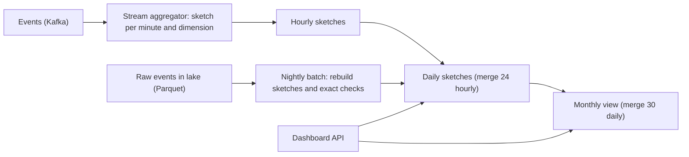

## 🎯 خلاصه

> یک داشبورد طراحی کن که **کاربران فعال روزانه (DAU)** و **کاربران فعال ماهانه (MAU)** را برای هر بُرش (کشور، پلتفرم، نسخه‌ی اپ) نشان دهد، روی میلیاردها رویداد در روز، با کوئری‌هایی که کمتر از یک ثانیه جواب بدهند.

- **شمارش یکتا** جمع‌پذیر نیست: کاربری که در سه ساعت فعال بوده یک کاربر است، نه سه تا. جمع یکتاهای ساعتی بیش از حد می‌شمارد.
- **HyperLogLog (HLL)** یک sketch حدود **۱۲ KB** است که شمارش یکتا را با خطای استاندارد حدود **۰٫۸٪** تخمین می‌زند، و sketchها **ادغام** می‌شوند (اجتماع یعنی بیشینه‌ی هر register).
- sketchها را ساعت → روز → ماه roll up کن، پس MAU ادغام ۳۰ sketch روزانه است، نه اسکن دوباره‌ی رویدادهای خام.
- شمارش دقیق را فقط جایی به کار ببر که پول یا قانون به آن وابسته است، و دو مسیر را به‌صورت دوره‌ای با هم تطبیق بده.

## 🌱 از ساده شروع کنیم (مبتدی)

> **💡 تشبیه:** لیست مهمان‌های یک کنفرانس. اگر «کسانی که وارد شدند» را روی هر در بشماری، کسی که از سه در رد شود سه بار شمرده می‌شود. برای شمارش افراد یکتا به یک دفترچه‌ی اسامی نیاز داری، و آن دفترچه با جمعیت بزرگ می‌شود. یک sketch مثل یک شمارنده‌ی هوشمند است که هرگز اسم‌ها را ذخیره نمی‌کند ولی جمع را تقریباً درست درمی‌آورد.

**صورت مسئله‌ای** که طراحی می‌کنیم:

> مدیران محصول داشبوردی باز می‌کنند که DAU و MAU را بر اساس کشور، پلتفرم و نسخه‌ی اپ نشان می‌دهد. داده حدود ۵ میلیارد رویداد در روز می‌رسد. اعداد باید در ۵ دقیقه تازه باشند و کوئری MAU برای ۳۰ روز حدود یک ثانیه جواب بدهد.

**چرا رویکردهای ساده شکست می‌خورند**

- `COUNT(DISTINCT user_id)` روی رویدادهای خام کار می‌کند، ولی برای هر کاشی داشبورد ۱۵۰ میلیون ردیف را اسکن و برای حذف تکرار shuffle می‌کند. هر کوئری گران است.
- جمع کردن شمارش‌های روزانه، **MAU اشتباه** می‌دهد: کاربری که ۱۰ روز فعال بوده ۱۰ بار شمرده می‌شود.
- نگه داشتن یک `set` پایتونی از همه‌ی user ID برای هر بُرش در مقیاس بزرگ در حافظه جا نمی‌شود.

**نیازمندی‌های عملکردی**

- DAU و MAU برای هر ترکیب بُرش، با پنجره‌ی ۳۰ روزه‌ی متحرک.
- سوال‌های نگه‌داری (retention) بعداً: «از کاربران این هفته، چند نفر هفته‌ی قبل هم فعال بودند»، به‌عنوان هدف اضافی.
- رویدادهای دیررس (تا ۲۴ ساعت دیرتر) در روز درست شمرده شوند.

**نیازمندی‌های غیرعملکردی**

- تازگی: ۵ دقیقه برای روز جاری.
- تأخیر کوئری: p95 کمتر از ۱ ثانیه برای هر کاشی.
- دقت: در حدود ۱٪ برای داشبوردهای محصول. اعداد با سطح مالی روزانه با شمارش دقیق batch تطبیق داده می‌شوند.

**تخمین (محاسبه را نشان بده)**

- رویدادها: ۵ میلیارد در روز، میانگین حدود ۵ × ۱۰⁹ / ۸۶٬۴۰۰ = **۵۸٬۰۰۰ رویداد در ثانیه**؛ پیک با ضریب ۳ حدود ۱۷۵٬۰۰۰ در ثانیه.
- DAU: ۵۰ میلیون. MAU: ۱۵۰ میلیون کاربر یکتا در ۳۰ روز.
- **مجموعه‌ی دقیق روزانه** برای هر بُرش: ۵۰ میلیون user ID × ۸ بایت = **۴۰۰ MB**. ساختار hash سربار اضافه می‌کند، پس حدود ۸۰۰ MB. برای MAU، اجتماع دقیق ۱۵۰ میلیون × ۸ B = **۱٫۲ GB** است، و هر ترکیب بُرش این را ضرب می‌کند.
- **sketch HLL**: حدود **۱۲ KB** برای هر sketch (۲^۱۴ register × ۶ بیت = ۱۲٬۲۸۸ بایت).
- ترکیب بُرش‌ها: ۲۰۰ کشور × ۳ پلتفرم × ۵۰ نسخه‌ی اپ = ۳۰٬۰۰۰ در روز. sketchهای روزانه: ۳۰٬۰۰۰ × ۱۲ KB = **۳۶۰ MB در روز**، حدود **۱۰٫۸ GB** برای ۳۰ روز.
- sketchهای ساعتی فقط برای بُرش کشور: ۲۰۰ × ۲۴ × ۱۲ KB = **۵۷٫۶ MB در روز**.
- خطا: خطای استاندارد برابر ۱٫۰۴ / √m است. با m = ۱۶٬۳۸۴ register، یعنی ۱٫۰۴ / ۱۲۸ ≈ **۰٫۸۱٪**. روی DAU ۵۰ میلیونی، یک انحراف معیار حدود ۵۰ M × ۰٫۰۰۸۱ ≈ **۴۰۵٬۰۰۰ کاربر** است.

> **⚠️ مراقب باش:** خطا نسبی است، پس ۰٫۸٪ از ۵۰ میلیون عدد مطلق بزرگی است. برای بُرش‌های کوچک (چند هزار کاربر) خطای نسبی در تئوری همان است، ولی پیاده‌سازی‌ها در کاردینالیتی کم به حالت دقیق یا sparse می‌روند. موتورت را بررسی کن.

## 🔧 واقعاً چطور کار می‌کند (متوسط)

**HyperLogLog در یک پاراگراف.** هر user ID را به یک مقدار ۶۴ بیتی hash کن. بیت‌های اول یکی از m register را انتخاب می‌کنند. با بیت‌های باقی‌مانده، صفرهای پشت‌سر‌هم از ابتدا را می‌شماری؛ دنباله‌ی طولانی صفر نادر است، پس دیدنش یعنی مقادیر یکتای زیاد. هر register بزرگ‌ترین دنباله‌ی دیده‌شده را نگه می‌دارد. میانگین هماهنگ register‌ها، با تصحیح، تخمین شمارش است. حافظه با m ثابت است، نه با تعداد کاربران.

دو ویژگی HLL را برای داشبورد مناسب می‌کند:

1. **اجتماع ارزان است.** ادغام دو sketch یعنی بیشینه‌ی هر register. ادغام ۳۰ sketch روزانه، MAU را می‌دهد.
2. **افزودن idempotent است.** اضافه کردن همان کاربر دو بار چیزی را تغییر نمی‌دهد. رویدادهای تکراری یا replay شده شمارش را بالا نمی‌برند.

**معماری.**



مسیر stream، sketchهای روز جاری را سریع به‌روز می‌کند. یک job شبانه همان sketchها را از Parquet خام بازسازی می‌کند، پس رویدادهای دیررس وارد می‌شوند و هر انحرافی در مسیر stream اصلاح می‌شود. داشبورد فقط sketchها را می‌خواند.

**پیاده‌سازی با ClickHouse.** ClickHouse حالت‌های aggregate را ذخیره می‌کند تا rollupها ترکیب شوند:

```sql
CREATE TABLE visitors_daily (
    day      Date,
    country  LowCardinality(String),
    platform LowCardinality(String),
    users    AggregateFunction(uniq, UInt64)
) ENGINE = AggregatingMergeTree
ORDER BY (day, country, platform);

-- بارگذاری: حالت sketch را ذخیره کن، نه عدد نهایی
INSERT INTO visitors_daily
SELECT toDate(ts), country, platform, uniqState(user_id)
FROM events
GROUP BY toDate(ts), country, platform;

-- MAU برای یک کشور: ادغام ۳۰ حالت روزانه
SELECT uniqMerge(users) AS mau
FROM visitors_daily
WHERE country = 'IR' AND day >= today() - 29;
```

`uniqState` یک مقدار میانی قابل ادغام تولید می‌کند؛ `uniqMerge` حالت‌های ادغام‌شده را به عدد تبدیل می‌کند. جدول حالت‌ها را نگه می‌دارد، پس `GROUP BY platform` روی جدول روزانه ارزان است. همین طراحی با ستون‌های distinct-count sketch در Druid یا Pinot هم کار می‌کند، و در Redis با `PFADD`، `PFCOUNT` و `PFMERGE` برای کلیدهای بلادرنگ (حدود ۱۲ KB برای هر کلید).

**سلسله‌مراتب rollup.** قاعده ساده است: **sketch** را roll up کن، نه شمارش نهایی را.

- ساعت → روز: ادغام ۲۴ sketch ساعتی برای هر بُرش.
- روز → ماه: ادغام ۳۰ sketch روزانه.
- کشور → منطقه: ادغام sketchهای کشور.

مقدار DAU همیشه شمارش یکتای sketch روز است، نه جمع شمارش‌های ساعتی.

**داده‌ی دیررس.** رویدادهایی که تا ۲۴ ساعت دیر رسیده‌اند sketch روز رویداد خودشان را به‌روز می‌کنند. اگر job مسیر stream قبلاً روز را منتشر کرده باشد، عدد بعد از انتشار تغییر می‌کند. به داشبورد یک نشانه‌ی «نهایی بعد از ۰۲:۰۰» بده و اجازه بده job شبانه sketch را بازنویسی کند.

## 🧠 عمق و trade-offها (سنیور)

**عملیات مجموعه‌ای به sketch دیگری نیاز دارد.** HLL اجتماع را خوب پشتیبانی می‌کند. اشتراک و تفاضل مستقیم کار نمی‌کنند: می‌توانی `|A ∩ B|` را با `|A| + |B| − |A ∪ B|` تخمین بزنی، ولی وقتی اشتراک نسبت به مجموعه‌ها کوچک است، خطای هر جمله بر نتیجه غالب می‌شود. برای نگه‌داری («کاربرانی که این هفته و هفته‌ی قبل فعال بودند») از **Theta sketch** (از Apache DataSketches) استفاده کن که اشتراک و تفاضل را با خطای محدود پشتیبانی می‌کند، یا برای کوهورتی که مهم است یک bitmap دقیق نگه دار. این trade-off را پیش از آنکه مصاحبه‌گر بپرسد اسم ببر.

**دقیق در برابر تقریبی یک تصمیم محصول است.**

| سوال | روش | چرا |
|---|---|---|
| DAU و MAU داشبورد محصول | sketch HLL | خطای ۰٫۸٪ در سطح تصمیم دیده نمی‌شود؛ سریع و ارزان |
| نگه‌داری، هم‌پوشانی کوهورت | Theta sketch یا bitmap | عملیات مجموعه‌ای به sketchی نیاز دارد که پشتیبانی‌اش کند |
| صورتحساب، سهم‌ها، گزارش‌های قانونی | شمارش دقیق batch، حسابرسی‌شده | پول و قانون اعداد دقیق و قابل بازتولید می‌خواهند |
| بُرش کوچک و دقیق (چند هزار) | مجموعه‌ی دقیق یا bitmap | در اندازه‌ی کوچک ارزان است؛ خطا را کاملاً حذف می‌کند |

شمارش یکتای دقیق در این مقیاس یک shuffle گران است: ۵ میلیارد ردیف که روی `user_id` هش می‌شوند تا ۵۰ میلیون کلید یکتا بسازند. آن را به‌صورت job شبانه برای اعداد حسابرسی اجرا کن، نه در مسیر داشبورد.

**شناسه‌های متراکم و bitmap.** اگر user ID ها عدد ۳۲ بیتی متراکم باشند، یک Roaring bitmap برای یک بُرش، جایگزین دقیق و اغلب فشرده‌ای برای HLL است. اندازه‌اش با تعداد اعضا رشد می‌کند، نه با ۱۲ KB ثابت، پس برای بُرش‌های کوچک و متوسط خوب است و برای مجموعه‌های بزرگ و پراکنده نه. اندازه را روی توزیع واقعی ID هایت اندازه بگیر.

**اندازه‌ی sketch و انفجار بُرش‌ها.** هزینه تعداد sketchهاست، نه تعداد رویدادها. ۳۰٬۰۰۰ ترکیب با ۱۲ KB یعنی ۳۶۰ MB در روز؛ اگر یک بُرش با ۱٬۰۰۰ مقدار اضافه کنی، می‌شود ۱۲ GB در روز. ضرب دکارتی را کوچک نگه دار: ترکیب‌های رایج را sketch کن و ترکیب‌های نادر را از یک rollup درشت‌تر پاسخ بده. نمایش‌های sparse در HLL برای ترکیب‌هایی با کاربر کم حافظه را ذخیره می‌کنند، و بیشتر ترکیب‌ها همین‌طورند.

**هش کردن و هویت.** کیفیت HLL به یک hash خوب ۶۴ بیتی از ID بستگی دارد. ID کوتاه یا ترتیبی را بدون هش کردن نده، وگرنه آماره‌های register بایاس پیدا می‌کنند. حل هویت (ادغام device IDها در یک کاربر) یک دغدغه‌ی upstream است. sketch هر ID ای را که بدهی می‌شمارد، پس گراف هویت خراب یک عدد دقیق و غلط تولید می‌کند.

**منطقه‌ی زمانی و «روز».** «روز» با منطقه‌ی زمانی‌ای تعریف می‌شود که در قرارداد متریک انتخاب شده (برای pipelineها معمولاً UTC). `event_time` را به UTC ذخیره کن و فقط در لایه‌ی نمایش به منطقه‌ی گزارش تبدیل کن، وگرنه داشبوردهای مختلف با هم نمی‌خوانند.

**حالت‌های خرابی.**

- job مسیر stream ری‌استارت می‌شود و یک بازه را replay می‌کند: امن است، چون افزودن HLL idempotent است.
- sketch با مقدار بُرش اشتباه نوشته می‌شود (مثلاً کشور `NULL`): شمارش زیر کاشی «نامشخص» ظاهر می‌شود. سهم «نامشخص» را پایش کن.
- ادغام sketchهایی با دقت متفاوت (m متفاوت) خطا می‌دهد یا نتیجه‌ی غلط. دقت را در یک جا ثابت و نسخه‌بندی کن.
- بازسازی batch و مسیر stream بیشتر از خطای مورد انتظار با هم فرق دارند. این یعنی باگ در یکی از آن‌هاست، پس روی این شکاف هشدار بگذار.

**کی این را نسازی.** اگر شرکت چند میلیون رویداد در روز دارد و یک warehouse، `COUNT(DISTINCT)` روی پارتیشن روزانه کافی است. sketchها وقتی مهم می‌شوند که تعداد بُرش‌ها، حجم رویداد و نیاز تازگی با هم جمع شوند.

**سیگنال‌های عملیاتی:** تازگی روز جاری، شکاف بین عددهای stream و batch برای هر بُرش، سهم مقادیر «نامشخص»، اندازه‌ی sketch store در روز، و تأخیر کوئری کاشی ۳۰ روزه.

## 🧪 امتحان کن

این ورودی‌ها را استفاده کن: ۲ میلیارد رویداد در روز، ۲۰ میلیون DAU، ۶۰ میلیون MAU در ۳۰ روز، ۱۰۰ کشور، ۲ پلتفرم، ۴۰ نسخه‌ی اپ و sketchهای روزانه‌ی ۱۲ KB.

1. میانگین رویداد در ثانیه چقدر است؟
2. sketchهای روزانه برای همه‌ی ترکیب‌های بُرش چقدرند و روزانه چند مگابایت می‌شوند؟
3. همکارت می‌گوید: «MAU جمع ۳۰ مقدار آخر DAU است.» دلیل غلط بودنش را بگو و بگو به‌جایش چه ذخیره می‌کنی.

<details><summary>راه‌حل‌ها</summary>

**1.** ۲ × ۱۰⁹ / ۸۶٬۴۰۰ ≈ **۲۳٬۱۵۰ رویداد در ثانیه** به‌طور میانگین.

**2.** ترکیب‌ها: ۱۰۰ × ۲ × ۴۰ = ۸٬۰۰۰. اندازه‌ی sketch: ۸٬۰۰۰ × ۱۲ KB = ۹۶٬۰۰۰ KB ≈ **۹۶ MB در روز** (حدود ۹۴ MiB).

**3.** کاربری که در ۱۰ روز از ۳۰ روز فعال بوده، در جمع مقادیر DAU ده بار شمرده می‌شود. جمع، MAU را بیش از حد نشان می‌دهد، اغلب با فاصله‌ی زیاد، چون بیشتر کاربران در چند روز فعال‌اند. یک sketch روزانه برای هر بُرش ذخیره کن و ۳۰ sketch را ادغام کن (در HLL یعنی بیشینه‌ی هر register) تا شمارش یکتا را بگیری. جمع شمارش‌های یکتای روزانه، شمارش یکتای آن دوره نیست.

</details>

## 💬 گوشه‌ی مصاحبه

**شکل سوال:** «یک داشبورد طراحی کن که DAU و MAU را در مقیاس بزرگ نشان دهد.» انتظار follow-up درباره‌ی دقت، rollup و نگه‌داری داشته باش.

**پاسخ سطح متوسط:** «شمارش‌های یکتای روزانه را برای هر بُرش از قبل حساب می‌کنم تا داشبورد اسکن خام نکند. برای MAU از sketchهای HyperLogLog استفاده می‌کنم تا اجتماع ۳۰ روز ادغام باشد و شمارش مجدد نباشد. جمع شمارش‌های روزانه را انجام نمی‌دهم چون کاربران را دوبار می‌شمارد.»

**پاسخ سطح سنیور:** «sketchهای HLL حدود ۱۲ KB برای هر بُرش در روز نگه می‌دارم که خطای ۰٫۸٪ می‌دهد. jobهای stream روز جاری را در چند دقیقه به‌روز می‌کنند و یک batch شبانه sketchها را از Parquet خام بازسازی می‌کند تا داده‌ی دیررس جذب شود و انحرافات اصلاح شوند. sketchها را ساعت به روز و ماه roll up می‌کنم. برای نگه‌داری به Theta sketch می‌روم چون اشتراک با HLL پایدار نیست، و برای صورتحساب یک شمارش دقیق و حسابرسی‌شده دارم و دو مسیر را تطبیق می‌دهم.»

> **🎤 این را در مصاحبه بگو:** «شمارش‌های یکتا جمع‌پذیر نیستند، پس sketchهای قابل ادغام را roll up می‌کنم، نه عددها را. HLL یک جواب با اندازه‌ی ثابت، idempotent و قابل ادغام می‌دهد که برای تصمیم محصول دقیق کافی است، و هرجا پول به آن وابسته است آن را با یک مسیر batch دقیق تطبیق می‌دهم.»

**سیگنال‌های سطح Staff:** قرارداد متریک (تعریف «فعال»، منطقه‌ی زمانی، زمان قطع داده‌ی دیررس)؛ هزینه‌ی هر ترکیب بُرش؛ حاکمیت روی کاشی «نامشخص»؛ تصمیم درباره‌ی اینکه کدام بُرش‌ها در cube sketch مجازند؛ و برنامه‌ای برای گراف هویتی که شمارش‌ها را تغذیه می‌کند.

**follow-upهای محتمل.** *چرا همه‌چیز را در Redis نگه نداریم؟* برای کلیدهای بلادرنگ خوب است، ولی دوام، حافظه‌ی هر بُرش و کوئری‌های بین‌بُرشی یک store ستونی با ستون‌های sketch را ترجیح می‌دهند. *فاصله‌ی اطمینان ۹۵٪ را چطور نشان می‌دهی؟* تقریباً دو خطای استاندارد: ۱٫۹۶ × ۰٫۸۱٪ ≈ ۱٫۶٪. *کاربران خارج‌شده از سیستم ID ندارند چه؟* این یک مسئله‌ی تعریف محصول است؛ آن را در قرارداد متریک تصمیم بگیر، نه در sketch.

## ⚠️ اشتباهات رایج

> **⚠️ مراقب باش:** جمع کردن یکتاهای روزانه یا ساعتی برای رسیدن به MAU یا DAU. شمارش‌های یکتا در طول زمان جمع‌پذیر نیستند.

> **⚠️ مراقب باش:** استفاده از HLL برای اشتراک و نگه‌داری بدون بررسی خطا. تفاضل دو تخمین بزرگ می‌تواند اشتراک کوچک را در نویز غرق کند.

- اجرای `COUNT(DISTINCT user_id)` روی رویدادهای خام برای هر کاشی داشبورد، و بعد تعجب از هزینه‌ی بالا.
- ذخیره‌ی عدد نهایی در جدول rollup. وقتی عدد ذخیره شد، دیگر نمی‌توانی ادغامش کنی و نمی‌توانی roll up اش کنی.
- مخلوط کردن sketchهای با دقت متفاوت در یک ستون.
- فراموش کردن اینکه داده‌ی دیررس عدد دیروز را عوض می‌کند و به کاربر نگفتن که عدد کی نهایی می‌شود.
- ذکر نتیجه‌ی HLL بدون خطایش، یا رفتار با خطای ۰٫۸٪ مثل مقدار دقیق در گزارش مالی.
- استفاده از ID کوتاه یا ترتیبی به‌عنوان ورودی sketch بدون هش کردن.

## ✅ خودت را بسنج

۱. کاربری در ۴ روز از ۷ روز گذشته فعال بوده. سهم او در MAU ۷ روزه چقدر است؟
   - A) ۴
   - B) ۷
   - C) ۱
   - D) ۰٫۵

<details><summary>پاسخ</summary>

**C** — MAU شمارش کاربران یکتاست. این کاربر هر چند روز فعال باشد، یک بار شمرده می‌شود. جمع شمارش‌های روزانه برای او ۴ می‌دهد، و به همین دلیل جمع‌زدن غلط است.

</details>

۲. چرا HyperLogLog برای اجتماع ۳۰ sketch روزانه مناسب است؟

   - A) همه‌ی user ID ها را ذخیره می‌کند، پس اجتماع دقیق است
   - B) هر register بیشینه نگه می‌دارد، پس ادغام بیشینه‌ی هر register است و نتیجه sketch اجتماع است
   - C) فقط جمع hashها را ذخیره می‌کند
   - D) از یک index خاص استفاده می‌کند که کاربران را مرتب می‌کند

<details><summary>پاسخ</summary>

**B** — اجتماع دو sketch HLL با گرفتن بیشینه‌ی هر register به دست می‌آید. sketch ادغام‌شده همان sketchی است که از همه‌ی رویدادها با هم ساخته شده باشد.

</details>

۳. با m = ۱۶٬۳۸۴ register، خطای استاندارد چقدر است و بازه‌ی یک‌سیگما برای DAU چهل میلیونی چیست؟

   - A) حدود ۰٫۸٪، یعنی حدود ±۳۲۵٬۰۰۰
   - B) حدود ۸٪، یعنی حدود ±۳٫۲ میلیون
   - C) حدود ۰٫۰۸٪، یعنی حدود ±۳۲٬۰۰۰
   - D) دقیقاً صفر، چون sketchها دقیق‌اند

<details><summary>پاسخ</summary>

**A** — ۱٫۰۴ / √۱۶٬۳۸۴ = ۱٫۰۴ / ۱۲۸ ≈ ۰٫۸۱٪. ۴۰ میلیون × ۰٫۰۰۸۱ ≈ ۳۲۵٬۰۰۰. sketchها تقریبی‌اند، هرگز دقیق نیستند.

</details>

۴. **(سنیور)** محصول می‌خواهد «کاربرانی که این هفته و هفته‌ی قبل هر دو فعال بودند» را از همان sketchها بگیرد. مشکل چیست و چه چیزی استفاده می‌کنی؟

   - A) هیچ؛ اشتراک HLL دقیق است
   - B) اشتراک از راه inclusion-exclusion خطا را وقتی هم‌پوشانی کم است تقویت می‌کند؛ از Theta sketch یا bitmap دقیق برای کوهورت استفاده کن
   - C) برای دقیق شدن اشتراک، m را بزرگ‌تر کن
   - D) میانگین روزانه را ذخیره کن

<details><summary>پاسخ</summary>

**B** — `|A ∩ B| = |A| + |B| − |A ∪ B|` تخمین‌های بزرگ را از هم کم می‌کند، پس خطای هر جمله می‌تواند اشتراک کوچک را غالب کند. Theta sketch اشتراک و تفاضل را مستقیم پشتیبانی می‌کند و bitmap دقیق وقتی مجموعه جا شود کار می‌کند.

</details>

۵. **(سنیور)** یک job مسیر stream بعد از کرش یک پنجره‌ی ۳ ساعته را دوباره اجرا می‌کند. کدام ویژگی HLL این کار را امن می‌کند و چه چیزی هنوز باید بررسی شود؟

   - A) HLL دقیق است، پس replay چیزی را تغییر نمی‌دهد
   - B) افزودن همان کاربر دوباره registerها را عوض نمی‌کند، پس تکراری‌ها بی‌ضررند؛ هنوز باید بررسی کنی که پنجره‌ی replay شده رویدادی را گم یا به روز اشتباه نسبت نداده باشد
   - C) HLL کاربران قدیمی را در replay حذف می‌کند
   - D) replay هرگز با sketch امن نیست

<details><summary>پاسخ</summary>

**B** — افزودن idempotent است، پس رویدادهای تکراری شمارش را بالا نمی‌برند. ریسک باقی‌مانده گم شدن یا نسبت دادن اشتباه رویدادهاست (مثلاً به روز دیگر)، که تطبیق با مسیر batch آن را می‌گیرد.

</details>

## 🗂️ فلش‌کارت

| Front | Back |
|---|---|
| چرا نمی‌توان یکتاهای روزانه را برای MAU جمع زد؟ | کاربری که در چند روز فعال است چند بار شمرده می‌شود؛ شمارش یکتا جمع‌پذیر نیست |
| اندازه و خطای یک sketch HLL چقدر است؟ | حدود ۱۲ KB با ۲^۱۴ register؛ خطای استاندارد حدود ۰٫۸۱٪ |
| دو sketch HLL چطور ادغام می‌شوند؟ | بیشینه‌ی هر register؛ نتیجه sketch اجتماع است |
| چرا افزودن HLL idempotent است؟ | افزودن دوباره‌ی همان کاربر همان مقدار register را می‌نویسد، پس replay شمارش را بالا نمی‌برد |
| کدام sketch اشتراک را خوب پشتیبانی می‌کند؟ | Theta sketch (از Apache DataSketches)؛ اشتراک HLL خطا را تقویت می‌کند |
| sketch را roll up کنیم یا عدد را؟ | sketch؛ عدد نهایی ذخیره‌شده بعداً قابل ادغام نیست |
| شمارش دقیق کی لازم است؟ | پول، سهم‌ها، گزارش‌های قانونی؛ شمارش batch حسابرسی‌شده و تطبیق |
| چرا زمان رویداد را UTC ذخیره کنیم؟ | تا همه‌ی داشبوردها مرز روز را یکسان ببینند؛ تبدیل فقط در نمایش |

## 🔗 ادامه

- **probabilistic-ds** HyperLogLog، فیلتر Bloom و sketchهای دیگر را از پایه توضیح می‌دهد؛ قبل از deep dive بخوانش.
- **data-estimation** عادت‌های اندازه‌گیری بخش تخمین را می‌دهد.
- **design-top-k** و **design-clickstream-analytics** از الگوهای تجمیع stream مشابه استفاده می‌کنند.
- **pattern-realtime-aggregation** و **realtime-olap** مسیر stream و store سرویس‌دهی روز جاری را پوشش می‌دهند.
- **design-metrics-monitoring** جای دیگری را نشان می‌دهد که rollupها باید درست ترکیب شوند.
- توابع distinct-count و پارامترهای دقت را در مستندات موتورت بررسی کن، چون پیش‌فرض‌ها و نوع sketchها بین نسخه‌ها فرق می‌کنند.
