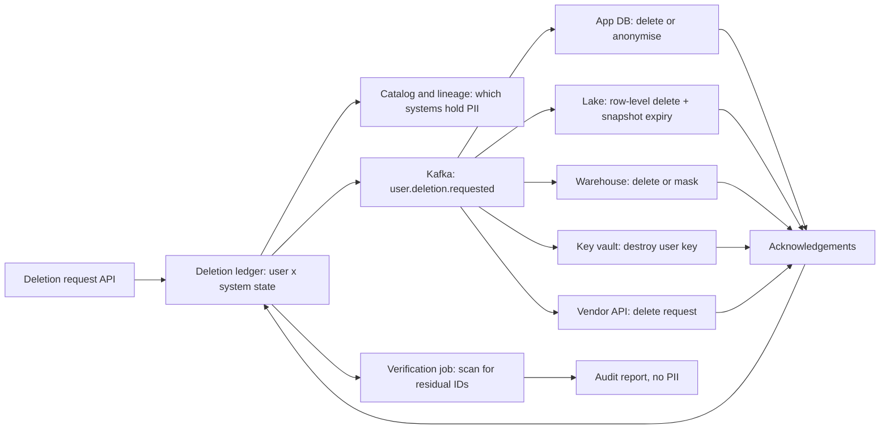

## 🎯 خلاصه

> «این کاربر را پاک کن» یک دستور `DELETE` نیست. این یک **workflow توزیع‌شده و قابل ممیزی** است که هر کپی از داده‌های یک شخص را پیدا می‌کند، آن را در هر سیستم حذف یا غیرقابل‌خواندن می‌کند (از جمله سیستم‌هایی که نمی‌توانی ویرایششان کنی، مثل log ها و backupها)، و **ثابت می‌کند** که این کار در مهلت قانونی انجام شده.

- از **lineage** شروع کن، نه از حافظه: catalog می‌گوید کدام datasetها داده شخصی دارند، و column-level lineage نشان می‌دهد این داده کجا جریان پیدا می‌کند.
- از یک **deletion ledger** با یک وضعیت برای هر کاربر در هر سیستم استفاده کن. هم trail ممیزی است و هم موتور retry.
- store های قابل تغییر حذف واقعی می‌گیرند. store های **تغییرناپذیر** (log های Kafka، snapshotهای lake، backupها) به **crypto-shredding** نیاز دارند (کلید را حذف کن، نه داده را) یا یک انقضای مستند.
- داده‌های مشتق‌شده (تجمیع‌ها، مدل‌های ML) یک سیاست صریح لازم دارند، و باید بگویی با آن‌ها چه می‌کنی.

## 🌱 از ساده شروع کنیم (مبتدی)

**صورت مسئله.** یک قانون حریم خصوصی به سبک GDPR به کاربر حق **پاک‌سازی (right to erasure)** می‌دهد: وقتی درخواست کند، شرکت باید داده‌های شخصی‌اش را در یک مهلت مشخص حذف کند و بتواند نشان بدهد که این کار را کرده. سیستمی طراحی کن که این درخواست‌ها را در دیتابیس اپلیکیشن، انبار تحلیلی، data lake، stream های رویداد، cache ها، backupها و فروشنده‌های شخص ثالث اجرا کند.

> **💡 تشبیه:** هتلی که یک مهمان را تسویه می‌کند. میز پذیرش کلید اتاق را دارد، رستوران حساب باز دارد، لباسشویی کیسه‌ای با نام مهمان دارد، سیستم ایمیل یک رشته پیام دارد، و در آرشیو یک آلبوم عکس او هست. تسویه‌ای که فقط کلید اتاق را پس می‌گیرد، بقیه را جا می‌گذارد. فهرست «همهٔ جاهایی که این مهمان رفته» باید از یک نقشه بیاید، نه از حافظه.

**نیازمندی‌های کاربردی**

- پذیرفتن درخواست حذف از یک کاربر تأییدشده.
- پیدا کردن همهٔ داده‌های شخصی آن کاربر، حذف یا ناشناس‌سازی آن در هر سیستم، و اطلاع به شخص ثالث.
- نگه‌داشتن یک رکورد ممیزی از اینکه چه کاری انجام شد و چه چیزی انجام نشد و چرا.
- رعایت استثناهای قانونی، مثل فاکتورهایی که به‌خاطر مالیات باید برای مدت مشخصی بمانند.

**نیازمندی‌های غیرکاربردی**

- مهلت: GDPR یک ماه فرصت پاسخ می‌دهد که در موارد پیچیده قابل تمدید است. یک هدف داخلی خیلی زودتر از آن بگذار (مثلاً ۷۲ ساعت برای همهٔ سیستم‌های داخلی).
- کامل بودن: یک سیستم فراموش‌شده یعنی شکست در انطباق.
- ایمنی: درخواست‌ها با یک شناسهٔ کاربر تأییدشده کلید می‌خورند، نه با متن آزاد مثل ایمیلی که کاربر در یک فرم تایپ کرده.

**برآورد (محاسبه را نشان بده)**

- کاربران: ۲۰ میلیون. فرض کن ۰٫۱٪ در ماه درخواست حذف می‌دهند → ۲۰,۰۰۰,۰۰۰ × ۰٫۰۰۱ = **۲۰,۰۰۰ درخواست در ماه ≈ ۶۷۰ در روز**.
- سیستم‌ها برای هر کاربر: حدود ۴۰ store و جدول داده‌های شخصی دارند، از جمله log ها و کپی‌های شخص ثالث.
- جدول بزرگ: یک جدول رویداد کاربر با ۵۰ میلیارد ردیف در حدود ۴۰۰,۰۰۰ فایل Parquet ۵۱۲ مگابایتی (حدود ۲۰۰ ترابایت). ردیف‌های یک کاربر در حدود ۳۰۰ فایل پخش‌اند (رویدادهایش در سال‌ها رخ داده، و نوشتن بر اساس کاربر مرتب نیست).
- حذف copy-on-write ساده: هر درخواست ۳۰۰ فایل × ۵۱۲ MB = ۱۵۳٫۶ گیگابایت بازنویسی می‌کند. برای ۶۷۰ درخواست در روز: ۶۷۰ × ۱۵۳٫۶ GB ≈ **۱۰۳ ترابایت بازنویسی در روز**. این شدنی نیست.
- دسته‌ای کردن کمک کمی می‌کند: ۶۷۰ کاربر × ۳۰۰ فایل = ۲۰۱,۰۰۰ دسترسی به فایل روی ۴۰۰,۰۰۰ فایل، پس حدود ۴۰٪ جدول هنوز در یک گذر بازنویسی می‌شود.

محاسبه «هر فایل را بازنویسی کن» را رد می‌کند. store های قابل تغییر حذف ردیفی و compaction می‌گیرند؛ store های تغییرناپذیر crypto-shredding. این تقسیم هستهٔ طراحی است.

## 🔧 واقعاً چطور کار می‌کند (متوسط)

**معماری**

**deletion ledger.** یک ردیف برای هر کاربر و هر سیستم:

| user_id (pseudonymous) | system | state | attempts | last_error | updated_at |
|---|---|---|---|---|---|
| u_8f2a | app_db | done | 1 | - | 2026-10-13 09:10 |
| u_8f2a | lake.events | in_progress | 2 | timeout on snapshot commit | 2026-10-13 09:40 |
| u_8f2a | vendor_crm | requested | 0 | - | 2026-10-13 09:00 |

ledger یک state machine است (`requested → in_progress → done → verified`، و `failed` بعد از retry دوباره به `in_progress` برمی‌گردد). با یک query می‌توانی بپرسی «کاربر X تمام شده؟»، و هر گام idempotent می‌شود: retry قبل از عمل وضعیت را چک می‌کند.

**پیدا کردن داده.** فهرست جدول‌ها را داخل کد ثابت نکن. ستون‌ها را در catalog به‌عنوان داده شخصی تگ کن (مثلاً `pii=direct` برای ایمیل و `pii=indirect` برای IP یا شناسهٔ دستگاه). column-level lineage نشان می‌دهد کدام جدول‌های پایین‌دستی از این ستون‌ها مشتق شده‌اند، از جمله تجمیع‌هایی که هنوز شناسهٔ کاربر دارند. این را در زمان درخواست اجرا کن و نتیجه را در ledger ذخیره کن، تا فهرست حتی اگر بعداً catalog عوض شد ثبت بماند. ببین [[data-lineage]] و [[data-catalogs]].

**store های قابل تغییر: حذف واقعی.**

- دیتابیس اپلیکیشن: `DELETE` یا ناشناس‌سازی (نام و ایمیل را با placeholder عوض کن و ردیف را برای یکپارچگی ارجاع‌ها نگه دار). وقتی جدول‌های دیگر به کلید خارجی نیاز دارند، مثل سفارش‌هایی که برای مالیات لازم‌اند، ناشناس‌سازی کن.
- انبار و lake در فرمت‌های جدول باز: حذف ردیفی. در Iceberg یک `DELETE` فایل‌های delete از نوع position یا equality می‌نویسد که ردیف‌ها را هنگام خواندن پنهان می‌کنند. در Delta همین ایده با deletion vector یا بازنویسی (syntax و رفتار را برای نسخهٔ خودت در مستندات چک کن).

حذف ردیفی تمام ماجرا نیست. snapshotهای قدیمی هنوز ردیف‌ها را دارند، و دقیقاً همین را [[time-travel]] می‌دهد. با انقضای snapshot و پاک‌سازی فایل‌های یتیم تمام کن، مثلاً procedureهای expire-snapshots و remove-orphan-files در Iceberg، یا `VACUUM` در Delta با یک بازهٔ نگه‌داشت. تا وقتی این‌ها اجرا نشوند، داده از نظر منطقی حذف شده ولی از نظر فیزیکی هنوز هست. این فاصله را در ledger ثبت کن.

**store های تغییرناپذیر.**

- **Kafka**: یک log رکوردها را تا پایان retention نگه می‌دارد. برای یک topic فشرده‌شده با کلید شناسهٔ کاربر، یک tombstone (رکورد با کلید و مقدار null) مقادیر قدیمی‌تر را بعد از اجرای compaction حذف می‌کند. compaction فوری نیست: segment فعال و هر segmentی که هنوز compact نشده داده را دارد ([[log-compaction]]، [[tombstone]]). برای topic غیرفشرده، نمی‌توانی رکوردهای یک کاربر را حذف کنی. پنجرهٔ retention را به‌عنوان حداکثر تأخیر برنامه‌ریزی کن.
- **snapshotهای lake و backupها**: snapshotها را منقضی کن و backupها را طبق یک زمان‌بندی مستند از بین ببر. پاسخ صادقانه این است: «پس از N روز از نظر فیزیکی حذف می‌شود»، با N نوشته‌شده در سیاست.
- **crypto-shredding** راه کلی حل است. داده‌های شخصی هر کاربر را با یک کلید داده مختص آن کاربر رمزگذاری کن که در key vault است. داده در log ها، Kafka، lake و backup رمز است. کلید کاربر را نابود کن، و هر کپی غیرقابل‌خواندن می‌شود، حتی کپی‌هایی که خودت نمی‌توانی لمسشان کنی. فیلدهای غیرشخصی ساده می‌مانند. هزینه مدیریت کلید است و اینکه رمزگذاری باید قبل از نوشتن انجام شود، نه بعدش.

**داده‌های مشتق‌شده و مدل‌ها.** تجمیع‌های بدون شناسهٔ کاربر معمولاً مشکلی ندارند. تجمیع‌هایی که با شناسهٔ کاربر کلید خورده‌اند داده شخصی‌اند و وارد workflow می‌شوند. برای مدل‌های ML که با داده‌های یک کاربر آموزش دیده‌اند، سیاست (مثلاً «طبق زمان‌بندی عادی بازآموزی می‌شود و مستند است») یک تصمیم حقوقی و محصولی است. آن را بنویس.

**شخص ثالث.** درخواست را از API فروشنده بفرست، شناسهٔ مرجع فروشنده را در ledger ذخیره کن، و وقتی تأیید در مهلت SLA فروشنده نرسید، تشدید کن.

**تأیید.** حذف بدون تأیید یک ادعاست. یک job تأیید همهٔ سیستم‌های فهرست‌شده در ledger را برای شناسهٔ کاربر یا هر کلید pseudonymous که به آن برمی‌گردد اسکن می‌کند و تعداد را ثبت می‌کند. صفر ردیف باقی‌مانده (یا فقط کلیدهایی که shred شده‌اند) یعنی تأییدشده. نتیجهٔ تأیید را ذخیره کن، نه داده‌ای که پیدا کرده.

**مدیریت خطا.** هر گام idempotent است و با backoff دوباره تلاش می‌شود. خطاهای دائمی به یک مسیر dead-letter می‌روند ([[dead-letter-queue]]) با یک مالک. یک گزارش روزانه درخواست‌هایی که به مهلتشان نزدیک‌اند را فهرست می‌کند.

## 🧠 عمق و trade-offها (سنیور)

**deep dive ۱: حذف مبتنی بر lineage.**

- catalog به اندازهٔ تگ‌گذاری‌اش خوب است. تگ داده شخصی را بخشی از اجرای [[data-contract]] کن: یک جدول جدید با ستون شخصی بدون تگ نباید merge شود. بدون این، سیستم روزی که ساخته شد کامل است و ماه بعد ناقص.
- lineage نقاط کور دارد (ابزارهای بیرونی، UDFها، کپی‌های ساخته‌شده خارج از pipeline). یک اسکن دوره‌ای برای شناسهٔ کاربر در جاهای غیرمنتظره، مثل فیلدهای متنی آزاد و blobهای JSON، به‌عنوان شبکهٔ ایمنی اضافه کن و هر مورد پیداشده را یک باگ بدان.
- **لیست حل‌شده** را در زمان درخواست در ledger نگه دار. اگر lineage بعداً عوض شود، هنوز می‌دانی چه قولی برای حذف داده‌ای.

**deep dive ۲: store های تغییرناپذیر و مشترک.**

- برای هر store تصمیم یکی از این‌هاست: حذف فیزیکی، crypto-shredding، یا انقضا با حداکثر سن مستند. این جدول را در سیاست بنویس. از یک «ما همه‌چیز را حذف می‌کنیم» مبهم قابل دفاع‌تر است.
- replicaها، cacheها و ایندکس‌های جست‌وجو هم حساب می‌شوند. TTL فقط وقتی جواب قابل قبول است که کوتاه و مستند باشد.

**deep dive ۳: هزینهٔ حذف فیزیکی در مقیاس.**

- برآورد ۱۰۳ ترابایت در روز دلیل حذف با merge-on-read به‌همراه compaction زمان‌بندی‌شده است. فایل‌های delete زیاد خواندن را کند می‌کنند، پس زمان‌بندی compaction خودش یک SLO است.
- مرتب کردن جدول‌های بزرگ بر اساس یک bucket از شناسهٔ کاربر، ردیف‌های یک کاربر را در فایل‌های کمتری قرار می‌دهد و هزینهٔ بازنویسی را به‌شدت کم می‌کند. trade-off این است که کوئری‌های بازهٔ زمانی را کند می‌کند، پس هر دو را اندازه بگیر.

**deep dive ۴: درستی در همزمانی.** یک درخواست ممکن است وقتی یک job دسته‌ای رویدادهای جدید همان کاربر را می‌نویسد برسد. یک sweep نهایی بعد از batch اجرا کن تا رویدادهای نوشته‌شده در حین اجرا را هم بگیرد. کاربری که دوباره ثبت‌نام می‌کند یک شناسهٔ pseudonymous جدید می‌گیرد؛ داده‌های حذف‌شده را هرگز به حساب جدید برنگردان. اگر store ای خاموش است، ردیفش را در وضعیت retry نگه دار؛ هرگز آن را done علامت نزن تا درخواست را ببندی.

**انتظار سطح Staff.** کاندیداهای Staff معمولاً:

- قبل از هر جدولی با **lineage و ledger** شروع می‌کنند، و کامل بودن را قابل اندازه‌گیری می‌کنند (تعداد سیستم‌هایی که وضعیت `verified` دارند از کل سیستم‌های فهرست‌شده).
- استراتژی هر store را با عدد انتخاب می‌کنند: هزینهٔ بازنویسی، هزینهٔ خواندن، سن انقضا.
- crypto-shredding را به‌عنوان پاسخ کلی برای داده‌های تغییرناپذیر مطرح می‌کنند و ریسک‌هایش را می‌گویند: از دست رفتن key vault یعنی از دست رفتن همه‌چیز، و نابودی کلید باید ممیزی شود.
- برای فهرست استثناها و سیاست مدل، مالکان حقوقی و محصولی را درگیر می‌کنند.

**کی این را در مقیاس کامل نسازیم.** چند هزار کاربر در یک دیتابیس می‌تواند با یک checklist، یک script و یک query تأیید کار کند. workflow وقتی ارزش دارد که تعداد سیستم‌ها و درخواست‌ها، گام‌های دستی را غیرقابل‌اعتماد کنند.

## 🧪 امتحان کن

1. **برآورد.** شرکت به ۱۰۰ میلیون کاربر می‌رسد و نرخ درخواست حذف همان ۰٫۱٪ در ماه می‌ماند. الان چند درخواست در روز است؟ اگر هر درخواست ۳۰۰ بازنویسی فایل ۵۱۲ MB لازم داشته باشد، بدون حذف ردیفی چند ترابایت در روز می‌شود؟
2. **انتخاب store.** برای هر store استراتژی را انتخاب کن (حذف فیزیکی، ناشناس‌سازی، crypto-shred، انقضا): جدول orders در Postgres، topic کافکای `page_views` (فشرده‌نشده)، جدول events در Iceberg، backup شبانهٔ دیتابیس، و cache سشن Redis.
3. **استدلال Kafka.** یک topic فشرده‌شده با کلید شناسهٔ کاربر در ساعت ۱۰:۰۰ یک tombstone دریافت می‌کند. آیا داده‌های کاربر ساعت ۱۰:۰۰ رفته‌اند؟ به ممیز چه می‌گویی؟

جواب‌ها را ببین

**۱.** ۱۰۰,۰۰۰,۰۰۰ × ۰٫۰۰۱ = ۱۰۰,۰۰۰ در ماه، یعنی حدود ۳,۳۳۳ در روز (۱۰۰,۰۰۰ / ۳۰). بدون حذف ردیفی: ۳,۳۳۳ × ۱۵۳٫۶ GB ≈ **۵۱۲ ترابایت در روز** بازنویسی. عدد بزرگ‌تر دلیل حذف با merge-on-read به‌همراه compaction را محکم می‌کند.

**۲.** orders در Postgres: فیلدهای شخصی را ناشناس کن و ردیف را برای مالیات و یکپارچگی ارجاع‌ها نگه دار. topic کافکای `page_views` (فشرده‌نشده): نمی‌توان رکوردهای یک کاربر را حذف کرد؛ اگر فیلدهای شخصی هنگام نوشتن رمز شده‌اند، crypto-shredding، وگرنه انقضای مبتنی بر retention با حداکثر سن مستند. جدول events در Iceberg: حذف ردیفی، سپس انقضای snapshot و پاک‌سازی فایل‌های یتیم. backup شبانه: crypto-shredding فیلدهای شخصی (اگر رمز شده‌اند) یا انقضا طبق زمان‌بندی retention بک‌آپ، با حداکثر سن در سیاست. cache سشن Redis: کلیدهای کاربر را حذف کن، و TTL کوتاه را پشتوانه بگذار.

**۳.** نه. tombstone یک نشانگر است. مقادیر قدیمی‌تر تا compact شدن segment در log می‌مانند، و کپی‌ها در consumerهای دیگر، replicaها و backupها تا پایان retention خودشان می‌مانند. جواب صادقانه برای ممیز: «tombstone در ساعت ۱۰:۰۰ نوشته شد و داده بعد از compaction و retention از نظر فیزیکی حذف می‌شود، با حداکثر تاریخ مستند.» اگر فیلدهای شخصی crypto-shred شده باشند، از ساعت ۱۰:۰۰ داده غیرقابل‌خواندن است، که جواب قوی‌تری است.

## 💬 گوشه‌ی مصاحبه

**سؤال: «حذف کاربر به سبک GDPR را در کل پلتفرم داده طراحی کن.»**

- **جواب متوسط:** «یک API حذف می‌سازم که برای هر سیستم job راه می‌اندازد: حذف ردیف‌ها در دیتابیس، حذف ردیف‌ها در جدول lake، و فراخوانی فروشنده‌ها. وضعیت را در یک جدول نگه می‌دارم و در پایان یک بررسی اجرا می‌کنم.»
- **جواب سنیور:** «از lineage شروع می‌کنم: تگ‌های PII و column-level lineage فهرست سیستم‌ها را می‌دهند، که هنگام درخواست در یک ledger ثبت می‌شود. store های قابل تغییر حذف ردیفی به‌همراه انقضای snapshot می‌گیرند. store های تغییرناپذیر به crypto-shredding با کلید مختص هر کاربر نیاز دارند، یا tombstone با پنجرهٔ retention مستند. گام‌ها idempotent‌اند، ledger retry را هدایت می‌کند، و یک اسکن تأیید قبل از بستن درخواست اجرا می‌شود.»
- **جواب Staff:** مدل هزینه (بازنویسی در روز، هزینهٔ خواندن فایل‌های delete)، جدول سیاست برای هر store، رقابت با نوشتن‌های همزمان، و کامل بودن به‌عنوان متریک اندازه‌گیری‌شده را اضافه می‌کند.

**follow-upهایی که انتظار داشته باش**

- داده‌ها در مدل‌های ML چه می‌شوند؟ (سیاست صریح: بازآموزی طبق زمان‌بندی، یا پذیرش و مستندسازی. پنهانش نکن.)
- چطور حذف را به ممیز ثابت می‌کنی؟ (ledger با زمان‌ها، تعداد تأیید برای هر سیستم، و لاگ ممیزی نابودی کلید. هرگز خود داده حذف‌شده.)
- اگر فروشنده هرگز تأیید نکند چه؟ (بعد از SLA تشدید کن، وضعیت را ثبت کن، و درخواست را تا حل شدن یا بستن حقوقی باز نگه دار.)

> **🎤 این را در مصاحبه بگو:** «حذف یک workflow مبتنی بر lineage و ledger است، نه یک اسکریپت. store های قابل تغییر حذف واقعی به‌همراه انقضای snapshot می‌گیرند. store های تغییرناپذیر crypto-shredding با کلید مختص هر کاربر می‌گیرند، چون بازنویسی log ها و backupها مقیاس‌پذیر نیست. ledger retry را هدایت می‌کند و یک اسکن تأیید ثابت می‌کند که کار کامل است.»

## ⚠️ اشتباهات رایج

> **⚠️ Watch out:** فهرست جدول‌ها را داخل اسکریپت حذف ثابت کردن. اولین جدول جدید با ستون کاربر که در فهرست نیست، یک یافتهٔ انطباق می‌شود.

> **⚠️ Watch out:** گفتن «ردیف را حذف کردیم» در حالی که snapshotهای قدیمی، backupها و segmentهای Kafka هنوز آن را دارند. وضعیت فیزیکی و حداکثر سنش را نام ببر و ثبت کن.

- در نظر گرفتن حذف به‌عنوان انجام‌شده وقتی API جواب می‌دهد، قبل از اینکه jobهای پایین‌دستی تمام شوند.
- رد شدن از تأیید، و فرض کامل بودن به‌جای اندازه‌گیری آن.
- فراموش کردن cacheها، ایندکس‌های جست‌وجو و فروشنده‌ها که کپی‌هایی بیرون از pipeline اصلی دارند.
- نوشتن داده شخصی رمزنشده در log های تغییرناپذیر، و کشف اینکه در یک درخواست نمی‌شود حذفش کرد.

## ✅ خودت را بسنج (quiz)

1. هدف اصلی ledger حذف چیست؟
   - A) جایگزینی نیاز به catalog
   - B) ثبت یک وضعیت برای هر کاربر در هر سیستم، تا کامل بودن را ممیزی کنی، امن retry کنی و ثابت کنی چه کاری انجام شد
   - C) ذخیرهٔ داده شخصی حذف‌شده برای backup
   - D) یک cache برای تسریع خواندن

جواب

**B** — ledger وضعیت workflow و trail ممیزی آن است. به هر گام اجازهٔ retry idempotent می‌دهد و یک جواب واحد برای «آیا این کاربر تمام شده؟» می‌دهد. ذخیرهٔ داده حذف‌شده هدف را نقض می‌کند.

2. ردیف‌های یک کاربر در ۳۰۰ فایل از یک جدول ۴۰۰,۰۰۰ فایلی پخش‌اند. دلیل اصلی اینکه حذف copy-on-write برای صدها درخواست در روز مقیاس نمی‌یابد چیست؟

   - A) فایل‌ها را نمی‌توان موازی خواند
   - B) هر درخواست هر فایلی که ردیف‌های کاربر را دارد بازنویسی می‌کند، پس حجم بازنویسی با تعداد درخواست ضربدر تعداد فایل در هر کاربر رشد می‌کند
   - C) Iceberg از حذف پشتیبانی نمی‌کند
   - D) ledger ردیف‌های زیادی دارد

جواب

**B** — محاسبهٔ برآورد هزینهٔ بازنویسی را نشان می‌دهد. حذف ردیفی با merge-on-read و بعد compaction، بازنویسی همهٔ فایل‌ها برای هر درخواست را نمی‌خواهد.

3. یک topic کافکا فشرده نشده. کاربری درخواست حذف می‌دهد. کدام رویکرد برای رکوردهای موجود در topic پاسخ قابل دفاع می‌دهد؟

   - A) ارسال یک tombstone با کلید کاربر و فرض حذف شدن
   - B) رمزگذاری فیلدهای شخصی به‌ازای هر کاربر، تا با نابودی کلید کاربر همهٔ کپی‌ها غیرقابل‌خواندن شوند، و مستندسازی حداکثر retention برای بقیه
   - C) حذف topic
   - D) نادیده گرفتن topic، چون کافکا دیتابیس نیست

جواب

**B** — topic غیرفشرده نمی‌تواند رکوردهای یک کاربر را حذف کند. crypto-shredding داده ذخیره‌شده را با نابودی کلید غیرقابل‌خواندن می‌کند، که کپی‌هایی را هم که نمی‌توانی ویرایش کنی پوشش می‌دهد. tombstone فقط در topic فشرده‌شده و بعد از اجرای compaction کار می‌کند.

4. **(سنیور)** بعد از یک حذف، یک snapshot قدیمی Iceberg از طریق time travel هنوز ردیف‌های کاربر را برمی‌گرداند. چه چیزی جا افتاده و گام بعدی درست چیست؟

   - A) حذف ردیفی اجرا نشده است
   - B) انقضای snapshot و حذف فایل‌های یتیم اجرا نشده‌اند؛ آن‌ها را با بازهٔ retention مندرج در سیاست زمان‌بندی کن و وضعیت را در ledger ثبت کن
   - C) time travel را برای همه برای همیشه غیرفعال کن
   - D) یک `LIMIT` به کوئری اضافه کن

جواب

**B** — حذف ردیفی ردیف‌ها را در snapshotهای جدید پنهان می‌کند، اما snapshotهای قدیمی هنوز به فایل‌های داده ارجاع می‌دهند. انقضای snapshot و حذف فایل‌های یتیم حذف را فیزیکی می‌کند. تا آن موقع ledger باید «از نظر منطقی حذف شده» را نشان دهد.

5. **(سنیور)** یک درخواست حذف می‌رسد در حالی که یک job دسته‌ای دارد رویدادهای جدید همان کاربر را می‌نویسد. کدام قاعده نتیجه را درست نگه می‌دارد؟

   - A) رویدادهای جدید را نادیده بگیر، چون batch قبلاً شروع شده
   - B) رویدادهای تا زمان درخواست را حذف کن و بعد از پایان batch یک sweep نهایی اجرا کن، تا رویدادهای نوشته‌شده در حین اجرا هم حذف شوند
   - C) فقط رویدادهای سال گذشته را حذف کن
   - D) ingestion کل شرکت را متوقف کن

جواب

**B** — sweep پایانی هر چیزی را که در حین اجرا نوشته شده می‌گیرد. بدون آن، درخواست «انجام‌شده» است در حالی که داده شخصی جدید هنوز هست. این یک race کلاسیک است که اسکن تأیید باید پیدا کند.

## 🗂️ فلش‌کارت

| Front | Back |
|---|---|
| اولین گام workflow حذف | پیدا کردن سیستم‌ها از تگ‌های catalog و column-level lineage، و ثبت فهرست در ledger |
| state machine ledger | `requested → in_progress → done → verified`، با `failed` که به retry برمی‌گردد |
| چرا حذف ردیفی در Iceberg کافی نیست | snapshotهای قدیمی هنوز به فایل‌ها ارجاع دارند؛ snapshot را منقضی و فایل‌های یتیم را پاک کن |
| tombstone در Kafka | رکورد با مقدار null و کلید؛ مقادیر قدیمی را فقط بعد از compaction حذف می‌کند |
| crypto-shredding | کلید رمزگذاری به‌ازای هر کاربر؛ نابودی کلید همهٔ کپی‌ها را غیرقابل‌خواندن می‌کند |
| مهلت در قانون به سبک GDPR | یک ماه، در موارد پیچیده قابل تمدید؛ یک هدف داخلی خیلی زودتر بگذار |
| ردیف‌های ممیزی چه چیزی دارند | زمان‌ها، وضعیت‌ها و تعداد تأیید، هرگز داده شخصی حذف‌شده |
| رقابت با batch در حال اجرا | sweep نهایی بعد از batch برای گرفتن رویدادهای نوشته‌شده در حین اجرا |

## 🔗 ادامه

- سیاست‌های نگه‌داشت و کمینه‌سازی که مکمل این‌اند: [[data-retention]] و [[data-security]].
- lineage و catalogها که داده را پیدا می‌کنند: [[data-lineage]] و [[data-catalogs]].
- فرمت‌های جدول و پاک‌سازی snapshot: [[lakehouse-table-formats]] و [[time-travel]].
- درس‌های طراحی مرتبط: [[design-cdc-lake]] (چطور تغییرات وارد lake می‌شوند) و [[design-dq-platform]] (job های تأیید و بررسی کیفیت).

