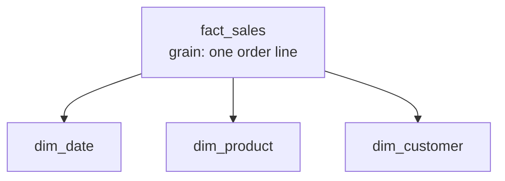

## 🎯 خلاصه

> **Dimensional modeling** (مدل‌سازی ابعادی، روش Kimball) یک پایگاه داده‌ی تحلیلی را دور یک فرایند کسب‌وکار می‌چیند: **factها** عددهایی هستند که اندازه می‌گیری، و **dimensionها** زمینه‌ای هستند که با آن برش می‌زنی (چه کسی، چه چیزی، کجا، کِی).

چهار گام Kimball، به ترتیب:

1. **انتخاب فرایند کسب‌وکار** (مثلاً فروش خرده‌فروشی).
2. **تعیین grain**: دقیقاً اینکه یک ردیف fact چه چیزی را نشان می‌دهد (مثلاً یک ردیف سفارش).
3. **انتخاب dimensionها** که هر ردیف را توصیف می‌کنند (تاریخ، محصول، مشتری، فروشگاه).
4. **انتخاب factها** (تعداد، مبلغ فروش، تخفیف) که در آن grain درست باشند.

نتیجه یک **star schema** است: یک جدول fact در وسط و جدول‌های dimension دور آن. اول grain می‌آید؛ بقیه از آن نتیجه می‌شوند.

## 🌱 از ساده شروع کنیم (مبتدی)

> **💡 تشبیه:** یک pivot table در اسپردشیت. عددهای داخل سلول‌ها **factها** هستند. برچسب‌های ردیف و ستون (ماه، محصول، شهر) **dimensionها** هستند. dimensionها می‌گویند چطور برش بزنی؛ factها چیزی هستند که برش می‌زنی.

این یک star schema کوچک خرده‌فروشی است. جدول‌های `dim_*` چیزها را توصیف می‌کنند و `fact_sales` رویدادها را ثبت می‌کند:

```sql
CREATE TABLE dim_date (
  date_sk    int PRIMARY KEY,        -- 20260115, a readable surrogate key
  full_date  date NOT NULL,
  year       int,
  month      int,
  is_weekend boolean
);

CREATE TABLE dim_product (
  product_sk   int PRIMARY KEY,      -- surrogate key
  product_id   text NOT NULL,        -- business key from the source system
  product_name text,
  category     text,
  brand        text
);

CREATE TABLE dim_customer (
  customer_sk   int PRIMARY KEY,
  customer_id   text NOT NULL,
  customer_name text,
  city          text,
  segment       text
);

CREATE TABLE fact_sales (
  order_number    text NOT NULL,     -- degenerate dimension (no table needed)
  line_number     int  NOT NULL,
  date_sk         int REFERENCES dim_date (date_sk),
  product_sk      int REFERENCES dim_product (product_sk),
  customer_sk     int REFERENCES dim_customer (customer_sk),
  qty             int,
  sales_amount    numeric(12,2),
  discount_amount numeric(12,2),
  PRIMARY KEY (order_number, line_number)   -- the grain: one order line
);
```

تبدیل یک سؤال کسب‌وکار به یک join و group ساده می‌شود:

```sql
SELECT d.year, d.month, p.category, SUM(f.sales_amount) AS revenue
FROM fact_sales f
JOIN dim_date d    ON d.date_sk    = f.date_sk
JOIN dim_product p ON p.product_sk = f.product_sk
WHERE d.year = 2026
GROUP BY d.year, d.month, p.category;
```



## 🔧 واقعاً چطور کار می‌کند (متوسط)

**Factها** اندازه‌گیری‌ها در سطح grain هستند. بیشترشان **additive** هستند: می‌توانی آن‌ها را روی همه‌ی dimensionها جمع بزنی. `qty` و `sales_amount` additive هستند. انواع دیگری هم وجود دارد:

- **Semi-additive:** فقط روی بعضی dimensionها جمع می‌خورد. موجودی یک حساب را می‌شود برای یک روز روی همه‌ی حساب‌ها جمع زد، ولی هرگز روی روزها. از `AVG` یا آخرین مقدار در طول زمان استفاده کن.
- **Non-additive:** اصلاً قابل جمع نیست، مثل قیمت واحد یا درصد حاشیه‌ی سود. بخش‌های additive را ذخیره کن (`margin_amount`، `sales_amount`) و نسبت را بعد از تجمیع حساب کن: `SUM(margin) / SUM(sales)`.

**Dimensionها** پهن، توصیفی و بیشتر متنی یا کدی هستند. عمداً denormalize می‌شوند: `dim_product` دسته و برند را در یک جدول دارد، به‌جای زنجیره‌ای از جدول‌های snowflake. هر dimension یک **surrogate key** دارد (`product_sk`)، یک عدد بی‌معنی که متعلق به warehouse است. شناسه‌ی کسب‌وکار (`product_id`) به‌عنوان یک ویژگی باقی می‌ماند. ببین [[surrogate-key]].

چرا surrogate key:

- سیستم منبع ممکن است شناسه‌هایش را دوباره استفاده، تغییر یا ادغام کند، و warehouse پایدار می‌ماند.
- join روی یک کلید عددی فشرده در موتور ارزان است.
- تنها راه نگه‌داشتن تاریخچه وقتی یک ویژگی dimension عوض می‌شود است (Type 2 در [[scd]] یک ردیف جدید با surrogate key جدید می‌سازد).
- عضوهای ناشناخته یا دیرهنگام را می‌شود با یک ردیف ویژه نشان داد (مثلاً `product_sk = -1` به معنی «محصول ناشناخته») تا هیچ ردیف fact در inner join گم نشود.

**Conformed dimensionها** dimensionهایی هستند که کلیدها و معنایشان در چند جدول fact یکی است. اگر `fact_sales` و `fact_returns` هر دو از یک `dim_customer` و یک `dim_date` استفاده کنند، می‌توانی فروش و برگشت را بر اساس مشتری یا ماه مقایسه کنی («drill across»). اگر هر mart تعریف متفاوتی از «مشتری» داشته باشد، عددها هرگز قابل تطبیق نخواهند بود.

**Bus matrix** ابزار برنامه‌ریزی این کار است. سطرها فرایندهای کسب‌وکار هستند، ستون‌ها dimensionها، و علامت نشان می‌دهد کدام dimension به کدام فرایند مربوط است:

| فرایند کسب‌وکار | date | product | customer | store |
|---|---|---|---|---|
| فروش | X | X | X | X |
| برگشت از فروش | X | X | X | |
| snapshot موجودی | X | X | | X |

ستون‌هایی که در چند سطر تکرار شده‌اند، conformed dimensionهایی هستند که باید یک بار طراحی شوند.

## 🧠 عمق و trade-offها (سنیور)

- **grain قرارداد است.** ترکیب دو grain در یک جدول fact جمع‌ها را خراب می‌کند. هزینه‌ی ارسال در سطح سفارش که روی هر ردیف کالا تکرار شده، با `SUM` دوبار شمرده می‌شود. یا آن را بین ردیف‌ها تقسیم کن، یا یک fact جداگانه در سطح سفارش نگه دار.
- **dimensionهای نقش‌آفرین (role-playing).** یک سفارش `order_date` و `ship_date` دارد. یک `dim_date` بساز و دو بار (با دو foreign key) به آن ارجاع بده، یا view با نام‌های `dim_order_date` و `dim_ship_date` بساز. جدول را کپی نکن.
- **dimensionهای degenerate.** `order_number` داخل جدول fact می‌ماند، بدون جدول جداگانه، چون ویژگی توصیفی ندارد.
- **junk dimensionها.** پرچم‌های با تعداد مقدار کم (is_gift، payment_type، channel) را می‌شود در یک dimension کوچک ترکیب کرد، به‌جای چند dimension ریز.
- **داده‌ی دیرهنگام.** یک فروش ممکن است قبل از ورود محصولش به dimension برسد. یک عضو inferred درج کن و وقتی رکورد واقعی رسید ویژگی‌هایش را به‌روز کن.
- **چیدمان فیزیکی.** در Spark، Trino یا ClickHouse جدول fact را بر اساس تاریخ partition یا cluster کن، و dimensionهای کوچک را به همه‌ی executorها broadcast کن به‌جای shuffle (ببین [[shuffle]]). کلیدهای اصلی تعریف‌شده در خیلی از warehouseها فقط اطلاعاتی هستند: موتور ممکن است آن‌ها را اعمال نکند، پس grain را با یک کوئری تست کن.
- **مدل را مانیتور کن.** کلیدهای تکراری در grain، ردیف‌های fact که surrogate key‌شان در dimension وجود ندارد (orphan)، و تطبیق جمع factها با سیستم منبع بعد از هر load را بررسی کن.
- **کِی استفاده نکنیم.** مدل‌های ابعادی به سؤال‌های شناخته‌شده‌ی کسب‌وکار خوب جواب می‌دهند. برای رابطه‌های many-to-many (بیمار با چند تشخیص) به جدول bridge نیاز داری، و برای کاوش ad hoc و در سطح رویداد، یک جدول رویداد پهن یا data vault ممکن است بهتر باشد. trade-offهای star و snowflake در `star-snowflake-obt` آمده است.

## 🧪 امتحان کن

یک شرکت اشتراکی می‌خواهد فاکتورهای ماهانه‌اش را تحلیل کند.

1. چهار گام Kimball را برای این فرایند کسب‌وکار بنویس.
2. سه dimension و دو fact فهرست کن، و هر fact را به‌عنوان additive، semi-additive یا non-additive دسته‌بندی کن.
3. دستور `CREATE TABLE` جدول fact را با کلید اصلی‌اش بنویس.

<details><summary>راه‌حل را ببین</summary>

1. فرایند: صدور فاکتور اشتراک. Grain: یک ردیف برای هر خط فاکتور به‌ازای هر مشتری در هر ماه صورتحساب. Dimensionها: `dim_date` (تاریخ صورتحساب)، `dim_customer`، `dim_plan`. Factها: `amount` و `discount`.
2. `amount` و `discount` additive هستند. یک fact احتمالی semi-additive: `active_seats` (تعداد صندلی‌ها، که می‌شود روی مشتری‌ها جمع زد ولی روی ماه‌ها نه). یک fact non-additive: `price_per_seat`.
3.
```sql
CREATE TABLE fact_invoice_line (
  invoice_number text NOT NULL,
  line_number    int  NOT NULL,
  billing_date_sk int,
  customer_sk    int,
  plan_sk        int,
  amount         numeric(12,2),
  discount       numeric(12,2),
  PRIMARY KEY (invoice_number, line_number)
);
```

</details>

## 💬 گوشه‌ی مصاحبه

**سؤال: «grain یک جدول fact سفارش‌ها را تعریف کن.»** جواب متوسط: «یک ردیف برای هر خط سفارش.» جواب سنیور: «یک ردیف برای هر خط سفارش در هر سفارش، به‌عنوان grain اتمی، تا بعداً بتوانم به سفارش یا مشتری جمع بزنم. ویژگی‌های سطح سفارش مثل هزینه‌ی ارسال یا بین خطوط تقسیم می‌شوند یا در یک fact جداگانه در سطح سفارش نگه داشته می‌شوند. درستی grain را با بررسی یکتا بودن `(order_number, line_number)` تأیید می‌کنم.»

**سؤال: «چرا surrogate key به‌جای natural key؟»** جواب متوسط: «پایدارترند و کوچک‌ترند و از تاریخچه پشتیبانی می‌کنند.» جواب سنیور: «منبع ممکن است کلیدهایش را دوباره استفاده یا تغییر دهد، و ممکن است یک موجودیت از چند منبع بیاید. surrogate key warehouse را از این موضوع جدا می‌کند، تاریخچه‌ی Type 2 را با یک ردیف برای هر نسخه ممکن می‌کند، و جای پایداری برای عضوهای ناشناخته فراهم می‌کند.»

> **🎤 این را در مصاحبه بگو:** «از grain شروع می‌کنم، بعد dimensionها، بعد factها. هر fact باید در آن grain درست باشد، و هر dimension باید بین martهایی که آن را مشترک دارند conformed باشد.»

## ⚠️ اشتباهات رایج

> **⚠️ توجه:** ترکیب دو grain در یک جدول fact، مثل خطوط سفارش و هدر سفارش. جمع‌ها مدتی درست به نظر می‌رسند و بعد دوبار شمرده می‌شوند.

> **⚠️ توجه:** جمع زدن یک معیار semi-additive (موجودی یا تعداد نفرات) در طول زمان. عددی که حاصل می‌شود هیچ معنایی ندارد.

- استفاده از natural key سیستم منبع به‌عنوان کلید join، و از دست رفتن تاریخچه وقتی منبع یک شناسه را دوباره استفاده می‌کند.
- گذاشتن معیارها داخل جدول‌های dimension، یا متن توصیفی داخل جدول‌های fact.
- ساختن یک dimension جداگانه برای هر پرچم کوچک، که مدل را سخت برای مرور کردن می‌کند.
- نداشتن عضو ناشناخته، که باعث می‌شود ردیف‌های fact بی‌صدا در inner join حذف شوند.
- تعریف «مشتری» به دو شکل متفاوت در دو mart، که گزارش‌های drill-across را غیرقابل تطبیق می‌کند.

## ✅ خودت را بسنج

1. کدام‌یک از چهار گام Kimball باید اول بیاید؟
   - A) انتخاب dimensionها
   - B) انتخاب فرایند کسب‌وکار
   - C) انتخاب factها
   - D) ساختن index

<details><summary>جواب</summary>

**B** — فرایند کسب‌وکار تعیین می‌کند چه چیزی اندازه‌گیری می‌شود. بعد grain، dimensionها و factها را به همین ترتیب تعیین می‌کنی.

</details>

2. کدام معیار **semi-additive** است؟
   - A) تعداد `qty` فروخته‌شده
   - B) `sales_amount`
   - C) موجودی حساب
   - D) `discount_amount`

<details><summary>جواب</summary>

**C** — موجودی را می‌شود برای یک روز روی حساب‌ها جمع زد، ولی جمع زدنش در طول روزها بی‌معنی است. تعداد و مبلغ کاملاً additive هستند.

</details>

3. چرا مدل‌های ابعادی به‌جای کلید کسب‌وکار منبع از surrogate key استفاده می‌کنند؟
   - A) SQL به surrogate key نیاز دارد
   - B) وابستگی warehouse به تغییر شناسه‌های منبع را قطع می‌کند و اجازه‌ی چند نسخه‌ی ردیف برای تاریخچه (Type 2) را می‌دهد
   - C) کلیدهای کسب‌وکار را نمی‌شود متنی ذخیره کرد
   - D) surrogate key نیاز به grain را برمی‌دارد

<details><summary>جواب</summary>

**B** — warehouse کلید را خودش مالک است، پس تغییر منبع تاریخچه را خراب نمی‌کند. نسخه‌ی جدید یک مشتری کلید جدید می‌گیرد، در حالی که کلید کسب‌وکار ثابت می‌ماند.

</details>

4. **(سنیور)** mart فروش و mart برگشت هر کدام dimension مشتری جداگانه دارند و تعداد مشتری‌هایشان با هم نمی‌خواند. راه‌حل چیست؟
   - A) dimension فروش را در mart برگشت کپی کن
   - B) dimension را conform کن: یک `dim_customer` با کلیدها و تعریف مشترک که هر دو جدول fact از آن استفاده کنند
   - C) dimension مشتری را از mart برگشت حذف کن
   - D) هر دو mart را به 3NF ببر

<details><summary>جواب</summary>

**B** — conformed dimensionها drill-across را ممکن می‌کنند. کپی‌ها با گذشت زمان از هم جدا می‌شوند، که دقیقاً همان مشکل است.

</details>

5. **(سنیور)** یک سفارش `order_date` و `ship_date` دارد. یک کارآموز یک جدول `dim_ship_date` دوم با همان داده ساخته است. چرا این طراحی ضعیف است و طراحی بهتر کدام است؟

   - A) اشکالی ندارد، چون کپی‌ها سریع‌تر کوئری می‌شوند
   - B) از یک `dim_date` استفاده کن که دو بار ارجاع داده شده (نقش‌آفرین): دو foreign key در جدول fact، یا view با نام‌های متفاوت؛ کپی‌های یک dimension از هم دور می‌شوند و نگهداری را سخت می‌کنند
   - C) هر دو تاریخ را به‌جای fact داخل dimension بگذار
   - D) تاریخ‌ها را حذف کن و از یک ستون متنی استفاده کن

<details><summary>جواب</summary>

**B** — جدول تاریخ در هر دو نقش یک تقویم را توصیف می‌کند. یک جدول، ویژگی‌هایی مثل ماه مالی را یکسان نگه می‌دارد، و جدول fact دو کلید دارد که به یک dimension اشاره می‌کنند.

</details>

## 🗂️ فلش‌کارت

| Front | Back |
|---|---|
| Grain | معنای دقیق یک ردیف fact، که قبل از هر چیز اعلام می‌شود |
| Fact table | اندازه‌گیری‌ها در سطح grain، با foreign keyهایی به dimensionها |
| Dimension table | زمینه‌ی پهن و توصیفی برای برش factها (چه کسی، چه چیزی، کجا، کِی) |
| Additive fact | روی همه‌ی dimensionها قابل جمع است (مثل `sales_amount`) |
| Semi-additive fact | فقط روی بعضی dimensionها قابل جمع است (مثل موجودی حساب) |
| Surrogate key | کلید عددی که warehouse مالک آن است و مستقل از کلید کسب‌وکار منبع است |
| Conformed dimension | همان dimension با همان کلیدها و معنا، که بین جدول‌های fact مشترک است |
| Bus matrix | جدول فرایندها در برابر dimensionها، برای برنامه‌ریزی conformed dimensionها |

## 🔗 ادامه

- `fact-table-types`: انواع fact شامل transaction، periodic snapshot، accumulating snapshot و factless.
- `scd`: چطور ویژگی‌های dimension در طول زمان عوض می‌شوند (Typeهای 1، 2 و 3).
- `advanced-dimensions`: جدول‌های bridge، junk dimensionها و موارد خاص دیگر.
- `star-snowflake-obt`: کِی dimensionها را نرمال نگه داریم و کِی تخت کنیم.
- `normalization`: طراحی نرمالی که مدل‌سازی ابعادی عمداً از آن کوتاه می‌آید.
