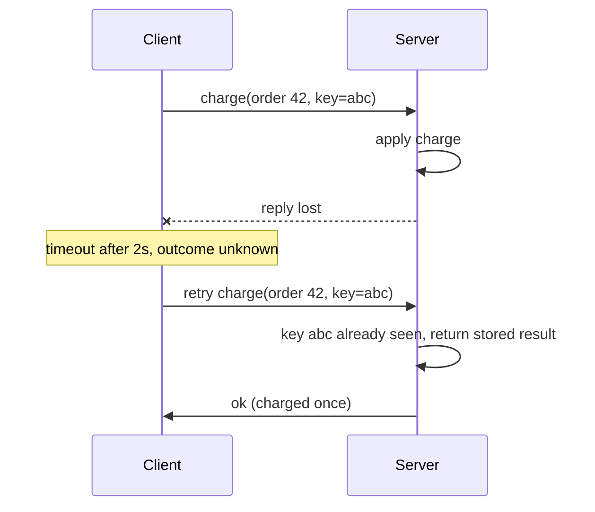

## 🎯 خلاصه

> سیستم توزیع‌شده چند ماشین است که از طریق شبکه با هم کار می‌کنند. سختی ماجرا خود ماشین‌ها نیست. سختی این است که **یک بخش می‌تواند خراب شود درحالی‌که بقیه کار می‌کنند**، و بخش‌های دیگر اغلب نمی‌فهمند کدام اتفاق افتاده.

- یک درخواست شبکه‌ای می‌تواند شکست بخورد، دیر برسد، یا موفق شود اما پاسخش گم شود. timeout یعنی «هنوز جوابی نیامده»، نه «شکست خورده».
- ساعت ماشین‌های مختلف با هم یکی نیستند. بدون دقت، رویدادها را بر اساس زمان دیواری مرتب نکن.
- یک پروسس می‌تواند برای چند ثانیه متوقف شود (garbage collection یا توقف VM) و باز هم فکر کند leader است.
- ابزارهای اصلی: timeout، heartbeat، fencing token و idempotency.

## 🌱 از ساده شروع کنیم (مبتدی)

> **💡 تشبیه:** به دوستت پیامک می‌دهی «فایل را می‌فرستی؟» و جوابی نمی‌گیری. پیام نرسیده؟ دوستت مشغول است؟ یا فایل را فرستاده و جواب گم شده؟ سکوت به تو نمی‌گوید کدام. هر سیستم توزیع‌شده با این مشکل زندگی می‌کند.

روی یک لپ‌تاپ، فراخوانی تابع یا برمی‌گردد یا خطا می‌دهد. بین ماشین‌ها، یک فراخوانی یک پیام است که در شبکه سفر می‌کند. آن پیام می‌تواند گم شود، دیر برسد، یا سرور آن را پردازش کند و جوابش گم شود. از سمت فراخواننده هر سه حالت یکسان به نظر می‌رسند: **تا قبل از timeout جوابی نیامده.**

یک مثال کوچک: یک سرویس checkout با timeout دو ثانیه‌ای به API پرداخت زنگ می‌زند. بعد از دو ثانیه جوابی ندارد. اگر دوباره تلاش کند، ممکن است مشتری دو بار پول بدهد. اگر هیچ کاری نکند، ممکن است سفارش هرگز پرداخت نشود. پاسخ امن به یک idempotency key نیاز دارد، که پایین‌تر توضیح می‌دهیم.

فهرست کلاسیک **مغالطه‌های محاسبات توزیع‌شده** (از Peter Deutsch و همکارانش) فهرستی از چیزهایی است که مهندس‌ها اشتباه فرض می‌کنند: شبکه قابل‌اعتماد است، تأخیر صفر است، پهنای باند بی‌نهایت است، شبکه امن است، توپولوژی تغییر نمی‌کند، یک مدیر وجود دارد، هزینه‌ی انتقال صفر است، و شبکه همگن است. هر کدام در محیط واقعی غلط است و هر کدام یک outage ساخته است.

## 🔧 واقعاً چطور کار می‌کند (متوسط)

**۱. timeout ابهام می‌سازد.** توالی زیر رایج‌ترین منبع نوشتن تکراری است.



**۲. تشخیص خرابی یک حدس است.** یک نود نمی‌تواند بفهمد نود دیگر مرده است یا فقط کند است. بیشتر سیستم‌ها از **heartbeat** استفاده می‌کنند: هر نود هر چند صد میلی‌ثانیه پیام «زنده‌ام» می‌فرستد، و اگر مدتی بیش از **timeout** خبری نباشد، همتا مرده اعلام می‌شود. انتخاب timeout یک trade-off است. کوتاه باشد، یک نود سالم ولی مشغول اشتباهاً مرده اعلام می‌شود (false positive). بلند باشد، بازیابی کند می‌شود.

مصرف‌کننده‌های Kafka همین مدل را دارند. مصرف‌کننده‌ای که در بازه‌ی session timeout خودش heartbeat نفرستد، از consumer group حذف می‌شود و partitionهایش به بقیه داده می‌شوند.

**۳. توقف پروسس فرض‌هایت را می‌شکند.** یک پروسس ممکن است به‌خاطر garbage collection طولانی، مهاجرت VM یا swap، چند ثانیه متوقف شود. وقتی بیدار می‌شود، نمی‌داند زمان گذشته است. ممکن است هنوز فکر کند قفل یا lease را دارد، درحالی‌که قبلاً به کس دیگری داده شده است.

**fencing token** این مشکل را حل می‌کند. سرویس قفل به هر lease عددی می‌دهد که فقط بزرگ‌تر می‌شود. storage بزرگ‌ترین عددی را که دیده نگه می‌دارد و هر چیزی قدیمی‌تر را رد می‌کند.

```python
class FencedStore:
    def __init__(self):
        self.max_token = 0
        self.data = {}

    def write(self, token, key, value):
        if token < self.max_token:
            raise PermissionError(f"stale token {token} < {self.max_token}")
        self.max_token = token
        self.data[key] = value

store = FencedStore()
store.write(33, "owner", "A")
store.write(34, "owner", "B")          # B took over the lease
try:
    store.write(33, "owner", "A-late") # A wakes up after a long pause
except PermissionError as e:
    print("rejected:", e)
print(store.data)                      # {'owner': 'B'}
```

بررسی باید در **منبع** (storage) انجام شود، نه فقط در سرویس قفل. سرویس قفل نمی‌تواند جلوی نوشتن یک کلاینت متوقف‌شده را بگیرد.

**۴. ساعت کمی دروغ می‌گوید.** ماشین‌ها ساعتشان را با NTP همگام می‌کنند، اما اختلاف بین آن‌ها می‌تواند میلی‌ثانیه یا بیشتر باشد، و زمان دیواری حتی ممکن است به عقب بپرد. برای اندازه‌گیری مدت زمان روی یک ماشین از ساعت monotonic استفاده کن. هیچ‌وقت آن را به‌عنوان ترتیب سراسری بدون فهم خطایش به کار نبر.

به last-write-wins (LWW) بر اساس timestamp فکر کن:

| رویداد | زمان واقعی | ساعت آن ماشین | برچسب زمان | مقدار |
|---|---|---|---|---|
| کلاینت A اول می‌نویسد | 10:00:00 | 3 ثانیه جلوتر | 10:00:03 | v1 |
| کلاینت B بعداً می‌نویسد | 10:00:01 | دقیق | 10:00:01 | v2 |

LWW مقدار `v1` را نگه می‌دارد، با اینکه `v2` از نظر زمان واقعی بعد از آن رخ داده. ساعت منحرف برنده را تعیین کرد.

**۵. idempotency** اصلی‌ترین دفاع است. یک عملیات idempotent است اگر اجرای دوباره‌اش همان اثر اجرای یک‌باره را داشته باشد. با یک کلید یکتا که در همان تراکنش اثر ذخیره می‌شود به آن می‌رسی. ببین [[idempotency]].

## 🧠 عمق و trade-offها (سنیور)

- **مدل‌های سیستم.** مدل *synchronous* تأخیر و توقف‌ها را محدود فرض می‌کند. مدل *partially synchronous* کرانه‌ها را دارد اما ناشناخته‌اند، و این واقع‌گرایانه‌ترین مدل برای پلتفرم‌های داده است. مدل *asynchronous* هیچ فرضی درباره‌ی زمان نمی‌کند. الگوریتم‌های consensus طوری طراحی شده‌اند که همیشه **safe** بمانند (هرگز به توافق اشتباه نرسند)، و فقط وقتی شبکه رفتار خوبی دارد **live** باشند (پیشرفت کنند).
- **مدل‌های خرابی.** *crash-stop*: نود برای همیشه متوقف می‌شود. *crash-recovery*: نود ری‌استارت می‌شود و حافظه‌اش را از دست می‌دهد. *Byzantine*: نود ممکن است دروغ بگوید. Kafka، Spark و بیشتر دیتابیس‌ها crash-recovery را با نودهای صادق فرض می‌کنند. تحمل Byzantine بیشتر در بلاک‌چین و سیستم‌های چندطرفه مهم است.
- **خرابی جزئی طراحی را شکل می‌دهد.** وقتی قبول کنی که نتیجه ممکن است نامعلوم باشد، سه چیز لازم داری: retry، idempotency، و یک job **reconciliation** که مبدأ و مقصد را مقایسه می‌کند (تعداد سطرها، مجموع‌ها، مجموعه‌ی کلیدها) و اختلاف‌ها را اصلاح می‌کند.
- **Spark در عمل.** وقتی یک executor از دست برود، taskهایش جای دیگری دوباره اجرا می‌شوند. یک تلاش کُند «زامبی» ممکن است هنوز تمام شود. مکانیزم commit در Spark خروجی هر task را در مکان موقت می‌نویسد و فقط تلاش commit‌شده را منتقل می‌کند، که همان ایدهٔ fencing است اما روی فایل. رفتار committer را برای نسخه و storage خودت در مستندات بررسی کن.
- **چه چیزی را مانیتور کنیم.** تأخیر heartbeat، تعداد rebalance، نرخ timeout و retry، offset ساعت هر میزبان، و عدم تطابق در reconciliation.
- **کی توزیع‌شده نکنیم.** یک نود PostgreSQL که خوب تنظیم شده باشد، برای خیلی از بارها از یک cluster بهتر است. توزیع مقیاس‌پذیری و تحمل خرابی می‌دهد، اما حالت‌های خرابی تازه هم می‌آورد. اول اندازه بگیر.

## 🧪 امتحان کن

1. یک کلاینت پرداخت timeout دو ثانیه‌ای دارد و در timeout دوباره تلاش می‌کند. wrapper تلاش مجدد را طوری بنویس که هر تلاش همان idempotency key را داشته باشد. در یک جمله توضیح بده چرا ساختن کلید جدید برای هر تلاش، تضمین را خراب می‌کند.
2. heartbeat هر 1 ثانیه فرستاده می‌شود و timeout برابر 3 ثانیه است. یک نود 4 ثانیه فریز می‌شود و بعد ادامه می‌دهد. بگو بقیه‌ی cluster چه می‌بینند، و نود وقتی بیدار می‌شود چه می‌کند.
3. در جدول LWW بالا فرض کن ساعت کلاینت A دقیق است (برچسب 10:00:00) و ساعت کلاینت B پنج ثانیه کند است (برچسب 09:59:56). کدام مقدار باقی می‌ماند؟

<details><summary>پاسخ‌ها را ببین</summary>

**1.**
```python
import uuid

def charge_with_retry(api, order_id, amount, attempts=3):
    key = str(uuid.uuid4())          # created ONCE, outside the loop
    for _ in range(attempts):
        try:
            return api.charge(order_id, amount, idempotency_key=key, timeout=2)
        except TimeoutError:
            continue                 # same key: the server can recognise the retry
    raise RuntimeError("outcome unknown, reconcile later")
```
اگر برای هر تلاش کلید جدید بسازی، سرور هر تلاش را شارژ جدید حساب می‌کند و مشتری چند بار پول می‌دهد.

**2.** بعد از 3 ثانیه بدون heartbeat، بقیه نود را مرده اعلام می‌کنند و کارش را به جای دیگری می‌دهند. وقتی نود در ثانیه‌ی 4 بیدار می‌شود، هنوز فکر می‌کند آن کار مال اوست. بدون fencing ممکن است نتیجه‌ی قدیمی بنویسد یا خروجی تکراری بسازد. راه‌حل یک fencing token است که منبع بررسی می‌کند.

**3.** `v1` باقی می‌ماند. برچسب 10:00:00 از برچسب 09:59:56 کلاینت B بزرگ‌تر است، پس LWW مقدار A را نگه می‌دارد، با اینکه B از نظر زمان واقعی بعداً نوشته. ساعت کند باعث می‌شود یک نوشتن ببازد.

</details>

## 💬 گوشه‌ی مصاحبه

**سؤال: «چرا نمی‌توانیم فراخوانی‌های شکست‌خورده را فقط دوباره امتحان کنیم؟»** پاسخ متوسط: «retry ممکن است اثر را تکرار کند، پس یک idempotency key اضافه می‌کنم.» پاسخ سنیور: «مشکل ابهام است. timeout به من نمی‌گوید اثر اتفاق افتاده یا نه. پس retry باید همان idempotency key را داشته باشد، کلید باید اتمیک با اثر ذخیره شود، و برای مواردی که کلید منقضی شده یک job reconciliation می‌گذارم.»

**سؤال: «چطور یک نود مرده را تشخیص می‌دهی؟»** متوسط: «heartbeat به‌همراه timeout.» سنیور: «نمی‌توانم مرده را از کُند تشخیص بدهم. timeout را از توزیع تأخیر مشاهده‌شده انتخاب می‌کنم، و منبع مشترک را با fencing token محافظت می‌کنم، تا نودی که اشتباهاً مرده اعلام شده وقتی بیدار می‌شود وضعیت را خراب نکند.»

> **🎤 این را در مصاحبه بگو:** «timeout یعنی نامعلوم، نه شکست‌خورده. هر اثر جانبی را idempotent طراحی می‌کنم، برای lease از fencing token استفاده می‌کنم، و هیچ‌وقت ترتیب رویدادها را فقط با ساعت ماشین‌ها مشخص نمی‌کنم.»

## ⚠️ اشتباهات رایج

> **⚠️ مراقب باش:** timeout یعنی «نامعلوم». اگر آن را «شکست‌خورده» فرض کنی، تکرار ایجاد می‌شود، و اگر «موفق» فرض کنی، کار گم می‌شود.

- مرتب کردن رویدادها بر اساس زمان دیواری ماشین‌های مختلف.
- فرض اینکه قفل یا lease بدون بررسی fencing در منبع، دسترسی انحصاری تضمین می‌کند.
- گذاشتن timeout heartbeat خیلی کوتاه، که false death و طوفان rebalance می‌سازد.
- retry کردن نوشتن‌های non-idempotent، یا ساختن کلید جدید برای هر تلاش.
- فراموش کردن اینکه پیام‌ها ممکن است دو بار و بی‌ترتیب برسند.

## ✅ خودت را بسنج

1. یک درخواست بعد از 2 ثانیه timeout می‌شود. چه نتیجه‌ای قطعی است؟
   - A) سرور آن را پردازش نکرده است
   - B) سرور کرش کرده است
   - C) هیچ چیز قطعی نیست: ممکن است گم شده، دیر رسیده، یا پردازش شده و پاسخش گم شده باشد
   - D) این درخواست هرگز موفق نمی‌شود

<details><summary>پاسخ</summary>

**C** — timeout فقط می‌گوید پاسخی در زمان لازم نرسیده. نتیجه نامعلوم است، و به همین دلیل retry به idempotency نیاز دارد.

</details>

2. کلاینت A یک قفل توزیع‌شده دارد، 40 ثانیه فریز می‌شود و lease‌اش تمام می‌شود. کلاینت B قفل را می‌گیرد. چه چیزی داده را محافظت می‌کند؟
   - A) lease طولانی‌تر
   - B) یک fencing token که storage بررسی می‌کند
   - C) اجرای هر دو کلاینت روی یک ماشین
   - D) همگام‌سازی دقیق‌تر NTP

<details><summary>پاسخ</summary>

**B** — lease طولانی‌تر فقط مشکل را کم‌تکرار می‌کند. storage باید نوشتن با توکن قدیمی را رد کند، تا کلاینت متوقف‌شده نتواند داده‌ی جدیدتر را بازنویسی کند.

</details>

3. **(سنیور)** heartbeat هر 1 ثانیه فرستاده می‌شود، timeout برابر 3 ثانیه است، و یک نود 4 ثانیه متوقف می‌شود. کدام جمله دقیق‌تر است؟
   - A) cluster نود را از ابتدا زنده می‌بیند، چون 1 ثانیه کمتر از 3 ثانیه است
   - B) cluster ممکن است نود را مرده اعلام کند و کارش را جای دیگری بدهد، درحالی‌که نود هنوز فکر می‌کند کار مال اوست؛ پس fencing لازم است
   - C) نود کرش می‌کند و داده‌اش را از دست می‌دهد
   - D) هیچ اتفاقی نمی‌افتد، چون نودهای دیگر توقف GC را نمی‌بینند

<details><summary>پاسخ</summary>

**B** — توقف 4 ثانیه‌ای از timeout سه ثانیه‌ای بیشتر است، پس نود مرده اعلام می‌شود. وقتی بیدار شود ممکن است بر اساس مالکیت قدیمی عمل کند. fencing token از آسیب جلوگیری می‌کند.

</details>

4. چرا last-write-wins بر اساس timestamp زمان دیواری ریسکی است؟
   - A) timestampها برای ذخیره خیلی بزرگ‌اند
   - B) انحراف ساعت بین ماشین‌ها می‌تواند باعث برنده شدن یک نوشتن قدیمی‌تر شود
   - C) LWW بیش از دو نوشتن را نمی‌تواند مدیریت کند
   - D) زمان دیواری همیشه به جلو می‌رود

<details><summary>پاسخ</summary>

**B** — ماشینی با ساعت جلوتر می‌تواند یک نوشتن قدیمی را با timestamp بزرگ‌تر ثبت کند، و آن نوشتن جدیدتری را که از ساعت دقیق آمده شکست می‌دهد.

</details>

5. **(سنیور)** Kafka، Spark و بیشتر دیتابیس‌ها کدام مدل خرابی را فرض می‌کنند؟
   - A) Byzantine: نودها ممکن است دروغ بگویند
   - B) crash-recovery: نودها ممکن است متوقف و دوباره راه‌اندازی شوند و حافظه‌شان را از دست بدهند، اما دروغ نمی‌گویند
   - C) هیچ خرابی‌ای نیست؛ فقط شبکه غیرقابل‌اعتماد است
   - D) فقط شبکه خراب می‌شود، نه نودها

<details><summary>پاسخ</summary>

**B** — این سیستم‌ها کرش و راه‌اندازی مجدد را تحمل می‌کنند و فرض می‌کنند نودها پروتکل را دنبال می‌کنند. تحمل Byzantine هزینه‌ی بسیار بیشتری دارد و داخل یک پلتفرم داده کمتر لازم است.

</details>

## 🗂️ فلش‌کارت

| Front | Back |
|---|---|
| timeout چه چیزی را نشان می‌دهد؟ | فقط اینکه پاسخی به‌موقع نرسیده؛ نتیجه نامعلوم است |
| چرا heartbeat به timeout نیاز دارد؟ | نود مرده و نود کُند یکسان به نظر می‌آیند؛ timeout یک trade-off است |
| fencing token چیست؟ | عددی که فقط بزرگ‌تر می‌شود؛ منبع نوشتن با عدد قدیمی‌تر را رد می‌کند |
| توقف یک نود چه مشکلی می‌سازد؟ | ممکن است هنوز فکر کند lease‌ای را دارد که قبلاً به دیگری داده شده |
| چرا LWW با زمان دیواری ریسکی است؟ | انحراف ساعت می‌تواند باعث برنده شدن یک نوشتن قدیمی شود |
| کدام مدل خرابی در پلتفرم‌های داده فرض می‌شود؟ | crash-recovery با نودهای صادق، نه Byzantine |
| retry کی امن است؟ | وقتی idempotency باشد: همان کلید که به‌صورت اتمیک با اثر ذخیره شده |

## 🔗 ادامه

- **consensus** توضیح می‌دهد نودها چطور روی leader و مقادیر به توافق می‌رسند، با safety و liveness زیر partial synchrony.
- **replication** نشان می‌دهد نسخه‌های داده چطور همگام می‌مانند، و خواندن‌های قدیمی از کجا می‌آیند.
- **fault-tolerance** retry، checkpoint و بازیابی را برای pipelineها کنار هم می‌گذارد.
- **time-and-ordering** درباره‌ی ساعت، event time و دلیل سخت بودن ترتیب عمیق‌تر می‌شود.
- **cap-pacelc** این ایده‌ها را برای انتخاب بین سازگاری و دسترس‌پذیری به کار می‌گیرد.
- فصل‌های اول کتاب *Designing Data-Intensive Applications* (Kleppmann) درباره‌ی شبکه‌ی غیرقابل‌اعتماد و ساعت‌های غیرقابل‌اعتماد را بخوان. این منبع اصلی این موضوع است.
