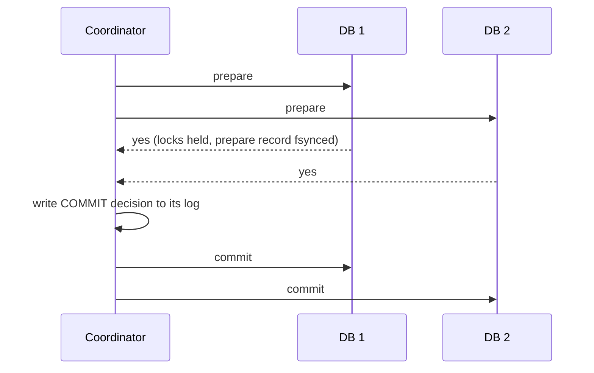

## 🎯 خلاصه

> **تراکنش توزیع‌شده (distributed transaction)** داده را در بیش از یک سیستم تغییر می‌دهد و باید یا کامل اعمال شود یا کامل اعمال نشود. می‌توانی با یک پروتکل بلاکینگ (**two-phase commit**، یا 2PC) هزینه‌اش را بدهی، یا مجموعه‌ای از مراحل محلی همراه با عمل‌های جبرانی (یک **saga**) طراحی کنی. **Transactional outbox** رایج‌ترین نسخه‌ی مسئله را حل می‌کند: به‌روزرسانی دیتابیس و انتشار یک رویداد به‌صورت اتمیک.

- **2PC** atomicity بین دیتابیس‌ها می‌دهد، اما اگر coordinator crash کند، شرکت‌کننده‌ها می‌توانند **بلاک** شوند و قفل‌ها را نگه دارند.
- **Saga** یک commit اتمیک را با commitهای محلی و **عمل‌های جبرانی (compensating actions)** جایگزین می‌کند. سازگاری نهایی است و حالت‌های میانی دیده می‌شوند.
- **Dual write** (نوشتن در دیتابیس و بعد publish در Kafka) می‌تواند بی‌صدا رویداد را گم یا جابه‌جا کند. بدون تور ایمنی آن را انجام نده.
- **Outbox** رویداد را در همان تراکنش محلی تغییر کسب‌وکار می‌نویسد. relay بعداً آن را منتشر می‌کند، پس تحویل **at least once** است و مصرف‌کننده‌ها باید idempotent باشند (الگوی **inbox**).

## 🌱 از ساده شروع کنیم (مبتدی)

> **💡 Analogy:** خرید خانه با بانک، دفترخانه و فروشنده انجام می‌شود. یا هر سه امضا می‌کنند و معامله بسته می‌شود، یا هیچ‌چیز اتفاق نمی‌افتد. **Saga** فرق دارد: ماشین کرایه می‌کنی، هتل رزرو می‌کنی و بلیط می‌خری. اگر پرواز کنسل شود، کرایه‌ی ماشین را «نامعتبر» نمی‌کنی؛ هتل و ماشین را کنسل می‌کنی و شاید جریمه بدهی. اولی اتمیک است؛ دومی یک دنباله با مراحل برگشت است.

فرض کن انتقال ۱۰۰ واحد از حساب `A` (در دیتابیس ۱) به حساب `B` (در دیتابیس ۲) را داری. یک دیتابیس می‌تواند هر دو به‌روزرسانی را داخل یک تراکنش بگذارد. دو دیتابیس به‌تنهایی نمی‌توانند این کار را بکنند.

```text
Step 1: debit A by 100     (database 1)
Step 2: credit B by 100    (database 2)

If the process crashes after step 1 and before step 2:
  money left A and never reached B
```

دو خانواده جواب وجود دارد. یا همه‌ی طرف‌ها قبل از اعمال تغییر توافق می‌کنند (2PC)، یا هر مرحله به‌صورت محلی اعمال می‌شود و برای هر مرحله یک عمل برگشت وجود دارد (saga). بقیه‌ی این درس درباره‌ی معامله‌ی بین این دو است.

## 🔧 واقعاً چطور کار می‌کند (متوسط)

### Two-phase commit (2PC)

یک **coordinator** از هر **شرکت‌کننده (participant)** می‌خواهد سهمش را انجام دهد و بعد نتیجه را تصمیم می‌گیرد.



۱. **Prepare.** هر شرکت‌کننده تراکنش را پایدار (durable) می‌کند و چیزهایی را که لمس کرده قفل می‌کند، سپس yes یا no رأی می‌دهد. yes یک قول است: این شرکت‌کننده دیگر به‌تنهایی نمی‌تواند تصمیم بگیرد.
۲. **Commit.** اگر همه yes داده باشند، coordinator تصمیم را در لاگ پایدار خودش می‌نویسد و به همه می‌گوید commit کنند. در غیر این صورت به همه می‌گوید abort کنند.

نقطه‌ی ضعف، فاصله‌ی بعد از رأی yes تا رسیدن تصمیم است. اگر coordinator آن‌جا crash کند، شرکت‌کننده **in doubt** است: بدون coordinator نمی‌تواند commit یا abort کند، و قفل‌هایش را نگه می‌دارد. تراکنش‌های دیگری که به آن ردیف‌ها کار دارند منتظر می‌مانند. بازیابی یا بازگشت coordinator را لازم دارد، یا یک تصمیم دستی و heuristic. به همین خاطر 2PC **blocking** نامیده می‌شود.

پشته‌های Java و رابطه‌ای این را به‌صورت تراکنش‌های **XA** نشان می‌دهند. خیلی از تیم‌ها XA را بین سرویس‌ها کنار می‌گذارند، به‌خاطر رفتار بلاکینگ و هزینه‌ی عملیاتی تراکنش‌های in doubt.

### Saga

saga دنباله‌ای از تراکنش‌های محلی `T1 ... Tn` است. هر کدام به‌تنهایی commit می‌شود. برای هر مرحله‌ای که قابل برگشت است، یک جبران `Ci` وجود دارد که از نظر معنایی آن را خنثی می‌کند: بازپرداخت برای یک شارژ، آزادسازی برای یک رزرو.

- اگر `Tk` شکست بخورد، جبران‌های `Ck-1 ... C1` را به ترتیب معکوس اجرا کن.
- یک مرحله‌ی **pivot** نقطه‌ی بازگشت‌ناپذیر است: مراحل بعد از آن باید قابل تکرار (retriable) باشند، و مراحل قبل از آن باید قابل جبران.
- مراحلی که قابل برگشت نیستند (فرستادن ایمیل، صدا زدن سامانه‌ی مالیاتی) را آخر بگذار.

saga دو سبک دارد. در **choreography** هر سرویس به رویدادهای مرحله‌ی قبل واکنش نشان می‌دهد و کنترلر مرکزی وجود ندارد. در **orchestration** یک موتور workflow (مثلاً Temporal یا یک state machine) هر مرحله را صدا می‌زند و پیشرفت را ثبت می‌کند. orchestration رصد و دیباگ آسان‌تری دارد؛ choreography اجزای متحرک کمتری دارد اما جریان کار سخت‌تر دیده می‌شود.

saga **isolation ندارد**. بین `T1` و `Tn` تراکنش‌های دیگر می‌توانند حالت میانی را بخوانند. خواننده ممکن است ببیند پول از حساب کم شده ولی هنوز به حساب دیگری نرسیده. راهکارها شامل قفل معنایی (ردیف را «در انتظار» علامت بزن)، به‌روزرسانی‌های جابه‌جاپذیر (جمع و تفریق به‌جای set) و خواندن دوباره قبل از عمل است.

### مشکل dual write

یک سرویس معمولی این کار را می‌کند:

```text
1. UPDATE orders SET status='PAID' WHERE id=42;   -- commit to PostgreSQL
2. producer.send('order-events', {id: 42, status: 'PAID'});   -- publish to Kafka
```

اگر مرحله‌ی ۲ بعد از commit شدن مرحله‌ی ۱ شکست بخورد، وضعیت تغییر کرده ولی کسی خبردار نشده. اگر publish موفق شود ولی commit شکست بخورد، مصرف‌کننده‌ها روی سفارشی عمل می‌کنند که وجود ندارد. تکرار کل تابع ممکن است دو بار publish کند. جابه‌جا کردن ترتیب هم بهتر نیست. هیچ عمل اتمیک واحدی بین دیتابیس و Kafka وجود ندارد.

### Transactional outbox

راه‌حل این است که رویداد بخشی از تراکنش دیتابیس باشد:

```sql
BEGIN;
UPDATE orders SET status = 'PAID' WHERE id = 42;
INSERT INTO outbox (id, aggregate_type, aggregate_id, event_type, payload)
VALUES (gen_random_uuid(), 'order', '42', 'OrderPaid', '{"status":"PAID"}');
COMMIT;
```

هر دو ردیف با هم commit می‌شوند یا اصلاً. سپس یک **relay** جدا ردیف‌های جدید outbox را می‌خواند و منتشر می‌کند:

- یک **polling publisher** ردیف‌های ارسال‌نشده را از `outbox` می‌خواند، منتشر می‌کند و علامت می‌زند. ساده است، اما بار و تأخیر اضافه می‌کند.
- **CDC** (change data capture، ببین [[cdc]]) لاگ دیتابیس را می‌خواند. **Debezium** می‌تواند جدول outbox را capture کند و هر ردیف را با `aggregate_type` به topic مناسب بفرستد؛ این کار با outbox event router انجام می‌شود.

تحویل **at least once** است: relay ممکن است publish کند، قبل از علامت زدن crash کند، و دوباره publish کند. پس هر مصرف‌کننده باید idempotent باشد. الگوی **inbox** این کار را می‌کند: مصرف‌کننده شناسه‌ی پیام پردازش‌شده را در همان تراکنش محلی‌ای ذخیره می‌کند که اثر خودش را می‌نویسد، و تکراری‌ها را رد می‌کند. ببین [[idempotency]] و [[dedup-idempotent-loads]].

## 🧠 عمق و trade-offها (سنیور)

- **انتخاب بر اساس invariant، نه مد روز.** اگر دو سیستم هرگز نباید درباره‌ی پول اختلاف داشته باشند و هر دو را خودت کنترل می‌کنی، یک تراکنش دیتابیس، یا 2PC با coordinator بسیار در دسترس، ممکن است توجیه داشته باشد. اگر سیستم‌ها سرویس‌های مستقل‌اند، saga همراه با جبران و outbox معمول‌ترین جواب است.
- **هزینه‌ی 2PC.** دو رفت‌وبرگشت به‌علاوه یک write پایدار برای هر شرکت‌کننده. قفل‌ها روی شبکه نگه داشته می‌شوند، پس یک شرکت‌کننده‌ی کند هر تراکنش متناقض را کند می‌کند. تراکنش‌های in doubt به پایش و یک روش عملیاتی روشن نیاز دارند.
- **Flink و checkpointها.** sinkهای exactly-once در Flink از یک پروتکل two-phase commit استفاده می‌کنند که با checkpointها هم‌راستا است: sink در زمان checkpoint pre-commit می‌کند و وقتی checkpoint کامل شد commit می‌کند. sink باید این را پشتیبانی کند (مثلاً producerهای تراکنشی Kafka یا فرمت‌های جدول). برای نسخه‌ی خودت مستندات connector را بررسی کن.
- **تراکنش‌های Kafka.** producer تراکنشی Kafka نوشتن اتمیک روی چند partition و read-process-write به‌صورت exactly-once داخل Kafka می‌دهد (ببین [[kafka-exactly-once]]). این کار نوشتن بیرونی در دیتابیس را با Kafka اتمیک نمی‌کند. برای آن هنوز outbox یا یک sink idempotent لازم است.
- **commitهای Lakehouse.** Iceberg و Delta یک جدول را با یک جابه‌جایی atomic در catalog یا لاگ commit می‌کنند. تغییر روی چند جدول اتمیک نیست، مگر این‌که ابزارت commit چندجدولی داشته باشد. pipeline را طوری طراحی کن که هر جدول در اجرای مجدد idempotent باشد.
- **عملیات outbox.** outbox را بر اساس sequence index کن، ردیف‌های منتشرشده را حذف یا archive کن (جدولی که بدون پاک‌سازی بزرگ می‌شود relay و دیتابیس را کند می‌کند)، و رویدادها را در هر aggregate با استفاده از aggregate id به‌عنوان کلید Kafka مرتب نگه دار.
- **چه چیزی را پایش کنی.** lag بودن outbox (سن قدیمی‌ترین ردیف ارسال‌نشده)، sagaهایی که در یک حالت میانی گیر کرده‌اند، شکست جبران‌ها، تراکنش‌های XA که in doubt‌اند، و نرخ رد شدن تکراری‌ها در consumer.
- **خطاهایی که باید طراحی‌شان کنی.** جبرانی که شکست می‌خورد، رویداد تکراری، رویداد خارج از ترتیب از producerهای مختلف، و sagaهایی که هرگز تمام نمی‌شوند. به هر saga یک timeout و یک مسیر dead-letter بده ([[dead-letter-queue]]).

## 🧪 امتحان کن

۱. یک سرویس پرداخت از کیف پول پول کم می‌کند و بعد `PaymentCaptured` را به Kafka می‌فرستد. دو سناریوی شکست را که باعث ناسازگاری می‌شوند توصیف کن و جریان را با outbox بازنویسی کن.
۲. saga مربوط به «رزرو پرواز، رزرو هتل، شارژ کارت» را طراحی کن. کدام مرحله pivot است؟ اگر بعد از رزرو پرواز شارژ کارت رد شود، چه جبران‌هایی لازم است؟
۳. relay outbox هر رویداد را دست‌کم یک بار منتشر می‌کند. یک مصرف‌کننده رویداد `OrderPaid` را برای سفارش ۴۲ دو بار دریافت می‌کند. جدول inbox و بررسی‌ای را توصیف کن که دومین تحویل را بی‌خطر می‌کند.

<details><summary>Show solutions</summary>

**1.** سناریوی اول: debit commit می‌شود، بعد فرایند قبل از publish کرد crash می‌کند، پس رویداد هرگز ارسال نمی‌شود. سناریوی دوم: publish موفق می‌شود، بعد تراکنش debit شکست می‌خورد، پس مصرف‌کننده‌ها پرداختی را می‌بینند که رخ نداده. راه‌حل outbox این است که debit و یک ردیف `outbox` را در یک تراکنش محلی بنویسد. relay بعداً ردیف را منتشر می‌کند، پس رویداد دقیقاً وقتی وجود دارد که debit commit شده باشد.

**2.** ترتیب: رزرو پرواز (جبران: کنسل پرواز)، رزرو هتل (جبران: کنسل هتل)، شارژ کارت. شارژ pivot است، چون مرحله‌ای است که تصمیم می‌گیرد سفر پرداخت شده یا نه. اگر شارژ رد شود، جبران‌ها را به ترتیب معکوس اجرا کن: اول کنسل هتل، بعد کنسل پرواز. مراحل بعد از pivot، مثل ارسال ایمیل تأیید، باید قابل تکرار باشند و آخر قرار بگیرند.

**3.** مصرف‌کننده جدول `inbox(message_id primary key, processed_at)` را نگه می‌دارد. در یک تراکنش محلی `message_id` را درج می‌کند و اثر را اعمال می‌کند (مثلاً سفارش ۴۲ را پرداخت‌شده می‌کند). در تحویل دوم، درج به کلید اصلی برخورد می‌کند، تراکنش rollback یا رد می‌شود و اثر تکرار نمی‌شود. شناسه‌ی پیام باید بین تلاش‌های مجدد ثابت باشد (در زمان درج در outbox تعیین شود، نه در زمان publish).

</details>

## 💬 گوشه‌ی مصاحبه

**سؤال: «چطور هم دیتابیس را به‌روز کنی و هم رویداد را منتشر کنی، بدون این‌که رویداد گم یا تکراری شود؟»**

- متوسط: «dual write انجام نمی‌دهم. از transactional outbox استفاده می‌کنم: رویداد را در همان تراکنشی که تغییر را می‌نویسد، در جدول outbox درج می‌کنم، و بعد از outbox با relay یا CDC منتشر می‌کنم. مصرف‌کننده‌ها تکراری‌ها را حذف می‌کنند.»
- سنیور: «outbox تحویل at least once به‌ازای هر aggregate می‌دهد، پس پیام‌های Kafka را با aggregate id کلید می‌زنم تا ترتیب هر موجودیت حفظ شود، و مصرف‌کننده‌ها را با inbox یا یک کلید یکتا idempotent می‌کنم. سن قدیمی‌ترین ردیف ارسال‌نشده‌ی outbox را پایش می‌کنم، چون همان lag قابل‌مشاهده برای کاربر است. بین Kafka و دیتابیس 2PC نمی‌گذارم؛ هزینه‌ی بلاکینگ و عملیاتی‌اش برای این مورد ارزش ندارد.»

**سؤال: «چرا بین میکروسرویس‌ها 2PC نه؟»** قفل‌ها روی فراخوانی‌های شبکه نگه داشته می‌شوند، crash کوردیناتور شرکت‌کننده‌ها را in doubt می‌گذارد، و بیشتر سرویس‌های امروزی و message brokerها XA را ارائه نمی‌دهند. saga انزوا را در برابر دسترس‌پذیری و استقلال معامله می‌کند.

> **🎤 Say this in the interview:** «atomicity را از هماهنگی جدا می‌کنم. داخل یک دیتابیس از تراکنش محلی استفاده می‌کنم. بین سرویس‌ها، برای این‌که رویداد با تغییر state اتمیک شود از outbox استفاده می‌کنم، و برای فرایندهای چندمرحله‌ای کسب‌وکار از saga با جبران. مصرف‌کننده‌ها idempotent هستند.»

## ⚠️ اشتباهات رایج

> **⚠️ Watch out:** «اول در Kafka publish می‌کنم، بعد دیتابیس را commit می‌کنم، پس امن هستم.» اگر commit شکست بخورد، مصرف‌کننده‌ها روی تغییری عمل کرده‌اند که هرگز رخ نداده.

> **⚠️ Watch out:** «exactly-once در Kafka یعنی هیچ تکراری از ابتدا تا انتها نیست.» تضمین‌های Kafka در مرز Kafka می‌ایستند. اثرهای جانبی بیرونی هنوز طراحی idempotent لازم دارند.

- رفتار با saga مثل یک تراکنش اتمیک، و فراموش کردن این‌که حالت‌های میانی دیده می‌شوند.
- نوشتن جبرانی که idempotent نیست، پس یک retry دو بار بازپرداخت می‌کند.
- استفاده از UUID تصادفی برای id outbox در زمان publish. id باید در زمان نوشتن ثابت شود تا retryها حذف تکراری شوند.
- گذاشتن جدول outbox که بی‌نهایت بزرگ شود، که relay و دیتابیس را کند می‌کند.
- فراموش کردن این‌که یک شرکت‌کننده‌ی 2PC که in doubt است قفل‌هایش را تا بازیابی coordinator نگه می‌دارد.

## ✅ خودت را بسنج

1. در two-phase commit، اصلی‌ترین دلیلی که یک شرکت‌کننده می‌تواند بلاک شود چیست؟
   - A) باید منتظر تخلیه‌ی شبکه بماند
   - B) بعد از رأی yes نمی‌تواند نتیجه را به‌تنهایی تعیین کند و باید منتظر coordinator بماند
   - C) باید لاگ را در سه ریجن replicate کند
   - D) coordinator باید قفل‌ها را مرتب کند

<details><summary>Answer</summary>

**B** — رأی yes یک قول است. شرکت‌کننده قفل‌هایش را نگه می‌دارد تا coordinator به آن بگوید commit یا abort کند. اگر coordinator در دسترس نباشد، شرکت‌کننده in doubt است.

</details>

2. کدام الگو امکان publish رویداد بدون dual write را می‌دهد؟
   - A) two-phase commit بین دیتابیس و Kafka
   - B) یک جدول transactional outbox که در همان تراکنش محلی تغییر کسب‌وکار نوشته می‌شود
   - C) تکرار producer تا موفق شود
   - D) غیرفعال کردن acknowledgementها در producer

<details><summary>Answer</summary>

**B** — ردیف رویداد همراه با تغییر state commit یا rollback می‌شود. relay بعداً آن را منتشر می‌کند. تکرار به‌تنهایی شکاف بین دو نوشتن جدا را برطرف نمی‌کند.

</details>

3. یک saga در مرحله‌ی ۳ از ۴ کارت را شارژ می‌کند و شارژ رد می‌شود. مراحل ۱ و ۲ commit شده‌اند. چه باید بشود؟
   - A) هیچ؛ saga اتمیک است
   - B) جبران‌های مرحله‌ی ۲ و سپس ۱ را به ترتیب معکوس اجرا کن
   - C) شارژ را بی‌نهایت تکرار کن
   - D) دیتابیسی که مرحله‌ی ۱ را دارد rollback کن

<details><summary>Answer</summary>

**B** — saga با عمل‌های جبرانی و به ترتیب معکوس برگردانده می‌شود. هر مرحله‌ی تکمیل‌شده توسط جبران خودش خنثی می‌شود، پس وضعیت کسب‌وکار به یک حالت پایان سازگار برمی‌گردد.

</details>

4. **(سنیور)** یک مصرف‌کننده‌ی رویدادهای outbox با بررسی `processed_at` در یک جدول جدا، بیرون از تراکنش اصلی‌اش، idempotent شده. چرا این ناامن است و باید چه کار کند؟
   - A) جدول‌های جدا قابل query نیستند
   - B) بررسی و اثر می‌توانند جدا commit شوند، پس crash بین آن‌ها می‌تواند اثر را تکرار یا حذف کند؛ شناسه‌ی پیام را در همان تراکنشی ثبت کن که اثر را می‌نویسد
   - C) مصرف‌کننده‌ها در Kafka نیازی به idempotency ندارند
   - D) processed_at باید در Kafka ذخیره شود، نه در دیتابیس

<details><summary>Answer</summary>

**B** — idempotency نیاز دارد که نشانگر و اثر atomic باشند. اگر در دو تراکنش جدا باشند، crash بین آن‌ها یا اثر را تکرار می‌کند یا آن را جا می‌اندازد. نوشتن inbox در همان تراکنش این شکاف را می‌بندد.

</details>

5. **(سنیور)** چرا saga ارکستری معمولاً قابلیت عملیاتی بهتری از saga کوریوگرافی‌شده دارد، و هزینه‌اش چیست؟
   - A) نیازی به جبران ندارد
   - B) یک جا وضعیت workflow و timeoutها را نگه می‌دارد، پس sagaهای گیرکرده دیده می‌شوند؛ هزینه‌اش یک جزء مرکزی است که باید بسیار در دسترس باشد و orchestrator به همه‌ی مراحل وابسته می‌شود
   - C) نیاز به idempotency را از بین می‌برد
   - D) همیشه سریع‌تر است

<details><summary>Answer</summary>

**B** — با یک orchestrator مرکزی، پیشرفت و retryها در یک store وضعیت قرار دارند، پس نمونه‌های گیرکرده را پیدا کردن آسان است. بهایش یک جزء اضافه برای اجرا و عملیات است، و orchestrator از همه‌ی مراحل خبر دارد.

</details>

## 🗂️ فلش‌کارت

| Front | Back |
|---|---|
| 2PC چیست؟ | prepare (رأی و قفل) و بعد commit یا abort که coordinator تصمیم می‌گیرد |
| چرا 2PC بلاکینگ است؟ | شرکت‌کننده‌ای که yes داده منتظر coordinator می‌ماند و قفل‌ها را نگه می‌دارد |
| saga چیست؟ | دنباله‌ای از تراکنش‌های محلی که با عمل جبرانی در شکست برگردانده می‌شوند |
| انزوای saga | پیش‌فرض ندارد؛ حالت‌های میانی برای تراکنش‌های دیگر دیده می‌شوند |
| مشکل dual write | نوشتن جدا در دیتابیس و broker می‌تواند رویداد را گم، تکراری یا جابه‌جا کند |
| transactional outbox | ردیف رویداد در همان تراکنش محلی نوشته می‌شود؛ relay بعداً منتشرش می‌کند |
| تحویل relay در outbox | at least once؛ مصرف‌کننده‌ها باید idempotent باشند |
| الگوی inbox | شناسه‌ی پیام‌های پردازش‌شده را در همان تراکنش اثر ثبت کن |

## 🔗 ادامه

- **[[consistency-models]]** trade-offهای انزوا و دیده‌شدن را توضیح می‌دهد که sagaها از آن‌ها می‌گذرند.
- **[[consensus]]** نشان می‌دهد یک coordinator بسیار در دسترس چطور ساخته می‌شود.
- **[[delivery-semantics]]** و **[[kafka-exactly-once]]** توضیح می‌دهند broker چه چیزی را تضمین می‌کند و چه چیزی را نه.
- **[[cdc]]** و **[[dedup-idempotent-loads]]** relay و الگوهای load ایمن در برابر تکرار را پوشش می‌دهند.
- ورودی‌های **outbox-pattern** و **saga** در glossary تعریف‌های کوتاه برای مرور سریع دارند.
