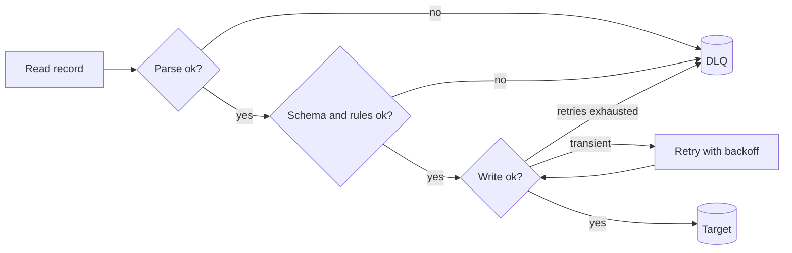

## 🎯 خلاصه

> وقتی یک رکورد قابل پردازش نیست، سه انتخاب داری: **متوقف‌کردن** پایپ‌لاین، **حذف بی‌صدای** رکورد، یا **انحراف** آن به یک **dead letter queue (DLQ)** یا جدول quarantine همراه با دلیل خطا. گزینه‌ی DLQ پایپ‌لاین را به حرکت نگه می‌دارد و مدرک خطا را هم حفظ می‌کند.

- اول خطا را دسته‌بندی کن. خطای **گذرا** (timeout، throttling) باید retry شود. خطای **سطح رکورد** (مقدار بد، JSON خراب) به DLQ می‌رود. خطای **سیستمی** (schema اشتباه برای کل فایل، sink خاموش) باید پایپ‌لاین را متوقف کند.
- هر ردیف DLQ به **payload خام**، **دلیل خطا**، **موقعیت منبع** (topic، partition، offset، یا فایل و شماره‌ی خط) و یک **وضعیت** نیاز دارد تا کسی بتواند آن را اصلاح و دوباره اجرا کند.
- هرگز رکورد بد را بی‌صدا حذف نکن. پایپ‌لاینی که با ۵٪ ردیف گم‌شده «موفق» شود بدتر از پایپ‌لاینی است که بایستد.
- پردازش دوباره‌ی DLQ یک اجرای عادی پایپ‌لاین است. باید idempotent باشد، وگرنه replay تکراری می‌سازد.

## 🌱 از ساده شروع کنیم (مبتدی)

> **💡 مثال:** اداره‌ی پست. نامه‌ای با آدرس اشتباه کل کامیون را متوقف نمی‌کند، و آن نامه هم به رودخانه انداخته نمی‌شود. به سبد «تحویل‌نشده» می‌رود با یادداشتی درباره‌ی دلیلش. هر روز کسی آن سبد را نگاه می‌کند، اگر شد آدرس را درست می‌کند و دوباره می‌فرستد.

یک pipeline را تصور کن که رویدادهای سفارش را می‌خواند و در یک جدول می‌نویسد. یکی از رویدادها این است: `{"order_id": "o2", "amount": -5}`. مبلغ منفی اشتباه است، پس پایپ‌لاین باید تصمیم بگیرد چه کند:

| انتخاب | چه اتفاقی می‌افتد | کی خوب است |
|---|---|---|
| توقف (Halt) | job خطا می‌دهد؛ هیچ‌چیز بعد از این رویداد بارگذاری نمی‌شود | خطا یعنی کد یا کانفیگ خراب است |
| حذف (Drop) | رویداد ناپدید می‌شود؛ job موفق گزارش می‌دهد | تقریباً هرگز؛ چون از گم‌شدن داده پنهان می‌کند |
| انحراف (DLQ) | رویداد همراه دلیل ذخیره می‌شود؛ job ادامه می‌دهد | فقط چند رکورد بد هستند و بقیه درست‌اند |

قاعده‌ی سرانگشتی: روی مشکلاتی که **همه‌ی** رکوردها را تحت تأثیر قرار می‌دهند متوقف شو، مشکلاتی که فقط **یک** رکورد را خراب می‌کنند منحرف کن، و مشکلاتی که شاید خودشان برطرف شوند را retry کن.

## 🔧 واقعاً چطور کار می‌کند (متوسط)

مسیر معمول یک رکورد چند لایه دارد و هر لایه می‌تواند یک رکورد بد تولید کند:



**جدول DLQ.** آن را عمومی نگه دار تا هر pipeline بتواند از آن استفاده کند:

```sql
CREATE TABLE ops.dead_letters (
  dl_id       BIGINT       NOT NULL,
  pipeline    VARCHAR(100) NOT NULL,
  source_ref  VARCHAR(255),              -- e.g. topic:partition:offset, or file:line
  batch_id    VARCHAR(64),
  error_code  VARCHAR(50)  NOT NULL,     -- e.g. PARSE_ERROR, NEGATIVE_AMOUNT
  error_msg   VARCHAR(2000),
  payload     TEXT,                      -- the raw record exactly as received
  failed_at   TIMESTAMP    NOT NULL,
  status      VARCHAR(20)  NOT NULL DEFAULT 'open',  -- open / fixed / discarded
  attempts    INT          NOT NULL DEFAULT 0
);

-- Reprocessing: pick the open rows for one error class after the fix is deployed
SELECT dl_id, payload
FROM ops.dead_letters
WHERE pipeline = 'orders' AND status = 'open' AND error_code = 'NEGATIVE_AMOUNT';
```

ستون `payload` رکورد را دقیقاً همان‌طور که رسیده ذخیره می‌کند، نه آن‌طور که parser آن را فهمیده. اگر parser باگ داشته باشد، payload خام تنها راه درست برای replay است.

**یک مثال کامل.** این حلقه رکوردهای خوب را نگه می‌دارد و رکوردهای بد را منحرف می‌کند:

```python
import json
from datetime import datetime, timezone

def parse_order(raw: str) -> dict:
    rec = json.loads(raw)                 # JSONDecodeError on broken JSON
    if rec["amount"] < 0:                 # ValueError on a business-rule failure
        raise ValueError("negative amount")
    return {"order_id": rec["order_id"], "amount": rec["amount"]}  # KeyError if missing

def run(batch: list[str]):
    good, dead_letters = [], []
    for offset, raw in enumerate(batch):
        try:
            good.append(parse_order(raw))
        except (json.JSONDecodeError, KeyError, ValueError) as exc:
            dead_letters.append({
                "payload": raw,
                "error": f"{type(exc).__name__}: {exc}",
                "offset": offset,
                "failed_at": datetime.now(timezone.utc).isoformat(),
            })
    return good, dead_letters

batch = [
    '{"order_id": "o1", "amount": 120}',
    'not-json',
    '{"order_id": "o2", "amount": -5}',
    '{"amount": 7}',
]
good, dlq = run(batch)
print(len(good), "good,", len(dlq), "dead letters")  # 1 good, 3 dead letters
```

به کاری که این کد **انجام نمی‌دهد** توجه کن: `ValueError` را دوباره امتحان نمی‌کند، چون retry کردن یک مقدار بد همان مقدار بد را برمی‌گرداند. retry برای خطاهایی است که بین تلاش‌ها تغییر می‌کنند، مثل timeout شبکه. به [[retry]] نگاه کن.

**موتورها و ابزارها.** اغلب stackها نسخه‌ی داخلی این ایده را دارند:

- **Kafka**: DLQ یک topic جداگانه است. consumer پیام خطادار را همراه header ها (خطا، offset منبع) منتشر می‌کند و offset اصلی را commit می‌کند. Kafka Connect تنظیمات error-tolerance و گزینه‌ی topic برای DLQ دارد؛ نام و رفتار را در مستندات نسخه‌ی خودت بررسی کن.
- **Flink**: یک side output (با `OutputTag`) رکوردهای بد را از یک operator جمع می‌کند، در حالی که stream اصلی ادامه دارد.
- **خواننده‌های فایل در Spark**: خواننده‌های CSV و JSON حالت دارند. `PERMISSIVE` ردیف‌های خراب را با null نگه می‌دارد و `columnNameOfCorruptRecord` متن خام را ذخیره می‌کند. `DROPMALFORMED` بی‌صدا حذفشان می‌کند، که در production باید از آن پرهیز کرد. `FAILFAST` متوقف می‌کند.
- **انبارها و loaderها**: بسیاری از ابزارهای load یک آستانه‌ی «حداکثر ردیف بد» دارند. زیر آن load موفق می‌شود و ردیف‌های رد شده لاگ می‌شوند؛ بالای آن load خطا می‌دهد.

**آستانه‌ها.** یک pipeline می‌تواند مقداری رکورد بد را تحمل کند. بودجه‌ی صریح تعیین کن، مثلاً «اگر بیش از ۰٫۱٪ یک batch رد شد، یا رد شده‌ها از ۱٬۰۰۰ ردیف گذشتند، متوقف شو». بودجه یک مشکلِ بی‌صدای کیفیت داده را به هشدار تبدیل می‌کند. بودجه را روی مجموع batch بسنج، نه روی هر رکورد.

## 🧠 عمق و trade-offها (سنیور)

- **Poison pill.** پیامی که همیشه consumer را خراب کند، اگر منحرف نشود برای همیشه دوباره امتحان می‌شود. تعداد تلاش‌ها را برای هر رکورد بشمار و بعد از N بار به DLQ ببر. وگرنه کل partition پشت یک رکورد گیر می‌کند.
- **ترتیب خراب می‌شود.** اگر `o2` منحرف شود و به‌روزرسانی‌های بعدی `o2` موفق بارگذاری شوند، وقتی `o2` بعداً replay شود وضعیت جدول غلط است. پردازش دوباره باید همان قوانین merge را داشته باشد (مثلاً «آخرین `updated_at` برنده است») و هرگز یک insert کورکورانه نباشد. تصمیم بگیر که آیا یک رکورد DLQ شده، رکوردهای جدیدتر همان کلید را هم متوقف کند.
- **replay باید idempotent باشد.** یک batch دوباره‌پخش‌شده ممکن است با آنچه قبلاً بارگذاری شده همپوشانی داشته باشد. از upsert با کلید یا `MERGE` استفاده کن، نه `INSERT` ساده. به [[idempotency]] و [[dedup-idempotent-loads]] نگاه کن.
- **DLQ داده‌ی حساس دارد.** payloadهای خام شامل PII و گاهی رمز یا توکن‌اند. همان کنترل دسترسی، ماسک‌سازی و قاعده‌ی نگهداری منبع را اعمال کن. DLQی که شماره‌ی تلفن مشتری‌ها را در یک داشبورد باز نشان دهد، یک نشت داده است.
- **payloadهای باینری و بزرگ.** ذخیره‌ی یک فایل ۵۰ مگابایتی در یک ستون متنی ایده‌ی بدی است. یک اشاره‌گر (مسیر object storage به‌همراه checksum) و خطا را ذخیره کن، نه خود بایت‌ها.
- **هشدار روی روند رشد.** روی **نرخ رشد** DLQ هشدار بده، نه فقط اندازه‌اش. افزایش ناگهانی `PARSE_ERROR` بعد از deploy یک producer همان سیگنالی است که لازم داری. قدیمی‌ترین ردیف `open` را هم به عنوان یک معیار تازگی دنبال کن.
- **کی DLQ استفاده نکنیم.** اگر consumer باید کاملاً مرتب باشد و هر رکورد باید به ترتیب اعمال شود (مثلاً موجودی یک دفتر حساب)، DLQ می‌تواند درستی را خراب کند. در این حالت متوقف شو، رفع کن و ادامه بده، و قبول کن که downtime داری.
- **مانیتور کن.** نرخ DLQ برای هر pipeline، تعداد open، قدیمی‌ترین سن open، نرخ موفقیت reprocess، و تعداد رکوردهایی که بعد از اصلاح دوباره شکست خوردند.

## 🧪 امتحان کن

pipeline سفارش‌های تو روزانه ۲۰۰٬۰۰۰ رکورد می‌گیرد. در یک روز بد، ۴٬۰۰۰ رکورد با `PARSE_ERROR` شکست می‌خورند، چون یک producer فرمت تاریخ را عوض کرده.

1. آیا pipeline باید متوقف شود یا این ۴٬۰۰۰ رکورد را منحرف کند؟ با ایده‌ی آستانه‌ی بالا استدلال کن.
2. بعد از اصلاح producer، برنامه‌ی reprocess را بنویس: چه چیزی را انتخاب می‌کنی، چطور دوباره load می‌کنی، و چطور ردیف‌ها را `fixed` علامت می‌زنی.

<details><summary>پاسخ نمونه</summary>

۱. بستگی به بودجه دارد. ۴٬۰۰۰ از ۲۰۰٬۰۰۰ یعنی ۲٪. اگر بودجه‌ات ۰٫۱٪ است، متوقف شو و کسی را خبر کن، چون producer خراب ممکن است روی همه‌ی رکوردهای جدید اثر بگذارد. اگر بودجه ۲٪ را می‌دهد و بقیه‌ی batch سالم است، ۴٬۰۰۰ رکورد را با `error_code = 'PARSE_ERROR'` منحرف کن، روی نرخ هشدار بده، و بارگذاری را ادامه بده. در هر حال خطا قابل‌دیدن است.
۲. ردیف‌های `open` با آن کد خطا و آن pipeline را انتخاب کن، آن‌ها را با parser اصلاح‌شده از `payload` خام parse کن، و از همان `MERGE` idempotent مسیر اصلی بارگذاری کن. هر ردیف را فقط بعد از موفقیت load به `fixed` تغییر بده، و `attempts` را ثبت کن. ردیف‌هایی که دوباره شکست بخورند `open` می‌مانند با خطای جدید.

</details>

## 💬 گوشه‌ی مصاحبه

**سؤال:** «با رکوردهای بد در یک pipeline streaming یا batch چه می‌کنی؟»

> **🎤 این را در مصاحبه بگو:** «اول خطا را دسته‌بندی می‌کنم. خطاهای گذرا با backoff دوباره امتحان می‌شوند. خطاهای سطح رکورد همراه payload خام، کد خطا و موقعیت منبع به DLQ می‌روند و pipeline ادامه می‌دهد. خطاهای سیستمی job را متوقف می‌کنند، چون همه‌ی رکوردها را تحت تأثیر قرار می‌دهند. بودجه‌ی صریح رد شده تعیین می‌کنم تا مشکل بی‌صدا به هشدار تبدیل شود، و replay را idempotent می‌کنم تا رفع DLQ تکرار نسازد.»

جواب میان‌سطح DLQ و payload خام را نام می‌برد. جواب سنیور poison pill، اثر ترتیب در replay، داده‌ی حساس در DLQ، و بودجه‌ی رد شده را اضافه می‌کند.

## ⚠️ اشتباهات رایج

- **حذف بی‌صدای ردیف‌های بد.** job موفق می‌شود، جمع‌ها غلط‌اند، و کسی نمی‌داند. همیشه رد شده‌ها را بشمار و لاگ کن.
- **retry کردن خطاهای دائمی.** یک مقدار بد هر بار به همان شکل خطا می‌دهد. فقط خطاهایی را retry کن که ممکن است تغییر کنند.
- **ذخیره‌ی فقط خطا، نه payload.** بدون رکورد خام نمی‌توانی parser را اصلاح و replay کنی.
- **replay با INSERT ساده.** replay ردیف‌هایی را که قبلاً بارگذاری شده تکراری می‌کند.
- **یک DLQ بدون مالک.** ردیف‌ها ماه‌ها جمع می‌شوند. برای DLQ مالک، SLA و داشبورد تعیین کن.
- **بی‌توجهی به ترتیب.** اگر قانون merge رعایت نشود، رکورد replay‌شده می‌تواند یک وضعیت جدیدتر را بازنویسی کند.

## ✅ خودت را بسنج

۱. یک consumer پیامی با JSON خراب می‌گیرد. کدام اقدام بهتر است؟
   - A) برای همیشه با backoff نمایی retry کن
   - B) خطای parse را همراه آن به DLQ منحرف کن و ادامه بده
   - C) کل pipeline را متوقف کن
   - D) بی‌صدا حذفش کن تا متریک‌ها تمیز بمانند

<details><summary>پاسخ</summary>

**B** — JSON خراب یک خطای دائمی سطح رکورد است. retry همان نتیجه را می‌دهد، توقف جلوی بقیه‌ی رکوردها را می‌گیرد، و حذف، گم‌شدن داده را پنهان می‌کند. آن را با payload خام و خطا منحرف کن.

</details>

۲. کدام خطا باید به جای DLQ، pipeline را متوقف کند؟
   - A) یک رکورد با مبلغ منفی
   - B) یک timeout تکی به sink
   - C) producer شروع کرده هر رکورد را با schema جدید بفرستد و sink همه‌شان را رد می‌کند
   - D) یک رکورد با کد ارز ناشناخته

<details><summary>پاسخ</summary>

**C** — خطای سیستمی همه‌ی رکوردها را تحت تأثیر قرار می‌دهد، پس منحرف کردن هر کدام DLQ را با کل جریان پر می‌کند. متوقف شو، قرارداد schema را اصلاح کن، و replay کن. A و D خطای سطح رکوردند؛ B گذراست و اول باید retry شود.

</details>

۳. replay یک DLQ، ۸۰۰ رکوردی را که دو روز پیش منحرف شده‌اند دوباره بارگذاری می‌کند. بعضی از کلیدهایشان بعد از خطا با موفقیت به‌روز شده‌اند. replay باید از چه چیزی استفاده کند؟
   - A) یک `INSERT` ساده، چون رکوردها جدیدند
   - B) یک `MERGE` یا upsert با کلید که زمان به‌روزرسانی را رعایت می‌کند
   - C) `TRUNCATE` مقصد و بارگذاری همه‌چیز
   - D) از replay صرف‌نظر کن؛ رکوردهای DLQ هرگز دوباره پردازش نمی‌شوند

<details><summary>پاسخ</summary>

**B** — replay باید idempotent باشد و نباید وضعیت جدیدتر را بازنویسی کند. یک merge با کلید و قاعده‌ای مثل «آخرین `updated_at` برنده است» هم تکرار و هم مسئله‌ی ترتیب را حل می‌کند.

</details>

۴. **(سنیور)** یک Kafka consumer روی همان پیام مدام شکست می‌خورد و lag پارتیشن بالا می‌رود. محتمل‌ترین نقص طراحی چیست؟
   - A) consumer به partition بیشتری نیاز دارد
   - B) شمارنده‌ی تلاش و مسیر poison pill وجود ندارد، پس یک رکورد کل partition را می‌بندد؛ بعد از N تلاش منحرف کن
   - C) Kafka از DLQ پشتیبانی نمی‌کند
   - D) offsetها هرگز نباید commit شوند

<details><summary>پاسخ</summary>

**B** — یک پیام سمی وقتی درجا retry شود، partition را برای همیشه می‌بندد. تلاش‌ها را بشمار، پیام را با header ها به یک topic DLQ ببر، offset اصلی را commit کن، و روی نرخ DLQ هشدار بده. partition بیشتر این رکورد گیرکرده را حل نمی‌کند.

</details>

## 🗂️ فلش‌کارت

| Front | Back |
|---|---|
| سه انتخاب برای رکورد بد | متوقف کردن pipeline، حذف (هرگز بی‌صدا)، یا انحراف به DLQ |
| ردیف DLQ باید چه چیزی داشته باشد | payload خام، کد و پیام خطا، موقعیت منبع، شناسه‌ی batch، زمان، وضعیت |
| برای JSON خراب retry یا DLQ؟ | DLQ. خطای دائمی سطح رکورد در هر retry همان نتیجه را می‌دهد |
| برای timeout retry یا توقف؟ | اول retry با backoff؛ فقط اگر تلاش‌ها تمام شد و sink خاموش ماند، متوقف شو |
| poison pill | پیامی که همیشه شکست می‌خورد و اگر درجا retry شود partition را می‌بندد |
| چرا payload خام را نگه داریم؟ | تا بعداً parser را اصلاح کنی و ورودی اصلی را دقیقاً replay کنی |
| چرا replay باید idempotent باشد؟ | یک batch دوباره‌پخش‌شده ممکن است با ردیف‌های قبلاً بارگذاری‌شده همپوشانی داشته باشد |
| کار reject budget چیست؟ | وقتی رد شده‌ها از آستانه بگذرند، مشکل بی‌صدای کیفیت را به هشدار تبدیل می‌کند |

## 🔗 ادامه

- [[fault-tolerance]] تلاش مجدد، checkpoint و حالت‌های خطا را در سطح سیستم توضیح می‌دهد.
- [[data-quality]] بررسی‌هایی را پوشش می‌دهد که از ابتدا ردیف‌های رد شده را تولید می‌کنند.
- [[pattern-reconciliation]] نشان می‌دهد چطور بعد از replay ثابت کنی مقصد با منبع می‌خواند.
- [[pattern-backfill]] استراتژی بارگذاری دوباره را وقتی replay بزرگ است توضیح می‌دهد.
- گزینه‌های bad-record موتورت (حالت‌های خواننده‌ی Spark، error tolerance در Kafka Connect، side outputs در Flink) را در مستندات نسخه‌ی خودت بررسی کن؛ نام‌ها و پیش‌فرض‌ها بین نسخه‌ها تغییر می‌کنند.
