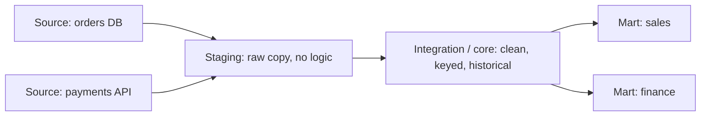

## 🎯 خلاصه

> **انبار داده (data warehouse یا DWH)** پایگاه‌داده‌ای است که برای **تحلیل** ساخته شده، نه برای اداره‌ی روزمرهٔ کسب‌وکار. داده را از سیستم‌های عملیاتی زیادی کپی می‌کند، آن را تمیز و حول **رویدادهای کسب‌وکار** سازمان می‌دهد، و سؤال‌هایی مثل «درآمد هر ماه و هر منطقه» را سریع جواب می‌دهد.

- سیستم‌های **OLTP** (پایگاه‌داده‌ی اپلیکیشن) خواندن و نوشتن کوچک و زیاد دارند. **انبارها** تعداد کمی خواندن بزرگ روی تاریخچه‌ی چند سال دارند.
- داده از **لایه‌ها** عبور می‌کند: staging (کپی خام)، integration/core (تمیز، کلیددار و تاریخ‌دار) و mart (آمادهٔ یک حوزه‌ی کاری).
- مدل رایج **بعدی (dimensional)** است: یک جدول **fact** برای هر رویداد کسب‌وکار در یک **grain** ثابت، که دور آن جدول‌های **dimension** قرار دارند و «چه کسی، چه چیزی، کجا و کی» را توصیف می‌کنند.
- انبار حاصل **تصمیم‌ها** دربارهٔ grain، کلیدها، تاریخچه و الگوی بارگذاری است. بیشترِ نکته‌های مصاحبه از همین تصمیم‌ها می‌آیند.

## 🌱 از ساده شروع کنیم (مبتدی)

> **💡 تشبیه:** یک مغازه با چند صندوق فروش را تصور کن. هر صندوق یک سیستم **OLTP** است: یک فروش را سریع ثبت می‌کند و نباید هیچ فروشی گم شود. **انبار** مثل دفتر حسابدار آخر ماه است. حسابدار رسیدهای همهٔ صندوق‌ها را جمع می‌کند، آن‌ها را بر اساس محصول، فروشگاه و روز دسته‌بندی می‌کند، و به سؤال‌هایی مثل «کدام فروشگاه در اسفند بیشترین قهوه را فروخته؟» جواب می‌دهد. حسابدار چیزی نمی‌فروشد.

این یک جدول عملیاتی و سؤالی است که کسب‌وکار می‌پرسد:

```sql
-- جدول عملیاتی (OLTP): یک سطر برای هر سفارش، نوشته‌شده توسط وب‌اپ
CREATE TABLE orders (
  order_id    int PRIMARY KEY,
  customer_id int,
  status      text,         -- 'new', 'paid', 'shipped', 'cancelled'
  total       numeric(10,2),
  updated_at  timestamp
);
```

اپلیکیشن می‌تواند «سفارش 42» را در یک میلی‌ثانیه با کلید اصلی پیدا کند. اما «درآمد پرداخت‌شدهٔ هر شهر برای هر ماه از 1404» به خواندن میلیون‌ها سطر، join با مشتری‌ها و فیلتر روی تاریخچه نیاز دارد. اجرای این کوئری روی دیتابیس اپلیکیشن، پرداخت را کند می‌کند. دلیل اصلی وجود انبار همین است.

سه واژه را به خاطر بسپار:

- **Fact:** یک رویداد قابل اندازه‌گیری (یک ردیف سفارش، یک کلیک، یک پرداخت).
- **Dimension:** زمینه‌ی رویداد (مشتری، محصول، تاریخ، فروشگاه).
- **Mart:** مجموعه‌ی کوچک و آمادهٔ جدول‌ها برای یک تیم (فروش، مالی، بازاریابی).

## 🔧 واقعاً چطور کار می‌کند (متوسط)

یک انبار معمولی سه لایه دارد. هر لایه یک کار مشخص دارد، پس باگ یک لایه را راحت‌تر پیدا می‌کنی.



- **Staging** کپی خامِ منبع است، اغلب با همان ستون‌ها و نوع‌ها، و به‌صورت batch (یا با [[cdc]]) بارگذاری می‌شود. در این لایه چیزی اصلاح نمی‌شود. کپی خام یعنی می‌توانی بدون درخواست دوباره از منبع، بارگذاری را تکرار کنی.
- **Integration / core** نوع‌ها را تمیز می‌کند، تکراری‌ها را حذف می‌کند، کدها را ترجمه می‌کند (`'PD'` می‌شود `paid`)، **کلید جایگزین (surrogate key)** می‌دهد و در جاهای لازم تاریخچه نگه می‌دارد.
- **Marts** مدل‌های بعدی هستند که برای پرسش‌های یک تیم ساخته شده‌اند. اغلب view یا جدول‌هایی هستند که از core دوباره ساخته می‌شوند.

یک مثال کوچک در PostgreSQL. staging سطرهای خام سفارش را دارد. بُعد مشتری و جدول fact را در grain «یک سطر برای هر ردیف سفارش» می‌سازیم:

```sql
CREATE TABLE stg_order_lines (
  order_id int, customer_email text, product_code text,
  qty int, unit_price numeric(10,2), order_ts timestamp
);

-- Dimension: هر مشتری یک سطر، با کلید جایگزین
CREATE TABLE dim_customer (
  customer_key   serial PRIMARY KEY,
  customer_email text UNIQUE,
  city           text
);

-- Fact: هر ردیف سفارش یک سطر (این همان grain است)
CREATE TABLE fact_order_line (
  order_id     int,
  customer_key int REFERENCES dim_customer(customer_key),
  date_key     int,          -- yyyymmdd، به یک dimension تاریخ اشاره می‌کند
  qty          int,
  amount       numeric(12,2)
);

INSERT INTO stg_order_lines VALUES
 (1, 'ali@x.com',  'P1', 2, 10.00, '2026-03-01 10:00'),
 (1, 'ali@x.com',  'P2', 1, 25.00, '2026-03-01 10:00'),
 (2, 'sara@x.com', 'P1', 3, 10.00, '2026-03-02 09:30');

-- بارگذاری dimension: فقط مشتری‌های جدید
INSERT INTO dim_customer (customer_email, city)
SELECT DISTINCT s.customer_email, 'unknown'
FROM stg_order_lines s
WHERE NOT EXISTS (
  SELECT 1 FROM dim_customer d WHERE d.customer_email = s.customer_email
);

-- بارگذاری fact: کلید جایگزین را پیدا کن، مبلغ را حساب کن
INSERT INTO fact_order_line (order_id, customer_key, date_key, qty, amount)
SELECT s.order_id,
       d.customer_key,
       CAST(to_char(s.order_ts, 'YYYYMMDD') AS int),
       s.qty,
       s.qty * s.unit_price
FROM stg_order_lines s
JOIN dim_customer d USING (customer_email);
```

حالا تحلیلگر با join و جمع ساده سؤال می‌پرسد:

```sql
SELECT c.city, SUM(f.amount) AS revenue
FROM fact_order_line f
JOIN dim_customer c USING (customer_key)
GROUP BY c.city
ORDER BY revenue DESC;
```

به join با `USING (customer_email)` در بارگذاری دقت کن: منبع کلید طبیعی (ایمیل) را دارد، اما fact کلید **جایگزین** را ذخیره می‌کند. اگر بعداً ایمیل عوض شود، کلید جایگزین ثابت می‌ماند و تاریخچه حفظ می‌شود.

دو خانوادهٔ طراحی که باید نامشان را بدانی:

- **Kimball (dimensional bus):** martها را مستقیم به‌صورت star schema می‌سازی که **dimension های همسان‌شده (conformed)** مشترک دارند (همان `dim_customer` در همه جا). سریع تحویل داده می‌شود و در بیشتر تیم‌ها پیش‌فرض است.
- **Inmon (انبار سازمانی):** ابتدا یک core نرمال‌شده و سراسری می‌سازی (نرمال‌سازی سوم)، و بعد martها را از آن مشتق می‌کنی. شروعش کندتر است، اما برای حوزه‌های موضوعی زیاد سازگاری قوی‌تری دارد.

در پشته‌های امروزی، لایه‌ها اغلب bronze/silver/gold نامیده می‌شوند (به [[medallion-architecture]] نگاه کن) و انبار یک موتور ابری مثل Snowflake، BigQuery یا Redshift است (به [[cloud-warehouses]] نگاه کن). ایده همان است و فقط نام‌ها فرق دارند.

## 🧠 عمق و trade-offها (سنیور)

- **اول grain.** پیش از افزودن هر ستون معلوم کن که یک سطر fact یعنی چه. «یک ردیف سفارش» و «یک سفارش» تعداد سطرهای متفاوت و جمع‌های درست متفاوت می‌دهند. grain مخلوط رایج‌ترین علت دوبار شمرده‌شدن درآمد است. به [[grain]] و [[fact-table]] نگاه کن.
- **کلیدها.** در انبار از کلید جایگزین استفاده کن تا تغییر کلید منبع، استفادهٔ دوباره از شناسه یا merge، تاریخچه را خراب نکند. کلید طبیعی را به‌عنوان یک ویژگی نگه دار. عضو «ناشناخته» (مثلاً `-1` یا یک سطر ویژه) اجازه می‌دهد fact ها وقتی dimension دیر می‌رسد هم بارگذاری شوند.
- **تاریخچه.** dimension ها تغییر می‌کنند. یک مشتری به شیراز می‌رود. نوع‌های [[scd]] (slowly changing dimension) مشخص می‌کنند که بازنویسی کنی (Type 1)، یک سطر نسخه نگه داری (Type 2) یا یک ستون مقدار قبلی (Type 3). انتخاب را برای هر ویژگی بگیر، نه برای کل جدول.
- **الگوی بارگذاری.** بارگذاری batch باید **idempotent** باشد: اجرای دوبارهٔ یک روز نباید fact ها را دو برابر کند. برای یک روز partition را overwrite کن، یا با `MERGE` روی کلید کسب‌وکار ادغام کن. `INSERT` ساده‌ای که بالاتر آمد هر fact را در اجرای مجدد دو برابر می‌کند؛ این اولین باگی است که در review پیدا می‌کنی. به [[dedup-idempotent-loads]] و [[backfills]] نگاه کن.
- **داده‌ی دیررسیده.** اصلاحی که سه روز بعد می‌رسد یک partition قدیمی را عوض می‌کند. طراحی‌ات به یک پنجره‌ی بارگذاری مجدد و قاعده‌ای برای اینکه گزارش کدام تاریخچه را نشان دهد نیاز دارد.
- **انتخاب معماری.** انبار ستونی MPP (به [[mpp-architecture]] نگاه کن) برای join و تجمیع روی داده‌ی ساخت‌یافته سریع است و بر اساس محاسبه و ذخیره‌سازی هزینه می‌گیرد. lakehouse (به [[lakehouse-table-formats]] نگاه کن) فایل‌های باز ذخیره می‌کند و چند موتور را پشتیبانی می‌کند و در حجم زیاد اغلب ارزان‌تر است، اما نگهداری جدول با خودت است. هیچ‌کدام برای همهٔ تیم‌ها «پاسخ مدرن» نیستند.
- **پایش.** تازگی داده (بیشترین timestamp بارگذاری‌شده در برابر الان)، تعداد سطر در هر بارگذاری، تطبیق با منبع (جمع روزانه)، و تست‌های کلید (بدون تکراری و بدون یتیم) را رصد کن. داده‌ی غلطِ بی‌صدا از داشبورد دیرِ کندتر گران‌تر تمام می‌شود.
- **کی نسازیم.** یک شرکت کوچک با چند منبع و یک ابزار BI ممکن است با یک replica پستگرس و مدل‌های خوب کافی باشد. لایه‌ها را وقتی بساز که منابع و تیم‌های زیادی داری و بر سر عددها اختلاف است.

## 🧪 امتحان کن

از سه جدول مثال کارشده استفاده کن (PostgreSQL نسخهٔ 13 یا بالاتر).

1. **fact با بارگذاری idempotent.** درج fact را طوری بازنویسی کن که اجرای دوباره همان تعداد سطر را بدهد. راهنمایی: اول سطرهای روزی را که بارگذاری می‌کنی حذف کن، در همان تراکنش، و بعد دوباره درج کن.
2. **بررسی grain.** کوئری‌ای بنویس که تعداد ردیف سفارش را به تفکیک `order_id` برگرداند، و توضیح بده اگر به‌اشتباه `fact_order_line` را به جدولی با یک سطر در هر سفارش join کنی، `SUM(amount)` چه می‌شود.
3. **تغییر dimension.** علی به شیراز می‌رود. کوئری update‌ای بنویس که fact های قدیمی را برای تاریخ اصلی‌شان به تهران وصل نگه دارد. برای این کار باید چه ستونی به dimension اضافه کنی (راهنمایی: بازهٔ اعتبار)؟

<details><summary>پاسخ‌ها را ببین</summary>

**1.**
```sql
BEGIN;
DELETE FROM fact_order_line WHERE date_key = 20260301;
INSERT INTO fact_order_line (order_id, customer_key, date_key, qty, amount)
SELECT s.order_id, d.customer_key,
       CAST(to_char(s.order_ts, 'YYYYMMDD') AS int),
       s.qty, s.qty * s.unit_price
FROM stg_order_lines s
JOIN dim_customer d USING (customer_email)
WHERE s.order_ts::date = DATE '2026-03-01';
COMMIT;
```
اجرای دوباره همان روز را جایگزین می‌کند، پس تعداد رشد نمی‌کند. (در سیستم واقعی حذف را هم با شناسه‌ی partition یا batch محدود می‌کنی.)

**2.**
```sql
SELECT order_id, COUNT(*) AS lines FROM fact_order_line GROUP BY order_id;
```
اگر به جدولی با یک سطر در هر سفارش join کنی و جمع مبلغ سفارش را بگیری، مبلغ هر سفارش به تعداد ردیف‌هایش تکرار می‌شود. درآمد بالا می‌رود. راه‌حل این است که fact در یک grain بماند و dimension ها فقط به dimension ها join شوند.

**3.** ستون‌های `valid_from` و `valid_to` را به dimension مشتری اضافه کن (یک سطر Type 2). سطر قدیمی `city = 'Tehran'` با `valid_to = '2026-05-31'` دارد و سطر جدید `city = 'Shiraz'`. fact ها به کلید جایگزین نسخه‌ای اشاره می‌کنند که در تاریخ‌شان معتبر بوده. این ایدهٔ اصلی [[scd]] Type 2 است.

</details>

## 💬 گوشه‌ی مصاحبه

**سؤال: «انبار داده چیست و با دیتابیس عملیاتی چه فرقی دارد؟»**

- **پاسخ مبتدی:** «انبار داده را برای گزارش ذخیره می‌کند. دیتابیس عملیاتی برای اپلیکیشن است. انبار برای خواندن حجم زیاد داده بهینه شده.»
- **پاسخ متوسط:** «یک store تاریخی و یکپارچه و موضوع‌محور است که از منابع زیادی ساخته می‌شود. لایه‌ها دارد (staging، core، mart)، مدل بعدی با fact و dimension استفاده می‌کند، و ستونی است تا تجمیع‌ها فقط ستون‌های کمی را بخوانند. بارگذاری batch یا micro-batch است و باید idempotent باشد.»
- **پاسخ سنیور:** «اول فرایندهای کسب‌وکار و grain هر fact را مشخص می‌کنم. بعد dimension های همسان‌شده، سیاست تاریخچه برای هر ویژگی، و استراتژی بارگذاری برای اصلاحات را تعیین می‌کنم. انبار و lakehouse را از نظر هزینه، همزمانی و نیاز به چند موتور مقایسه می‌کنم، و قبل از اولین داشبورد، بررسی‌های تازگی و تطبیق را تعریف می‌کنم.»

> **🎤 این را در مصاحبه بگو:** «انبار داده یک store تحلیلی است که داده را از سیستم‌های عملیاتی زیادی یکپارچه می‌کند، تاریخچه نگه می‌دارد، و در لایه‌ها و مدل‌های بعدی سازمان یافته. من آن را حول grain هر جدول fact و dimension های همسان‌شده طراحی می‌کنم، و بارگذاری‌ها را idempotent می‌کنم تا اجرای مجدد و اصلاحات امن باشند.»

## ⚠️ اشتباهات رایج

> **⚠️ مراقب باش:** انبار کپی دیتابیس اپلیکیشن نیست. کپی کردن اسکیمای نرمال‌شدهٔ OLTP به انبار و تمام فرض کردن آن، کوئری‌های کند و گیج‌کننده می‌دهد. حول رویدادهای کسب‌وکار مدل بساز.

- ترکیب grain های مختلف در یک جدول fact (بعضی سطرها در هر سفارش، بعضی در هر ردیف).
- استفاده از کلید طبیعی به‌عنوان تنها کلید join، طوری که تغییر کلید منبع تاریخچه را خراب کند.
- بارگذاری غیر idempotent: اجرای دوباره‌ی job درآمد را دو برابر می‌کند.
- بازنویسی تاریخچه‌ی dimension به‌صورت پیش‌فرض، و بعد ناتوانی در پاسخ به «سال گذشته چه چیزی درست بود؟».
- حذف لایه‌ی staging، طوری که یک transform بد مجبور می‌کند از منبعی که دیگر داده‌ی قدیمی را ندارد دوباره استخراج کنی.
- ساخت mart از mart (پرش از لایه‌ها) تا وقتی دو داشبورد درباره‌ی درآمد با هم اختلاف دارند.

## ✅ خودت را بسنج

1. کدام ویژگی بیشتر با یک انبار داده می‌خواند تا یک دیتابیس OLTP؟
   - A) تعداد زیادی تراکنش کوچک در ثانیه با قفل سطری
   - B) تعداد کمی خواندن تحلیلی بزرگ روی تاریخچه‌ی چند سال
   - C) اعمال foreign key روی هر نوشتن
   - D) فقط ذخیره‌ی آخرین وضعیت هر موجودیت

<details><summary>پاسخ</summary>

**B** — انبارها برای خواندن تحلیلی روی تاریخچه‌ی بزرگ بهینه‌اند. OLTP برای تراکنش‌های کوچک زیاد و آخرین وضعیت هر موجودیت بهینه است.

</details>

2. در مثال کارشده، grain جدول `fact_order_line` چیست؟
   - A) یک مشتری
   - B) یک سفارش
   - C) یک ردیف سفارش (یک محصول در یک سفارش)
   - D) یک روز

<details><summary>پاسخ</summary>

**C** — هر سطر یک ردیف سفارش است. نگه داشتن یک grain در هر جدول fact است که جمع‌ها را درست می‌کند.

</details>

3. چرا جدول fact به‌جای `customer_email` ستون `customer_key` را ذخیره می‌کند؟
   - A) ایمیل برای ایندکس خیلی بلند است
   - B) کلید جایگزین fact ها را از کلیدهای منبع جدا می‌کند و از تاریخچه پشتیبانی می‌کند
   - C) ایمیل را نمی‌توان در SQL join کرد
   - D) انبار ستون متنی را ممنوع کرده

<details><summary>پاسخ</summary>

**B** — کلید جایگزین وقتی کلید طبیعی عوض می‌شود یا دوباره استفاده می‌شود پایدار می‌ماند، و به یک dimension نوع Type 2 اجازه می‌دهد چند نسخه از یک مشتری را نگه دارد.

</details>

4. **(سنیور)** یک job شبانه داده‌ی fact دیروز را دوباره بارگذاری می‌کند. بعد از یک خطا، job دوباره اجرا می‌شود و درآمد دو برابر می‌شود. ریشه‌ی مشکل چیست و راه درست کدام است؟
   - A) job از executor زیاد استفاده کرده؛ موازی‌سازی را کم کن
   - B) بارگذاری idempotent نیست؛ برای هر partition حذف و درج کن، یا با MERGE روی کلید کسب‌وکار، در یک تراکنش
   - C) داشبورد کش دارد؛ کش را پاک کن
   - D) جدول fact به grain بزرگ‌تری نیاز دارد

<details><summary>پاسخ</summary>

**B** — اجرای مجدد باید به همان وضعیت برسد. جایگزین کردن partition (یا merge روی کلید) job را امن برای retry می‌کند، و این پایهٔ backfill است.

</details>

5. **(سنیور)** چه زمانی lakehouse را به‌جای انبار ستونی برای لایهٔ core ترجیح می‌دهی؟
   - A) وقتی همهٔ مصرف‌کننده‌ها ابزارهای BI با یک موتور هستند
   - B) وقتی داده بزرگ است، چند موتور باید همان جدول‌ها را بخوانند، و نگهداری جدول را می‌پذیری
   - C) وقتی هرگز تاریخچه لازم نداری
   - D) وقتی داده همیشه کوچک است

<details><summary>پاسخ</summary>

**B** — فرمت‌های جدول باز برای دسترسی چندموتوره و حجم بالا مناسب‌اند. هزینه‌اش کار عملیاتی بیشتر است (compaction، expire کردن snapshot ها)، پس انتخاب به تیم بستگی دارد، نه به مد روز.

</details>

## 🗂️ فلش‌کارت

| Front | Back |
|---|---|
| OLTP در برابر انبار (هدف) | OLTP اپلیکیشن را با تراکنش‌های کوچک و سریع اداره می‌کند؛ انبار به سؤال‌های تحلیلی روی تاریخچه‌ی بزرگ جواب می‌دهد |
| Fact table | رویدادهای قابل اندازه‌گیری در یک grain ثابت (مثلاً یک ردیف سفارش) |
| Dimension table | زمینه‌ی fact ها: چه کسی، چه چیزی، کجا، کی؛ معمولاً پهن و توصیفی |
| Grain | آنچه یک سطر در جدول fact نشان می‌دهد؛ اول آن را تعیین کن |
| Surrogate key | کلید عددیِ تحت کنترل انبار که fact ها را از کلیدهای منبع جدا می‌کند |
| Staging layer | کپی خام منابع، بدون منطق کسب‌وکار، تا بتوانی بدون استخراج دوباره بارگذاری کنی |
| Conformed dimension | dimension ای که بین martها با همان کلید و معنا مشترک است |
| Idempotent load | اجرای دوباره‌ی بارگذاری همان نتیجه‌ی یک اجرا را می‌دهد |

## 🔗 ادامه

- [[oltp-vs-olap]] تفاوت بار کاری را عمیق‌تر توضیح می‌دهد.
- [[dimensional-modeling]] و [[star-framework]] طراحی fact و dimension را گام‌به‌گام پوشش می‌دهند.
- [[etl-vs-elt]] مقایسه می‌کند که transform کجا اجرا شود.
- [[data-lake-object-storage]] دریاچه‌ای را توضیح می‌دهد که اغلب انبار را تغذیه می‌کند.
- [[lakehouse-table-formats]] فرمت‌های جدول باز را برای همین سؤال‌ها روی فایل پوشش می‌دهد.
- بانک سؤال: سؤال‌های فصل DWH (view در برابر materialized view، SCD Type 2، dimension در برابر attribute) پیگیری‌های خوبی هستند.
