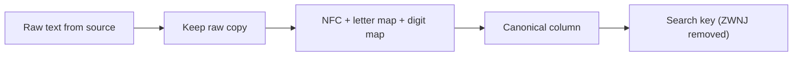

## 🎯 خلاصه

> داده‌ی فارسی ساده به نظر می‌رسد، ولی تله‌های code point دارد که join، شمارش و مرتب‌سازی را خراب می‌کند: دو شکل متفاوت «ی»، دو شکل متفاوت «ک»، دو دسته رقم، یک فاصله‌ی نامرئی به اسم ZWNJ، و تاریخ جلالی و قوانین ساعت تهران که با پیش‌فرض‌های میلادی و UTC جور درنمی‌آیند.

- دو رشته‌ای که یکسان دیده می‌شوند می‌توانند بایت‌های متفاوت داشته باشند. «ي» و «ی» شبیه‌اند، ولی دو کاراکتر متفاوت‌اند.
- متن فارسی را **یک بار، هنگام ورود داده** به یک شکل استاندارد (canonical) تبدیل کن و مقدار خام را هم نگه دار.
- زمان‌ها را به UTC ذخیره کن. تبدیل به ساعت تهران و تاریخ جلالی را در لایه‌ی نمایش انجام بده، با یک کتابخانه‌ی تست‌شده و پایگاه داده‌ی منطقه‌ی زمانی IANA.
- محاسبات تقویم و offset ساعت را خودت ننویس. از کتابخانه استفاده کن و با تاریخ‌های شناخته‌شده تستش کن.

## 🌱 از ساده شروع کنیم (مبتدی)

> **💡 تشبیه:** دو کلید ممکن است کاملاً شبیه هم باشند و ولی قفل‌های متفاوتی را باز کنند. سیستم داده **code point** (یک عدد) را مقایسه می‌کند، نه شکل حرف را. چشم یک حرف می‌بیند، پایگاه داده دو عدد متفاوت.

به این نگاه کن:

```python
>>> "ي" == "ی"
False
>>> "ك" == "ک"
False
>>> len("می‌خواهم"), len("میخواهم")   # the first one has a ZWNJ inside
(8, 7)
```

این دو حرف متفاوت غلط املایی نیستند. کاراکترهای متفاوتی هستند که از کیبورد، layout یا سیستم مبدأ متفاوتی آمده‌اند. فارسی و عربی الفبای مشترک دارند، پس هر دو شکل در داده‌ی واقعی پیدا می‌شوند:

| کاراکتر | Code point | نام Unicode | منبع معمول |
|---|---|---|---|
| ي | U+064A | ARABIC LETTER YEH | کیبورد عربی و بعضی منابع قدیمی |
| ی | U+06CC | ARABIC LETTER FARSI YEH | متن استاندارد فارسی |
| ك | U+0643 | ARABIC LETTER KAF | کیبورد عربی |
| ک | U+06A9 | ARABIC LETTER KEHEH | متن استاندارد فارسی |
| (نامرئی) | U+200C | ZERO WIDTH NON-JOINER (ZWNJ) | نیم‌فاصله، مثل می‌خواهم |
| ٠ تا ٩ | U+0660 تا U+0669 | ARABIC-INDIC DIGITS | متن عربی |
| ۰ تا ۹ | U+06F0 تا U+06F9 | EXTENDED ARABIC-INDIC DIGITS (ارقام فارسی) | متن فارسی |

اگر کاربری `كتاب` تایپ کند و کاربر دیگری `کتاب`، یک `WHERE` یا `GROUP BY` آن‌ها را دو محصول، دو آدم یا دو شهر جدا حساب می‌کند. هیچ خطایی رخ نمی‌دهد؛ فقط عددها غلط‌اند.

قانون ساده برای مبتدی: **متن فارسی، متن تمیز نیست.** قبل از شمارش، join یا حذف تکراری، فرض کن که نرمال‌سازی لازم است.

## 🔧 واقعاً چطور کار می‌کند (متوسط)

### UTF-8 در یک دقیقه

سیستم‌های امروزی متن را با UTF-8 ذخیره می‌کنند. این کدگذاری طول متغیر دارد:

- کاراکترهای ASCII (مثل `a` و `1`) **۱ بایت** می‌گیرند.
- بیشتر حروف فارسی در محدوده‌ی U+0600 تا U+06FF هستند و هر کدام **۲ بایت** می‌گیرند.
- ZWNJ (U+200C) در محدوده‌ی U+0800 تا U+FFFF است و **۳ بایت** می‌گیرد (`E2 80 8C`).

پس تعداد کاراکتر با تعداد بایت یکی نیست. تابع‌ها در هر موتور فرق دارند. مثلاً در ClickHouse تابع `length` بایت می‌شمارد و `lengthUTF8` کد پوینت. در MySQL برای جدول‌های جدید از `utf8mb4` استفاده کن؛ charset قدیمی `utf8` زیرمجموعه‌ی ۳بایتی است و منبع خطای رایج است. همیشه بررسی کن که کدام تابع را صدا می‌زنی.

یک ابزار کوچک برای دیباگ کردن ارزش دارد:

```python
import unicodedata

def show_codepoints(text: str) -> None:
    for ch in text:
        print(f"U+{ord(ch):04X}  {unicodedata.name(ch, '<unnamed>')}")

show_codepoints("كتاب")
# U+0643  ARABIC LETTER KAF
# U+062A  ARABIC LETTER TEH
# U+0627  ARABIC LETTER ALEF
# U+0628  ARABIC LETTER BEH
```

### نرمال‌سازی یک سیاست است، نه یک تابع

نرمال‌سازی یونیکد (`NFC`، `NFD`، `NFKC`، `NFKD`) با accent و شکل‌های سازگاری کار می‌کند، ولی حروف عربی را به فارسی **تبدیل نمی‌کند**. این شگفتی رایجی است:

```python
import unicodedata
unicodedata.normalize("NFKC", "ي") == "ي"   # True: NFKC leaves it unchanged
```

پس باید نگاشت (mapping) صریح داشته باشی و برای هر کاراکتر خاص تصمیم بگیری. مثال زیر یک normalizer کوچک و قابل اجرا برای مرحله‌ی ورود داده است:

```python
import unicodedata

# Arabic letters typed on Arabic keyboards -> Persian letters used in Persian text
CHAR_MAP = str.maketrans({
    "ي": "ی",  # ي ARABIC LETTER YEH  -> ی ARABIC LETTER FARSI YEH
    "ك": "ک",  # ك ARABIC LETTER KAF  -> ک ARABIC LETTER KEHEH
    "​": None,      # zero-width space: always junk, drop it
})

# Arabic-Indic digits (U+0660..U+0669) and Persian digits (U+06F0..U+06F9) -> ASCII 0-9
DIGIT_MAP = {}
for i in range(10):
    DIGIT_MAP[0x0660 + i] = str(i)
    DIGIT_MAP[0x06F0 + i] = str(i)


def normalize_fa(text: str) -> str:
    """Canonical form for storage and joins. Keeps ZWNJ (U+200C) on purpose."""
    text = unicodedata.normalize("NFC", text)
    text = text.translate(CHAR_MAP).translate(DIGIT_MAP)
    return text.strip()


def search_key(text: str) -> str:
    """Looser key for search and dedup only: also removes ZWNJ."""
    return normalize_fa(text).replace("‌", "")


if __name__ == "__main__":
    samples = ["كتاب", "کتاب", "۱۴۰۵/۰۱/۱۵", "١٤٠٥/١/١٥", "می‌خواهم", "میخواهم"]
    for s in samples:
        print(repr(s), "->", repr(normalize_fa(s)))

    assert normalize_fa("كتاب") == normalize_fa("کتاب") == "کتاب"
    assert normalize_fa("۱۴۰۵") == normalize_fa("١٤٠٥") == "1405"
    assert normalize_fa("می‌خواهم") != normalize_fa("میخواهم")   # ZWNJ is kept
    assert search_key("می‌خواهم") == search_key("میخواهم")
    assert unicodedata.normalize("NFKC", "ي") == "ي"                  # NFKC does not fix it
    print("all checks passed")
```

خروجی حلقه‌ی `print` این است:

```text
'كتاب' -> 'کتاب'
'کتاب' -> 'کتاب'
'۱۴۰۵/۰۱/۱۵' -> '1405/01/15'
'١٤٠٥/١/١٥' -> '1405/1/15'
'می‌خواهم' -> 'می‌خواهم'
'میخواهم' -> 'میخواهم'
```

به این نکته‌ها دقت کن که normalizer انجامشان **نمی‌دهد**: `1/1/1405` را به `01/01/1405` تبدیل نمی‌کند، و تصمیم نمی‌گیرد که `می‌خواهم` و `میخواهم` یک کلمه‌اند. این‌ها تصمیم‌های جدا هستند و باید در قرارداد داده (data contract) بیایند.



### مرتب‌سازی و collation

پایگاه داده رشته‌ها را با یک **collation** مرتب می‌کند. در collation باینری (بر اساس بایت یا code point)، `ك` (U+0643) و `ک` (U+06A9) در دو جای جدا مرتب می‌شوند و هیچ‌کدام طبق الفبای فارسی نیستند. collation آگاه به زبان (مثلاً تنظیمات locale یا ICU فارسی، در جایی که موتور پشتیبانی می‌کند) به انتظار کاربر نزدیک‌تر است. قبل از ساختن گزارش مرتب‌شده یا `DISTINCT` روی اسامی، رفتار موتورت را بررسی کن.

### تاریخ جلالی (هجری شمسی)

ایرانی‌ها در زندگی روزمره از تقویم جلالی استفاده می‌کنند. pipelineها معمولاً تاریخ میلادی را ذخیره و تاریخ جلالی را به کاربر نمایش می‌دهند. روش مطمئن:

- یک **date dimension** با کلید `date` میلادی نگه دار و ستون‌های `year`، `month`، `day`، `month_name_fa` و `week_of_year` جلالی را کنارش اضافه کن.
- این بعد را یک بار با کتابخانه‌ی تست‌شده بساز و تاریخ‌های مرجع را چک کن. مثلاً ۱ فروردین ۱۴۰۰ برابر است با ۲۱ مارس ۲۰۲۱.
- اعداد جلالی را به‌صورت integer ذخیره کن، نه رشته. ارقام فارسی در متن منبع باید قبل از cast نرمال شوند.

### زمان تهران

تهران از منطقه‌ی IANA به نام `Asia/Tehran` استفاده می‌کند، با زمان استاندارد UTC+03:30. ایران قوانین ساعت تابستانی را چند بار تغییر داده؛ آخرین بار در ۲۰۲۲ ساعت تابستانی را کنار گذاشت و از آن زمان بحث بازگشتش ادامه دارد. offset را در کد hard-code نکن. زمان رویدادها را به UTC ذخیره کن، در زمان query یا نمایش به `Asia/Tehran` تبدیل کن، و tzdata سرورها را به‌روز نگه دار.

## 🧠 عمق و trade-offها (سنیور)

- **خام و canonical را با هم نگه دار.** مقدار خام را برای audit و پردازش مجدد نگه دار، و یک ستون canonical برای join و aggregate. اگر normalizer عوض شد، ستون canonical را از روی داده‌ی خام دوباره بساز. یک `normalizer_version` ذخیره کن تا ردیف‌های قدیمی را تشخیص بدهی.
- **قبل از hash کردن، نرمال کن.** شماره ملی یا تلفنی که با ارقام فارسی تایپ شده، hash متفاوتی از همان عدد با ارقام انگلیسی می‌دهد. اول نرمال کن، بعد با HMAC کلیددار hash کن اگر داده‌ی شخصی است. وگرنه یک آدم، دو آدم حساب می‌شود.
- **حذف ZWNJ اطلاعات را از بین می‌برد.** هم `می‌خواهم` و هم `میخواهم` در متن واقعی زیاد دیده می‌شوند. حذف ZWNJ از مقدار ذخیره‌شده، اطلاعاتی را که خواننده ممکن است لازم داشته باشد پاک می‌کند. فقط در search key یا کلید dedup حذفش کن و در قرارداد داده بنویسش.
- **موتورهای جست‌وجو.** برای full-text search، نرمال‌سازی را داخل analyzer ایندکس (character filter یا token filter) بگذار تا query و سندها با قواعد یکسان بررسی شوند. اگر یک سرویس `replace()` داشته باشد و سرویس دیگر نه، ناهماهنگی قطعی است. فیلترهای فارسی را در مستندات موتور جست‌وجوی خودت بررسی کن.
- **رفتار موتور.** برابری، `LIKE`، `ILIKE`، عبارت منظم و `CAST` به موتور وابسته‌اند. مثلاً cast کردن `'۱۴۰۵'` به عدد در بسیاری از موتورها خطا می‌دهد، پس ارقام را قبل از cast نرمال کن.
- **چک‌های کیفیت داده.** یک چک روزانه اضافه کن: تعداد ردیف‌هایی را بشمار که هنوز `ي`، `ك` یا ارقام عربی‌–هندی دارند، در ستونی که باید canonical باشد. اگر این عدد بالا رفت، هشدار بده. سیستم‌های مبدأ اغلب کیبورد یا ابزار import را بدون اطلاع عوض می‌کنند.
- **کی نرمال نکنیم.** متن آزاد، شعر یا سند حقوقی باید کاراکترهای نویسنده را حفظ کند. نرمال‌سازی برای match و تحلیل است، نه برای نمایش محتوای کاربر.

## 🧪 امتحان کن

از PostgreSQL نسخه‌ی ۱۳ به بعد یا هر موتوری که عبارت منظم دارد استفاده کن.

1. **پیدا کردن آلودگی.** یک query بنویس که در جدول `customers(id, city)` ردیف‌هایی را بشمارد که در `city` کاراکتر `ي` یا `ك` دارند.
2. **dedup با search key.** لیست پایتونی `["می‌خواهم", "میخواهم", "کتاب", "كتاب"]` را در نظر بگیر. با `search_key` تعداد کلیدهای متمایز را حساب کن و توضیح بده چرا جواب ۲ است، نه ۴ و نه ۱.
3. **ارقام قبل از cast.** تابعی در پایتون بنویس که `"۱۴۰۵"` را به عدد صحیح `1405` تبدیل کند، فقط با استفاده از نگاشت این درس. با `"١٤٠٥"` هم تستش کن.

<details><summary>جواب‌ها را نشان بده</summary>

**۱.**
```sql
SELECT COUNT(*) AS contaminated
FROM customers
WHERE city ~ '[يك]';
```

**۲.** هر دو شکل ZWNJ به `میخواهم` و هر دو `كتاب` و `کتاب` به `کتاب` تبدیل می‌شوند. پس کلیدهای متمایز `میخواهم` و `کتاب` هستند: ۲ عدد.

**۳.**
```python
def to_int_fa(text: str) -> int:
    return int(normalize_fa(text))

assert to_int_fa("۱۴۰۵") == 1405
assert to_int_fa("١٤٠٥") == 1405
```

</details>

## 💬 گوشه‌ی مصاحبه

**سؤال: «دو ردیف مثل یک نفر به نظر می‌رسند، ولی join آن‌ها را پیدا نمی‌کند. چه چیزی را چک می‌کنی؟»**
جواب متوسط: «اول فاصله‌ها و حروف را چک می‌کنم، بعد code point ها را مقایسه می‌کنم، چون فارسی `ي` و `ی` و `ك` و `ک` دارد که شبیه‌اند.»
جواب سنیور: «اول code point ها را چک می‌کنم، بعد وجود ستون canonical و یکسان بودن `normalizer_version` دو ردیف را. همچنین بررسی می‌کنم که کلید شماره‌ی ملی با ارقام فارسی نباشد، چون hash مقدار خام متفاوت می‌شود. راه‌حل، ستون canonical هنگام ورود داده و یک هشدار کیفیت برای کاراکترهای غیرcanonical است.»

**سؤال: «تاریخ و زمان کاربران ایرانی را چطور ذخیره و گزارش می‌کنی؟»**
جواب متوسط: «زمان را به UTC ذخیره می‌کنم، برای نمایش به `Asia/Tehran` تبدیل می‌کنم و یک date dimension با ستون‌های جلالی دارم.»
جواب سنیور: «همان الگوی هر منطقه‌ی زمانی، با یک هشدار: قوانین ساعت تابستانی عوض شده‌اند، پس تبدیل باید از tz database بیاید، نه offset ثابت. جلالی یک بُعد نمایش و گزارش است؛ join ها همچنان با تاریخ میلادی انجام می‌شوند.»

> **🎤 این را در مصاحبه بگو:** «داده‌ی فارسی را هنگام ورود canonical می‌کنم. مقدار خام را نگه می‌دارم، حروف و ارقام را با نگاشت صریح تبدیل می‌کنم، چون نرمال‌سازی یونیکد این‌ها را پوشش نمی‌دهد، و زمان را به UTC ذخیره می‌کنم و در لایه‌ی نمایش به ساعت تهران تبدیل می‌کنم.»

## ⚠️ اشتباهات رایج

> **⚠️ توجه:** `NFKC` ، `ي` را به `ی` تبدیل نمی‌کند. نگاشت صریح لازم است و تست‌هایی که این را ثابت کنند.

> **⚠️ توجه:** hard-code کردن `+03:30` تاریخچه‌ی DST را نادیده می‌گیرد. از `Asia/Tehran` در tz database استفاده کن.

- فرض کردن این‌که دو رشته‌ای که یکسان رندر می‌شوند، برابرند. code point ها یا کلیدهای نرمال‌شده را مقایسه کن.
- ذخیره‌ی فقط مقدار نرمال‌شده. مسیر audit از بین می‌رود و بعداً نمی‌توانی دوباره محاسبه کنی.
- حذف ZWNJ از همه‌جا. معنی متن را عوض می‌کند و ممکن است انتظار جست‌وجو را خراب کند.
- hash کردن شناسه‌ی شخصی قبل از نرمال کردن ارقام.
- استفاده از `length` بر حسب بایت وقتی منظورت کاراکتر است، یا برعکس.
- نوشتن تبدیل جلالی خودت. قوانین سال کبیسه ظریف‌اند؛ از کتابخانه استفاده کن و تاریخ‌های مرجع را تست کن.

## ✅ خودت را بسنج

1. کدام code point حرف «ی» فارسی است؟
   - A) U+064A
   - B) U+06CC
   - C) U+0643
   - D) U+200C

<details><summary>جواب</summary>

**B** — U+06CC همان ARABIC LETTER FARSI YEH است. U+064A یک کاراکتر عربی متفاوت است که تقریباً شبیه آن است.

</details>

2. کدام مرحله‌ی نرمال‌سازی `ك` (U+0643) را به `ک` (U+06A9) تبدیل می‌کند؟
   - A) `NFC`
   - B) `NFKC`
   - C) `NFKD`
   - D) هیچ‌کدام: به یک نگاشت صریح کاراکتر نیاز داری

<details><summary>جواب</summary>

**D** — نرمال‌سازی یونیکد با accent و شکل‌های سازگاری کار می‌کند، ولی این حروف کاراکترهای متفاوتی‌اند که چنین نگاشتی ندارند. نگاشت صریح (مثل `CHAR_MAP`) لازم است.

</details>

3. یک ستون `name` از یک منبع `می‌خواهم` و از منبع دیگر `میخواهم` دارد. کسب‌وکار می‌گوید برای جست‌وجو یکی‌اند. بهترین طراحی کدام است؟
   - A) حذف ZWNJ از مقدار ذخیره‌شده هنگام ورود داده
   - B) نگه داشتن مقدار خام و canonical، و استفاده از search key که ZWNJ را در هر دو طرف حذف می‌کند
   - C) نادیده گرفتن تفاوت و اجازه دادن به کاربر که هر دو شکل را جست‌وجو کند
   - D) جایگزین کردن ZWNJ با فاصله‌ی معمولی

<details><summary>جواب</summary>

**B** — حذف ZWNJ از مقدار ذخیره‌شده اطلاعات را از بین می‌برد (A)، و فاصله (D) کلمه را عوض می‌کند. search key که از مقدار canonical ساخته می‌شود داده را حفظ می‌کند و تطبیق را یکسان می‌کند؛ این همان پیشنهادی است که یک سنیور می‌دهد.

</details>

4. (سنیور) شماره‌ی ملی برای join بین سیستم‌ها hash می‌شود. بعضی منابع ارقام فارسی و بعضی ارقام انگلیسی می‌فرستند. چه اتفاقی می‌افتد و راه‌حل چیست؟

<details><summary>جواب</summary>

دو hash متفاوت می‌شوند، پس همان شخص هرگز join نمی‌شود. راه‌حل این است که ارقام قبل از hash نرمال شوند، و بعد یک HMAC کلیددار به کار رود تا hash با حدس زدن روی فضای کوچک شناسه‌ها قابل شکستن نباشد.

</details>

5. چرا زمان‌ها باید به UTC ذخیره شوند و فقط برای نمایش به `Asia/Tehran` تبدیل شوند؟
   - A) محاسبه روی UTC سریع‌تر است
   - B) offset و قوانین DST با زمان عوض می‌شوند، پس لحظه‌ی ذخیره‌شده نباید به آن‌ها وابسته باشد
   - C) زمان تهران در SQL قابل نمایش نیست
   - D) تاریخ جلالی به UTC نیاز دارد

<details><summary>جواب</summary>

**B** — لحظه‌ی UTC ذخیره‌شده وقتی قوانین محلی عوض شوند هم درست می‌ماند. تبدیل در زمان خواندن از قوانین فعلی tz استفاده می‌کند، که برای گزارش همان چیزی است که می‌خواهی.

</details>

## 🗂️ فلش‌کارت

| جلو | پشت |
|---|---|
| U+06CC | ARABIC LETTER FARSI YEH (ی)، نه ي عربی (U+064A) |
| U+06A9 | ARABIC LETTER KEHEH (ک)، نه ك عربی (U+0643) |
| U+200C | ZERO WIDTH NON-JOINER (ZWNJ)، نیم‌فاصله‌ی نامرئی |
| U+06F0 تا U+06F9 | ارقام فارسی (Extended Arabic-Indic) ۰ تا ۹ |
| آیا NFKC، ي را به ی تبدیل می‌کند؟ | نه. یک نگاشت صریح کاراکتر لازم است. |
| مقدار canonical از کجا می‌آید؟ | یک مرحله‌ی نرمال‌سازی هنگام ورود، با نسخه، و مقدار خام نگه‌داشته‌شده |
| چرا قبل از hash کردن شناسه نرمال کنیم؟ | شکل‌های متفاوت رقم، hash متفاوت می‌دهند و join خراب می‌شود |
| کدام zone برای تهران؟ | `Asia/Tehran` از IANA؛ هرگز offset ثابت در کد |

## 🔗 ادامه

- درس‌های مرتبط: [[data-quality]] برای چک‌هایی که مقادیر غیرcanonical را پیدا می‌کنند، [[dedup-idempotent-loads]] برای dedup که به کلید پایدار وابسته است، و [[data-formats]] برای این‌که متن در فایل‌ها چطور ذخیره می‌شود.
- مرجع: جدول‌های کاراکتر رسمی Unicode برای هر code point جدول بالا. نام collation های موتورت را در مستندات همان موتور بررسی کن.
- تمرین: یک ستون متنی واقعی از پروژه‌ی خودت را انتخاب کن، کاراکترهای غیرcanonical‌اش را بشمار و قاعده‌ی canonical سازی را به‌صورت کوتاه در یک قرارداد داده بنویس.

