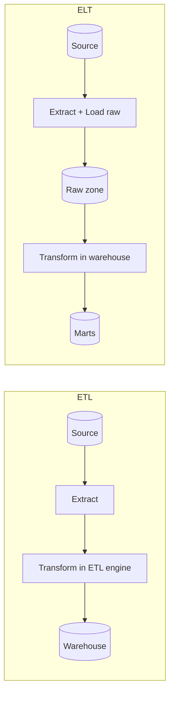

## 🎯 خلاصه

> **ETL** یعنی Extract، **Transform**، و بعد Load. **ELT** یعنی Extract، اول داده‌ی خام را Load کن، و بعد **Transform** را داخل سیستم مقصد انجام بده. سؤال اصلی فقط این است که *تبدیل کجا اجرا می‌شود و داده‌ی خام کی وارد می‌شود*.

- ETL داده را **قبل** از رسیدن به انبار تمیز و بازشکل‌دهی می‌کند. وقتی انبارها گران و ضعیف بودند، این روش پیش‌فرض بود.
- ELT اول داده‌ی خام را وارد می‌کند و بعد با قدرت محاسباتی خود انبار تبدیلش می‌کند. وقتی ذخیره‌سازی ارزان شد و انبارهای MPP قوی شدند، رایج شد.
- برای تحلیل، ELT را پیش‌فرض بگیر. ETL را برای مواردی نگه دار که داده‌ی خام نباید به شکل اصلی وارد شود: PII که باید ماسک شود، payloadهای باینری یا تودرتوی سنگین که باید parse شوند، یا داده‌ای که قبل از ذخیره باید کوچک شود.
- هر دو الگو هستند، نه محصول. بیشتر سیستم‌های واقعی ترکیبی‌اند: یک تبدیل کوچک قبل از ورود، و بیشتر منطق کسب‌وکار بعد از آن.

## 🌱 از ساده شروع کنیم (مبتدی)

> **💡 مثال:** آشپزخانه‌ی یک رستوران. در **ETL** آشپز در اتاق پشتی غذا را می‌پزد و آماده می‌کند، و فقط غذای آماده را به میز می‌برد. در **ELT** کامیون‌ها همه‌ی مواد خام را در یک انبار بزرگ خالی می‌کنند، و آشپزها هر غذا را وقت سفارش از همان انبار درست می‌کنند. طراحی دوم به انبار بزرگ و مرتب نیاز دارد، ولی می‌توانی دستور پخت را بعداً عوض کنی بدون اینکه دوباره مواد را بخری.

سه مرحله داریم که در هر دو الگو یکی‌اند:

1. **Extract**: داده را از منبع بخوان (یک پایگاه‌داده‌ی OLTP، یک API، یک فایل لاگ).
2. **Transform**: نوع‌ها را تمیز کن، تکراری‌ها را حذف کن، با داده‌ی مرجع join کن، ستون‌های محاسباتی بساز.
3. **Load**: نتیجه را در مقصد بنویس، معمولاً یک انبار داده یا یک جدول lakehouse.

تنها فرق، ترتیب مراحل ۲ و ۳ است. همان هدف را با هر دو روش در زیر می‌بینی. فرض کن جدول سفارش‌های منبع داریم که ستون `amount` آن متن است و پسوند ارز دارد.

```sql
-- Source (raw, as the app wrote it)
-- orders_raw(order_id, amount_text, status, created_at)
-- e.g. ('o1', '120000 IRR', 'paid', '2026-03-01 10:22:00')

-- ETL: the transform already ran outside the warehouse,
-- so the warehouse only receives clean typed rows.
INSERT INTO dw.fact_orders (order_id, amount_irr, status, order_date)
VALUES ('o1', 120000, 'paid', DATE '2026-03-01');

-- ELT: the raw row is loaded as it is, then transformed in the warehouse.
-- Step 1 (load): raw.orders_raw already contains the text value.
-- Step 2 (transform), run inside the warehouse:
CREATE TABLE analytics.fact_orders AS
SELECT order_id,
       CAST(REPLACE(amount_text, ' IRR', '') AS INTEGER) AS amount_irr,
       status,
       CAST(created_at AS DATE)                          AS order_date
FROM raw.orders_raw
WHERE status = 'paid';
```

نسخه‌ی ELT جدول `raw.orders_raw` را دست‌نخورده نگه می‌دارد. اگر بعداً در تبدیل cast خطایی پیدا کنی، SQL را درست می‌کنی و `analytics.fact_orders` را دوباره از جدول خام می‌سازی. در نسخه‌ی ETL، ردیف‌های بد دیگر وجود ندارند و تنها راه اصلاح، استخراج دوباره از منبع است.

## 🔧 واقعاً چطور کار می‌کند (متوسط)

**تبدیل کجا اجرا می‌شود.** ETL از یک موتور تبدیل جدا استفاده می‌کند: یک job پایتونی، یک ابزار ETL، یا یک خوشه‌ی Spark که بین منبع و انبار قرار دارد. ELT از موتور خود مقصد استفاده می‌کند: SQL یک انبار (Snowflake، BigQuery، Redshift، ClickHouse، StarRocks) یا خوشه‌ی Spark و Trino که lake تو را می‌خواند.



**چرا ELT پیش‌فرض شد.** سه تغییر آن را عملی کرد:

- **ذخیره‌سازی ارزان روی object storage.** نگه داشتن کل تاریخچه‌ی خام هزینه‌ی کمی دارد، پس همیشه می‌توانی دوباره پردازش کنی.
- **انبارهای موازی‌سازی‌شده‌ی عظیم.** یک موتور SQL که مقیاس می‌گیرد، تبدیل‌های بزرگ را سریع‌تر از یک سرور ETL اجرا می‌کند.
- **ابزار SQL نسخه‌دار.** تبدیل‌ها فایل SQL در Git هستند، تست می‌شوند و به ترتیب اجرا می‌شوند (برای نمونه با مدل‌های سبک [[dbt]]). بازبینی‌شان از job های ETL پنهان آسان‌تر است.

**کارهایی که ETL هنوز بهتر انجام می‌دهد.**

| موضوع | ETL | ELT |
|---|---|---|
| داده‌ی حساس (PII، شماره‌ی کارت) | قبل از ورود ماسک شود | PII خام در انبار است؛ دسترسی باید کنترل شود |
| ورودی باینری یا بدون ساختار (تصویر، PDF، protobuf) | بیرون parse شود و فیلدهای ساختاریافته بارگذاری شوند | داخل SQL parse کردنش سخت است |
| کاهش حجم قبل از ذخیره‌ی پرهزینه | زود فیلتر و تجمیع کن | اول همه چیز را ذخیره و هزینه بده |
| پردازش دوباره‌ی تاریخچه بعد از تغییر منطق | نیاز به استخراج دوباره از منبع دارد | از لایه‌ی خام بازسازی کن |
| هزینه‌ی محاسبه‌ی تبدیل | خوشه‌ی جدا و ثابت | اعتبار انبار به ازای هر query، که می‌تواند سریع بالا برود |
| مهارت تیم | معمولاً پایتون یا ابزار بصری | عمدتاً SQL |

**مثال: ماسک کردن PII قبل از ورود.** یک hash با کلید (HMAC) باعث می‌شود مقدار قابل join بماند بدون اینکه فاش شود. hash ساده‌ی ایمیل را می‌توان با حدس زدن آدرس‌های رایج برگرداند، پس کلید مهم است.

```python
import hmac
import hashlib

SECRET_KEY = b"load-from-a-secret-manager"  # never hard-code in production

def mask_email(email: str) -> str:
    # Same input always gives the same token, so joins and counts still work.
    return hmac.new(SECRET_KEY, email.strip().lower().encode(), hashlib.sha256).hexdigest()

rows = [{"order_id": "o1", "email": "Ali@Example.com"}]
safe = [{"order_id": r["order_id"], "email_token": mask_email(r["email"])} for r in rows]
print(safe)  # the warehouse never sees the raw address
```

**ترکیبی بودن امری عادی است.** یک طراحی رایج در production این است: ماسک کردن و بررسی فرمت به سبک ETL در لبه‌ی سیستم، و بعد ELT برای همه‌ی منطق کسب‌وکار داخل انبار. لازم نیست برای کل شرکت فقط یکی از این دو را انتخاب کنی.

**تأخیر موضوعی جداگانه است.** ELT دسته‌ای طبق زمان‌بندی اجرا می‌شود (ساعتی، روزانه). اگر داده در چند ثانیه لازم داری، از streaming استفاده می‌کنی که در آن «تبدیل» یعنی یک stream processor (Flink، Spark Structured Streaming، Kafka Streams) قبل از sink. ETL/ELT را با batch/stream یکی نگیر: هر دو الگو می‌توانند روی هر کدام اجرا شوند.

## 🧠 عمق و trade-offها (سنیور)

- **مدل هزینه.** ELT هزینه را از زیرساخت ثابت به مصرف (محاسبه و ذخیره‌ی انبار) منتقل می‌کند. حساب کن: یک job روزانه که هر شب ۲۰ ترابایت داده‌ی خام را دوباره اسکن کند، هر بار حدود ۲۰ ترابایت bytes اسکن‌شده دارد، حتی اگر فقط ۱٪ عوض شده باشد. مدل‌های incremental و partition کردن داده‌ی خام بر اساس تاریخ رویداد این را حل می‌کنند.
- **لایه‌ی خام به عنوان قرارداد.** لایه‌ی خام قراردادی با خودِ آینده‌ی توست. schema، زمان بارگذاری و شناسه‌ی batch منبع را نگه دار. بدون شناسه‌ی batch نمی‌توانی بفهمی کدام load یک ردیف بد را ساخته است.
- **تغییر schema (drift).** ELT یک ستون جدید منبع را تحمل می‌کند چون load خام آن را نگه می‌دارد، ولی تبدیل باید تصمیم بگیرد با آن چه کند. ETL معمولاً سریع خطا می‌دهد یا ستون را کنار می‌گذارد. هر دو به monitor نیاز دارند (به [[data-quality]] نگاه کن).
- **محو شدن مرز در lakehouse.** روی lakehouse، «لایه‌ی خام» یک table format (Iceberg، Delta) است و «تبدیل» یک job در Spark یا Trino. برچسب‌ها هنوز مفیدند، ولی موتورها هم‌پوشانی دارند.
- **کی ELT را استفاده نکنیم.** کارت‌های بانکی خام، داده‌ی سلامت یا داده‌ی شخصی تحت قانون را فقط چون ساده‌تر است در یک schema تحلیلی مشترک وارد نکن. همچنین تبدیلی که هر ساعت petabyte ها را دوباره اسکن می‌کند اجرا نکن، وقتی داده به کندی تغییر می‌کند.
- **چه چیزی را monitor کنی.** تأخیر load (از تغییر منبع تا فرود در لایه‌ی خام)، زمان اجرا و هزینه‌ی هر تبدیل، تعداد ردیف در هر مرحله، و تعداد ردیف‌های ناموفق. افت بی‌صدای تعداد ردیف رایج‌ترین خطای ELT است.

## 🧪 امتحان کن

مثال `orders_raw` بالا را بگیر و روی کاغذ جواب بده:

1. کدام‌یک از این‌ها باید در مرحله‌ی ETL بماند و چرا: (الف) cast کردن متن amount، (ب) ماسک کردن ایمیل مشتری، (ج) حذف سفارش‌های تست با `status = 'test'`؟
2. شش ماه بعد باگی در قانون ارز پیدا می‌شود. مراحل بازیابی را برای طراحی ETL و طراحی ELT توضیح بده.

<details><summary>پاسخ نمونه</summary>

۱. (ب) اگر ایمیل خام حساس است باید قبل از ورود انجام شود. (الف) و (ج) در هر کدام از دو جا می‌توانند انجام شوند. ELT برای آن‌ها مشکلی ندارد، چون جدول خام همه‌چیز را نگه می‌دارد و اگر قانون عوض شود می‌توانی دوباره محاسبه کنی.
۲. ETL: بازه‌ی تأثیرپذیرفته را پیدا کن، ردیف‌های آن بازه را اگر منبع هنوز دارد دوباره استخراج کن، دوباره تبدیل و بارگذاری کن. ممکن است منبع داده‌ی قدیمی را پاک کرده باشد. ELT: SQL را درست کن، مدل‌های تأثیرپذیرفته را از لایه‌ی خام بازسازی کن، و قبل از جایگزینی جدول‌ها تعداد ردیف‌ها را مقایسه کن.

</details>

## 💬 گوشه‌ی مصاحبه

**سؤال:** «ETL یا ELT، و چرا؟»

> **🎤 این را در مصاحبه بگو:** «برای تحلیل روی یک انبار یا lakehouse مدرن، پیش‌فرضم ELT است: داده‌ی خام را همراه متادیتای load بارگذاری می‌کنم و بعد با SQL نسخه‌دار تبدیل می‌کنم. این تاریخچه‌ی خام را نگه می‌دارد، پس تغییر منطق یعنی بازسازی، نه استخراج دوباره. به ETL سوییچ می‌کنم برای موارد مشخص: PII که باید قبل از ذخیره ماسک شود، payloadهای باینری که باید parse شوند، یا حجمی که برای هزینه باید کم شود. در عمل بیشتر سیستم‌ها ترکیبی‌اند.»

جواب میان‌سطح trade-off را نام می‌برد (هزینه‌ی محاسبه، تاریخچه‌ی خام). جواب سنیور حالت‌های خطا را هم اضافه می‌کند: لایه‌ی خام بدون شناسه‌ی batch، تبدیلی که همه‌چیز را دوباره اسکن می‌کند، و PII که وارد schema مشترک می‌شود.

## ⚠️ اشتباهات رایج

- **«ELT یعنی قبل از load هیچ تبدیلی نداریم.»** بسیاری از pipelineهای ELT هنوز تمیزکاری سبک، مثل بررسی نوع، ماسک کردن و حذف تکراری‌های batch، را قبل از load خام انجام می‌دهند.
- **لایه‌ی خام را انبار زباله دانستن.** بدون schema، شناسه‌ی batch و زمان load، ردیابی غیرممکن می‌شود.
- **انتخاب ETL از روی عادت** برای داده‌ی تحلیلی که نیازی به ماسک ندارد. در این صورت بدون دلیل توانایی پردازش دوباره را از دست می‌دهی.
- **نادیده گرفتن هزینه‌ی انبار.** ELT ساخت آسانی دارد و اجرای پرهزینه هم آسان است. bytes اسکن‌شده را به ازای هر مدل زیر نظر بگیر.
- **قاطی کردن ETL/ELT با batch/stream.** هر دو الگو می‌توانند روی هر کدام اجرا شوند.

## ✅ خودت را بسنج

۱. در ELT تبدیل کجا اجرا می‌شود؟
   - A) در یک سرور ETL جدا قبل از load
   - B) در سیستم مقصد، بعد از اینکه داده‌ی خام بارگذاری شد
   - C) در پایگاه‌داده‌ی منبع، قبل از استخراج
   - D) فقط در ابزار BI

<details><summary>پاسخ</summary>

**B** — ELT ابتدا داده‌ی خام را load می‌کند و بعد از محاسبه‌ی مقصد (SQL انبار، یا Spark و Trino روی lake) برای تبدیل استفاده می‌کند.

</details>

۲. کدام نیاز بیشترین دلیل را برای ماسک کردن به سبک ETL قبل از ورود داده دارد؟
   - A) گزارش‌های درآمد روزانه
   - B) ذخیره‌ی شماره‌ی کارت خام مشتری که تحلیلگران هرگز نباید ببینند
   - C) join کردن سفارش‌ها با بُعد محصول
   - D) ساخت داشبورد با جمع‌های هفتگی

<details><summary>پاسخ</summary>

**B** — مقادیر حساس نباید در schema مشترک بنشینند. قبل از load ماسک یا tokenize شوند. سه گزینه‌ی دیگر کار تحلیلی عادی‌اند که ELT به خوبی انجام می‌دهد.

</details>

۳. نُه ماه بعد باگی در یک تبدیل ELT پیدا می‌شود. تمیزترین راه بازیابی کدام است؟
   - A) استخراج کل تاریخچه از منبع دوباره
   - B) اصلاح SQL و بازسازی مدل‌های تأثیرپذیرفته از لایه‌ی خام
   - C) حذف انبار و شروع از صفر
   - D) اصلاح دستی ردیف‌ها در BI

<details><summary>پاسخ</summary>

**B** — لایه‌ی خام تاریخچه را نگه می‌دارد، پس از آن بازسازی می‌کنی. گزینه‌ی A کاری است که ETL مجبورت می‌کند انجام دهی، و ممکن است غیرممکن باشد اگر منبع داده‌ی قدیمی را پاک کرده باشد.

</details>

۴. **(سنیور)** یک تیم به ELT مهاجرت می‌کند و در یک ماه قبض انبار دو برابر می‌شود، با اینکه حجم داده فقط ۱۰٪ رشد کرده. محتمل‌ترین علت و اولین اصلاح چیست؟

   - A) انبار به یک instance بزرگ‌تر نیاز دارد؛ محاسبه‌ی بیشتری بخر
   - B) بازسازی کامل مدل‌های بزرگ در هر اجرا؛ مدل‌های سنگین را به پردازش incremental تبدیل کن و داده‌ی خام را بر اساس تاریخ رویداد partition کن
   - C) ELT همیشه گران‌تر از ETL است؛ به ETL برگرد
   - D) لایه‌ی خام باید حذف شود تا فضا ذخیره شود

<details><summary>پاسخ</summary>

**B** — بازسازی کامل یعنی در هر اجرا کل تاریخچه اسکن می‌شود، پس هزینه با کل حجم رشد می‌کند، نه با داده‌ی جدید. مدل‌های incremental که فقط partitionهای جدید را پردازش می‌کنند، به همراه partition pruning روی جدول خام، علت را برطرف می‌کنند. خرید محاسبه‌ی بیشتر فقط مشکل را پنهان می‌کند.

</details>

## 🗂️ فلش‌کارت

| Front | Back |
|---|---|
| ETL در یک جمله | Extract، تبدیل بیرون از مقصد، و بعد load داده‌ی تمیز |
| ELT در یک جمله | Extract، load خام در مقصد، و بعد تبدیل همان‌جا |
| دلیل اصلی رواج ELT | ذخیره‌سازی ارزان و انبارهای MPP قوی، پس نگه داشتن تاریخچه‌ی خام مقرون‌به‌صرفه است |
| مورد استفاده‌ی ماسک به سبک ETL | PII یا رازهایی که نباید هرگز وارد انبار مشترک شوند |
| چرا لایه‌ی خام نگه داشته شود | پردازش دوباره بعد از تغییر منطق بدون استخراج دوباره از منبع |
| لایه‌ی خام علاوه بر داده چه چیزی لازم دارد | زمان load و شناسه‌ی batch منبع برای ردیابی |
| اصلی‌ترین ریسک هزینه در ELT | بازسازی کامل که هر اجرا تاریخچه‌ی رو به رشد را اسکن می‌کند |
| آیا ELT همیشه دسته‌ای است؟ | نه. هر دو الگوی ETL و ELT می‌توانند روی موتورهای batch یا streaming اجرا شوند |

## 🔗 ادامه

- برای زمینه‌ی انباری که ELT را عملی می‌کند، [[dwh-fundamentals]] را بخوان.
- [[pattern-batch-etl]] یک طراحی کامل ETL دسته‌ای را با زمان‌بندی و backfill نشان می‌دهد.
- [[dbt]] توضیح می‌دهد که مدل‌های SQL نسخه‌دار چطور بخش «T» در ELT را پیاده می‌کنند.
- [[data-quality]] بررسی‌هایی را توضیح می‌دهد که باید هم روی لایه‌ی خام و هم روی لایه‌ی تبدیل‌شده اجرا شوند.
- قبل از انتخاب طراحی، مستندات MERGE، partitioning و قابلیت‌های incremental موتور خودت را بخوان؛ پیش‌فرض‌ها بین انبارها متفاوت است.
