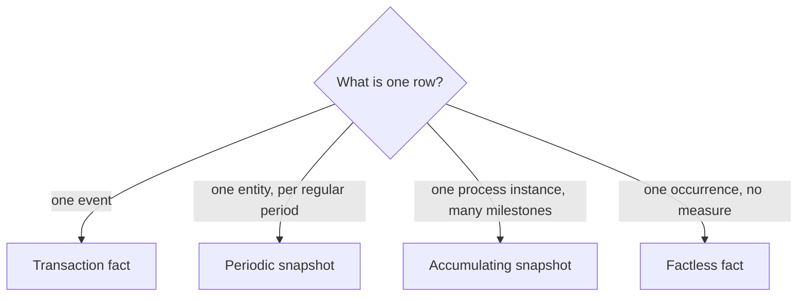

## 🎯 خلاصه

> یک **fact table** یک grain دارد، و grain آن نوعش را مشخص می‌کند. چهار نوع داریم: **transaction** (یک ردیف برای هر رویداد)، **periodic snapshot** (یک ردیف برای هر موجودیت در هر دوره‌ی منظم)، **accumulating snapshot** (یک ردیف برای هر نمونه‌ی فرایند، که با رسیدن به هر milestone به‌روز می‌شود) و **factless** (ردیف‌هایی که ثبت می‌کنند چیزی اتفاق افتاده، بدون معیار عددی).

- factهای transaction به این سؤال جواب می‌دهند: «چه اتفاقی افتاد و کِی؟». رایج‌ترین نوع‌اند و بارگذاری‌شان ساده‌ترین است.
- periodic snapshotها به این سؤال جواب می‌دهند: «وضعیت در پایان هر روز یا ماه چه بود؟»
- accumulating snapshotها به این سؤال جواب می‌دهند: «هر مرحله‌ی یک فرایند چقدر طول کشید؟»
- factless factها به این سؤال جواب می‌دهند: «کدام ترکیب‌ها رخ داده‌اند؟» (حضور، ثبت‌نام، پوشش تبلیغ)

## 🌱 از ساده شروع کنیم (مبتدی)

> **💡 تشبیه:** چهار راه برای ثبت یک سال تحصیلی. fact از نوع **transaction** مثل یک فیلمی است که هر رویداد را ضبط می‌کند. **periodic snapshot** مثل عکسی است که هر ماه در یک روز مشخص گرفته می‌شود. **accumulating snapshot** مثل یک کارت پروژه است که با هر milestone تاریخ آن در کارت پر می‌شود. **factless** مثل برگه‌ی حضور و غیاب است: اسم و تاریخ دارد، ولی مبلغ ندارد.

نوع را با یک سؤال انتخاب کن: **یک ردیف چیست؟**

```sql
-- Transaction: one row per payment
CREATE TABLE fact_payment_txn (
  txn_id      bigint PRIMARY KEY,
  date_sk     int,
  account_sk  int,
  merchant_sk int,
  amount      numeric(14,2),
  txn_ts      timestamp
);

-- Periodic snapshot: one row per account per day, even with no activity
CREATE TABLE fact_account_daily (
  date_sk           int,
  account_sk        int,
  closing_balance   numeric(14,2),
  deposits_today    numeric(14,2),
  withdrawals_today numeric(14,2),
  PRIMARY KEY (date_sk, account_sk)
);
```

یک fact از نوع transaction وقتی هیچ اتفاقی نیفتد ردیفی ندارد. یک periodic snapshot برای هر حساب در هر روز ردیف دارد، حتی روزهای بی‌تحرک. همین تفاوت بیشتر تصمیم‌های طراحی زیر را توضیح می‌دهد.



## 🔧 واقعاً چطور کار می‌کند (متوسط)

**۱. Transaction fact.** یک ردیف برای هر رویداد کسب‌وکار، در grain خود رویداد. این جدول append-only، sparse و additive است. ردیف‌ها هرگز به‌روز نمی‌شوند؛ اصلاح یعنی یک ردیف جدید، یا یک ردیف جبرانی.

**۲. Periodic snapshot.** یک ردیف برای هر موجودیت در هر دوره‌ی ثابت (روز، ماه). وضعیت را در پایان دوره ثبت می‌کند. موجودی پایانی **semi-additive** است: می‌شود آن را برای یک روز روی حساب‌ها جمع زد، ولی روی روزها نه. واریزی‌ها additive هستند.

```sql
-- Total money held by the bank on one day: correct (sum across accounts)
SELECT SUM(closing_balance) FROM fact_account_daily WHERE date_sk = 20260115;

-- Wrong: summing balances across days
SELECT SUM(closing_balance) FROM fact_account_daily
WHERE account_sk = 42 AND date_sk BETWEEN 20260101 AND 20260131;
```

برای دومی از `AVG` برای میانگین موجودی، یا مقدار آخرین روز برای موجودی پایان ماه استفاده کن.

**۳. Accumulating snapshot.** یک ردیف برای هر نمونه‌ی فرایند (یک سفارش، یک ادعای بیمه، یک درخواست وام). برای هر milestone یک ستون تاریخ دارد. ردیف با پیشرفت فرایند **به‌روز** می‌شود و ستون‌های lag کم‌کم پر می‌شوند.

```sql
CREATE TABLE fact_order_pipeline (
  order_number      text PRIMARY KEY,
  customer_sk       int,
  ordered_date_sk   int,
  shipped_date_sk   int,      -- NULL (or -1, the unknown member) until shipped
  delivered_date_sk int,      -- NULL until delivered
  order_amount      numeric(12,2),
  days_to_ship      int,      -- computed by the pipeline from the two dates
  status            text
);

-- The order ships: one update moves the row forward
UPDATE fact_order_pipeline
SET shipped_date_sk = 20260112,
    days_to_ship    = 2,
    status          = 'shipped'
WHERE order_number = 'SO-1001';
```

سفارش‌هایی که هرگز ارسال نمی‌شوند، `shipped_date_sk` نامشخص دارند، پس «سفارش‌هایی که بیش از ۵ روز در انبار مانده‌اند» یک کوئری ساده است.

**۴. Factless fact.** جدولی که فقط کلید dimension دارد. دو کاربرد رایج دارد:

- **وقوع یک رویداد:** `fact_attendance(date_sk, student_sk, class_sk)`. یک ردیف یعنی «این دانشجو در آن روز در این کلاس حاضر بود». شمارش ردیف‌ها خود معیار است.
- **پوشش (coverage):** `fact_promo_coverage(date_sk, store_sk, product_sk)`. یک ردیف یعنی «این محصول در این فروشگاه در آن روز تبلیغاتی بود»، چه فروخته شده باشد چه نه. coverage امکان پرسیدن «تبلیغ داشت ولی فروش نداشت» را می‌دهد.

```sql
-- Promoted products in store 7 on one day, with their sales (0 if none)
SELECT c.product_sk,
       COUNT(s.product_sk) AS units_sold_rows
FROM fact_promo_coverage c
LEFT JOIN fact_sales s
  ON  s.product_sk = c.product_sk
  AND s.date_sk    = c.date_sk
  AND s.store_sk   = c.store_sk
WHERE c.date_sk = 20260115 AND c.store_sk = 7
GROUP BY c.product_sk;
```

`COUNT(s.product_sk)` فقط فروش‌های متصل را می‌شمارد. `COUNT(*)` برای هر محصول تبلیغ‌شده عدد ۱ می‌شمارد، حتی محصولاتی که فروش نداشته‌اند.

## 🧠 عمق و trade-offها (سنیور)

- **رشد snapshot.** یک snapshot روزانه از ۱۰ میلیون حساب یعنی ۱۰ میلیون ردیف در روز، یا حدود ۳٫۶۵ میلیارد ردیف در سال، حتی اگر بیشتر حساب‌ها کاری نکنند. جدول را بر اساس تاریخ partition کن، و snapshot را فقط برای موجودیت‌هایی بساز که کسب‌وکار وضعیتشان را می‌خواهد. یا snapshot را روی تقاضا از روی transactionها بساز، به قیمت زمان کوئری بیشتر.
- **چه کسی snapshot را می‌سازد.** periodic snapshot معمولاً توسط یک job زمان‌بندی‌شده از روی transactionها به‌علاوه‌ی موجودی اولیه ساخته می‌شود. job باید idempotent باشد (ببین [[idempotency]]): اجرای دوباره‌ی یک روز باید ردیف‌های آن روز را جایگزین کند، نه اینکه اضافه کند. بازپرکردن تاریخچه (backfill) هم از همان transactionها تاریخچه را بازسازی می‌کند.
- **accumulating snapshotها سنگین از نظر به‌روزرسانی‌اند.** در یک row store ساده‌اند. در lakehouse یا warehouse ستونی، هر به‌روزرسانی یک فایل یا partition را بازنویسی می‌کند، پس جدولی با میلیون‌ها به‌روزرسانی در روز نیاز به طراحی عمدی دارد: به‌روزرسانی‌ها را دسته‌ای کن، در هر micro-batch با `MERGE` اعمال کن، یا یک log از رویدادها نگه دار و وضعیت فعلی را از روی آن بساز.
- **milestoneهای دیرهنگام.** رویداد تحویل ممکن است قبل از رویداد ارسال برسد. تصمیم بگیر pipeline آخرین مقدار را برای هر milestone نگه می‌دارد یا اولین را، و تست کن که معیارهای lag هرگز منفی نشوند.
- **پوشش factless یک cross product متراکم است.** تبلیغ ضربدر فروشگاه ضربدر روز می‌تواند سریع رشد کند. فقط ترکیب‌های برنامه‌ریزی‌شده را ذخیره کن، و مسیر `LEFT JOIN` را تست کن، چون یک کلید join گم‌شده بی‌صدا «نفروخته» را به یک ردیف گم‌شده تبدیل می‌کند.
- **مانیتور کن.** برای factهای transaction، جمع‌ها را با منبع تطبیق بده. برای periodic snapshotها، بررسی کن که هر موجودیت در هر دوره ردیف داشته باشد. برای accumulating snapshotها، هشدار بده وقتی ردیفی بیش از حد آستانه در یک مرحله گیر کرده است.
- **کِی هر نوع را استفاده نکنیم.** از accumulating snapshot استفاده نکن وقتی تاریخچه‌ی کامل هر تغییر را لازم داری؛ آن را در یک fact رویدادی نگه دار. از periodic snapshot برای موجودیت‌هایی که به ندرت عوض می‌شوند استفاده نکن، اگر transaction fact به‌علاوه‌ی یک window function جواب سؤال را می‌دهد.

## 🧪 امتحان کن

یک شرکت حمل‌ونقل سه fact می‌خواهد: هر حرکت کامیون، تعداد کامیون‌های پارک‌شده در هر انبار در پایان هر روز، و چرخه‌ی عمر هر محموله (ایجاد، تحویل از مبدأ، تحویل به مقصد).

1. به هر یک از سه نیاز یک نوع fact بده و grain را بنویس.
2. کدام یک accumulating snapshot است، و کدام ستون یک معیار lag می‌شود؟
3. کدام معیار در fact روزانه‌ی انبار semi-additive است؟

<details><summary>راه‌حل را ببین</summary>

1. حرکت کامیون‌ها: **transaction**، grain = یک رویداد حرکت. کامیون‌های پارک‌شده در هر انبار در هر روز: **periodic snapshot**، grain = یک انبار در یک روز. چرخه‌ی عمر محموله: **accumulating snapshot**، grain = یک محموله.
2. چرخه‌ی عمر محموله همان accumulating snapshot است. یک معیار lag می‌شود `days_pickup_to_delivery`، که وقتی milestone تحویل پر می‌شود محاسبه می‌شود.
3. `trucks_parked` semi-additive است: می‌شود آن را برای یک روز روی انبارها جمع زد، ولی روی روزها نه.

</details>

## 💬 گوشه‌ی مصاحبه

**سؤال: «accumulating snapshot چیست و کِی از آن استفاده می‌کنی؟»** جواب متوسط: «یک جدول fact که برای هر فرایند یک ردیف دارد، با یک تاریخ برای هر milestone، و با پیشرفت فرایند به‌روز می‌شود.» جواب سنیور trade-off را هم اضافه می‌کند: «پرسش‌های مدت هر مرحله را ساده می‌کند، ولی به‌روزرسانی‌اش سنگین است؛ پس در lakehouse به‌روزرسانی‌ها را دسته‌ای می‌کنم و تاریخچه‌ی کامل را در یک fact رویدادی نگه می‌دارم.»

**سؤال: «محصولاتی را بشمار که تبلیغ داشتند ولی فروش نداشتند.»** جواب متوسط: «از یک factless coverage و یک left join به فروش استفاده می‌کنم.» جواب سنیور: «coverage جمعیت را می‌دهد و left join تطبیق‌ها را. کلید متصل‌شده را می‌شمارم، نه `*`، تا ردیف‌های بی‌تطابق صفر حساب شوند. روی یک روز با یک محصول مشخص که فروش صفر دارد تستش می‌کنم.»

> **🎤 این را در مصاحبه بگو:** «نوع fact را از grain انتخاب می‌کنم: یک رویداد می‌شود transaction fact، یک وضعیت منظم می‌شود periodic snapshot، یک فرایند با milestone می‌شود accumulating snapshot، و یک وقوع محض می‌شود factless fact.»

## ⚠️ اشتباهات رایج

> **⚠️ توجه:** جمع زدن موجودی یک periodic snapshot در طول روزها. هر روز از قبل مجموع جاری را دارد، پس جمع همان پول را بارها می‌شمارد.

> **⚠️ توجه:** استفاده از `COUNT(*)` روی join پوشش factless. ردیف تبلیغ همیشه وجود دارد، پس هر محصول تبلیغ‌شده فروخته‌شده به نظر می‌رسد.

- استفاده از transaction fact برای سؤال‌های «وضعیت فعلی» و محاسبه‌ی وضعیت در هر داشبورد.
- ساختن periodic snapshot بدون ردیف برای روزهای بی‌تحرک، طوری که «موجودی روز X» بی‌صدا چیزی برنگرداند.
- به‌روزرسانی در جا یک accumulating snapshot بدون در نظر گرفتن هزینه‌اش در ذخیره‌سازی ستونی.
- استفاده از NULL برای «هنوز اتفاق نیفتاده» در یک جدول و عدد unknown member یعنی `-1` برای همان چیز در جدول دیگر، که باعث می‌شود کوئری‌ها درباره‌ی تعداد سفارش‌های باز با هم نخوانند.
- فراموش کردن grain یک snapshot وقتی آن را به یک transaction fact join می‌کنی، که ردیف‌ها را ضرب می‌کند.

## ✅ خودت را بسنج

1. یک جدول یک ردیف برای هر محصول در هر فروشگاه در هر روز با موجودی پایانی دارد. این چه نوع fact است؟
   - A) Transaction fact
   - B) Periodic snapshot
   - C) Accumulating snapshot
   - D) Factless fact

<details><summary>جواب</summary>

**B** — یک ردیف برای هر موجودیت در هر دوره‌ی منظم، که وضعیت را در پایان دوره ثبت می‌کند. موجودی یک وضعیت است، نه یک رویداد.

</details>

2. کدام نوع در طول milestoneهای یک فرایند در جا به‌روز می‌شود؟
   - A) Transaction fact
   - B) Periodic snapshot
   - C) Accumulating snapshot
   - D) Factless fact

<details><summary>جواب</summary>

**C** — هر نمونه‌ی فرایند یک ردیف دارد که ستون‌های milestone‌اش در طول زمان پر می‌شوند. transaction factها append-only هستند.

</details>

3. جدول `fact_attendance(date_sk, student_sk, class_sk)` هیچ ستون عددی ندارد. این چیست؟
   - A) یک جدول dimension
   - B) یک transaction fact
   - C) یک factless fact (وقوع یک رویداد)
   - D) یک جدول bridge

<details><summary>جواب</summary>

**C** — این جدول ثبت می‌کند که یک رویداد رخ داده است. هر ردیف ترکیبی از کلیدهاست، و حضور شمرده می‌شود، جمع زده نمی‌شود.

</details>

4. **(سنیور)** snapshot روزانه‌ی حساب‌ها برای هر حساب و هر روز موجودی دارد، و یک تحلیلگر موجودی‌ها را در ژانویه جمع زده تا «کل پولی که در ژانویه نگه داشته شده» را بدست آورد. اشکال کار کجاست و معیار درست چیست؟

   - A) هیچ اشکالی ندارد؛ جمع درست است
   - B) موجودی‌ها semi-additive هستند: جمع در طول روزها همان پول را بارها می‌شمارد؛ از میانگین موجودی روزانه یا موجودی پایان ماه استفاده کن
   - C) snapshotها اصلاً قابل جمع نیستند، پس جدول باید به transaction fact تبدیل شود
   - D) راه‌حل اضافه کردن `DISTINCT` است

<details><summary>جواب</summary>

**B** — هر روز از قبل مجموع جاری را دارد. میانگین یا مقدار پایان ماه معیار معنادار است.

</details>

5. **(سنیور)** تیمی می‌خواهد «زمان از سفارش تا تحویل» را برای هر سفارش داشته باشد، اما جدول سفارش یک transaction fact از تغییر وضعیت‌هاست. کدام طراحی ساده‌ترین کوئری را می‌دهد و نگه‌داشتنش چه هزینه‌ای دارد؟

   - A) transaction fact را نگه دار و برای هر مرحله در هر داشبورد آن را self-join کن
   - B) یک accumulating snapshot با یک ردیف برای هر سفارش و تاریخ‌های milestone بساز؛ هزینه‌اش کار به‌روزرسانی است که دسته‌ای و تست‌شده انجام می‌دهی
   - C) یک periodic snapshot از سفارش‌ها در هر روز بساز
   - D) lag را فقط در ابزار BI نگه دار

<details><summary>جواب</summary>

**B** — accumulating snapshot معیارهای lag را به یک تفریق ساده تبدیل می‌کند. هزینه‌اش به‌روزرسانی در هر milestone است که pipeline باید آن را کارآمد و بدون تکرار انجام دهد.

</details>

## 🗂️ فلش‌کارت

| Front | Back |
|---|---|
| Transaction fact | یک ردیف برای هر رویداد؛ append-only؛ sparse (وقتی اتفاقی نیفتد ردیفی نیست) |
| Periodic snapshot | یک ردیف برای هر موجودیت در هر دوره‌ی منظم، حتی دوره‌های بی‌تحرک |
| Accumulating snapshot | یک ردیف برای هر نمونه‌ی فرایند، که با رسیدن milestoneها به‌روز می‌شود |
| Factless fact | فقط کلید؛ ثبت وقوع (حضور) یا پوشش (تبلیغ) |
| Semi-additive measure | فقط روی بعضی dimensionها قابل جمع (موجودی روی حساب‌ها، نه روی روزها) |
| بررسی grain یک snapshot | اگر موجودیت‌های بی‌تحرک ردیف ندارند، جدول transaction fact است، نه snapshot |
| شمارش پوشش | بعد از left join، کلید متصل‌شده را بشمار (`COUNT(s.product_sk)`)، نه `COUNT(*)` |
| Lag measure | تفاضل دو تاریخ milestone، وقتی تاریخ دومی پر می‌شود محاسبه می‌شود |

## 🔗 ادامه

- `dimensional-modeling`: grain، dimensionها و factها، پایه‌ی هر نوع fact.
- `scd`: چطور dimensionهایی که به این factها join می‌شوند در طول زمان تغییر می‌کنند.
- `pattern-history`: نگه داشتن تاریخچه وقتی منبع فقط وضعیت فعلی را دارد.
- `modeling-levels`: جای انواع fact در مدل‌سازی مفهومی، منطقی و فیزیکی.
- `sql-window-functions`: محاسبه‌ی موجودی‌های جاری و lagها وقتی آن‌ها را ذخیره نمی‌کنی.
