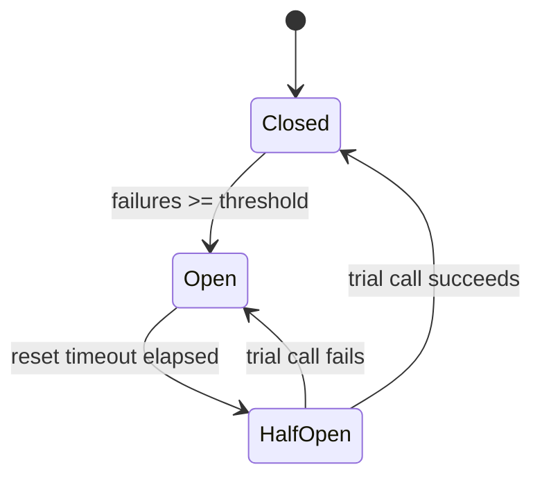
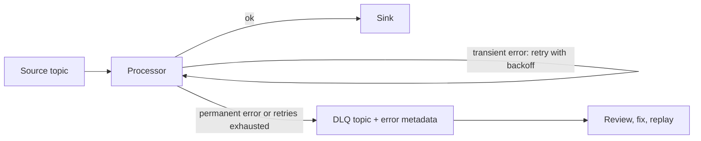

## 🎯 خلاصه

> **fault tolerance** (تحمل خطا) یعنی سیستم وقتی بخشی از آن خراب می‌شود باز هم نتیجه‌ی درست تولید کند. خرابی را نمی‌شود همیشه جلوگیری کرد؛ آن را فرض می‌گیری و طوری طراحی می‌کنی که خرابی فقط یک retry، یک restart یا یک رکورد نگه‌داشته‌شده هزینه داشته باشد، نه یک عدد غلط یا یک pipeline خراب.

- خطاهای **گذرا** را با **exponential backoff** و **jitter** دوباره امتحان کن، و فقط برای عملیاتی که امنِ تکرارند.
- یک **circuit breaker** وقتی یک وابستگی واضحاً خاموش است، فراخوانی‌ها به آن را متوقف می‌کند تا وقت و بار تلف نشود.
- **checkpoint** پیشرفت و state یک job را ذخیره می‌کند، پس restart از یک نقطه‌ی مشخص ادامه می‌دهد، نه از صفر.
- **dead letter queue (DLQ)** رکوردهایی را نگه می‌دارد که مدام شکست می‌خورند، تا یک رکورد بد بقیه را معطل نکند.
- **replay** داده را از log پایدار دوباره پردازش می‌کند؛ و فقط وقتی درست است که sink، **idempotent** باشد.

## 🌱 از ساده شروع کنیم (مبتدی)

> **💡 تشبیه:** یک بسته‌ی پستی را می‌فرستی و پیک تحویل نمی‌دهد. بلافاصله ده پیک با هم نمی‌فرستی. یک ساعت بعد دوباره امتحان می‌کنی، بعد دو ساعت بعد، بعد چهار ساعت. اگر آدرس اصلاً وجود ندارد، هیچ انتظاری کمک نمی‌کند، پس بسته را روی قفسه‌ی «مشکل‌دار» می‌گذاری و بعداً بررسی‌اش می‌کنی.

کل این درس در یک تصویر:

- بعضی خطاها **خودبه‌خود رفع می‌شوند** (یک قطعی کوتاه شبکه، یک سرور شلوغ). دوباره امتحانشان کن.
- بعضی خطاها **رفع نمی‌شوند** (آدرس اشتباه، رکورد با فرمت بد). بی‌نهایت تکرارشان نکن؛ کنارشان بگذار.
- بعضی وابستگی‌ها **مدتی خاموش‌اند**. مدتی صدایشان نزن، بعد با احتیاط بررسی کن برگشته‌اند یا نه.
- اگر وسط کار کرش کنی، باید بدانی **کجا ایستادی**. آن نقطه را مرتب ذخیره کن.

pipeline داده‌ای که این چهار حالت را بی‌صدا و درست مدیریت کند، خیلی ارزشمندتر از pipelineای است که در روز خوب سریع است.

## 🔧 واقعاً چطور کار می‌کند (متوسط)

### اول خطا را دسته‌بندی کن

قبل از انتخاب الگو، مشخص کن از چه نوع خطایی است:

| نوع | مثال | اقدام |
|---|---|---|
| گذرا | timeout، ۵۰۳، ۴۲۹ (rate limit)، connection reset | retry با backoff |
| دائمی | ۴۰۰ درخواست بد، عدم تطابق schema، فیلد ناشناخته | retry نکن؛ به DLQ ببر |
| مبهم | timeout **بعد از** این‌که نوشتن شاید موفق شده | فقط اگر عملیات idempotent است retry کن |
| سیستمی | دیتابیس ۲۰ دقیقه خاموش است | circuit breaker، مکث، و هشدار |

حالت **مبهم** چیزی است که بیشتر آدم‌ها از قلم می‌اندازند. وقتی درخواستی timeout می‌شود، نمی‌دانی سرور پردازشش کرده یا نه. retry یک فراخوانی غیر idempotent (مثلاً «کارت را شارژ کن») ممکن است دو بار شارژ کند. اول نوشتن را idempotent کن؛ به [[idempotency]] نگاه کن.

### retry با exponential backoff و jitter

exponential backoff بعد از هر شکست زمان انتظار را دو برابر می‌کند، تا سرویسِ در تلاش برای بازیابی فضا داشته باشد. **jitter** تصادفی‌سازی اضافه می‌کند، تا هزاران کلاینت دقیقاً در یک لحظه دوباره امتحان نکنند.

```python
import random
import time

class TransientError(Exception):
    """Raised by the client for errors worth retrying (timeouts, 503, 429)."""

def call_with_retry(fn, max_attempts=5, base=0.2, cap=10.0):
    for attempt in range(max_attempts):
        try:
            return fn()
        except TransientError:
            if attempt == max_attempts - 1:
                raise  # give up and let the caller park or alert
            ceiling = min(cap, base * (2 ** attempt))
            time.sleep(random.uniform(0, ceiling))  # "full jitter"
```

با `base=0.2` و `cap=10` سقف انتظارها ۰٫۲، ۰٫۴، ۰٫۸ و ۱٫۶ ثانیه است. زمان واقعی خواب زیر هر سقف تصادفی است، پس میانگین انتظار تقریباً نصف سقف است.

قواعدی که retry را امن نگه می‌دارند:

- فقط خطاهایی را دوباره امتحان کن که بعداً ممکن است موفق شوند. هیچ‌وقت ۴۰۰ را retry نکن.
- هم **تعداد تلاش** و هم **کل زمان** را محدود کن. حلقه‌ی بی‌نهایت یعنی یک outage تولیدشده.
- برای هر سرویس **budget برای retry** داشته باش: اگر ۳۰٪ درخواست‌ها از قبل retry هستند، دیگر retry نکن. وگرنه retryها بار سیستم بیمار را ضرب می‌کنند.
- retry را **داخل** مرز idempotent نگه دار: کل واحد کار را با همان idempotency key دوباره اجرا کن.

### circuit breaker

یک circuit breaker فراخوانی‌های یک وابستگی را در بر می‌گیرد و سه حالت دارد:



- **Closed (بسته):** فراخوانی‌ها عبور می‌کنند؛ شکست‌ها شمرده می‌شوند.
- **Open (باز):** فراخوانی‌ها فوراً شکست می‌خورند، بدون این‌که به وابستگی دست بزنند. این از فراخواننده محافظت می‌کند و به وابستگی زمان برای بازیابی می‌دهد.
- **Half-open (نیمه‌باز):** بعد از reset timeout یک فراخوانی **آزمایشی** مجاز است. موفقیت breaker را می‌بندد؛ شکست دوباره بازش می‌کند.

یک نسخه‌ی کم‌حجم در Python (محدودیت فراخوانی آزمایشی ساده شده؛ breaker واقعی اجازه می‌دهد فقط یک probe نیمه‌باز همزمان عبور کند):

```python
import time

class CircuitBreaker:
    def __init__(self, threshold=5, reset_after=60.0):
        self.threshold = threshold
        self.reset_after = reset_after
        self.failures = 0
        self.opened_at = None

    def allow(self):
        if self.opened_at is None:
            return True                       # closed
        return time.monotonic() - self.opened_at >= self.reset_after  # half-open probe

    def record_success(self):
        self.failures = 0
        self.opened_at = None                 # close again

    def record_failure(self):
        self.failures += 1
        if self.failures >= self.threshold:
            self.opened_at = time.monotonic() # open
```

breaker وقتی مفید است که بدون آن، فراخواننده برای هر درخواست منتظر timeout بماند. بدون breaker، هزار درخواست در ثانیه به یک سرویس مرده تبدیل می‌شود به هزار timeout در ثانیه.

### checkpointing

checkpoint یک snapshot سازگار از پیشرفت job است: offsetهای ورودی که خوانده شده و stateای که ساخته. در Flink، checkpointها با barrier گرفته می‌شوند که از داخل dataflow عبور می‌کند، پس هر operator state‌اش را در همان نقطه‌ی منطقی ذخیره می‌کند. موقع خرابی، job از آخرین checkpoint کامل restart می‌شود و source را از offsetهای ذخیره‌شده دوباره می‌خواند.

این چیزی است که به دست می‌آوری:

- بعد از crash، job حداکثر کار بعد از آخرین checkpoint را از دست می‌دهد، نه کل روز را.
- همراه با یک sink تراکنشی یا idempotent، نتیجه در عمل **exactly-once** است؛ به [[exactly-once]] و [[kafka-exactly-once]] نگاه کن.
- بدون checkpoint، restart یعنی پردازش دوباره از ابتدای log نگه‌داشته‌شده، که ممکن است عملی نباشد.

### dead letter queue

**DLQ** یک topic یا جدول جدا است که رکوردهایی را که قابل پردازش نیستند در آن می‌گذارند، همراه با metadata: payload اصلی، خطا، تعداد تلاش و offset منبع. pipeline اصلی ادامه می‌دهد. کسی یا job‌ای DLQ را مرور می‌کند، علت را رفع می‌کند (تغییر schema، باگ) و رکوردها را replay می‌کند.



بدون DLQ، یک رکورد «زهرآلود» (poison) کل partition را می‌ایستد: job برای همیشه آن را دوباره امتحان می‌کند و هرچه پشتش است منتظر می‌ماند. با DLQ بقیه‌ی partition جریان دارد و رکورد بد هم برای تحلیل نگه داشته می‌شود.

### replay

replay یعنی یک بازه از ورودی را دوباره بخوانی و دوباره پردازش کنی؛ مثلاً بعد از رفع یک باگ یا بازسازی یک sink. سه چیز لازم است: ورودی هنوز نگه‌داشته شده (به [[kafka-retention-compaction]] نگاه کن)، تبدیل deterministic است، و sink idempotent است (تا اجرای دوم بنویسد و تکرار نکند). یک [[backfill]] همان replay است که روی یک بازه‌ی تاریخی اعمال شود.

## 🧠 عمق و trade-offها (سنیور)

- **retryها بار را ضرب می‌کنند.** با سه لایه که هر کدام سه بار retry می‌کنند، یک درخواست شکست‌خورده می‌شود ۲۷ فراخوانی به لایه‌ی پایین. retry را در یک لایه انجام بده، معمولاً آن‌که به خطا نزدیک‌تر است، یا budget بگذار تا کل بار محدود بماند.
- **timeout بخشی از fault tolerance است.** بدون timeout، retry هیچ‌وقت شروع نمی‌شود چون فراخوانی اول هیچ‌وقت تمام نمی‌شود. timeout را از توزیع تأخیر وابستگی تنظیم کن (مثلاً p99 به‌علاوه‌ی حاشیه)، و از deadline خود فراخواننده کوتاه‌تر بگیر.
- **exactly-once ویژگی کل مسیر است.** checkpoint بازیابی می‌دهد؛ نوشتن idempotent یا two-phase commit درستی می‌دهد. قبل از ادعای exactly-once بپرس: وقتی همان رکورد دوبار برسد sink چه می‌کند؟
- **DLQ یک قابلیت با مالک است.** DLQ‌ای که کسی نمی‌خواند، یک انبار از دست‌رفتن داده است. روی رشد آن هشدار بگذار، برایش retention تعیین کن، و مشخص کن چه کسی replay می‌کند و تصحیح را چطور تأیید می‌کنی.
- **circuit breaker به سیگنال خوب نیاز دارد.** اگر فقط خطاهای HTTP 500 را بشماری، timeoutها و پاسخ‌های کند را نمی‌بینی. نرخ خطا و تأخیر را با هم استفاده کن، و breaker را در staging با تزریق خطا تست کن.
- **هزینه‌ی checkpoint.** checkpointهای مکرر با state بزرگ هزینه‌ی I/O دارند و می‌توانند backpressure بسازند (به [[backpressure]] نگاه کن). فاصله را با زمان بازیابی قابل قبولت تنظیم کن: زمان بازیابی تقریباً برابر است با فاصله‌ی checkpoint به‌علاوه‌ی زمان restore به‌علاوه‌ی replay ورودی از آخرین checkpoint.
- **دامنه‌های خرابی.** تکثیر یک سرویس در چند zone کمکی نمی‌کند اگر همه‌ی replicaها یک دیتابیس یا یک deployment بد مشترک داشته باشند. بپرس کدام جزء، دامنه‌ی خرابی مشترک است.
- **chaos testing.** یک worker را بکش، یک لینک شبکه را قطع کن، یک sink را کند کن. طراحی تحمل خطایی که هرگز تست نشده فقط یک فرضیه است.

## 🧪 امتحان کن

روی کاغذ یا در REPL پایتون کار کن. تابع `call_with_retry` بالا را مرجع بگیر.

۱. با `base = 0.5` ثانیه و `cap = 8` ثانیه، سقف انتظارهای backoff برای تلاش‌های ۰ تا ۵ چقدر است؟ حداکثر کل انتظار قبل از این‌که تلاش ششم تسلیم شود چقدر است؟
۲. برای هر خطا بگو retry می‌کنی، به DLQ می‌بری، یا circuit breaker باز می‌کنی: (الف) HTTP 429، (ب) HTTP 400 با پیام «unknown field `sku`»، (ج) ۴۰ timeout پشت‌سرهم در ۶۰ ثانیه، (د) timeout روی یک `POST` که کارت را شارژ می‌کند، بدون idempotency key.
۳. یک job در Flink از checkpoint‌ای که ۳ دقیقه پیش گرفته شده restart می‌شود. topic ورودی ۷ روز نگه می‌دارد. آیا بازیابی ممکن است، و برای درستی خروجی درباره‌ی sink چه چیزی باید درست باشد؟

<details><summary>پاسخ‌ها را ببین</summary>

**۱.** سقف‌ها `min(8, 0.5 × 2^n)` می‌شوند: ۰٫۵، ۱، ۲، ۴، ۸، ۸ برای تلاش‌های ۰ تا ۵. تا قبل از تلاش ششم پنج انتظار داریم (بعد از تلاش‌های ۰ تا ۴)، پس حداکثر مجموع سقف‌ها ۰٫۵ + ۱ + ۲ + ۴ + ۸ = **۱۵٫۵ ثانیه** است. با full jitter میانگین خواب تقریباً نصف این است.

**۲.**
- (الف) **retry با backoff**: ۴۲۹ سیگنال گذرای rate limit است.
- (ب) **به DLQ ببر**: خطای دائمی schema با گذشت زمان بهتر نمی‌شود.
- (ج) **circuit breaker را باز کن**: وابستگی واضحاً خاموش است؛ فراخوانی را متوقف کن و هشدار بده.
- (د) **بی‌دلیل retry نکن.** نوشتن مبهم و غیر idempotent است. اول idempotency key اضافه کن، بعد با همان کلید retry کن تا کارت حداکثر یک بار شارژ شود.

**۳.** بله، بازیابی ممکن است: ورودی ۷ روز نگه داشته می‌شود، پس job می‌تواند از offsetهای ذخیره‌شده‌ی checkpoint دوباره بخواند. job حدود ۳ دقیقه ورودی را دوباره پردازش می‌کند. برای درستی خروجی، sink باید idempotent یا تراکنشی باشد، تا رکوردهای دوباره‌پردازش‌شده overwrite شوند یا یک بار commit شوند و تکرار نشوند.

</details>

## 💬 گوشه‌ی مصاحبه

**سؤال: «یک pipeline را چطور تحمل‌پذیر خطا می‌کنی؟»** پاسخ متوسط: «retry با exponential backoff، یک dead letter queue برای رکوردهای بد، و checkpoint تا job بتواند restart شود.» پاسخ سنیور: «اول خطاها را دسته‌بندی می‌کنم: خطاهای گذرا retry محدود با jitter و budget دارند، خطاهای دائمی به DLQ با metadata می‌روند، و circuit breaker از وابستگی‌های خاموش محافظت می‌کند. job، offset و state را checkpoint می‌کند و sink idempotent است، پس restart و replay همان نتیجه را می‌دهند. با fault injection تستش می‌کنم و روی رشد DLQ و مدت checkpoint هشدار می‌گذارم.»

**سؤال: «چرا jitter لازم است؟»** بدون jitter، کلاینت‌هایی که با هم شکست خورده‌اند با هم دوباره امتحان می‌کنند و اسپایک‌های همزمان می‌سازند (thundering herd). تصادفی‌سازی retryها را در زمان پخش می‌کند.

> **🎤 این را در مصاحبه بگو:** «خطا را دسته‌بندی می‌کنم تا با آن طراحی کنم. خطاهای گذرا با backoff نمایی سقف‌دار و jitter دوباره امتحان می‌شوند، ولی فقط برای عملیات idempotent. خطاهای پایدار به DLQ می‌روند تا partition را معطل نکنند، و وابستگی‌هایی که واضحاً خاموش‌اند با circuit breaker محافظت می‌شوند. checkpoint بازیابی می‌دهد، و sink idempotent باعث می‌شود بازیابی درست باشد.»

## ⚠️ اشتباهات رایج

> **⚠️ مراقب باش:** retry یک نوشتن غیر idempotent بعد از timeout. درخواست اول شاید موفق شده باشد، و retry یک تکراری می‌سازد.

> **⚠️ مراقب باش:** retry بدون سقف یا بدون timeout. job روی یک فراخوانی برای همیشه منتظر می‌ماند و هیچ چیز دیگر حرکت نمی‌کند.

- retry کردن خطاهای دائمی (۴۰۰، عدم تطابق schema). همیشه شکست می‌خورند و ظرفیت را هدر می‌دهند.
- retry در همه‌ی لایه‌ها با هم، که بار را روی سرویس خراب ضرب می‌کند.
- استفاده از تأخیر ثابت بدون jitter، که باعث می‌شود همه‌ی کلاینت‌ها همگام retry کنند.
- اجرای DLQ بدون مالک، هشدار یا روال replay.
- دیدن checkpointها به‌عنوان بک‌آپ. آن‌ها برای بازیابی یک job در حال اجرا هستند؛ منبع نگه‌داشته‌شده و sink idempotent است که نتیجه را درست می‌کند.
- ادعای exactly-once بدون بررسی این‌که sink با تکراری‌ها چه می‌کند.

## ✅ خودت را بسنج

۱. کدام خطا **نباید** retry شود؟
   - A) HTTP 503 Service Unavailable
   - B) HTTP 429 Too Many Requests
   - C) یک connection reset
   - D) HTTP 400 چون payload یک فیلد ناشناخته دارد

<details><summary>پاسخ</summary>

**D** — ۴۰۰ یعنی درخواست بد ساخته شده. retry همان payload همان شکست را می‌دهد؛ آن را به DLQ ببر و producer یا schema را اصلاح کن.

</details>

۲. چرا به backoff نمایی **jitter** اضافه می‌شود؟
   - A) تا هر retry کندتر از قبلی باشد
   - B) تا بعد از یک خرابی مشترک، بسیاری از کلاینت‌ها در یک لحظه دوباره امتحان نکنند
   - C) تا کد خطای پاسخ عوض شود
   - D) تا از timeout استفاده نشود

<details><summary>پاسخ</summary>

**B** — retryهای همگام اسپایک می‌سازند که سرویس را overload نگه می‌دارد. تأخیرهای تصادفی بار را پخش می‌کنند.

</details>

۳. یک circuit breaker در حالت **open** است. یک فراخوانی جدید چه می‌شود؟
   - A) به هر حال به وابستگی فرستاده می‌شود، با timeout بلندتر
   - B) فوراً شکست می‌خورد، بدون این‌که به وابستگی دست بزند، تا وقتی reset timeout بگذرد
   - C) برای همیشه در DLQ نوشته می‌شود
   - D) هر میلی‌ثانیه retry می‌شود

<details><summary>پاسخ</summary>

**B** — breaker باز فوراً شکست می‌دهد تا فراخواننده محافظت شود و وابستگی فرصت بازیابی داشته باشد. بعد از reset timeout به نیمه‌باز می‌رود و یک فراخوانی آزمایشی مجاز می‌کند.

</details>

۴. **(سنیور)** یک job در Flink هر ۵ دقیقه checkpoint می‌گیرد و به یک sink غیر idempotent می‌نویسد. بعد از crash، داشبورد شمارش‌های تکراری نشان می‌دهد. علت و راه‌حل چیست؟
   - A) فاصله‌ی checkpoint کوتاه است؛ آن را به ۱ ساعت افزایش بده
   - B) رکوردهای بین آخرین checkpoint و crash دوباره پردازش و دوباره نوشته می‌شوند؛ از sink idempotent (upsert با کلید) یا sink تراکنشی که با checkpoint commit می‌شود استفاده کن
   - C) checkpointها باید خاموش شوند تا تکراری نداشته باشیم
   - D) DLQ باید همه‌ی رکوردها را دریافت کند

<details><summary>پاسخ</summary>

**B** — بازیابی ورودی بعد از آخرین checkpoint را دوباره پخش می‌کند، پس sink آن رکوردها را دو بار می‌بیند. درستی یعنی sink با تکراری‌ها کنار بیاید؛ یا با overwrite بر اساس کلید، یا با commit تراکنشی همراه checkpoint. فاصله‌ی طولانی‌تر فقط پنجره‌ی replay را بزرگ‌تر می‌کند.

</details>

۵. **(سنیور)** DLQ شما روزانه ۲۰۰٬۰۰۰ رکورد دریافت می‌کند و کسی آن را نگاه نمی‌کند. ریسک چیست و چه چیزی باید بگذاری؟
   - A) ریسکی نیست؛ فضای ذخیره ارزان است و DLQها خودبه‌خود درست می‌شوند
   - B) DLQ عملاً داده‌ی از دست‌رفته است؛ روی رشدش هشدار بگذار، مالک تعیین کن، رکوردها را بر اساس نوع خطا دسته‌بندی کن، روال replay و تأیید تصحیح تعریف کن، و retention‌ای متناسب با زمان لازم برای رفع خطا بگذار
   - C) برای صرفه‌جویی در فضا DLQ را حذف کن
   - D) همه‌ی رکوردها را به DLQ بفرست تا pipeline اصلی ساده‌تر شود

<details><summary>پاسخ</summary>

**B** — DLQ فقط وقتی مفید است که رکوردها مرور و replay شوند. بدون مالک و مسیر replay، رکوردهای نگه‌داشته‌شده گم می‌مانند، در حالی که داشبوردها عادی به نظر می‌رسند. جزئیات عملیاتی را در [[dlq-bad-records]] ببین.

</details>

## 🗂️ فلش‌کارت

| Front | Back |
|---|---|
| خطای گذرا در برابر دائمی | گذرا ممکن است بعداً موفق شود (timeout، ۵۰۳، ۴۲۹)؛ دائمی هرگز (۴۰۰، عدم تطابق schema) |
| چرا jitter؟ | زمان retryها را تصادفی می‌کند تا کلاینت‌ها همگام تکرار نکنند (thundering herd) |
| timeout مبهم روی نوشتن غیر idempotent؟ | retry نکن؛ اول idempotent کن (idempotency key)، بعد retry کن |
| حالت‌های circuit breaker | بسته (عبور و شمارش)، باز (شکست فوری)، نیمه‌باز (یک فراخوانی آزمایشی) |
| checkpoint چه چیزی ذخیره می‌کند؟ | snapshot سازگار از offsetهای ورودی و state operatorها |
| هدف DLQ | نگه داشتن رکوردهایی که مدام شکست می‌خورند تا بقیه‌ی partition جریان داشته باشد |
| چه چیزی replay را درست می‌کند؟ | ورودی نگه‌داشته‌شده، تبدیل deterministic، و sink idempotent |

## 🔗 ادامه

- **distributed-fundamentals** خرابی‌هایی را پوشش می‌دهد که این الگوها به آن‌ها پاسخ می‌دهند.
- **dlq-bad-records** توضیح می‌دهد dead letter queue را در عمل چطور اداره کنی.
- **delivery-semantics** و **kafka-exactly-once** at-least-once، at-most-once و exactly-once را با جزئیات توضیح می‌دهند.
- **dedup-idempotent-loads** و **pattern-exactly-once** نشان می‌دهند sinkها را چطور زیر retry و replay امن کنی.
- **flink** و **streaming-state** checkpoint و بازیابی state را در موتور streaming نشان می‌دهند.
- **backpressure** جنبه‌ی flow control تاب‌آوری را پوشش می‌دهد که با retry و breaker جفت می‌شود.
- مستندات framework خودت را برای پیش‌فرض‌های retry، timeout و checkpoint بخوان؛ بین کتابخانه‌ها و نسخه‌ها فرق دارند.
