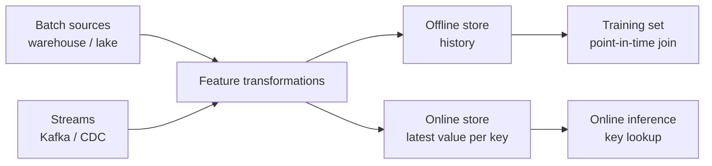

## 🎯 خلاصه

> یک **feature** عددی یا دسته‌ای است که یک entity (مثلاً کاربر، کارت، یا محصول) را در یک لحظه توصیف می‌کند. **feature store** این featureها را محاسبه، ذخیره و سرو می‌کند تا آموزش و تولید از **همان** تعریف و **همان** مقادیر استفاده کنند.

- **offline store** تاریخچه را نگه می‌دارد (برای ساختن training set). **online store** آخرین مقدار هر entity را نگه می‌دارد (برای پیش‌بینی با تأخیر کم).
- **point-in-time (PIT) correctness** یعنی هر ردیف آموزشی فقط مقادیری از feature را ببیند که **قبل از** زمان label وجود داشته‌اند. شکستن این قاعده همان **data leakage** است؛ مدل در آموزش عالی به نظر می‌رسد و در تولید شکست می‌خورد.
- **training-serving skew** وقتی رخ می‌دهد که پایپ‌لاین آموزش و پایپ‌لاین سرویس، یک feature را متفاوت محاسبه کنند.

## 🌱 از ساده شروع کنیم (مبتدی)

> **💡 تشبیه:** امتیاز اعتباری بانکی یک feature است. برای آموزش مدلی که وام‌های فروردین را تصمیم می‌گیرد، باید از امتیاز **همان موقع فروردین** استفاده کنی، نه امتیازی که امروز می‌بینی. استفاده از امروز یعنی به مدل آینده را نشان داده‌ای.

فرض کن می‌خواهیم پیش‌بینی کنیم کاربری در ۳۰ روز آینده churn می‌کند یا نه. دو جدول داریم:

```sql
CREATE TABLE user_features (user_id int, feature_ts timestamp, orders_30d int);
INSERT INTO user_features VALUES
 (1, '2026-01-01', 2),
 (1, '2026-01-15', 5),
 (1, '2026-02-01', 1);

CREATE TABLE labels (user_id int, label_ts timestamp, churned int);
INSERT INTO labels VALUES
 (1, '2026-01-10', 0),
 (1, '2026-01-20', 1);
```

برای label با زمان `2026-01-10`، feature درست `orders_30d = 2` است (مقدار ۲۰۲۶-۰۱-۰۱). مقدار `5` مربوط به `2026-01-15` در آینده است و مقدار `1` مربوط به `2026-02-01` هم دورتر. یک **point-in-time join** آخرین ردیف feature را انتخاب می‌کند که زمانش بعد از زمان label نباشد.

این کوئری PostgreSQL دقیقاً همین کار را می‌کند:

```sql
SELECT l.user_id, l.label_ts, l.churned, f.orders_30d, f.feature_ts
FROM labels l
LEFT JOIN LATERAL (
  SELECT orders_30d, feature_ts
  FROM user_features f
  WHERE f.user_id = l.user_id
    AND f.feature_ts <= l.label_ts
  ORDER BY f.feature_ts DESC
  LIMIT 1
) f ON true
ORDER BY l.label_ts;
```

نتیجه: label با زمان `2026-01-10` مقدار `orders_30d = 2` می‌گیرد؛ label با زمان `2026-01-20` مقدار `orders_30d = 5` می‌گیرد. هر ردیف فقط گذشته را می‌بیند.

## 🔧 واقعاً چطور کار می‌کند (متوسط)

یک feature store چهار کار دارد:

1. **تعریف** featureها یک‌بار (نام، entity، منبع، تبدیل، مالک).
2. **محاسبه** در batch (از lake یا warehouse) و در streaming (از Kafka یا CDC).
3. **ذخیره** تاریخچه در offline store (Parquet یا جدول warehouse) و آخرین مقادیر در online store (یک key-value store مثل Redis، DynamoDB یا یک دیتابیس wide-column).
4. **سرو** همان featureها به job های آموزش (با point-in-time join) و به inference آنلاین (جست‌وجوی کلید بر اساس شناسه‌ی entity).



**Feast** یک feature store متن‌باز است. در Feast، entityها و feature viewها را تعریف می‌کنی و `get_historical_features` را با یک DataFrame از entityها که ستون `event_timestamp` دارد صدا می‌زنی. Feast همان point-in-time join بالا را انجام می‌دهد. مستندات آن هم می‌گوید **TTL** (زمان زندگی) هر feature view تعیین می‌کند تا کجا به عقب نگاه شود: مقدار قدیمی‌تر از TTL null می‌شود. پیش از اتکا به نام‌های مشخص API، مستندات نسخه‌ی خودت را چک کن، چون API بین نسخه‌ها تغییر کرده است.

**Materialization** مرحله‌ای است که آخرین مقادیر را از offline store به online store کپی می‌کند. این مرحله به‌صورت زمان‌بندی‌شده (یا پیوسته) اجرا می‌شود. پس تازگی online store، تازگی job materialization است، نه تازگی منبع.

دو لایه‌ی زمان مهم‌اند:

| زمان | معنی | کاربرد |
|---|---|---|
| Event time | زمانی که رخداد در دنیای واقعی اتفاق افتاده | point-in-time joins |
| Ingestion time | زمانی که رکورد به سیستم رسیده | مدیریت داده‌ی دیرهنگام، بررسی تازگی |

featureی که از رویدادهای دیرهنگام محاسبه می‌شود باید با **event time** برچسب بخورد، وگرنه PIT join یا مقدار نشت‌شده می‌دهد یا مقدار را از دست می‌دهد. به [[late-arriving-data]] و [[watermark]] نگاه کن.

## 🧠 عمق و trade-offها (سنیور)

- **Leakage مهم‌ترین ریسک است.** نشت‌های رایج: استفاده از feature ای که روی پنجره‌ای بعد از زمان label محاسبه شده، join کردن روی آخرین snapshot یک جدول بُعد بدون تاریخچه (یک slowly changing dimension بدون history)، و تجمیع روی کل داده قبل از جدا کردن train و test. پایپ‌لاین را با assert کردن `feature_ts <= label_ts` برای هر ردیف آموزشی تست کن.
- **Training-serving skew.** برای هر دو مسیر یک تعریف تبدیل نگه دار. skew های رایج: job آموزش از یک تابع SQL در warehouse استفاده می‌کند، ولی مسیر آنلاین بازنویسی پایتونی با مدیریت null یا time zone متفاوت دارد. featureهای سرو‌شده‌ی آنلاین را لاگ کن و توزیع آن‌ها را با مجموعه‌ی آموزش مقایسه کن. برای بیشتر، به [[training-serving-skew]] نگاه کن.
- **اندازه‌گیری online store.** تخمین بزن `entities × features × bytes per value + key overhead`. مثلاً ۵۰ میلیون کاربر × ۱۰۰ feature × ۸ بایت حدود ۴۰ GB است، قبل از overhead؛ و overhead (کلیدها، index ها، replication) اغلب از payload بزرگ‌تر است. روی یک نمونه اندازه‌گیری کن.
- **تازگی در برابر هزینه.** featureهای streaming (مثلاً «تعداد کلیک‌ها در ۵ دقیقه‌ی اخیر») به پردازش stateful (Flink، Spark Structured Streaming) و پنجره‌های محدود نیاز دارند. featureهای batch (مثلاً «تعداد سفارش در ۳۰ روز») ارزان‌تر و backfill آن‌ها ساده‌تر است. ارزان‌ترین تازگی‌ای را انتخاب کن که مدل واقعاً از آن سود می‌برد.
- **Backfill.** featureی جدید برای آموزش به تاریخچه نیاز دارد. backfill یعنی بازمحاسبه‌ی آن با PIT correctness برای labelهای گذشته، که اغلب از خود feature کار بیشتری دارد. قبل از قول دادن به data scientist برنامه‌ریزی کن. به [[backfill]] نگاه کن.
- **مالکیت و حاکمیت.** featureها بیشتر از پروژه‌هایی که ساخته‌شان عمر می‌کنند. مالک، جدول‌های منبع، SLA و مصرف‌کننده‌ها را ثبت کن. featureی بدون مالک روزی بی‌صدا یک مدل را خراب می‌کند.
- **کِی feature store لازم نیست.** یک مدل، یک تیم، و چند feature که در یک job شبانه‌ی SQL محاسبه می‌شوند: feature store هزینه‌ی عملیاتی اضافه می‌کند بدون سود روشن. با یک جدول مشترک و یک کوئری PIT مستند شروع کن، و وقتی چند مدل به همان featureها نیاز داشتند به store منتقل شو.

## 🧪 امتحان کن

با جدول‌های `user_features` و `labels` از بخش مبتدی:

1. یک label با زمان `2026-01-31` برای کاربر ۱ اضافه کن. کدام مقدار `orders_30d` را PIT join برمی‌گرداند و چرا؟
2. یک کوئری **اشتباه** بنویس که فقط روی `user_id` join می‌کند و `MAX(feature_ts)` را به‌عنوان feature می‌گیرد. نشان بده به کدام ردیف‌های label نشت می‌کند.
3. کاربر دومی با هیچ ردیفی در `user_features` قبل از زمان label اضافه کن. پیش‌بینی کن آیا `LEFT JOIN LATERAL` مقدار null برمی‌گرداند، و جوابت را بررسی کن.

<details><summary>جواب‌ها را ببین</summary>

**۱.** آخرین ردیف feature در یا قبل از `2026-01-31` مربوط به `2026-01-15` است، پس `orders_30d = 5`. ردیف `2026-02-01` در آینده است و نادیده گرفته می‌شود.

**۲.** این کوئری آخرین feature سراسری هر کاربر را می‌گیرد، پس label با زمان `2026-01-10` مقدار مربوط به `2026-02-01` را می‌گیرد؛ این همان leakage است.
```sql
SELECT l.user_id, l.label_ts, l.churned,
       (SELECT orders_30d FROM user_features f
        WHERE f.user_id = l.user_id
        ORDER BY feature_ts DESC LIMIT 1) AS orders_30d
FROM labels l;
```

**۳.** `LEFT JOIN LATERAL` ردیف label را نگه می‌دارد و برای feature مقدار `NULL` برمی‌گرداند، چون هیچ ردیفی شرط `feature_ts <= label_ts` را برآورده نمی‌کند. مرحله‌ی بعدی باید تصمیم بگیرد این مقادیر را چطور پر یا حذف کند، و این تصمیم باید در آموزش و سرویس یکسان باشد.

</details>

## 💬 گوشه‌ی مصاحبه

**سؤال: «point-in-time correctness چیست و چرا مهم است؟»** جواب متوسط: «وقتی training set می‌سازی، هر ردیف باید مقادیر feature را از قبل از زمان label استفاده کند، تا مدل آینده را نبیند.» جواب سنیور: «این قاعده‌ای است که می‌گوید feature متصل‌شده به یک label باید `feature_ts <= label_ts` داشته باشد. نقض آن metricهای آفلاین را بالا می‌برد و در تولید شکست می‌خورد. من آن را با PIT join در offline store، تست assert روی timestamp، و بررسی این‌که مقادیر آنلاین با خروجی job آفلاین یکی باشند اجرا می‌کنم.»

**سؤال: «online در برابر offline store؟»** offline: تاریخچه‌ی کامل، اسکن‌های بزرگ، برای آموزش. online: آخرین مقدار هر کلید، جست‌وجوی سریع، برای inference. این دو باید با همان منطق تبدیل پر شوند، وگرنه skew می‌گیری.

**سؤال: «چطور از training-serving skew جلوگیری می‌کنی؟»** یک تعریف feature برای هر دو مسیر، کد یا SQL مشترک، لاگ کردن featureهای سرو‌شده، و مقایسه‌ی دوره‌ای توزیع آنلاین و آفلاین.

> **🎤 در مصاحبه این را بگو:** «feature store به من یک تعریف واحد برای هر feature، تاریخچه‌ی PIT-correct برای آموزش، و یک کپی آنلاین با تأخیر کم برای سرویس می‌دهد. event time را قانون اصلی درستی می‌دانم و leakage و skew را صریحاً تست می‌کنم.»

## ⚠️ اشتباهات رایج

> **⚠️ مراقب باش:** join کردن جدول بُعد **فعلی** به رویدادهای تاریخی. مشتری که ماه گذشته شهرش را عوض کرده، در ردیف‌های آموزشی سال گذشته شهر جدید را می‌گیرد. از تاریخچه‌ی SCD یا PIT join استفاده کن.

> **⚠️ مراقب باش:** محاسبه‌ی feature روی کل داده (مثلاً میانگین برای normalization) قبل از جدا کردن train و test. مجموعه‌ی test روی feature اثر گذاشته است. تبدیل‌ها را فقط روی پنجره‌ی آموزش fit کن.

- استفاده از ingestion time به جای event time در PIT join، که اجازه می‌دهد رویدادهای دیرهنگام نشت کنند یا گم شوند.
- فرض کردن online store کش منبع است. این یک کپی materialize شده با تازگی و خطاهای خودش است.
- ساختن feature store برای یک مدل با سه feature.
- تغییر تعریف یک feature بدون نسخه، طوری که مدل‌های قدیمی و جدید زیر یک نام، معنای متفاوت بخوانند.
- فراموش کردن TTL: مقادیر قدیمی‌تر از TTL بی‌صدا null می‌شوند.

## ✅ خودت را بسنج

۱. یک point-in-time join چه چیزی را تضمین می‌کند؟
   - A) هر ردیف آموزشی آخرین مقدار feature موجود در جدول را استفاده می‌کند
   - B) هر ردیف آموزشی آخرین مقدار feature را در یا قبل از زمان label استفاده می‌کند
   - C) هر ردیف آموزشی میانگین feature در کل زمان را استفاده می‌کند
   - D) هر ردیف آموزشی مقدار feature روز بعد را استفاده می‌کند

<details><summary>جواب</summary>

**B** — PIT join جدیدترین ردیف feature را انتخاب می‌کند که timestampش بعد از timestamp label نباشد. A نشت داده است؛ C و D معنای PIT ندارند.

</details>

۲. کدام store برای جست‌وجوی با تأخیر کم در inference آنلاین استفاده می‌شود؟
   - A) offline store
   - B) online store
   - C) topic خام Kafka
   - D) data lake آموزشی

<details><summary>جواب</summary>

**B** — online store آخرین مقدار هر کلید entity را برای lookup سریع نگه می‌دارد. offline store تاریخچه را برای scanهای بزرگ نگه می‌دارد.

</details>

۳. یک مدل روی داده‌ی آفلاین AUC برابر ۰.۹۵ دارد ولی در تولید ۰.۷۰ است، و کد feature در job batch و در API متفاوت است. محتمل‌ترین علت چیست؟

   - A) تعداد درخت‌های کم مدل
   - B) training-serving skew
   - C) تعداد زیاد partitionهای Kafka
   - D) بزرگ بودن بیش از حد online store

<details><summary>جواب</summary>

**B** — همان feature در آموزش و سرویس متفاوت محاسبه می‌شود، پس مدل در تولید ورودی متفاوتی می‌بیند. راه‌حل: یک تعریف مشترک و مقایسه‌ی توزیع featureهای سرو‌شده با آموزش.

</details>

۴. **(سنیور)** می‌خواهی یک feature جدید را برای دو سال داده‌ی آموزشی backfill کنی. feature این است: «سفارش‌ها در ۹۰ روز اخیر». چه چیزی باید تضمین شود، و اشتباه رایج کدام است؟

   - A) فقط این‌که feature در Parquet ذخیره شود
   - B) این‌که هر label تاریخی پنجره‌ی ۹۰ روزه‌ی منتهی به زمان خودش را ببیند؛ اشتباه رایج این است که یک پنجره‌ی منتهی به امروز برای همه‌ی ردیف‌ها محاسبه شود
   - C) این‌که feature هیچ null ای نداشته باشد
   - D) این‌که online store در زمان backfill خالی باشد

<details><summary>جواب</summary>

**B** — پنجره باید به زمان هر label لنگر بخورد، پس باید برای هر label (یا برای هر snapshot روزانه) با منطق PIT محاسبه شود. یک پنجره‌ی واحد منتهی به امروز آینده را به ردیف‌های قدیمی نشت می‌دهد.

</details>

۵. **(سنیور)** چرا ممکن است یک feature batch را بر یک feature streaming ترجیح دهی، با این‌که streaming تازه‌تر است؟

   - A) featureهای batch همیشه دقیق‌ترند
   - B) featureهای streaming به پردازش stateful نیاز دارند و ساخت و backfill آن‌ها پرهزینه‌تر است؛ اگر مدل از تازگی بیشتر سود کمی ببرد، batch انتخاب بهتری است
   - C) featureهای streaming را نمی‌توان در online store ذخیره کرد
   - D) featureهای batch به event time نیاز ندارند

<details><summary>جواب</summary>

**B** — تازگی هزینه‌ی مهندسی دارد (jobهای stateful، داده‌ی دیرهنگام، backfill سخت‌تر). ارزان‌ترین تازگی‌ای را انتخاب کن که مدل واقعاً از آن بهره می‌برد، و آن را اندازه بگیر.

</details>

## 🗂️ فلش‌کارت

| Front | Back |
|---|---|
| Feature | مقداری که یک entity را در یک لحظه توصیف می‌کند و ورودی مدل است |
| Offline store | تاریخچه‌ی کامل feature، برای ساخت training set |
| Online store | آخرین مقدار هر کلید، برای inference با تأخیر کم |
| Point-in-time join | هر label را به آخرین feature با `feature_ts <= label_ts` وصل می‌کند |
| Data leakage | ردیف‌های آموزشی که اطلاعات بعد از زمان label را می‌بینند |
| Training-serving skew | همان feature در آموزش و سرویس متفاوت محاسبه شود |
| Materialization | کپی کردن آخرین مقادیر feature از offline به online store |
| TTL در feature view | حداکثر سن مقداری که استفاده می‌شود؛ مقادیر قدیمی‌تر null می‌شوند |

## 🔗 ادامه

- **design-feature-store** طراحی سیستمی یک پایپ‌لاین feature برای توصیه‌گر را بررسی می‌کند: سازگاری آنلاین/آفلاین، PIT join و backfill.
- **pattern-late-data** نشان می‌دهد رویدادهای دیرهنگام چطور منطق event-time را که PIT join به آن تکیه دارد تحت تأثیر قرار می‌دهند.
- **sql-window-functions** الگوهای پنجره و `LATERAL` برای «آخرین مقدار قبل از زمان t» را نشان می‌دهد.
- **data-quality** چک‌هایی (نرخ null، تازگی، تست بازه‌ی مقادیر) را توضیح می‌دهد که روی جدول‌های feature باید اجرا شوند.
- مستندات Feast نسخه‌ی خودت را بخوان: معنای point-in-time پایدار است، ولی API و تنظیمات store بین نسخه‌ها تغییر می‌کنند.
