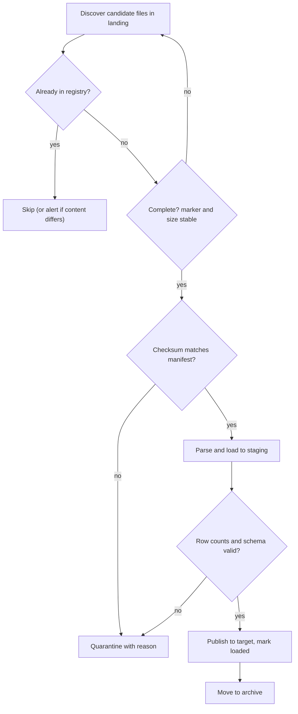

## 🎯 خلاصه

> **File-based ingestion** فایل‌هایی را که یک شریک یا سیستم دیگر فرستاده (از طریق SFTP یا در object storage) می‌گیرد و به پلتفرم بار می‌کند. بخش سخت خواندن فایل نیست. بخش سخت این است: هر فایل را **دقیقاً یک بار** پیدا کنیم، مطمئن شویم فایل **کامل و سالم** است، و برای هر فایل ثبت کنیم **چه اتفاقی افتاده**.

- فایل‌ها در یک **landing zone** فرود می‌آیند. ingestion هرگز فایلی را نمی‌خواند که ممکن است هنوز در حال نوشته‌شدن باشد.
- یک **manifest** یا **علامت پایان (done marker)** می‌گوید کدام فایل‌ها متعلق به یک تحویل‌اند و checksum هر کدام چیست.
- یک **جدول registry فایل** هر فایل، checksum و وضعیتش را ثبت می‌کند. این حافظه‌ی سیستم است که از بارگذاری تکراری جلوگیری می‌کند.
- فایل‌های خراب با دلیل به **quarantine** می‌روند، فایل‌های خوب به **archive**، و چیزی بی‌صدا حذف نمی‌شود.

## 🌱 از ساده شروع کنیم (مبتدی)

> **💡 تشبیه:** یک بخش پست در یک اداره را در نظر بگیرید. بسته‌ها پشت میز پذیرش می‌رسند. کارمند هر بسته را در دفتر ثبت می‌کند، بررسی می‌کند جعبه آسیب ندیده و سفارش کامل است، هرگز یک بسته را دوبار تحویل نمی‌دهد، و بسته‌های آسیب‌دیده را با یادداشت کنار می‌گذارد. دفتر ثبت منبع حقیقت است.

یک شریک هر شب یک فایل می‌فرستد. یک چیدمان رایج پوشه‌ها این است:

```text
/data/landing/cdr/              <- partner uploads here
/data/landing/cdr/2026-10-13/   <- one folder per delivery
    cdr_2026-10-13_0001.csv.gz
    cdr_2026-10-13_0002.csv.gz
    manifest.txt                <- expected checksums, written last
/data/processing/               <- ingestion works here
/data/archive/cdr/              <- loaded successfully
/data/quarantine/cdr/           <- failed checks, with a reason file
```

**manifest** وعده‌ی فرستنده است: «این فایل‌ها را می‌فرستم و هش هر کدام این است». معمولاً **آخر** نوشته می‌شود، پس وجودش یعنی تحویل کامل است. بررسی‌اش ساده است:

```bash
# manifest.txt holds one line per file: "<sha256>  <file name>"
cd /data/landing/cdr/2026-10-13 && sha256sum -c manifest.txt
```

اگر همه‌ی خطوط `OK` بگویند، فایل‌ها همان چیزی‌اند که فرستنده قصد داشته. اگر یکی `FAILED` بگوید، فایل خراب یا ناقص است و باید به quarantine برود، نه به انبار داده.

## 🔧 واقعاً چطور کار می‌کند (متوسط)

یک pipeline مقاوم فایل، برای هر فایل همین مراحل را دنبال می‌کند:



**registry.** registry یک جدول در پلتفرم است (نه یک فایل روی دیسک). سؤال «این را قبلاً بار کرده‌ایم؟» را به یک query تبدیل می‌کند، نه یک حدس.

```sql
CREATE TABLE file_registry (
  source        text        NOT NULL,
  file_name     text        NOT NULL,
  sha256        text        NOT NULL,
  size_bytes    bigint      NOT NULL,
  row_count     bigint,
  status        text        NOT NULL
                CHECK (status IN ('discovered', 'loading', 'loaded', 'quarantined')),
  discovered_at timestamptz NOT NULL DEFAULT now(),
  loaded_at     timestamptz,
  PRIMARY KEY (source, file_name)
);

-- a second, unique constraint catches the same content sent under a new name
CREATE UNIQUE INDEX ux_file_registry_sha ON file_registry (source, sha256);
```

دو کلید دو مشکل متفاوت را می‌گیرند:

- **همان نام، همان محتوا** (ارسال مجدد یا retry): primary key آن را رد می‌کند و pipeline از آن رد می‌شود.
- **نام متفاوت، همان محتوا** (شریک اسم را عوض کرده و دوباره فرستاده): index روی checksum آن را می‌گیرد. بدون این، همان داده با دو نام دوبار بار می‌شود.
- **همان نام، محتوای متفاوت** (شریک فایل را رونویسی کرده): این مشکوک است. داده‌ی بارشده را بی‌صدا رونویسی نکنید. نسخه‌ی جدید را قرنطینه کنید، هشدار بدهید، و تصمیم را به یک انسان بسپارید. نام‌های نسخه‌دار از فرستنده این مشکل را کاملاً حذف می‌کنند.

**کامل بودن.** فقط به دلیل وجود یک فایل به آن اعتماد نکنید.

- **SFTP**: ممکن است وقتی پوشه را لیست می‌کنید فرستنده هنوز در حال نوشتن باشد. از فرستنده بخواهید با یک نام موقت (`.part`، `.tmp`) آپلود کند و در پایان تغییر نامش دهد، یا به manifest تکیه کنید. ingestion نام‌های موقت را نادیده می‌گیرد و بررسی می‌کند که اندازه بین دو لیست‌برداری ثابت مانده است.
- **Object storage (مثل S3)**: یک object فقط وقتی قابل‌دیدن می‌شود که آپلود تمام شده باشد، پس object نیمه‌نوشته نادر است. با این حال تحویل چندفایله هنوز علامت لازم دارد، چون «فایل ۲ از ۳ رسید» وضعیتی نیست که خود storage بتواند توصیف کند.

```python
import hashlib
import time
from pathlib import Path

LANDING = Path("/data/landing/cdr")

def sha256_of(path: Path) -> str:
    h = hashlib.sha256()
    with path.open("rb") as f:
        for chunk in iter(lambda: f.read(1 << 20), b""):  # 1 MiB chunks
            h.update(chunk)
    return h.hexdigest()

def is_stable(path: Path, wait_s: float = 5.0) -> bool:
    # Simple version: sleep and compare sizes. In production, compare two directory listings.
    size_before = path.stat().st_size
    time.sleep(wait_s)
    return path.stat().st_size == size_before

def discover(known_names: set[str]) -> list[Path]:
    ready = []
    for p in sorted(LANDING.glob("*.csv.gz")):
        if p.name in known_names:
            continue
        if is_stable(p):
            ready.append(p)
    return ready
```

**محتوای خراب و ناقص.** checksum ها آسیب انتقال را می‌گیرند. اما فایلی را که از اول از سمت فرستنده اشتباه بوده نمی‌گیرند. اینها را هم بررسی کنید:

- **فشرده‌سازی**: یک جریان `gzip` کوتاه‌شده با خطای CRC یا پایان غیرمنتظره شکست می‌خورد. این یک شکست کل فایل است.
- **هدر و schema**: ستون گم‌شده یا ستون جدید در CSV. زود شکست بخورید، یا با نام و یک قرارداد صریح نگاشت کنید.
- **encoding**: فایلی با Windows-1256 که به‌عنوان UTF-8 خوانده شود، متن فارسی به‌هم‌ریخته تولید می‌کند. یک BOM مربوط به UTF-8 هم می‌تواند یک کاراکتر نامرئی به نام ستون اول اضافه کند. به [[encoding-persian-data]] مراجعه کنید.
- **خطای سطح ردیف**: چند ردیف بد در یک فایل در غیر این صورت سالم. آن‌ها را با دلیل به یک محل dead-letter ببرید (به [[dead-letter-queue]] مراجعه کنید) و یک آستانه تعیین کنید. مثلاً اگر بیش از ۰٫۱٪ ردیف‌ها شکست خوردند، کل فایل قرنطینه شود.

**فرمت‌های باینری.** بسیاری از CDRهای مخابراتی با ASN.1 (BER یا PER) رمزگذاری شده‌اند، نه CSV. برای خواندنشان به schema کامپایل‌شده‌ی ASN.1 همان release که فایل را تولید کرده نیاز دارید، یک decoder که مرز رکوردها را می‌شناسد، و تبدیل به یک فرمت ستونی مثل Parquet. هدر و تریلر فایل اغلب شمارش و شماره ترتیب دارند، که بهترین بررسی‌های کامل بودن هستند.

**polling یا event.** polling یک پوشه هر چند دقیقه ساده و مقاوم است. اعلان رویداد (مثلاً یک event «object ساخته شد» که به یک صف فرستاده می‌شود) سریع‌تر است، اما ممکن است دیر، دوبار، یا اصلاً نرسد. طراحی مقاوم از event برای سرعت و از **reconciliation دوره‌ای با لیست‌برداری** برای درستی استفاده می‌کند، و registry هر دو را idempotent می‌کند.

**بارگذاری و انتشار.** در یک جدول staging بار کنید که `file_name` را به‌عنوان ستون lineage نگه می‌دارد. فقط بعد از موفقیت بررسی‌ها به مقصد منتشر کنید. اگر مقصد در همان دیتابیس registry است، مقصد و وضعیت registry را در یک تراکنش به‌روز کنید:

```sql
BEGIN;
INSERT INTO dwh.cdr_events
SELECT * FROM staging.cdr_batch
WHERE file_name = 'cdr_2026-10-13_0001.csv.gz';

UPDATE file_registry
SET status = 'loaded', row_count = 1250000, loaded_at = now()
WHERE source = 'partner_a' AND file_name = 'cdr_2026-10-13_0001.csv.gz';
COMMIT;
```

اگر قبل از commit کرش شود، چیزی نیمه‌منتشر نمی‌شود. registry هنوز `discovered` یا `loading` می‌گوید، و اجرای بعدی فایل را دوباره امتحان می‌کند.

## 🧠 عمق و trade-offها (سنیور)

- **مقیاس فایل‌ها.** میلیون‌ها فایل کوچک هم کارایی لیست‌برداری و هم کارایی query را از بین می‌برند (به [[small-files-problem]] مراجعه کنید). از فرستنده فایل‌های بزرگ‌تر بخواهید، یا بعد از فرود آوردن compact کنید. برعکس، یک فایل ۲۰۰ گیگابایتی را نمی‌توان موازی کرد مگر فرمت قابل تقسیم باشد، پس متن فشرده ممکن است به chunk کردن یا codec دیگری نیاز داشته باشد.
- **idempotency قرارداد است.** retry، اجرای مجدد و backfill باید همان نتیجه را بدهند. از registry و یک مرحله‌ی انتشار قطعی استفاده کنید (پارتیشن آن تاریخ را رونویسی کنید، یا حذف-و-درج بر اساس lineage فایل). هرگز کورکورانه append نکنید.
- **سطح اعتماد شریک.** هر منبع را تا وقتی ثابت نشده، غیرقابل‌اعتماد در نظر بگیرید. manifest را اعتبارسنجی کنید، محدودیت حجم بگذارید، و محتوای عجیب را بررسی کنید. درباره‌ی زمان تحویل و نحوه‌ی اصلاح فایل خراب، یک SLA با شریک داشته باشید.
- **سیاست قرنطینه.** قرنطینه‌ی کل فایل امن است، اما ممکن است داده‌ی یک روز را برای چند ردیف بد عقب بیندازد. dead-letter در سطح ردیف داده را جاری نگه می‌دارد، اما می‌تواند یک مشکل سیستماتیک را پنهان کند. بر اساس اثر کسب‌وکاری انتخاب کنید، آستانه بگذارید، و همیشه هشدار بدهید.
- **واقعیت‌های مخابرات و بانک.** فایل‌های CDR مخابراتی حجم بالا دارند، برای صورتحساب حساس به زمان‌اند، و اغلب باینری‌اند. فایل دیرهنگام یا تکراری مجموع صورتحساب را تغییر می‌دهد، پس reconciliation شمارش‌ها با سیستم switch یا mediation مهم است. فیلدها و نام‌های فارسی به بررسی‌های encoding بالا نیاز دارند.
- **پایش.** فایل‌های کشف‌شده، فایل‌های بارشده، فایل‌های داخل quarantine و سن‌شان، تعداد ردیف هر فایل نسبت به روز قبل، و زمان از تحویل تا انتشار را پایش کنید. «امروز فایلی نرسید» یک هشدار است، نه یک موفقیت بی‌صدا.
- **replay و نگهداری.** فایل‌های خام را برای مدت نگهداری لازم کسب‌وکار (و قانون) نگه دارید. replay از archive ارزان‌ترین مسیر بازیابی است، پس مطمئن شوید archive کامل و فقط‌خواندنی است.
- **کی از file ingestion استفاده نکنیم.** اگر سورس بتواند رویدادهای تغییر یا یک API با خواندن incremental بدهد، به‌جای خواستن فایل شبانه از شریک، از [[cdc]] یا pull از API استفاده کنید.

## 🧪 امتحان کن

1. یک پوشه‌ی تحویل شامل `cdr_0001.csv.gz`، `cdr_0002.csv.gz` و `manifest.txt` است. manifest سه فایل را فهرست کرده. بررسی‌هایی را که قبل از بارگذاری انجام می‌دهید، به ترتیب توضیح دهید.
2. شریک `cdr_0002.csv.gz` را با checksum یکسان ولی نام جدید `cdr_0002_v2.csv.gz` دوباره می‌فرستد. registry چه می‌کند، و چرا index روی checksum لازم است؟
3. کوئری بنویسید که فایل‌هایی را فهرست کند که در registry ثبت شده‌اند اما بیش از یک ساعت است که به وضعیت `loaded` نرسیده‌اند.

<details><summary>Show solutions</summary>

**1.** (الف) وجود و کامل بودن manifest را چک کنید، چون آخر نوشته می‌شود. (ب) بررسی کنید همه‌ی فایل‌های manifest وجود دارند و اندازه‌شان ثابت است. (ج) هر checksum را با manifest تطبیق دهید. (د) بررسی کنید جریان gzip کامل است. (ه) فقط بعد از آن در staging parse و بار کنید. هر شکستی فایل را با دلیل قرنطینه می‌کند.

**2.** کلید اصلی `(source, file_name)` تطابق ندارد، چون نام جدید است. index یکتا روی `(source, sha256)` محتوای تکراری را می‌گیرد و pipeline آن را رد یا هشدار می‌دهد. بدون آن، همان ردیف‌ها با دو نام دوبار بار می‌شد.

**3.**
```sql
SELECT source, file_name, status, discovered_at
FROM file_registry
WHERE status IN ('discovered', 'loading')
  AND discovered_at < now() - interval '1 hour';
```
آستانه را با SLA تحویل تنظیم کنید. برای هر ردیفی که برمی‌گردد هشدار بدهید، و `quarantined` را جدا در نظر بگیرید، چون آن‌ها تصمیم انسانی می‌خواهند.

</details>

## 💬 گوشه‌ی مصاحبه

**سؤال: «ingestion فایل‌های شبانه از SFTP یک شریک را طراحی کن.»**

- **پاسخ متوسط:** «پوشه‌ی SFTP را poll می‌کنم، فایل‌ها را به landing دانلود می‌کنم، با manifest چک می‌کنم، در staging parse و بار می‌کنم، و بعد فایل‌ها را به archive می‌برم. یک جدول registry نگه می‌دارم تا فایل‌ها دوبار بار نشوند.»
- **پاسخ سنیور:** «از قرارداد شروع می‌کنم: شریک manifest را آخر می‌نویسد، هنگام آپلود نام موقت استفاده می‌کند، و نام فایل‌ها نسخه‌دار است. pipeline فایل‌ها را از طریق registry کشف می‌کند، کامل بودن و checksum را بررسی می‌کند، با schema صریح parse می‌کند، و در یک تراکنش منتشر می‌کند که registry را هم به‌روز می‌کند. فایل‌های خراب با دلیل و هشدار به quarantine می‌روند، و خطاهای سطح ردیف به یک محل dead-letter با آستانه. فایل‌های گم‌شده را هم‌سنگ فایل‌های خراب پایش می‌کنم، و هر مرحله را idempotent می‌کنم تا اجرای مجدد یا backfill از archive امن باشد.»

**سؤال: «چطور یک فایل را دوبار بار نکنیم؟»** یک registry با کلید منبع و نام فایل، به‌علاوه یک index یکتا روی checksum. اولی retry را متوقف می‌کند؛ دومی ارسال مجدد با نام جدید را.

> **🎤 این را در مصاحبه بگو:** «یک فایل را فقط وقتی کامل می‌دانم که manifest و checksumها بگویند. هر فایل را در registry ثبت می‌کنم، پس اجرای مجدد امن است و تکرار با محتوا گرفته می‌شود، نه فقط با نام. شکست‌ها با دلیل قرنطینه می‌شوند، و یک تحویل گم‌شده یک هشدار است، نه یک موفقیت بی‌صدا.»

## ⚠️ اشتباهات رایج

> **⚠️ مراقب باش:** deduplicate کردن فقط با نام فایل. ارسال مجدد با نام جدید همان داده را دوبار بار می‌کند.

> **⚠️ مراقب باش:** خواندن فایلی از پوشه‌ی SFTP وقتی فرستنده هنوز در حال نوشتن آن است. فایل ناقص بار می‌شود و موفقیت حساب می‌شود.

- append کردن به مقصد در هر اجرا. retry آنگاه ردیف تکراری می‌سازد. از یک مرحله‌ی انتشار قطعی استفاده کنید.
- رونویسی یک فایل بارشده وقتی فرستنده آن را با همان نام عوض می‌کند، بدون هیچ هشداری.
- تلقی «هیچ فایلی نرسید» به‌عنوان موفقیت. تحویل گم‌شده یک شکست است که باید گزارش شود.
- بار کردن CSV بدون schema صریح، طوری که یک ستون جدید بی‌صدا همه‌ی مقادیر را به سمت راست شیفت دهد.
- فرض UTF-8 برای همه‌ی فایل‌های شرکا. سیستم‌های قدیمی ویندوز اغلب Windows-1256 صادر می‌کنند، و حروف فارسی-عربی (ي، ك) با حروف فارسی (ی، ک) قاطی می‌شوند.
- حذف فایل‌های مبدأ بلافاصله بعد از بارگذاری، بدون archive برای replay.

## ✅ خودت را بسنج

1. چرا فرستنده معمولاً manifest را آخر می‌نویسد؟
   - A) نوشتنش سریع‌تر است
   - B) وجودش نشانه‌ی کامل بودن تحویل است، پس ingestion روی یک دسته‌ی ناقص شروع نمی‌کند
   - C) فقط آخرین فایل یک تحویل قابل checksum است
   - D) سرور SFTP شریک به آن نیاز دارد

<details><summary>Answer</summary>

**B** — manifestی که آخر ظاهر می‌شود یک سیگنال تکمیل است. ingestion منتظر آن می‌ماند، و فهرست checksumهایی را دارد که باید با آن‌ها تطبیق دهد.

</details>

2. یک فایل با همان محتوا و نام جدید دوباره فرستاده می‌شود. کدام ویژگی registry آن را می‌گیرد؟
   - A) primary key روی `file_name`
   - B) یک index یکتا روی checksum (مثلاً `sha256`) برای هر منبع
   - C) timestamp مربوط به `discovered_at`
   - D) تعداد ردیف‌ها

<details><summary>Answer</summary>

**B** — نام جدید است، پس primary key تطابق ندارد. هش محتوا یکسان است، پس یک index یکتا روی checksum تکرار را رد می‌کند.

</details>

3. یک شریک فایل `cdr_0007.csv.gz` را با محتوای متفاوت و همان نام رونویسی می‌کند. پاسخ درست چیست؟
   - A) داده‌ی بارشده را رونویسی کنید، چون جدیدترین فایل حقیقت است
   - B) نسخه‌ی جدید را قرنطینه کنید، هشدار بدهید، و تصمیم را به یک نفر بسپارید، و داده‌ی بارشده را دست‌نخورده نگه دارید
   - C) آن را به‌عنوان فایل جدید با همان نام بار کنید، که مقصد می‌پذیرد
   - D) نادیده بگیرید، چون نام قبلاً ثبت شده

<details><summary>Answer</summary>

**B** — رونویسی بی‌صدا trail حسابرسی را از بین می‌برد و می‌تواند اعداد صورتحساب یا گزارش را تغییر دهد. قرنطینه و هشدار بدهید، و از شریک برای آینده نام نسخه‌دار بخواهید.

</details>

4. **(سنیور)** یک فایل ASN.1 به حجم ۴۰ گیگابایت، ۰٫۳٪ از رکوردهایش decode نمی‌شوند. کسب‌وکار داده‌ی روز را تا ساعت ۰۸:۰۰ می‌خواهد. کل فایل را قرنطینه کنید یا رکوردهای بد را dead-letter کنید؟ استدلال شما چیست؟
   - A) کل فایل را قرنطینه کنید، چون هر خطایی یعنی فایل نامعتبر است
   - B) رکوردهای بد را با دلیلشان dead-letter کنید، بقیه را بار کنید و هشدار بدهید، به شرط اینکه نرخ شکست زیر آستانه‌ی توافق‌شده باشد و رکوردهای بد برای replay نگه داشته شوند
   - C) خطاها را نادیده بگیرید، چون ۰٫۳٪ مهم نیست
   - D) اول فایل را به CSV تبدیل کنید تا خطاها ناپدید شوند

<details><summary>Answer</summary>

**B** — آستانه تصمیم را صریح می‌کند. یک نرخ خطای کوچک و شناخته‌شده نباید کل روز را عقب بیندازد، اما رکوردهای بد باید با دلیل ذخیره شوند تا قابل replay باشند، و هشدار تضمین می‌کند خطا بررسی شود. نرخی بالای آستانه، یا جهشی ناگهانی، باید فایل را قرنطینه کند.

</details>

5. **(سنیور)** رویدادهای «object ساخته شد» برای bucket فرود گاهی دوبار و گاهی اصلاً نمی‌رسند. کدام طراحی pipeline را درست نگه می‌دارد؟
   - A) به رویدادها اعتماد کنید، چون به‌اندازه‌ی کافی قابل اتکا هستند
   - B) برای تأخیر کم از رویدادها استفاده کنید، اما یک reconciliation دوره‌ای با لیست‌برداری هم اجرا کنید، و registry پردازش هر فایل را idempotent کند
   - C) به یک cron شبانه‌ی تنها بروید و رویدادها را کاملاً کنار بگذارید
   - D) قانون رویداد را حذف کنید و فایل‌ها را دستی بار کنید

<details><summary>Answer</summary>

**B** — رویدادها مسیر سریع‌اند و ممکن است گم یا تکراری شوند. لیست‌برداری دوره‌ای هر چیزی را که رویدادها جا انداخته‌اند پیدا می‌کند، و registry (با کلید نام و checksum) تضمین می‌کند تکراری‌ها یک بار پردازش شوند. ترکیب این دو وقتی هر کدام بد عمل کند هم درست است.

</details>

## 🗂️ فلش‌کارت

| Front | Back |
|---|---|
| landing zone چیست؟ | پوشه یا prefixی که شرکا فایل‌ها را در آن تحویل می‌دهند؛ ingestion نباید وقتی فایل هنوز نوشته می‌شود آن را بخواند |
| manifest چه چیزی فراهم می‌کند؟ | فهرست فایل‌های مورد انتظار و checksumهایشان، معمولاً آخر نوشته‌شده به‌عنوان سیگنال تکمیل |
| چرا جدول registry فایل؟ | سؤال «این فایل را بار کرده‌ایم؟» را به یک query تبدیل می‌کند و اجرای مجدد و retry را امن می‌کند |
| چرا دو کلید یکتا؟ | نام، ارسال مجدد با همان نام را می‌گیرد؛ checksum، ارسال مجدد با نام جدید و همان محتوا را |
| همان نام، محتوای متفاوت | مشکوک: قرنطینه، هشدار، و هرگز رونویسی بی‌صدای داده‌ی بارشده |
| چطور از خواندن ناقص در SFTP جلوگیری کنیم؟ | آپلود با نام موقت و تغییر نام در پایان، به‌علاوه بررسی ثبات اندازه یا manifest |
| quarantine در برابر dead-letter | quarantine کل فایل شکست‌خورده را نگه می‌دارد؛ dead-letter رکوردهای بد منفرد را، با آستانه بین آن دو |
| چرا CDR های ASN.1 سخت‌ترند؟ | باینری‌اند، schema کامپایل‌شده‌ی دقیق همان release را لازم دارند، و قبل از هر SQL به decoder نیاز دارند |

## 🔗 ادامه

- **batch-ingestion** همین انضباط را برای سورس‌های دیتابیس پوشش می‌دهد: watermark، lookback و merge idempotent.
- **small-files** و **file-layout** توضیح می‌دهند تعداد و چیدمان فایل‌ها چطور سرعت و هزینه‌ی query را تحت تأثیر می‌گذارد.
- **data-formats** فرمت‌های CSV، JSON، Avro، ORC و Parquet را مقایسه می‌کند، که وقتی فایل‌ها فرود آمدند اهمیت پیدا می‌کند.
- **dlq-bad-records** نشان می‌دهد چطور رکوردهایی را که اعتبارسنجی شکست می‌خورند ذخیره و replay کنیم.
- **encoding-persian-data** مشکلات encoding در فایل‌های فارسی را با جزئیات بیشتر پوشش می‌دهد.

