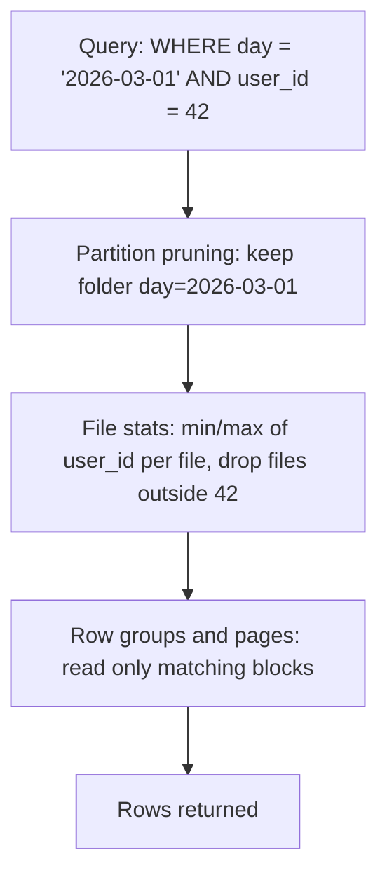

## 🎯 خلاصه

> **File layout** تعیین می‌کند داده روی storage چطور به فایل و پوشه تقسیم شود، و این‌که یک query چقدر باید بخواند. سه اهرم داریم: **partitioning** (کدام پوشه‌ها وجود دارند)، **اندازه‌ی فایل** (چند فایل و هرکدام چقدر بزرگ) و **sorting/clustering** (داخل هر فایل چه چیزی هست).

- Partitioning به موتور اجازه می‌دهد **کل پوشه‌ها را رد کند**. آمار min/max اجازه می‌دهد **کل فایل‌ها** و row groupها را رد کند. Sorting باعث می‌شود این آمار باریک‌تر شود، پس فایل‌های بیشتری رد می‌شوند.
- فایل‌های کوچک زیاد به همه‌چیز آسیب می‌زنند: برنامه‌ریزی، listing، هزینه‌ی باز و بستن فایل، و تعداد زیاد درخواست کوچک روی object storage.
- **Compaction** فایل‌های کوچک را در فایل‌های کمتر، بزرگ‌تر و مرتب‌تر بازنویسی می‌کند. این ابزار تعمیر چیدمانی است که خودت طراحی نکرده‌ای.

## 🌱 از ساده شروع کنیم (مبتدی)

> **💡 تشبیه:** یک کتابخانه. اگر کتاب‌ها بر اساس موضوع در قفسه چیده شده باشند (partition)، فقط یک قفسه را می‌گردی نه کل ساختمان. اگر داخل هر قفسه بر اساس نام نویسنده مرتب باشند (sorting)، اسم را سریع پیدا می‌کنی. اگر کتابخانه یک میلیون جزوه‌ی دوتایی‌دوتایی در جعبه داشته باشد (فایل‌های کوچک)، حتی با قفسه‌های خوب هم پیدا کردن هرچیزی ابدی طول می‌کشد.

فرض کن یک سال لاگ بازدید وب داری، جمعاً حدود ۳۶۵ گیگابایت. دو چیدمان را مقایسه کن:

```text
Layout A: یک پوشه، ۳۶۵ فایل ۱ گیگابایتی، مرتب‌نشده
  query: بازدیدهای user 42 در 2026-03-01
  -> موتور همه‌ی فایل‌ها را باز می‌کند (۳۶۵ گیگابایت خواندن)

Layout B: پوشه به تفکیک روز، فایل‌ها مرتب بر اساس user_id
  logs/day=2026-03-01/part-000.parquet   (حدود ۱ گیگابایت، مرتب بر اساس user_id)
  query: بازدیدهای user 42 در 2026-03-01
  -> یک پوشه، و min/max هر فایل به موتور می‌گوید کدام فایل‌ها می‌توانند user 42 را داشته باشند
```

Layout B بخش کوچکی از بایت‌ها را می‌خواند. داده همان است، فقط چیدمان روی دیسک فرق دارد.

دو قاعده برای شروع:

- بر اساس چیزی partition کن که **تقریباً همیشه روی آن فیلتر می‌کنی**، با تعداد مقدار **متوسط**. تاریخ مثال کلاسیک است.
- فایل‌هایی با اندازه‌ی **صدها مگابایت** هدف بگیر، نه کیلوبایت. هدف دقیق به موتور بستگی دارد، پس مستندات آن را بررسی کن.

## 🔧 واقعاً چطور کار می‌کند (متوسط)

یک موتور query در سه مرحله برنامه‌ریزی می‌کند و هر مرحله می‌تواند داده را رد کند:



- **Partition pruning** روی اسم پوشه‌ها (`day=2026-03-01`) کار می‌کند. ارزان و دقیق است.
- **آمار سطح فایل** (min و max هر ستون، ذخیره‌شده در footer فایل Parquet یا metadata جدول) اجازه می‌دهد موتور فایل‌ها را بدون باز کردن داده‌شان رد کند. این فقط وقتی کار می‌کند که مقادیر خوشه‌ای باشند: اگر هر فایل کاربران ۱ تا ۱,۰۰۰,۰۰۰ را داشته باشد، min/max هیچ‌چیزی را حذف نمی‌کند.
- **آمار row group** همین کار را داخل یک فایل انجام می‌دهد. Parquet داده را در row groupها ذخیره می‌کند، معمولاً در حد ده‌ها مگابایت، و هر کدام آمار خودش را دارد.

**اندازه‌ی فایل.** هر فایل هزینه دارد: یک درخواست، metadata برای خواندن، و یک task برای زمان‌بندی. یک مثال مشخص: فرض کن یک job روزانه ۲ ترابایت را روی ۲۰۰ کشور می‌نویسد، با partition بر اساس `day` و `country`:

- میانگین هر کشور در هر روز: ۲ ترابایت / ۲۰۰ = ۱۰ گیگابایت.
- اگر writer ده هزار فایل ریز ۲۰۰ مگابایتی تولید کند، یعنی ۲ ترابایت / ۲۰۰ مگابایت = ۱۰,۰۰۰ فایل در روز. قابل قبول است.
- اگر writer دو میلیون فایل ۱ مگابایتی بسازد (مثلاً یک فایل به ازای هر Spark task در هر partition بعد از یک shuffle بد)، همان بایت‌ها به ۲,۰۰۰,۰۰۰ درخواست نیاز دارند. Query کند می‌شود، هرچند حجم داده تغییر نکرده.

**انفجار partition.** partition زدن بر اساس ستونی با cardinality بالا، اشتباه کلاسیک است. partition بر اساس `day` و `user_id` با ۵۰ میلیون کاربر، یعنی ۵۰ میلیون پوشه در روز، هر کدام با یک فایل ریز. partition بر اساس `day` تنها (۳۶۵ پوشه در سال) معمولاً درست است.

**Compaction** کاری است که فایل‌های کوچک یک partition را در فایل‌های کمتر با اندازه‌ی هدف ادغام می‌کند. table formatهایی مثل Delta Lake، Iceberg و Hudi آن را به‌عنوان عملیات نگهداری ارائه می‌کنند؛ metadata جدول به‌صورت atomic به‌روز می‌شود، پس خواننده یا فایل‌های قدیم را می‌بیند یا جدید را، نه ترکیبی از هر دو. از قانون bin-packing استفاده کن (فایل‌ها را تا رسیدن به اندازه‌ی هدف ترکیب کن) و آن را روی partitionهایی اجرا کن که اخیراً تغییر کرده‌اند، نه کل جدول.

```sql
-- نگهداری به سبک Iceberg (syntax بین موتورها و نسخه‌ها فرق دارد؛ در مستندات خودت بررسی کن)
CALL system.rewrite_data_files(
  table => 'analytics.web_logs',
  where => 'day >= DATE ''2026-03-01'''
);
```

**Sorting و clustering.** sorting داخل فایل‌ها، آمار min/max را باریک می‌کند. برای یک ستون، sort ساده کافی است. برای query هایی که روی دو یا سه ستون با ترکیب‌های مختلف فیلتر می‌کنند، **Z-ordering** (یا یک space-filling curve مشابه) کلیدهای sort را در هم می‌پیچد تا هر فایل یک «جعبه‌ی» فشرده در فضای چندستونی را پوشش دهد. sort ساده روی `(a, b)` فقط به query هایی کمک می‌کند که اول روی `a` فیلتر کنند. table formatها این‌ها را به‌صورت دستور ارائه می‌کنند (`OPTIMIZE ... ZORDER BY` در Delta، و sort order و clustering در Iceberg). syntax دقیق را برای نسخه‌ی خودت در مستندات بررسی کن.

**نوشتن.** یک job در Spark که داده‌ی partition‌شده را بدون shuffle روی کلید partition می‌نویسد، باعث می‌شود هر task در هر partition بنویسد، و در نتیجه هر partition فایل‌های ریز زیادی بگیرد. shuffle بر اساس کلید partition قبل از نوشتن (`repartition` بر اساس ستون partition، یا option معادل writer) به هر partition یک writer می‌دهد و در نتیجه فایل‌های کمتر و بزرگ‌تر. ببین [[spark-writes]].

## 🧠 عمق و trade-offها (سنیور)

- **مثلث معاوضه.** partition بیشتر، pruning بهتر ولی فایل بیشتر می‌دهد. partition کمتر، فایل بزرگ‌تر ولی داده‌ی بیشتر در هر query. نقطه‌ی درست به ترکیب queryها بستگی دارد، نه یک قاعده‌ی سرانگشتی. قبل و بعد از هر تغییر، بایت‌های اسکن‌شده و تعداد فایل‌ها را اندازه بگیر.
- **Compaction در برابر نوشتن استریمی.** یک job استریمی که هر دقیقه commit می‌کند، طبیعتاً فایل‌های ریز زیادی تولید می‌کند. برای این جدول‌ها compaction زمان‌بندی کن، و مراقب باش compaction با نوشتن‌های همزمان تداخل نکند. concurrency خوش‌بینانه در table formatها یعنی یک rewrite ممکن است شکست بخورد و دوباره امتحان شود؛ زمان‌بندی را طوری طراحی کن که compaction و ingestion سر یک partition دعوا نکنند.
- **Time travel در برابر فضای ذخیره‌سازی.** نگه داشتن snapshotهای قدیمی، فایل‌های ریز قدیمی را روی دیسک نگه می‌دارد. بازنویسی فایل‌ها تا وقتی snapshotهای قدیمی منقضی و فایل‌های بلااستفاده با یک job مثل vacuum حذف نشده‌اند، فضایی آزاد نمی‌کند. ممکن است چند روز به نظر برسد که رفع چیدمان روی هزینه‌ی storage اثری نداشته.
- **Hidden partitioning.** Iceberg می‌تواند partition را از یک transform روی ستون بسازد (مثلاً روز از یک timestamp)، پس queryهایی که روی timestamp خام فیلتر می‌کنند هنوز pruning می‌شوند. بدون آن، query ای که روی `event_time` فیلتر می‌کند ولی روی پوشه‌ی `day` نه، کل جدول را اسکن می‌کند. چیدمانی انتخاب کن که با فیلترهایی که کاربران می‌نویسند جور باشد، نه چیدمانی که ساختنش آسان است.
- **Skew و اندازه‌ی فایل.** یک partition داغ (یک کشور با ۶۰ درصد ترافیک) بزرگ‌ترین فایل‌ها و طولانی‌ترین نوشتن‌ها را دارد. تعیین اندازه فقط بر اساس تعداد partition این را پنهان می‌کند. بزرگ‌ترین فایل و توزیع اندازه‌ی فایل‌ها را زیر نظر بگیر، نه فقط میانگین را.
- **موتورهای OLAP چیدمان خودشان را دارند.** ClickHouse فرمت بومی‌اش Parquet نیست؛ `ORDER BY` آن چیدمان مرتب و primary index پراکنده داخل هر part را تعریف می‌کند، ببین [[clickhouse]]. اصول (prune با partition، skip با آمار، اجتناب از partهای ریز زیاد) هنوز برقرار است، با دکمه‌های متفاوت.
- **پایش.** تعداد فایل، میانگین و میانه‌ی اندازه‌ی فایل برای هر جدول، بایت‌های اسکن‌شده در هر query، تعداد partitionها، و سن قدیمی‌ترین فایل compaction‌نشده را رصد کن. وقتی میانه‌ی فایل خیلی پایین‌تر از هدف است، هشدار بده.
- **کی لازم نیست بیش از حد مهندسی کنی.** جدولی چند گیگابایتی با یک مصرف‌کننده به هیچ‌کدام از این‌ها نیاز ندارد. یک partition روزانه و یک job compaction هفتگی شاید کافی باشد.

## 🧪 امتحان کن

جدول `sales` داری که با `(day, store_id)` partition شده، با ۲,۰۰۰ فروشگاه. هر روز حدود ۲۰ گیگابایت می‌رسد، پس هر فروشگاه روزانه حدود ۱۰ مگابایت اضافه می‌کند، و هر partition دقیقاً یک فایل حدود ۱۰ مگابایتی دارد.

1. در هر روز و در هر ماه چند فایل ساخته می‌شود، و چرا این برای queryهایی که روی یک ماه فیلتر می‌کنند مشکل است؟
2. برای query رایج «جمع درآمد فروشگاه ۱۷ در ۷ روز گذشته، به تفکیک محصول»، یک کلید partition جدید و یک sort order پیشنهاد بده. هر انتخاب را توجیه کن.
3. یک job compaction برای چیدمان جدید توصیف کن: کدام partitionها را لمس می‌کند، اندازه‌ی فایل هدفش چقدر است، و چطور از تداخل با job ingestion جلوگیری می‌کنی؟

<details><summary>جواب‌ها را ببین</summary>

**1.** یک فایل به ازای هر partition یعنی ۲,۰۰۰ فایل در روز (۲,۰۰۰ فروشگاه ضربدر ۱ فایل)، که با ۲۰ گیگابایت در روز در فایل‌های ۱۰ مگابایتی می‌خواند. یک ماه ۳۰ روزه یعنی ۳۰ ضربدر ۲,۰۰۰ = ۶۰,۰۰۰ پوشه‌ی partition و ۶۰,۰۰۰ فایل. یک query روی یک ماه باید ۶۰,۰۰۰ فایل کوچک را list و باز کند، با این‌که کل داده فقط حدود ۶۰۰ گیگابایت است. بیشتر زمان صرف listing و باز کردن فایل‌ها می‌شود، نه خواندن بایت‌ها.

**2.** partition فقط بر اساس `day` (حدود ۳۰ پوشه در ماه، با تعداد محدود)، و sort داخل فایل‌ها بر اساس `store_id, product_id`. query روی `store_id` فیلتر می‌کند، پس sort روی آن باعث می‌شود آمار min/max فایل‌های فروشگاه‌های دیگر را رد کند، و partition روزانه ۷ روز را prune می‌کند. اگر فیلتر فروشگاه با فیلترهای دیگر خیلی رایج است، Z-ordering روی `store_id` و `product_id` را در نظر بگیر.

**3.** compaction را برای هر پوشه‌ی روز و فقط برای روزهایی اجرا کن که در ۲۴ ساعت گذشته تغییر کرده‌اند. اندازه‌ی فایل هدف حدود ۲۵۶ مگابایت تا ۱ گیگابایت (پیش‌فرض table format خود را بررسی کن). آن را در پنجره‌ای اجرا کن که ingestion بیکار است، یا از table formatی استفاده کن که rewriteهای همزمان را پشتیبانی کند و در صورت تداخل دوباره امتحان کند، و تا جایی که ممکن است ingestion و compaction را روی partitionهای مختلف نگه دار.

</details>

## 💬 گوشه‌ی مصاحبه

**سؤال: «کلید partition را چطور انتخاب می‌کنی؟»** جواب متوسط: «ستونی که کاربران بیشتر از همه روی آن فیلتر می‌کنند، معمولاً تاریخ، تا queryها پوشه‌ها را رد کنند.»

جواب سنیور: «اول query mix را نگاه می‌کنم. کلید باید ستونی باشد که در بیشتر فیلترها هست، تعداد مقدار محدودی دارد، و فایل‌هایی با اندازه‌ی سالم می‌سازد. cardinality و اندازه در هر partition را چک می‌کنم، از کلیدهای با cardinality بالا مثل user_id پرهیز می‌کنم، و بعد sort order داخل فایل‌ها را برای فیلترهای ثانویه انتخاب می‌کنم. قبل از تصمیم، بایت‌های اسکن‌شده و تعداد فایل‌ها را اندازه می‌گیرم.»

**سؤال: «جدول کند است، اول چه چیزی را چک می‌کنی؟»** قبل از دست زدن به query، تعداد فایل‌ها و اندازه‌شان را ببین. فایل‌های ریز زیاد و partitionهای skewed بیشتر کندی‌های data lake را توضیح می‌دهند.

> **🎤 این را در مصاحبه بگو:** «چیدمان سه تصمیم است: چه پوشه‌هایی وجود دارند، فایل‌ها چقدر بزرگ‌اند، و ردیف‌ها داخلشان چطور مرتب‌اند. partition را بر اساس رایج‌ترین فیلتر با cardinality محدود انتخاب می‌کنم، فایل‌ها را در حد صدها مگابایت نگه می‌دارم، و برای فیلترهای ثانویه sort یا cluster می‌کنم. compaction آنچه ingestion باقی می‌گذارد را تعمیر می‌کند.»

## ⚠️ اشتباهات رایج

> **⚠️ هشدار:** partition بیش از حد. partition زدن بر اساس `day` و `user_id`، یا بر اساس timestamp تا سطح ثانیه، میلیون‌ها پوشه می‌سازد که هرکدام یک فایل ریز دارند. pruning ارزان می‌شود، ولی برنامه‌ریزی و listing گلوگاه می‌شوند.

- فرض این‌که partition بیشتر همیشه یعنی query سریع‌تر. فقط وقتی کمک می‌کند که فیلتر با ستون partition جور باشد.
- partition زدن بر اساس ستونی که queryها هرگز روی آن فیلتر نمی‌کنند؛ این پوشه اضافه می‌کند و چیزی را حذف نمی‌کند.
- رها کردن نوشتن‌های استریمی یا micro-batch بدون compaction، طوری که هر جدول هزاران فایل ریز داشته باشد.
- sort کردن بر اساس یک ستون و انتظار فیلتر سریع روی ستون دوم.
- قضاوت درباره‌ی چیدمان فقط بر اساس میانگین اندازه‌ی فایل، در حالی که چند فایل غول‌پیکر و تعداد زیادی ریز پشت همان میانگین پنهان‌اند.
- اجرای compaction روی کل جدول هر شب، وقتی فقط partitionهای دیروز تغییر کرده‌اند.

## ✅ خودت را بسنج

1. **partition pruning** چه کاری می‌کند؟
   - A) پارتیشن‌های قدیمی را حذف می‌کند
   - B) پوشه‌هایی (partitionهایی) را که نمی‌توانند با فیلتر مطابقت داشته باشند، قبل از باز کردن هر فایل رد می‌کند
   - C) فایل‌های کوچک را ادغام می‌کند
   - D) ردیف‌های داخل هر فایل را مرتب می‌کند

<details><summary>جواب</summary>

**B** — pruning از مقادیر partition، که در اسم پوشه‌ها یا metadata کدگذاری شده، برای رد کردن کل پوشه‌ها استفاده می‌کند. حذف داده‌ی قدیمی، نگهداری (retention) است؛ ادغام فایل‌های کوچک، compaction؛ و sorting یک تصمیم جدا برای چیدمان است.

</details>

2. یک جدول ۲ میلیون فایل ۱ مگابایتی برای ۲ ترابایت داده دارد. مستقیم‌ترین رفع چیست؟
   - A) افزودن partition بیشتر بر اساس `user_id`
   - B) ادغام فایل‌های کوچک در فایل‌های چند صد مگابایتی، و اصلاح writer تا دیگر آن‌ها را تولید نکند
   - C) تغییر به یک فرمت ردیف‌محور
   - D) افزایش تعداد executorهای Spark

<details><summary>جواب</summary>

**B** — مشکل تعداد فایل‌هاست، نه حجم بایت‌ها. compaction چیدمان موجود را رفع می‌کند و اصلاح writer (یک shuffle بر اساس کلید partition، یا یک تنظیم batching) نمی‌گذارد مشکل برگردد. partition بیشتر یا executor بیشتر یا اوضاع را بدتر می‌کند یا کمکی نمی‌کند.

</details>

3. چرا مرتب کردن یک فایل بر اساس `user_id` به query ای که `user_id = 42` را فیلتر می‌کند کمک می‌کند، ولی query روی `country` از آن بهره‌ای نمی‌برد؟

   - A) sorting فقط برای ستون‌های عددی کار می‌کند
   - B) آمار min/max برای ستون مرتب‌شده باریک است و فایل‌ها را می‌توان رد کرد؛ برای `country` مقادیر در همه‌ی فایل‌ها پخش‌اند و آمار هیچ فایلی را نمی‌تواند حذف کند
   - C) Parquet نمی‌تواند `country` را ذخیره کند
   - D) sorting نیاز به آمار را از بین می‌برد

<details><summary>جواب</summary>

**B** — بعد از sort بر اساس `user_id`، هر فایل بازه‌ی باریکی از user IDها را پوشش می‌دهد، پس موتور برای `user_id = 42` بیشتر فایل‌ها را رد می‌کند. ستونی که کلید sort نیست در همه‌ی فایل‌ها پخش می‌ماند، بازه‌های min/max هم هم‌پوشانی دارند و هیچ‌چیز رد نمی‌شود.

</details>

4. **(سنیور)** یک job استریمی هر دقیقه در یک partition روزانه commit می‌کند. queryهای جدول صبح کند و بعدازظهر سریع‌اند. علت احتمالی چیست و چه چیزی را عوض می‌کنی؟
   - A) queryهای صبحگاهی از موتور دیگری استفاده می‌کنند
   - B) شب‌ها فایل‌های ریز زیادی جمع شده‌اند؛ compaction را برای partitionهای اخیر زمان‌بندی کن و بازه‌ی commit یا اندازه‌ی batch را تنظیم کن
   - C) جدول به `LIMIT` بزرگ‌تری نیاز دارد
   - D) بر اساس دقیقه partition کن

<details><summary>جواب</summary>

**B** — commit در هر دقیقه فایل‌های ریز زیادی تولید می‌کند که در طول زمان جمع می‌شوند، پس اولین queryها بعد از یک دوره‌ی آرام، چیدمانی را می‌بینند که compaction هرگز تعمیرش نکرده. رفع: زمان‌بندی compaction برای partitionهای اخیر، و batch یا بازه‌ی commit بزرگ‌تر تا فایل کمتری نوشته شود.

</details>

5. **(سنیور)** شما هر روز compaction اجرا می‌کنید، ولی هزینه‌ی storage همچنان بالا می‌رود، حتی بعد از این‌که تعداد فایل‌ها کم شده. محتمل‌ترین توضیح چیست؟
   - A) compaction کپی‌های جدیدی می‌سازد که هرگز منقضی نمی‌شوند
   - B) snapshotهای قدیمی هنوز به فایل‌های ریز جایگزین‌شده ارجاع می‌دهند، پس تا وقتی snapshotها منقضی و job مثل vacuum یا expiry اجرا نشود، نمی‌توان آن‌ها را حذف کرد
   - C) فایل‌های Parquet قابل compaction نیستند
   - D) هزینه‌ی storage ربطی به چیدمان فایل ندارد

<details><summary>جواب</summary>

**B** — بازنویسی‌ها، فایل‌های قدیمی را از طریق snapshotهای قبلی (برای time travel) قابل دسترس نگه می‌دارند. فضا فقط بعد از انقضای snapshot و حذف فایل‌های بلااستفاده آزاد می‌شود. سیاست retention را با نیاز به time travel هماهنگ کن.

</details>

## 🗂️ فلش‌کارت

| Front | Back |
|---|---|
| Partition pruning | رد کردن پوشه‌هایی که مقدار partitionشان نمی‌تواند با فیلتر جور باشد |
| آمار سطح فایل | min و max هر ستون در هر فایل، برای رد کردن فایل بدون خواندن آن |
| چرا داده را sort کنیم؟ | بازه‌ی min/max هر فایل را باریک می‌کند تا فایل‌های بیشتری رد شوند |
| Z-ordering | چند کلید sort را در هم می‌پیچد تا فیلترهای چندستونی بتوانند فایل رد کنند |
| Over-partitioning | کلیدهای partition با cardinality بالا که پوشه‌ها و فایل‌های ریز زیادی می‌سازند |
| Compaction | بازنویسی فایل‌های کوچک در فایل‌های کمتر با اندازه‌ی هدف |
| چرا فایل‌های کوچک آسیب می‌زنند؟ | هر فایل هزینه‌ی درخواست، metadata و زمان‌بندی دارد، حتی اگر جمع بایت‌ها یکی باشد |
| فضای storage بعد از compaction | فایل‌های قدیمی می‌مانند تا snapshotها منقضی و فایل‌های بلااستفاده حذف شوند |

## 🔗 ادامه

- **[[medallion-architecture]]** نشان می‌دهد کدام لایه‌ها بیشترین نیاز به compaction و دقت در چیدمان را دارند (معمولاً Bronze و Silver).
- **[[small-files]]** مشکل فایل‌های کوچک و علت‌هایش را عمیق‌تر توضیح می‌دهد.
- **[[compression]]** و **[[data-formats]]** جزئیات داخلی Parquet (row group، page، encoding) را توضیح می‌دهند که این آمارها از آن‌ها می‌آیند.
- **[[lakehouse-table-formats]]** snapshot، compaction و vacuum را در Iceberg، Delta و Hudi پوشش می‌دهد.
- **[[spark-writes]]** نشان می‌دهد Spark داده‌ی partition‌شده را چطور می‌نویسد و چرا shuffle قبل از نوشتن مهم است.
