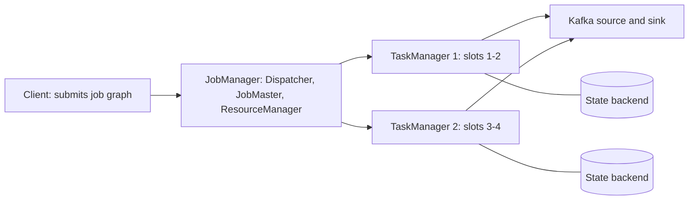

## 🎯 خلاصه

> **Apache Flink** یک پردازشگر جریان stateful است. هر رکورد را همان لحظه‌ی رسیدن پردازش می‌کند (نه در micro-batch)، keyed state نگه می‌دارد، و با checkpoint بازیابی می‌شود تا semantics از نوع exactly-once برای **state** داشته باشد. برای exactly-once بودن **خروجی** هم به یک sink تراکنشی نیاز است.

- یک cluster شامل یک **JobManager** (هماهنگی، checkpoint) و **TaskManager**ها (اجرای taskها در **slot**ها) است.
- job یک گراف از operatorهاست. operatorهای زنجیره‌شده در یک thread و بدون hop شبکه اجرا می‌شوند.
- زمان با **event time** و **watermark** مدیریت می‌شود؛ پنجره‌ها و timerها به آن وابسته‌اند (ببین [[time-and-ordering]]).
- سازگاری از **checkpointهای مبتنی بر barrier** و **sinkهای two-phase-commit** می‌آید.
- با **Flink Kubernetes Operator** اجرا کن و متریک‌های **backpressure** و **checkpoint** را زیر نظر داشته باش.

## 🌱 از ساده شروع کنیم (مبتدی)

> **💡 تشبیه:** یک تسمه‌ی نقاله در کارخانه. آیتم‌ها (رویدادها) یکی‌یکی می‌آیند، هر ایستگاه (operator) یک مرحله را انجام می‌دهد، و یک ناظر (JobManager) در زمان‌های ثابت از کل خط عکس می‌گیرد (checkpoint). اگر خط گیر کند، از آخرین عکس ادامه می‌دهی، نه از مواد خام.

یک job کوچک کلیک‌ها را برای هر کاربر در پنجره‌های یک‌دقیقه‌ای می‌شمارد:

```text
clicks: (ali, 10:00:05), (ali, 10:00:40), (sara, 10:00:50), (ali, 10:01:10)
result: 10:00-10:01  ali=2, sara=1
        10:01-10:02  ali=1
```

سه ایده Flink را توضیح می‌دهند:

1. **اول استریم.** رکوردها دائماً در گراف جریان دارند.
2. **Event time.** پنجره بر اساس زمان وقوع کلیک تعیین می‌شود، نه زمانی که job آن را دیده. رویداد دیررس یک واقعیت عادی است.
3. **بازیابی با snapshot.** اگر job کرش کند، از یک snapshot سازگار از state ادامه می‌دهد، نه از ابتدای زمان.

## 🔧 واقعاً چطور کار می‌کند (متوسط)

### معماری cluster



- **JobMaster** یک job را اجرا می‌کند: taskها را زمان‌بندی می‌کند، وضعیتشان را دنبال می‌کند و checkpoint را شروع می‌کند.
- **TaskManager** یک فرایند JVM با چند **task slot** است. هر slot سهم ثابتی از حافظه و CPU برای یک pipeline موازی است.
- **slot sharing** اجازه می‌دهد یک slot یک نسخه‌ی موازی از هر operator یک pipeline را در خود داشته باشد، پس یک slot یک برش کامل از job را اجرا می‌کند. این باعث می‌شود ترافیک شبکه بین operatorها تا جای ممکن محلی بماند.

### operatorها، chaining و parallelism

job یک DAG از operatorهاست: source، map، keyBy، window، sink. parallelism برای هر operator جدا تنظیم می‌شود. Flink operatorهای مجاور را با اتصال forward و parallelism یکسان در یک task **زنجیره** می‌کند. زنجیره رکوردها را با فراخوانی متد منتقل می‌کند، نه با سریال‌سازی روی شبکه، که خیلی ارزان‌تر است. `keyBy` یا `rebalance` زنجیره را می‌شکنند، چون داده باید shuffle شود.

```java
StreamExecutionEnvironment env = StreamExecutionEnvironment.getExecutionEnvironment();
env.setParallelism(4);

// clickSource: a KafkaSource<Click> defined elsewhere; CountClicks: an AggregateFunction
env.fromSource(clickSource, WatermarkStrategy
        .<Click>forBoundedOutOfOrderness(Duration.ofSeconds(10))
        .withTimestampAssigner((c, ts) -> c.eventTimeMillis()), "clicks")
    .map(c -> c.withNormalizedUser())          // chained with the source
    .keyBy(Click::userId)                      // breaks the chain: network shuffle
    .window(TumblingEventTimeWindows.of(Duration.ofMinutes(1)))
    .aggregate(new CountClicks())
    .sinkTo(kafkaSink);
```

### DataStream API و Flink SQL

- **DataStream API** کنترل کامل می‌دهد: keyed state، timer و processFunction سفارشی.
- **Flink SQL** و **Table API** همان منطق را به‌صورت declarative بیان می‌کنند و از optimizer استفاده می‌کنند. پنجره‌ها به‌صورت table-valued function نوشته می‌شوند:

```sql
SELECT window_start, window_end, user_id, COUNT(*) AS clicks
FROM TABLE(
  TUMBLE(TABLE clicks, DESCRIPTOR(ts), INTERVAL '1' MINUTE))
GROUP BY window_start, window_end, user_id;
```

برای aggregation و join استاندارد از SQL استفاده کن. وقتی state یا timer سفارشی لازم داری، به DataStream API برو.

### watermark و پنجره‌ها

**watermark** یک ادعاست: «دیگر نباید رویدادی قدیمی‌تر از این timestamp برسد». `forBoundedOutOfOrderness(10 s)` یعنی watermark برابر است با بزرگ‌ترین event time دیده‌شده منهای ۱۰ ثانیه. پنجره وقتی بسته می‌شود که watermark از انتهای آن رد شود. رویدادهایی که بعد از آن برسند **دیررس** هستند. می‌توانی یک دوره‌ی allowed lateness تعریف کنی (state پنجره بیشتر می‌ماند و نتیجه به‌روز می‌شود) یا رویدادهای دیررس را به side output بفرستی. منبع‌های بی‌کار watermark را عقب نگه می‌دارند، پس برای partitionهایی که دیگر تولید نمی‌کنند idleness تنظیم کن.

### checkpoint

JobManager به‌طور دوره‌ای **barrier** را به sourceها تزریق می‌کند. barrierها همراه داده حرکت می‌کنند. وقتی یک operator barrier را روی همه‌ی ورودی‌هایش دریافت کند (**checkpoint همگام، aligned**)، state خود را snapshot می‌گیرد و barrier را جلو می‌فرستد. وقتی همه‌ی operatorها تأیید کنند، checkpoint کامل است و در بازیابی sourceها به offsetهای ذخیره‌شده در آن برمی‌گردند. این ایده‌ی Chandy-Lamport است که برای dataflow تطبیق داده شده.

- checkpointهای **aligned** منتظر کانال‌های کند می‌مانند، که زیر [[backpressure]] آسیب می‌زند.
- checkpointهای **unaligned** اجازه می‌دهند barrierها از رکوردهای بافرشده‌ی در حال پرواز جلو بزنند و آن رکوردها را داخل checkpoint ذخیره می‌کنند. alignment کوتاه‌تر می‌شود، ولی checkpoint بزرگ‌تر.

### exactly-once از ابتدا تا انتها

state داخلی Flink بعد از restore به‌صورت exactly-once است. خروجی فرق دارد: sinkی که رکوردی را قبل از کامل شدن checkpoint می‌نویسد، ممکن است در replay دوباره بنویسدش. راه‌حل یک sink با **two-phase commit** است:

1. **pre-commit:** با هر barrier از checkpoint، sink داده‌اش را داخل یک تراکنش باز flush می‌کند و آن تراکنش را در state checkpoint ثبت می‌کند.
2. **commit:** وقتی JobManager تأیید کند checkpoint کامل شده، sink تراکنش را commit می‌کند.

اگر job قبل از commit خراب شود، تراکنش بسته به sink هنگام بازیابی abort یا دوباره commit می‌شود. برای Kafka، sink داخل تراکنش‌های Kafka می‌نویسد و مصرف‌کنندگان پایین‌دستی باید `read_committed` باشند تا فقط داده‌ی commit‌شده را ببینند:

```java
KafkaSink<String> sink = KafkaSink.<String>builder()
    .setBootstrapServers("broker:9092")
    .setRecordSerializer(KafkaRecordSerializationSchema.builder()
        .setTopic("clicks-agg")
        .setValueSerializationSchema(new SimpleStringSchema())
        .build())
    .setDeliveryGuarantee(DeliveryGuarantee.EXACTLY_ONCE)
    .setTransactionalIdPrefix("clicks-agg-job")   // unique per job
    .build();
```

timeout تراکنش Kafka را از فاصله‌ی checkpoint به‌علاوه‌ی زمان بازیابی بزرگ‌تر بگذار، وگرنه broker قبل از commit تراکنش را abort می‌کند.

### عملیات: backpressure و Kubernetes Operator

- **backpressure** وقتی ظاهر می‌شود که یک task پایین‌دستی نمی‌تواند همگام شود: بافر ورودی‌اش پر می‌شود و taskهای بالادستی کند می‌شوند. Web UI و متریک‌های backpressure نشان می‌دهند کدام operator گلوگاه است. گلوگاه را برطرف کن (skew، lookup کند بیرونی، parallelism کم)، نه بالادست را.
- **Flink Kubernetes Operator** منابع `FlinkDeployment` را مدیریت می‌کند: cluster را deploy می‌کند، job را submit می‌کند، ارتقا با savepoint را انجام می‌دهد و jobهای خراب‌شده را ری‌استارت می‌کند. وقتی job زیاد داری، به‌جای manifestهای دست‌ساز از آن استفاده کن.

## 🧠 عمق و trade-offها (سنیور)

- **Flink در برابر Spark Structured Streaming.** Flink رکوردها را پیوسته پردازش می‌کند و timerهای event time بومی و latency کم به‌ازای هر رکورد دارد. Spark Structured Streaming به‌طور پیش‌فرض micro-batch اجرا می‌کند، با API یکپارچه برای batch و streaming و اکوسیستم قوی SQL و ML. برای پردازش رویدادهای stateful با latency کم (fraud، sessionization، pipelineهای CDC) Flink را انتخاب کن. اگر از قبل Spark برای batch داری و latency چند ثانیه‌ای کافی است، Spark منطقی‌تر است. هر دو امروز خیلی کارها را انجام می‌دهند؛ بر اساس latency، نیاز به state و مهارت تیم تصمیم بگیر، نه بر اساس یک benchmark که خودت اجرا نکرده‌ای.
- **parallelism و skew کلید.** parallelism با تعداد key groupها و با شلوغ‌ترین کلید محدود می‌شود. یک کلید داغ تمام بارش را به یک subtask می‌فرستد. از pre-aggregation (محلی و بعد سراسری)، key salting برای aggregationهای جابه‌جایی‌پذیر، یا طراحی‌ای که اصلاً به کلید نیاز ندارد استفاده کن.
- **هزینه‌ی checkpoint.** فاصله‌ی checkpoint بین زمان بازیابی و سربار معامله می‌کند. state بزرگ با RocksDB و checkpoint افزایشی آپلود را کوچک نگه می‌دارد، ولی compaction هنوز می‌تواند جهش ایجاد کند. مدت checkpoint، زمان alignment و تعداد شکست را با هم تماشا کن. بخش state را در [[streaming-state]] ببین.
- **idleness و skew در watermark.** یک partition کند watermark سراسری را عقب نگه می‌دارد، پس پنجره‌ها هرگز بسته نمی‌شوند و state رشد می‌کند. راه‌حل معمول تنظیم idleness و watermark به‌تفکیک partition است.
- **Flink CDC.** Flink CDC لاگ تغییرات پایگاه داده را (مثلاً با reader های لاگ مثل Debezium) مستقیماً به Flink می‌خواند و در بعضی pipelineها یک hop جدا از Kafka Connect را حذف می‌کند. قبل از تکیه بر آن، فاز snapshot، تغییر schema و مدت نگهداری لاگ پایگاه داده را بررسی کن؛ باگ‌های ingestion معمولاً همین‌جا پیدا می‌شوند. با [[cdc]] مقایسه کن.
- **ارتقا.** تغییر گراف job یا schema state به savepoint و restore سازگار نیاز دارد. `uid()` را باید صریحاً تنظیم کنی، وگرنه بعد از refactor، state به job جدید نگاشت نمی‌شود.
- **کی از Flink استفاده نکنیم.** برای تبدیل‌های ساده‌ی هر رکورد با تیم کوچک و latency چند ثانیه‌ای، یک connector مدیریت‌شده یا یک برنامه‌ی Kafka Streams ساده‌تر اجرا می‌شود. Flink وقتی ارزش هزینه‌ی عملیاتی‌اش را دارد که exactly-once state در مقیاس بزرگ یا منطق event time لازم باشد که جای دیگری سخت بیان می‌شود.
- **چه چیزهایی را مانیتور کنیم:** backpressure به‌تفکیک operator، مدت و شکست checkpoint، watermark lag به‌ازای هر source، تعداد رکورد ورودی و خروجی در ثانیه، زمان GC روی TaskManagerها و consumer lag روی sourceی Kafka.

## 🧪 امتحان کن

1. **chaining.** در کد بالا فهرست کن کدام operatorها با هم زنجیره شده‌اند و کدام‌ها یک task جدید شروع می‌کنند. توضیح بده چرا `keyBy` باید یک task جدید شروع کند.
2. **محاسبه‌ی watermark.** با `forBoundedOutOfOrderness(10 s)`، بزرگ‌ترین event time دیده‌شده `10:05:30` است. کدام پنجره‌ای که در `10:05:00` تمام می‌شود هنوز می‌تواند رویداد بپذیرد؟ مقدار watermark چقدر است؟
3. **بررسی exactly-once.** یک Kafka sink با `EXACTLY_ONCE` و checkpoint هر ۶۰ ثانیه. یک مصرف‌کننده با `read_committed` می‌خواند. توضیح بده وقتی job بعد از آخرین checkpoint کامل‌شده کرش می‌کند، با رکوردهایی که نوشته شده‌اند چه می‌شود.

<details><summary>جواب‌ها را ببین</summary>

**1.** `fromSource` و `map` با اتصال forward و parallelism برابر هستند، پس یک زنجیره می‌سازند. `keyBy` رکوردها را بر اساس hash کلید از طریق شبکه توزیع مجدد می‌کند، پس بعد از آن یک task جدید شروع می‌شود. پنجره، aggregate و sink بعد از آن shuffle با اتصال forward و parallelism یکسان هستند، پس معمولاً در task دوم زنجیره می‌شوند. گروه‌بندی واقعی را در گراف job در Web UI تأیید کن، چون operatorهای داخلی sink می‌توانند آن را عوض کنند.

**2.** watermark برابر است با `10:05:30 - 10 s = 10:05:20`. پنجره‌ی `[10:04:00, 10:05:00)` وقتی بسته شد که watermark از `10:05:00` رد شد، و این قبلاً اتفاق افتاده، پس از watermark گذشته است. فقط اگر allowed lateness تنظیم شده باشد (مثلاً ۱ دقیقه) هنوز رویداد می‌پذیرد و نتیجه به‌روز می‌شود.

**3.** رکوردهایی که بعد از آخرین checkpoint کامل‌شده نوشته شده‌اند، داخل یک تراکنش Kafka باز و commit‌نشده هستند. بعد از کرش، job از checkpoint بازیابی می‌شود و تراکنش باز abort (یا fence) می‌شود، پس مصرف‌کننده‌ی `read_committed` آن رکوردها را هرگز نمی‌بیند. job بازیابی‌شده آن‌ها را در یک تراکنش جدید دوباره ارسال می‌کند. مصرف‌کنندگان هر نتیجه را دقیقاً یک بار می‌بینند.

</details>

## 💬 گوشه‌ی مصاحبه

**سؤال: «Flink چطور exactly-once را به دست می‌آورد؟»** جواب متوسط: «از checkpoint استفاده می‌کند، پس بعد از خطا از آخرین checkpoint دوباره پردازش می‌کند و نتیجه exactly-once است.» جواب سنیور: «state داخلی با checkpointهای barrier-aligned یا unaligned که state و offset منبع را سازگار snapshot می‌گیرند، exactly-once است. exactly-once بودن خروجی به یک sink تراکنشی با two-phase commit نیاز دارد که فقط بعد از کامل شدن checkpoint commit می‌کند. برای Kafka یعنی تراکنش‌ها و مصرف‌کننده‌های `read_committed`، با timeout تراکنشی بزرگ‌تر از checkpoint به‌علاوه‌ی زمان بازیابی. sinkهای غیرتراکنشی جز با نوشتن idempotent فقط at-least-once می‌دهند.»

**سؤال: «Flink در برابر Spark Structured Streaming؟»** جواب متوسط: «Flink استریم واقعی است و Spark micro-batch.» جواب سنیور: «Flink پردازش به‌ازای هر رکورد با timerهای غنی event time و latency کم می‌دهد، که برای پردازش رویداد stateful مناسب است. Spark یک موتور برای batch و streaming و اکوسیستم بزرگ SQL و ML دارد، با latency در حد ثانیه برای بیشتر کارها. بر اساس هدف latency، اندازه‌ی state و اینکه تیم از قبل Spark دارد یا نه، انتخاب می‌کنم.»

> **🎤 این را در مصاحبه بگو:** «Flink exactly-once را برای state با checkpoint تضمین می‌کند. برای exactly-once بودن خروجی به sink با two-phase commit نیاز دارم و timeout تراکنش را با فاصله‌ی checkpoint مقایسه می‌کنم. اولین متریک‌های عملیاتی‌ام backpressure به‌تفکیک operator و مدت checkpoint هستند.»

## ⚠️ اشتباهات رایج

> **⚠️ مراقب باش:** فکر کنی checkpoint exactly-once یعنی خروجی exactly-once است. sink بدون تراکنش یا نوشتن idempotent بعد از replay باز هم رکورد را تکرار می‌کند.

> **⚠️ مراقب باش:** timeout تراکنش Kafka را کوتاه‌تر از فاصله‌ی checkpoint به‌علاوه‌ی زمان بازیابی بگذاری. broker تراکنش را abort می‌کند و job یا commit در حال پرواز را از دست می‌دهد.

- برطرف کردن backpressure با اضافه کردن parallelism به operator بالادستی، وقتی گلوگاه پایین‌دستی است.
- فراموش کردن `uid()` روی operatorهای stateful، پس refactor نمی‌تواند state را بازیابی کند.
- استفاده از processing time برای پنجره‌ها وقتی سؤال کسب‌وکار درباره‌ی event time است.
- نادیده گرفتن partitionهای بی‌کار، پس watermark هرگز حرکت نمی‌کند و پنجره‌ها هرگز فعال نمی‌شوند.
- استفاده از یک global window بزرگ بدون TTL روی state و فرض این‌که خودش پاک می‌شود.

## ✅ خودت را بسنج (quiz)

1. یک slot در TaskManager نمایانگر چیست؟
   - A) یک partition کافکا
   - B) سهم ثابتی از حافظه و CPU در یک TaskManager برای یک برش pipeline
   - C) یک barrier checkpoint
   - D) یک فایل savepoint

<details><summary>جواب</summary>

**B** — slot سهم ثابتی از منابع یک TaskManager است. چند task موازی از job می‌توانند با slot sharing در یک slot قرار بگیرند.

</details>

2. کدام operatorها به احتمال زیاد در یک task قرار می‌گیرند؟
   - A) دو operator که با `keyBy` به هم وصل شده‌اند
   - B) دو operator که با اتصال forward و parallelism برابر به هم وصل شده‌اند
   - C) هر source و هر sink
   - D) operatorهای job های مختلف

<details><summary>جواب</summary>

**B** — operatorهای forward-connected با parallelism یکسان در یک task زنجیره می‌شوند و رکوردها را با فراخوانی متد منتقل می‌کنند. `keyBy` داده را از طریق شبکه توزیع مجدد می‌کند و زنجیره را می‌شکند.

</details>

3. پنجره وقتی بسته می‌شود که watermark از انتهایش رد شود. رویدادی که بعد از آن برسد و allowed lateness نداشته باشیم چه می‌شود؟

   - A) همیشه به هر حال به پنجره نوشته می‌شود
   - B) دیررس حساب می‌شود و حذف می‌شود، یا اگر تنظیم شده باشد به side output می‌رود
   - C) watermark را به عقب برمی‌گرداند
   - D) باعث ری‌استارت job می‌شود

<details><summary>جواب</summary>

**B** — بدون allowed lateness، پنجره قبلاً منتشر شده و state آن رفته، پس رویداد دیررس است. برای مدیریت آن allowed lateness یا side output تنظیم کن.

</details>

4. **(سنیور)** یک pipeline روی یک sink HTTP غیرتراکنشی با تحویل at-least-once می‌نویسد. تیم می‌گوید «ما Flink با exactly-once داریم، پس امنیم». ایراد این استدلال چیست و چه پیشنهادی می‌دهی؟

   - A) Flink از HTTP پشتیبانی نمی‌کند
   - B) state با exactly-once، اثرهای جانبی بیرونی را exactly-once نمی‌کند؛ sink باید idempotent باشد (کلیدهای پایدار، upsert) یا یک sink با two-phase commit استفاده کند
   - C) فاصله‌ی checkpoint باید ۰ باشد
   - D) مشکلی نیست؛ state و خروجی یک چیزند

<details><summary>جواب</summary>

**B** — Flink state را سازگار بازیابی می‌کند، ولی یک رکورد replay‌شده ممکن است دو بار به endpoint HTTP برسد. راه‌حل نوشتن idempotent با یک ID پایدار است، یا sinkی که در checkpointها شرکت می‌کند.

</details>

5. **(سنیور)** بعد از یک refactor، job ری‌استارت‌شده برای یک operator با state خالی شروع می‌کند، هرچند savepoint آن را دارد. محتمل‌ترین علت چیست؟

   - A) parallelism افزایش یافته
   - B) `uid()` operator تغییر کرده یا هرگز تنظیم نشده، پس state نمی‌تواند به آن نگاشت شود
   - C) watermarkها غیرفعال شده‌اند
   - D) job از Flink SQL استفاده کرده

<details><summary>جواب</summary>

**B** — state با uid به operatorها نگاشت می‌شود. uid را روی operatorهای stateful صریحاً تنظیم کن تا refactor نگاشت را حفظ کند، و قبل از deploy گزارش restore از savepoint را بررسی کن.

</details>

## 🗂️ فلش‌کارت

| Front | Back |
|---|---|
| JobManager در برابر TaskManager | JobManager job و checkpoint را هماهنگ می‌کند؛ TaskManagerها taskها را در slotها اجرا می‌کنند |
| slot چیست؟ | سهم ثابتی از حافظه و CPU یک TaskManager برای یک برش pipeline |
| operator chaining | operatorهای forward-connected با parallelism یکسان در یک task و بدون hop شبکه اجرا می‌شوند |
| چه چیزی زنجیره را می‌شکند؟ | shuffleهایی مثل `keyBy`، `rebalance` یا تغییر parallelism |
| checkpoint همگام در برابر ناهمگام | همگام منتظر barrier روی همه‌ی ورودی‌ها می‌ماند؛ ناهمگام اجازه می‌دهد barrier از داده‌ی بافرشده جلو بزند |
| exactly-once خروجی به چه نیاز دارد؟ | یک sink تراکنشی یا idempotent با two-phase commit مرتبط با checkpoint |
| watermark با out-of-orderness محدود | بزرگ‌ترین event time دیده‌شده منهای out-of-orderness مجاز |
| چرا `uid()` تنظیم کنیم؟ | تا state بعد از تغییر گراف job به همان operator نگاشت شود |

## 🔗 ادامه

- **streaming-state** backendهای state، TTL و اندازه‌ی checkpoint را عمیق‌تر توضیح می‌دهد.
- **kafka-exactly-once** تراکنش‌های Kafka و `read_committed` را از سمت broker پوشش می‌دهد.
- **spark-structured-streaming** نقطه‌ی مقایسه‌ی اصلی برای سؤال Flink در برابر Spark است.
- **stream-concepts** و **time-and-ordering** event time، پنجره‌ها و watermarkها را پوشش می‌دهند.
- **pattern-exactly-once** و **pattern-late-data** این ایده‌ها را به‌صورت طراحی end-to-end نشان می‌دهند.
- قبل از ذکر مقادیر پیش‌فرض پیکربندی، مستندات Flink را برای نسخه‌ی دقیق خودت بررسی کن، به‌ویژه checkpointing و Kubernetes Operator.
