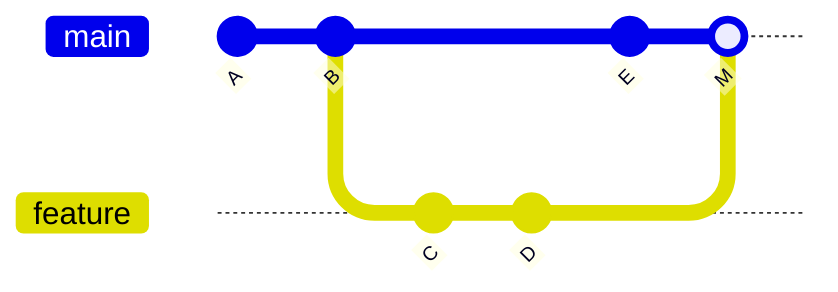

## 🎯 خلاصه

> Git تاریخچه را به صورت گرافی از **commit**ها ثبت می‌کند. workflow مجموعه قواعدی است که تیم با آن به این گراف امن اضافه می‌کند: شاخه‌های کوچک، تغییرات بررسی‌شده، بررسی‌های خودکار، و یک شاخه‌ی اصلی که همیشه قابل deploy است.

- یک **commit** یک snapshot به‌علاوه‌ی اشاره‌گر به والد(ها)ست. یک **branch** نام متحرکی برای یک commit است.
- **Merge** تاریخچه را همان‌طور که اتفاق افتاده نگه می‌دارد (یک merge commit دو خط کار را به هم وصل می‌کند). **Rebase** commitهای تو را روی یک base جدید دوباره اجرا می‌کند و commitهای جدید با hash جدید می‌سازد.
- **Trunk-based development**: شاخه‌های کوتاه‌عمر که زود و مکرر به `main` ادغام می‌شوند، پشت تست و CI.
- برای تیم داده همان دیسیپلین برای SQL، مدل‌های dbt، DAGها و کد زیرساخت لازم است. تغییر داده‌ای که review و تست نشده، یک incident در production است که منتظر وقوع است.

## 🌱 از ساده شروع کنیم (مبتدی)

> **💡 Analogy:** گیت مثل نقطه‌های ذخیره‌ی یک بازی ویدیویی است. هر commit یک نقطه‌ی ذخیره با یادداشت است. branch یک برچسب است که به آخرین نقطه‌ی ذخیره‌ی یک مسیر اشاره می‌کند. می‌توانی یک تغییر ریسکی را روی مسیر جدا امتحان کنی و اگر خراب شد دورش بیندازی، بدون اینکه مسیر اصلی تغییر کند.

یک حلقه‌ی روزانه‌ی ساده:

```bash
git status                          # چه چیزی تغییر کرده؟
git diff                            # دقیقاً چه تغییری است؟
git add models/orders.sql           # یک فایل را stage کن
git commit -m "Fix duplicate orders in daily load"
git push -u origin feature/fix-orders-dup
```

کار جدید را از `main` به‌روز شروع کن، روی شاخه‌ی خودش:

```bash
git switch main
git pull --ff-only                  # اگر تاریخچه واگرا شده، شکست بخور؛ merge غیرمنتظره نساز
git switch -c feature/fix-orders-dup
```

> **⚠️ Watch out:** `git add .` همه‌چیز پوشه را اضافه می‌کند، از جمله فایل‌های تولیدشده، رمزها و dumpهای بزرگ داده. فایل‌ها را با نام stage کن و قبل از commit، `git status` را ببین.

پیام commit باید **چرایی** تغییر را بگوید، با فعل امری («Fix duplicate orders» نه «fixed stuff»). کسی که شش ماه بعد `git log` را می‌خواند باید قصد را بفهمد.

## 🔧 واقعاً چطور کار می‌کند (متوسط)

### گراف

هر commit یک hash یکتا دارد و به والدش اشاره می‌کند. یک merge commit دو والد دارد. branch فقط نامی برای یک commit است و `HEAD` نام جایی است که الان در آن هستی.



### Merge در برابر rebase

هر دو تغییرات یک خط کار را به خط دیگر می‌آورند. تفاوتشان در این است که با تاریخچه چه می‌کنند.

| | `git merge main` روی شاخه‌ی تو | `git rebase main` روی شاخه‌ی تو |
|---|---|---|
| چه اتفاقی می‌افتد | یک merge commit با دو والد می‌سازد | commitهای تو را روی `main` دوباره اجرا می‌کند، با hash جدید |
| تاریخچه | کار موازی واقعی را نشان می‌دهد | خطی است و مثل یک داستان خوانده می‌شود |
| روی شاخه‌ی مشترک امن است؟ | بله | نه، چون commitهایی را بازنویسی می‌کند که ممکن است دیگران داشته باشند |
| کاربرد معمول | ادغام یک شاخه‌ی طولانی، حفظ ردپای ممیزی | مرتب کردن شاخه‌ی خصوصی قبل از review |

مثال عملی. شاخه‌ی `C-D` از `B` ساخته شده. در همین حین `main` یک commit به نام `E` گرفته.

```bash
git switch feature
git rebase main          # C و D روی E دوباره اجرا می‌شوند و hash جدید C' و D' می‌گیرند
git switch main
git merge --ff-only feature   # fast-forward: main از E به D' می‌رود بدون merge commit
```

rebase تعاملی commitهای خودت را قبل از review تمیز می‌کند:

```bash
git rebase -i main       # ویرایشگر باز می‌شود: pick، reword، squash، fixup، drop
```

قاعده را به یاد بسپار: **فقط چیزی را rebase کن که هنوز به اشتراک نگذاشته‌ای**. اگر دیگران شاخه‌ات را pull کرده‌اند، بازنویسی آن نسخه‌ی آن‌ها را خراب می‌کند. وقتی باید بعد از rebase یک شاخه‌ی مشترک را به‌روز کنی، از `git push --force-with-lease` استفاده کن؛ این دستور push را رد می‌کند اگر کس دیگری در این فاصله push کرده باشد. `--force` ساده ممکن است بی‌صدا کار دیگران را پاک کند.

### Trunk-based development

تیم روی `main` (trunk) کار می‌کند، با شاخه‌هایی که ساعت‌ها یا چند روز زنده‌اند، نه هفته‌ها. هر merge یک اجرای CI دارد. کاری که آماده نیست پشت feature flag پنهان می‌شود یا از مسیر deploy بیرون نگه داشته می‌شود، پس `main` همیشه قابل deploy است.

در مقابل، GitFlow با شاخه‌های طولانی‌مدت (`develop`، `release/*`، `hotfix/*`) قرار دارد. GitFlow دردسر merge را زیاد می‌کند چون شاخه‌ها از هم دور می‌شوند. برای تیم داده‌ای که pipelineها را روزانه deploy می‌کند، trunk-based با شاخه‌های کوتاه معمولاً ساده‌تر است. هزینه‌اش این است که تست خوب و feature flag لازم داری.

### Code review

یک pull request (PR) یا merge request، diff را نشان می‌دهد، CI را اجرا می‌کند و از یک یا چند نفر تأیید می‌خواهد. برای کار داده، یک review خوب این‌ها را بررسی می‌کند:

- **grain** و کلیدهای join هر مدل جدید (join ای که ردیف‌ها را تکرار می‌کند باگ کلاسیک است)،
- تغییر **schema** و اینکه آیا مصرف‌کننده‌های پایین‌دستی می‌شکنند،
- **برنامه‌ی backfill** و هزینه (بازسازی کامل یک جدول ۵ ترابایتی تغییر ساده نیست)،
- تست‌ها: یکتایی، not-null، مقادیر مجاز، و بررسی عقلانیت تعداد ردیف.

### Monorepo برای داده

قرار دادن مدل‌های SQL، DAGها، جاب‌های Python، زیرساخت و تست‌ها در یک repository باعث می‌شود یک جدول و مصرف‌کننده‌هایش را در یک PR اتمیک تغییر دهی. هزینه‌اش CI ای است که فقط بخش‌های تحت‌تأثیر را اجرا کند (مثلاً با فیلتر مسیر یا گراف وابستگی) تا pipeline کند نشود.

### Pre-commit hook

pre-commit hook قبل از ساخته شدن commit چک‌ها را اجرا می‌کند. گیت hookها را از `.git/hooks/` اجرا می‌کند، ولی تیم‌ها معمولاً آن‌ها را از طریق ابزاری مثل فریم‌ورک `pre-commit` و یک فایل نسخه‌بندی‌شده به اشتراک می‌گذارند:

```bash
# راه‌اندازی یک‌باره در repository (بعد از نصب pre-commit)
pre-commit install
```

```yaml
# .pre-commit-config.yaml (نمونه)
repos:
  - repo: https://github.com/pre-commit/pre-commit-hooks
    rev: v4.6.0          # نسخه‌ای را پین کن که تأییدش کرده‌ای
    hooks:
      - id: check-yaml
      - id: detect-private-key
      - id: end-of-file-fixer
```

hookها مشکل‌های ارزان (رمز، YAML خراب) را قبل از CI می‌گیرند. باید سریع باشند، چون توسعه‌دهنده‌ها hookهای کند را خاموش می‌کنند.

## 🧠 عمق و trade-offها (سنیور)

- **استراتژی شاخه یک تصمیم درباره‌ی throughput است.** شاخه‌های طولانی conflict ایجاد می‌کنند و باگ‌های integration را پنهان می‌کنند. زمان بین ساخت شاخه و merge را اندازه بگیر؛ اگر بیشتر از چند روز است، فرایند گلوگاه است، نه آدم‌ها.
- **از `main` محافظت کن.** CI موفق، حداقل یک تأیید، و بدون force-push را الزامی کن. اجرای CI را هم روی merge commit نگه دار، نه فقط روی PR، تا ترکیبی که conflict ندارد ولی خراب است گرفته شود.
- **رمزها بعد از push همیشه لو رفته‌اند.** حذف فایل در یک commit جدید، آن را از تاریخچه پاک نمی‌کند. اگر کلیدی commit شده، اول آن را rotate کن، بعد تاریخچه را با ابزاری مثل `git filter-repo` پاک کن و همه‌ی cloneها را به‌روز کن. پیشگیری (اسکن رمز در pre-commit، `.gitignore`) خیلی ارزان‌تر است.
- **فایل‌های بزرگ داده و باینری.** Git پایگاه داده نیست. dataset یا باینری مدل را commit نکن؛ از object storage با یک فایل ارجاع استفاده کن، یا Git LFS اگر تیم واقعاً باینری نسخه‌دار لازم دارد. repository بی‌پایان بزرگ می‌شود و cloneها کند.
- **از Git deploy کن، نه از لپ‌تاپ.** وضعیت production باید از روی یک commit قابل بازتولید باشد. این پیوند با [[dataops-cicd]] است: pipeline از یک commit تگ‌خورده build می‌شود، و rollback یعنی deploy تگ قبلی.
- **Migration و ترتیب merge.** برای تغییر schema، اول قدم سازگار با عقب را deploy کن (ستون جدید اضافه کن، هر دو را بنویس)، بعد خواننده‌ها را منتقل کن، و در آخر ستون قدیمی را حذف کن. یک PR که جدول و همه‌ی مصرف‌کننده‌ها را یک‌جا عوض می‌کند، ریسکش بیشتر از چیزی است که به نظر می‌رسد، حتی در monorepo.
- **کجا نباید استفاده کنی.** شاخه‌ای را که همکارت روی آن کار می‌کند rebase نکن. `git reset --hard` را روی کاری که commit نشده به کار نبر؛ برگشت‌ناپذیر است. اگر روزانه deploy می‌کنی، هر تغییر pipeline را به یک release چندهفته‌ای GitFlow تبدیل نکن.

## 🧪 امتحان کن

این‌ها را در یک repository آزمایشی اجرا کن (`mkdir /tmp/git-lab && cd /tmp/git-lab && git init -b main`):

۱. یک فایل `orders.sql` با یک خط بساز و روی `main` commit کن. شاخه‌ی `feature/a` بساز، خط را عوض کن و commit کن. به `main` برگرد، یک خط دیگر را عوض کن و commit کن. حالا `git merge feature/a` بزن. تاریخچه را توصیف کن.
۲. مرحله‌ی ۱ را تکرار کن، ولی به جای merge از `git switch feature/a && git rebase main` و بعد `git switch main && git merge --ff-only feature/a` استفاده کن. خروجی `git log --oneline --graph` هر دو اجرا را مقایسه کن.
۳. دستورهای لازم برای به‌روز کردن امن یک شاخه‌ای که قبلاً push و rebase کرده‌ای را بنویس، بدون اینکه commit جدید یک همکار را از بین ببری.

<details><summary>راه‌حل‌ها را نشان بده</summary>

**۱.** بعد از `git merge feature/a` روی `main` (با تغییری که با خط دیگر conflict ندارد)، Git یک merge commit با دو والد می‌سازد. `git log --oneline --graph` دو خط را نشان می‌دهد که در merge commit به هم می‌رسند.

**۲.** rebase، commit `feature/a` را روی commit جدید `main` دوباره اجرا می‌کند و hash جدید می‌دهد. سپس merge با fast-forward، `main` را بدون merge commit جلو می‌برد، پس گراف یک خط صاف است.

**۳.**
```bash
git push --force-with-lease origin feature/a
```
`--force-with-lease` push را رد می‌کند اگر شاخه‌ی remote commitی داشته باشد که تو fetch نکرده‌ای. اول fetch کن و بررسی کن (`git fetch && git log origin/feature/a`)، بعد در صورت نیاز روی وضعیت جدید remote rebase کن، نه کورکورانه روی نسخه‌ی قدیمی خودت.

</details>

## 💬 گوشه‌ی مصاحبه

**سؤال: «merge یا rebase؟»** جواب متوسط: «rebase برای مرتب نگه داشتن تاریخچه‌ی شاخه‌ی خودم قبل از review؛ merge برای ادغام یک شاخه‌ی مشترک، تا تاریخچه کار موازی واقعی را نشان دهد.» جواب سنیور: «بستگی دارد چه کسی commitها را دارد. کار خصوصی را آزادانه rebase می‌کنم و وقتی باید شاخه‌ی push‌شده را به‌روز کنم از `--force-with-lease` استفاده می‌کنم. هرگز `main` را بازنویسی نمی‌کنم. شاخه‌های کوتاه‌عمر را با squash یا fast-forward merge می‌کنم تا تاریخچه خوانا بماند و هر merge با یک تغییر بررسی‌شده مطابقت کند.»

**سؤال: «چطور دیسیپلین مهندسی نرم‌افزار را به تیم داده بیاوریم؟»** جواب سنیور: «SQL، DAGها و زیرساخت را در version control بگذار، PR با چک‌لیست الزامی کن (grain، تغییر schema، هزینه‌ی backfill)، تست‌های خودکار مثل یکتایی و تازگی داده را در CI اضافه کن، و از commitهای تگ‌خورده deploy کن تا rollback یک دستور باشد. از پرریسک‌ترین جدول‌ها شروع می‌کنم، نه با بازنویسی همه‌چیز.»

**سؤال: «یک commit بد روی main push شده. چه کار می‌کنی؟»** جواب متوسط: «`git revert` یک commit جدید می‌سازد که آن را خنثی می‌کند؛ روی شاخه‌ی مشترک امن است.» جواب سنیور: «اول revert تا سرویس سریع برگردد، بعد در یک PR درست را اصلاح می‌کنم. `main` را برای پنهان کردن اشتباه بازنویسی نمی‌کنم، چون clone و deployهای دیگر به آن وابسته‌اند. اگر رمزی push شده، قبل از هر کار دیگری آن را rotate می‌کنم.»

> **🎤 Say this in the interview:** «شاخه‌ها را کوتاه نگه می‌دارم، فقط کار خصوصی را rebase می‌کنم، و شاخه‌ی push‌شده‌ی مشترک را جز با `--force-with-lease` force-push نمی‌کنم. برای تیم داده، SQL و pipelineها را مثل کد رفتار می‌کنم: PR بررسی‌شده، تست داده‌ی خودکار در CI، و deploy از commit تگ‌خورده.»

## ⚠️ اشتباهات رایج

> **⚠️ Watch out:** `git push --force` روی شاخه‌ی مشترک می‌تواند commitهای همکار را پاک کند. از `--force-with-lease` استفاده کن، و فقط وقتی می‌دانی روی remote چه چیزی هست.

- commit کردن رمز، فایل `.env` یا dump داده، و بعد حذف آن در commit بعدی. تاریخچه هنوز آن را دارد.
- شاخه‌های طولانی که هفته‌ها دور می‌شوند و بعد یک merge بزرگ و پرِ conflict می‌سازند.
- rebase کردن شاخه‌ای که کس دیگری checkout کرده.
- استفاده از `git add .` بدون بررسی `git status`.
- نوشتن پیام‌هایی مثل «fix» یا «wip» روی main، که `git log` را برای بررسی incident بی‌فایده می‌کند.
- رد کردن review به این بهانه که «فقط یک تغییر SQL است». یک join اشتباه در یک مدل می‌تواند درآمد را برای همه‌ی داشبوردها دوبرابر کند.
- استفاده از `git reset --hard` روی کار commit نشده. اول commit یا `git stash` کن.

## ✅ خودت را بسنج

۱. وقتی `feature` commitهایی دارد که `main` ندارد، و `main` هم commitهای جدید دارد، `git merge` چه می‌سازد؟
   - A) یک شاخه‌ی جدید به نام `feature`
   - B) یک merge commit با دو والد
   - C) یک کپی rebase‌شده از `feature` با hash جدید
   - D) هیچ؛ merge فقط اشاره‌گر HEAD را جابه‌جا می‌کند

<details><summary>جواب</summary>

**B** — وقتی هر دو شاخه واگرا شده‌اند، Git یک merge commit می‌سازد که نوک هر دو شاخه والدش است. rebase (گزینه‌ی C) hash جدید می‌سازد، ولی merge نه.

</details>

۲. شاخه‌ای را که قبلاً push کرده بودی rebase کردی. کدام دستور push امن‌ترین راه برای به‌روز کردن remote است؟
   - A) `git push`
   - B) `git push --force`
   - C) `git push --force-with-lease`
   - D) `git push --mirror`

<details><summary>جواب</summary>

**C** — `--force-with-lease` remote را فقط وقتی بازنویسی می‌کند که هنوز با آخرین commitی که fetch کرده‌ای یکی باشد، پس commit جدید همکار پاک نمی‌شود. `--force` ساده (گزینه‌ی B) چنین بررسی‌ای ندارد. push ساده (A) بعد از rebase رد می‌شود.

</details>

۳. همکارت تصادفاً رمز دیتابیس را دو commit قبل کامیت کرده و شاخه push شده. حذف فایل در یک commit جدید کافی است. درست است یا غلط؟
   - A) درست؛ فایل از repository حذف می‌شود
   - B) غلط؛ رمز در تاریخچه می‌ماند و باید rotate شود، و در صورت نیاز تاریخچه پاک شود
   - C) درست، اگر repository خصوصی باشد
   - D) غلط، فقط اگر commit امضا نشده باشد

<details><summary>جواب</summary>

**B** — تاریخچه blobهای قدیمی را نگه می‌دارد و هر کسی که clone دارد آن‌ها را دارد. اول رمز را rotate کن، بعد در صورت نیاز با ابزاری مثل `git filter-repo` تاریخچه را بازنویسی کن و با همه‌ی دارندگان clone هماهنگ شو.

</details>

۴. **(سنیور)** تیم داده‌ی تو pipelineها را روزانه deploy می‌کند، ولی شاخه‌های feature سه هفته طول می‌کشند تا merge شوند و conflict زیادی دارند. محتمل‌ترین ریشه‌ی مشکل چیست و workflow بهتر کدام است؟
   - A) تعداد reviewerها کم است؛ بیشتر اضافه کن
   - B) شاخه‌های طولانی از `main` دور می‌شوند؛ به trunk-based با شاخه‌های کوتاه، CI روی هر merge، و feature flag برای کار ناتمام برو
   - C) گیت کند است؛ به یک file share برو
   - D) commitها خیلی کوچک‌اند؛ هفته‌ای همه را squash کن

<details><summary>جواب</summary>

**B** — شاخه‌های طولانی واگرایی جمع می‌کنند و باگ‌های integration را پنهان می‌کنند، پس conflictها با زمان بزرگ‌تر می‌شوند. شاخه‌های کوتاه که زود merge می‌شوند، CI آن‌ها را تست می‌کند و flagها کار ناتمام را پنهان می‌کنند، و `main` قابل deploy می‌ماند و diffها کوچک.

</details>

۵. **(سنیور)** monorepo برای مدل‌های SQL، DAGها و تست‌ها چه سودی برای تیم داده دارد و چه چیزی لازم دارد؟
   - A) نیاز به code review را از بین می‌برد
   - B) یک PR می‌تواند یک جدول و مصرف‌کننده‌هایش را اتمیک تغییر دهد، ولی CI باید فقط بخش‌های تحت‌تأثیر را اجرا کند تا سریع بماند
   - C) فایل‌های داده را بهینه ذخیره می‌کند
   - D) rebase را غیرضروری می‌کند

<details><summary>جواب</summary>

**B** — کنار هم بودن کد تولیدکننده و مصرف‌کننده اجازه می‌دهد یک تغییر بررسی‌شده هر دو را به‌روز کند و وضعیت‌های ناسازگار میانی بین repositoryها پیش نیاید. هزینه این است که CI به فیلتر مسیر یا گراف وابستگی نیاز دارد، وگرنه هر تغییر کل مجموعه‌ی تست را اجرا می‌کند.

</details>

## 🗂️ فلش‌کارت

| Front | Back |
|---|---|
| commit چیست؟ | snapshot درخت به‌علاوه‌ی اشاره‌گر به commit(های) والد |
| branch چیست؟ | نامی متحرک که به یک commit اشاره می‌کند |
| merge در برابر rebase (اثر روی تاریخچه) | merge یک commit با دو والد اضافه می‌کند؛ rebase commitها را با hash جدید دوباره اجرا می‌کند |
| چه وقت rebase ناامن است؟ | وقتی دیگران روی commitهایی کار کرده‌اند که می‌خواهی بازنویسی کنی |
| `--force` در برابر `--force-with-lease` | `--force` کورکورانه بازنویسی می‌کند؛ `--force-with-lease` اگر remote از آخرین fetch تو تغییر کرده باشد رد می‌کند |
| trunk-based development چیست؟ | شاخه‌های کوتاه‌عمر که زود به `main` merge می‌شوند، پشت CI و feature flag |
| چرا رمز push‌شده بعد از حذف هنوز لو رفته؟ | تاریخچه‌ی Git blobهای قدیمی را نگه می‌دارد؛ رمز را rotate کن و در صورت نیاز تاریخچه را پاک کن |
| pre-commit hook چه می‌کند؟ | قبل از ساخته شدن commit چک‌هایی (رمز، YAML، فرمت) را اجرا می‌کند |

## 🔗 ادامه

- **dataops-cicd** توضیح می‌دهد چطور یک commit تگ‌خورده به یک pipeline تست‌شده و deployشده تبدیل می‌شود و rollback چطور کار می‌کند.
- **dbt** و **airflow** ابزارهای داده‌ای رایجی هستند که کدشان در Git است؛ تست‌ها و review مربوط به DAG همین workflow را دنبال می‌کنند.
- **data-quality** چک‌هایی را توضیح می‌دهد که باید در CI بگذاری تا مدل بد قبل از رسیدن به داشبورد شکست بخورد.
- یک بار `git help rebase` و بخش «Reset, restore and revert» مستندات Git را بخوان؛ رفتار دقیق `reset`، `restore` و `revert` چیزی است که زیر فشار اشتباه می‌شود.
