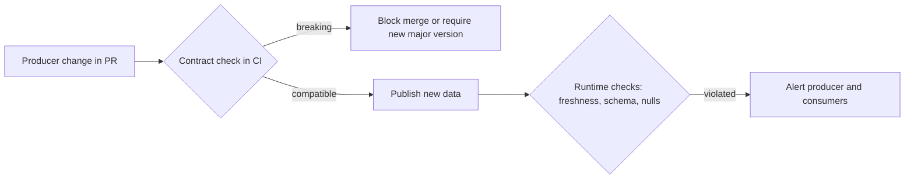

## 🎯 خلاصه

> **حاکمیت داده** تصمیم می‌گیرد چه کسی مالک داده است، چه قواعدی روی آن اعمال می‌شود، و کیفیت و دسترسی‌اش چطور کنترل می‌شود. **data contract** یک توافق نسخه‌بندی‌شده بین **تولیدکننده** داده و **مصرف‌کننده‌ها** درباره‌ی schema، معنی، تازگی و کیفیت است. **Data Mesh** یک رویکرد سازمانی است که به تیم‌های دامنه مالکیت داده‌شان را به‌عنوان محصول می‌دهد، روی یک پلتفرم self-serve مشترک و با قواعد federated.

- حاکمیت بدون مالک فقط یک سند سیاست است. مالکیت اولین کنترل است.
- قرارداد کنترل کیفیت را به **سمت تولیدکننده** می‌برد، جایی که تغییر شکننده قبل از رسیدن به مصرف‌کننده گرفته می‌شود.
- Data Mesh بیشتر درباره‌ی **چه کسی مالک چیست** و **تیم‌ها چطور کار می‌کنند** است. فناوری نیست، و هزینه‌ها و منتقدان واقعی دارد.

## 🌱 از ساده شروع کنیم (مبتدی)

> **💡 تشبیه:** یک آشپزخانه‌ی مشترک در ساختمان اداری. هر تیم برای بقیه غذا می‌پزد. حاکمیت قوانین خانه است: چه کسی یخچال را تمیز می‌کند، کدام مواد حساسیت‌زا باید برچسب بخورند. قرارداد وعده‌ی منو است: «سوپ ما همیشه این مواد را دارد، در این ساعت، و اگر دستور پخت را عوض کنیم اول به شما خبر می‌دهیم.» Data Mesh تصمیم دادن آشپزخانه‌ی خودش به هر طبقه است، به شرط این‌که همه قوانین ساختمان را رعایت کنند.

این مشکلی است که قراردادها حل می‌کنند. سرویس checkout واحد `amount` را از سنت به یورو عوض می‌کند. تست‌های خودش پاس می‌شوند. داشبورد مالی درآمد را ۱۰۰ برابر بیشتر نشان می‌دهد و یک هفته کسی متوجه نمی‌شود. تولیدکننده طبق تعریف خودش کار اشتباهی نکرده، اما توافقی وجود نداشته که مصرف‌کننده بتواند رویش حساب کند.

قرارداد توافق را صریح می‌کند:

```yaml
dataset: orders
owner: checkout-team
version: 2.1.0
schema:
  - {name: order_id, type: string, nullable: false, unique: true}
  - {name: amount_cents, type: integer, nullable: false}
  - {name: currency, type: string, nullable: false, allowed: [EUR, USD, GBP]}
freshness:
  max_lag_minutes: 60
change_policy: removing, renaming or retyping a column requires a new major version
```

## 🔧 واقعاً چطور کار می‌کند (متوسط)

**حاکمیت** چند کنترل دارد. راه ساده برای به خاطر سپردنشان:

| کنترل | سؤالی که جواب می‌دهد | مکانیزم معمول |
|---|---|---|
| مالکیت | چه کسی پاسخ‌گوی این dataset است؟ | فیلد owner در کاتالوگ، نقش steward |
| طبقه‌بندی | شخصی، مالی یا عمومی است؟ | برچسب‌ها (PII)، برچسب سطح ستون |
| دسترسی | چه کسی می‌تواند بخواند و چه کسی تأیید کرده؟ | نقش‌ها، grantها، گردش‌کار تأیید |
| کیفیت | برای استفاده مناسب است؟ | تست‌ها، observability، SLA |
| نگه‌داری | چقدر باید نگه داریم و کی باید پاک کنیم؟ | قواعد چرخه‌ی عمر، jobهای حذف |
| lineage و تغییر | به چه چیزی وابسته است و چه چیزی تغییر می‌کند؟ | گراف lineage، لاگ تغییرات |

**قراردادهای داده** بخش سمت تولیدکننده‌ی این کنترل‌ها هستند. یک قرارداد چهار بخش دارد: **schema** (نام‌ها، نوع‌ها، nullable بودن، مقادیر مجاز)، **معنی** (یک فیلد یعنی چه، که توضیح و واژه‌های کسب‌وکاری حملش می‌کنند)، **سطح سرویس** (تازگی، کامل بودن، دسترس‌پذیری)، و **سیاست تغییر** (چطور تغییرات شکننده اعلام و نسخه‌بندی می‌شوند). اجرای قرارداد می‌تواند در سه جا انجام شود:



یک بررسی سطح ردیف که pipeline می‌تواند با قرارداد اجرا کند:

```python
contract = {
    "schema": [
        {"name": "order_id", "nullable": False},
        {"name": "amount_cents", "nullable": False},
        {"name": "currency", "nullable": False, "allowed": ["EUR", "USD", "GBP"]},
    ]
}

def check_row(row: dict, contract: dict) -> list[str]:
    errors = []
    for col in contract["schema"]:
        value = row.get(col["name"])
        if value is None and not col["nullable"]:
            errors.append(f"{col['name']} is null")
        if "allowed" in col and value is not None and value not in col["allowed"]:
            errors.append(f"{col['name']}={value!r} not allowed")
    return errors

print(check_row({"order_id": "a1", "amount_cents": 500, "currency": "JPY"}, contract))
# ["currency='JPY' not allowed"]
```

**Data Mesh** (اصطلاحی از کارهای Zhamak Dehghani) روی چهار اصل بنا شده است:

1. **مالکیت دامنه:** تیمی که فرایند کسب‌وکار را می‌فهمد، داده‌ای را که تولید می‌کند مالک است.
2. **داده به‌عنوان محصول:** datasetها مصرف‌کننده، مستندات، SLA و یک product owner دارند.
3. **پلتفرم داده‌ی self-serve:** یک تیم پلتفرم مرکزی ابزار ذخیره‌سازی، pipeline و انتشار را در اختیار دامنه‌ها می‌گذارد، تا هر دامنه زیرساخت را از صفر نسازد.
4. **حاکمیت محاسباتی فدرال:** استانداردهای سراسری (نام‌گذاری، حریم خصوصی، قابلیت همکاری) با کد و خودکارسازی اعمال می‌شوند، و دامنه‌ها جزئیات را تصمیم می‌گیرند.

## 🧠 عمق و trade-offها (سنیور)

- **قرارداد یعنی API برای داده.** با تغییر schema مثل نسخه‌بندی API رفتار کن: پنجره‌ی deprecation، فهرست مصرف‌کننده‌ها از lineage، و برنامه‌ی مهاجرت. تغییر شکننده بدون نسخه یعنی یک حادثه‌ی تولیدی در انتظار.
- **محل قرارداد مهم است.** قراردادی که در مخزنی است که تولیدکننده مالکش است و در CI همان تیم اجرا می‌شود، تغییرات را زود می‌گیرد. قراردادی که فقط در ویکی است، وعده‌ای است که کسی بررسی نمی‌کند.
- **بررسی‌های runtime هنوز لازم‌اند.** سیستم‌های بالادستی به شکلی تغییر می‌کنند که CI نمی‌بیند، مثلاً یک ستون دیتابیس منبع که شروع به دریافت مقدار جدید می‌کند. بررسی ردیف و تازگی را در pipeline نگه دار، همان‌طور که در [[data-observability|observability]] آمده.
- **حاکمیت یک trade-off بین کنترل و سرعت است.** تأیید مرکزی برای هر ستون جدید جلوی اشتباه را می‌گیرد و تیم‌ها را هم متوقف می‌کند. بررسی‌های خودکار سیاست (برای ستون‌های PII، نام‌گذاری، برچسب نگه‌داری) بهتر از کمیته مقیاس می‌شوند.
- **ادعای واقعی Data Mesh.** گلوگاه در بسیاری از شرکت‌ها تیم داده‌ی مرکزی است که برای هر درخواست صف می‌شود. Mesh می‌کوشد مالکیت را به کسانی بدهد که کسب‌وکار را می‌شناسند. پلتفرم فنی است که این کار را اصلاً ممکن می‌کند.
- **نقدهای Data Mesh.** دانستنشان مهم است:
  - به یک پلتفرم بالغ و مهندسی دامنه‌ی بالغ نیاز دارد. بدون آن‌ها هر دامنه همان pipelineها را بد از نو می‌سازد.
  - کار تکراری و تعریف‌های ناسازگار بین دامنه‌ها، که تحلیل‌های بین‌دامنه باید آشتی‌شان دهند.
  - join و سازگاری بین‌دامنه‌ای وقتی مالکیت تقسیم شده سخت‌تر است.
  - شرکت‌های کوچک معمولاً دامنه‌ی کافی برای توجیه هزینه‌ی سربار ندارند.
  - اغلب به‌عنوان برچسبی برای بازسازی تیم‌ها پذیرفته می‌شود، بی‌آن‌که انگیزه‌ها یا پلتفرم عوض شوند.
- **کیفیت به سمت بالادست منتقل می‌شود.** قراردادها تولیدکننده را در برابر آن‌چه مصرف‌کننده می‌بیند پاسخ‌گو می‌کنند. این به انگیزه نیاز دارد: تیمی که فقط با تحویل feature سنجیده می‌شود قراردادها را نگه نمی‌دارد.
- **کی آن را اتخاذ نکنی.** شرکت کوچکی با یک تیم داده و چند منبع با یک تیم مرکزی، ماله‌ی مالکیت واضح در [[data-catalogs|کاتالوگ]] و چند قرارداد برای جریان‌های حیاتی بهتر عمل می‌کند. مالکیت به سبک mesh را تدریجی بیاور، یک دامنه در هر مرحله، آن‌جا که واقعاً گلوگاه را برمی‌دارد.

## 🧪 امتحان کن

۱. یک فیلد `discount_cents` (nullable، integer) به قرارداد و به `check_row` اضافه کن. سپس تصمیم بگیر: طبق سیاست تغییر بالا، اضافه کردن این فیلد تغییر شکننده است؟ توضیح بده.
۲. یک تولیدکننده `amount_cents` را به `amount_minor` تغییر نام می‌دهد. مراحلی را توصیف کن که مصرف‌کننده‌ها خراب نشوند. نسخه‌هایی که استفاده می‌کنی را نام ببر.
۳. شرکت تو ۴۰ مهندس در پنج تیم محصول و یک تیم داده‌ی سه‌نفره دارد که گلوگاه است. اولین قدم به سمت مالکیت دامنه را پیشنهاد بده که نیاز به اجرای کامل Data Mesh نداشته باشد.

<details><summary>جواب‌ها را ببین</summary>

**۱.** اضافه کردن یک فیلد nullable معمولاً تغییر **سازگار با عقب** است: مصرف‌کننده‌هایی که ستون‌های ناشناخته را نادیده می‌گیرند کار می‌کنند. طبق سیاست بالا، فقط حذف، تغییر نام یا تغییر نوع ستون نسخه‌ی major جدید می‌خواهد. تابع `check_row` باید ردیف‌هایی را که این فیلد را ندارند بپذیرد، پس بررسی جدید نباید آن را اجباری کند.

**۲.** یک نسخه‌ی جدید منتشر کن که هم `amount_cents` و هم `amount_minor` را داشته باشد (تغییر نسخه‌ی minor، برای سازگاری). deprecation را با تاریخ اعلام کن. مصرف‌کننده‌ها را از lineage و کاتالوگ پیدا کن. آن‌ها را مهاجرت بده. بعد `amount_cents` را در یک نسخه‌ی major جدید بردار، وقتی مصرف‌کننده‌ها منتقل شده‌اند. تغییر نام در جا بدون این ترتیب یک تغییر شکننده است.

**۳.** یک تیم محصول با دامنه‌ی کسب‌وکار واضح را انتخاب کن و مالک datasetهای کلیدی‌اش کن، با قرارداد و SLA، در حالی که تیم داده پلتفرم مشترک و استانداردها را فراهم می‌کند. بقیه‌ی سازمان را دست‌نخورده نگه دار. اندازه بگیر آیا صف تیم داده کوچک می‌شود و حادثه‌های مصرف‌کننده کم می‌شوند. فقط بعد از این‌که کار کرد گسترش بده.

</details>

## 💬 گوشه‌ی مصاحبه

**سؤال: «data contract چیست و چرا از آن استفاده می‌کنی؟»** جواب متوسط: «data contract توافقی درباره‌ی schema و کیفیت یک dataset بین تولیدکننده و مصرف‌کننده است. جلوی رسیدن تغییر شکننده به داشبورد بدون هشدار را می‌گیرد.» جواب سنیور: «این توافقی شبیه API است با چهار بخش: schema، معنی، سطح سرویس و سیاست تغییر. schema و nullable بودن را در CI تولیدکننده اعمال می‌کنم، بررسی‌های تازگی و ردیف را در runtime نگه می‌دارم، و تغییرات شکننده را نسخه‌بندی می‌کنم. سخت‌ترین بخش انگیزه است: تولیدکننده باید تجربه‌ی مصرف‌کننده را مال خودش بداند، پس سلامت قرارداد را جزو اهداف تیم می‌کنم.»

**سؤال: «نظرت درباره‌ی Data Mesh چیست؟»** این سؤال یک پاسخ متوازن را می‌سنجد. جواب متوسط: «راهی است برای این‌که تیم‌های دامنه مالک داده‌شان باشند، با یک پلتفرم مشترک.» جواب سنیور: «اصول مفیدند، به‌ویژه وقتی تیم مرکزی گلوگاه است. آن را به‌عنوان بازنویسی کل سازمان اتخاذ نمی‌کنم. به یک پلتفرم self-serve بالغ و مهندسی دامنه‌ی قوی نیاز دارد، و کار تکراری و مشکلات سازگاری بین‌دامنه‌ای اضافه می‌کند. با یک یا دو دامنه شروع می‌کنم که مالکیتشان واضح است و نتیجه را اندازه می‌گیرم.»

> **🎤 این را در مصاحبه بگو:** «حاکمیت را اول از مالکیت می‌بینم، بعد سیاست‌ها و بررسی‌ها. data contract وعده‌ی تولیدکننده را صریح و قابل اجرا می‌کند. Data Mesh مجموعه‌ی مفیدی از اصول مالکیت است، اما جایی اتخاذش می‌کنم که تیم مرکزی واقعاً گلوگاه است، نه به‌عنوان بازسازی کلی سازمان.»

## ⚠️ اشتباهات رایج

> **⚠️ مراقب باش:** Data Mesh را فناوری‌ای بدانی که می‌شود خرید. این یک مدل عملیاتی است و پلتفرم فقط یک بخش آن است.

- نوشتن قراردادهایی که هیچ‌کس اجرا نمی‌کند. قرارداد بدون بررسی فقط مستندات است.
- تغییر نوع ستون در جا و نامیدن آن «تغییر minor» چون test suite پاس شد.
- تبدیل حاکمیت به کمیته برای هر تغییر، که تیم‌ها را کند می‌کند بی‌آن‌که حادثه‌ها را کم کند.
- فرض این‌که مالکیت دامنه نیاز به تعریف‌های مشترک را برمی‌دارد. متریک‌های بین‌دامنه‌ای هنوز واژه‌های توافق‌شده لازم دارند.
- راه‌اندازی mesh بدون پلتفرم self-serve، که باعث می‌شود هر دامنه همان pipelineها را بسازد.
- سنجیدن حاکمیت با تعداد سیاست‌های نوشته‌شده، نه با حادثه‌های جلوگیری‌شده و مصرف‌کننده‌های خدمت‌گرفته‌شده.

## ✅ خودت را بسنج (quiz)

۱. کدام‌یک **data contract** است؟
   - A) داشبوردی که تازگی جدول را نشان می‌دهد
   - B) توافق نسخه‌بندی‌شده بین تولیدکننده و مصرف‌کنندگان درباره‌ی schema، معنی، تازگی و کیفیت
   - C) قاعده‌ی دسترسی نقش‌محور در انبار داده
   - D) برنامه‌ی نگه‌داری برای بکاپ‌ها

<details><summary>جواب</summary>

**B** — قرارداد توافق تولیدکننده و مصرف‌کننده است. داشبورد، قواعد دسترسی و برنامه‌ی نگه‌داری ابزارهای حاکمیتی دیگرند.

</details>

۲. طبق یک سیاست تغییر معمول، کدام تغییر **شکننده** است؟
   - A) اضافه کردن یک ستون nullable در انتها
   - B) اضافه کردن یک مقدار مجاز جدید به ستون enum، اگر مصرف‌کننده‌ها مقادیر ناشناخته را درست مدیریت کنند
   - C) تغییر نام `amount_cents` به `amount_minor` بدون مرحله‌ی انتقال
   - D) اضافه کردن توضیح به یک ستون

<details><summary>جواب</summary>

**C** — تغییر نام نامی را حذف می‌کند که مصرف‌کننده‌ها به آن وابسته‌اند. بقیه‌ی گزینه‌ها در بیشتر راه‌اندازی‌ها سازگار با عقب‌اند؛ گزینه‌ی B بستگی دارد به این‌که مصرف‌کننده‌ها مقادیر جدید را تحمل کنند، که خودش یک سؤال قرارداد است.

</details>

۳. **(سنیور)** کدام اصل Data Mesh به گلوگاه شدن تیم داده‌ی مرکزی می‌پردازد؟

   - A) داده به‌عنوان محصول
   - B) مالکیت دامنه
   - C) حاکمیت محاسباتی فدرال
   - D) پلتفرم داده‌ی self-serve

<details><summary>جواب</summary>

**B** — مالکیت دامنه مسئولیت داده را به تیم‌هایی می‌دهد که فرایند کسب‌وکار را می‌فهمند. پلتفرم self-serve هم کمک می‌کند، اما تغییر مالکیت است که صف را برمی‌دارد.

</details>

۴. **(سنیور)** تیمی می‌گوید SLA تازگی قرارداد لازم نیست، چون CI از قبل schema را چک می‌کند. قوی‌ترین استدلال مخالف چیست؟

<details><summary>جواب</summary>

CI روی تغییرات کد اجرا می‌شود، اما خرابی تازگی از شرایط runtime می‌آید: منبع بالادستی دیر، job شکست‌خورده، کوئری کند. schema می‌تواند کامل باشد در حالی که داده سه روز قدیمی است. تازگی نیاز به بررسی runtime در برابر SLA دارد که CI نمی‌بیند.

</details>

۵. **(سنیور)** دو انتقاد درست به Data Mesh و یک شرط که با آن هنوز ایده‌هایش را اتخاذ می‌کنی نام ببر.

<details><summary>جواب</summary>

دو انتقاد: به پلتفرم بالغ و مهندسی دامنه‌ی بالغ نیاز دارد تا pipelineهای تکراری ساخته نشود، و سازگاری بین‌دامنه‌ای وقتی مالکیت تقسیم شده سخت‌تر می‌شود. شرط اتخاذ ایده‌ها: تیم داده‌ی مرکزی گلوگاه ثابت‌شده‌ای باشد و چند دامنه مالکیت کسب‌وکاری واضح و بلوغ مهندسی کافی داشته باشند تا داده‌ی خودشان را مدیریت کنند.

</details>

## 🗂️ فلش‌کارت

| Front | Back |
|---|---|
| حاکمیت داده چیست؟ | تصمیم‌ها و کنترل‌ها روی مالکیت، طبقه‌بندی، دسترسی، کیفیت، نگه‌داری و تغییر |
| بخش‌های یک data contract | schema، معنی، سطح سرویس (تازگی، کامل بودن)، سیاست تغییر |
| قرارداد اول کجا اعمال شود؟ | تغییرات schema در CI تولیدکننده، و بررسی‌های runtime برای تازگی و مقادیر |
| تغییر شکننده چیست؟ | تغییری که چیزی را که مصرف‌کننده‌ها به آن وابسته‌اند حذف، تغییر نام یا تغییر نوع می‌دهد؛ نسخه‌ی major جدید می‌خواهد |
| چهار اصل Data Mesh | مالکیت دامنه، داده به‌عنوان محصول، پلتفرم self-serve، حاکمیت محاسباتی فدرال |
| چرا مالکیت اولین کنترل است؟ | بدون مالک پاسخ‌گو، سیاست، کیفیت و دسترسی کسی را برای اجرا ندارند |
| اصلی‌ترین انتقاد به Data Mesh | به پلتفرم بالغ و مهندسی دامنه نیاز دارد؛ وگرنه کار تکراری می‌کند و سازگاری را ضعیف می‌کند |

## 🔗 ادامه

- [[data-catalogs|کاتالوگ‌های داده]] جایی است که مالکان، طبقه‌بندی‌ها و قراردادها برای مردم قابل دیدن می‌شوند.
- [[data-lineage]] نشان می‌دهد یک تغییر شکننده به کدام مصرف‌کننده‌ها می‌رسد.
- [[data-observability]] بررسی‌های runtime را پوشش می‌دهد که مکمل قراردادها هستند.
- [[medallion-architecture]] لایه‌بندی رایجی است که قراردادها معمولاً روی آن می‌نشینند، بین تولیدکننده‌ها و لایه‌های curated.
- [[dataops-cicd]] pipeline CI را پوشش می‌دهد که بررسی‌های schema در آن جا می‌گیرند.
- [[data-security]] کنترل دسترسی و masking را پوشش می‌دهد که سیاست‌های حاکمیت به آن‌ها تکیه دارند.
