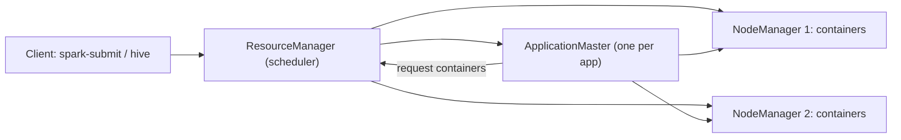

## 🎯 خلاصه

> **Hadoop** مجموعه‌ای از اجزاست برای ذخیره‌ی فایل روی ماشین‌های زیاد (**HDFS**)، زمان‌بندی کار روی آن‌ها (**YARN**) و پرس‌وجو با SQL (**Hive**، و **HBase** برای خواندن و نوشتن تصادفی با کلید). بیشتر این اکوسیستم هنوز روی خوشه‌های on-prem اجرا می‌شود.

- **HDFS** فایل‌ها را به blockهای بزرگ تقسیم و replicate می‌کند (پیش‌فرض ۳ کپی). **NameNode** فضای نام را در حافظه نگه می‌دارد؛ **DataNode**ها blockها را ذخیره می‌کنند.
- **YARN** مدیر منابع است: **ResourceManager** کانتینرها را روی **NodeManager**ها تخصیص می‌دهد و هر application یک **ApplicationMaster** مخصوص خودش دارد.
- **Hive** یک SQL را به jobهایی تبدیل می‌کند که روی YARN اجرا می‌شوند. **Metastore** آن (یک دیتابیس رابطه‌ای که metadata جدول و partition را نگه می‌دارد) کاتالوگی است که Spark، Trino و Impala هم استفاده می‌کنند.
- مشکل عملیاتیِ تکراری **small files** است: اشیای زیاد NameNode را تحت فشار می‌گذارند و همه‌ی jobها را کند می‌کنند.

## 🌱 از ساده شروع کنیم (مبتدی)

> **💡 تشبیه:** یک کتابخانه‌ی بزرگ در شهری با ساختمان‌های زیاد را تصور کن. HDFS سیستم انبارداری است: هر کتاب به فصل‌ها (block) بریده می‌شود، هر فصل در سه ساختمان مختلف نگه‌داری می‌شود (replica) و یک فهرست کارت‌ها می‌گوید هر فصل کجاست (NameNode). YARN مدیر کارکنان است که برای هر درخواست کارگر و میز اختصاص می‌دهد. Hive یک میز مرجع است که سؤالت را به SQL می‌پرسی و میز کارگرها را می‌فرستد تا جواب را پیدا کنند.

چهار جزئی که باید اسمشان را بدانی:

| جزء | نقش | اگر خراب شود |
|---|---|---|
| **NameNode** | درخت فایل‌ها و محل blockها را در حافظه نگه می‌دارد | بدون HA کل خوشه از دسترس خارج می‌شود |
| **DataNode** | فایل blockها را روی دیسک محلی ذخیره و heartbeat می‌فرستد | HDFS blockهایش را جای دیگری دوباره replicate می‌کند |
| **ResourceManager** | زمان‌بند سراسری CPU و حافظه | application جدید نمی‌تواند شروع شود |
| **NodeManager** | کانتینرها را روی یک ماشین اجرا می‌کند | کانتینرهایش دوباره زمان‌بندی می‌شوند |

جدول در Hive یعنی یک پوشه از فایل‌ها در HDFS، به‌علاوه یک ردیف در Metastore که ستون‌ها، فرمت و مکان را توصیف می‌کند:

```sql
CREATE TABLE sales (
  order_id    BIGINT,
  customer_id BIGINT,
  amount      DECIMAL(12,2)
)
PARTITIONED BY (dt STRING)
STORED AS ORC;
```

هر partition یک زیرپوشه می‌شود، مثل `/warehouse/sales/dt=2026-10-01/`. کوئری‌ای که روی `dt` فیلتر دارد فقط همان پوشه‌ها را می‌خواند. به این کار **partition pruning** می‌گویند و اولین بهینه‌سازی‌ای است که باید چک کنی.

## 🔧 واقعاً چطور کار می‌کند (متوسط)

### HDFS

فایل به blockها تقسیم می‌شود (پیش‌فرض ۱۲۸ مگابایت در Hadoop 2 به بعد؛ تنظیمات خوشه‌ات را چک کن). هر block روی سه DataNode نگه‌داری می‌شود، ترجیحاً روی rackهای مختلف. نوشتن از یک **pipeline** می‌گذرد: client block را به DataNode اول می‌فرستد، آن به دومی و همین‌طور تا آخر. وقتی همه‌ی replicaها را داشته باشند، نوشتن تأیید می‌شود.

**متادیتای NameNode.** NameNode فضای نام (پوشه‌ها و فایل‌ها) و نگاشت block به DataNode را در حافظه نگه می‌دارد. نگاشت block به DataNode از block reportهای DataNodeها بازسازی می‌شود، ولی فضای نام از طریق **edit log** و **fsimage** (checkpoint) ماندگار است. موقع راه‌اندازی NameNode، edit log را روی آخرین fsimage بازپخش می‌کند که در خوشه‌ی بزرگ ممکن است خیلی طول بکشد.

**NameNode HA.** خوشه‌های production یک NameNode **Active** و یک **Standby** دارند. هر دو edit log مشترک را از یک quorum از **JournalNode**ها (QJM) می‌خوانند و یک failover controller با **ZooKeeper** standby را خودکار ارتقا می‌دهد. fencing تضمین می‌کند active قبلی دیگر نمی‌تواند بنویسد. بدون HA، یک NameNode یعنی یک نقطه‌ی خرابی.

**مسیر خواندن.** client از NameNode محل blockها را می‌پرسد و بعد هر block را مستقیم از یک DataNode می‌خواند. NameNode در مسیر داده نیست، برای همین throughput بالا را مقیاس‌پذیر نگه می‌دارد.

### YARN

YARN مدیریت منابع را از محاسبه جدا می‌کند:



- **ResourceManager** کانتینرها (تکه‌ای از حافظه و vCore) را طبق صف‌ها زمان‌بندی می‌کند. **Capacity Scheduler** به هر صف سهم تضمین‌شده می‌دهد و **Fair Scheduler** بین appهای در حال اجرا تعادل برقرار می‌کند. بانک‌ها و اپراتورها معمولاً برای هر تیم یا pipeline صف تعریف می‌کنند تا یک job بقیه را گرسنه نگه ندارد.
- هر application یک **ApplicationMaster** دارد که کانتینر درخواست می‌کند و taskهای خودش را دنبال می‌کند. برای MapReduce همان MR AM است؛ برای Spark در cluster mode، driver داخل AM اجرا می‌شود.
- اگر یک NodeManager heartbeat نفرستد، کانتینرهایش از دست می‌روند و کارش دوباره زمان‌بندی می‌شود.

### Hive

Hive سه لایه دارد که باید جدا از هم در ذهنت داشته باشی:

1. **Metastore.** سرویسی روی یک دیتابیس رابطه‌ای (در بیشتر نصب‌ها MySQL یا PostgreSQL). دیتابیس‌ها، جدول‌ها، ستون‌ها، partitionها، مکان‌ها و آمار را نگه می‌دارد. Spark SQL، Trino، Impala و موتورهای دیگر همین Metastore را می‌خوانند، پس در یک شرکت Hadoop این کاتالوگ عملاً استاندارد است.
2. **کامپایلر کوئری.** HiveQL پارس، بهینه‌سازی (cost-based با آمار) و به یک DAG از taskها کامپایل می‌شود.
3. **موتور اجرا.** MapReduce موتور قدیمی است. **Tez** انتخاب معمول برای Hive تعاملی و batch است، چون DAG را در یک application YARN اجرا می‌کند و بین مراحل روی دیسک نمی‌نویسد.

**Partition.** هر partition یک پوشه‌ی `col=value` در مکان جدول است. فیلتر روی ستون partition پوشه‌ها را قبل از باز کردن هر فایلی حذف می‌کند. فیلتر روی ستون غیر-partition همه‌ی فایل‌های partitionهای انتخاب‌شده را می‌خواند.

**Bucket.** bucket یعنی hash یک ستون در تعداد ثابتی فایل (`CLUSTERED BY (customer_id) INTO 32 BUCKETS`). اگر دو طرف join با همان کلید و همان تعداد bucket شده باشند، join و sampling بهتر می‌شوند. ولی سخت‌گیرند: تغییر تعداد یعنی بازنویسی جدول.

**فرمت فایل.** ORC و Parquet ستونی‌اند، فشرده‌اند و آمار هر stripe یا row group را دارند. Text و JSON سطری‌اند و اسکنشان گران است. جدول‌های تحلیلی را در ORC یا Parquet نگه دار.

**بارگذاری یک partition** با مقدار ثابت:

```sql
INSERT OVERWRITE TABLE sales PARTITION (dt = '2026-10-01')
SELECT order_id, customer_id, amount
FROM staging_sales
WHERE load_date = '2026-10-01';
```

`INSERT OVERWRITE` فقط همان partition را جایگزین می‌کند؛ پس بارگذاری روزانه idempotent می‌شود (ببین [[idempotency]]). partitioning پویا (`PARTITION (dt)` بدون مقدار) راحت است، ولی از یک ستون بد می‌تواند هزاران partition بسازد؛ با محدودیت‌هایی مثل `hive.exec.max.dynamic.partitions` کنترلش کن و اول مقادیر را چک کن.

**HBase** فرق دارد: یک store با ستون‌های گسترده روی HDFS با **RegionServer**ها، کلید سطر مرتب‌شده و خواندن و نوشتن تصادفی سریع. برای lookup با کلید در مقیاس بزرگ (پروفایل، وضعیت دستگاه) به کار می‌رود، نه برای اسکن تحلیلی.

## 🧠 عمق و trade-offها (سنیور)

- **مشکل small files.** هر فایل و هر block یک شیء در حافظه‌ی NameNode است؛ یک قاعده‌ی سرانگشتی حدود ۱۵۰ بایت برای هر شیء است (نسخه و تنظیم heap را چک کن). دو چیدمان از همان ۱ ترابایت را مقایسه کن. به‌صورت حدود یک میلیون فایل ۱ مگابایتی: تقریباً ۱٬۰۰۰٬۰۰۰ شیء فایل به‌علاوه ۱٬۰۰۰٬۰۰۰ شیء block، یعنی حدود ۲ میلیون شیء یا حدود ۳۰۰ مگابایت heap در NameNode با ۱۵۰ بایت برای هر شیء، و یک اسکن کامل حدود یک میلیون task شروع می‌کند. به‌صورت blockهای ۱۲۸ مگابایتی: حدود ۸٬۱۹۲ block و تعداد task خیلی کمتر. علت‌ها: ingestion استریمی که برای هر micro-batch یک فایل می‌نویسد، یک فایل برای هر partition در هر load کوچک، یا reducerهای زیادی که هر کدام یک فایل ریز می‌نویسند. راه‌حل‌ها: نوشتن‌های کمتر و بزرگ‌تر، یک job دوره‌ای compaction که partitionها را به فایل‌های با اندازه‌ی هدف بازنویسی کند، و تنظیمات ادغام فایل Hive (مثلاً `hive.merge.mapfiles`) جایی که موجود است. ببین [[small-files-problem]].
- **Metastore به‌عنوان قرارداد.** وقتی Metastore اشتباه باشد (مکان یک partition به پوشه‌ی حذف‌شده اشاره کند یا آمار کهنه باشد)، همه‌ی موتورها داده‌ی اشتباه می‌بینند. کارهایی مثل تعمیر partitionها و تازه‌کردن آمار بعد از load بزرگ کار واقعی است، نه نظافت.
- **Hive روی Tez در برابر Spark.** Tez نوشتن روی دیسک بین مراحل یک کوئری را حذف می‌کند. امروزه موتورهای SQL مبتنی بر Spark برای ETL رایج‌اند. روی هر پلتفرم یک موتور را انتخاب و مستند کن، چون ترکیب موتورها روی یک جدول تفاوت‌های ظریفی در فرمت و آمار می‌سازد.
- **مسیرهای مهاجرت.** اغلب بانک‌ها و اپراتورهای ایرانی سال‌ها Hadoop را نگه می‌دارند. مسیر واقع‌بینانه این است: HDFS را نگه دار یا storage را به object storage ببر، Metastore را به‌عنوان کاتالوگ نگه دار، یک فرمت جدول ستونی مثل Iceberg یا Delta روی آن بگذار و compute را به Spark یا Trino ببر. همزمان عوض‌کردن کاتالوگ و چیدمان فایل معمول‌ترین علت شکست مهاجرت است. ببین [[lakehouse-table-formats]] و [[design-hadoop-migration]].
- **ابزارهای قدیمی.** **Sqoop** داده را بین دیتابیس رابطه‌ای و HDFS جابه‌جا می‌کرد؛ ingestion جدید از ابزارهای CDC یا خواندن JDBC در Spark استفاده می‌کند. **Oozie** workflowها را هماهنگ می‌کرد؛ در بیشتر پلتفرم‌های جدید Airflow و زمان‌بندهای مشابه جایش را گرفته‌اند. هر دو را در کدهای قدیمی بشناس.
- **بهره‌برداری.** heap و توقف‌های GC در NameNode، تعداد فایل و block، blockهای under-replicated و corrupt (`hdfs fsck /`)، مصرف دیسک DataNode، استفاده‌ی صف‌های YARN و کانتینرهای pending، و بار دیتابیس Metastore را پایش کن.

## 🧪 امتحان کن

برای دستورها به یک نصب محلی Hadoop یا Hive نیاز داری؛ استدلال SQL در هر موتور سازگار با Hive کار می‌کند.

1. برای جدول `sales` بالا، کدام کوئری فقط پوشه‌های یک هفته را می‌خواند: `WHERE dt = '2026-10-01'` یا `WHERE customer_id = 42`؟ دلیلش را بگو. بعد کوئری‌ای بنویس که وقتی فیلتر `dt >= '2026-10-01'` است هم روی `dt` prune کند.
2. یک job روزانه ۵۰۰ فایل حدود ۲ مگابایتی در یک partition می‌نویسد. تعداد blockهای HDFS و تعداد map taskها را برای یک اسکن کامل تخمین بزن و بازنویسی‌ای پیشنهاد بده که هر دو را کم کند. محاسبه را نشان بده.
3. زمان‌بندی خرابی را رسم کن وقتی NameNode فعال وسط یک نوشتن crash می‌کند. کدام جزء خرابی را تشخیص می‌دهد و قبل از این‌که standby فعال شود چه باید اتفاق بیفتد؟

<details><summary>پاسخ‌ها را ببین</summary>

**1.** `WHERE dt = '2026-10-01'` به یک پوشه‌ی partition محدود می‌شود. `customer_id` ستون partition نیست، پس کوئری همه‌ی partitionها را اسکن می‌کند، مگر این‌که جدول روی `customer_id` bucket شده باشد و join هم با همان کلید انجام شود. برای بازه، برای یک هفته از `dt >= '2026-10-01' AND dt < '2026-10-08'` استفاده کن تا optimizer پوشه‌ها را انتخاب کند.

**2.** ۵۰۰ فایل × ۲ مگابایت = ۱٬۰۰۰ مگابایت. هر فایل یک block است، پس ۵۰۰ block و حداقل ۵۰۰ map task (چون فایل‌ها block مشترک ندارند). بازنویسی به یک فایل ۱٬۰۰۰ مگابایتی حدود ۸ block از ۱۲۸ مگابایت و حدود ۸ task می‌دهد. یک job compaction که با `INSERT OVERWRITE` از همان partition فایل‌های ۱ گیگابایتی بنویسد هر دو عدد را درست می‌کند.

**3.** کنترلر failover در ZooKeeper متوجه می‌شود session یا health check مربوط به active قطع شده. active قبلی fence می‌شود تا نتواند به JournalNodeها بنویسد، و سپس standby ارتقا پیدا می‌کند و بقیه‌ی edit log را بازپخش می‌کند. clientها روی failover proxy دوباره تلاش می‌کنند. نوشتن در حال انجام ممکن است شکست بخورد و client آن را دوباره امتحان می‌کند.

</details>

## 💬 گوشه‌ی مصاحبه

> **🎤 این را در مصاحبه بگو:** «HDFS فایل‌ها را به blockهای replicate‌شده نگه می‌دارد، NameNode فضای نام را در حافظه دارد، و YARN کانتینرها را از طریق صف‌ها روی NodeManagerها زمان‌بندی می‌کند. Hive روی این فایل‌ها SQL می‌دهد، با Metastore به‌عنوان کاتالوگ و partitionها به‌صورت پوشه. مشکلی که بیشتر رصدش می‌کنم small files است، چون هم NameNode را اذیت می‌کند و هم هر jobی که به آن‌ها دست می‌زند.»

**سؤال‌های رایج**

- *وقتی یک DataNode می‌میرد چه می‌شود؟* blockهایش زیر ضریب replication می‌افتند، NameNode کپی‌ها را از replicaهای باقی‌مانده زمان‌بندی می‌کند و خوشه خودش ترمیم می‌شود.
- *تفاوت partition و bucket چیست؟* partition یک پوشه به ازای هر مقدار است و pruning می‌دهد؛ bucket تقسیم hash ثابت در فایل‌هاست و برای join کمک می‌کند.
- *چرا Metastore فراتر از Hive مهم است؟* Spark، Trino و Impala همین تعریف جدول‌ها را استفاده می‌کنند؛ Metastore خراب همه را خراب می‌کند.
- *چرا کوئری‌های یک جدول با گذشت زمان کندتر می‌شوند؟* انباشت small files، نبود آمار، یا partitionهایی که دیگر با چیدمان داده نمی‌خوانند.

**جواب mid:** هر جزء، partition pruning، و یک راه‌حل برای small files را توضیح می‌دهد.

**جواب senior:** NameNode HA و fencing، طراحی صف برای خوشه‌ی چندتیمی، یک برنامه‌ی مهاجرت که کاتالوگ را پایدار نگه می‌دارد، و سیگنال‌های پایش بالا.

## ⚠️ اشتباهات رایج

- **رفتار با HDFS مثل یک فایل‌سیستم POSIX.** HDFS بیشتر append-محور است، به‌روزرسانی در جا ندارد و فایل بسته‌شده تغییرناپذیر است. به‌روزرسانی سطری به یک فرمت جدول یا بازنویسی partition نیاز دارد.
- **partition کردن روی ستون با cardinality بالا** مثل `customer_id` یا زمان با دقت ثانیه. نتیجه میلیون‌ها پوشه و فایل ریز است. روزانه یا ماهانه partition کن و اگر locality برای join لازم است bucket بساز.
- **حذف جدول Hive و انتظار حذف فایل‌ها** وقتی جدول `EXTERNAL` است. جدول external داده را نگه می‌دارد؛ جدول managed داده را حذف می‌کند.
- **باور این‌که ضریب replication از همه چیز محافظت می‌کند.** replica از خرابی دیسک و نود محافظت می‌کند، نه از یک `DELETE` اشتباه، job بدی که داده‌ی غلط می‌نویسد، یا Metastore خراب.
- **اجرای Hive با موتور پیش‌فرض MapReduce** برای کار تعاملی و تعجب از کندی آن.

## ✅ خودت را بسنج

۱. مسیر فایل‌ها به شناسه‌ی blockها را کدام جزء نگه می‌دارد و اگر NameNode فعال بدون HA خراب شود چه می‌شود؟

   - A) DataNode، و از Metastore بازسازی می‌شود
   - B) NameNode در حافظه، ماندگار از طریق edit log و fsimage؛ بدون HA خوشه تا وقتی NameNode برگردد و edit log را بازپخش کند در دسترس نیست
   - C) ResourceManager، و همچنان کار می‌کند
   - D) ZooKeeper، که کل داده را نگه می‌دارد

<details><summary>پاسخ</summary>

**B** — NameNode فضای نام را دارد. بدون standby، تا وقتی NameNode برگردد و edit log را بازپخش کند، هیچ تغییر یا خواندنی روی فضای نام ممکن نیست.

</details>

۲. یک کوئری روی `dt` فیلتر دارد ولی کل جدول را اسکن می‌کند. محتمل‌ترین علت کدام است؟

   - A) جدول فرمت ORC دارد
   - B) فیلتر روی ستون partition با یک تابع پیچیده شده، یا `dt` ستون partition نیست، پس optimizer نمی‌تواند prune کند
   - C) ضریب replication برابر ۳ است
   - D) جدول bucket دارد

<details><summary>پاسخ</summary>

**B** — pruning به مقایسه‌ی مستقیم روی ستون partition نیاز دارد. تابعی مثل `substr(dt, 1, 7) = '2026-10'` روی ستون اغلب جلوی آن را می‌گیرد. شرط را روی ستون خام بنویس.

</details>

۳. **(متوسط)** تیمی می‌خواهد `customer_id` را کلید partition یک جدول ۵ ساله با ۵۰ میلیون مشتری کند. چرا انتخاب ضعیفی است و چه چیزی بگذاریم؟

   - A) شناسه‌ی مشتری نمی‌تواند رشته باشد
   - B) میلیون‌ها پوشه و فایل ریز می‌سازد؛ بر اساس ستون زمانی مثل روز یا ماه partition کن و در صورت نیاز locality برای join، با `customer_id` bucket بساز
   - C) partitionها باید عددی باشند
   - D) Hive از partitioning پشتیبانی نمی‌کند

<details><summary>پاسخ</summary>

**B** — هر partition یک پوشه با فایل‌هاست، پس cardinality بالا تعداد اشیاء در حافظه‌ی NameNode و تعداد taskها را ضرب می‌کند. با زمان partition کن (محدود و قابل پیش‌بینی) و برای کلید join از bucket استفاده کن.

</details>

۴. **(سنیور)** یک job هر ساعت ۲۰۰۰ فایل در یک partition می‌نویسد. heap در NameNode به ۹۰٪ رسیده و راه‌اندازی job چند دقیقه طول می‌کشد. علت اصلی و ترتیب راه‌حل‌ها چیست؟

   - A) DataNodeها کندند؛ دیسک اضافه کن
   - B) تعداد فایل علت اصلی است؛ اول نوشتن‌های آینده را کم کن (batchهای بزرگ‌تر، reducer کمتر، یا sink که ادغام کند)، بعد فایل‌های موجود را compact کن، و اگر لازم شد heap NameNode را تنظیم کن
   - C) ضریب replication را زیاد کن تا خواندن سریع‌تر شود
   - D) از ORC به فایل text برو

<details><summary>پاسخ</summary>

**B** — مشکل تعداد اشیاست، نه پهنای باند دیسک. اول از منبع جلوی ساخت فایل ریز را بگیر، فایل‌های موجود را compact کن، و بعد به heap دست بزن. اضافه‌کردن replica یا عوض‌کردن فرمت تعداد اشیا را کم نمی‌کند.

</details>

۵. **(سنیور)** چرا مهاجرتی که داده را به object storage می‌برد و همزمان Metastore را هم عوض می‌کند ریسکی است؟

   - A) object storage از Parquet پشتیبانی نمی‌کند
   - B) دو تغییر هم‌زمان خطاها را سخت قابل تشخیص می‌کند: اگر تعداد یا partitionها فرق داشته باشند، نمی‌دانی داده، کاتالوگ یا موتور مشکل دارد؛ هر لایه را جدا و با مرحله‌ی اعتبارسنجی جابه‌جا کن
   - C) Metastore را نمی‌شود بک‌آپ گرفت
   - D) Hive فایل‌های خارج از HDFS را نمی‌خواند

<details><summary>پاسخ</summary>

**B** — مهاجرت مرحله‌ای (ابتدا کاتالوگ را نگه دار، بعد storage را ببر، بعد موتورها و فرمت جدول) امکان مقایسه‌ی نتایج را در هر مرحله می‌دهد. تغییر همه‌چیز یکجا این توانایی را از بین می‌برد.

</details>

## 🗂️ فلش‌کارت

| Front | Back |
|---|---|
| NameNode چه چیزی را نگه می‌دارد؟ | فضای نام و محل blockها در حافظه؛ ماندگار به‌صورت edit log و fsimage |
| ضریب replication پیش‌فرض HDFS؟ | ۳ (قابل تنظیم برای هر فایل یا پوشه) |
| چرا NameNode گلوگاه داده نیست؟ | clientها داده‌ی block را مستقیم از DataNodeها می‌خوانند؛ NameNode فقط metadata می‌دهد |
| Standby NameNode برای HA به چه نیاز دارد؟ | edit log مشترک از طریق JournalNodeها (QJM) و failover controller (ZooKeeper) با fencing |
| ResourceManager چه می‌کند؟ | کانتینرها را طبق صف‌ها روی NodeManagerها زمان‌بندی می‌کند؛ هر app ApplicationMaster خودش را دارد |
| Hive Metastore چیست؟ | دیتابیس رابطه‌ای با metadata جدول، partition و آمار؛ کاتالوگ مشترک پلتفرم |
| partition در برابر bucket؟ | partition = پوشه به ازای هر مقدار (pruning)؛ bucket = تقسیم hash ثابت در فایل‌ها (locality برای join) |
| چرا small files مضرند؟ | هر فایل و block یک شیء NameNode و یک task جدا است؛ هم storage و هم compute را کند می‌کنند |

## 🔗 ادامه

- **mapreduce** مدل اجرایی زیر Hive روی MapReduce را توضیح می‌دهد و دلیل جایگزینی آن با Tez و Spark را.
- **spark-architecture** نشان می‌دهد Spark از همان YARN و Metastore استفاده می‌کند، و **yarn-vs-k8s** YARN را با Kubernetes به‌عنوان زمان‌بند مقایسه می‌کند.
- **small-files** و واژه‌نامه‌ی [[small-files-problem]] به compaction و چیدمان عمیق‌تر می‌پردازند.
- **design-hadoop-migration** یک طراحی کامل مهاجرت را قدم‌به‌قدم می‌برد؛ موضوع رایج مصاحبه‌ی سنیور در ایران.
- **lakehouse-table-formats** توضیح می‌دهد Iceberg و Delta چطور تراکنش و تکامل schema را روی فایل‌هایی مثل فایل‌های HDFS اضافه می‌کنند.
