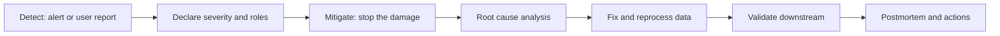

## 🎯 خلاصه

> **postmortem** یا گزارش پس‌از-حادثه، روایت کوتاه و صادقانه‌ی یک خرابی در محیط تولید است: کاربر چه چیزی دید، چطور جلوی آسیب را گرفتی، چرا اتفاق افتاد، و چه چیزی را عوض می‌کنی تا دوباره همان‌طور نشود.

- در کارهای داده، آسیب اغلب **بی‌صدا** است: یک عدد درآمدِ غلط که سه هفته کسی متوجهش نشده، از یک قطعی بلند بدتر است.
- ترتیب روایت مهم است: **تشخیص → مهار → علت ریشه‌ای → رفع → پیشگیری**. اول جلوی خونریزی را بگیر، بعد تحقیق کن.
- **بدون سرزنش (blameless)** یعنی سیستم، پیش‌فرض‌ها و تصمیم‌ها را توصیف کنی، نه آدم‌ها. یک نفر حرکتی کرد؛ سیستم اجازه داد یک حرکت اشتباه به تولید برسد.
- برای هر اقدام پیشگیرانه **مسئول و تاریخ** لازم است. «بیشتر دقت کنیم» یک اقدام نیست.

## 🌱 از ساده شروع کنیم (مبتدی)

> **💡 تشبیه:** آتش‌سوزی آشپزخانه. اول گاز را می‌بندی و آتش را خاموش می‌کنی (مهار). بعد می‌پرسی چرا تابه داغ شد و چرا آژیر دود صدا نداد (علت ریشه‌ای و تشخیص). در آخر عادت یا آژیر را عوض می‌کنی تا تابه‌ی بعدی نسوزد. هدف پیدا کردن مقصر نیست؛ هدف یادگیری است.

یک حادثه‌ی کوچک و واقعی را در نظر بگیر. داشبورد درآمد از سه‌شنبه حدود ۴۰٪ کمتر از معمول را نشان می‌دهد.

| زمان (UTC) | رویداد |
|---|---|
| سه‌شنبه ۰۲:۰۰ | جاب شبانه‌ی `build_revenue_daily` با نسخه‌ی جدید SQL اجرا شد |
| سه‌شنبه ۰۹:۱۵ | یک تحلیلگر مالی افت را دید و در کانال تیم پیام داد |
| سه‌شنبه ۰۹:۳۰ | on-call به‌روزرسانی داشبوردهای پایین‌دست را متوقف کرد |
| سه‌شنبه ۱۱:۰۰ | علت پیدا شد: یک inner join سفارش‌هایی با کد کشور ناشناخته را حذف می‌کرد |
| سه‌شنبه ۱۴:۰۰ | رفع ادغام شد، روزهای آسیب‌دیده دوباره پردازش شدند و اعداد با سیستم پرداخت تطبیق داده شد |
| پنج‌شنبه ۱۰:۰۰ | postmortem نوشته و بازبینی شد |

خطای اصلی یک کلمه است. درس این درس، همه‌چیز اطراف آن کلمه است.

```sql
-- نسخه‌ی مستقر شده در سه‌شنبه (باگ): inner join سفارش‌هایی با کد کشور ناشناخته را حذف می‌کند
SELECT o.order_id, o.amount, c.country
FROM orders AS o
JOIN countries AS c ON c.code = o.country_code;

-- نسخه‌ی اصلاح‌شده: همه‌ی سفارش‌ها را نگه می‌دارد و ناشناخته‌ها را برچسب می‌زند
SELECT o.order_id, o.amount, COALESCE(c.country, 'UNKNOWN') AS country
FROM orders AS o
LEFT JOIN countries AS c ON c.code = o.country_code;
```

یک **قالب postmortem** بخش‌هایی را می‌دهد که هر گزارش خوب دارد. از آن مثل یک فرم پرکردنی استفاده کن:

```text
Title:            <کوتاه، مشخص، دارای تاریخ>
Severity:         SEV-1 / SEV-2 / SEV-3
Impact:           چه کسانی تحت تأثیر بودند، چقدر طول کشید، چه حجم داده یا پولی
Detection:        چطور فهمیدیم (هشدار، گزارش کاربر، بررسی دستی) و چقدر طول کشید
Timeline:         فقط واقعیت‌های دارای زمان، با تصمیمی که در هر مرحله گرفته شد
Mitigation:       چه چیزی جلوی آسیب را گرفت (ممکن است با رفع فرق داشته باشد)
Root cause:       مکانیسم، به همراه عوامل مشارکت‌کننده
What went well:   چه چیزی کمک کرد (rollback سریع، lineage خوب، مسئول مشخص)
What went badly:  چه چیزی کار را کند کرد
Action items:     <اقدام> | مسئول | تاریخ | تیکت
```

## 🔧 واقعاً چطور کار می‌کند (متوسط)

یک حادثه چرخه‌ی قابل پیش‌بینی دارد. نقش‌ها مهم‌اند، چون جلوی این را می‌گیرند که پنج نفر هم‌زمان یک چیز را به پنج روش مختلف درست کنند.



نقش‌های معمول در یک تیم کوچک:

- **incident lead** تصمیم می‌گیرد بعد از این چه می‌شود و یک timeline واحد نگه می‌دارد.
- **investigator** کوئری می‌زند، lineage را بررسی می‌کند و رفع را پیشنهاد می‌دهد.
- **communicator** به ذی‌نفعان می‌گوید چه چیزی تحت تأثیر است و پیام بعدی کی می‌آید.
- **scribe** زمان‌ها را ثبت می‌کند. بدون این نقش، timeline در postmortem همیشه غلط است.

### مهار، رفع نیست

مهار یعنی **همین حالا** آسیب را محدود کنی، حتی اگر علت هنوز معلوم نیست. در سیستم‌های داده مهارهای رایج این‌ها هستند:

- زمان‌بند یا مصرف‌کننده‌ای که داده‌ی بد می‌نویسد را متوقف کن؛
- جدول یا داشبورد آسیب‌دیده را «قدیمی» علامت بزن یا پنهانش کن؛
- مدل یا دیپلوی را به آخرین نسخه‌ی سالم برگردان (rollback)؛
- جلوی ارسال داده به سیستم‌های بیرونی را بگیر.

رفع، علت را حذف می‌کند و پردازش دوباره، داده‌ای که قبلاً خراب شده را تعمیر می‌کند. هر دو لازم‌اند. یک rollback که ۳ روز ردیف‌های غلط را دست‌نخورده بگذارد، فقط نصف کار است.

### علت ریشه‌ای و عوامل مشارکت‌کننده

یک «علت ریشه‌ای» تنها اغلب یک ساده‌سازی راحت است. از **five whys** (پنج چرای) استفاده کن تا زنجیره را پایین بروی، و بعد **عوامل مشارکت‌کننده** را فهرست کن؛ یعنی شرایطی که باگ را ممکن کرد یا تشخیصش را کند کرد:

- چرا درآمد پایین بود؟ سفارش‌ها در join حذف شدند.
- چرا سفارش‌ها حذف شدند؟ کد کشور برای بعضی سفارش‌ها خالی بود.
- چرا join آن‌ها را حذف کرد؟ مدل به‌طور پیش‌فرض inner join داشت.
- چرا هیچ تستی شکست نخورد؟ هیچ تستی تعداد ردیف‌ها را با منبع مقایسه نمی‌کرد.
- چرا ۱۳ ساعت کسی متوجه نشد؟ بررسی تازگی داده رد شد، چون جدول به‌موقع بار شده بود، فقط با ردیف‌های کمتر.

هر «چرا» باید به یک **ویژگی سیستم** اشاره کند که می‌توانی عوضش کنی (یک تست، یک پیش‌فرض، یک هشدار)، نه به دقت ذهنی یک آدم.

### متن postmortem ضعیف در برابر قوی

| ضعیف | قوی |
|---|---|
| «علی join را عوض کرد و درآمد خراب شد. از این به بعد بیشتر دقت می‌کنیم.» | «تغییری در `build_revenue_daily` یک LEFT JOIN را با INNER JOIN عوض کرد. در CI هیچ بررسی تعداد ردیف نسبت به `orders` وجود نداشت، پس تغییر ادغام شد.» |
| «درستش کردیم و الان همه‌چیز خوب است.» | «رفع ساعت ۱۴:۰۰ ادغام شد. ۶ روز دوباره پردازش شد. درآمد هر روز با پرداخت‌ها در حد ۰٫۱٪ تطبیق دارد؛ این بررسی در داشبورد است.» |
| «اقدام: تست را بهتر کنیم.» | «یک تست تطبیق اضافه شود: تعداد `orders` باید برای هر روز با خروجی برابر باشد، با تلرانس صفر. مسئول: پلتفرم داده. مهلت: اسپرینت بعدی. تیکت: DATA-412.» |
| «کاربرها پیدا کردند.» | «۱۳ ساعت بعد از اولین بار بد، پیدا شد. هشداری برای افت ناگهانی تعداد ردیف وجود نداشت؛ این همان شکاف تشخیص است.» |

### پردازش دوباره بدون بدتر کردن اوضاع

بعد از رفع، باید بازه‌ی آسیب‌دیده را دوباره بسازی. بازسازی فقط وقتی امن است که نوشتن **idempotent** باشد؛ یعنی اجرای دوباره همان نتیجه را بدهد. پارتیشن‌های کامل روزهای آسیب‌دیده را بازنویسی کن، نه درج‌های موردی.

```sql
-- تعمیر idempotent یک روز: پارتیشن را حذف کن و از منطق اصلاح‌شده دوباره بساز
DELETE FROM revenue_daily WHERE day = DATE '2026-10-06';

INSERT INTO revenue_daily
SELECT day, SUM(amount) AS revenue
FROM (
    SELECT o.order_id, o.amount, o.created_at::date AS day
    FROM orders AS o
    LEFT JOIN countries AS c ON c.code = o.country_code
) AS x
WHERE day = DATE '2026-10-06'
GROUP BY day;
```

بعد اعتبارسنجی کن: مجموع‌های بازسازی‌شده را با یک منبع مستقل (پرداخت‌ها، دفتر مالی) مقایسه کن، نه با همان pipeline.

## 🧠 عمق و trade-offها (سنیور)

**حادثه‌های داده شکل خودشان را دارند.** نسبت به قطعی یک وب‌سایت، اغلب این‌ها هستند:

- **بی‌صدا**: pipeline سبز است، اما اعداد غلط‌اند. بررسی‌های تازگی و وضعیت جاب این را نمی‌گیرند. به بررسی حجم، توزیع و تطبیق نیاز داری (به [[data-quality]] و [[data-observability]] نگاه کن).
- **دیرهنگام تشخیص‌داده‌شده**: یک ردیف بد برای یک روز ممکن است فقط در بستن ماهانه پیدا شود.
- **شعاع انفجار گسترده**: یک جدول به داشبوردها، فیچرهای ML و خروجی‌های مالی وصل است. قبل از اطلاع‌رسانی، با lineage همه‌ی مصرف‌کننده‌ها را فهرست کن.
- **تعمیر گران**: پردازش دوباره هزینه‌ی محاسباتی دارد و بعضی سیستم‌های پایین‌دست با عدد غلط کاری کرده‌اند (بازپرداخت انجام شده، مدل بازآموزی شده).

**جزئیات ذخیره‌سازی و موتورها که پاسخ را عوض می‌کنند:**

- **جداول lakehouse** (Iceberg، Delta): time travel یا rollback به snapshot می‌تواند جدول را سریع‌تر از بازنویسی تاریخچه به یک snapshot سالم برگرداند. قبل از تکیه بر آن، نگهداری snapshotهای قدیمی را بررسی کن. جزئیات بین موتورها و نسخه‌ها فرق دارد؛ در مستندات نسخه‌ی خودت تأیید کن.
- **Kafka**: ریست کردن offset مصرف‌کننده می‌تواند داده را دوباره پخش کند (تکراری) یا داده را رد کند (گمشده). امکان replay به retention ترکیب تاپیک بستگی دارد؛ اگر رویدادها منقضی شده‌اند، postmortem باید این را بگوید.
- **Spark**: یک جاب بد با dynamic partition overwrite ممکن است پارتیشن‌های بیشتری از آنچه می‌خواستی بازنویسی کرده باشد. قبل از پردازش دوباره، از لاگ جاب بررسی کن کدام پارتیشن‌ها نوشته شده‌اند.
- **ClickHouse**: `ALTER ... UPDATE` و `DELETE` mutation های غیرهمزمان هستند. «رفع اعمال شد» باید یعنی «mutation تمام شد»؛ وضعیت mutation را بررسی کن.
- **Airflow**: پاک کردن taskها آن‌ها را دوباره اجرا می‌کند؛ قدرتمند و خطرناک. قبل از پاک کردن یک بازه، بدان taskها idempotent هستند یا نه.

**معیارهایی که گزارش می‌کنی**، تا حادثه‌ها در طول زمان قابل مقایسه باشند:

- زمان تشخیص (TTD): از اولین بار بد تا اولین هشدار؛
- زمان مهار (TTM): از اولین هشدار تا توقف آسیب؛
- پنجره‌ی مواجهه: مدت زمانی که مصرف‌کننده‌ها داده‌ی غلط دیده‌اند؛
- تعداد ردیف‌ها، جدول‌ها و مصرف‌کننده‌های آسیب‌دیده؛
- ساعت‌های پردازش مجدد و هزینه.

**trade-offهایی که باید بتوانی دفاع کنی:**

- **بلاک کردن در برابر هشدار**: بررسی کیفیتی که pipeline را بلاک می‌کند از مصرف‌کننده‌ها محافظت می‌کند، اما برای یک متریک پرنویز همه‌چیز را متوقف می‌کند. هشدار فقط وقتی محافظت می‌کند که کسی آن را بخواند. روی قوانین با معنای روشن بلاک کن (تعداد ردیف ۵۰٪ افت کرد، کلید اصلی تکراری شد) و روی بقیه هشدار بده.
- **فریز بعد از حادثه**: مکث دیپلوی‌های پرریسک بعد از SEV-1 برای یک هفته زمان می‌خرد، اما تحویل را کند می‌کند. بگو چه وقت این کار را می‌کنی و چه وقت نه.
- **postmortem کامل در برابر یادداشت کوتاه**: یک قطعی ۵ دقیقه‌ای بدون تأثیر روی کاربر فقط یک یادداشت کوتاه می‌خواهد. نوشتن سند بلند برای هر قطعی، باعث می‌شود مردم postmortemها را نادیده بگیرند.

**چیزی که بعد از حادثه مانیتور می‌کنی:** تعداد ردیف روزانه در برابر منبع، تازگی هر جدول مصرف‌کننده، و یک متریک تطبیق با سیستم ثبت اصلی (system of record).

## 🧪 امتحان کن

**تمرین ۱ — یک postmortem ضعیف را درست کن.** این جمله را بازنویسی کن تا قوانین بدون سرزنش و قابل‌اقدام را رعایت کند: *«دینا جمعه یک migration بد را روی سیستم گذاشت و انبار داده ۴ ساعت از کار افتاد. دینا باید در migrationها دقت بیشتری کند.»*

<details><summary>راه‌حل</summary>

نمونه‌ی بازنویسی: «یک migration تغییرِ اسکیمای جمعه ساعت ۱۶:۱۰ یک ستون NOT NULL بدون مقدار پیش‌فرض اضافه کرد. این migration بدون تمرین روی staging اجرا شد و بارگذاری‌های انبار داده ۴ ساعت (۱۶:۱۰ تا ۲۰:۱۰) شکست خورد. اقدامات: (۱) اجرای migration روی staging در CI الزامی شود، مسئول: پلتفرم، مهلت: اسپرینت بعدی؛ (۲) قانون lint که ستون NOT NULL بدون پیش‌فرض روی جدول موجود را رد می‌کند، مسئول: پلتفرم داده، تیکت DATA-415.»

بازنویسی نام را حذف می‌کند، مکانیسم و مدت را می‌گوید و درس را به دو اقدام قابل بررسی تبدیل می‌کند.

</details>

**تمرین ۲ — timeline را دسته‌بندی کن.** برای هر مورد بگو تشخیص، مهار، علت ریشه‌ای یا رفع است: (الف) «۱۶:۴۰ هشدار تازگی داده زده شد»؛ (ب) «۱۶:۵۰ pipeline متوقف شد»؛ (ج) «۱۷:۲۰ یک join روی ستونی پیدا شد که بالادستی تغییر نام داده بود»؛ (د) «۱۸:۰۰ نگاشت ستون برگردانده شد و backfill شروع شد».

<details><summary>راه‌حل</summary>

(الف) تشخیص، (ب) مهار، (ج) علت ریشه‌ای، (د) رفع (همراه با پردازش دوباره). توجه کن که (الف) یک هشدار تازگی بود که برای این نوع مشکل ضعیف است: postmortem باید یک هشدار تعداد ردیف را به‌عنوان بهبود تشخیص اضافه کند.

</details>

**تمرین ۳ — یک اقدام خوب بنویس.** حادثه‌ی تو: یک API بالادستی دو روز مقادیر `amount` را به‌جای واحد ارز، به سنت فرستاد. یک اقدام پیشگیرانه بنویس با مسئول، تاریخ و شرط موفقیت قابل اندازه‌گیری.

<details><summary>راه‌حل</summary>

نمونه: «یک contract test روی فیلد `amount` اضافه شود: مقادیر باید در بازه‌ی ۹۰ روز اخیر باشند و واحد در data contract مستند شود. اگر میانگین روزانه نسبت به میانگین متحرک ۳۰ روزه بیش از ۱۰ برابر فرق کرد، بار شکست بخورد و هشدار داده شود. مسئول: تیم ingestion. مهلت: ۲ هفته. موفقیت: تست در CI یک payload آزمایشی با سنت را بگیرد.»

اقدام خوب، بررسی، آستانه، مسئول و راه تأیید اینکه کار می‌کند را نام می‌برد.

</details>

## 💬 گوشه‌ی مصاحبه

**سؤال رایج:** «یک حادثه‌ی تولید که مدیریت کردی را تعریف کن. چه کار کردی؟»

- **پاسخ مبتدی:** «pipeline خطا داد، دوباره راه‌اندازی‌اش کردم و کار کرد.» این پاسخ نه تشخیص را نشان می‌دهد، نه تأثیر را، نه پیشگیری را.
- **پاسخ متوسط:** «یک بار بدون خطا fail شد و داشبوردی جمع‌های غلط نشان داد. علت را در join پیدا کردم، rollback کردم، سه روز را دوباره پردازش کردم و یک تست تعداد ردیف اضافه کردم.»
- **پاسخ سنیور:** تأثیر را با عدد می‌گوید، شکاف تشخیص را، انتخاب مهار زیر عدم قطعیت را، نحوه‌ی اطلاع‌رسانی به مصرف‌کننده‌ها و تغییر در سطح سازمان (مثلاً یک بررسی تطبیق استاندارد برای همه‌ی جدول‌های درآمد).

> **🎤 این را در مصاحبه بگو:** «ما ۱۳ ساعت دیرتر و از زبان یک تحلیلگر مالی فهمیدیم. اولین کاری که کردم این بود که به‌روزرسانی داشبوردهای پایین‌دست را متوقف کنم تا اعداد غلط بیشتر پخش نشوند، و همزمان تحقیق را ادامه دادم. علت یک inner join بود که سفارش‌های با کد کشور ناشناخته را بی‌صدا حذف می‌کرد؛ تست‌های ما schema را چک می‌کردند، نه تعداد ردیف‌ها. شش روز را به‌صورت idempotent و پارتیشن‌به‌پارتیشن دوباره پردازش کردیم و با پرداخت‌ها تطبیق دادیم. تغییر ماندگار یک تست تطبیق روی هر جدول درآمد بود، با مالکیت تیم پلتفرم، و زمان تشخیص این دسته خطا از ساعت‌ها به دقیقه رسید.»

## ⚠️ اشتباهات رایج

- **نام بردن از یک نفر به‌عنوان علت ریشه‌ای.** این باعث می‌شود مردم حادثه‌ها را پنهان کنند. اسم ویژگی سیستمی که اجازه داد اشتباه برسد را بگو.
- **شروع با علت ریشه‌ای قبل از مهار.** وقتی دو ساعت برای تحقیق وقت می‌گذاری، داده‌ی بد همچنان به مصرف‌کننده‌ها می‌رسد.
- **اقدام بدون مسئول یا بدون بررسی.** «مانیتورینگ را بهتر کنیم» قابل تمام شدن نیست. بنویس چه بررسی، کجا و زیر نظر کی.
- **اعلام پیروزی بعد از رفع کد.** کد درست شده، اما پارتیشن‌های بد هنوز وجود دارند. پردازش دوباره و اعتبارسنجی پایین‌دست لازم است.
- **فراموش کردن مصرف‌کننده‌ها.** کسانی که از عدد غلط استفاده کرده‌اند، به یادداشت اصلاحی نیاز دارند، نه فقط یک postmortem در ویکی.
- **توصیف رفع، بدون توصیف شکاف تشخیص.** سؤال «چرا زودتر متوجه نشدیم؟» اغلب از خود باگ ارزشمندتر است.

## ✅ خودت را بسنج

۱. ترتیب درست روایت postmortem کدام است؟

   - A) علت ریشه‌ای → رفع → تشخیص → مهار
   - B) تشخیص → مهار → علت ریشه‌ای → رفع → پیشگیری
   - C) رفع → تشخیص → پیشگیری → مهار
   - D) پیشگیری → تشخیص → رفع → مهار

<details><summary>پاسخ</summary>

**B** — اول مشکل را می‌فهمی، بعد آسیب را متوقف می‌کنی، بعد علت را پیدا می‌کنی، علت را رفع می‌کنی و سیستم را طوری تغییر می‌دهی که دوباره اتفاق نیفتد. مهار می‌تواند قبل از معلوم شدن علت انجام شود.

</details>

۲. یک pipeline سه هفته سبز است، اما درآمد ۱۵٪ کم است. کدام بررسی احتمالاً زودتر این را می‌گرفت؟

   - A) هشدار مدت اجرای جاب
   - B) بررسی تازگی روی جدول خروجی
   - C) بررسی تطبیق یا تعداد ردیف نسبت به سیستم منبع
   - D) سیاست retry در زمان‌بند

<details><summary>پاسخ</summary>

**C** — جاب به‌موقع و تازه است، پس بررسی تازگی و وضعیت جاب رد می‌شوند. فقط مقایسه‌ی خروجی با منبع (تعداد ردیف، جمع‌ها، تطبیق) می‌بیند که داده کم است.

</details>

۳. کدام اقدام پیشگیرانه برای یک postmortem مفیدتر است؟

   - A) «در استفاده از join بیشتر دقت کنیم.»
   - B) «یک تست تعداد ردیف اضافه شود که اگر خروجی یک روز از منبع کمتر بود بار را شکست بدهد؛ مسئول: پلتفرم داده؛ مهلت: دو هفته.»
   - C) «حادثه را در ویکی مستند کنیم.»
   - D) «در جلسه‌ی تیم بعدی بحث شود.»

<details><summary>پاسخ</summary>

**B** — یک تغییر مشخص در سیستم است با شرط قابل اندازه‌گیری، مسئول و تاریخ. بقیه یا مبهم‌اند یا پیشگیرانه نیستند.

</details>

۴. **(سنیور)** باید ۹۰ روز از یک جدول را دوباره پردازش کنی که مالی و فیچرهای ML از آن می‌خوانند. چرا بازنویسی idempotent پارتیشن‌ها بر درج‌های موردی ترجیح دارد، و بازهم چه چیزی را باید تأیید کنی؟

   - A) درج موردی سریع‌تر است، پس همیشه ترجیح دارد
   - B) بازنویسی کامل پارتیشن‌ها را می‌توان امن دوباره اجرا کرد و همان نتیجه را می‌دهد، در حالی که درج‌ها در ری‌استارت جاب ممکن است ردیف تکراری بسازند؛ با این حال باید بررسی کنی کدام مصرف‌کننده‌های پایین‌دست قبلاً مقادیر غلط را استفاده کرده‌اند و آیا به اصلاح نیاز دارند
   - C) نوشتن idempotent نیاز به postmortem را از بین می‌برد
   - D) جدول‌های مالی قابل پردازش دوباره نیستند

<details><summary>پاسخ</summary>

**B** — اجرای دوباره‌ی overwrite همان نتیجه را می‌دهد، پس ری‌استارت بعد از خطا امن است. پردازش دوباره جدول را تعمیر می‌کند، اما سیستم‌های پایین‌دستی که مقادیر غلط را مصرف کرده‌اند (بازپرداخت، مدل‌های بازآموزی‌شده) هنوز به اصلاح نیاز دارند.

</details>

## 🗂️ فلش‌کارت

| Front | Back |
|---|---|
| ترتیب postmortem چیست؟ | تشخیص → مهار → علت ریشه‌ای → رفع → پیشگیری |
| مهار در برابر رفع | مهار آسیب را همین حالا متوقف می‌کند؛ رفع علت را حذف می‌کند؛ پردازش دوباره داده را تعمیر می‌کند |
| «بدون سرزنش» یعنی چه؟ | سیستم و تصمیم‌ها را توصیف کن، نه افراد؛ بپرس چه چیزی باعث شد اشتباه به تولید برسد |
| چرا بررسی تازگی کافی نیست؟ | بارگذاری دیرهنگام را می‌گیرد، اما بارگذاری کامل با ردیف‌های کم را نه |
| اقدام خوب چه ویژگی‌هایی دارد؟ | تغییر مشخص، مسئول، تاریخ و شرط موفقیت قابل اندازه‌گیری |
| چرا برای تعمیر از partition overwrite استفاده می‌کنیم؟ | idempotent است: ری‌استارت همان نتیجه را می‌دهد، بدون تکرار |
| عامل مشارکت‌کننده چیست؟ | شرطی که اجازه داد باگ رخ دهد یا تشخیصش را کند کرد، نه علت مستقیم |

## 🔗 ادامه

- **behavioral-questions** نشان می‌دهد چطور داستان حادثه را در مصاحبه با ساختار STAR تعریف کنی.
- **data-observability** و **data-quality** بررسی‌هایی را توضیح می‌دهند که خطاهای بی‌صدای این درس را می‌گرفتند.
- **data-lineage** نشان می‌دهد چطور سریع مصرف‌کننده‌های پایین‌دست را فهرست کنی، که برنامه‌ی اطلاع‌رسانی به آن بستگی دارد.
- **dedup-idempotent-loads** توضیح می‌دهد چرا پردازش دوباره و retry نباید تکرار ایجاد کنند.
- ادبیات فرهنگ postmortem بدون سرزنش (از SRE) را بخوان و با اندازه‌ی تیمت تطبیق بده؛ اصول مهم‌تر از قالب‌اند.
