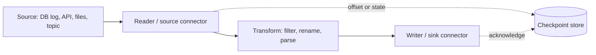

## 🎯 خلاصه

> یک **ابزار ingestion** داده را از منبع (دیتابیس، API، فایل، لاگ، جریان رویداد) به مقصد (lake، warehouse، topic) می‌برد و retry، offset و schema را مدیریت می‌کند. **بر اساس نوع منبع و بر اساس اینکه چه کسی آن را عملیاتی نگه می‌دارد انتخاب کن**، نه بر اساس اینکه کدام لوگو بهتر به نظر می‌رسد.

- **تغییرات دیتابیس:** CDC مبتنی بر لاگ با **Debezium** (معمولاً روی Kafka Connect).
- **جریان رویداد:** connector های source و sink در **Kafka Connect**.
- **منابع SaaS و API:** connector مدیریت‌شده مثل **Airbyte** (یا loader خود ارائه‌دهنده).
- **پروتکل‌های مختلط on-prem با flow بصری:** **Apache NiFi**، رایج در سازمان‌های بزرگ.
- **تبدیل‌های یکپارچه‌ی batch و streaming:** **Apache SeaTunnel**، یا Spark و Flink وقتی منطق سنگین‌تر است.
- **لاگ و متریک روی هاست‌ها:** **Fluent Bit**، **Vector** یا **Logstash**.

## 🌱 از ساده شروع کنیم (مبتدی)

> **💡 تشبیه:** یک سیستم تأمین آب را در نظر بگیر. بعضی منابع رودخانه‌اند (جریان رویدادها)، بعضی چاه‌اند (دیتابیسی که طبق برنامه از آن می‌کشی)، بعضی بشکه‌ی باران‌اند که با دست حمل می‌کنی (فایل‌ها). لوله، پمپ و فیلتر همان ابزارهای ingestion‌اند. برای هر خانه یک پمپ جدا نمی‌سازی؛ نوع تجهیزات مناسب هر منبع و آدمی که باید نگهداری‌اش کند را انتخاب می‌کنی.

اولین سؤالی که باید بپرسی ساده است:

| منبع | چه می‌خواهی | ابزار معمول |
|---|---|---|
| یک جدول Postgres یا MySQL | هر insert، update و delete | Debezium (CDC) |
| یک topic در Kafka | نوشتن در lake یا warehouse | Kafka Connect sink |
| یک API از SaaS (CRM، پرداخت) | همگام‌سازی زمان‌بندی‌شده‌ی اشیای زیاد | Airbyte یا connector مدیریت‌شده |
| پوشه‌ی SFTP به‌همراه HTTP و دیتابیس | مسیریابی، تبدیل و تحویل با flow بصری | Apache NiFi |
| لاگ برنامه روی ۵۰۰ سرور | جمع‌آوری، فیلتر و ارسال | Fluent Bit (یا Vector) |
| batch و streaming مخلوط با فرمت‌های زیاد | یک تعریف job، چند موتور | Apache SeaTunnel |

لازم نیست همه‌ی ابزارها را بدانی. باید **شکل** هرکدام را بدانی: یک connector از منبع می‌خواند، اختیاری تبدیل می‌کند، و در sink می‌نویسد، و باید یادش بماند تا کجا رفته است.

## 🔧 واقعاً چطور کار می‌کند (متوسط)

### قرارداد مشترک

هر ابزار ingestion همان حلقه را پیاده‌سازی می‌کند، با اسم‌های متفاوت:



چهار چیز بین ابزارها فرق دارد و در مصاحبه همین‌ها را مقایسه می‌کنی:

1. **state کجا نگه‌داری می‌شود:** Kafka Connect offset ها را در topic های Kafka نگه می‌دارد؛ NiFi از repository ها روی هر node استفاده می‌کند؛ Airbyte state همگام‌سازی را برای هر stream نگه می‌دارد.
2. **تضمین تحویل:** بیشتر ابزارها به‌صورت پیش‌فرض **at-least-once** می‌دهند. exactly-once به sink بستگی دارد (مثلاً upsert های idempotent یا نوشتن تراکنشی). به [[exactly-once]] و [[delivery-semantics]] نگاه کن.
3. **مدل عملیات:** SaaS مدیریت‌شده، کلاستری که خودت اجرا می‌کنی، یا کتابخانه‌ای درون job خودت.
4. **مدیریت schema:** آیا ابزار payload خام را پاس می‌دهد، نوع‌ها را تبدیل می‌کند، یا registry را اجرا می‌کند؟ به [[schema-registry]] نگاه کن.

### Apache NiFi

NiFi یک ابزار **flow-based** است. در مرورگر یک گراف از **processor** ها می‌سازی (مثلاً `ListSFTP`، `FetchSFTP`، `ConvertRecord`، `PutS3Object`، `PublishKafka`). هر واحد داده یک **FlowFile** است: محتوا (بایت‌ها) به‌همراه attribute ها (فراداده‌ی کلید-مقدار).

- **Back-pressure** داخلی است. هر connection بین processor ها حد اندازه دارد؛ وقتی پر شود، processor های بالادستی متوقف می‌شوند. این حافظه‌ی یک node را محافظت می‌کند.
- **Provenance** هر رویداد هر FlowFile را ثبت می‌کند (دریافت، مسیریابی، ارسال). این بهترین trail حسابرسی بین ابزارهای این درس است و پاسخ «این فایل کجا رفت؟» را در ۳۰ ثانیه می‌دهد.
- **تضمین‌ها:** NiFi وضعیت FlowFile را در یک repository ماندگار می‌نویسد، پس کرش معمولاً کار را از همان‌جا ادامه می‌دهد. با این حال تحویل تکراری به سیستم پایین‌دستی ممکن است، پس sink باید idempotent باشد.
- **trade-off:** canvas بصری برای ده‌ها flow بهره‌ور است، اما flow های بزرگ را سخت می‌شود بررسی و version کرد. flow ها را در registry نگه دار (NiFi Registry یا معادل آن در نسخه‌ات) و با آن‌ها مثل کد رفتار کن.

### Kafka Connect

Kafka Connect یک framework است که **source connector** ها (دیتابیس → Kafka) و **sink connector** ها (Kafka → storage یا دیتابیس) را اجرا می‌کند. در **حالت distributed**، worker ها یک گروه می‌سازند و tasks های connector بین آن‌ها پخش می‌شوند.

- پیکربندی، offset ها و وضعیت در topic های داخلی Kafka ذخیره می‌شوند، پس worker ری‌استارت‌شده از جایی که گروه مانده ادامه می‌دهد.
- **Single Message Transforms (SMT)** تغییرات کوچک هر رکورد را انجام می‌دهند (تغییر نام فیلد، مسیریابی به topic دیگر، پوشاندن یک مقدار).
- یک sink بعد از موفقیت نوشتن، offset کافکا را commit می‌کند. اگر نوشتن موفق شود اما commit شکست بخورد، رکورد دوباره نوشته می‌شود، پس sink ها باید idempotent باشند.

اجرای Kafka Connect (rebalance، connector مرده، تنظیمات DLQ) در [[kafka-connect-ops]] آمده است.

### Debezium

Debezium **لاگ تراکنش** دیتابیس را می‌خواند (logical decoding در Postgres، binlog در MySQL، جدول‌های CDC در SQL Server و غیره) و برای هر تغییر یک رویداد می‌فرستد: `before`، `after`، کد عملیات (`c`، `u`، `d`، و `r` برای خواندن snapshot) و موقعیت منبع.

- اولین اجرا یک **snapshot اولیه** از جدول موجود می‌گیرد، سپس به stream کردن لاگ می‌رود. موقعیت ذخیره می‌شود (مثلاً LSN در Postgres یا موقعیت binlog در MySQL)، پس ری‌استارت درست ادامه می‌دهد.
- حذف‌ها به‌صورت رویداد می‌رسند؛ این مزیت اصلی نسبت به CDC مبتنی بر query است. به [[cdc]] نگاه کن.
- دیتابیس منبع باید تنظیمات لاگ را فعال داشته باشد (مثلاً `wal_level = logical` در Postgres) و یک replication slot دارد که باید پایش شود؛ slot خوانده‌نشده باعث می‌شود دیتابیس WAL نگه دارد و دیسک پر شود.

```yaml
# Debezium Postgres connector registered in Kafka Connect (simplified)
name: orders-cdc
config:
  connector.class: io.debezium.connector.postgresql.PostgresConnector
  database.hostname: pg.internal
  database.dbname: shop
  topic.prefix: shop
  table.include.list: public.orders
  plugin.name: pgoutput
  snapshot.mode: initial
```

### Airbyte

Airbyte یک ابزار **ELT** است با کاتالوگ بزرگی از connector های source و destination که بسیاری‌شان برای APIهای SaaS هستند. هر **stream** (مثلاً `orders`) در یکی از حالت‌های sync اجرا می‌شود: **full refresh** (overwrite یا append)، **incremental append** (بر اساس cursor، ردیف‌های جدید را اضافه می‌کند)، یا **incremental deduped** (برای هر primary key آخرین نسخه را نگه می‌دارد).

- connector ها کانتینر هستند. می‌توانی با Connector Development Kit (CDK) خودت بسازی؛ این کیت pagination، محدودیت نرخ و state را برایت مدیریت می‌کند.
- Airbyte داده‌ی خام را بار می‌کند؛ تبدیل معمولاً بعداً با dbt انجام می‌شود. به [[dbt]] و [[etl-vs-elt]] نگاه کن.
- state بارگذاری افزایشی یک cursor برای هر stream است. نگرانی‌های watermark و lookback از [[api-ingestion]] اینجا هم صادق است.

### Apache SeaTunnel

SeaTunnel یک پروژه‌ی Apache است با یک تعریف job (فایل پیکربندی) که می‌تواند روی موتور خودش (Zeta) یا روی Spark و Flink اجرا شود. از batch و streaming پشتیبانی می‌کند و connector هایی برای دیتابیس‌ها، فایل‌ها، صف‌ها و warehouse ها دارد. وقتی می‌خواهی یک تیم بدون یادگیری همه‌ی موتورها، جابه‌جایی داده بین سیستم‌های ناهمگن را تعریف کند، گزینه‌ی خوبی است.

### لاگ و متریک: Fluent Bit، Vector، Logstash

| ابزار | زمان اجرا | نقطه‌ی قوت | کاربرد معمول |
|---|---|---|---|
| Fluent Bit | C، حافظه‌ی بسیار کم | همه‌جا اجرا می‌شود، مناسب Kubernetes | forwarder لاگ روی node یا sidecar |
| Vector | Rust، توان عملیاتی بالا | تبدیل با زبان خودش (VRL)، و متریک | pipeline مشاهده‌پذیری بین agent ها و sink ها |
| Logstash | JVM، سنگین | اکوسیستم plugin بالغ، بخشی از Elastic stack | تجزیه و غنی‌سازی در ELK |

برای داده‌ی لاگ معماری معمول این است: agent روی هر هاست ← بافر (اغلب Kafka) ← lake یا index جست‌وجو. بافر پس از قطعی sink امکان replay می‌دهد.

### ابزارهای قدیمی و خاص

- **Apache Flume** لاگ‌ها را به Hadoop جمع می‌کرد. هنوز در پلتفرم‌های قدیمی دیده می‌شود، اما طراحی‌های جدید معمولاً از Kafka یا NiFi استفاده می‌کنند.
- **Apache Sqoop** جدول‌ها را با JDBC به Hadoop منتقل می‌کرد. بیشتر تیم‌ها الان به‌جایش CDC یا connector مدیریت‌شده دارند.

فقط اگر مصاحبه‌کننده به آن‌ها اشاره کرد ذکرشان کن؛ بدان چه چیزی جایگزینشان شده.

## 🧠 عمق و trade-offها (سنیور)

- **هزینه‌ی مالکیت.** connector مدیریت‌شده از نظر زمان مهندسی ارزان است و در حجم بالا به‌ازای هر ردیف گران. یک کلاستر Kafka Connect که خودت اجرا می‌کنی پروفایل برعکس دارد. هر دو را تخمین بزن: ردیف در روز، قیمت به‌ازای یک میلیون ردیف، و نیروی لازم برای on-call.
- **حوزه‌های خرابی.** NiFi وضعیت flow را روی node هایی نگه می‌دارد که خودت عملیاتی می‌کنی؛ Kafka Connect ماندگاری را به Kafka می‌سپارد؛ ابزارهای مدیریت‌شده state را پنهان می‌کنند، و سیاست retry را هم. بپرس state کجاست و با خرابی یک node چه می‌شود.
- **ترتیب.** taskهای موازی ترتیب per-key را می‌شکنند. Debezium ترتیب را در سطح partition جدول و کلید حفظ می‌کند؛ اما یک sink با taskهای زیاد ممکن است به‌روزرسانی‌های یک ردیف را جابه‌جا کند. بر اساس primary key پارتیشن کن و sink را طوری بنویس که تغییرات را بر اساس نسخه یا timestamp اعمال کند.
- **تغییر schema.** ستون جدید در جدول منبع نباید pipeline را بشکند. بررسی کن هر ابزار DDL را منتقل می‌کند یا نه (Debezium برای بعضی دیتابیس‌ها از طریق topic تاریخچه‌ی schema این کار را می‌کند؛ connector های batch اغلب به refresh کامل نیاز دارند). به [[schema-evolution]] نگاه کن.
- **replication slot و لاگ.** یک CDC connector متوقف‌شده باعث رشد لاگ تراکنش منبع می‌شود. قبل از پر شدن دیسک دیتابیس، روی lag و سن replication slot هشدار بگذار.
- **back-pressure سرتاسری.** منبع سریع و sink کند به بافر نیاز دارند. Kafka این را رایگان می‌دهد؛ اتصال مستقیم منبع به warehouse نمی‌دهد، و منبع ممکن است timeout بخورد.
- **تست.** یک connector را وسط یک batch خراب کن: worker را بکش، ری‌استارت کن، ردیف‌ها را بشمار. نتیجه باید «همه‌ی ردیف‌ها، احتمالاً با تکرار، و sink با تکرارها کنار می‌آید» باشد.

## 🧪 امتحان کن

ingestion این سه منبع را طراحی کن. برای هرکدام یک جمله درباره‌ی ابزار، یک جمله درباره‌ی تضمین تحویل و یک جمله درباره‌ی ریسک اصلی بنویس.

۱. جدول سفارش‌ها در یک دیتابیس MySQL، ۵۰ میلیون ردیف؛ update و delete باید ظرف ۵ دقیقه به lakehouse برسد.
۲. یک SaaS پرداخت با ۴۰ شیء، همگام‌سازی روزانه، و تیمی که توسعه‌دهنده‌ی Java ندارد.
۳. لاگ وب‌سرور: ۳۰۰ سرور، حدود ۲ ترابایت در روز، و تیم جست‌وجو که آن‌ها را در ۱ دقیقه لازم دارد.

<details><summary>Show solutions</summary>

۱. **Debezium** (CDC از binlog مربوط به MySQL) به Kafka، سپس یک sink به lakehouse. تضمین: از لاگ at-least-once؛ sink تغییرات را بر اساس primary key و نسخه اعمال می‌کند، پس عملاً exactly-once است. ریسک: binlog باید تاریخچه‌ی کافی نگه دارد و connector باید عقب نماند.
۲. **Airbyte** یا connector مدیریت‌شده با incremental sync و dedup. تضمین: at-least-once برای هر sync، با state برای هر stream. ریسک: محدودیت نرخ API و تغییر schema از سمت vendor؛ وضعیت sync و تعداد ردیف را پایش کن.
۳. **Fluent Bit** روی هر سرور که به **Kafka** فوروارد می‌کند، سپس sink به lake و index جست‌وجو. تضمین: at-least-once با بافر؛ تکرارها باید با event id در پایین‌دست حذف شوند. ریسک: ۲ ترابایت در روز میانگین حدود ۲۳ مگابایت در ثانیه است (۲ × ۱۰¹² بایت ÷ ۸۶٬۴۰۰ ثانیه ≈ ۲۳ MB/s)، اما اوج‌ها بیشترند، پس پارتیشن‌های Kafka را برای اوج اندازه بگیر.

</details>

## 💬 گوشه‌ی مصاحبه

**سؤال: «داده را از یک Postgres عملیاتی به lake چطور منتقل می‌کنی؟»**

- **جواب متوسط:** «برای CDC از Debezium با Kafka Connect استفاده می‌کنم، topic ها را با یک sink connector در S3 می‌نویسم، و بعد در یک جدول Iceberg merge می‌کنم.»
- **جواب سنیور:** «با CDC مبتنی بر لاگ شروع می‌کنم تا حذف‌ها هم گرفته شوند، و replication slot را پایش می‌کنم، چون slot خوانده‌نشده دیسک دیتابیس را پر می‌کند. رویدادها به Kafka می‌روند که منبع را از lake جدا می‌کند. sink مقصد تغییرات را idempotent و بر اساس primary key و نسخه‌ی مرتب اعمال می‌کند، و یک تطبیق دوره‌ای با شمارش و checksum دارم. بارگذاری اولیه از snapshot است و برای تغییر schema از schema registry استفاده می‌کنم.»

**سؤال: «چرا یک شرکت NiFi را به نوشتن job های Spark ترجیح دهد؟»**

NiFi برای پروتکل‌های ناهمگن و on-prem، با مسیریابی، back-pressure و حسابرسی (provenance) از همان ابتدا مناسب است و به اپراتورهایی که توسعه‌دهنده نیستند اجازه‌ی نگهداری flow را می‌دهد. Spark برای تبدیل‌های سنگین و حجم بالای batch مناسب است؛ بسیاری از تیم‌ها هر دو را دارند.

> **🎤 این را در مصاحبه بگو:** «ابزار را بر اساس نوع منبع و مدل عملیات انتخاب می‌کنم. CDC برای دیتابیس‌ها، connector برای جریان‌های رویداد، ابزار مدیریت‌شده برای SaaS، و ابزار flow وقتی محیط مختلط است و اپراتورها همگی توسعه‌دهنده نیستند. در همه‌ی حالت‌ها تضمین تحویل را بررسی می‌کنم و sink را idempotent می‌کنم.»

## ⚠️ اشتباهات رایج

> **⚠️ هشدار:** هر ساعت از جدول منبع با `WHERE updated_at > ...` پرس‌وجو بزنی و اسمش را CDC بگذاری. حذف‌ها را از دست می‌دهی و بار اضافه روی دیتابیس تولیدی می‌گذاری. از لاگ استفاده کن، یا محدودیت‌های بارگذاری افزایشی مبتنی بر query را بپذیر.

> **⚠️ هشدار:** ساختن یک CDC connector و فراموش کردن replication slot آن. وقتی مصرف‌کننده می‌ایستد، دیتابیس WAL را نگه می‌دارد تا دیسک پر شود.

- انتخاب ابزار فقط چون محبوب است، بدون در نظر گرفتن منبع یا مدل عملیات.
- فرض اینکه «exactly-once» ویژگی ابزار است. این ویژگی کل مسیر است و بیشترش به sink برمی‌گردد.
- موازی کردن connector بدون پارتیشن‌بندی بر اساس کلید، و بعد گرفتن به‌روزرسانی‌های نامرتب.
- فراموش کردن اینکه flow بصری هم کد است: بدون version control، بدون review، بدون تست.
- اجرای یک کلاستر Kafka Connect خودمدیریت‌شده بدون پایش وضعیت connector ها و خطای taskها.
- نادیده گرفتن مسیر شبکه: connector در subnet اشتباه با خطاهایی شکست می‌خورد که شبیه باگ دیتابیس به نظر می‌رسند.

## ✅ خودت را بسنج

۱. باید هر insert، update و delete یک جدول عملیاتی MySQL را با بار کم روی دیتابیس بگیری. کدام روش بهتر است؟
   - A) یک `SELECT *` شبانه در یک فایل
   - B) یک query هر دقیقه با `WHERE updated_at > last_run`
   - C) CDC مبتنی بر لاگ با Debezium
   - D) یک trigger که در یک فایل CSV می‌نویسد

<details><summary>Answer</summary>

**C** — CDC مبتنی بر لاگ، binlog را می‌خواند، حذف‌ها را می‌بیند و بار کمی روی جدول می‌گذارد. روش‌های مبتنی بر query حذف‌ها را از دست می‌دهند و با query های production رقابت می‌کنند.

</details>

۲. اصلی‌ترین دلیل قرار دادن Kafka بین یک منبع CDC و lake چیست؟
   - A) Kafka داده را رمزنگاری می‌کند
   - B) منبع را از sink جدا می‌کند و وقتی sink کند یا خاموش است تغییرات را بافر می‌کند
   - C) Kafka نیاز به primary key را از بین می‌برد
   - D) Kafka داده را به Parquet تبدیل می‌کند

<details><summary>Answer</summary>

**B** — بافر اجازه می‌دهد منبع به کارش ادامه دهد و مصرف‌کننده‌ها بعد از قطعی replay کنند. Kafka خودش رمزنگاری نمی‌کند و فرمت‌ها را تغییر نمی‌دهد.

</details>

۳. کدام ابزار برای جمع‌آوری لاگ از صدها هاست با حافظه‌ی بسیار کم مناسب‌تر است؟
   - A) Logstash روی هر هاست
   - B) Fluent Bit یا Vector روی هر هاست
   - C) Airbyte با یک منبع SaaS
   - D) Spark Structured Streaming روی هر هاست

<details><summary>Answer</summary>

**B** — هر دو agent سبک برای همین کار هستند. Logstash روی JVM اجرا می‌شود و برای هر هاست سنگین‌تر است؛ Airbyte و Spark برای نقش agent هاست طراحی نشده‌اند.

</details>

۴. **(سنیور)** یک sink connector با ۸ task موازی، به‌روزرسانی‌های یک جدول دیتابیس را در یک جدول lakehouse می‌نویسد. گاهی نسخه‌ی قدیمی یک ردیف، نسخه‌ی جدیدتر را بازنویسی می‌کند. ریشه‌ی مشکل و راه‌حل چیست؟

   - A) lakehouse از update پشتیبانی نمی‌کند
   - B) taskهای موازی ممکن است به‌روزرسانی‌های یک کلید را نامرتب برسانند؛ بر اساس primary key پارتیشن کن و در merge بر اساس نسخه یا timestamp منبع اعمال کن
   - C) تعداد taskها را به ۱۶ افزایش بده
   - D) primary key را غیرفعال کن

<details><summary>Answer</summary>

**B** — یک کلید ممکن است از taskهای مختلف عبور کند، پس ترتیب رسیدن تضمین نمی‌شود. merge باید نسخه یا موقعیت منبع را مقایسه کند و جدیدترین را نگه دارد.

</details>

۵. **(سنیور)** یک CDC connector برای سه روز برای نگهداری متوقف شد و دیسک دیتابیس منبع تقریباً پر است. علت محتمل چیست و چه چیزی باید پایش می‌شد؟

   - A) connector لاگ زیادی می‌نویسد
   - B) replication slot، لاگ تراکنش (WAL) را که connector مصرف نکرده بود نگه داشته؛ باید lag و سن slot را پایش می‌کردی
   - C) جدول منبع برای snapshot خیلی بزرگ بود
   - D) topic های Kafka حذف شده بودند

<details><summary>Answer</summary>

**B** — replication slot لاگ را تا وقتی مصرف‌کننده‌اش تأیید کند نگه می‌دارد. lag و سن slot را پایش کن و خیلی قبل از پر شدن دیسک هشدار بده، و slot های بلااستفاده را عمداً حذف کن.

</details>

## 🗂️ فلش‌کارت

| Front | Back |
|---|---|
| بهترین ابزار برای تغییرات سطر در دیتابیس با حذف‌ها؟ | Debezium (CDC مبتنی بر لاگ) |
| چه چیزی source و sink connector ها را در کلاستر اجرا می‌کند؟ | Kafka Connect (حالت distributed) |
| واحد داده در NiFi | FlowFile: محتوا به‌همراه attribute ها |
| back-pressure در NiFi چیست؟ | صف پر connection، processor های بالادستی را متوقف می‌کند و حافظه را محافظت می‌کند |
| Airbyte incremental deduped یعنی | sync مبتنی بر cursor که برای هر primary key آخرین ردیف را نگه می‌دارد |
| Fluent Bit در برابر Logstash | Fluent Bit یک agent کوچک C است؛ Logstash یک pipeline سنگین‌تر روی JVM است |
| چرا CDC متوقف‌شده دیسک منبع را پر می‌کند؟ | replication slot آن لاگ تراکنش را تا مصرف نگه می‌دارد |
| exactly-once واقعاً کجا تعیین می‌شود؟ | بیشتر در sink، با نوشتن idempotent یا تراکنشی |

## 🔗 ادامه

- **kafka-connect-ops** اجرای Kafka Connect را پوشش می‌دهد: rebalance، مدیریت خطا و پایش.
- **cdc** و **api-ingestion** دو الگوی پشت بیشتر این ابزارها را عمیق‌تر توضیح می‌دهند.
- **dlq-bad-records** توضیح می‌دهد connector رکوردهایی را که نمی‌تواند پردازش کند کجا می‌فرستد.
- **seatunnel** و **kafka-architecture** گام‌های بعدی برای جابه‌جایی چندموتوره و برای لایه‌ی بافر هستند.
- **etl-vs-elt** توضیح می‌دهد کی قبل از بارگذاری تبدیل کنیم و کی اول بارگذاری کنیم.
