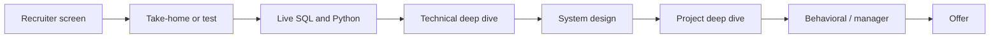

## 🎯 خلاصه

> مصاحبه‌ی مهندسی داده یک **loop** است: چند مرحله‌ی پشت‌سرهم که هر کدام یک «سیگنال» متفاوت را می‌سنجد. وقتی بدانی هر مرحله برای چیست، می‌فهمی باید چه چیزی را آماده کنی و چطور حرف بزنی.

- مراحل رایج: غربالگری با HR یا recruiter، تکلیف خانگی یا تست آنلاین، SQL زنده، کدنویسی پایتون، مصاحبه‌ی فنی عمیق، طراحی سیستم داده، مرور پروژه‌ی گذشته، مصاحبه‌ی رفتاری یا مدیر، و در آخر پیشنهاد کار و مذاکره.
- هر مرحله با یک rubric (فهرست آنچه مصاحبه‌گر باید ببیند) نمره می‌گیرد، نه با «جواب من را حدس زد یا نه».
- مصاحبه‌گرها جداگانه یادداشت می‌نویسند و یک کمیته تصمیم می‌گیرد. هیچ مرحله‌ای اختیاری نیست: یک سیگنال ضعیف واضح در یک مرحله می‌تواند پیشنهاد را از بین ببرد.
- سطحی که برایش مصاحبه می‌دهی، سطح انتظار را در همه‌ی مراحل عوض می‌کند. در loop سنیور انتظار trade-off داری، در loop متوسط انتظار درستیِ پاسخ.

## 🌱 از ساده شروع کنیم (مبتدی)

> **💡 تشبیه:** آزمون رانندگی یک بخش کتبی، یک تمرین پارک‌کردن و یک رانندگی در خیابان دارد. قبول‌شدن در بخش کتبی ثابت نمی‌کند که پارک هم بلدی. loop مصاحبه هم همین‌طور است: هر مرحله یک مهارت متفاوت را می‌سنجد.

این ترتیب رایج است، با زبان ساده:

1. **غربالگری با recruiter یا HR (۲۰ تا ۳۰ دقیقه).** می‌پرسند آیا همان کسی هستی که در رزومه نوشته‌ای، دنبال چه چیزی هستی، بازه‌ی حقوقت چقدر است و چقدر زمان داری تا شروع کنی. کوتاه و صادق باش.
2. **تکلیف خانگی یا تست آنلاین.** یک کار کوچک، مثلاً تمیزکردن یک فایل CSV و بارگذاری‌اش در یک جدول. نشان می‌دهد وقتی کسی نگاه نمی‌کند چطور کار می‌کنی.
3. **SQL زنده.** همزمان که کوئری می‌نویسی، فکرت را توضیح می‌دهی. join، `GROUP BY` و گاهی window function.
4. **کدنویسی پایتون.** کارهای پردازش داده با لیست، دیکشنری، فایل یا pandas. کد تمیز و پیچیدگی منطقی را می‌سنجند.
5. **مصاحبه‌ی فنی عمیق.** «در رزومه‌ات Kafka نوشته‌ای. یک مشکلی که با آن حل کردی را توضیح بده.» دنبال عمق واقعی‌اند.
6. **طراحی سیستم.** یک pipeline یا warehouse را روی تخته یا سند مشترک طراحی می‌کنی. ببین [[delivery-framework]].
7. **مرور پروژه.** پروژه‌ای که واقعاً ساخته‌ای را توضیح می‌دهی: حجم داده، تصمیم‌ها، و آنچه خراب شد.
8. **مصاحبه‌ی رفتاری یا مدیر.** کار تیمی، اختلاف، مسئولیت‌پذیری، اشتباهات.
9. **پیشنهاد کار.** سطح، دامنه‌ی کار و حقوق.

> **🎤 این را در مصاحبه بگو:** «قبل از شروع، می‌شود مراحل را و اینکه هر کدام با چه معیاری نمره می‌گیرد توضیح بدهید؟ می‌خواهم برای چیزی که واقعاً سنجیده می‌شود آماده شوم.»

## 🔧 واقعاً چطور کار می‌کند (متوسط)

هر مرحله یک **سیگنال** اصلی دارد. مصاحبه‌گرها روی همان سیگنال یادداشت می‌نویسند و به ندرت کل آدم را قضاوت می‌کنند.

| مرحله | سیگنال اصلی | طول معمول | کاندیدای قوی چه می‌کند |
|---|---|---|---|
| غربالگری recruiter | تناسب، هماهنگی، انتظارات | ۲۰ تا ۳۰ دقیقه | داستان کوتاه از دو شغل آخر و بازه‌ی حقوق روشن |
| تکلیف خانگی / تست آنلاین | کار تمیز، قضاوت، ارتباط | چند ساعت (اغلب محدود) | یک repo قابل اجرا با README، فرضیات و تست |
| SQL زنده | تسلط و استدلال | ۴۵ تا ۶۰ دقیقه | قبل از تایپ، grain و حالت‌های مرزی را روشن می‌کند |
| کدنویسی پایتون | پردازش داده و کد تمیز | ۴۵ تا ۶۰ دقیقه | اول نسخه‌ی درست، بعد بهبود و نام‌بردن trade-off |
| مصاحبه‌ی فنی عمیق | عمق روی ابزارهای رزومه | ۴۵ تا ۶۰ دقیقه | از مفهوم به failure mode و عدد می‌رسد |
| طراحی سیستم | تفکر ساختاریافته | ۴۵ تا ۶۰ دقیقه | یک ترتیب ثابت را دنبال می‌کند، ببین [[delivery-framework]] |
| مرور پروژه | مالکیت و نتیجه | ۴۵ تا ۶۰ دقیقه | داستان با معیار و تصمیم‌هایی که با «من» گرفته شد |
| رفتاری / مدیر | همکاری و قضاوت | ۳۰ تا ۴۵ دقیقه | مثال مشخص و صادق درباره‌ی اشتباهات |



**مثال کاربردی: یک تکلیف خانگی.** صورت مسئله می‌گوید: «رویدادهای سفارش خام داریم که هر سفارش ممکن است چند بار به‌روز شود. درآمد روزانه به تفکیک کشور را با آخرین نسخه‌ی هر سفارش بساز.» یک راه‌حل خوب از بخش dedup شروع می‌کند، همان جایی که بیشتر کاندیداها اشتباه می‌کنند:

```sql
-- Keep the latest version of each order, then aggregate
WITH ranked AS (
  SELECT
    order_id, order_date, country, amount, updated_at,
    ROW_NUMBER() OVER (PARTITION BY order_id ORDER BY updated_at DESC, order_id) AS rn
  FROM orders_raw
)
SELECT order_date, country, SUM(amount) AS revenue
FROM ranked
WHERE rn = 1
GROUP BY order_date, country
ORDER BY order_date, country;
```

تایبریکر `order_id` باعث می‌شود نتیجه قطعی باشد وقتی دو نسخه‌ی یک سفارش `updated_at` یکسان دارند. این را در README بنویس؛ داورها متوجه‌اش می‌شوند.

**قواعد عملی تکلیف خانگی:**

- زمان را محدود کن. اگر صورت مسئله ۴ ساعت گفته، ۱۲ ساعت وقت نگذار. آنچه نکردی را یادداشت کن.
- README را اول بنویس: نحوه‌ی اجرا، فرضیات، trade-offها و قدم بعدی.
- مهم‌ترین منطق را تست کن (اینجا همان dedup).
- داشبوردی نساز که کسی نخواسته.

**نمره‌دهی.** بازخورد برای هر سیگنال نوشته می‌شود و کمیته سطح‌ها را با هم مقایسه می‌کند. به همین دلیل یک جواب ممکن است برای متوسط «خوب» باشد و برای سنیور «کافی نیست».

## 🧠 عمق و trade-offها (سنیور)

- **loop سنیور ابهام را می‌سنجد.** صورت مسئله عمداً مبهم است. کاندیدای قوی آن را با کلمات خودش بازگو می‌کند، دو سه فرضیه می‌گوید و می‌پرسد کدام محدودیت مهم‌تر است: تأخیر، هزینه یا درستی.
- **deep dive حقیقت را پیدا می‌کند.** مصاحبه‌گر می‌پرسد «در production چه چیزی خراب شد؟» و سه لایه عمیق‌تر پیگیری می‌کند. اگر نمی‌توانی failure mode ابزاری که نوشته‌ای را توضیح بدهی، آن را از رزومه حذف کن یا آمادگی‌اش را بگیر.
- **تکلیف خانگی در برابر زنده.** تکلیف خانگی ظاهر تمیزی نشان می‌دهد، اما می‌تواند درک سطحی را پنهان کند. انتظار داشته باش که در تماس بعدی بخواهند کد را زنده تغییر بدهی.
- **مرحله‌ی «از تجربه‌هایت بپرس».** در بازار ایران این مرحله اغلب وزن زیادی دارد. دو سه پروژه را با عدد آماده کن (تعداد رکورد در روز، تأخیر، هزینه)، معماری‌ای که واقعاً ساختی، تصمیمی که امروز برعکسش می‌کردی و incidentی که از آن یاد گرفتی.
- **زبان trade-off.** «بستگی دارد» وقتی جواب خوبی است که متغیرهایی که به آن بستگی دارد و انتخابت در هر حالت را بگویی. هر بار این‌طور بگو.
- **وقتی نیازی به آمادگی زیاد نیست.** اگر یک هفته وقت داری، آن را صرف پروژه‌های خودت و دو سه mock round کن، نه حفظ‌کردن فهرست ۲۰۰ ابزار.

## 🧪 امتحان کن

۱. سه مصاحبه‌ی گذشته (خودت یا یک دوست) را با ردیف‌های جدول بالا تطبیق بده. کدام سیگنال ضعیف‌ترین بود؟
۲. از تکلیف خانگی مثال بالا استفاده کن. ۹۰ دقیقه وقت بگذار، یک README با سه فرضیه بنویس و فهرست کن چه چیزی را رد کردی.

<details><summary>جواب‌ها را ببین</summary>

**۱.** جواب واحدی وجود ندارد. الگوی رایج این است: کاندیدا SQL و کدنویسی را خوب آماده می‌کند ولی در مرور پروژه ضعیف است، چون نمی‌تواند عدد بدهد یا trade-off را توضیح دهد. اول ضعیف‌ترین سیگنال را درست کن.

**۲.** یک README خوب شامل این‌هاست: نحوه‌ی اجرای کد، قاعده‌ی dedup («آخرین نسخه بر اساس `updated_at`، با tie-break روی `order_id`»)، فرض اینکه `amount` در یک واحد پولی است، و «قدم بعدی: اصلاح‌های دیررس را با اجرای مجدد partitionهای `order_date` تنظیم کنیم».

</details>

## 💬 گوشه‌ی مصاحبه

> **🎤 این را در مصاحبه بگو:** «هر مرحله را با سیگنالش آماده می‌کنم. برای تکلیف خانگی زمان را محدود می‌کنم و یک README می‌نویسم. برای deep dive، پروژه‌هایی با عدد و یک incident که از آن یاد گرفتم را می‌آورم.»

**چطور پرسیده می‌شود:** «برای loop مصاحبه‌ی مهندسی داده چطور آماده می‌شوی؟» یا «فرایند آخرین مصاحبه‌ات را برام توضیح بده.»

- **پاسخ مبتدی:** فهرست موضوعات می‌گوید («SQL، پایتون، Spark، Kafka») و می‌گوید «مطالعه می‌کنم».
- **پاسخ متوسط:** مراحل را به مهارت‌ها وصل می‌کند، از تمرین با زمان‌سنج می‌گوید و می‌پرسد هر مرحله با چه معیاری نمره می‌گیرد.
- **پاسخ سنیور:** trade-offهایی که زیر فشار زمان می‌گیرد را توضیح می‌دهد، می‌گوید چطور پروژه‌ها را برای ارائه انتخاب می‌کند و از یک loop گذشته چه یاد گرفته.

**پاسخ نمونه (۳ تا ۵ جمله):** «من هر مرحله را یک سیگنال متفاوت می‌دانم. برای SQL و پایتون با زمان‌سنج تمرین می‌کنم و فرضیاتم را با صدای بلند می‌گویم. برای تکلیف خانگی زمان را محدود می‌کنم، یک repo قابل اجرا با README تحویل می‌دهم و فهرست می‌کنم چه چیزی را رد کردم. برای deep dive دو پروژه با عدد واقعی و یک incident که از آن یاد گرفتم را می‌آورم. از recruiter می‌خواهم ساختار مراحل را زود بگوید تا برای چیزی که واقعاً نمره می‌گیرد آماده شوم.»

## ⚠️ اشتباهات رایج

- **تکلیف خانگی را مسابقه دیدن.** ویژگی‌های اضافی امتیاز نمی‌آورند اگر وقت تست و README را گرفته باشند.
- **شروع SQL زنده بدون روشن‌کردن grain.** ممکن است مسئله‌ی دیگری را زیبا حل کنی.
- **گفتن «ما» در مرور پروژه.** مصاحبه‌گر تیم را نمره نمی‌دهد؛ سهم تو را نمره می‌دهد.
- **آوردن ابزارهایی که نمی‌توانی از آن‌ها دفاع کنی.** deep dive آن‌ها را امتحان می‌کند.
- **جواب حقوقی بدون آمادگی.** قبل از تماس recruiter بازه و سطح خودت را بدان.
- **بی‌توجهی به هماهنگی.** منطقه‌ی زمانی، مدت notice و ابزارها (ویرایشگر مشترک، دوربین، زبان) خطاهای قابل پیشگیری می‌سازند.

## ✅ خودت را بسنج

۱. کدام مرحله مستقیم‌ترین تست است برای اینکه بتوانی پروژه‌ای از رزومه‌ات را با عدد واقعی توضیح بدهی؟
   - A) SQL زنده
   - B) مرور پروژه‌ی گذشته
   - C) تکلیف خانگی
   - D) غربالگری recruiter

<details><summary>جواب</summary>

**B** — مرور پروژه جایی است که مالکیت، معیارها و تصمیم‌ها نمره می‌گیرند. SQL تسلط را می‌سنجد، تکلیف خانگی قضاوت را در خلوت، و غربالگری تناسب و هماهنگی را.

</details>

۲. یک تکلیف خانگی حدود ۴ ساعت پیشنهاد می‌دهد. قوی‌ترین حرکت کدام است؟
   - A) ساختن pipeline، داشبورد و زمان‌بند
   - B) محدودکردن زمان، تحویل هسته‌ی قابل اجرا با تست و README، و فهرست چیزهایی که رد شد
   - C) فرستادن فقط یک notebook بدون توضیح
   - D) درخواست دو روز بیشتر بدون گفتن به recruiter

<details><summary>جواب</summary>

**B** — داور کار تمیز و قابل اجرا و ارتباط روشن را نمره می‌دهد. فهرست‌کردن آنچه رد شده نشان‌دهنده‌ی قضاوت است و همان چیزی است که این مرحله می‌سنجد.

</details>

۳. **(سنیور)** در یک مرحله‌ی SQL زنده، مصاحبه‌گر می‌گوید «کاربران فعال روزانه به تفکیک کشور» و تو فوراً شروع به نوشتن join می‌کنی. ریسک اصلی چیست و اول چه کاری باید کرد؟
   - A) مصاحبه‌گر صفحه را نمی‌بیند، پس نمره صفر است
   - B) ممکن است به سؤال دیگری جواب بدهی؛ اول grain (هر کاربر در هر روز؟)، منطقه‌ی زمانی و وجود تکرار را روشن کن
   - C) SQL زنده اجازه‌ی `JOIN` نمی‌دهد
   - D) برای هر کوئری باید window function استفاده کنی

<details><summary>جواب</summary>

**B** — ریسک این است که مسئله‌ی دیگری را حل کنی. grain، منطقه‌ی زمانی و تکرارها را روشن کن، فرضیات را با صدای بلند بگو، بعد کوئری را بنویس. سؤال‌های روشن‌کننده‌ی یک کاندیدای سنیور بخشی از نمره است.

</details>

۴. **(سنیور)** recruiter قبل از هر مرحله‌ی فنی، انتظار حقوقی‌ات را می‌پرسد. بهترین پاسخ کدام است؟
   - A) در کل فرایند از گفتن عدد خودداری کنی
   - B) بر اساس تحقیق بازار و سطحت یک بازه بگویی و بپرسی سطح و دامنه‌ی کار چیست
   - C) بالاترین عددی که تا حال دیده‌ای را بگویی
   - D) بگویی هیچ انتظاری نداری

<details><summary>جواب</summary>

**B** — بازه‌ی مبتنی بر تحقیق به‌علاوه‌ی پرسش درباره‌ی سطح و دامنه، کنترل مذاکره را در دست تو نگه می‌دارد. خودداری مطلق یا گفتن یک عدد افراطی معمولاً ضرر می‌زند. برای زمینه‌ی بازار، ببین [[negotiation-iran]].

</details>

## 🗂️ فلش‌کارت

| Front | Back |
|---|---|
| سیگنال مرور پروژه‌ی گذشته چیست؟ | مالکیت، عدد واقعی و تصمیم‌هایی که گرفتی |
| اولین کار در یک سؤال مبهم SQL زنده؟ | روشن‌کردن grain، منطقه‌ی زمانی و تکرارها، و گفتن فرضیات |
| در تکلیف خانگی اول چه چیزی در repo باشد؟ | یک README: نحوه‌ی اجرا، فرضیات، trade-offها، قدم‌های بعدی |
| چرا `order_id` در `ORDER BY` یک window dedup است؟ | تایبریکر قطعی وقتی `updated_at` برابر است |
| چرا «ما» در داستان پروژه نشانه‌ی ضعف است؟ | مصاحبه‌گر سهم تو را نمره می‌دهد، نه سهم تیم را |
| قبل از تماس غربالگری چه چیزی باید بدانی؟ | بازه‌ی حقوق، سطح و مدت notice |

## 🔗 ادامه

- **how-to-prepare** این نقشه را به یک برنامه‌ی مطالعه‌ی هفتگی تبدیل می‌کند.
- **delivery-framework** ساختار مرحله‌ی طراحی سیستم است.
- **behavioral-questions** و **star-framework** داستان‌های رفتاری و پروژه را پوشش می‌دهند.
- **questions-to-ask** سؤال‌های خوب برای پایان هر مرحله را می‌دهد.
- **negotiation-iran** مذاکره‌ی پیشنهاد کار و حقوق در بازار ایران را توضیح می‌دهد.
