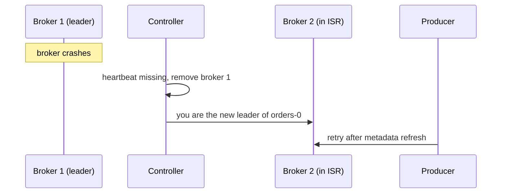

## 🎯 خلاصه

> Kafka یک خوشه از **broker** است که **topic** ها را ذخیره می‌کند. هر topic به **partition** تقسیم می‌شود و هر partition یک log مرتب و append-only است که روی چند broker کپی می‌شود. یکی از replicaها **leader** است و کل خواندن و نوشتن را انجام می‌دهد، بقیه **follower** هستند، و **ISR** مجموعه‌ی replicaهایی است که کاملاً همگام شده‌اند.

- یک **controller** تعیین می‌کند هر partition را چه کسی رهبری کند. Kafka مدرن این کار را با **KRaft** انجام می‌دهد، یک quorum مبتنی بر Raft داخل خود Kafka، به جای ZooKeeper.
- پایداری داده ترکیبی از تنظیمات است: replication factor، `acks` و `min.insync.replicas` باید با هم انتخاب شوند.
- Kafka سریع است چون به‌صورت ترتیبی append می‌کند، از page cache سیستم‌عامل استفاده می‌کند، بایت‌ها را با zero-copy می‌فرستد و با batch کار می‌کند.

## 🌱 از ساده شروع کنیم (مبتدی)

> **💡 تشبیه:** topic را مثل **مجموعه‌ای از دفترهای شماره‌دار** (partitionها) در نظر بگیر. فقط به انتهای هر دفتر می‌نویسی و هر خط شماره دارد (offset). برای اینکه با آتش‌سوزی داده از بین نرود، از هر دفتر سه کپی در سه کتابخانه (replica) داری، و یک کتابدار (leader) همه‌ی نوشتن‌های جدید را می‌گیرد.

یک topic به نام `orders` با ۳ partition و replication factor برابر ۳ بساز:

```bash
kafka-topics.sh --bootstrap-server localhost:9092 \
  --create --topic orders --partitions 3 --replication-factor 3
```

و بعد آن را توصیف کن:

```bash
kafka-topics.sh --bootstrap-server localhost:9092 --describe --topic orders
```

خروجی معمولی (کوتاه‌شده؛ شناسه‌ی brokerها به خوشه‌ی تو بستگی دارد):

```text
Topic: orders  Partition: 0  Leader: 1  Replicas: 1,2,3  Isr: 1,2,3
Topic: orders  Partition: 1  Leader: 2  Replicas: 2,3,1  Isr: 2,3,1
Topic: orders  Partition: 2  Leader: 3  Replicas: 3,1,2  Isr: 3,1,2
```

یعنی partition 0 روی broker 1 نوشته می‌شود، brokerهای 2 و 3 آن را کپی می‌کنند و هر سه همگام‌اند. سه واژه را نگه دار: **broker** (سرور)، **partition** (log مرتب) و **offset** (موقعیت داخل آن). رکوردهای partitionهای مختلف ترتیب مشترک ندارند.

## 🔧 واقعاً چطور کار می‌کند (متوسط)

**Partition و segment.** هر partition روی دیسک به‌صورت پوشه‌ای از فایل‌های **segment** است. رکوردها به segment فعال append می‌شوند. وقتی segment به حد اندازه یا سن برسد، Kafka یک segment جدید می‌سازد. segmentهای قدیمی‌تر با retention حذف یا با compaction تمیز می‌شوند. هر segment یک index از offset دارد، پس مصرف‌کننده‌ای که offset 4000 می‌خواهد کل فایل را اسکن نمی‌کند.

**Offset.** هر partition رکوردهایش را ۰، ۱، ۲، ... شماره می‌دهد. offset فقط داخل همان partition یکتاست.

**Replication.** هر partition یک replication factor (RF) دارد که در محیط واقعی معمولاً ۳ است. leader درخواست‌های produce را می‌پذیرد. followerها مثل مصرف‌کننده‌ها از leader **fetch** می‌کنند و همان بایت‌ها را append می‌کنند. رکورد وقتی برای مصرف‌کننده قابل‌دیدن می‌شود که همه‌ی replicaهای ISR آن را داشته باشند؛ موقعیتی که تا آن جا همه‌چیز امن است **high watermark** نام دارد.

**ISR.** مجموعه‌ی in-sync replica شامل leader و هر followerی است که اخیراً کاملاً همگام شده (در بازه‌ی `replica.lag.time.max.ms`). followerی که عقب بماند از ISR بیرون می‌رود و بعد از جبران عقب‌ماندگی دوباره وارد می‌شود.

**تنظیمات پایداری با هم کار می‌کنند:**

- `acks=all`: leader فقط بعد از اینکه اعضای ISR رکورد را داشته باشند به producer جواب می‌دهد.
- `min.insync.replicas`: حداقل اندازه‌ی ISR که برای پذیرفتن نوشتن (با `acks=all`) لازم است.

با RF=3، `acks=all` و `min.insync.replicas=2`، یک broker می‌تواند خراب شود و نوشتن ادامه پیدا می‌کند. اگر دومی هم خراب شود، ISR به کمتر از ۲ می‌رسد و producer خطای `NotEnoughReplicas` می‌گیرد. این طراحی است: نوشتن را رد کن، به جای اینکه با پایداری ضعیف بپذیری و بعداً گمش کنی.

**Controller و failover رهبر.** یکی از brokerها نقش **controller** را دارد و وضعیت brokerهای زنده و leader هر partition را نگه می‌دارد. در حالت KRaft، controllerها یک quorum مبتنی بر Raft هستند و این metadata را داخل یک log خود Kafka نگه می‌دارند. وقتی broker رهبر بمیرد:



leader جدید فقط می‌تواند از ISR انتخاب شود. نوشتن روی آن partition برای مدت کوتاهی، در حین انتخاب و به‌روزرسانی metadata، متوقف می‌شود. مگر اینکه `unclean.leader.election.enable` برابر true باشد (پیش‌فرضش false است)، replicaای که خارج از ISR است هرگز leader نمی‌شود و رکوردهای تأییدشده گم نمی‌شوند. روشن کردن انتخاب unclean یعنی در ازای دسترس‌پذیری، ریسک از دست رفتن داده را می‌پذیری.

**چرا سریع است؟**

- **I/O ترتیبی:** نوشتن‌ها به انتهای فایل می‌روند، و دیسک و سیستم‌عامل با این الگو خیلی بهتر از نوشتن تصادفی کار می‌کنند.
- **Page cache:** Kafka به page cache سیستم‌عامل تکیه می‌کند، نه یک کش بزرگ روی heap جاوا، پس داده‌ی تازه اغلب از حافظه سرو می‌شود.
- **Zero-copy:** برای مصرف‌کننده، بایت‌های فایل از طریق سیستم‌عامل (`sendfile`) به socket می‌رسند بدون اینکه به فضای کاربر کپی شوند.
- **Batching و فشرده‌سازی:** producerها batch می‌فرستند، و هر batch یک بار فشرده می‌شود و به‌صورت فشرده ذخیره می‌شود.

## 🧠 عمق و trade-offها (سنیور)

- **انتخاب تعداد partition.** از دو اندازه‌گیری شروع کن: throughput هدف، و throughput که یک partition روی سخت‌افزار خودت تحمل می‌کند (حتماً اندازه بگیر). تعداد لازم برای throughput = هدف ÷ نرخ هر partition. بزرگ‌ترین consumer group هم حد پایین می‌گذارد، چون هر partition در هر گروه حداکثر به یک مصرف‌کننده می‌رسد. مثال: هدف ۳۰۰ MB/s و اندازه‌گیری ۲۰ MB/s برای هر partition، یعنی حداقل ۱۵ partition. اگر بزرگ‌ترین گروه ۱۲ مصرف‌کننده دارد، ۱۵ هم جوابگوی آن است. کمی حاشیه بگذار، مثلاً ۱۸، چون اضافه کردن partition بعداً نگاشت کلید به partition را در topicهای keyed تغییر می‌دهد.
- **partition رایگان نیست.** هر کدام هزینه‌ی file handle، حافظه، ترافیک replication و زمان بازیابی بعد از ری‌استارت دارند. تعداد زیاد partition روی هر broker، انتخاب leader را کند می‌کند. راهنمای اندازه‌گیری نسخه‌ی خودت را ببین.
- **Replication هزینه را ضرب می‌کند.** RF=3 فضای ذخیره و ترافیک بین brokerها را سه برابر می‌کند. برای داده‌ای که می‌توانی از منبع بازسازی کنی، RF=2 می‌تواند انتخاب آگاهانه باشد، ولی باید در طراحی دلیلش را بنویسی.
- **نشانه‌های خطا که باید هشدار بدهند:** partitionهای under-replicated (ISR کوچک‌تر از لیست replica)، partitionهای offline (بدون leader)، کوچک شدن ISR بعد از مشکل شبکه، broker با دیسک پر، و controller quorum که اکثریت را از دست داده.
- **leaderهای داغ.** leader همه‌ی ترافیک produce و بخش بزرگی از consume را برای partitionهایش حمل می‌کند. توزیع نامتوازن leaderها باعث brokerهای داغ می‌شود، حتی وقتی تعداد partitionها متعادل به نظر برسد. بعد از اضافه کردن broker، توزیع leaderها را بررسی و عمدی متعادل کن.
- **چند خوشه.** کپی داده بین خوشه‌ها یا دیتاسنترها با ابزار جداگانه‌ای انجام می‌شود (مثلاً MirrorMaker 2)، با lag و محدودیت ترتیب خودش.
- **کی Kafka مناسب نیست؟** حجم کم با مسیریابی هر پیام، اولویت یا کارهای با تأخیر، معمولاً با یک صف ساده‌تر است. تیم کوچکی که تجربه‌ی بهره‌برداری از Kafka ندارد، باید به سرویس مدیریت‌شده فکر کند.

## 🧪 امتحان کن

1. **تعداد partition.** هدف ورودی داده ۵۰۰ MB/s است، تست تو ۲۵ MB/s برای هر partition نشان می‌دهد، و بزرگ‌ترین consumer group ۴۰ مصرف‌کننده دارد. کدام عدد هم throughput و هم موازی‌سازی را پوشش می‌دهد؟
2. **محاسبه‌ی پایداری.** RF=3، `acks=all`، `min.insync.replicas=2`. چند خرابی broker می‌تواند رخ دهد تا producerهای یک partition خطا بگیرند؟ اگر `min.insync.replicas=1` باشد چه تغییری می‌کند؟
3. **خواندن metadata.** partition ای با `Leader: 1  Replicas: 1,2,3  Isr: 1,3` را می‌بینی. چه مشکلی هست و با `min.insync.replicas=2` چه ریسکی دارد؟

<details><summary>جواب‌ها را نشان بده</summary>

**1.** برای throughput، ۵۰۰ ÷ ۲۵ = ۲۰ partition لازم است. برای اینکه ۴۰ مصرف‌کننده بیکار نمانند، ۴۰ partition لازم است. کمترین عددی که هر دو را پوشش می‌دهد ۴۰ است. ۴۰ یا کمی بیشتر را برای حاشیه انتخاب کن.

**2.** با یک خرابی، ISR برابر ۲ می‌ماند و حداقل را رد می‌کند، پس نوشتن ادامه دارد. با خرابی دوم، ISR برابر ۱ می‌شود، زیر حداقل، و producerها خطا می‌گیرند. با `min.insync.replicas=1`، `acks=all` فقط یعنی leader به‌تنهایی رکورد را دارد، و یک خرابی broker می‌تواند داده‌ی تأییدشده را از بین ببرد.

**3.** broker 2 از ISR بیرون رفته، چون عقب مانده یا خاموش است. اندازه‌ی ISR که ۲ است هنوز حداقل ۲ را برآورده می‌کند، پس نوشتن ادامه دارد، ولی یک خرابی دیگر روی broker 1 یا 3 نوشتن را متوقف می‌کند. broker 2 را پیش از اینکه تبدیل به incident شود بررسی کن.

</details>

## 💬 گوشه‌ی مصاحبه

**سؤال: «تعداد partition را چطور انتخاب می‌کنی؟»** جواب متوسط: «throughput هدف و بزرگ‌ترین consumer group را نگاه می‌کنم و عددی را انتخاب می‌کنم که هر دو را با حاشیه پوشش دهد.» جواب سنیور: «throughput هر partition را روی سخت‌افزار خودمان اندازه می‌گیرم، حداقل را از هدف throughput و موازی‌سازی مصرف‌کننده به دست می‌آورم، و حاشیه اضافه می‌کنم. تغییر تعداد بعداً کلیدها را دوباره نگاشت می‌کند، پس برای داده‌ی keyed از اول برنامه‌ریزی می‌کنم یا topic جدید می‌سازم.»

**سؤال: «وقتی broker رهبر بمیرد چه می‌شود؟»** جواب متوسط: «controller یک leader جدید از ISR انتخاب می‌کند، و کلاینت‌ها metadata را تازه می‌کنند و دوباره وصل می‌شوند.» جواب سنیور: «partitionهای درگیر برای مدت کوتاهی در دسترس نیستند. داده امن است چون leader جدید از ISR می‌آید، و به همین دلیل انتخاب unclean خاموش می‌ماند. بعد از رویداد، نرخ انتخاب leader و partitionهای under-replicated را می‌پایم و بررسی می‌کنم که broker خراب یک نقطه‌ی داغ بوده یا نه.»

**سؤال: «min.insync.replicas و acks=all با هم.»** جواب متوسط: «`acks=all` منتظر replicaهای ISR می‌ماند و min ISR می‌گوید حداقل چند تا باید حاضر باشند.» جواب سنیور: «با هم، پایداری را بدون نیاز به همه‌ی replicaها تضمین می‌کنند. با RF=3 و حداقل ISR برابر ۲، یک خرابی را تحمل می‌کنم و در خرابی دوم سریع خطا می‌دهم. `acks=all` به تنهایی کافی نیست اگر ISR تا یک replica کوچک شده باشد.»

> **🎤 این را در مصاحبه بگو:** «partitionهای Kafka log های مرتبی هستند که روی چند broker کپی می‌شوند. leader نوشتن‌ها را می‌گیرد، followerهای همگام آن‌ها را کپی می‌کنند، و پایداری از ترکیب `acks=all` و `min.insync.replicas` می‌آید. تعداد partition را از throughput و بزرگ‌ترین consumer group محاسبه می‌کنم.»

## ⚠️ اشتباهات رایج

> **⚠️ هشدار:** `acks=all` وقتی ISR کوچک شده باشد محافظتی نمی‌کند. اگر فقط یک replica در ISR مانده باشد، `acks=all` همان یک نسخه را منتظر می‌ماند.

- replication factor برابر ۱ در محیط واقعی: با خرابی یک دیسک، partition از بین می‌رود.
- روشن کردن انتخاب unclean leader برای «در دسترس نگه داشتن»، که می‌تواند رکوردهای تأییدشده را از بین ببرد.
- اضافه کردن partition برای حل مصرف‌کننده‌ی کند، وقتی گلوگاه واقعی کد پردازش یا یک کلید داغ است.
- فرض ترتیب بین partitionها. ترتیب فقط داخل یک partition وجود دارد.
- خواندن ستون‌های `Leader` و `Replicas` به‌عنوان سلامت. سلامت یعنی ISR با لیست replica برابر باشد.
- فرض یکسان بودن جزئیات controller و metadata در همه‌ی نسخه‌ها. مستندات نسخه‌ی خودت را ببین.

## ✅ خودت را بسنج

1. ISR چیست؟
   - A) لیست همه‌ی brokerهای خوشه
   - B) replicaهایی که با leader همگام‌اند
   - C) مصرف‌کننده‌هایی که مشترک یک topic‌اند
   - D) topicهایی که از replication استفاده می‌کنند

<details><summary>جواب</summary>

**B** — ISR مجموعه‌ی replicaهای همگام است، شامل leader. تعیین می‌کند چه کسی می‌تواند leader شود و آیا `min.insync.replicas` برقرار است.

</details>

2. RF=3، `acks=all`، `min.insync.replicas=2`. ISR به یک broker کوچک می‌شود. producer چه می‌بیند؟
   - A) نوشتن موفق است، با یک هشدار
   - B) نوشتن با خطا شکست می‌خورد، پس رکورد با پایداری ضعیف پذیرفته نمی‌شود
   - C) نوشتن به controller فرستاده می‌شود
   - D) نوشتن موفق است و followerها بعداً جبران می‌کنند

<details><summary>جواب</summary>

**B** — وقتی تعداد replicaهای همگام کمتر از حداقل است، broker نوشتن را رد می‌کند. خطای بلند هدف این تنظیم است.

</details>

3. چرا مسیر نوشتن روی دیسک در Kafka سریع است؟
   - A) همه‌ی داده را در heap جاوا نگه می‌دارد
   - B) به‌صورت ترتیبی append می‌کند و به page cache سیستم‌عامل و zero-copy تکیه دارد
   - C) برای هر رکورد fsync صدا می‌زند
   - D) رکوردها را در B-tree با دسترسی تصادفی ذخیره می‌کند

<details><summary>جواب</summary>

**B** — append ترتیبی با دیسک سازگار است، page cache داده‌ی تازه را از حافظه سرو می‌کند، و zero-copy کپی‌های اضافی در مسیر مصرف‌کننده را حذف می‌کند.

</details>

4. **(سنیور)** leader می‌میرد و `unclean.leader.election.enable` برابر true است. replicaای که خارج از ISR بود leader می‌شود. ریسک چیست؟
   - A) partition دو leader پیدا می‌کند
   - B) رکوردهایی که به producer تأیید شده‌اند اما به آن replica نرسیده‌اند می‌توانند گم شوند
   - C) مصرف‌کننده‌ها باید offset را به صفر برگردانند
   - D) followerها replication را متوقف می‌کنند

<details><summary>جواب</summary>

**B** — با `acks=all`، رکوردهای تأییدشده روی اعضای ISR هستند. replica خارج از ISR ممکن است بعضی از آن‌ها را نداشته باشد، پس ارتقای آن بی‌صدا داده را از بین می‌برد.

</details>

5. **(سنیور)** یک topic با ۱۲ partition و یک consumer group با ۱۲ مصرف‌کننده داری. ۱۲ مصرف‌کننده‌ی دیگر به همان گروه اضافه می‌کنی. چه می‌شود؟
   - A) throughput دو برابر می‌شود
   - B) ۱۲ مصرف‌کننده‌ی جدید بیکار می‌مانند، چون هر partition در هر گروه حداکثر به یک مصرف‌کننده می‌رسد
   - C) Kafka هر partition را بین ۲۴ مصرف‌کننده تقسیم می‌کند
   - D) brokerها مصرف‌کننده‌های جدید را رد می‌کنند

<details><summary>جواب</summary>

**B** — سقف گروه یک مصرف‌کننده برای هر partition است، پس مصرف‌کننده‌های بیشتر از ۱۲ چیزی نمی‌گیرند. throughput بیشتر به partition بیشتر نیاز دارد.

</details>

## 🗂️ فلش‌کارت

| Front | Back |
|---|---|
| Broker | سروری در Kafka که replicaهای partition را نگه می‌دارد و به کلاینت‌ها سرویس می‌دهد. |
| Partition | یک log مرتب و append-only؛ واحد موازی‌سازی و ترتیب. |
| Offset | موقعیت یک رکورد داخل partition خودش. |
| Leader و follower | replicaای که خواندن و نوشتن را انجام می‌دهد، و replicaهایی که آن را کپی می‌کنند. |
| ISR | replicaهایی که با leader همگام‌اند. |
| High watermark | offset‌ای که تا آن همه‌ی اعضای ISR رکورد را دارند؛ مصرف‌کننده فقط زیر آن می‌خواند. |
| `min.insync.replicas` | حداقل اندازه‌ی ISR برای پذیرفتن نوشتن وقتی `acks=all` است. |
| Unclean leader election | اجازه می‌دهد replicaی خارج از ISR leader شود؛ می‌تواند داده‌ی تأییدشده را از بین ببرد. |

## 🔗 ادامه

- `queues-vs-logs`: چرا partition و offset وجود دارند.
- `kafka-producers`: `acks`، batching و idempotence از سمت کلاینت.
- `kafka-consumers`: گروه‌ها، offset و rebalancing.
- `kafka-retention-compaction`: چگونه segmentها حذف یا compact می‌شوند.
- `distributed-fundamentals`: replication، quorum و consensus به‌طور کلی.
- واژه‌نامه: [[wal]]، [[consumer-lag]].

