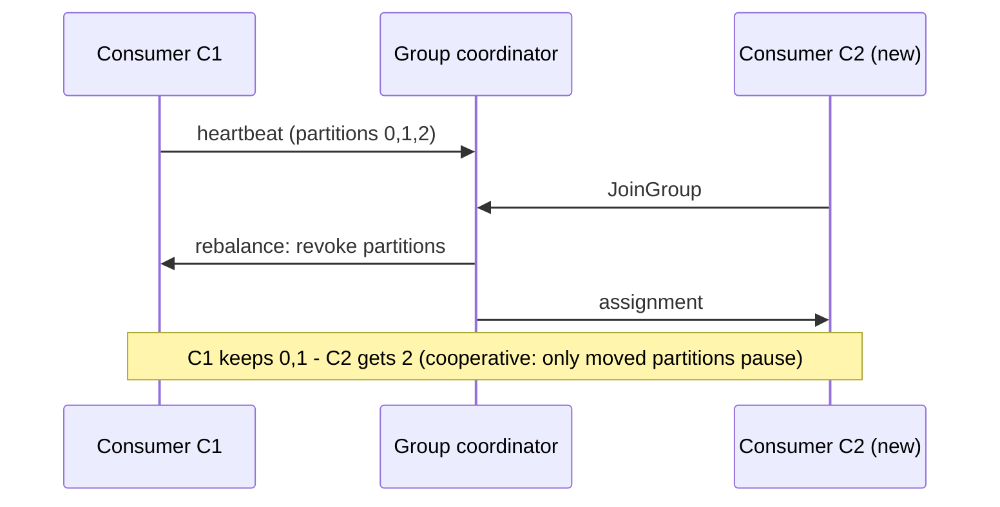

## 🎯 خلاصه

> یک **consumer group** مجموعه‌ای از consumerهاست که partitionهای یک topic را بین خودشان تقسیم می‌کنند. در هر لحظه، هر partition را **دقیقاً یک** consumer از آن group می‌خواند.

- موازی‌سازی از partition می‌آید: یک group هیچ‌وقت نمی‌تواند reader فعال بیشتر از تعداد partition داشته باشد.
- هر group آفست (نشانک) خودش را برای هر partition در broker ذخیره می‌کند. commit کردن آفست یعنی «همه‌چیز قبل از این را تمام کرده‌ام».
- **rebalance** هنگام جوین شدن، خروج، crash یا کندی اعضا، partitionها را جابه‌جا می‌کند. این شایع‌ترین منبع دردسر در production است.
- **lag** (فاصله‌ی group از جدیدترین پیام) معیاری است که نشان می‌دهد consumerها عقب افتاده‌اند یا نه.

## 🌱 از ساده شروع کنیم (مبتدی)

> **💡 Analogy:** یک سوپرمارکت با ۳ صندوق (partition) و کاشیر (consumer). هر صندوق در هر لحظه **یک** کاشیر دارد، پس ترتیب مشتری‌های یک صندوق حفظ می‌شود. اگر وقتی سه صندوق داری، کاشیر چهارم استخدام کنی، او بیکار می‌ماند. نشانکی که هر کاشیر برای «تا کجا رفتم» نگه می‌دارد همان **offset** است.

مثال: topic به نام `orders` با ۳ partition داریم و group به نام `billing` با ۲ consumer.

```text
partition 0 ──► consumer C1
partition 1 ──► consumer C1
partition 2 ──► consumer C2
```

حالا consumer سومی، C3، را اجرا می‌کنیم. Kafka دوباره تخصیص می‌دهد تا هر consumer یک partition داشته باشد. consumer چهارم، C4، هیچ partitionی نمی‌گیرد و فقط به‌عنوان پشتیبان منتظر می‌ماند.

دو قاعده را به خاطر بسپار:

1. در داخل یک group، یک partition همزمان بین دو consumer تقسیم نمی‌شود. همین باعث حفظ ترتیب در هر partition می‌شود.
2. دو group **مختلف** هرکدام **همه‌ی** پیام‌ها را دریافت می‌کنند. group ها راه پخش یک topic به چند برنامه‌ی مستقل هستند (billing، analytics، search).

یک حلقه‌ی ساده‌ی consumer در Python (کلاینت `confluent-kafka`):

```python
from confluent_kafka import Consumer

c = Consumer({
    "bootstrap.servers": "localhost:9092",
    "group.id": "orders-billing",
    "enable.auto.commit": False,      # we decide when the bookmark moves
    "auto.offset.reset": "earliest",  # what to do when there is no saved offset yet
})
c.subscribe(["orders"])

while True:
    msg = c.poll(1.0)
    if msg is None or msg.error():
        continue
    process(msg.value())                       # your code; must be idempotent
    c.commit(message=msg, asynchronous=False)  # commit AFTER processing succeeded
```

## 🔧 واقعاً چطور کار می‌کند (متوسط)

**state کجا ذخیره می‌شود؟** آفست‌ها در topic داخلی `__consumer_offsets` ذخیره می‌شوند و کلیدشان `(group, topic, partition)` است. آفست commit‌شده، **آفست بعدی** برای خواندن است. یک **group coordinator** (یکی از brokerها) عضویت را دنبال می‌کند و تخصیص را اجرا می‌کند.

**زنده بودن: دو تایمر.**

- consumer از یک thread پس‌زمینه **heartbeat** می‌فرستد. اگر coordinator بیش از `session.timeout.ms` چیزی نشنود، عضو حذف می‌شود.
- حلقه‌ی **poll** تو باید هر `max.poll.interval.ms` دوباره `poll()` را صدا بزند (پیش‌فرض در نسخه‌های رایج ۵ دقیقه است؛ برای نسخه‌ی خودت مستندات را چک کن). اگر پردازش یک batch طولانی‌تر شود، consumer گیرکرده حساب می‌شود، group را ترک می‌کند و rebalance راه می‌افتد. این همان باگ کلاسیک است: یک دیتابیس کند باعث می‌شود consumer تا ابد بین عضو بودن و خارج شدن نوسان کند.

**چه چیزهایی rebalance را راه می‌اندازد:** جوین یا خروج consumer، crash، رد شدن از `max.poll.interval.ms`، اضافه شدن partition به topic، یا تغییر subscription.



**rebalance از نوع eager در برابر cooperative.**

| | Eager (stop-the-world) | Cooperative (incremental) |
|---|---|---|
| چه اتفاقی می‌افتد | هر consumer **همه‌ی** partitionها را رها می‌کند، بعد مجموعه‌ی جدید می‌گیرد | فقط partitionهایی که باید جابه‌جا شوند revoke می‌شوند |
| توقف group | کل group خواندن را متوقف می‌کند | فقط partitionهای جابه‌جاشده مکث می‌کنند |
| تنظیمات | assignorهای قدیمی‌تر (`RangeAssignor`، `RoundRobinAssignor`) | `CooperativeStickyAssignor` |

rebalance از نوع cooperative نیاز دارد که همه‌ی اعضا از assignor سازگار استفاده کنند. برای نسخه‌ی کلاینتت مستندات را بررسی کن.

**static membership.** روی هر consumer مقدار `group.instance.id` را بگذار. اگر consumer به‌سرعت (داخل `session.timeout.ms`) ری‌استارت شود، partitionهای قبلی‌اش را دوباره می‌گیرد و rebalance رخ نمی‌دهد. برای deployهای rolling consumerهای stateful مفید است.

**commit آفست.**

- با `enable.auto.commit=true` آفست روی یک تایمر commit می‌شود و بر اساس چیزی است که **آخرین `poll()`** برگردانده. Kafka نمی‌داند پردازش تو تمام شده یا نه. اگر پردازش async باشد یا پروسه crash کند، پیام‌ها ممکن است رد شوند (از دست رفتن) یا دوباره پردازش شوند (تکرار).
- commit دستی (`commitSync` / `commitAsync`) **بعد از** پردازش، تحویل **at-least-once** می‌دهد: crash بین پردازش و commit باعث replay می‌شود.
- commit **قبل از** پردازش، at-most-once می‌دهد: crash بعد از commit یعنی پیام گم شده است.

**lag.** برای هر partition: `lag = log end offset − committed offset`. جمع آن روی partitionها lag کل group را می‌دهد. با دستور زیر می‌توانی ببینی:

```bash
kafka-consumer-groups.sh --bootstrap-server localhost:9092 \
  --describe --group orders-billing
```

ستون‌های خروجی برای هر partition عبارت‌اند از `CURRENT-OFFSET`، `LOG-END-OFFSET` و `LAG`، به‌علاوه‌ی این‌که کدام consumer مالک آن partition است.

**poison pill.** رکوردی که همیشه در پردازش شکست می‌خورد (JSON خراب، schema که کد نمی‌فهمد) partition خودش را مسدود می‌کند: آفست بدون رد کردن آن جلو نمی‌رود. راه‌حل معمول این است که چند بار با محدودیت retry کنی، بعد رکورد را به topic **dead-letter queue** (DLQ) بفرستی که همراه متادیتا (topic، partition، offset، خطا) ذخیره می‌شود، و بعد commit کنی تا partition جلو برود.

## 🧠 عمق و trade-offها (سنیور)

**موازی‌سازی سقف partition دارد.** حداکثر تعداد consumerِ مفید در یک group برابر تعداد partition است. افزایش partition بعداً ممکن است، اما نگاشت key به partition را عوض می‌کند و ترتیب per-key را برای keyهایی که در حال پردازشند می‌شکند. partitionها را بر اساس throughput اوج تقسیم بر throughput یک consumer، به‌علاوه‌ی حاشیه برای رشد، تنظیم کن.

**زمان پردازش دشمن واقعی است.** batchهای طولانی باعث تخطی از `max.poll.interval.ms` می‌شوند، که باعث rebalance می‌شود، که باعث پردازش تکراری بیشتر می‌شود، که batchها را طولانی‌تر می‌کند. اهرم‌های عملی:

- کم کردن `max.poll.records` تا هر poll کار کمتری برگرداند.
- نگه داشتن کار هر رکورد محدود؛ فراخوانی‌های کند بیرونی را با timeout و retry محصور کن.
- اگر باید با thread pool پردازش کنی، با احتیاط از `pause()` / `resume()` استفاده کن تا بیشتر از توان تمام کردنت poll نکنی.

**حالت‌های خرابی که باید اسمشان را بدانی.**

- *طوفان rebalance:* group دائم rebalance می‌کند؛ lag بالا می‌رود و هیچ‌چیز پردازش نمی‌شود.
- *partition گیرکرده:* lag یک partition بالا می‌رود و بقیه خوب‌اند. معمولاً poison pill یا hot key است.
- *consumer زامبی:* پروسه مکث شده (GC طولانی، پارتیشن شبکه) ولی هنوز تا رسیدن timeout partitionها را نگه داشته؛ بعد ممکن است تکراری پردازش کند.

**trade-off در DLQ.** فرستادن رکورد به DLQ ترتیب را به هم می‌زند. اگر رویدادهای بعدیِ همان key به رکورد شکست‌خورده وابسته‌اند، باید بین مسدود کردن partition (ترتیب درست، lag بالا) و رد کردن (جریان ادامه دارد، ناسازگاری داده) یکی را انتخاب کنی. این را قوانین کسب‌وکار تعیین می‌کنند، نه Kafka.

**چه چیزهایی را مانیتور کنیم.** **نرخ رشد lag** (مفیدتر از lag مطلق)، تعداد rebalance در ساعت، خطاهای commit، زمان از `poll()` تا commit و نرخ DLQ. هشدار را روی «lag بیش از ۱۵ دقیقه در حال افزایش است» بگذار، نه روی یک عدد ثابت، چون عدد درست به ترافیک بستگی دارد.

**فریم‌ورک‌ها آفست خودشان را مدیریت می‌کنند.** Flink آفست‌های source را در checkpointها نگه می‌دارد و برای recovery از آن‌ها استفاده می‌کند؛ commit کردن در Kafka بیشتر برای مانیتورینگ است. Kafka Streams و Kafka Connect زیر پوشش از consumer group استفاده می‌کنند. وقتی می‌پرسی «چرا lag در Flink با group من نمی‌خواند»، این را باید بدانی.

**کی group مشترک نباید استفاده شود.** اگر هر instance به **همه‌ی** پیام‌ها نیاز دارد (cache محلی، پخش notification)، به هر instance یک `group.id` جدا بده. اگر کنترل کامل و بدون rebalance می‌خواهی، از `assign()` دستی برای partitionهای مشخص استفاده کن و بپذیر که failover با خودت است.

## 🧪 امتحان کن

1. یک topic با ۳ partition بساز و ۳۰۰ پیام با key (`orders`، `key=user_id`) تولید کن.
2. یک consumer در group به نام `billing` اجرا کن. با `kafka-consumer-groups.sh --describe` ستون LAG را یادداشت کن.
3. consumer دوم و سوم را اجرا کن. دوباره describe بگیر: هر consumer باید یک partition داشته باشد.
4. consumer چهارم را اجرا کن. تأیید کن که هیچ partitionی ندارد.
5. یکی از consumerها را با `kill -9` متوقف کن و ببین rebalance تقریباً چقدر طول می‌کشد تا تشخیص داده شود (حدود `session.timeout.ms`).

اول پیش‌بینی کن: بعد از مرحله‌ی ۵، کدام consumer partition یتیم را می‌گیرد و چرا این فوری رخ نمی‌دهد؟

<details><summary>حدست چیست؟</summary>

هیچ‌کس فوری آن را نمی‌گیرد. coordinator عضو را فقط بعد از قطع شدن heartbeat به مدت `session.timeout.ms` حذف می‌کند، پس آن partition در این بازه خوانده نمی‌شود. بعد rebalance آن را به یکی از اعضای زنده می‌دهد. در این فاصله lag بالا می‌رود و بعداً پایین می‌آید.

</details>

## 💬 گوشه‌ی مصاحبه

**س: چند consumer باید اجرا کنم؟**

> **🎤 Say this in the interview:** «تا تعداد partition؛ بیشتر از آن فقط بیکار می‌ماند. تعداد consumer را از throughput اوج تقسیم بر throughput هر consumer حساب می‌کنم، بعد partition را با حاشیه انتخاب می‌کنم. به نرخ رشد lag نگاه می‌کنم، نه lag مطلق، و `max.poll.interval.ms` را بالاتر از بدترین زمان batch نگه می‌دارم تا پردازش کند باعث rebalance نشود.»

**س: وقتی یک consumer می‌میرد چه می‌شود؟**

> **🎤 Say this in the interview:** «coordinator دیگر heartbeat نمی‌گیرد و بعد از `session.timeout.ms` عضو را حذف می‌کند. یک rebalance partitionهایش را به بقیه می‌دهد. کار commit‌نشده دوباره پخش می‌شود، پس پردازش باید idempotent باشد. با static membership و rebalance از نوع cooperative، ری‌استارت سریع اختلال خیلی کمتری ایجاد می‌کند.»

## ⚠️ اشتباهات رایج

- **«consumer بیشتر یعنی throughput بیشتر.»** فقط تا تعداد partition. بیشتر از آن consumerهای اضافی کاری نمی‌کنند.
- **auto-commit همراه با پردازش async.** آفست قبل از تمام شدن کار جلو می‌رود، پس crash داده را از دست می‌دهد.
- **کار طولانی داخل حلقه‌ی `poll()`.** نبودن تنظیم درست `max.poll.interval.ms` باعث rebalanceهایی می‌شود که شبیه خطاهای تصادفی به نظر می‌رسند.
- **استفاده‌ی مجدد از یک `group.id` برای برنامه‌های نامرتبط.** partitionها بین آن‌ها تقسیم می‌شود و هر کدام فقط بخشی از داده را می‌بیند.
- **retry بی‌پایان یک poison pill.** partition متوقف می‌شود؛ lag روی یک partition بالا می‌رود در حالی که داشبورد topic را «سالم» نشان می‌دهد.
- **فرض این‌که «commit شده» یعنی «دقیقاً یک‌بار پردازش شده».** commit تحویل at-least-once می‌دهد، مگر این‌که از transaction استفاده کنی (در درس exactly-once ببین).

## ✅ خودت را بسنج

1. یک topic با ۶ partition داریم و group به نام `reports` ۸ consumer دارد. چند consumer پیام دریافت می‌کنند؟
   - A) ۶
   - B) ۸
   - C) ۱
   - D) به کلیدهای پیام بستگی دارد

<details><summary>پاسخ</summary>

**A** — هر partition به دقیقاً یک consumer در group می‌رسد، پس فقط ۶ consumer مالک partition هستند. ۲ تای دیگر بیکار می‌مانند تا وقتی partition اضافه شود یا consumerی خارج شود.

</details>

2. کدام تنظیم مشخص می‌کند برنامه بین دو فراخوانی `poll()` حداکثر چقدر می‌تواند طول بکشد قبل از این‌که consumer از group حذف شود؟
   - A) `session.timeout.ms`
   - B) `heartbeat.interval.ms`
   - C) `max.poll.interval.ms`
   - D) `auto.commit.interval.ms`

<details><summary>پاسخ</summary>

**C** — `max.poll.interval.ms` فاصله بین pollها را پوشش می‌دهد، یعنی زمان پردازش تو. `session.timeout.ms` مربوط به heartbeatهایی است که از thread پس‌زمینه می‌رود، پس حلقه‌ی کند هنوز می‌تواند heartbeat بفرستد و بعد با timeout مربوط به poll بیرون انداخته شود.

</details>

3. auto-commit روشن است. کد تو هر رکورد را به یک thread پس‌زمینه می‌دهد و فوراً به `poll()` برمی‌گردد. ریسک اصلی چیست؟
   - A) فقط پردازش تکراری
   - B) امکان از دست رفتن پیام
   - C) هرگز rebalance رخ نمی‌دهد
   - D) lag همیشه صفر است

<details><summary>پاسخ</summary>

**B** — auto-commit آفست را بر اساس آخرین `poll()` جلو می‌برد، نه بر اساس تمام شدن کار پس‌زمینه. crash بعد از commit و قبل از تمام شدن thread باعث می‌شود آن رکوردها رد شوند.

</details>

4. *(سنیور)* چرا rebalance از نوع cooperative نسبت به eager حادثه‌ها را کم می‌کند؟

<details><summary>پاسخ</summary>

rebalance از نوع eager همه‌ی partitionها را از همه‌ی اعضا می‌گیرد، پس کل group مکث می‌کند. rebalance از نوع cooperative فقط partitionهایی را revoke می‌کند که باید مالک‌شان عوض شود، پس consumerهای بی‌تأثیر به خواندن ادامه می‌دهند. هزینه‌اش دورهای بیشتر پروتکل است و همه‌ی اعضا باید assignor را پشتیبانی کنند.

</details>

5. lag یک partition مرتب بالا می‌رود در حالی که بقیه نزدیک صفر هستند. محتمل‌ترین علت و راه‌حل چیست؟

<details><summary>پاسخ</summary>

محتمل‌ترین علت یک poison pill (رکوردی که همیشه شکست می‌خورد) یا یک hot key است که یک consumer را زیر فشار می‌گذارد. آفست شکست‌خورده را در لاگ‌ها پیدا کن، تعداد retry را محدود کن، رکورد را همراه متادیتا به DLQ بفرست و بعد commit کن. اگر hot key است، راه‌حل در partitioning یا salting است، نه در consumer.

</details>

## 🗂️ فلش‌کارت

| Front | Back |
|---|---|
| قانون consumer group | هر partition در هر لحظه توسط دقیقاً یک consumer در group خوانده می‌شود |
| حداکثر consumer مفید | تعداد partition؛ بقیه بیکار می‌مانند |
| آفست commit‌شده یعنی | آفست بعدی برای خواندن (هر چیزی قبل از آن تمام شده) |
| فرمول lag | log end offset − committed offset، برای هر partition |
| `max.poll.interval.ms` | حداکثر فاصله بین دو `poll()` قبل از خروج consumer از group |
| eager در برابر cooperative | eager همه‌ی partitionها را revoke می‌کند؛ cooperative فقط آن‌هایی که جابه‌جا می‌شوند |
| static membership | `group.instance.id`: ری‌استارت سریع بدون rebalance |
| راه‌حل poison pill | retry محدود، بعد DLQ با متادیتا، بعد commit |

## 🔗 ادامه

- بعدی: **kafka-exactly-once** توضیح می‌دهد وقتی consumer همزمان در Kafka می‌نویسد (read-process-write داخل یک transaction) چه می‌شود.
- **kafka-retention-compaction** توضیح می‌دهد وقتی داده‌ی قدیمی حذف می‌شود با آفست‌ها چه می‌شود: یک group کند ممکن است از ابتدای log بیفتد.
- **dlq-bad-records** الگوی dead-letter، retry topic و replay را عمیق‌تر توضیح می‌دهد.
- مدخل‌های glossary به نام‌های [[consumer-lag]] و [[idempotency]] دو ایده‌ای را تعریف می‌کنند که این درس به آن‌ها وابسته است.
