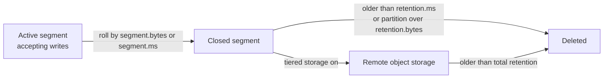

## 🎯 خلاصه

> یک topic در Kafka یک **log** است و log بی‌نهایت بزرگ می‌شود، مگر این‌که به Kafka بگویی چه چیزی را دور بریزد. دو **cleanup policy** به این سؤال جواب می‌دهند: **delete** (داده‌ی قدیمی را حذف کن) و **compact** (آخرین مقدار هر کلید را نگه دار).

- `cleanup.policy=delete` کل **segment**ها را وقتی حذف می‌کند که از حد زمانی قدیمی‌تر باشند یا partition از حد حجمی بزرگ‌تر شده باشد.
- `cleanup.policy=compact` برای هر کلید **آخرین** رکورد را نگه می‌دارد و رکوردهای قدیمی‌تر با همان کلید را دور می‌ریزد.
- یک **tombstone** (رکوردی با کلید و مقدار `null`) به compaction می‌گوید که آن کلید را کاملاً حذف کند.
- **Tiered storage** segmentهای قدیمی‌تر را از دیسک broker به object storage ارزان‌تر می‌برد، در حالی که همان topic و offsetها را حفظ می‌کند.

## 🌱 از ساده شروع کنیم (مبتدی)

> **💡 Analogy:** یک دفترچه را تصور کن که هر رویداد را در یک خط می‌نویسی. با **delete**، وقتی دفترچه پر شد یا صفحه‌ها از یک ماه قدیمی‌تر شدند، صفحه‌های اول را پاره می‌کنی. با **compact**، فقط آخرین خطی را نگه می‌داری که برای هر اسم نوشته‌ای، مثل دفترچه‌ی تلفن که شماره‌ی جدید جای شماره‌ی قدیمی را می‌گیرد.

هر partition یک فایل فقط-اضافه‌شونده است. Kafka این فایل را به **segment** تقسیم می‌کند (فایل‌هایی با اندازه یا سن ثابت). cleanup هرگز وسط segment فعال رکوردی را ویرایش نمی‌کند و فقط روی segmentهای بسته کار می‌کند.

این دو policy برای هر topic جدا تنظیم می‌شوند:

```bash
# Delete old data after 7 days (the common default)
kafka-configs.sh --bootstrap-server localhost:9092 \
  --entity-type topics --entity-name clicks \
  --alter --add-config cleanup.policy=delete,retention.ms=604800000

# Keep the latest value per key, forever
kafka-configs.sh --bootstrap-server localhost:9092 \
  --entity-type topics --entity-name user-profiles \
  --alter --add-config cleanup.policy=compact
```

یک مثال ساده برای topic فشرده‌شده. سه به‌روزرسانی برای `user-1` و یکی برای `user-2` می‌فرستیم:

```text
offset  key       value
0       user-1    {"city": "Tehran"}
1       user-2    {"city": "Shiraz"}
2       user-1    {"city": "Isfahan"}
3       user-1    {"city": "Mashhad"}
```

بعد از compaction، یک consumer جدید که از ابتدا می‌خواند `user-2 → Shiraz` و `user-1 → Mashhad` را می‌بیند. offsetهای 0 و 2 دیگر نیستند، پس offsetها الان شکاف دارند. این طبیعی است: consumerها نباید فرض کنند offsetها پشت‌سرهم هستند.

> **⚠️ Watch out:** Compaction **فوری** نیست. تا وقتی cleaner اجرا نشود، یک consumer ممکن است چند مقدار قدیمی برای یک کلید را بخواند. هرگز فرض نکن «compacted» یعنی «الان فقط یک رکورد به‌ازای هر کلید».

## 🔧 واقعاً چطور کار می‌کند (متوسط)

### سیاست delete

هر segment یک بزرگ‌ترین timestamp دارد. Kafka یک segment بسته را وقتی حذف می‌کند که **یکی** از این دو شرط برقرار باشد:

- `retention.ms` گذشته باشد (بر اساس زمان)، یا
- `retention.bytes` نشان دهد که partition از حد بزرگ‌تر است (بر اساس حجم، به‌ازای هر partition نه هر topic).

هر دو حد چک می‌شوند و هر کدام زودتر برقرار شود، اجرا می‌شود. segment **فعال** هرگز حذف نمی‌شود، پس یک topic با `segment.bytes` خیلی بزرگ ممکن است بیشتر از `retention.ms` داده نگه دارد. به همین دلیل اندازه و زمان roll شدن segment (`segment.bytes`، `segment.ms`) روی دقت retention اثر دارد.

retention به این بستگی ندارد که consumerها داده را خوانده باشند یا نه. consumer کندی که offsetش به داده‌ی حذف‌شده اشاره می‌کند خطای `OffsetOutOfRangeException` می‌گیرد و تنظیم `auto.offset.reset` تعیین می‌کند بعد چه می‌شود.

### سیاست compact

یک topic فشرده‌شده **آخرین مقدار هر کلید** را نگه می‌دارد. log cleaner، log را به بخش **clean** (قبلاً فشرده‌شده) و بخش **dirty** (داده‌ی جدید) تقسیم می‌کند. وقتی dirty ratio از `min.cleanable.dirty.ratio` بیشتر شود اجرا می‌شود، پس روی هر نوشتن اجرا نمی‌شود.

نکته‌های مهم:

| قاعده | معنی |
|---|---|
| segment فعال | هرگز compact نمی‌شود. جدیدترین داده همیشه سالم می‌ماند. |
| کلید لازم است | رکوردهای بدون کلید قابل compact نیستند. Kafka در topic فشرده آن‌ها را رد می‌کند. |
| offsetها | مثل قبل می‌مانند. compaction رکورد را حذف می‌کند، آن‌ها را شماره‌گذاری مجدد نمی‌کند. |
| ترتیب | رکوردهای باقی‌مانده ترتیب نسبی‌شان را حفظ می‌کنند. |
| tombstone | رکوردی با `value = null`. وقتی خودش هم پاک شود، کلید را حذف می‌کند. |
| `delete.retention.ms` | مدت نگه‌داشتن tombstone تا consumerها حذف را ببینند. |

**tombstone** روش حذف یک کلید از topic فشرده است. consumerهایی که از topic یک جدول می‌سازند باید مقدار `null` را به‌معنی «این کلید را از state من حذف کن» بگیرند.

```python
# Python, confluent-kafka client: delete user-1 from a compacted topic
from confluent_kafka import Producer

p = Producer({"bootstrap.servers": "localhost:9092"})
p.produce("user-profiles", key=b"user-1", value=None)  # tombstone
p.flush()
```

هر دو policy را می‌شود با `cleanup.policy=delete,compact` ترکیب کرد. Kafka آخرین مقدار هر کلید را نگه می‌دارد و داده‌ی قدیمی‌تر از `retention.ms` را هم حذف می‌کند. این برای topicهای changelog با سقف زمانی مفید است.

### چرا compaction مهم است

topicهای فشرده ستون فقرات **changelog**ها هستند. state storeهای Kafka Streams، topicهای CDC مثل Debezium و خیلی از فیدهای «وضعیت فعلی» از compaction استفاده می‌کنند، پس یک consumer جدید می‌تواند کل state فعلی را با خواندن topic از ابتدا بازسازی کند. بدون compaction باید سال‌ها تاریخچه را دوباره پخش کنی. برای ایده‌ی گسترده‌تر [[cdc]] و [[log-compaction]] را ببین.

### Tiered storage

Tiered storage (KIP-405) segmentهای اخیر را روی دیسک محلی broker نگه می‌دارد و segmentهای بسته‌ی قدیمی‌تر را به remote object storage مثل S3 یا GCS کپی می‌کند. consumerها offsetهای قدیمی را به‌صورت شفاف از remote storage می‌خوانند. دو ویژگی برای مصاحبه مهم است:

- `retention.ms` همچنان **کل** retention (محلی به‌علاوه remote) را توصیف می‌کند.
- یک تنظیم retention محلی تعیین می‌کند چقدر روی دیسک broker بماند.

در دسترس بودن و نام دقیق تنظیمات به نسخه و توزیع Kafka بستگی دارد، پس قبل از نقل قول، docs نسخه‌ی خودت را چک کن.

این چرخه‌ی عمر یک رکورد روی topic با سیاست delete است:



## 🧠 عمق و trade-offها (سنیور)

**retention یک قرارداد است، نه cache.** `retention.ms` در واقع SLA برای این است که یک consumer تا کجا دیر بخواند. اگر کندترین consumer ممکن است ۳ روز خاموش باشد و retention دو روز است، داری یک incident آماده می‌کنی. retention را این‌طور اندازه بگیر: `retention ≥ بدترین زمان بازیابی + زمان replay + حاشیه`.

**محاسبه‌ی حجم.** دیسک لازم برای یک topic را این‌طور تخمین بزن:

```text
ingest rate   = 20 MB/s
retention     = 7 days = 604800 s
raw data      = 20 MB/s × 604800 s = 12,096,000 MB ≈ 12.1 TB
replication   = 3
disk needed   = 12.1 TB × 3 ≈ 36.3 TB (before compression and headroom)
```

برای segmentهایی که هنوز حذف نشده‌اند و برای خرابی broker حاشیه بگذار. فشرده‌سازی (`compression.type`) حجم دیسک را کم می‌کند، اما عددهای واقعی کلاستر خودت را بسنج.

**حالت‌های خرابی compaction.**

- thread مربوط به cleaner ممکن است با یک رکورد بد بمیرد یا حافظه‌ی key map آن تمام شود. آن‌وقت داده‌ی dirty بزرگ می‌شود و دیسک پر می‌شود. metricهای log cleaner و اندازه‌ی بخش dirty log را پایش کن.
- تعداد زیاد کلید یکتا، key map را بزرگ می‌کند و compaction را گران می‌کند. برای داده‌ی رویدادی که «وضعیت فعلی» نمی‌خواهد، delete بر اساس زمان بهتر است.
- tombstoneهایی که زود پاک شوند ممکن است به consumerی که آفلاین بوده اجازه دهند مقدار قدیمی را دوباره ببیند. `delete.retention.ms` را بیشتر از lag کندترین consumer نگه دار.

**ترتیب و کلیدها.** compaction ترتیب بازماندگان را حفظ می‌کند ولی آن‌ها را جابه‌جا نمی‌کند. انتخاب partition key معنی «آخرین» را تعیین می‌کند. اگر یک entity با دو کلید مختلف بیاید (مثلاً user id و email)، compaction نمی‌تواند آن‌ها را ادغام کند.

**کی compaction را استفاده نکنیم.** یک stream رویدادی که همه‌ی رویدادها مهم‌اند (پرداخت، کلیک، audit log) را compact نکن. compaction تاریخچه‌ی معتبر را پاک می‌کند. به‌جایش delete retention به‌علاوه sink به lake برای تاریخچه بگذار.

**چه چیزی را پایش کنی.**

- consumer lag نسبت به پنجره‌ی retention (offset قدیمی‌ترین consumer چقدر به earliest offset موجود نزدیک است).
- مصرف دیسک به‌تفکیک broker و topic و سرعت رشد آن.
- سلامت log cleaner و dirty ratio topicهای فشرده.
- خطاهای آپلود tiered storage، اگر از آن استفاده می‌کنی.

## 🧪 امتحان کن

1. یک topic به نام `user-profiles` با `cleanup.policy=compact` و `segment.ms` کوچک (مثلاً 10 ثانیه) بساز تا cleaner در حین تمرین اجرا شود.
2. چهار رکورد تولید کن: `user-1` سه بار با شهرهای مختلف، و `user-2` یک بار.
3. از ابتدا consume کن و تعداد رکوردها را بشمار. ممکن است بعضی مقادیر قدیمی هنوز باشند.
4. برای `user-1` یک tombstone تولید کن، صبر کن تا compaction انجام شود، و دوباره consume کن. `user-1` باید بعد از پایان مدت tombstone ناپدید شود.
5. بنویس اگر topic به‌جای آن `cleanup.policy=delete` بود، چه چیزی را باید عوض می‌کردی.

> **🎤 Say this in the interview:** «سیاست را از سؤالی که باید جواب بدهم انتخاب می‌کنم. اگر برای replay یا audit تاریخچه لازم دارم، از delete با retention به‌اندازه‌ی کندترین consumer استفاده می‌کنم. اگر وضعیت فعلی به‌ازای هر کلید لازم دارم، مثل changelog، از compact استفاده می‌کنم و کلیدها را با tombstone حذف می‌کنم. هرگز فرض نمی‌کنم compaction قبلاً انجام شده، چون ناهمزمان است.»

## 💬 گوشه‌ی مصاحبه

**سؤال: وقتی consumer از پنجره‌ی retention عقب بیفتد چه می‌شود؟**
- **مبتدی:** داده‌ی قدیمی را از دست می‌دهد، چون Kafka آن را حذف کرده. باید از قدیمی‌ترین offsetی که هنوز موجود است شروع کند.
- **متوسط:** offset commit شده‌اش به segment حذف‌شده اشاره می‌کند، پس fetch با `OffsetOutOfRangeException` شکست می‌خورد. تنظیم `auto.offset.reset` تعیین می‌کند به earliest یا latest برود، و هر دو حالت داده را بی‌صدا رد می‌کنند.
- **سنیور:** این برای consumer یک incident از دست رفتن داده است. روی lag نسبت به earliest offset هشدار بگذار، retention را با حاشیه اندازه بگیر و سیاست reset را صریح کن. بازیابی معمولاً یعنی backfill از منبع یا از lake.

**سؤال: چطور یک کلید را از topic فشرده حذف کنی؟**
- **متوسط:** یک tombstone بفرست، یعنی همان کلید با مقدار `null`. بعد از این‌که compaction مقادیر قدیمی را حذف کرد، خود tombstone بعد از `delete.retention.ms` پاک می‌شود.

**جواب نمونه (سنیور):** delete تاریخچه را برای یک پنجره‌ی زمانی نگه می‌دارد، compaction آخرین مقدار هر کلید را. compaction ناهمزمان است و فقط روی segmentهای بسته کار می‌کند، پس consumerها ممکن است مدتی مقادیر قدیمی ببینند. حذف‌ها با tombstone انجام می‌شوند و retention باید کندترین consumer را پوشش دهد. من lag نسبت به earliest offset و سلامت cleaner را پایش می‌کنم.

## ⚠️ اشتباهات رایج

- **«compacted یعنی همین الان deduplicate شده.»** compaction با تأخیر است. خواننده‌ها باید کلیدهای تکراری را هندل کنند، یا از یک consumer دارای state بخوانند.
- **استفاده از compaction برای stream رویدادی.** هر رویداد یک واقعیت است. compaction تاریخچه‌ای را که شاید لازم داری پاک می‌کند.
- **فرستادن رکورد بدون کلید به topic فشرده.** این رکوردها قابل compact نیستند و producer خطا می‌دهد.
- **فراموش کردن این‌که `retention.bytes` به‌ازای هر partition است.** یک topic با ۱۲ partition می‌تواند تا ۱۲ برابر این حد داده نگه دارد.
- **تنظیم `retention.ms` کوتاه‌تر از زمان بازیابی consumer.** این رایج‌ترین علت از دست رفتن بی‌صدای داده است.
- **فرض این‌که offsetها بعد از compaction پشت‌سرهم هستند.** شکاف طبیعی است.

## ✅ خودت را بسنج

1. یک topic با `cleanup.policy=delete` و `retention.ms` برابر ۱ روز داریم. یک segment ۳ روز پیش بسته شده. چرا هنوز ممکن است وجود داشته باشد؟
   - A) Kafka هرگز segment بسته را حذف نمی‌کند
   - B) segment فعال است، یا cleaner هنوز اجرا نشده
   - C) consumerها باید اول offset را commit کنند
   - D) compaction جلوی حذف را گرفته

   <details><summary>Answer</summary>

   **B** — حذف روی segmentهای بسته بررسی می‌شود و طبق برنامه‌ی cleaner انجام می‌شود، پس یک segment بسته ممکن است بعد از حد زمانی‌اش برای مدت کوتاهی بماند. segment فعال هرگز حذف نمی‌شود، پس یک segment فعال طولانی می‌تواند داده را بیشتر از حد نگه دارد.

   </details>

2. می‌خواهی کاربر `42` را از topic فشرده‌ی `profiles` حذف کنی. چه چیزی تولید می‌کنی؟
   - A) رکوردی با کلید `42` و یک شیء JSON خالی
   - B) رکوردی با کلید `42` و مقدار `null`
   - C) رکوردی بدون کلید
   - D) هیچ‌چیز؛ باید خود topic را حذف کنی

   <details><summary>Answer</summary>

   **B** — tombstone رکوردی با کلید و مقدار `null` است. گزینه‌ی A کلید را با یک مقدار زنده نگه می‌دارد. گزینه‌ی C اصلاً قابل compact نیست.

   </details>

3. **سناریو:** یک topic پرداخت فشرده شده تا «وضعیت فعلی» هر پرداخت نگه داشته شود. مالی یک audit trail کامل می‌خواهد. مشکل کجاست و چه می‌کنی؟
   - A) مشکلی نیست؛ compaction همه‌ی تاریخچه را نگه می‌دارد
   - B) compaction رویدادهای قبلی را حذف می‌کند، پس از delete retention استفاده کن و داده را برای audit به lake بفرست
   - C) `min.cleanable.dirty.ratio` را بالا ببر
   - D) topic را به یک sink فشرده‌شده تبدیل کن

   <details><summary>Answer</summary>

   **B** — compaction رکوردهای قدیمی‌تر با همان کلید را حذف می‌کند، پس audit trail از بین می‌رود. رویدادها را روی topic با سیاست delete و retention کافی نگه دار و برای نگه‌داری بلندمدت به storage منتقل کن.

   </details>

4. **trade-off سنیور:** کندترین consumer ما ممکن است تا ۴۸ ساعت در زمان deploy خاموش باشد. retention برابر ۲۴ ساعت است. ریسک چیست و راه‌حل کدام است؟
   - A) ریسکی نیست؛ consumerها خودکار وصل می‌شوند
   - B) داده قبل از بازیابی حذف می‌شود، پس retention را برای پوشش زمان بازیابی و replay با حاشیه بالا ببر و روی lag هشدار بگذار
   - C) `segment.bytes` را کم کن
   - D) compaction را فعال کن

   <details><summary>Answer</summary>

   **B** — retention پنجره‌ای است که در آن consumer می‌تواند بازیابی کند. retention باید از بدترین زمان خاموشی به‌علاوه زمان replay بیشتر باشد و هشدار lag به تو فرصت واکنش می‌دهد.

   </details>

## 🗂️ فلش‌کارت

| Front | Back |
|---|---|
| `cleanup.policy=delete` | حذف segmentهای بسته‌ی قدیمی‌تر از `retention.ms` یا بالاتر از `retention.bytes` به‌ازای هر partition |
| `cleanup.policy=compact` | نگه‌داشتن آخرین رکورد هر کلید؛ رکوردهای قدیمی‌تر با همان کلید ناهمزمان حذف می‌شوند |
| Tombstone | رکورد کلیددار با مقدار `null`؛ بعد از compaction کلید را حذف می‌کند |
| `delete.retention.ms` | مدتی که tombstone قبل از پاک شدن توسط cleanup قابل دیدن است |
| segment فعال | هرگز حذف یا compact نمی‌شود |
| Dirty ratio | سهم داده‌ی compact نشده؛ cleaner وقتی از `min.cleanable.dirty.ratio` بگذرد اجرا می‌شود |
| Tiered storage | segmentهای بسته‌ی قدیمی روی object storage، با همان topic و offsetها |
| retention به‌عنوان SLA | retention باید بدترین زمان بازیابی کندترین consumer را پوشش دهد |

## 🔗 ادامه

- [[kafka-architecture]] — چگونگی چیدمان segmentها و partitionها روی دیسک
- [[kafka-exactly-once]] — چرا تکراری بودن داده وقتی کلیدها compact می‌شوند مهم است
- [[kafka-connect-ops]] — عملیات pipelineهایی که روی این topicها سوار هستند
- [[data-retention]] — سیاست retention فراتر از Kafka
- docs مربوط به Kafka: «Log compaction» و مرجع تنظیمات سطح topic برای نسخه‌ی خودت
