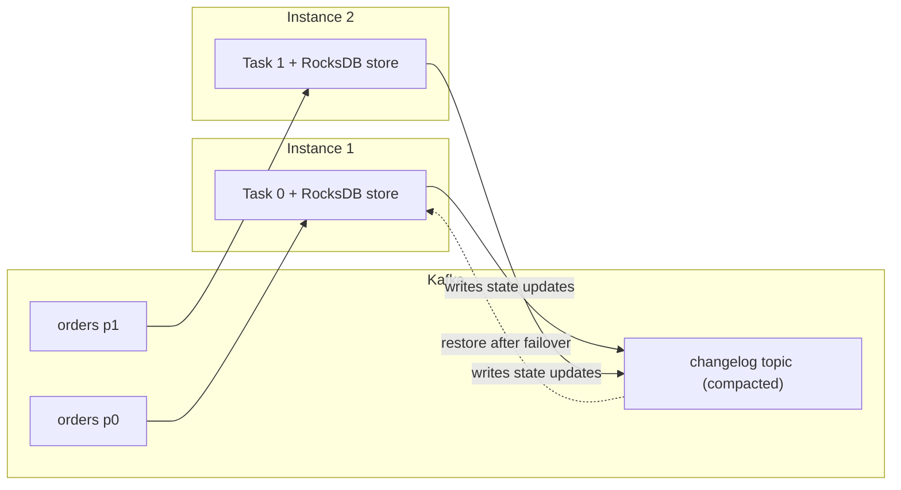

## 🎯 خلاصه

> **Kafka Streams** یک **کتابخانه‌ی Java** است، نه یک کلاستر جدا. اپلیکیشن شما topicهای Kafka را می‌خواند، تبدیلشان می‌کند، state خودش را نگه می‌دارد و نتیجه را دوباره در Kafka می‌نویسد. مقیاس‌پذیری یعنی اجرای نسخه‌های بیشتری از همان اپلیکیشن.

- `KStream` یک **جریان بی‌پایان از رویدادها** است. هر رکورد یک واقعیت است.
- `KTable` یک **نمای changelog** است: برای هر کلید فقط آخرین مقدار اهمیت دارد.
- state محلی در **state store** (به‌طور پیش‌فرض RocksDB) نگه داشته می‌شود و در **changelog topic** داخل Kafka پشتیبان‌گیری می‌شود تا بعد از crash قابل بازسازی باشد.
- **ksqlDB** همان موتور را با SQL در اختیار می‌گذارد، برای تیم‌هایی که به‌جای Java کوئری می‌خواهند.

## 🌱 از ساده شروع کنیم (مبتدی)

> **💡 Analogy:** اپلیکیشن Kafka Streams مثل کارگری است پشت میز مرتب‌سازی. نوار نقاله همان topic در Kafka است. کارگر هر بسته را برمی‌دارد، شاید یادداشتی در دفترچه‌ی شخصی‌اش بنویسد (همان state store) و نتیجه را روی نوار دیگری می‌گذارد. انبار جداگانه لازم نیست: کارگر و دفترچه در یک اتاق‌اند.

یک job کوچک برای enrichment در Java: هر سفارش با آخرین پروفایل مشتری join می‌شود.

```java
StreamsBuilder builder = new StreamsBuilder();

KStream<String, Order> orders = builder.stream("orders");          // events
KTable<String, Customer> customers = builder.table("customers");   // latest profile per customer

orders
    .filter((customerId, order) -> order.amount() > 0)
    .join(customers, (order, customer) -> new EnrichedOrder(order, customer.tier()))
    .to("enriched-orders");

KafkaStreams streams = new KafkaStreams(builder.build(), props);
streams.start();
```

شیء `props` حداقل به `application.id` (نام گروه اپلیکیشن شما) و `bootstrap.servers` نیاز دارد. توجه کنید که topology کد معمولی است: می‌توانید با `TopologyTestDriver` بدون broker در حال اجرا تستش کنید.

## 🔧 واقعاً چطور کار می‌کند (متوسط)

**Taskها.** Kafka Streams توپولوژی را به **task** تبدیل می‌کند. هر task مالک یک partition از هر topic ورودی (برای ورودی‌های co-partitioned) است. taskها بین instanceها و threadهای در حال اجرا پخش می‌شوند. یعنی:

- حداکثر موازی‌سازی مفید برابر تعداد partitionهای ورودی است. یک topic با ۱۲ partition حداکثر ۱۲ task فعال دارد، مهم نیست چند instance راه بیندازید.
- وقتی یک instance از کار می‌افتد، taskهایش به instance دیگری می‌روند. مالک جدید اول state را دوباره می‌سازد.



**KStream در برابر KTable.** فرض کنید کلید `c1` سه به‌روزرسانی به topic مشتری‌ها می‌فرستد: `tier=silver`، بعد `tier=gold`، و بعد `tier=gold, city=Tehran`. به‌عنوان `KStream` این سه رویداد هستند. به‌عنوان `KTable` مقدار فعلی `c1` فقط آخرینش است. `KTable` همان جریان تغییرات است که به «آخرین مقدار برای هر کلید» تبدیل شده، و enrichment دقیقاً همین را لازم دارد.

**Changelog topicها.** هر state storeای که با aggregation یا table به‌روز می‌شود، در یک changelog topic آینه می‌شود. نام آن از application id و نام store ساخته می‌شود. این changelog فشرده (compacted) است (ببینید [[log-compaction]]) و آخرین مقدار هر کلید را نگه می‌دارد. موقع restart، task این changelog را در یک store محلی تازه پخش می‌کند. زمان بازیابی با حجم state متناسب است، و به همین دلیل state بزرگ failover را کند می‌کند.

**Aggregation و repartition.**

```java
KTable<String, Long> ordersPerCustomer = orders
    .groupByKey()
    .count();
```

اگر اول کلید را عوض کنید (مثلاً با `selectKey` به `merchantId`)، Kafka Streams خودکار رکوردها را در یک **repartition topic** داخلی می‌نویسد تا هر کلید به task درست برسد. این topicهای اضافی دیسک، شبکه و تأخیر می‌خواهند و اولین جایی است که وقتی pipeline کندتر از انتظار است باید نگاه کنید.

**Join نیاز به co-partitioning دارد.** join جریان-جدول فقط وقتی کار می‌کند که هر دو طرف تعداد partition یکسان و کلید partition شده‌ی یکسان داشته باشند. وگرنه ممکن است یک کلید روی taskهای مختلف بیفتد و join بی‌صدا جفت‌ها را از دست بدهد. معنای join جریان-جریان و جریان-جدول در [[stream-joins]] آمده است.

## 🧠 عمق و trade-offها (سنیور)

- **Exactly-once.** Kafka Streams برای حلقه‌ی read-process-write حالت exactly-once را با یک تنظیم (`processing.guarantee`) پشتیبانی می‌کند. نسخه‌های جدید از حالت `exactly_once_v2` استفاده می‌کنند؛ برای نسخه‌ی خودتان داک را چک کنید. این حالت روی transaction کار می‌کند، پس همان مکانیزم [[kafka-exactly-once]] است. این حالت نوشتن در دیتابیس‌های خارجی را exactly-once نمی‌کند.
- **ریسک اصلی state است.** state محلی RocksDB می‌تواند به صدها گیگابایت برسد. مصرف دیسک هر instance، زمان restore بعد از rebalance و تعداد فایل‌های باز را زیر نظر بگیرید. standby replicaها (تعداد قابل تنظیمی نسخه‌ی گرم از هر store) زمان failover را کم می‌کنند، به قیمت دیسک و ترافیک شبکه.
- **Rebalance.** اضافه یا حذف کردن یک instance taskها را جابه‌جا می‌کند. بدون standby، مالک جدید اول کل store را از changelog بازسازی می‌کند و partitionهای مربوطه متوقف می‌شوند. اجرای stateful (مثلاً Kubernetes StatefulSet با volume پایدار) این هزینه را کم می‌کند.
- **Interactive queries.** Kafka Streams می‌تواند state storeهای محلی را از طریق HTTP در دسترس بگذارد، تا سؤال «شمارش فعلی مشتری c1 چند است؟» مستقیم جواب داده شود. یادتان باشد هر instance فقط partitionهای خودش را دارد؛ درخواست باید به instance درست هدایت شود.
- **ksqlDB.** ksqlDB، SQL را به‌صورت persistent query روی Kafka Streams اجرا می‌کند. برای فیلتر، aggregation ساده، join و دادن نمای جریان به تحلیلگرها عالی است. برای منطق کسب‌وکار پیچیده، state سفارشی و کنترل عملیاتی ضعیف‌تر است. push query نتایج را جریانی می‌فرستد؛ pull query وضعیت فعلی یک جدول را می‌خواند.
- **در برابر Flink.** Kafka Streams کلاستر جدا و job manager ندارد، پس برای میکروسرویس و pipelineهای ساده مناسب است. Flink کلاستر خودش، پشتیبانی غنی‌تر از event time، مدیریت state بزرگ و SQL را دارد. انتخاب را بر اساس محل state و مقیاس‌پذیری بگذارید، نه بر اساس هیاهو.
- **چه چیزی را پایش کنیم.** consumer lag روی topicهای ورودی، دفعات rebalance، مدت restore state، نرخ cache hit رکوردها و تأخیر پردازش. نام metricها بین نسخه‌ها تغییر می‌کند، پس داک نسخه‌ی خودتان را ببینید.

## 🧪 امتحان کن

با توپولوژی بالا، قبل از نگاه کردن به جواب، کتبی پاسخ دهید:

1. topic ورودی `orders` شش partition دارد. ده instance اجرا می‌کنید. چند instance همزمان کار مفید انجام می‌دهند و چرا؟
2. کلید `orders` را از `customerId` به `merchantId` تغییر می‌دهید و بعد با جدول `customers` که با `customerId` کلیددار است join می‌کنید. مشکل کجاست و چطور درستش می‌کنید؟
3. یک `KTable` از topic مشتری‌ها برای enrichment استفاده می‌شود. مشتری از gold به silver می‌رود و بعد رکوردش حذف می‌شود (tombstone). join بعد از tombstone چه چیزی خروجی می‌دهد؟

<details><summary>جواب‌ها را ببین</summary>

**۱.** شش instance (یا کمتر) کار می‌کنند و چهار تای دیگر بیکارند. taskها به partitionها گره خورده‌اند؛ شش partition حداکثر شش task فعال می‌دهد. instanceهای اضافه ظرفیت standby هستند.

**۲.** بعد از `selectKey` رکوردها بر اساس `merchantId` repartition می‌شوند، اما جدول با `customerId` کلیددار است. join روی کلید یکسانی نیست و جفت‌ها پیدا نمی‌شوند. راه‌حل: جدول را با همان کلیدی که join می‌کنید دوباره کلیددار کنید، یا روی کلیدی join کنید که واقعاً در جریان وجود دارد.

**۳.** tombstone (رکوردی با مقدار null) کلید را از جدول حذف می‌کند. joinهای بعدی برای آن مشتری ردیفی پیدا نمی‌کنند، پس inner join برای او چیزی خروجی نمی‌دهد تا پروفایل جدیدی برسد. left join سفارش را با پروفایل null خروجی می‌دهد.

</details>

## 💬 گوشه‌ی مصاحبه

**سؤال: «چه وقت به‌جای Flink از Kafka Streams استفاده می‌کنی؟»** جواب متوسط: «برای یک تبدیل ساده داخل میکروسرویس، بدون اینکه کلاستر جداگانه‌ای اجرا کنم.» جواب سنیور: «وقتی state متوسط است، تیم از قبل سرویس‌های Java دارد و می‌خواهم مقیاس‌پذیری به partitionهای topic گره بخورد، Kafka Streams را انتخاب می‌کنم. وقتی state بزرگ، منطق event-time پیچیده یا یک کلاستر مشترک برای چند job لازم است، Flink. قبل از تعهد، می‌پرسم آیا تیم می‌تواند instanceهای stateful را اداره کند.»

> **🎤 Say this in the interview:** «Kafka Streams یک کتابخانه است که topology را به taskهایی تقسیم می‌کند که هرکدام یک partition دارد. state محلی است و با یک changelog topic پشتیبان‌گیری می‌شود، پس failover یعنی restore، نه ساختن دوباره از منبع. محدودیت‌هایش سقف موازی‌سازی به partition و اندازه‌ی state است.»

## ⚠️ اشتباهات رایج

> **⚠️ Watch out:** استفاده از `KTable` برای جریان رویدادها. اگر هر رکورد یک واقعیت است (پرداخت، کلیک)، `KStream` بگیرید. `KTable` فقط آخرین مقدار هر کلید را نگه می‌دارد و تاریخچه را بی‌صدا از دست می‌دهد.

- join بین stream و table بدون بررسی یکسان بودن کلید و تعداد partition.
- عوض کردن کلید و فراموش کردن topic اضافی repartition و هزینه‌اش.
- فرض اینکه exactly-once شامل نوشتن در دیتابیس هم می‌شود. فقط کار Kafka-به-Kafka را پوشش می‌دهد.
- نادیده گرفتن زمان restore: یک store با ۲۰۰ گیگ می‌تواند failover را چند دقیقه کند.
- تغییر ناسازگار topology بدون reset. وقتی لایه‌ی state عوض می‌شود، از ابزار reset و یک `application.id` جدید استفاده کنید.
- فکر کردن اینکه ksqlDB جای اپلیکیشن را می‌گیرد. منطق پیچیده معمولاً هنوز کد لازم دارد.

## ✅ خودت را بسنج

1. برای غنی‌سازی هر سفارش با آخرین پروفایل مشتری، از کدام انتزاع استفاده می‌کنی؟
   - A) `KStream` روی topic مشتری‌ها
   - B) `KTable` روی topic مشتری‌ها که با جریان سفارش join می‌شود
   - C) یک شمارنده‌ی سراسری در دیتابیس
   - D) یک repartition topic

<details><summary>جواب</summary>

**B** — `KTable` آخرین مقدار هر کلید را می‌دهد و این چیزی است که enrichment لازم دارد. گزینه‌ی A هر تغییر پروفایل را به‌عنوان رویداد نگه می‌دارد که شکل اشتباه برای «پروفایل فعلی» است.

</details>

2. یک topic ورودی ۸ partition دارد. حداکثر چند task می‌توانند همزمان آن را پردازش کنند؟
   - A) ۱
   - B) ۸
   - C) ۱۶
   - D) بی‌نهایت، اگر instance اضافه کنی

<details><summary>جواب</summary>

**B** — هر task مالک یک partition ورودی است. instanceهای بیشتر از ۸ برای این topic task فعال اضافه نمی‌کنند؛ می‌توانند standby باشند.

</details>

3. هدف changelog topic چیست؟
   - A) خروجی اپلیکیشن را ذخیره می‌کند
   - B) state محلی را پشتیبان‌گیری می‌کند تا task بعد از failover بتواند store را بازسازی کند
   - C) offsetهای consumer را ذخیره می‌کند
   - D) جایگزین topic ورودی می‌شود

<details><summary>جواب</summary>

**B** — changelog نسخه‌ی فشرده‌ی به‌روزرسانی‌های state است. بعد از failover، task جدید آن را در یک store محلی پخش می‌کند.

</details>

4. **(سنیور)** تیم می‌خواهد زمان failover یک سرویس با ۱۵۰ گیگ state را کم کند. کدام گزینه دیسک و شبکه را در برابر بازیابی سریع‌تر معامله می‌کند و هزینه‌اش چیست؟

   - A) خاموش کردن changelogها
   - B) افزایش تعداد partitionهای ورودی به ۱۰۰۰
   - C) تنظیم standby replica برای storeها، به قیمت دیسک و ترافیک replication بیشتر
   - D) استفاده از `KStream` به‌جای `KTable`

<details><summary>جواب</summary>

**C** — standby replicaها نسخه‌های گرم store را روی instanceهای دیگر نگه می‌دارند، پس failover نیازی به restore کامل ندارد. خاموش کردن changelogها (A) تحمل خطا را از بین می‌برد و partitionهای بیشتر (B) زمان restore را کم نمی‌کنند.

</details>

5. **(سنیور)** چرا بعد از تغییر partitioner در producer، یک stream-table join بی‌صدا تعداد جفت‌های کمتری برمی‌گرداند؟

   - A) Kafka Streams بعد از تغییر producer از join پشتیبانی نمی‌کند
   - B) دو ورودی دیگر partitioning یکسان ندارند و کلیدهای مشابه ممکن است روی taskهای متفاوت بیفتند
   - C) tombstone تولید می‌شود
   - D) commit offsetها تکراری شده‌اند

<details><summary>جواب</summary>

**B** — joinها به ورودی‌های co-partitioned نیاز دارند (تعداد partition یکسان و کلید partition شده‌ی یکسان). اگر producer به شکل دیگری partition کند، رکوردهای مطابق روی taskهای مختلف می‌افتند و هرگز به هم نمی‌رسند.

</details>

## 🗂️ فلش‌کارت

| Front | Back |
|---|---|
| Kafka Streams چیست؟ | یک کتابخانه‌ی Java که پردازش جریان را داخل اپلیکیشن شما اجرا می‌کند، بدون کلاستر جدا |
| KStream در برابر KTable | KStream = هر رکورد یک رویداد است؛ KTable = آخرین مقدار هر کلید |
| state محلی کجا می‌رود؟ | state store (به‌طور پیش‌فرض RocksDB)، پشتیبان‌گیری‌شده در یک changelog topic فشرده |
| حداکثر taskهای فعال برای یک topic | تعداد partitionهای ورودی (taskها مالک partitionاند) |
| چه چیزی repartition topic می‌سازد؟ | عملیات تغییر کلید مثل `selectKey` و بعد grouping یا join |
| tombstone در KTable چه می‌کند؟ | کلید را از جدول حذف می‌کند |
| چرا standby replica استفاده می‌شود؟ | failover سریع‌تر: یک نسخه‌ی گرم از store روی instance دیگر وجود دارد |
| ksqlDB در یک خط | persistent queryهای SQL که روی Kafka Streams اجرا می‌شوند |

## 🔗 ادامه

- [[stream-joins]] جوین‌های window-دار، جدولی و lookup را با جزئیات توضیح می‌دهد، از جمله داده‌ی دیررس.
- [[stream-concepts]] زمان رویداد، window و watermark را پوشش می‌دهد که Kafka Streams هم از آن‌ها استفاده می‌کند.
- [[streaming-state]] به‌طور کلی state store، checkpoint و TTL از state را توضیح می‌دهد.
- [[kafka-exactly-once]] مکانیزم transaction پشت پردازش exactly-once را شرح می‌دهد.
- [[flink]] جایگزین اصلی وقتی state و منطق event-time بزرگ می‌شوند است.
- داک Kafka Streams و ksqlDB را برای نسخه‌ی خودتان بخوانید؛ مفاهیم بالا پایدارند، اما نام تنظیمات و پیش‌فرض‌ها تغییر می‌کنند.
