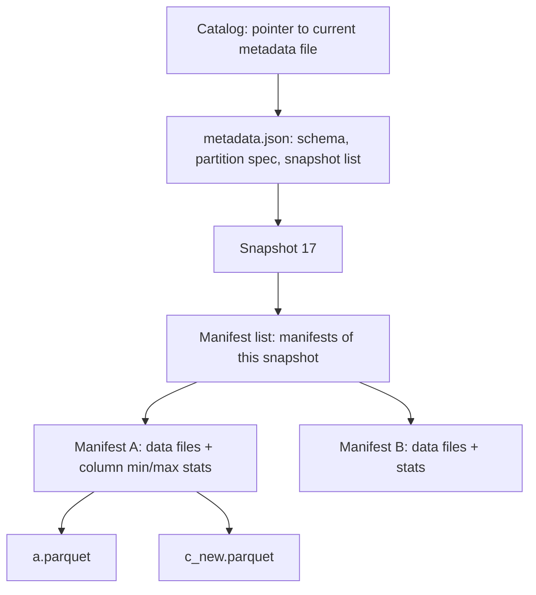
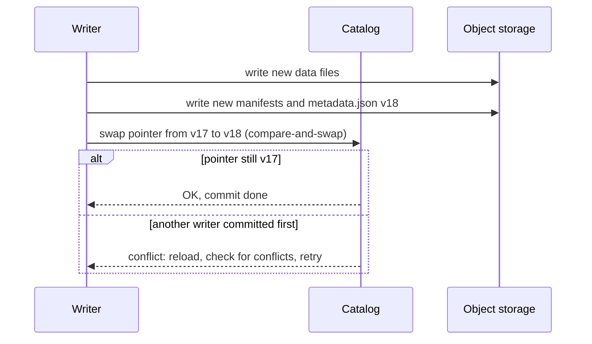

## 🎯 خلاصه

> **فرمت جدول (table format)** مثل Apache Iceberg، Delta Lake و Apache Hudi یک **لایه‌ی متادیتا روی فایل‌های** object storage است. به یک پوشه از فایل‌های Parquet چیزهایی می‌دهد که یک جدول دیتابیس دارد: **commit اتمی**، **snapshot** (سفر در زمان)، **تکامل schema** و **تغییرات سطری** (`MERGE`، حذف). **lakehouse** یعنی lake که از طریق چنین جدول‌هایی کوئری زده می‌شود.

- پوشه‌های ساده‌ی Parquet commit اتمی ندارند، معلوم نیست «جدول الان» کدام فایل‌ها هستند، و راه امنی برای به‌روزرسانی یک سطر وجود ندارد.
- فرمت‌های جدول **فهرست فایل‌ها را برای هر snapshot** نگه می‌دارند. یک commit متادیتای جدید می‌نویسد و بعد یک اشاره‌گر را جابه‌جا می‌کند. خواننده یا snapshot قبلی را می‌بیند یا جدید را، و هرگز نیمه‌ی یک نوشتن را نمی‌بیند.
- Iceberg، Delta و Hudi همان مسئله را با درخت‌های متادیتای متفاوت و روش‌های متفاوت برای به‌روزرسانی حل می‌کنند. انتخاب **copy-on-write یا merge-on-read** در Hudi رایج‌ترین مقایسه در مصاحبه است.
- انتخاب فرمت به **بار کاری** (حجم CDC، موتورها، الگوی به‌روزرسانی) و **عملیات** قابل‌نگهداری (compaction، expire کردن snapshot، پاک‌سازی فایل‌های یتیم) بستگی دارد، نه به محبوب بودن یک اسم.

## 🌱 از ساده شروع کنیم (مبتدی)

> **💡 تشبیه:** یک آلبوم عکس مشترک روی قفسه. هر صفحه عکس دارد و هرکس می‌تواند عکس اضافه یا حذف کند. اگر دو نفر همزمان صفحات را جابه‌جا کنند، آلبوم خراب می‌شود و کسی نمی‌داند کدام مجموعه عکس «فعلی» است. **فرمت جدول** مثل یک کارت فهرست روی جلد آلبوم است: «نسخه 17 = صفحات 1، 2، 5، 9.» هر نسخه‌ی جدید کارت جدید دارد. عوض کردن کارت یک قدم سریع است، پس همه یا نسخه‌ی 16 را می‌بینند یا نسخه‌ی 17 را.

فرض کن داده را به یک پوشه‌ی Parquet اضافه می‌کنی. خواننده‌ای که وسط نوشتن تو پوشه را لیست می‌کند، ممکن است بعضی فایل‌های جدید را ببیند و بعضی را نبیند. هیچ راهی نیست که بگویی «این 40 فایل جدول امروز هستند» و هیچ راهی نیست که اگر job خطا داد آن‌ها را برگردانی.

با فرمت جدول، جدول یک **snapshot فعلی** دارد و snapshot فهرست فایل‌هایش را نگه می‌دارد:

```text
Snapshot 17 (فعلی) -> files: a.parquet, b.parquet, c_new.parquet
Snapshot 16 (قدیمی) -> files: a.parquet, b.parquet, c_old.parquet
```

- job خطادار فایل می‌نویسد، اما هرگز اشاره‌گر را عوض نمی‌کند، پس خواننده‌ها آن‌ها را نمی‌بینند.
- سفر در زمان یعنی «snapshot 16 را بخوان».
- یک به‌روزرسانی، سطری را بازنویسی یا علامت‌گذاری می‌کند؛ فایل‌های قدیمی تا وقتی snapshot های قدیمی را expire نکنی باقی می‌مانند.

## 🔧 واقعاً چطور کار می‌کند (متوسط)

### درخت متادیتا (Iceberg به‌عنوان مثال)

Iceberg یک درخت از فایل‌های متادیتا دارد. هر لایه مجموعه‌ای را که موتور باید بخواند کوچک‌تر می‌کند:



- **فایل‌های داده** Parquet (یا ORC و Avro) معمولی هستند.
- **Manifest** ها فایل‌های داده را با تعداد سطر و آمار ستون‌ها (min/max) فهرست می‌کنند. موتور می‌تواند با این آمار کل فایل‌ها را رد کند، قبل از اینکه هیچ فایلی را باز کند. این مهم‌ترین دلیل سریع‌تر بودن فرمت جدول نسبت به لیست کردن bucket است.
- **Manifest list** مشخص می‌کند کدام manifest ها به یک snapshot تعلق دارند.
- **Catalog** (Hive Metastore، یک REST catalog، Glue، Nessie و موارد دیگر) تنها اشاره‌گر به فایل متادیتای فعلی را نگه می‌دارد.

### چطور یک commit اتمی انجام می‌شود



تنها گام اتمی، جابه‌جایی اشاره‌گر است. هر چیزی که قبل از آن نوشته شده تا آن لحظه نامرئی است، پس job خراب‌شده فایل‌های یتیم می‌گذارد، نه جدول نیمه‌مرئی. نویسنده‌های همزمان از **optimistic concurrency** استفاده می‌کنند: هر دو می‌نویسند، یکی جابه‌جایی را می‌برد، و دیگری اگر تغییراتش تداخل داشته باشد متادیتا را دوباره می‌خواند و تلاش می‌کند یا شکست می‌خورد.

### پارتیشن‌بندی پنهان و تکامل پارتیشن (Iceberg)

در جدول‌های سبک Hive، ستون پارتیشن بخشی از مسیر است (`dt=2026-03-01`)، پس کاربر باید دقیقاً روی `dt` فیلتر بگذارد وگرنه موتور همه‌چیز را اسکن می‌کند. Iceberg یک **transform پارتیشن** را در متادیتا نگه می‌دارد، مثلاً `days(event_ts)`. کاربر روی `event_ts` فیلتر می‌گذارد و موتور پارتیشن درست را انتخاب می‌کند. چیدمان از کوئری‌ها پنهان است.

**تکامل پارتیشن:** می‌توانی spec را برای داده‌ی جدید از `days` به `hours` تغییر دهی. فایل‌های قدیمی همان چیدمان قبلی را نگه می‌دارند و موتور هر گروه فایل را با spec خودش برنامه‌ریزی می‌کند. برای تغییر پارتیشن‌بندی لازم نیست کل جدول را بازنویسی کنی.

### تغییرات سطری: حذف و به‌روزرسانی

فایل‌های داده تغییرناپذیرند، پس به‌روزرسانی یا حذف به یکی از دو روش انجام می‌شود:

- **Copy-on-write (CoW):** هر فایل داده‌ای که سطر تغییرکرده دارد بازنویسی می‌شود. خواندن ساده است، نوشتن تقویت می‌شود.
- **Merge-on-read (MoR):** فایل‌های کوچک **حذف** (یا به‌روزرسانی/log) کنار داده نوشته می‌شوند. خواننده هنگام کوئری آن‌ها را ادغام می‌کند، و **compaction** بعدی فایل‌های داده را بازنویسی و حذف‌ها را اعمال می‌کند.

Iceberg نسخه‌ی 2 دو نوع حذف دارد. **position delete** فایل و موقعیت سطر را نام می‌برد (نوشتنش ارزان و دقیق است). **equality delete** مقادیر کلید (مثلاً `customer_id = 42`) را نام می‌برد و روی همه‌ی سطرهای قدیمی‌تر با آن کلید اعمال می‌شود. برای CDC خوب است، اما تا compaction خواندن را گران‌تر می‌کند.

### مثال: merge در CDC و سفر در زمان (Spark SQL با Iceberg)

```sql
-- اعمال یک دسته‌ی CDC: op = 'I', 'U' یا 'D'
MERGE INTO lake.db.customers t
USING cdc_batch s
  ON t.customer_id = s.customer_id
WHEN MATCHED AND s.op = 'D' THEN DELETE
WHEN MATCHED AND s.op = 'U' THEN
  UPDATE SET t.email = s.email, t.city = s.city, t.updated_at = s.updated_at
WHEN NOT MATCHED AND s.op <> 'D' THEN
  INSERT (customer_id, email, city, updated_at)
  VALUES (s.customer_id, s.email, s.city, s.updated_at);

-- سفر در زمان: جدول دیروز ظهر چطور بود؟
SELECT count(*) FROM lake.db.customers
TIMESTAMP AS OF '2026-03-01 12:00:00';
```

Delta Lake و Hudi همین شکل `MERGE` را در dialect خودشان دارند، پس منطق منتقل می‌شود. برای نسخه‌ی موتور خودت نحو دقیق را بررسی کن.

### Hudi: کلیدهای رکورد، precombine و نوع جدول

Hudi حول **upsert** ساخته شده است. هر رکورد به یک **record key** (هویت)، یک **partition path** و یک **precombine field** (معمولاً نسخه یا timestamp) نیاز دارد که وقتی دو نسخه از یک کلید در یک دسته می‌رسند، برنده را انتخاب می‌کند. Hudi یک **timeline** از instant ها (commit، compaction، clean) و یک index که کلیدها را به file group ها وصل می‌کند نگه می‌دارد.

```python
# PySpark با Hudi: upsert در جدولی که از CDC تغذیه می‌شود (نام گزینه‌ها مطابق Spark writer هودی)
hudi_options = {
    "hoodie.table.name": "customers",
    "hoodie.datasource.write.recordkey.field": "customer_id",
    "hoodie.datasource.write.partitionpath.field": "city",
    "hoodie.datasource.write.precombine.field": "updated_at",
    "hoodie.datasource.write.operation": "upsert",
    "hoodie.datasource.write.table.type": "MERGE_ON_READ",   # or COPY_ON_WRITE
}
(cdc_df.write.format("hudi")
       .options(**hudi_options)
       .mode("append")
       .save("s3://company-lake/hudi/customers"))
```

- **Hudi COW:** به‌روزرسانی file group را بازنویسی می‌کند. خواندن، Parquet ساده است.
- **Hudi MOR:** به‌روزرسانی‌ها کنار فایل پایه‌ی Parquet در فایل‌های log می‌روند. خواندن، پایه + log ها را ادغام می‌کند، و **compaction** آن‌ها را در یک فایل پایه‌ی جدید ادغام می‌کند. بعضی موتورها یک نمای «read-optimized» دارند که فقط فایل‌های پایه را می‌خواند (سریع، اما کهنه) و یک نمای «snapshot» که log ها را ادغام می‌کند (تازه، اما کندتر).

### Delta Lake در یک پاراگراف

Delta یک پوشه‌ی `_delta_log/` با commit های JSON شماره‌دار و کنش‌های `add` و `remove` نگه می‌دارد، به‌علاوه checkpoint های Parquet دوره‌ای که log را خلاصه می‌کنند. یک commit یک فایل JSON جدید است که به‌صورت اتمی در log ساخته می‌شود. optimistic concurrency تضادهای نویسنده‌ها را بررسی می‌کند. اکوسیستم Delta با Spark و Databricks قوی‌تر است؛ پیش از تعهد، موتورها و قابلیت‌هایی را که نسخه‌ات پشتیبانی می‌کند بررسی کن.

## 🧠 عمق و trade-offها (سنیور)

- **انتخاب فرمت بر اساس بار کاری.** برای جدول CDC سنگین با به‌روزرسانی زیاد در روز، یا MoR (Hudi) یا حذف merge-on-read (Iceberg نسخه‌ی 2) همراه با compaction زمان‌بندی‌شده لازم داری. برای جدول پرخواندن که یک‌بار در روز تغییر می‌کند، CoW ساده‌تر است. برای موتورهای زیادی (Trino، Spark، Flink، StarRocks) که داده‌ی یکسان را می‌خوانند، بررسی کن هر فرمت چه integration هایی با catalog و موتور دارد، چون این‌ها سریع تغییر می‌کنند. اول معیار را نام ببر، بعد ابزار را.
- **compaction هزینه‌ی عملیاتی است.** MoR و commit های کوچک و مکرر هر دو فایل‌های داده و حذف ریز زیادی می‌سازند. بازنویسی فایل‌های داده، ادغام فایل‌های حذف و **expire کردن snapshot** ها را با هم زمان‌بندی کن. expire کردن snapshot های قدیمی تاریخچه‌ی سفر در زمان را پاک می‌کند، پس پنجره‌ی نگهداری را با نیاز حسابرسی تنظیم کن.
- **فایل‌های یتیم.** commit های خراب یا کرش‌کرده فایل‌های داده‌ای می‌گذارند که هیچ snapshot به آن‌ها اشاره نمی‌کند. پاک‌سازی فایل یتیم را با یک سن امن اجرا کن، تا فایلی را که یک نوشتن در حال اجرا هنوز لازم دارد حذف نکنی.
- **همزمانی.** optimistic concurrency وقتی نویسنده‌ها کلیدها یا پارتیشن‌های متفاوتی را لمس می‌کنند خوب کار می‌کند. وقتی نویسنده‌های زیادی به یک پارتیشن می‌زنند، یا jobهای طولانی با شرط `MERGE` پهن دارند، تلاش مجدد و کار هدررفته زیاد می‌شود. پارتیشن را بر اساس الگوی نوشتن انتخاب کن و شرط‌های `MERGE` را انتخابی نگه دار.
- **مقیاس متادیتا.** میلیون‌ها فایل، manifest ها و catalog را بزرگ می‌کند. پارتیشن‌بندی پنهان، رد کردن manifest و فایل‌های کمتر و بزرگ‌تر زمان برنامه‌ریزی را محدود نگه می‌دارد. زمان planning را پایش کن، نه فقط زمان کوئری.
- **تکامل schema.** Iceberg ستون‌ها را با ID دنبال می‌کند، پس تغییر نام فقط تغییر متادیتاست و داده را بازنویسی نمی‌کند. Delta و Hudi قواعد خودشان را دارند؛ گسترش نوع و حذف ستون را ابتدا روی یک کپی تست کن.
- **پشتیبانی موتورها.** فرمت فقط وقتی مفید است که موتورهایت قابلیت‌هایی را که استفاده می‌کنی (`MERGE` سطری، حذف، سفر در زمان، تکامل پارتیشن) پشتیبانی کنند. این ماتریس را پیش از جلسه‌ی طراحی برای هر موتور بررسی کن، نه بعدش.
- **نوشتن استریمی.** commit های مکرر (مثلاً هر دقیقه از Flink یا Spark Structured Streaming) فایل‌های کوچک و snapshot ها را ضرب می‌کنند. commit را با ظرفیت compaction هماهنگ کن. به [[spark-structured-streaming]] نگاه کن.
- **کی فرمت جدول لازم نیست.** آرشیو رویدادهای append-only و غیرقابل‌تغییر با یک موتور خواننده اغلب با Parquet پارتیشن‌بندی‌شدهٔ ساده کافی است. فرمت جدول متادیتای بیشتری برای عملیات اضافه می‌کند؛ وقتی به تضمین‌ها نیاز داری از آن استفاده کن.
- **پایش.** موفقیت و نرخ تضاد commit، تعداد snapshot در هر جدول، نسبت فایل‌های کوچک، نسبت فایل‌های حذف، تأخیر compaction، زمان planning، و زمان از تغییر منبع تا دیده شدن سطر (تازگی CDC) را رصد کن.

## 🧪 امتحان کن

1. **طراحی جدول CDC.** جدول `payments` روزانه 50 میلیون تغییر سطری می‌گیرد، بیشتر به‌روزرسانی سطرهای اخیر، و داشبوردها هر دقیقه آن را می‌خوانند. CoW، MoR (Hudi) یا حذف merge-on-read (Iceberg) را انتخاب کن و زمان‌بندی compaction و نگهداری snapshot را بنویس.
2. **ردیابی commit خراب.** یک job در Spark 300 فایل نوشته و قبل از جابه‌جایی catalog کرش کرده. خواننده‌ها کدام فایل‌ها را می‌بینند؟ بعداً چه چیزی باید اجرا شود، و چرا پاک‌سازی باید آستانه‌ی سن داشته باشد؟
3. **تضاد را توضیح بده.** دو job همزمان `MERGE` را روی یک پارتیشن اجرا می‌کنند و یکی با خطای تضاد commit شکست می‌خورد. چه اتفاقی افتاده، و یک تغییر را پیشنهاد بده که نرخ تضاد را کم کند.

<details><summary>پاسخ‌ها را ببین</summary>

**1.** به‌روزرسانی سطرهای اخیر با خواندن دقیقه‌ای، MoR را ترجیح می‌دهد، چون نوشتن به‌روزرسانی ارزان است و خواندن مقدار کمی log را ادغام می‌کند. compaction را برای پارتیشن‌های اخیر هر 15 تا 60 دقیقه و compaction روزانه را برای پارتیشن‌های قدیمی‌تر زمان‌بندی کن. snapshot ها را برای پنجره‌ی حسابرسی (مثلاً 7 روز) نگه دار و قدیمی‌ترها را expire کن. دقیق زمان‌بندی به ظرفیت compaction خوشه بستگی دارد، پس اندازه‌ی log و زمان planning را بسنج و تنظیم کن. CoW با 50 میلیون تغییر در روز، در هر به‌روزرسانی فایل‌های زیادی را بازنویسی می‌کند.

**2.** خواننده‌ها هیچ‌کدام از 300 فایل را نمی‌بینند، چون اشاره‌گر هرگز جابه‌جا نشد. snapshot قبلی همچنان فعلی است. بعداً پاک‌سازی فایل یتیم، 300 فایل بدون ارجاع را حذف می‌کند. آستانه‌ی سن مهم است، چون یک نویسنده‌ی همزمان ممکن است همین حالا فایل‌هایی نوشته باشد که هنوز به یک snapshot commit شده ارجاع ندارند؛ حذف آن‌ها commit آن نویسنده را خراب می‌کند.

**3.** هر دو job همان وضعیت پایه را خوانده‌اند و هر دو سعی می‌کنند اشاره‌گر را جابه‌جا کنند یا تغییرات متضاد را روی فایل‌های مشترک بنویسند. دومی تشخیص می‌دهد جدول تغییر کرده و تغییراتش همپوشانی دارد، پس شکست می‌خورد. راه‌حل این است که جدول را طوری پارتیشن‌بندی کنی که دو job به پارتیشن‌های متفاوت بنویسند، یا شرط `MERGE` را طوری محدود کنی که هر job کلیدهای جدا بزند. اجرای سریالی دو job ساده‌ترین راه درست است.

</details>

## 💬 گوشه‌ی مصاحبه

**سؤال: «Iceberg چطور روی S3 که rename ندارد commit اتمی می‌دهد؟»**

- **پاسخ مبتدی:** «Iceberg فهرستی از فایل‌ها نگه می‌دارد، پس خواننده‌ها فقط فایل‌های داخل فهرست را می‌بینند.»
- **پاسخ متوسط:** «هر commit manifest ها و یک فایل متادیتای جدید می‌نویسد، بعد catalog اشاره‌گر را با compare-and-swap به متادیتای جدید جابه‌جا می‌کند. خواننده‌ها یا اشاره‌گر قدیمی یا جدید را می‌بینند. commit های خراب فایل‌های یتیمی می‌گذارند که هیچ‌کس به آن‌ها ارجاع نمی‌دهد.»
- **پاسخ سنیور:** «واحد اتمی جابه‌جایی اشاره‌گر catalog است، نه نوشتن فایل. نویسنده‌ها از optimistic concurrency استفاده می‌کنند: در جابه‌جایی متضاد، متادیتا را دوباره می‌خوانند و تلاش مجدد می‌کنند یا با تغییرات همپوشان شکست می‌خورند. هزینه‌اش رشد متادیتا و پاک‌سازی فایل یتیم است. مطمئن می‌شوم catalog برای موتورهایم جابه‌جایی اتمی را پشتیبانی می‌کند، و تضاد و تعداد snapshot را پایش می‌کنم.»

**سؤال: «برای جدول CDC سنگین، CoW یا MoR؟»**

- **پاسخ متوسط:** «MoR، چون CoW برای هر به‌روزرسانی کل فایل‌ها را بازنویسی می‌کند. خواندن تا compaction کندتر است.»
- **پاسخ سنیور:** «MoR برای به‌روزرسانی و حذف مکرر، با compaction زمان‌بندی‌شده روی پارتیشن‌های داغ. هزینه‌ی merge در خواندن را می‌پذیرم و SLO برای تازگی و تأخیر کوئری تعیین می‌کنم. CoW برای جدول‌های پرخواندن با به‌روزرسانی کم، که خواندن باید Parquet ساده بماند.»

> **🎤 این را در مصاحبه بگو:** «فرمت جدول یک لایه‌ی متادیتا روی فایل‌های تغییرناپذیر می‌گذارد. commit یک جابه‌جایی اشاره‌گر است، پس خواننده‌ها هرگز نوشتن نیمه‌کاره نمی‌بینند. برای جدول‌های CDC سنگین، merge-on-read را انتخاب می‌کنم و compaction را روی پارتیشن‌های داغ زمان‌بندی می‌کنم، و تضاد، فایل‌های کوچک و تعداد snapshot ها را پایش می‌کنم.»

## ⚠️ اشتباهات رایج

> **⚠️ مراقب باش:** فکر کردن که فرمت جدول نیاز به نگهداری را از بین می‌برد. compaction، expire کردن snapshot و پاک‌سازی فایل یتیم بخشی از طراحی هستند.

- نوشتن جدول CDC با CoW و مقصر دانستن خوشه وقتی merge ها ساعت‌ها طول می‌کشند.
- اجرای commit های مکرر MoR بدون compaction، طوری که خواندن هزاران فایل log را ادغام کند.
- expire کردن فوری snapshot ها، که سفر در زمان را حذف می‌کند و بازیابی از commit خراب را ناممکن می‌کند.
- حذف فایل‌های «بدون ارجاع» بدون آستانه‌ی سن، که می‌تواند فایل‌های یک نوشتن در حال اجرا را حذف کند.
- پارتیشن‌بندی بر اساس ستونی که برای هر سطر تغییر می‌کند (مثلاً timestamp تا سطح ثانیه)، که میلیون‌ها پارتیشن می‌سازد.
- فرض کردن اینکه هر موتوری همه‌ی قابلیت‌ها (حذف سطری، تکامل پارتیشن) را دارد، بدون بررسی.

## ✅ خودت را بسنج

1. در یک commit از Iceberg روی object storage، تنها گام اتمی کدام است؟
   - A) نوشتن اولین فایل Parquet
   - B) جابه‌جایی اشاره‌گر catalog به فایل متادیتای جدید
   - C) حذف فایل‌های داده‌ی قدیمی
   - D) نوشتن manifest list

<details><summary>پاسخ</summary>

**B** — فایل‌های داده و متادیتا اول نوشته می‌شوند و نامرئی می‌مانند. جابه‌جایی اشاره‌گر آن‌ها را در یک گام به snapshot فعلی تبدیل می‌کند.

</details>

2. کدام گزاره دربارهٔ merge-on-read درست است؟
   - A) در هر به‌روزرسانی همه‌ی فایل‌های داده را بازنویسی می‌کند
   - B) به‌روزرسانی‌ها به فایل‌های حذف یا log می‌روند که خواننده هنگام کوئری ادغام می‌کند، تا زمان compaction
   - C) نیاز به snapshot را از بین می‌برد
   - D) فقط با Parquet کار می‌کند

<details><summary>پاسخ</summary>

**B** — MoR با نوشتن فایل‌های کوچک حذف یا log، نوشتن را ارزان نگه می‌دارد. هزینه‌ی خواندن بعد از compaction از بین می‌رود.

</details>

3. جدولی به سبک Hive با `dt` پارتیشن شده و کاربران روی `event_ts` فیلتر می‌گذارند. پارتیشن‌بندی پنهان در Iceberg چه چیزی را عوض می‌کند؟
   - A) کاربران همیشه باید فیلتر `dt` اضافه کنند
   - B) transform پارتیشن در متادیتا است، پس فیلتر روی `event_ts` هم پارتیشن‌ها را محدود می‌کند
   - C) جدول نمی‌تواند پارتیشن شود
   - D) کوئری‌ها لایه‌ی متادیتا را رد می‌کنند

<details><summary>پاسخ</summary>

**B** — Iceberg transform (مثلاً `days(event_ts)`) را نگه می‌دارد، پس موتور فیلتر کاربر را بدون نیاز به ستون جدا `dt` در کوئری به پارتیشن درست نگاشت می‌کند.

</details>

4. **(سنیور)** یک pipeline CDC هر دقیقه commit می‌کند و زمان planning داشبوردها هر هفته دو برابر می‌شود. محتمل‌ترین علت و اولین راه‌حل چیست؟
   - A) موتور کوئری کند است؛ executor بیشتر اضافه کن
   - B) فایل‌های کوچک و snapshot ها جمع می‌شوند؛ compaction و expire کردن snapshot را زمان‌بندی کن
   - C) Parquet فرمت اشتباهی است؛ به CSV برو
   - D) catalog خاموش است؛ آن را ری‌استارت کن

<details><summary>پاسخ</summary>

**B** — commit های مکرر فایل، فایل حذف و snapshot زیادی می‌سازند که متادیتا و زمان planning را بزرگ می‌کند. compaction و expire کردن آن را محدود نگه می‌دارد.

</details>

5. **(سنیور)** چرا optimistic concurrency برای نوشتن در lakehouse پیش‌فرض خوبی است، و کی شکست می‌خورد؟
   - A) هرگز شکست نمی‌خورد
   - B) وقتی نویسنده‌ها کلیدها یا پارتیشن‌های متفاوتی را لمس کنند خوب است؛ همپوشانی زیاد باعث تلاش مجدد و کار هدررفته می‌شود
   - C) برای هر شیء به یک قفل سراسری نیاز دارد
   - D) فقط برای خواندن استفاده می‌شود

<details><summary>پاسخ</summary>

**B** — نویسنده‌ها یکدیگر را مسدود نمی‌کنند و فقط جابه‌جایی بررسی می‌شود. وقتی نویسنده‌ها روی داده‌ی یکسان همپوشانی دارند، بازنده کار را دوباره انجام می‌دهد، پس پارتیشن‌بندی و شرط‌های انتخابی اهمیت دارند.

</details>

## 🗂️ فلش‌کارت

| Front | Back |
|---|---|
| فرمت جدول (table format) | لایه‌ی متادیتا روی فایل‌های تغییرناپذیر که commit اتمی، snapshot و تکامل schema می‌دهد |
| Snapshot | یک نسخه از جدول: مجموعه‌ی فایل‌های داده‌ای که در یک commit فعلی‌اند |
| commit اتمی روی object storage | نوشتن متادیتای جدید، بعد جابه‌جایی یک اشاره‌گر catalog (compare-and-swap) |
| Manifest | فایلی که فایل‌های داده را با آمار فهرست می‌کند؛ موتور بدون باز کردن فایل‌ها آن‌ها را رد می‌کند |
| پارتیشن‌بندی پنهان | transform پارتیشن در متادیتا (مثلاً `days(ts)`)، پس کوئری روی خود ستون فیلتر می‌گذارد |
| CoW در برابر MoR | CoW در به‌روزرسانی فایل‌ها را بازنویسی می‌کند (خواندن سریع)؛ MoR فایل‌های log یا حذف می‌نویسد و هنگام خواندن ادغام می‌کند (نوشتن سریع) |
| Equality در برابر position delete | equality مقادیر کلید را نام می‌برد؛ position فایل و موقعیت سطر را |
| Compaction | بازنویسی فایل‌های کوچک و ادغام فایل‌های حذف یا log در فایل‌های پایه‌ی تمیز |

## 🔗 ادامه

- [[lakehouse]] و [[delta-lake]] (واژه‌نامه) اصطلاحات پایه را تعریف می‌کنند؛ [[iceberg]] به Iceberg مشخصاً می‌پردازد.
- [[data-lake-object-storage]] ذخیره‌سازی زیر این فرمت‌ها را توضیح می‌دهد.
- [[cdc]] و [[upsert]] دلیل رایج انتخاب فرمتی با تغییرات سطری هستند.
- [[time-travel]] و [[compaction]] دو مفهومی هستند که بیشتر از همه درباره‌شان پرسیده می‌شود.
- [[dwh-fundamentals]] lakehouse را با انبار مقایسه می‌کند.
- بانک سؤال: فصل Iceberg (تکامل پارتیشن، حذف equality در برابر position، فایل‌های کوچک) و فصل Hudi (COW در برابر MOR، record key، precombine) بعد از این درس تمرین خوبی‌اند.
