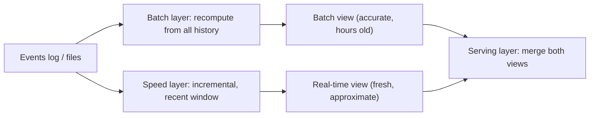
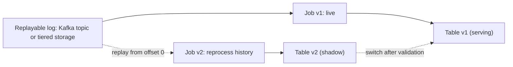

## 🎯 خلاصه

> **Lambda** نتیجه را دو بار محاسبه می‌کند: یک **لایه‌ی batch** کل تاریخ را دوباره حساب می‌کند تا حقیقت را بدهد، و یک **لایه‌ی speed** در این فاصله نتیجه‌ی تازه ولی تقریبی می‌دهد. **Kappa** نتیجه را فقط یک بار و با یک pipeline استریمینگ حساب می‌کند، و تاریخ را با **replay کردن لاگ** دوباره پردازش می‌کند.

- Lambda دقیق و مقاوم است، ولی همان منطق در دو کدبیس زندگی می‌کند که به‌تدریج از هم دور می‌شوند.
- Kappa یک کدبیس دارد، ولی به لاگ با نگهداری طولانی و راهی برای اجرای نسخه‌ی جدید روی داده‌ی قدیمی بدون آسیب به نسخه‌ی زنده نیاز دارد.
- سیستم‌های امروزی اغلب مرز را محو می‌کنند: یک موتور (Spark یا Flink) برای batch و استریم که در یک جدول **lakehouse** می‌نویسد؛ جدولی که time travel و compaction دارد.
- سؤال واقعی این نیست که کدام نمودار زیباتر است، بلکه این است: چقدر به عقب باید پردازش مجدد کنی، چقدر سریع، و چه کسی منطق را نگه می‌دارد.

## 🌱 از ساده شروع کنیم (مبتدی)

> **💡 تشبیه:** شمردن آرا. Lambda مدرسه‌ای است که آرا را دو بار می‌شمارد: یک شمارش سریع همان شب (speed) و یک بازشماری رسمی هفته‌ی بعد از روی صندوق‌ها (batch). Kappa مدرسه‌ای است با یک شمارنده که همه‌ی برگه‌ها را در لاگ نگه می‌دارد؛ وقتی قوانین عوض می‌شوند، از همان لاگ با قوانین جدید دوباره می‌شمارد.

فرض کن یک فروشگاه می‌خواهد «درآمد هر دقیقه» را روی داشبورد ببیند:

```text
orders:  10:00:05 $12   10:00:40 $8   10:01:10 $20   ...
dashboard, live:          10:00  $20   10:01  $20
dashboard, next morning:  10:00  $20   10:01  $20   (corrected with late orders)
```

عدد زنده در چند ثانیه می‌رسد ولی اگر سفارش‌ها دیر برسند ممکن است غلط باشد. عدد اصلاح‌شده دیرتر می‌رسد ولی درست است. Lambda و Kappa در این که چطور هر دو عدد را تولید می‌کنند فرق دارند.

دو واژه که باید بدانی:

- **Batch**: پردازش یک مجموعه‌ی محدود داده، مثل فایل‌های دیروز. دقیق است، ولی نتیجه طبق زمان‌بندی می‌رسد.
- **Stream**: پردازش رویدادها همان لحظه‌ی رسیدن. تازه است، ولی دیررس و نامرتب را خودت باید مدیریت کنی (ببین [[event-time]]).

## 🔧 واقعاً چطور کار می‌کند (متوسط)

### معماری Lambda

Lambda (Nathan Marz) سه بخش دارد:



- **master dataset** غیرقابل‌تغییر است: رویدادهای خام فقط اضافه می‌شوند و هرگز به‌روز نمی‌شوند.
- **لایه‌ی batch** view ها را از master dataset دوباره می‌سازد، مثلاً هر شب. دقیق است و با اجرای دوباره می‌تواند هر باگی را اصلاح کند.
- **لایه‌ی speed** فقط داده‌ی اخیر را پردازش می‌کند و فاصله را تا آماده شدن view بعدی batch پر می‌کند. نتایجش وقتی batch برسد کنار گذاشته می‌شوند.
- **لایه‌ی serving** با ترکیب view دسته‌ای (تا یک نقطه‌ی cut-off) و view استریمی (بعد از آن) به کوئری‌ها جواب می‌دهد.

یک تقسیم مشخص برای داشبورد درآمد:

```sql
-- Batch (nightly, Spark SQL over the Parquet master dataset)
INSERT OVERWRITE TABLE rev_minute_batch
SELECT date_trunc('minute', order_ts) AS minute, merchant_id, SUM(amount) AS revenue
FROM orders_master
WHERE order_date = DATE '2026-10-12'
GROUP BY 1, 2;
```

لایه‌ی speed همان aggregate را برای امروز در یک job استریمینگ حساب می‌کند و در یک key-value store می‌نویسد. کوئری serving برای دقیقه‌های قبل از cut-off از `batch` و بعد از آن از `speed` می‌خواند.

هزینه فوراً پیداست: aggregate، منطق cut-off، سیاست داده‌ی دیررس و کوئری ادغام، همه دو بار نوشته می‌شوند. وقتی job speed و job batch با هم نخوانند، باید تصمیم بگیری کدام درست است، و کاربران عددهایی می‌بینند که در cut-off می‌پرند.

### معماری Kappa

Kappa (Jay Kreps، ۲۰۱۴) لایه‌ی batch را حذف می‌کند. استریم تنها pipeline است:



- **عملیات عادی:** یک job استریمینگ لاگ را می‌خواند و نتایج را نگه می‌دارد.
- **پردازش مجدد:** وقتی منطق عوض می‌شود، job نسخه‌ی ۲ را از ابتدا (یا از یک timestamp انتخابی) روی همان لاگ شروع کن. خروجی جدید بنویس، صبر کن به زمان زنده برسد، مقایسه کن، سپس مصرف‌کننده‌ها را سوییچ کن و نسخه‌ی ۱ را بازنشسته کن.

replay از یک timestamp با CLI کافکا:

```bash
# stop the old consumer group first, then reset its offsets to a timestamp
kafka-consumer-groups.sh --bootstrap-server broker:9092 \
  --group revenue-v2 --topic orders \
  --reset-offsets --to-datetime 2026-01-01T00:00:00.000 --execute
```

Kappa فقط وقتی کار می‌کند که سه چیز برقرار باشد: لاگ تاریخچه‌ی کافی نگه دارد، موتور استریم بتواند آن تاریخچه را به‌اندازه‌ی کافی سریع پردازش کند تا به زمان زنده برسد، و منطق آن‌قدر قطعی باشد که replay همان نتیجه را بدهد. replay رایگان نیست؛ یک سال تاریخچه با ۵۰ MB/s حدود ۵۰ × ۱۰^۶ B/s × ۳.۱۵ × ۱۰^۷ s ≈ ۱.۶ PB ورودی برای خواندن دوباره است.

### آنچه با lakehouse عوض می‌شود

استقرارهای امروزی **شکل** Kappa را نگه می‌دارند، ولی نتایج را در یک جدول **lakehouse** (Iceberg، Delta یا Hudi) ذخیره می‌کنند نه در یک topic کافکا. job استریمینگ داده را append یا upsert می‌کند، و پردازش مجدد یک نسخه‌ی جدید یا backfill در همان جدول می‌نویسد. time travel و snapshotها اجازه می‌دهند نسخه‌ها را مقایسه کنی. خواننده‌های batch و استریم یک جدول را می‌بینند، پس مسئله‌ی serving که منطق ادغام Lambda را ساخته بود اغلب ناپدید می‌شود.

برای پردازش مجدد تاریخچه‌ی طولانی، الگوی معمول **backfill** است: همان کد job را به‌صورت batch محدود روی داده‌ی lake (یا لاگ) اجرا کن، در یک جدول staging بنویس، اعتبارسنجی کن و سوییچ کن. این‌طور یک کدبیس هر دو نیاز را بدون یک لایه‌ی speed دائمی پوشش می‌دهد. ببین [[backfill]] و [[lakehouse]].

## 🧠 عمق و trade-offها (سنیور)

**جایی که Lambda هنوز برنده است.** تحلیل‌های سنگین batch روی کل تاریخچه (joinهای بزرگ چند ساله، آموزش مدل، deduplication پیچیده روی همه‌ی داده) در یک موتور batch با master dataset تمیز ساده‌ترند. وقتی منطق batch و speed واقعاً فرق دارند (مثلاً شمارش دقیق در برابر sketch تقریبی)، Lambda صادقانه آن را نشان می‌دهد. Lambda هم به‌خوبی تنزل می‌کند: اگر استریم خراب شود، view دسته‌ای گذشته را هنوز پوشش می‌دهد.

**جایی که Kappa برنده است.** یک کدبیس، یک مجموعه تست و یک جا برای رفع باگ. سازگاری بین نتایج زنده و پردازش‌شده‌ی مجدد راحت‌تر قابل استدلال است. برای محصولاتی که هسته‌شان رویداد-محور است و استریم خودش system of record است، مناسب است.

**نگهداری لاگ، هزینه‌ی پنهان است.** در Kappa لاگ منبع حقیقت است. نگهداری ۷ روزه‌ی Kafka یعنی نمی‌توانی ۸ روز قبل را دوباره پردازش کنی، بدون استثنا. گزینه‌ها: نگهداری طولانی‌تر (روی brokerها گران است)، tiered storage، یا نوشتن رویدادهای خام در object storage و replay از آنجا با یک job محدود. مکانیزم‌ها را در [[kafka-retention-compaction]] ببین.

**ترتیب و داده‌ی دیررس.** replay ترتیب ورود را عوض می‌کند: replay تاریخچه‌ی یک ماه در چند دقیقه همه‌ی داده را تحویل می‌دهد، پس پنجره‌ها و timeoutهای «ساعت دیواری» با حالت زنده فرق دارند. منطق event time با watermark باید برای هر دو حالت درست باشد. job ای که فقط وقتی رویدادها مرتب می‌رسند کار می‌کند، در replay نتیجه‌ی متفاوتی می‌دهد.

**اثرهای جانبی.** job Kappa که API خارجی را صدا می‌زند یا ایمیل می‌فرستد، در replay آن اثرها را تکرار می‌کند. پردازش مجدد را خالص نگه دار (فقط در جدول بنویس) یا اثرهای جانبی را پشت یک flag قرار بده.

**اجرای دو نسخه.** در مهاجرت Kappa، نسخه‌ی ۱ و ۲ کنار هم اجرا می‌شوند و محاسبات دو برابر می‌شود. قبل از شروع، سوییچ را برنامه‌ریزی کن (dual-write، مقایسه‌ی shadow، تاریخ cut-over).

**مقایسه‌ی هزینه.** Lambda هزینه‌ی نگهداری دو pipeline و یک لایه‌ی ادغام دارد. Kappa هزینه‌ی storage برای نگهداری و محاسبه‌ی بیشتر در زمان پردازش مجدد دارد. هر دو را برای مورد خودت تخمین بزن: ماه‌های مهندسی برای نگهداری در برابر ترابایت‌های نگه‌داشته‌شده و ساعت‌های replay.

**کی هیچ‌کدام؟** اگر نتایج می‌توانند یک روز قدیمی باشند و منطق SQL خالص روی جدول‌هاست، یک pipeline batch زمان‌بندی‌شده از هر دو ساده‌تر است. برای داشبوردی که یک بار در روز نگاه می‌شود، لایه‌ی speed نساز.

**چه چیزهایی را مانیتور کنیم:** consumer lag جاب زنده، پیشرفت و ETA replay، اختلاف نتایج shadow و زنده روی نمونه، تعداد رویدادهای دیررس و سن جدیدترین مقداری که سرو می‌شود.

## 🧪 امتحان کن

1. **انتخاب معماری.** تیم fraud به تصمیم زیر یک ثانیه نیاز دارد و هفته‌ای یک بار مدل را روی یک سال تاریخچه آموزش می‌دهد. کدام بخش‌ها به مسیر speed و کدام به مسیر batch می‌روند، و Lambda، Kappa یا hybrid را انتخاب می‌کنی؟ در سه جمله توجیه کن.
2. **حساب نگهداری.** یک topic سفارش‌ها ۲,۰۰۰ رویداد در ثانیه دریافت می‌کند، هر کدام ۵۰۰ بایت. حجم ۳۰ روز نگهداری را حساب کن (تکرار را نادیده بگیر). بعد بگو الزام Kappa «برگشت تا ۴۵ روز» یعنی چه.
3. **برنامه‌ی cut-over.** پنج گامی را بنویس که برای جایگزینی منطق یک job Kappa بدون تغییر ناگهانی اعداد داشبورد برمی‌داری.

<details><summary>جواب‌ها را ببین</summary>

**۱.** hybrid منطقی است: مسیر تصمیم یک job استریمینگ با state است (سریع و رویداد-محور)، و آموزش مدل یک job batch روی تاریخچه‌ی lakehouse است. هر دو از همان لاگ یا جدول می‌خوانند، پس feature یک‌بار تعریف می‌شود. Kappa خالص می‌تواند از لاگ آموزش دهد، ولی replay یک سال برای هر آموزش مجدد گران است؛ یک جدول materialized در lakehouse ارزان‌تر است. Lambda خالص منطق feature را تکرار می‌کند که ریسک training-serving skew است.

**۲.** ۲,۰۰۰ رویداد/ثانیه × ۵۰۰ B = ۱,۰۰۰,۰۰۰ B/s = ۱ MB/s. در روز: ۱ MB/s × ۸۶,۴۰۰ s ≈ ۸۶.۴ GB. برای ۳۰ روز: ≈ ۲.۶ TB قبل از تکرار. الزام «برگشت تا ۴۵ روز» با ۳۰ روز نگهداری پوشش داده نمی‌شود؛ یا نگهداری را به ۴۵ روز می‌بری (≈ ۳.۹ TB قبل از تکرار)، یا ۱۵ روز قدیمی‌تر را در object storage ذخیره می‌کنی.

**۳.** (۱) نسخه‌ی ۲ را روی همان لاگ با consumer group و جدول خروجی جدا شروع کن، از همان نقطه‌ی شروع نسخه‌ی ۱. (۲) اجازه بده نسخه‌ی ۲ به زمان زنده برسد و در حالت shadow اجرا شود. (۳) خروجی نسخه‌ی ۱ و ۲ را روی نمونه‌ای از کلیدها و مجموع‌ها مقایسه کن و هر تفاوت را توضیح بده (داده‌ی دیررس، تغییر منطق). (۴) مسیر خواندن داشبورد را در زمان برنامه‌ریزی‌شده به نسخه‌ی ۲ ببر و نسخه‌ی ۱ را برای یک بازه‌ی rollback نگه دار. (۵) بعد از پایان بازه، نسخه‌ی ۱ و خروجی‌اش را متوقف و حذف کن.

</details>

## 💬 گوشه‌ی مصاحبه

**سؤال: «Lambda یا Kappa؟»** جواب متوسط: «Kappa ساده‌تر است چون یک pipeline دارد، پس Kappa را انتخاب می‌کنم.» جواب سنیور: «به سه چیز بستگی دارد: چقدر به عقب پردازش مجدد می‌کنیم و چند وقت یک‌بار، آیا منطق batch و استریم واقعاً فرق دارند، و چقدر نگهداری لاگ را می‌توانیم تحمل کنیم. اگر استریم system of record است و پردازش مجدد نادر است، پیش‌فرض من Kappa با sink در lakehouse است. اگر تحلیل سنگین batch روی کل تاریخچه کنار نتایج کم‌تأخیر لازم داریم، یک موتور برای هر دو با منطق مشترک می‌گذارم و دو کدبیس جدا نمی‌سازم، مگر این‌که منطق واقعاً فرق کند.»

**سؤال: «باگی در یک aggregate استریمینگ که یک ماه اجرا شده، چطور برطرف می‌کنی؟»** جواب مورد انتظار: «منطق اصلاح‌شده را به‌عنوان نسخه‌ی جدید deploy می‌کنم، داده‌ی لاگ یا lakehouse را در یک خروجی shadow replay می‌کنم، مقایسه می‌کنم و بعد سوییچ می‌کنم. اول نگهداری را چک می‌کنم، چون بدون تاریخچه replay ممکن نیست.»

> **🎤 این را در مصاحبه بگو:** «من سعی می‌کنم منطق را در یک کدبیس نگه دارم، چون دو مسیر Lambda با گذشت زمان از هم دور می‌شوند. اول نگهداری و sink در lakehouse را انتخاب می‌کنم، چون آن‌ها تعیین می‌کنند که پردازش مجدد، که کار واقعی عملیاتی است، ممکن است یا نه.»

## ⚠️ اشتباهات رایج

> **⚠️ مراقب باش:** گفتن این‌که «Kappa یعنی اصلاً batch نداریم». در عمل job های batch و backfill هنوز استفاده می‌شوند، اغلب با همان کد و همان جدول‌ها.

> **⚠️ مراقب باش:** طراحی Kappa با ۷ روز نگهداری و بدون هیچ کپی دیگری از رویدادهای خام، و بعد کشف این‌که در اولین باگ باید ۳۰ روز پردازش شود.

- نگه داشتن دو پیاده‌سازی از یک متریک و تست نکردن این‌که با هم یکسان‌اند.
- replay در جدول زنده، طوری که داشبورد در طول replay اعداد نیمه‌پردازش‌شده نشان دهد.
- فراموش کردن این‌که replay ترتیب ورود را عوض می‌کند و در نتیجه رفتار پنجره و timeout را.
- اجرای کد با اثر جانبی (ایمیل، فراخوانی API، شارژ) داخل یک job replay‌شده.
- ساختن لایه‌ی speed برای داشبوردی که روزی یک بار نگاه می‌شود.

## ✅ خودت را بسنج (quiz)

1. در Lambda نقش لایه‌ی speed چیست؟
   - A) تنها منبع حقیقت است
   - B) نتایج تازه و افزایشی برای داده‌ی اخیر می‌دهد تا وقتی لایه‌ی batch برسد
   - C) master dataset را نگه می‌دارد
   - D) جای لایه‌ی serving را می‌گیرد

<details><summary>جواب</summary>

**B** — لایه‌ی speed فاصله‌ی اخیری را پوشش می‌دهد که view دسته‌ای هنوز شامل آن نیست. نتایجش وقتی view دسته‌ای آماده شود جایگزین می‌شوند.

</details>

2. Kappa برای پردازش مجدد تاریخچه از چه چیزی استفاده می‌کند؟
   - A) یک job batch شبانه روی یک کپی جدا از داده
   - B) replay لاگ از یک offset یا timestamp قدیمی‌تر به یک نسخه‌ی جدید job
   - C) خواندن دوباره‌ی پایگاه داده‌ی serving
   - D) راه‌اندازی مجدد producerها

<details><summary>جواب</summary>

**B** — Kappa لاگ را منبع حقیقت نگه می‌دارد و آن را replay می‌کند. نسخه‌ی جدید در یک خروجی shadow می‌نویسد که قبل از سوییچ اعتبارسنجی می‌شود.

</details>

3. تیمی می‌گوید «ما Kappa داریم، پس هرگز backfill لازم نداریم.» ایراد این حرف چیست؟

   - A) Kappa نمی‌تواند بیشتر از یک topic را مدیریت کند
   - B) backfill نوعی replay است؛ تیم هنوز برای داده‌ی خارج از نگهداری لاگ و پردازش مجدد از lake یا یک job محدود برنامه لازم دارد
   - C) backfill به Lambda نیاز دارد
   - D) job های استریمینگ نمی‌توانند در جدول بنویسند

<details><summary>جواب</summary>

**B** — backfill و replay همان نیاز عملیاتی هستند. وقتی تاریخچه خارج از نگهداری لاگ است، داده باید از lake یا object storage و با یک job محدود بیاید.

</details>

4. **(سنیور)** replay یک Kappa از ۶۰ روز رویداد ۶ ساعت طول می‌کشد و در پایان، job زنده ۲ ساعت عقب است. چه چیزی را چک می‌کنی و اولین تغییر معقول چیست؟

   - A) هیچ؛ عقب‌افتادن در replay طبیعی است
   - B) چک کن که job replay همان parallelism، state backend و throughput sink را با job زنده دارد؛ parallelism را بالا ببر یا گلوگاه sink را رفع کن، و در صورت امکان replay را از مسیر زنده جدا کن تا نتایج زنده تأخیر نبینند
   - C) checkpoint را برای کل job خاموش کن
   - D) topic زنده را حذف کن

<details><summary>جواب</summary>

**B** — replay و ترافیک زنده برای منابع و گاهی برای همان sink رقابت می‌کنند. گلوگاه را با متریک‌های backpressure پیدا کن، job replay یا sink آن را مقیاس بده، و replay را از مسیر زنده جدا کن تا مشتری تأخیر نبیند.

</details>

5. **(سنیور)** چرا replay یک job Kappa با همان کد همیشه قطعی نیست؟

   - A) Kafka زمان‌ها را ذخیره نمی‌کند
   - B) منطق مبتنی بر processing time، lookupهای خارجی که از اجرای اول عوض شده‌اند، و ترتیب ورود متفاوت می‌توانند نتیجه را تغییر دهند
   - C) replay همیشه از offsetهای یکسان استفاده می‌کند
   - D) Flink نمی‌تواند دوباره پردازش کند

<details><summary>جواب</summary>

**B** — نتایج به منطق زمان‌محور که ساعت دیواری را می‌خواند، داده‌ی مرجع خارجی که عوض شده، و ترتیب ورود وابسته‌اند. برای قطعی کردن replay از event time، داده‌ی مرجع نسخه‌دار و کلیدهای قطعی استفاده کن.

</details>

## 🗂️ فلش‌کارت

| Front | Back |
|---|---|
| Lambda در یک جمله | لایه‌ی batch برای محاسبه‌ی دقیق، لایه‌ی speed برای نتیجه‌ی تازه‌ی تقریبی، و لایه‌ی serving که هر دو را ادغام می‌کند |
| Kappa در یک جمله | یک pipeline استریمینگ؛ پردازش مجدد با replay لاگ در یک نسخه‌ی جدید job |
| بزرگ‌ترین هزینه‌ی Lambda | همان منطق در دو کدبیس که ممکن است از هم دور شوند |
| بزرگ‌ترین الزام Kappa | نگهداری لاگ به‌اندازه‌ی پردازش مجدد لازم، یا یک کپی از رویدادهای خام در جای دیگر |
| master dataset چیست؟ | یک store غیرقابل‌تغییر و append-only از رویدادهای خام که می‌شود از آن دوباره محاسبه کرد |
| چرا قبل از سوییچ خروجی shadow را اعتبارسنجی کنیم؟ | تا هر تفاوت با نتایج زنده را توضیح دهیم، قبل از این‌که مصرف‌کننده‌ها عددهای جدید را ببینند |
| نقش lakehouse در Kappa چیست؟ | نتایج را به‌صورت جدول نسخه‌دار با time travel نگه می‌دارد تا خواننده‌های batch و استریم یک منبع داشته باشند |
| چه چیزی قطعیت replay را می‌شکند؟ | منطق ساعت دیواری، داده‌ی مرجع تغییرکرده و ترتیب ورود متفاوت |

## 🔗 ادامه

- **pattern-lambda-kappa** همین انتخاب را به‌عنوان یک طراحی سیستم end-to-end بررسی می‌کند.
- **queues-vs-logs** توضیح می‌دهد چرا لاگ با نگهداری، replay را ممکن می‌کند.
- **kafka-retention-compaction** نشان می‌دهد داده چقدر نگه داشته می‌شود و compaction چه چیزی را حذف می‌کند.
- **lakehouse-table-formats** time travel، snapshot و upsert را پوشش می‌دهد که جدول‌های shadow را عملی می‌کنند.
- **pattern-backfill** و **backfills** پردازش مجدد تاریخچه را در batch و استریم پوشش می‌دهند.
- **spark-structured-streaming** و **flink** نشان می‌دهند یک موتور چطور نسخه‌ی محدود و نامحدود همان منطق را اجرا می‌کند.
