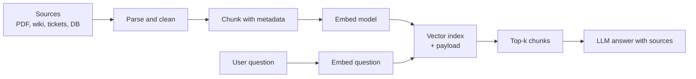

## 🎯 خلاصه

> **RAG** (retrieval-augmented generation) به یک سؤال جواب می‌دهد با این‌که اول بخش‌های مرتبط را از **اسناد خودت** **بازیابی** می‌کند و بعد آن‌ها را به یک مدل زبانی می‌دهد. کار پایپ‌لاین داده این است که اسناد نامرتب را به **تکه‌های قابل جست‌وجو، به‌روز و قابل ردیابی** تبدیل کند.

- مراحل پایپ‌لاین: **ingest** اسناد، **parse و clean**، **chunk**، **embed** (تبدیل متن به بردار)، **index** در vector store، و **تازه نگه داشتن** آن.
- یک vector database نزدیک‌ترین بردارها به یک بردار کوئری را پیدا می‌کند. Qdrant، Milvus و pgvector (یک extension برای PostgreSQL) همه این کار را می‌کنند، با trade-off های متفاوت.
- مسائل سخت مهندسی داده، **به‌روزرسانی افزایشی** (فقط داده‌ی تغییرکرده را دوباره embed کن)، **حذف** (سند حذف‌شده باید از ایندکس هم برود)، و **کیفیت** (parse بد بی‌صدا پاسخ‌ها را خراب می‌کند) هستند.

## 🌱 از ساده شروع کنیم (مبتدی)

> **💡 تشبیه:** یک کتابخانه با دستیار بسیار سریع. دستیار برای هر سؤال کل کتاب‌ها را نمی‌خواند. قبل از باز شدن کتابخانه، کسی هر کتاب را به کارت‌های ایندکس بریده، روی هر کارت یک «کد معنا» نوشته و کارت‌ها را بر اساس آن کد بایگانی کرده. وقتی سؤالی می‌رسد، دستیار فقط کارت‌هایی را پیدا می‌کند که معنای نزدیک دارند و فقط همان‌ها را می‌خواند.

ایده در چهار قدم:

1. **Chunk**: یک سند بلند را به تکه‌های چند صد کلمه‌ای تقسیم کن.
2. **Embed**: یک مدل embedding هر تکه را به لیستی از عدد (یک بردار) تبدیل می‌کند، طوری که تکه‌های با معنای مشابه، بردارهای نزدیک به هم بگیرند.
3. **Store**: هر بردار را همراه متن و metadata (منبع، تاریخ، صفحه) در یک ایندکس برداری ذخیره کن.
4. **Retrieve**: سؤال کاربر را با همان روش embed کن، نزدیک‌ترین تکه‌ها را پیدا کن، و آن‌ها را همراه سؤال به مدل زبانی بده.

یک chunker ساده با پایتون قدم اول را نشان می‌دهد:

```python
def chunk_words(text: str, size: int = 200, overlap: int = 40) -> list[str]:
    """Split text into word windows. Overlap keeps sentences that cross a boundary."""
    words = text.split()
    chunks = []
    step = size - overlap
    for start in range(0, len(words), step):
        window = words[start:start + size]
        if window:
            chunks.append(" ".join(window))
        if start + size >= len(words):
            break
    return chunks

doc = "word " * 450
parts = chunk_words(doc)
print(len(parts), [len(p.split()) for p in parts])
```

خروجی: `3 [200, 200, 130]`. پنجره‌ها از کلمه‌های ۰، ۱۶۰ و ۳۲۰ شروع می‌شوند، پس هر همسایه ۴۰ کلمه‌ی مشترک دارد.

## 🔧 واقعاً چطور کار می‌کند (متوسط)



**Ingestion و parsing.** اسناد به شکل PDF، HTML، فایل‌های اداری، ردیف‌های دیتابیس و تیکت می‌آیند. parsing اغلب ضعیف‌ترین حلقه است: یک PDF دو ستونی ممکن است ستون‌هایش در هم برود، و یک جدول به جریانی از عدد تبدیل شود. **فایل خام** را در object storage نگه دار، **متن parse شده** را جدا ذخیره کن، و نسخه‌ی parser را ثبت کن. وقتی parser را عوض می‌کنی، باید اسناد تحت‌تأثیر را دوباره پردازش کنی.

**Chunking.** استراتژی‌های رایج:

- **پنجره‌ی ثابت** (مثل مثال پایتون): ساده و قابل پیش‌بینی، ولی ممکن است جمله یا جدول را وسط ببرد.
- **تکه‌های ساختاری**: تقسیم بر اساس عنوان، پاراگراف یا آیتم لیست، و بعد ادغام تکه‌های کوچک تا سقف اندازه. برای راهنما و wiki بهتر است.
- **Overlap**: چند درصد محتوای تکراری در مرزها، تا پاسخی که از مرز عبور می‌کند هنوز قابل بازیابی باشد.

هر chunk باید **metadata** داشته باشد: `doc_id`، `source_uri`، `section`، `page`، `updated_at`، `acl` (چه کسی می‌تواند بخواند). metadata همان چیزی است که اجازه می‌دهد بر اساس دسترسی فیلتر کنی و پاسخ را ارجاع بدهی.

**Embedding.** یک مدل embedding متن را به بردار با طول ثابت تبدیل می‌کند، مثلاً ۳۸۴، ۷۶۸ یا ۱٬۵۳۶ بعد. دو قانون برای پایپ‌لاین مهم است:

- **همان مدل و همان نسخه** باید هم اسناد و هم کوئری‌ها را embed کند. تغییر مدل یعنی embed مجدد کل corpus، پس مدل و نسخه‌ی آن را همراه هر بردار ذخیره کن.
- Embedding از نظر هزینه و تأخیر گران‌ترین مرحله است. درخواست‌ها را batch کن، بر اساس hash محتوا کش کن، و تکه‌های بدون تغییر را دوباره embed نکن.

**جست‌وجوی برداری.** شباهت معمولاً با cosine similarity یا inner product سنجیده می‌شود. جست‌وجوی دقیق کوئری را با همه‌ی بردارها مقایسه می‌کند. ایندکس‌های **Approximate Nearest Neighbour (ANN)** در ازای کمی از recall، تأخیر را خیلی کم می‌کنند. HNSW یک ایندکس مبتنی بر گراف است که در بسیاری از سیستم‌ها استفاده می‌شود؛ ایندکس‌های نوع IVF بردارها را در خوشه‌ها تقسیم می‌کنند.

مثال مشخص در PostgreSQL با pgvector (اندازه‌ی بردار برای خوانایی کوچک است):

```sql
CREATE EXTENSION IF NOT EXISTS vector;

CREATE TABLE chunks (
  chunk_id     text PRIMARY KEY,         -- stable id: doc_id + chunk number
  doc_id       text NOT NULL,
  content_hash text NOT NULL,            -- changes when the text changes
  model_ver    text NOT NULL,            -- embedding model version
  source_uri   text NOT NULL,
  content      text NOT NULL,
  embedding    vector(3) NOT NULL        -- real models use 384-1536 dims
);

CREATE INDEX chunks_embedding_hnsw
  ON chunks USING hnsw (embedding vector_cosine_ops);

-- nearest 5 chunks to the query vector, by cosine distance
SELECT chunk_id, source_uri, content
FROM chunks
ORDER BY embedding <=> '[0.12, 0.90, 0.31]'
LIMIT 5;
```

در pgvector، ایندکس وقتی استفاده می‌شود که کوئری با عملگر فاصله به‌صورت صعودی مرتب کند و `LIMIT` داشته باشد. کوئری‌ای که فاصله را داخل یک عبارت می‌پیچد و بر اساس آن مرتب می‌کند، ممکن است ایندکس را رد کند. با `EXPLAIN` چک کن.

**به‌روزرسانی افزایشی.** هر شب embed مجدد کل corpus هدررفت است. الگوی معمول:

1. برای هر سند، یک hash محتوا از متن parse شده بساز.
2. با hash ذخیره‌شده برای آن `doc_id` مقایسه کن. اسناد بدون تغییر رد می‌شوند.
3. برای اسناد تغییرکرده، chunkهای قدیمی را حذف و chunkهای جدید را در یک تراکنش درج کن.
4. برای اسناد حذف‌شده، chunkهایشان را پاک کن. این قدم همان چیزی است که تیم‌ها فراموش می‌کنند.

```sql
-- upsert one chunk (PostgreSQL 9.5+ syntax)
INSERT INTO chunks (chunk_id, doc_id, content_hash, model_ver, source_uri, content, embedding)
VALUES ('doc42#3', 'doc42', 'a1b2', 'emb-v2', 's3://docs/doc42.pdf', 'text…', '[0.1,0.2,0.3]')
ON CONFLICT (chunk_id) DO UPDATE
SET content_hash = EXCLUDED.content_hash,
    content      = EXCLUDED.content,
    embedding    = EXCLUDED.embedding,
    model_ver    = EXCLUDED.model_ver;
```

chunkهای قدیمی باگ کلاسیک‌اند: اگر سندی از ۱۰ chunk به ۷ chunk کوچک شود، chunkهای قدیمی ۸ تا ۱۰ همچنان به سؤال‌ها پاسخ می‌دهند. قبل از درج مجدد، با `doc_id` حذف کن، یا تعداد chunkها را ردیابی کن.

**بقیه‌ی vector storeها.** Qdrant و Milvus پایگاه‌داده‌های برداری اختصاصی‌اند. بردارها را همراه payload (metadata) ذخیره می‌کنند و جست‌وجوی فیلتر‌شده، collection یا partition، و استقرار توزیع‌شده را پشتیبانی می‌کنند. نحو فیلتر، انواع ایندکس و گزینه‌های sharding را در مستندات نسخه‌ی خودت چک کن، چون بین نسخه‌ها تغییر می‌کنند.

## 🧠 عمق و trade-offها (سنیور)

- **انتخاب store.** pgvector وقتی جذاب است که از قبل PostgreSQL داری، corpus در حد میلیون‌ها chunk است، و می‌خواهی به‌روزرسانی‌ها تراکنشی و کنار بقیه‌ی داده‌ها باشند. یک vector database اختصاصی برای corpusهای خیلی بزرگ، جست‌وجوی فیلتر‌شده‌ی سنگین، یا نرخ کوئری بالا مناسب‌تر است. قبل از تصمیم، recall و تأخیر p95 را روی داده‌ی واقعی خودت اندازه بگیر.
- **فیلتر با ANN.** فیلترهای دسترسی (`acl`) و تاریخ یا در حین جست‌وجوی برداری اعمال می‌شوند یا بعد از آن. post-filter وقتی فیلتر سخت‌گیر است می‌تواند کمتر از k نتیجه بدهد. فیلترهای سخت‌گیر را صریحاً تست کن.
- **SLA تازگی.** تعریف کن یک تغییر در منبع چقدر باید طول بکشد تا در پاسخ‌ها ظاهر شود (مثلاً ۱۵ دقیقه برای تیکت‌ها، ۲۴ ساعت برای سندهای سیاستی). این SLA طراحی را تعیین می‌کند: CDC یا جریان رویداد برای نزدیک‌به‌زمان‌واقعی، batch زمان‌بندی‌شده برای بقیه. به [[cdc]] و [[kafka-architecture]] نگاه کن.
- **ایندکس‌سازی مجدد یک مهاجرت است.** تغییر مدل embedding یا قوانین chunking یعنی ساخت یک نسخه‌ی جدید از ایندکس، backfill آن، مقایسه‌ی کیفیت پاسخ، و سپس جابه‌جایی alias. تا وقتی جابه‌جایی تأیید نشده، هر دو نسخه را نگه دار.
- **ارزیابی.** یک golden set از سؤال‌ها با سندهای مورد انتظار بساز. بعد از هر تغییر پایپ‌لاین، recall@k را پیگیری کن. بدون این، یک parser خراب شبیه «مشکل مدل» به نظر می‌رسد.
- **امنیت.** بازیابی یک مسئله‌ی کنترل دسترسی است. دسترسی را در زمان بازیابی از ACLهای سیستم منبع اعمال کن، نه فقط در رابط کاربری. chunkهایی که به مدل داده شده‌اند را برای audit لاگ کن.
- **هزینه.** هزینه‌ی embedding با توکن‌های تغییرکرده رشد می‌کند؛ حجم ایندکس با تعداد بردار × ابعاد × بایت هر مقدار، به‌علاوه‌ی overhead ایندکس. تخمین: ۵ میلیون chunk × ۷۶۸ بعد × ۴ بایت ≈ ۱۵.۴ GB بردار خام float32 قبل از overhead ایندکس؛ پس quantization و انتخاب ابعاد در مقیاس مهم‌اند.
- **کِی RAG لازم نیست.** اگر جواب یک واقعیت در دیتابیس است، از خود دیتابیس بپرس. اگر corpus آن‌قدر کوچک است که در context window مدل جا می‌شود و به‌ندرت تغییر می‌کند، ارسال مستقیم آن ساده‌تر است.

## 🧪 امتحان کن

۱. یک سند با ۱۰ chunk ویرایش می‌شود و حالا ۷ chunk دارد. دو دستور SQL (اول حذف، بعد درج) بنویس که ایندکس را در یک تراکنش درست نگه دارد.
۲. تیم شما از مدل embedding از `emb-v1` به `emb-v2` رفته، ولی مسیر کوئری هنوز `emb-v1` را استفاده می‌کند. علامت این مشکل چیست و کدام چک آن را می‌گیرد؟
۳. فضای ذخیره‌سازی برای ۲ میلیون chunk با بردارهای float32 با ۱٬۵۳۶ بعد را تخمین بزن و محاسبه‌ات را نشان بده.

<details><summary>جواب‌ها را ببین</summary>

**۱.**
```sql
BEGIN;
DELETE FROM chunks WHERE doc_id = 'doc42';
INSERT INTO chunks (chunk_id, doc_id, content_hash, model_ver, source_uri, content, embedding)
VALUES ('doc42#1', 'doc42', 'h2', 'emb-v2', 's3://docs/doc42.pdf', '…', '[…]'),
       -- …five more rows for chunks 2 to 7
       ('doc42#7', 'doc42', 'h2', 'emb-v2', 's3://docs/doc42.pdf', '…', '[…]');
COMMIT;
```
با حذف اول بر اساس `doc_id`، سه chunk اضافی که دیگر وجود ندارند پاک می‌شوند.

**۲.** مخلوط شدن نسخه‌های مدل: بردارهای کوئری از `emb-v1` با بردارهای سند از `emb-v2` مقایسه می‌شوند، که در فضاهای متفاوت‌اند. نتایج تصادفی یا بی‌ربط به نظر می‌رسند و کیفیت شدیداً افت می‌کند. چک، شمارش `model_ver` در ایندکس است، و تست recall روی golden set بعد از هر تغییر مدل.

**۳.** ۲٬۰۰۰٬۰۰۰ × ۱٬۵۳۶ × ۴ بایت = ۱۲٬۲۸۸٬۰۰۰٬۰۰۰ بایت ≈ ۱۲.۳ GB بردار خام (حدود ۱۱.۴ GiB)، قبل از overhead ایندکس، ذخیره‌ی متن و metadata.

</details>

## 💬 گوشه‌ی مصاحبه

**سؤال: «پایپ‌لاینی طراحی کن که یک ایندکس RAG را با یک document store به‌روز نگه دارد.»** جواب متوسط: «اسناد را parse، chunk و embed می‌کنم، و روی یک زمان‌بندی در vector store upsert می‌کنم.» جواب سنیور: «هر سند parse شده را hash می‌کنم و فقط اسناد تغییرکرده را پردازش می‌کنم؛ در یک تراکنش chunkهای قدیمی را حذف و جدیدها را درج می‌کنم. حذف‌ها را صریحاً هندل می‌کنم، نسخه‌ی مدل embedding را با هر بردار ذخیره می‌کنم، و metadata ای ACL را به هر chunk وصل می‌کنم. SLA تازگی تعیین می‌کند که از رویدادهای CDC استفاده کنم یا batch زمان‌بندی‌شده، و recall را روی golden set بعد از هر تغییر اندازه می‌گیرم.»

**سؤال: «چرا کیفیت بازیابی به مهندسی داده وابسته است؟»** چون parsing بد، مرز chunkهای نادرست، chunkهای قدیمی و دسترسی‌های جاافتاده باعث پاسخ‌های غلط یا نشت داده می‌شوند، حتی وقتی مدل زبانی خوب باشد.

**سؤال: «pgvector یا یک vector database اختصاصی؟»** به مقیاس، پیچیدگی فیلترها، نرخ کوئری، و این‌که بردارها باید کنار داده‌ی تراکنشی باشند بستگی دارد. روی داده‌ی واقعی نمونه‌سازی می‌کنم و recall و تأخیر را مقایسه می‌کنم.

> **🎤 در مصاحبه این را بگو:** «پایپ‌لاین RAG یک پایپ‌لاین داده است که در انتهایش جست‌وجو دارد. روی به‌روزرسانی افزایشی بر پایه‌ی hash، حذف کامل، ردیابی نسخه‌ی مدل، metadata برای دسترسی و استناد، و ارزیابی با golden set تمرکز می‌کنم، تا باگ‌های داده به افت قابل‌اندازه‌گیری recall تبدیل شوند.»

## ⚠️ اشتباهات رایج

> **⚠️ مراقب باش:** embed کردن کوئری‌ها با مدل یا نسخه‌ای متفاوت از اسناد. بردارهای مدل‌های متفاوت در فضاهای متفاوت‌اند و نتایج معقول به نظر می‌رسند ولی اشتباه‌اند.

> **⚠️ مراقب باش:** upsert کردن chunkهای جدید بدون حذف قدیمی‌ها. سندهایی که کوچک می‌شوند chunkهای بیات باقی می‌گذارند که همچنان به سؤال‌ها جواب می‌دهند.

- chunk کردن با اندازه‌ی ثابت بدون بررسی جدول‌ها، بلوک‌های کد یا عنوان‌ها.
- نداشتن metadata، و در نتیجه ناتوانی در استناد به منبع یا اعمال دسترسی.
- embed مجدد کل corpus هر شب وقتی فقط چند سند تغییر کرده‌اند.
- فراموش کردن حذف‌ها در منبع، که باعث می‌شود اسناد حذف‌شده یا محرمانه همچنان قابل بازیابی باشند.
- قضاوت پایپ‌لاین فقط با پاسخ نهایی، نه با recall بازیابی.

## ✅ خودت را بسنج

۱. یک embedding model چه چیزی تولید می‌کند؟
   - A) خلاصه‌ی سند
   - B) یک بردار با طول ثابت که فاصله‌هایش شباهت معنایی را منعکس می‌کند
   - C) یک ایندکس SQL
   - D) نسخه‌ی فشرده‌ی فایل

<details><summary>جواب</summary>

**B** — embedding یک بردار با طول ثابت است. بردارهای نزدیک (با cosine یا inner product) به معنای مشابه متناظرند، و بازیابی از همین استفاده می‌کند.

</details>

۲. کدام تغییر نیاز به embed مجدد **کل** corpus دارد؟
   - A) اضافه کردن یک سند جدید
   - B) حذف یک سند
   - C) تغییر مدل embedding
   - D) اضافه کردن یک ستون ACL

<details><summary>جواب</summary>

**C** — بردارهای مدل‌های متفاوت قابل مقایسه نیستند، پس هر سند باید با مدل جدید دوباره embed شود. اضافه یا حذف سند فقط همان سند را تحت تأثیر قرار می‌دهد.

</details>

۳. یک سند از ۱۰ chunk به ۷ chunk کوچک می‌شود و پایپ‌لاین فقط upsert می‌کند. چه اتفاقی می‌افتد؟

   - A) ایندکس فقط‌خواندنی می‌شود
   - B) chunkهای ۸ تا ۱۰ در ایندکس می‌مانند و همچنان قابل بازیابی‌اند
   - C) مدل embedding خودکار عوض می‌شود
   - D) chunkهای تکراری حذف می‌شوند

<details><summary>جواب</summary>

**B** — upsert فقط id هایی را جایگزین می‌کند که می‌نویسد. chunkهای ۸ تا ۱۰ بیات‌اند. قبل از درج، بر اساس `doc_id` حذف کن، در همان تراکنش.

</details>

۴. **(سنیور)** یک فیلتر دسترسی بعد از یک جست‌وجوی تقریبی اعمال می‌شود که ۲۰ کاندید برتر برمی‌گرداند، و بیشتر کاندیدها متعلق به کاربرانی هستند که دسترسی ندارند. خطر چیست و چه چیزی را تغییر می‌دهی؟

   - A) فقط کندی کوئری
   - B) نتایج کم یا صفر برای کاربران مجاز؛ فیلترهای سخت‌گیر را تست کن، از ایندکس آگاه به فیلتر یا یک استخر کاندید بزرگ‌تر استفاده کن، و recall را با فیلتر فعال اندازه بگیر
   - C) embeddingها نامعتبر می‌شوند
   - D) هیچ؛ post-filter همیشه درست است

<details><summary>جواب</summary>

**B** — post-filter روی یک مجموعه‌ی کوچک کاندید می‌تواند نتایج مجاز کم یا صفر بدهد. از ایندکس آگاه به فیلتر یا استخر کاندید بزرگ‌تر استفاده کن، و recall را با الگوهای واقعی دسترسی تست کن.

</details>

۵. **(سنیور)** تیم شما برای تیکت‌های پشتیبانی SLA تازگی ۵ دقیقه می‌خواهد ولی برای سندهای سیاستی یک job شبانه کافی است. کدام طراحی هر دو را پوشش می‌دهد؟

   - A) batch شبانه برای همه
   - B) به‌روزرسانی رویدادمحور (CDC یا stream) برای تیکت‌ها و batch زمان‌بندی‌شده برای سیاست‌ها، هر دو با همان منطق hash-and-replace
   - C) embed لحظه‌ای هر کوئری
   - D) فقط ذخیره‌ی فایل‌های خام و عدم ایندکس

<details><summary>جواب</summary>

**B** — SLA تعیین می‌کند چه چیزی به‌روزرسانی را شروع کند، ولی منطق به‌روزرسانی (hash، جایگزینی، حذف) ثابت می‌ماند. یک طراحی، دو زمان‌بندی.

</details>

## 🗂️ فلش‌کارت

| Front | Back |
|---|---|
| RAG | بازیابی بخش‌های مرتبط از داده‌ی خودت، و بعد پرسیدن از LLM با آن‌ها |
| Chunking | تقسیم اسناد به تکه‌های قابل بازیابی، اغلب با overlap |
| Embedding | بردار با طول ثابت که معنای یک متن را نمایش می‌دهد |
| ANN index | ایندکس نزدیک‌ترین همسایه‌ی تقریبی که در ازای کمی recall سرعت می‌دهد |
| HNSW | ایندکس ANN مبتنی بر گراف، رایج در pgvector و vector storeهای اختصاصی |
| نسخه‌ی مدل روی بردارها | لازم است چون بردارهای مدل‌های متفاوت قابل مقایسه نیستند |
| Stale chunk | chunk قدیمی که بعد از تغییر یا حذف سندش در ایندکس مانده |
| Golden set | سؤال‌های برچسب‌خورده با منابع مورد انتظار، برای سنجش recall بازیابی |

## 🔗 ادامه

- **file-ingestion** نشان می‌دهد landing zone، manifest و ردیابی فایل‌های پردازش‌شده را که مستقیماً برای ingestion سند کاربرد دارند.
- **dedup-idempotent-loads** الگوهای جایگزینی بر اساس کلید را توضیح می‌دهد که برای به‌روزرسانی افزایشی chunkها استفاده می‌شوند.
- **feature-stores** ایده‌ی داده‌ی مشتق‌شده‌ی نسخه‌دار و آگاه به تازگی را به اشتراک می‌گذارد.
- **data-observability** و **data-quality** پایش تازگی، نرخ null و خطاهای parse را برای ایندکس پوشش می‌دهند.
- مستندات vector store خودت را برای نحو فیلتر، انواع ایندکس و sharding در نسخه‌ی خودت بخوان.
