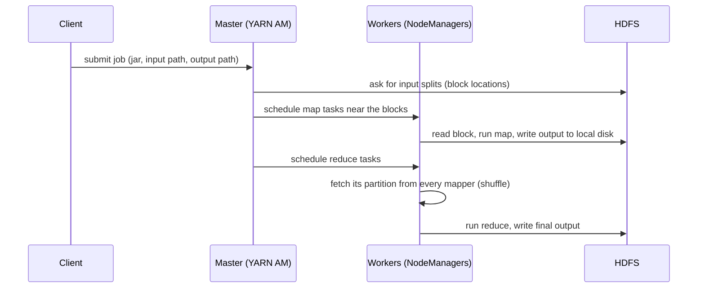

## 🎯 خلاصه

> **MapReduce** یک داده‌ی عظیم را به تکه‌ها تقسیم می‌کند، روی هر تکه یک تابع کوچک (**map**) را موازی اجرا می‌کند، خروجی‌ها را **shuffle** می‌کند تا هر کلید به یک ماشین برسد، و برای هر کلید یک تجمیع (**reduce**) انجام می‌دهد.

- برنامه‌نویس فقط دو تابع می‌نویسد. تقسیم داده، زمان‌بندی، جابه‌جایی داده، retry و مدیریت خطا با فریمورک است.
- محاسبه به سمت **داده** می‌رود (data locality)، نه برعکس.
- مدل ساده و خیلی مقاوم در برابر خطاست، ولی هر مرحله روی دیسک می‌نویسد و همین کار iterative و تعاملی را کند می‌کند.
- تقریباً هر ایده‌ی Spark (partition، stage، shuffle، narrow در برابر wide) نسخه‌ی اصلاح‌شده‌ی همین مدل است.

## 🌱 از ساده شروع کنیم (مبتدی)

> **💡 تشبیه:** فرض کن آرای یک انتخابات ملی را با ۱۰۰۰ شمارنده می‌شماری. هر شمارنده برگه‌های یک صندوق را می‌شمارد و روی یک کاغذ می‌نویسد «حزب A: ۳۱۲، حزب B: ۸۸». بعد همه‌ی کاغذهای یک حزب را کنار هم می‌گذاری و یک نفر برای هر حزب جمع می‌زند. هیچ‌کس همه‌ی برگه‌ها را نمی‌بیند و کار موازی انجام می‌شود.

سه فاز به این داستان نگاشت می‌شوند:

| فاز | چه اتفاقی می‌افتد | در داستان انتخابات |
|---|---|---|
| **Map** | هر رکورد ورودی تبدیل می‌شود به صفر یا چند جفت `(key, value)` | هر شمارنده یک صندوق را می‌خواند و کاغذ می‌نویسد |
| **Shuffle** | همه‌ی مقادیر با یک کلید به یک ماشین فرستاده می‌شوند | کاغذها بر اساس حزب روی میز می‌روند |
| **Reduce** | مقادیر یک کلید ترکیب می‌شوند تا یک نتیجه شود | یک نفر کاغذهای یک حزب را جمع می‌زند |

مثال کلاسیک word count را می‌توانی با پایتون ساده (بدون فریمورک) اجرا کنی:

```python
from collections import defaultdict

def map_fn(line):
    # برای هر کلمه (کلمه، 1) تولید کن
    for word in line.split():
        yield word.lower(), 1

def reduce_fn(word, counts):
    # همه‌ی شمارش‌های یک کلمه را جمع کن
    yield word, sum(counts)

lines = ["the cat sat", "the cat ran"]

# 1. map: روی هر تکه‌ی ورودی اجرا می‌شود
pairs = [kv for line in lines for kv in map_fn(line)]

# 2. shuffle: مقادیر را بر اساس کلید گروه‌بندی کن (فریمورک این کار را بین ماشین‌ها انجام می‌دهد)
groups = defaultdict(list)
for key, value in pairs:
    groups[key].append(value)

# 3. reduce: برای هر کلید یک بار صدا زده می‌شود
for word in sorted(groups):
    for result in reduce_fn(word, groups[word]):
        print(result)
```

خروجی:

```text
('cat', 2)
('ran', 1)
('sat', 1)
('the', 2)
```

همین نتیجه در SQL می‌شود `SELECT word, COUNT(*) FROM words GROUP BY word`. یک `GROUP BY` دقیقاً یعنی shuffle و بعد reduce، و به همین دلیل موتورهای SQL و Spark را می‌شود با زبان MapReduce توضیح داد.

## 🔧 واقعاً چطور کار می‌کند (متوسط)

یک job مپ‌ریداست روی Hadoop (نسخه‌ی متن‌باز مقاله‌ی گوگل در سال ۲۰۰۴) این مراحل را طی می‌کند:



**Input split و block.** HDFS فایل‌ها را به block تقسیم می‌کند؛ در Hadoop 2 به بعد پیش‌فرض ۱۲۸ مگابایت است (تنظیمات خوشه‌ات را چک کن). معمولاً هر map task یک block را می‌خواند. ورودی ۱ ترابایتی با blockهای ۱۲۸ مگابایتی یعنی ۱٬۰۴۸٬۵۷۶ / ۱۲۸ = ۸٬۱۹۲ map task، که تا جایی که اسلات آزاد باشد به‌صورت موازی اجرا می‌شوند.

**Data locality.** master ترجیح می‌دهد map task را روی نودی اجرا کند که یک replica از block را دارد. خواندن از دیسک محلی شبکه را دور می‌زند. اگر آن نود مشغول است، task روی همان rack اجرا می‌شود و فقط در آخرین حالت روی rack دیگر.

**Partitioning.** کلید خروجی هر mapper توسط partitioner به یک reducer نسبت داده می‌شود، معمولاً با `hash(key) mod R` که `R` تعداد reducerهاست. هر mapper خروجی‌اش را در `R` فایل روی دیسک محلی خودش می‌نویسد، یکی برای هر reducer.

**Shuffle.** هر reducer فایل‌های مربوط به خودش را از همه‌ی mapperها روی شبکه می‌گیرد، ادغام می‌کند و بر اساس کلید مرتب می‌کند. این گران‌ترین مرحله است: داده را در کل خوشه جابه‌جا می‌کند و روی دیسک مرتب می‌کند.

**Combiner.** combiner یک «reduce کوچک» است که پیش از shuffle، سمت mapper اجرا می‌شود. در word count مثلاً `("the", 1), ("the", 1)` را به `("the", 2)` تبدیل می‌کند و ترافیک shuffle را کم می‌کند. فقط وقتی درست است که تابع associative و commutative باشد (جمع، شمارش، max درست‌اند؛ میانگین نه، مگر این‌که جفت `(sum, count)` بفرستی).

**تحمل خطا.** اگر task خراب شود، master آن را روی نود دیگری با همان block ورودی دوباره اجرا می‌کند. خروجی mapper روی دیسک محلی است و replicate نمی‌شود؛ پس اگر نود از بین برود، map taskهای کامل‌شده‌اش هم دوباره اجرا می‌شوند. ورودی reducer دوباره fetch می‌شود. taskهای کند (straggler) یک نسخه‌ی تکراری speculative می‌گیرند و هرکدام زودتر تمام شود برنده است.

**Chaining.** pipelineهای واقعی چند job پشت سر هم دارند. هر job خروجی‌اش را روی HDFS می‌نویسد و job بعدی آن را دوباره می‌خواند. کوئری‌های Hive که به MapReduce کامپایل می‌شدند و بسیاری از ETLهای قدیمی همین شکل را داشتند: یک زنجیره از jobها با نوشتن و خواندن دیسک بین آن‌ها.

## 🧠 عمق و trade-offها (سنیور)

- **چرا Spark جایگزینش شد.** هزینه‌ی MapReduce مدل نیست، رفت‌وبرگشت به دیسک بین jobهاست. یک الگوریتم iterative (مثلاً ۲۰ پاس PageRank) ۲۰ بار روی HDFS می‌نویسد. Spark داده‌ی میانی را در حافظه نگه می‌دارد و کل job را به‌صورت DAG می‌سازد، پس مراحل narrow را pipeline می‌کند و فقط جایی shuffle می‌کند که ناچار است. MapReduce هنوز درست است، فقط برای کار چندمرحله‌ای و iterative کند است.
- **Skew دشمن واقعی است.** کار reduce به کلید تقسیم می‌شود. اگر یک کلید ۴۰٪ رکوردها را داشته باشد (مثل `NULL`، یک کاربر پیش‌فرض، یا کد کشور یک بازار بزرگ)، یک reducer ساعت‌ها کار می‌کند و بقیه چند دقیقه تمام می‌شوند. سرعت job برابر با کندترین reducer است. راه‌حل‌ها: salting کلید (`key + پسوند تصادفی`، و بعد یک تجمیع دوم)، combiner سمت mapper، یا partitioner سفارشی. ببین [[data-skew]] و [[hot-key]].
- **حافظه و spill.** خروجی map در یک بافر حافظه مرتب و وقتی پر شد روی دیسک spill می‌شود. spillهای زیاد یعنی مرحله‌ی merge بیشتر. تنظیم اندازه‌ی بافر و تعداد reducerها کار عملیاتی رایجی است.
- **فایل‌های کوچک.** یک map task برای هر فایل یعنی یک میلیون فایل ریز، یک میلیون task و سربار زمان‌بندی عظیم. ضمن این‌که NameNode متادیتای هر فایل را در حافظه نگه می‌دارد. ببین [[small-files-problem]].
- **جایی که MapReduce هنوز پیدا می‌شود.** jobهای قدیمی Hive روی MapReduce، importهای Sqoop و workflowهای Oozie در بسیاری از بانک‌ها و اپراتورها هنوز هستند. فهم مدل کمک می‌کند این کدها را debug کنی، حتی اگر برای کار جدید آن را انتخاب نکنی.
- **کجا به فکر MapReduce نباشی.** کوئری با تأخیر کم، کاوش تعاملی، streaming و iterationهای گرافی برای مراحل batch مبتنی بر دیسک مناسب نیستند. موتوری را انتخاب کن که مدل اجرایش با نوع کار بخواند.

## 🧪 امتحان کن

word count بالا را گسترش بده.

1. یک مرحله‌ی **combiner** اضافه کن: قبل از shuffle، شمارش‌های داخل خروجی هر mapper را جمع کن. مطمئن شو نتیجه‌ی نهایی تغییری نمی‌کند.
2. با `hash(key) % 2` دو **reducer** شبیه‌سازی کن. نشان بده هر reducer کدام کلیدها را می‌گیرد. توجه کن که hash در پایتون برای هر پروسس تصادفی است؛ پس برای نتیجه‌ی تکرارپذیر از تابعی پایدار مثل `sum(ord(c) for c in key) % 2` استفاده کن.
3. با یک job مپ‌ریدیوس **میانگین طول کلمه** را برای هر حرف اول محاسبه کن. توضیح بده چرا combiner ساده‌لوحانه (میانگین‌گرفتن از میانگین‌ها) جواب غلط می‌دهد و چطور درستش کنی.

<details><summary>پاسخ‌ها را ببین</summary>

**1.** داخل `map_fn`، یا برای هر mapper، قبل از emit کردن با یک دیکشنری `(word, count)` را تجمیع کن. خروجی reduce همان می‌ماند، ولی تعداد جفت‌هایی که از shuffle عبور می‌کنند از کل تعداد کلمات به تعداد کلمات متمایز در هر mapper کاهش می‌یابد.

**2.** `reducer = sum(ord(c) for c in key) % 2` را محاسبه کن، جفت‌ها را در دو لیست نگه دار و هر لیست را جدا reduce کن. هر کلید دقیقاً به یک reducer می‌رسد، پس اجتماع دو خروجی همان نتیجه‌ی قبلی است.

**3.** هر کلمه را به `(first_letter, (len(word), 1))` تبدیل کن. combiner و reducer جفت‌ها را مؤلفه‌به‌مؤلفه جمع می‌کنند: `(sum_len, count)`. جواب نهایی `sum_len / count` است. میانگین‌گرفتن از میانگین دو mapper وقتی تعدادشان متفاوت است درست نیست.

</details>

## 💬 گوشه‌ی مصاحبه

> **🎤 این را در مصاحبه بگو:** «MapReduce سه فاز دارد: map به‌صورت موازی جفت کلید-مقدار تولید می‌کند، shuffle هر کلید را به یک reducer می‌فرستد، و reduce برای هر کلید تجمیع می‌کند. داده سر جایش می‌ماند و فریمورک محاسبه را به سمت blockها می‌برد. ضعفش نوشتن روی دیسک بین مراحل است، و به همین دلیل Spark برای بیشتر کارها جایگزینش شد.»

**سؤال‌های رایج**

- *بین map و reduce چه می‌گذرد؟* partitioning، انتقال خروجی mapperها روی شبکه، و merge و sort روی reducer. بگو که بیشترین زمان همین‌جاست.
- *چرا combiner برای `SUM` مجاز است ولی برای `AVG` نه؟* جمع associative و commutative است؛ میانگین جزئی تعداد را از دست می‌دهد.
- *چرا یک task کند کل job را نگه می‌دارد؟* reduce یک barrier است: reducer وقتی تمام می‌شود که همه‌ی ورودی‌اش رسیده باشد. skew یک reducer را گلوگاه می‌کند.

**جواب mid:** فازها را توضیح می‌دهد، از data locality و combiner می‌گوید، و یک مثال job کند به خاطر skew می‌آورد.

**جواب senior:** مدل هزینه (I/O دیسک در هر مرحله، حجم shuffle)، معنای خطا (taskها دوباره اجرا می‌شوند، خروجی map replicate نمی‌شود) و این‌که کی این مدل انتخاب اشتباه است و چه چیزی جایش می‌آید را می‌گوید.

## ⚠️ اشتباهات رایج

- **«MapReduce یک دیتابیس است.»** نه؛ یک مدل اجرایی است. فایل می‌خواند و فایل می‌نویسد؛ index و تراکنش ندارد.
- **فرض این‌که reducer بیشتر همیشه سریع‌تر است.** reducer زیاد یعنی فایل خروجی ریز زیاد و سربار زمان‌بندی. reducer کم یعنی reducerهای عظیم و کند. بر اساس حجم داده تنظیمشان کن.
- **استفاده از تابع غیر-associative به‌عنوان combiner.** نتیجه بسته به تعداد mapperها عوض می‌شود. میانگین، میانه و شمارش متمایز نیاز به روش خاص دارند.
- **نادیده‌گرفتن skew چون میانگین خوب به نظر می‌رسد.** زمان job را بدترین کلید تعیین می‌کند، نه میانگین.
- **فکر کردن این‌که locality همان اهمیت قبل را دارد.** در object storage ابری و در معماری جداشده‌ی compute و storage، شبکه خیلی در دسترس‌تر است و locality کم‌اهمیت‌تر شده.

## ✅ خودت را بسنج

۱. در یک word count، کدام فاز تضمین می‌کند که همه‌ی تکرارهای کلمه‌ی `data` در یک فراخوانی reduce قرار بگیرند؟
   - A) Map
   - B) Shuffle
   - C) Combiner
   - D) Output commit

<details><summary>پاسخ</summary>

**B** — shuffle خروجی map را بر اساس کلید پارتیشن می‌کند، پس همه‌ی مقادیر یک کلید به یک reducer می‌رسند. combiner فقط داده را زودتر کم می‌کند و گروه‌بندی سراسری را تضمین نمی‌کند.

</details>

۲. یک job دو هزار reducer دارد، ولی ۱۹۹۰ تا در ۲ دقیقه تمام می‌شوند و یکی ۳ ساعت طول می‌کشد. محتمل‌ترین علت چیست؟

   - A) ضریب replication در HDFS زیاد است
   - B) Data skew: یک کلید مقادیر بسیار بیشتری از بقیه دارد
   - C) combiner نیست
   - D) NameNode حافظه‌اش تمام شده

<details><summary>پاسخ</summary>

**B** — یک reducer سهم نامتناسبی از کلیدها گرفته. اضافه‌کردن reducer کمکی نمی‌کند، چون کلید داغ همچنان به یک reducer می‌رود. salting یا تجمیع قبلی کلید داغ راه‌حل است.

</details>

۳. **(متوسط)** چرا combiner برای `SUM` معتبر است ولی برای `AVG` که روی هر mapper به‌صورت `sum(values) / count(values)` حساب شود نه؟

   - A) `AVG` در سیستم توزیع‌شده قابل محاسبه نیست
   - B) میانگین‌های جزئی تعداد را از دست می‌دهند، پس دوباره میانگین‌گرفتن جواب غلط می‌دهد؛ جمع‌ها و شمارش‌ها درست ترکیب می‌شوند
   - C) combiner فقط با عدد صحیح کار می‌کند
   - D) `SUM` مرتب است، `AVG` نه

<details><summary>پاسخ</summary>

**B** — میانگین دو میانگین جزئی جز در حالت تعداد برابر، میانگین کل نیست. جفت `(sum, count)` بفرست که به‌صورت associative ترکیب می‌شود و تقسیم را یک بار در reducer انجام بده.

</details>

۴. **(سنیور)** یک job یادگیری ماشین iterative در MapReduce چهل دقیقه طول می‌کشد، عمدتاً برای نوشتن روی HDFS بین iterationها. کدام تغییر علت اصلی را حل می‌کند و چه ریسک جدیدی اضافه می‌کند؟

   - A) افزایش اندازه‌ی block به ۱ گیگابایت
   - B) نگه‌داشتن داده‌ی میانی در حافظه بین iterationها (مثل Spark)؛ ریسک آن فشار حافظه و محاسبه‌ی دوباره یا spill وقتی partitionها گم شوند
   - C) جای HDFS گذاشتن دیسک محلی یک نود
   - D) حذف combiner

<details><summary>پاسخ</summary>

**B** — علت اصلی رفت‌وبرگشت دیسک در هر iteration است. نگه‌داشتن داده در حافظه و برنامه‌ریزی کل DAG آن را حذف می‌کند، ولی مجموعه‌ی کاری باید در حافظه‌ی executor جا شود و partitionهای گم‌شده باید از lineage دوباره ساخته یا از checkpoint خوانده شوند.

</details>

۵. **(سنیور)** چرا MapReduce یک map task خراب‌شده را دوباره اجرا می‌کند، به‌جای این‌که خروجی‌اش را روی نود دیگری replicate کند؟

   - A) replication، data locality را خراب می‌کند
   - B) خروجی map داده‌ی میانی است و از block ورودی replicate‌شده به‌راحتی دوباره ساخته می‌شود؛ نوشتن هر خروجی سه بار هزینه‌ی بسیار بیشتری از اجرای مجدد نادر دارد
   - C) HDFS اجازه‌ی replicate کردن فایل محلی نمی‌دهد
   - D) map task نمی‌تواند خطا بدهد

<details><summary>پاسخ</summary>

**B** — ورودی از قبل در HDFS replicate شده، پس اجرای مجدد map ارزان است. نوشتن هر نتیجه‌ی میانی سه بار خیلی گران‌تر از اجرای مجدد نادر است. Spark هم با lineage همین منطق را دنبال می‌کند.

</details>

## 🗂️ فلش‌کارت

| Front | Back |
|---|---|
| سه فاز MapReduce چیست؟ | Map (تولید جفت کلید-مقدار)، shuffle (مسیریابی و گروه‌بندی بر اساس کلید)، reduce (تجمیع به ازای هر کلید) |
| data locality یعنی چه؟ | زمان‌بندی task روی نود (یا rack) که block ورودی‌اش را دارد |
| combiner چه کاری می‌کند؟ | reduce جزئی سمت mapper که ترافیک shuffle را کم می‌کند؛ باید associative و commutative باشد |
| چرا `AVG` مستقیم combiner نمی‌شود؟ | میانگین میانگین‌ها غلط است؛ به‌جایش `(sum, count)` بفرست |
| چرا یک reducer کند مشکل است؟ | reduce یک barrier است؛ job منتظر کندترین گروه کلید (skew) می‌ماند |
| چرا MapReduce برای jobهای iterative کند است؟ | هر job خروجی‌اش را روی HDFS می‌نویسد و job بعدی آن را دوباره می‌خواند |
| partition چطور انتخاب می‌شود؟ | پیش‌فرض `hash(key) mod R` که R تعداد reducerهاست |

## 🔗 ادامه

- **hadoop-ecosystem** نشان می‌دهد HDFS، YARN و Hive دور این مدل کجا قرار می‌گیرند.
- **spark-architecture** و **spark-shuffle** توضیح می‌دهند Spark همین ایده‌ها (partition، shuffle، stage) را با داده‌ی درون‌حافظه و DAG چطور نگه داشته.
- **spark-joins-skew** درس‌های skew این صفحه را روی join اعمال می‌کند.
- یک بار مقاله‌ی اصلی گوگل در سال ۲۰۰۴ میلادی با عنوان «MapReduce: Simplified Data Processing on Large Clusters» را بخوان؛ واژگان پردازش دسته‌ای توزیع‌شده از آن آمده.
- واژه‌نامه: [[shuffle]]، [[partition]]، [[data-skew]].
