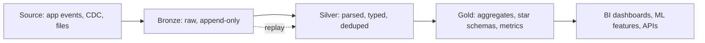

## 🎯 خلاصه

> **معماری Medallion** یک lakehouse را در سه لایه‌ی با کیفیت رو‌به‌افزایش سازماندهی می‌کند: **Bronze** (داده‌ی خام، همان‌طور که رسیده)، **Silver** (تمیز، با نوع‌های درست، بدون تکرار و یکپارچه‌شده) و **Gold** (جدول‌های آماده‌ی کسب‌وکار برای داشبورد، متریک و ML).

- هر لایه یک **قرارداد (contract)** دارد: چه چیزی را تضمین می‌کند، چه کسی از آن می‌خواند و چند وقت یک‌بار بازسازی می‌شود.
- Bronze همه‌چیز را نگه می‌دارد تا همیشه بتوانی تاریخچه را دوباره اجرا (replay) کنی. Silver جایی است که اعتماد شروع می‌شود. Gold برای سؤال‌هایی ساخته می‌شود که کسب‌وکار می‌پرسد.
- این یک قرارداد نام‌گذاری و مسئولیت است، نه یک محصول. روی object storage با جدول‌های Delta، Iceberg یا Hudi کار می‌کند، و همان ایده روی انبار داده‌ی کلاسیک به staging، ODS و mart نگاشت می‌شود.

## 🌱 از ساده شروع کنیم (مبتدی)

> **💡 تشبیه:** آشپزخانه‌ی یک رستوران. جعبه‌ی سبزیجات خام که از بازار رسیده **Bronze** است: همان‌طور که آمده نگهش می‌داری تا اگر غذایی خراب شد، بعداً بررسی‌اش کنی. مواد شسته، پوست‌گرفته و تقسیم‌شده **Silver** است: تمیز، یکدست و آماده‌ی استفاده. بشقاب نهایی روی منو **Gold** است: چیزی که مشتری واقعاً سفارش می‌دهد.

فرض کن یک فروشگاه آنلاین داری. سفارش‌ها به‌صورت رویدادهای JSON از اپلیکیشن می‌رسند. یک pipeline سه کار انجام می‌دهد:

1. **Bronze:** هر رویداد را دقیقاً همان‌طور که رسیده، به‌همراه متادیتا (چه زمانی رسید، از کدام فایل آمد) ذخیره کن.
2. **Silver:** JSON را parse کن، `amount` را به عدد تبدیل کن، سفارش‌های تستی را حذف کن و برای هر `order_id` فقط آخرین نسخه را نگه دار.
3. **Gold:** `درآمد روزانه به تفکیک شهر` را حساب کن، همان عددی که داشبورد مالی نشان می‌دهد.

این نسخه‌ی کوچکی از Bronze است:

```sql
-- Bronze: خام، فقط append، هیچ‌چیز دور ریخته نمی‌شود
CREATE TABLE bronze_orders (
  _ingested_at TIMESTAMP,
  _source_file TEXT,
  payload      TEXT            -- رشته‌ی خام JSON، دست‌نخورده
);
```

چرا payload خام را نگه می‌داریم؟ چون یک روز کسی می‌پرسد «در ۳ اسفند چه چیزی دریافت کردیم؟» و باید جواب صادقانه داشته باشی. Silver و Gold همیشه از روی Bronze قابل ساخت‌اند، ولی Bronze از روی Gold قابل ساخت نیست.

## 🔧 واقعاً چطور کار می‌کند (متوسط)

pipeline بین لایه‌ها معمولاً incremental است: هر اجرا فقط داده‌ی جدید Bronze را می‌خواند، تبدیلش می‌کند و در Silver merge می‌کند. سپس Gold از Silver دوباره محاسبه می‌شود؛ یا کامل (برای جدول‌های کوچک) یا partition به partition (برای جدول‌های بزرگ).



**Silver** جایی است که کار واقعی انجام می‌شود. مراحل معمول: parse و تبدیل نوع، حذف ردیف‌های نامعتبر و حذف تکرار. حذف تکرار معمولاً یک window function است، همان الگوی [[sql-window-functions]]:

```sql
-- Silver: نگه داشتن آخرین نسخه‌ی هر سفارش
CREATE TABLE silver_orders AS
SELECT order_id, customer_id, city, CAST(amount AS DECIMAL(12,2)) AS amount,
       updated_at
FROM (
  SELECT
    CAST(JSON_VALUE(payload, '$.order_id') AS BIGINT) AS order_id,
    JSON_VALUE(payload, '$.customer_id')              AS customer_id,
    JSON_VALUE(payload, '$.city')                     AS city,
    JSON_VALUE(payload, '$.amount')                   AS amount,
    CAST(JSON_VALUE(payload, '$.updated_at') AS TIMESTAMP) AS updated_at,
    ROW_NUMBER() OVER (
      PARTITION BY JSON_VALUE(payload, '$.order_id')
      ORDER BY CAST(JSON_VALUE(payload, '$.updated_at') AS TIMESTAMP) DESC,
               _ingested_at DESC
    ) AS rn
  FROM bronze_orders
  WHERE JSON_VALUE(payload, '$.is_test') IS NULL   -- حذف ترافیک تستی
) t
WHERE rn = 1;
```

`JSON_VALUE` و syntax دقیق JSON در موتورهای مختلف فرق دارد (Spark، BigQuery، Snowflake و PostgreSQL هرکدام به شکل خودشان می‌نویسند)، پس این query را شکل منطق بدان، نه اسکریپتی برای copy-paste. منطق مهم است: parse کن، فیلتر کن، آخرین نسخه را نگه دار.

**Gold** برای مصرف‌کننده‌ها شکل می‌گیرد. اغلب شبیه star schema ([[star-schema]]) یا مجموعه‌ای از متریک‌های از پیش تجمیع‌شده است:

```sql
-- Gold: چیزی که داشبورد می‌خواند
CREATE TABLE gold_daily_revenue AS
SELECT CAST(updated_at AS DATE) AS day, city,
       COUNT(*) AS orders, SUM(amount) AS revenue
FROM silver_orders
GROUP BY CAST(updated_at AS DATE), city;
```

یک قاعده‌ی مفید: **Bronze فقط append است، Silver بازسازی‌اش idempotent است، و Gold چیزی است که حاضری بابتش ساعت دو شب بیدار شوی.** اگر عددی در Gold غلط بود، مسیر رفع از Silver می‌گذرد و بعد Gold دوباره ساخته می‌شود؛ هرگز ویرایش دستی جدول Gold.

## 🧠 عمق و trade-offها (سنیور)

- **قرارداد برای هر لایه.** Bronze قول می‌دهد «هر بایتی که دریافت کردیم، با متادیتای lineage»، و با فیلد جدید خراب نمی‌شود. Silver قول می‌دهد نوع‌ها، یکتایی روی کلید مشخص و قوانین null مستند. Gold تعریف متریک با مالک مشخص را تضمین می‌کند. اگر این‌ها نوشته نشوند، لایه‌ها در یک دریاچه‌ی درهم‌ریخته ادغام می‌شوند.
- **Schema drift.** Bronze باید payload خام یا یک struct بازِ انعطاف‌پذیر را نگه دارد تا اضافه‌شدن فیلد در بالادست، ingestion را نشکند. Silver تصمیم می‌گیرد با فیلد جدید چه کند: نادیده بگیرد، ستون اضافه کند یا هشدار دهد. همین مرز جایی است که [[schema-evolution]] مدیریت می‌شود.
- **Replay و پردازش مجدد.** دلیل اصلی وجود Bronze همین replay است: بعد از یک باگ در قانون Silver، کد را درست می‌کنی و از داده‌ی خام بازسازی می‌کنی. این فقط وقتی جواب می‌دهد که retention در Bronze پنجره‌ی replay را بپوشاند و job در Silver deterministic باشد. آن را با [[idempotency]] و [[deduplication]] همراه کن، وگرنه replay درآمد را دو برابر می‌کند.
- **فضا و هزینه.** داده را تا سه بار ذخیره می‌کنی (خام، تمیز، تجمیع‌شده). برای حجم رویدادهای بزرگ، Bronze بیشترین سهم صورتحساب را دارد. از lifecycle rule، فشرده‌سازی و retention جدا برای هر لایه استفاده کن، و یادت باشد داده‌ی خام اغلب فیلدهای شخصی دارد که باید mask یا حذف شوند ([[data-masking]] و حذف به سبک [[tombstone]]).
- **رفتار موتور.** روی یک table format مثل Delta Lake، Iceberg یا Hudi، `MERGE` در Silver کامیت‌های ACID و [[time-travel]] می‌دهد، و همین لایه‌ها را امن برای بازسازی می‌کند. روی فایل‌های ساده بدون table format، حذف تکرار و به‌روزرسانی دیرهنگام خیلی سخت‌تر است. این الگو روی هر دو کار می‌کند، اما تضمین‌ها فقط به قوت storage زیرش است.
- **داده‌ی دیرهنگام و خارج از ترتیب.** جدول Silver که با تاریخ رویداد کلید خورده، باید رویدادهایی را هم بپذیرد که چند روز دیرتر رسیده‌اند. تصمیم بگیر که Gold برای روزهای متأثر دوباره محاسبه شود یا بعد از یک cut-off، ردیف‌های دیرهنگام دور ریخته شوند، و انتخابت را مستند کن ([[late-arriving-data]]).
- **در مقایسه با انبار داده‌ی کلاسیک.** یک انبار سنتی معمولاً staging، یک operational data store و بعد martهای بُعدی دارد. Medallion تقریباً به staging (Bronze)، لایه‌ی یکپارچه‌سازی تمیز (Silver) و mart (Gold) نگاشت می‌شود. تفاوت اصلی این است که Bronze تاریخچه‌ی خام را ارزان روی object storage نگه می‌دارد، به‌جای این‌که بعد از load دور ریخته شود.
- **کی استفاده نکنیم.** یک منبع، یک تیم کوچک و چند داشبورد: سه لایه سربار است. یک لایه‌ی تمیز به‌علاوه martها، مثل یک [[dwh-fundamentals|انبار]] خوب اداره‌شده، کافی است. لایه اضافه کن وقتی نیاز به replay، مصرف‌کننده‌های زیاد یا منبع‌های متعدد داری.

## 🧪 امتحان کن

برای این مورد لایه‌ها را طراحی کن: یک اپ تاکسی‌یابی رویدادهای `trip_started`، `trip_completed` و `trip_cancelled` می‌فرستد. راننده‌ها ممکن است وضعیت یک سفر را چند بار به‌روز کنند.

1. **Bronze.** علاوه بر payload خام، چه ستون‌هایی ذخیره می‌کنی؟ حداقل دو ستون متادیتا نام ببر و توضیح بده هر کدام در replay به چه درد می‌خورد.
2. **Silver.** کلید یکتای یک سفر چیست؟ قانونی بنویس که یک ردیف برای هر سفر نگه دارد، و بگو وقتی `trip_completed` زودتر از `trip_started` برسد (خارج از ترتیب) چه می‌شود.
3. **Gold.** `تعداد سفرهای تکمیل‌شده‌ی روزانه به تفکیک شهر` را تعریف کن، و یک ابهام را نام ببر: سفری که دوشنبه شروع و سه‌شنبه تمام می‌شود، در کدام روز شمرده می‌شود؟

<details><summary>جواب‌ها را ببین</summary>

**1.** متادیتای مفید: `_ingested_at` (زمانی که پلتفرم دریافت کرده، برای این‌که بتوانی بفهمی در یک زمان مشخص چه چیزی معلوم بوده)، و `_source_file` یا `_offset` (lineage تا منبع، برای دیباگ کردن یک batch بد). با این‌ها دقیقاً همان batch مشکل‌ساز را می‌توانی بازسازی کنی.

**2.** کلید `trip_id` است. ردیفی را نگه دار که رتبه‌ی وضعیتش بالاتر است؛ اما «completed > started > cancelled» همیشه درست نیست، پس بر اساس زمان رویداد و یک شماره‌ی ترتیب وضعیت که از producer می‌آید رتبه‌بندی کن. رویدادهای خارج از ترتیب عادی‌اند: قانون merge نباید به ترتیب رسیدن وابسته باشد، فقط به زمان رویداد یا یک ستون version. وگرنه یک `trip_started` قدیمی‌تر می‌تواند یک `trip_completed` جدیدتر را بازنویسی کند.

**3.** `تعداد سفرهای کامل‌شده به تفکیک شهر و روز`، با شمردن بر اساس تاریخ اتمام، یک پیش‌فرض معقول است. ابهام در تعریف کسب‌وکار است: شمردن بر اساس تاریخ شروع یا اتمام، عددهای متفاوت می‌دهد. این تصمیم را در تعریف متریک (قرارداد Gold) بنویس تا همه‌ی داشبوردها یک جواب بدهند.

</details>

## 💬 گوشه‌ی مصاحبه

**سؤال: «معماری medallion چیست و چرا از آن استفاده می‌کنیم؟»** جواب متوسط: «Bronze داده‌ی خام دارد، Silver تمیز و بدون تکرار است، Gold برای مصرف کسب‌وکار تجمیع شده. هر لایه کار مشخصی دارد و دیباگ کردن را آسان‌تر می‌کند.»

جواب سنیور: «این مجموعه‌ای از قراردادهای لایه روی یک lakehouse است. Bronze امکان replay و lineage می‌دهد، Silver تنها جایی است که قوانین تمیزکاری و حذف تکرار زندگی می‌کنند، و Gold تعریف متریک را با مالک مشخص نگه می‌دارد. Silver را قابل بازسازی از Bronze و idempotent می‌کنم، و Gold را هم قابل محاسبه‌ی مجدد، تا عدد غلط با تغییر کد اصلاح شود نه با دست. اگر دامنه کوچک باشد، لایه‌ی اضافه نمی‌سازم.»

**سؤال: «این با یک انبار با جدول‌های staging چه فرقی دارد؟»** مفاهیم هم‌پوشانی زیادی دارند. تفاوت عملی، تاریخچه‌ی خام، ارزان و تغییرناپذیر روی object storage است، و table formatهایی که merge ACID را روی همه‌ی لایه‌ها ممکن می‌کنند.

> **🎤 این را در مصاحبه بگو:** «من medallion را مجموعه‌ای از قراردادهای لایه می‌بینم. Bronze خام و قابل replay است، Silver جایی است که نوع‌ها، کلیدها و حذف تکرار را با merge idempotent اعمال می‌کنم، و Gold متریک‌های کسب‌وکار را با مالک مشخص نگه می‌دارد. با این لایه‌ها، رفع یک مشکل یعنی تغییر کد و بازسازی، نه وصله‌ی دستی.»

## ⚠️ اشتباهات رایج

> **⚠️ هشدار:** Bronze را «کپی منبع در قالب بهتر» دیدن. اگر در Bronze فیلتر کنی یا فیلدی بیندازی، بعد از یک باگ نمی‌توانی replay کنی. شکل خام را نگه دار و فیلتر کردن را به Silver بسپار.

- نوشتن منطق کسب‌وکار در Gold که باید در Silver باشد، طوری که دو جدول Gold درباره‌ی «درآمد» با هم اختلاف داشته باشند.
- ویرایش دستی جدول Gold برای رفع یک عدد. اجرای بعدی اصلاح را بازنویسی می‌کند و Silver همچنان غلط است.
- حذف تکرار بدون tiebreaker قطعی. دو ردیف با `updated_at` یکسان، در هر اجرا نتیجه‌ی متفاوتی می‌دهند.
- وابسته کردن merge در Silver به ترتیب رسیدن به جای زمان رویداد یا ستون version.
- نگه داشتن Bronze برای همیشه بدون سیاست retention یا PII، و کشف داده‌ی شخصی در یک bucket تحلیلی.
- ساختن سه لایه برای داده‌ای که یک مصرف‌کننده دارد و نیازی به replay ندارد.

## ✅ خودت را بسنج

1. کدام لایه باید **append-only و تا حد ممکن نزدیک به منبع** باشد؟
   - A) Gold
   - B) Silver
   - C) Bronze
   - D) هر سه به یک اندازه

<details><summary>جواب</summary>

**C** — Bronze رکوردهای خام را همان‌طور که رسیده‌اند نگه می‌دارد و همین امکان replay و lineage را می‌دهد. Silver و Gold از آن مشتق می‌شوند.

</details>

2. یک باگ در قانون تمیزکاری Silver دو هفته است که فعال است. تمیزترین راه رفع چیست؟
   - A) ویرایش مستقیم عددهای Gold با `UPDATE`
   - B) اصلاح قانون Silver و بازسازی Silver از Bronze برای روزهای متأثر، و بعد محاسبه‌ی مجدد Gold
   - C) حذف Bronze و شروع دوباره از منبع
   - D) افزودن یادداشتی به داشبورد که خطا را توضیح دهد

<details><summary>جواب</summary>

**B** — لایه‌ها در یک جهت مشتق می‌شوند. اصلاح قانون و بازسازی Silver و Gold از Bronze، همه‌ی جدول‌ها را سازگار نگه می‌دارد. ویرایش دستی با اجرای بعدی بازنویسی می‌شود و حذف Bronze منبع replay را از بین می‌برد.

</details>

3. **(سنیور)** Silver رویدادها را بر اساس `order_id` merge می‌کند و ردیفی با آخرین `updated_at` را نگه می‌دارد. دو رویداد برای یک سفارش، `updated_at` یکسان دارند. چرا این مشکل است و چه چیزی را تغییر می‌دهی؟
   - A) هیچ؛ موتور همیشه یکسان انتخاب می‌کند
   - B) نتیجه بین اجراها می‌تواند فرق کند، پس یک tiebreaker قطعی مثل شماره‌ی ترتیب producer یا offset ingestion اضافه کن
   - C) job باید به‌جای `ROW_NUMBER` از `RANK` استفاده کند
   - D) `updated_at` باید از کلید حذف شود

<details><summary>جواب</summary>

**B** — `ROW_NUMBER` در بین مساوی‌ها دلخواه عمل می‌کند، پس replay ممکن است ردیف دیگری انتخاب کند و Silver بین اجراها تغییر کند. یک tiebreaker یکتا (شماره‌ی ترتیب از producer یا offset) بازسازی را قطعی می‌کند.

</details>

4. **(سنیور)** تیم بالادستی فیلد جدید `coupon_code` را به payload سفارش اضافه کرده و job ingestion شبانه شروع به خطا کرده. کدام لایه باید این تغییر را جذب کند و چرا؟
   - A) Gold، چون لایه‌ی کسب‌وکار است
   - B) Bronze باید payload خام را نگه دارد تا ingestion نشکند؛ سپس Silver تصمیم می‌گیرد `coupon_code` چگونه و آیا در دسترس قرار گیرد
   - C) هیچ؛ job باید متوقف شود تا schema قفل شود
   - D) Silver باید همه‌ی رویدادهای دارای فیلد جدید را رد کند

<details><summary>جواب</summary>

**B** — Bronze داده را با انعطاف ذخیره می‌کند، پس ingestion کار می‌کند. Silver جایی است که schema تایپ‌شده اعمال می‌شود و افزودن ستون جدید به‌صورت آگاهانه انجام می‌شود. Gold فقط بعد از Silver تغییر می‌کند.

</details>

5. کدام گزاره دربارهٔ معماری medallion **درست** است؟
   - A) محصولی خاص است که نصب می‌کنی
   - B) دقیقاً سه لایه لازم دارد و بیشتر از آن نه
   - C) یک قرارداد لایه‌ها است که روی object storage یا انبار داده اجرا می‌شود
   - D) نیاز به حذف تکرار را از بین می‌برد

<details><summary>جواب</summary>

**C** — medallion قراردادی درباره‌ی مسئولیت‌ها است. محصول نیست، تعداد لایه‌ها انتخابی است و حذف تکرار همچنان لازم است (در Silver).

</details>

## 🗂️ فلش‌کارت

| Front | Back |
|---|---|
| لایه‌ی Bronze | داده‌ی خام و append-only همان‌طور که رسیده، به‌همراه متادیتای lineage؛ منبع replay |
| لایه‌ی Silver | داده‌ی parse‌شده، تایپ‌شده، بدون تکرار و اعتبارسنجی‌شده روی کلیدهای مشخص |
| لایه‌ی Gold | تجمیع‌های آماده‌ی کسب‌وکار، star schema و متریک با مالک |
| چرا Bronze خام است؟ | برای replay بعد از باگ و lineage؛ Gold نمی‌تواند Bronze را بسازد |
| رفع یک عدد اشتباه در Gold | قانون را در Silver اصلاح کن، از Bronze بازسازی کن، Gold را دوباره محاسبه کن؛ هرگز دستی ویرایش نکن |
| حذف تکرار در Silver به چه نیاز دارد؟ | کلید قطعی و tiebreaker، نه فقط یک timestamp |
| medallion در برابر انبار کلاسیک | نقش مشابه (staging، یکپارچه‌سازی، mart)؛ Bronze تاریخچه‌ی خام ارزان نگه می‌دارد |
| کی لایه‌ها را کنار بگذاریم؟ | یک منبع، یک مصرف‌کننده، بدون نیاز به replay |

## 🔗 ادامه

- **[[dwh-fundamentals|مبانی انبار داده]]** staging، یکپارچه‌سازی و mart را توضیح می‌دهد؛ نسخه‌ی کلاسیک همین ایده.
- **[[lakehouse-table-formats]]** لایه‌ی جدول ACID را پوشش می‌دهد که merge در Silver و replay را امن می‌کند.
- **[[file-layout]]** نشان می‌دهد فایل‌های فیزیکی پشت هر لایه چطور اندازه و partition شوند.
- **[[pattern-late-data]]** و **[[dedup-idempotent-loads]]** دو مسئله‌ی طراحی‌ای هستند که اول با آن‌ها در ساخت Silver روبه‌رو می‌شوی.
- **[[dimensional-modeling]]** روش معمول طراحی جدول‌های Gold است.
