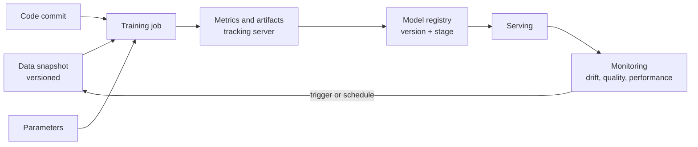

## 🎯 خلاصه

> **MLOps** مجموعه‌ی روش‌هایی است که نگه می‌دارد مدل‌های یادگیری ماشین بعد از اولین آموزش هم درست کار کنند. برای مهندس داده، سؤال اصلی این است: **کدام داده‌ی دقیق این مدل را ساخته، و آیا داده هنوز همان رفتاری را دارد که مدل انتظارش را دارد؟**

- **Reproducibility** به داده‌ی نسخه‌بندی‌شده، کد نسخه‌بندی‌شده و پارامترهای ثبت‌شده برای هر اجرای آموزش نیاز دارد.
- **Experiment tracking** (مثلاً MLflow) اجراها، پارامترها، metricها، artifactها و نسخه‌های مدل را ثبت می‌کند.
- **Drift** یعنی داده‌ی ورودی یا رابطه‌ی ورودی‌ها و label با گذر زمان تغییر کند. آن را مانیتور کن و بر اساس زمان‌بندی یا یک trigger دوباره آموزش بده.
- **چک‌های کیفیت داده** قبل از آموزش و قبل از سرویس اجرا می‌شوند، نه فقط داخل warehouse.

## 🌱 از ساده شروع کنیم (مبتدی)

> **💡 تشبیه:** کارت دستور پخت می‌گوید «۴۰ دقیقه بپز». اگر ننوشته باشی از چه آردی و با چه فری استفاده کرده‌ای، ماه بعد کسی نمی‌تواند همان کیک را درست کند. MLOps دفترچه‌ی آزمایشگاهی مدل‌هاست: داده، تنظیمات، کد و نتایج، همه نوشته شده.

فرض کن یک طبقه‌بند اسپم را دوشنبه با ۱۰۰٬۰۰۰ ایمیل آموزش داده‌ای. جمعه job دوباره اجرا می‌شود و مدلی متفاوت می‌گیرد، و کسی نمی‌داند چرا. دلیل‌های محتمل:

- جدول ایمیل بین این دو زمان **به‌روزرسانی** شده (ردیف جدید، برچسب‌های اصلاح‌شده)،
- کد تغییر کرده،
- یک پارامتر دستی عوض شده،
- seed تصادفی ست نشده.

راه‌حل ساده به زبان، و سخت در عمل: **ورودی‌ها و تنظیمات هر اجرا را ثبت کن**، تا بتوانی همان مدل را بازسازی کنی یا تفاوت را توضیح بدهی.

```text
run_id: 2026-10-01-spam-v7
training_data: emails_snapshot_2026_09_30   (immutable snapshot)
code_commit: 4f2a9c1
params: learning_rate=0.05, max_depth=6, seed=42
metrics: auc=0.91, precision_at_0.5=0.88
model_output: s3://models/spam/v7/
```

## 🔧 واقعاً چطور کار می‌کند (متوسط)

یک اجرای آموزش ML سه نوع ورودی دارد: **کد**، **پارامترها** و **داده**. یک پایپ‌لاین قابل بازتولید هر سه را ثبت می‌کند.



**نسخه‌بندی داده.** جدولی که هر شب بازنویسی می‌شود، نمی‌تواند مدل ماه گذشته را توضیح دهد. گزینه‌ها:

- **snapshot های تغییرناپذیر**: هر training set را در مسیر یا partition ای ذخیره کن که با تاریخ یا hash نام‌گذاری شده (مثلاً `dt=2026-09-30/`) و هرگز آن را تغییر نده.
- **فرمت‌های جدولی با time travel**: Delta Lake، Apache Iceberg و Hudi نسخه‌های جدول را نگه می‌دارند، پس job آموزش می‌تواند snapshot مشخصی را بخواند. نحو دقیق را در مستندات موتور خودت چک کن.
- **hash محتوای** dataset که همراه اجرا ذخیره می‌شود، تا بفهمی «همان» dataset تغییر کرده یا نه.

**MLflow** ابزار متن‌باز برای tracking آزمایش‌ها و مدیریت مدل است. مفاهیم اصلی آن:

| مفهوم | چه چیزی ذخیره می‌کند |
|---|---|
| Run | یک اجرای آموزش، با زمان شروع و پایان و وضعیت |
| Parameters | hyperparameterها و مقادیر تنظیمات |
| Metrics | مقادیر در طول زمان (مثلاً loss در هر epoch) |
| Artifacts | فایل‌هایی مثل مدل، نمودارها و لیست featureها |
| Model registry | نسخه‌های نام‌گذاری‌شده‌ی مدل، با stage یا alias برای ارتقا |

نسخه‌های جدیدتر MLflow می‌توانند dataset ورودی یک run را هم ثبت کنند. نسخه‌ی خودت را در مستندات چک کن. اصل مطلب در هر tracker یکی است: **run باید به نسخه‌ی داده اشاره کند، نه فقط به نام جدول**، چون نام جدول همیشه به داده‌ی امروز اشاره می‌کند.

**Drift** تغییر داده در طول زمان است. سه نوع آن مهم است:

- **Data drift (covariate shift)**: توزیع featureهای ورودی تغییر می‌کند (مثلاً میانگین طول ایمیل بعد از تغییر محصول بالا می‌رود).
- **Label drift**: توزیع target تغییر می‌کند (نرخ تقلب از ۰.۱٪ به ۰.۴٪ می‌رسد).
- **Concept drift**: رابطه‌ی ورودی‌ها و target تغییر می‌کند (کاربران بعد از تغییر یک سیاست رفتار دیگری دارند)، حتی اگر ورودی‌ها مثل قبل به نظر برسند.

مانیتورینگ معمولاً پنجره‌ی فعلی را با یک پنجره‌ی مرجع (داده‌ی آموزش) مقایسه می‌کند، با آماره‌ای مثل population stability index (PSI)، آزمون Kolmogorov–Smirnov، یا چک‌های خلاصه مثل نرخ null و میانگین و min و max. آستانه یک تصمیم کسب‌وکار است، نه عددی جهانی.

**پایپ‌لاین‌های آموزش مجدد** با یکی از دو trigger اجرا می‌شوند: **زمان‌بندی** (هفتگی، روزانه)، یا **رویداد** (drift بالاتر از آستانه، افت عملکرد با labelهای تأخیری). پایپ‌لاین معمولاً یک DAG ارکستره‌شده است: گرفتن snapshot، اعتبارسنجی، ساخت feature، آموزش، ارزیابی در برابر مدل فعلی، ثبت اگر بهتر بود، و استقرار با مسیر rollback. به [[dag]] و [[data-quality]] نگاه کن.

## 🧠 عمق و trade-offها (سنیور)

- **تأخیر label.** برای تقلب یا churn، label واقعی ممکن است روزها یا ماه‌ها بعد برسد. drift ورودی را همان لحظه می‌توان دید، ولی drift عملکرد فقط بعد از رسیدن labelها. پایپ‌لاین را با این تأخیر طراحی کن و label گم‌شده را صفر فرض نکن.
- **داده‌ی آموزشی یک محصول است.** snapshot آموزشی را مثل یک dataset منتشرشده در نظر بگیر: قرارداد schema، مالک، چک‌های کیفیت، نگهداری. تغییرات ناسازگار بالادستی مدل را بی‌صدا عوض می‌کنند. به [[data-contract]] نگاه کن.
- **بازتولیدپذیری در برابر هزینه.** ذخیره‌ی یک snapshot کامل برای هر run روی جدول‌های بزرگ گران است. برای مدل‌های در تولید و baseline، snapshot نگه دار؛ برای آزمایش‌ها، کوئری، نسخه‌ی جدول و hash را ذخیره کن.
- **ارزیابی آفلاین کافی نیست.** مدل جدید را با مدل فعلی روی یک مجموعه‌ی ارزیابی ثابت و داده‌ی اخیر مقایسه کن. slice ها (منطقه، دستگاه، بخش مشتری) را هم بررسی کن، نه فقط metric سراسری.
- **هزینه‌ی مانیتورینگ.** محاسبه‌ی آماره‌های drift روی میلیاردها ردیف هر ساعت بار واقعی است. نمونه‌برداری کن، per partition تجمیع کن، و آماره‌ها را در همان job لیک یا warehouse که داده را اسکن می‌کند حساب کن.
- **Shadow و canary.** مدل جدید را در حالت shadow (امتیاز می‌دهد ولی عمل نمی‌کند) یا روی سهم کوچکی از ترافیک سرو کن، قبل از استقرار کامل. این به همان منطق feature تولید نیاز دارد؛ به [[training-serving-skew]] نگاه کن.
- **کِی کل پشته لازم نیست.** مدلی که یک بار در سه‌ماه توسط یک تحلیلگر بازآموزی می‌شود، به registry و سرویس drift نیاز ندارد. یک notebook تحت version control، یک مسیر snapshot و یک گزارش metric مکتوب ممکن است کافی باشد. وقتی تعداد مدل‌ها یا هزینه‌ی یک مدل اشتباه بالا رفت، ابزار اضافه کن.

## 🧪 امتحان کن

۱. یک job شبانه جدول `customers_features` را هر شب بازنویسی می‌کند. یک مدل که در خرداد آموزش دیده، در شهریور قابل بازتولید نیست. سه تغییر بنویس که به ترتیب اثر، پیشنهاد می‌کنی.
۲. یک feature به نام `avg_order_value` در آموزش میانگین ۵۲ داشت و این هفته میانگین ۸۱ است. ابتدا کدام نوع drift را مشکوک می‌دانی، و دو چک برای تأیید قبل از آموزش مجدد؟
۳. حداقل metadata (به شکل یک بلوک YAML یا JSON) را بنویس که یک رکورد run باید داشته باشد تا مهندس دیگری بتواند مدل را بازسازی کند.

<details><summary>جواب‌ها را ببین</summary>

**۱.** (الف) به جای بازنویسی، هر training set را به یک snapshot تاریخ‌دار و تغییرناپذیر تبدیل کن؛ (ب) مسیر snapshot یا نسخه‌ی جدول و commit کد را در رکورد run ذخیره کن؛ (ج) کد تبدیل را زیر version control نگه دار و نسخه‌ی وابستگی‌ها را ثابت کن. snapshot از همه مهم‌تر است، چون بدون آن خود ورودی از بین رفته.

**۲.** ابتدا **data drift** (covariate shift) را مشکوک می‌دانم، احتمالاً به‌خاطر تغییر قیمت یا ارز در بالادست. چک‌ها: مقایسه‌ی کل توزیع (نه فقط میانگین) با پنجره‌ی مرجع؛ بررسی تغییر واحد یا ارز، منبع داده‌ی جدید، یا باگ join که سفارش‌های پرارزش را تکراری می‌کند.

**۳.** یک رکورد حداقلی: `run_id`، `data_version` (مسیر snapshot یا نسخه‌ی جدول به‌همراه hash)، `code_commit`، `params`، `seed`، `environment` (نسخه‌ی کتابخانه‌ها)، `metrics` روی یک مجموعه‌ی ارزیابی نام‌دار، و مکان `model_artifact`.

</details>

## 💬 گوشه‌ی مصاحبه

**سؤال: «چطور آموزش ML را بازتولیدپذیر می‌کنی؟»** جواب متوسط: «کد را version کنترل می‌کنم، پارامترها و seed را ثابت می‌کنم، و snapshot داده‌ی آموزشی را ذخیره می‌کنم.» جواب سنیور: «رکورد run را به یک نسخه‌ی تغییرناپذیر داده (snapshot یا نسخه‌ی جدول با hash)، commit کد و محیط وصل می‌کنم. پایپ‌لاین را هم تست می‌کنم: یک مدل اخیر را از روی رکوردش بازسازی می‌کنم و چک می‌کنم metricها در یک بازه‌ی تحمل‌پذیر برابر باشند.»

**سؤال: «چطور drift را در تولید تشخیص می‌دهی؟»** جواب متوسط: «توزیع featureهای ورودی را با داده‌ی آموزش مقایسه می‌کنم و در تغییرات بزرگ هشدار می‌دهم.» جواب سنیور: «ورودی‌ها، پیش‌بینی‌ها و وقتی labelها می‌رسند عملکرد را، هرکدام را با یک پنجره‌ی مرجع مانیتور می‌کنم. data drift را از concept drift جدا می‌کنم، چون اقدام‌شان فرق دارد: data drift شاید اصلاح داده بخواهد، concept drift آموزش مجدد. تأخیر label را حساب می‌کنم و آستانه را با کسب‌وکار برای هر feature تعیین می‌کنم.»

**سؤال: «کِی آموزش مجدد انجام دهیم؟»** با زمان‌بندی وقتی داده به‌تدریج تغییر می‌کند و labelها زود می‌رسند؛ با رویداد وقتی drift یا افت عملکرد از آستانه گذشت؛ و هرگز بی‌صدا — هر آموزش مجدد از اعتبارسنجی در برابر مدل فعلی می‌گذرد.

> **🎤 در مصاحبه این را بگو:** «در MLOps روی داده تمرکز می‌کنم: هر مدل باید به یک نسخه‌ی تغییرناپذیر داده و یک commit کد قابل ردیابی باشد. drift ورودی را فوری و drift عملکرد را وقتی labelها می‌رسند مانیتور می‌کنم، و آموزش مجدد را از طریق پایپ‌لاین با اعتبارسنجی و rollback انجام می‌دهم، نه دستی.»

## ⚠️ اشتباهات رایج

> **⚠️ مراقب باش:** ثبت نام جدول به‌جای نسخه‌ی داده. نام جدول همیشه یعنی «محتوای فعلی»، پس run قابل بازتولید نیست.

> **⚠️ مراقب باش:** تبدیل هشدار drift به دلیل خودکار برای آموزش مجدد. اول بررسی کن که پایپ‌لاین داده خراب شده یا نه (ستون null، دسته‌ی جدید، تغییر واحد یا ارز). آموزش روی داده‌ی خراب مدلی می‌سازد که تازه به نظر می‌رسد ولی اشتباه است.

- overwrite کردن داده‌ی آموزشی به‌جای نسخه‌بندی آن.
- ست نکردن random seed و مقایسه‌ی دو run انگار قابل مقایسه‌اند.
- مانیتور کردن فقط میانگین هر feature، که تغییر شکل توزیع را پنهان می‌کند.
- فراموش کردن تأخیر label و گزارش «drift عملکرد نداریم» در حالی که labelها هنوز نرسیده‌اند.
- استقرار مدل آموزش‌دیده‌ی مجدد بدون مقایسه با مدل فعلی روی همان مجموعه‌ی ارزیابی.

## ✅ خودت را بسنج

۱. کدام مورد برای بازتولیدپذیری یک run ML **مهم‌ترین** است که ثبت شود؟
   - A) نام تیمی که مدل را آموزش داده
   - B) نسخه‌ی تغییرناپذیر داده‌ای که برای آموزش استفاده شده
   - C) تعداد هسته‌های CPU ماشین آموزش
   - D) رنگ داشبورد

<details><summary>جواب</summary>

**B** — نام جدول به داده‌ی در حال تغییر اشاره می‌کند. نسخه‌ی تغییرناپذیر داده (snapshot یا نسخه‌ی جدول با hash) چیزی است که مدل را بازتولیدپذیر می‌کند. سخت‌افزار و اسم تیم کمک می‌کنند، ولی مدل را بازسازی نمی‌کنند.

</details>

۲. کدام نوع drift تغییر در **رابطه** بین ورودی‌ها و target است، حتی وقتی ورودی‌ها مثل قبل به نظر می‌رسند؟
   - A) Data drift
   - B) Concept drift
   - C) Schema drift
   - D) Clock drift

<details><summary>جواب</summary>

**B** — concept drift تغییر P(target | inputs) است. data drift تغییر P(inputs) است. schema drift به ساختار ستون‌ها مربوط می‌شود.

</details>

۳. labelهای مدل تقلب تو ۳۰ روز دیرتر می‌رسند. رویکرد درست مانیتورینگ چیست؟

   - A) ۳۰ روز صبر کنی و بعد فقط عملکرد را بررسی کنی
   - B) drift ورودی و پیش‌بینی را فوری مانیتور کنی، و عملکرد را وقتی labelها می‌رسند پیگیری کنی، با تأخیر در خود پایپ‌لاین
   - C) labelهای گم‌شده را صفر واقعی فرض کنی
   - D) مانیتورینگ را تا کامل شدن labelها غیرفعال کنی

<details><summary>جواب</summary>

**B** — توزیع ورودی و پیش‌بینی فوراً در دسترس است، پس drift زود دیده می‌شود. عملکرد روی labelهای رسیده سنجیده می‌شود. صفر فرض کردن labelهای گم‌شده مدل را بهتر از واقعیت نشان می‌دهد.

</details>

۴. **(سنیور)** بعد از یک release بالادستی هشدار drift فعال می‌شود. قبل از هر آموزش مجدد چه باید بشود؟

   - A) فوری روی جدیدترین داده آموزش بده
   - B) بررسی کن پایپ‌لاین داده تغییر کرده یا نه (null، دسته‌های جدید، تغییر واحد یا ارز) و داده را اول اصلاح یا قرنطینه کن، بعد تصمیم بگیر آموزش مجدد لازم است
   - C) مانیتور drift را حذف کن
   - D) نرخ یادگیری را زیاد کن

<details><summary>جواب</summary>

**B** — هشدار drift می‌تواند باگ داده باشد، و آموزش روی داده‌ی خراب مدلی می‌سازد که تازه به نظر می‌رسد ولی اشتباه است. اول داده را تشخیص بده، بعد تصمیم بگیر.

</details>

۵. **(سنیور)** چرا یک مدل کاندید با مدل فعلی تولید روی **همان** مجموعه‌ی ارزیابی و روی داده‌ی اخیر مقایسه می‌شود؟

   - A) تا مدل جدید بهتر به نظر برسد
   - B) تا مقایسه منصفانه باشد و رگرسیون در slice های مهم، نه فقط در metric سراسری، شناسایی شود
   - C) چون registry برای ذخیره‌سازی به آن نیاز دارد
   - D) تا محاسبه‌ی metricها لازم نباشد

<details><summary>جواب</summary>

**B** — مقایسه‌ی منصفانه داده‌ی یکسان برای هر دو مدل می‌خواهد. چک slice ها رگرسیونی را پیدا می‌کند که میانگین خوب آن را پنهان کرده، مثل عملکرد بدتر برای یک منطقه یا دستگاه.

</details>

## 🗂️ فلش‌کارت

| Front | Back |
|---|---|
| ورودی‌های بازتولیدپذیری | نسخه‌ی تغییرناپذیر داده، commit کد، پارامترها، seed، محیط |
| Run (مفهوم MLflow) | یک اجرای آموزش با پارامترها، metricها و artifactهایش |
| Model registry | مدل‌های نام‌گذاری‌شده و نسخه‌دار با stage یا alias برای ارتقا |
| Data drift | تغییر توزیع featureهای ورودی |
| Concept drift | تغییر رابطه‌ی ورودی‌ها و target |
| Label delay | فاصله‌ی بین پیش‌بینی و رسیدن label واقعی آن |
| PSI | population stability index، امتیاز رایج برای تغییر توزیع |
| Shadow deployment | مدل جدید ترافیک را امتیاز می‌دهد ولی روی آن عمل نمی‌کند |

## 🔗 ادامه

- **feature-stores** همان مسئله را از سمت feature پوشش می‌دهد: point-in-time correctness و training-serving skew.
- **data-lineage** توضیح می‌دهد چطور یک مدل را به داده و کدی که آن را ساخته ردیابی کنی.
- **data-observability** و **data-quality** چک‌هایی را پوشش می‌دهند که قبل از آموزش یا سرویس مدل باید اجرا شوند.
- **dataops-cicd** نشان می‌دهد چطور پایپ‌لاین و تست‌هایش را خودکار کنی.
- مستندات ابزار tracking و فرمت جدولی‌ات را برای امکانات دقیق بازتولیدپذیری در نسخه‌ی خودت بخوان.
