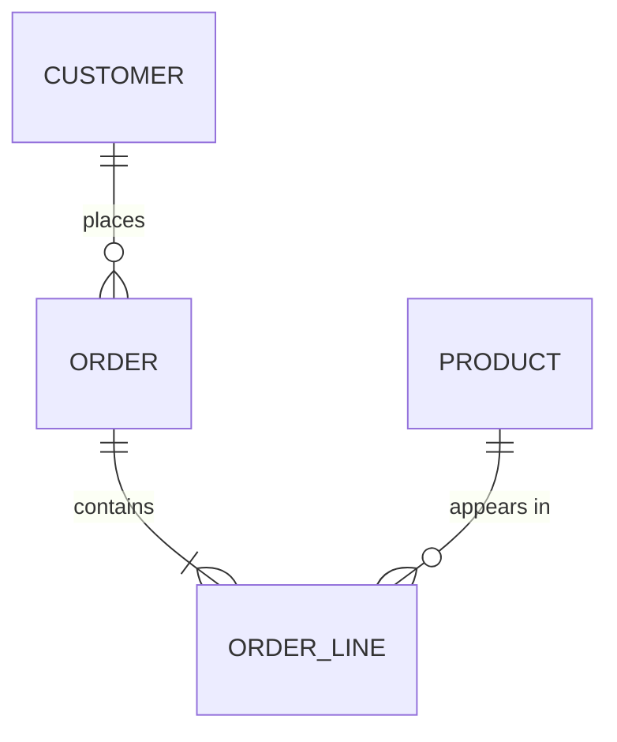

## 🎯 خلاصه

> مدل‌سازی داده در **سه سطح** انجام می‌شود. مدل **مفهومی (conceptual)** می‌گوید کسب‌وکار درباره‌ی چه چیزهایی حرف می‌زند، مدل **منطقی (logical)** می‌گوید آن چیزها چطور به هم مربوط‌اند (کلید، ویژگی، کاردینالیتی)، و مدل **فیزیکی (physical)** می‌گوید یک موتور مشخص چطور آن‌ها را ذخیره می‌کند (جدول، نوع داده، ایندکس، پارتیشن، sort key).

- همان مدل کسب‌وکار روی Postgres، ClickHouse و Cassandra **مدل فیزیکی متفاوت** می‌سازد.
- رفتن از مفهومی به منطقی درباره‌ی معنا و یکپارچگی است. رفتن از منطقی به فیزیکی درباره‌ی موتور و کوئری‌هاست.
- در مصاحبه باید بگویی الان در کدام سطح کار می‌کنی و کدام تصمیم‌ها متعلق به موتور است.

## 🌱 از ساده شروع کنیم (مبتدی)

> **💡 تشبیه:** به ساختن یک خانه فکر کن. مدل **مفهومی** می‌شود طرحِ دستی «یک آشپزخانه، دو اتاق خواب، یک پارکینگ، و همه به هم وصل‌اند». مدل **منطقی** نقشه‌ی معمار است با اندازه‌ی اتاق‌ها، درها و دیوارهای باربر. مدل **فیزیکی** مشخصات ساخت است: چه آجری، چه بتنی، چه پیچی، روی این زمین مشخص.

فرض کن یک فروشگاه آنلاین داریم. در سطح **مفهومی** فقط چیزها و ارتباطشان را نام می‌بریم:

- یک **Customer** (مشتری) **Order** (سفارش) ثبت می‌کند.
- یک **Order** شامل یک یا چند **Product** (محصول) است، از طریق خط‌های سفارش (order line).



این نمودار را این‌طور بخوان: `||--o{` یعنی «یک به چند». یک مشتری صفر یا چند سفارش ثبت می‌کند. یک سفارش یک یا چند خط سفارش دارد. هنوز نوع ستون و کلید نداریم. این سطح مفهومی است.

> **⚠️ مراقب باش:** مدل مفهومی «پیش‌نویس جدول‌ها» نیست. اگر قبل از توافق کسب‌وکار روی معنای «سفارش»، شروع کنی به تایپ `INT` و `VARCHAR(50)`، بعداً باید کل schema را دوباره بسازی.

حالا همین فروشگاه را در سطح **منطقی** ببین. ویژگی‌ها، کلید اصلی، کلید خارجی و کاردینالیتی را اضافه می‌کنیم، ولی هنوز موتوری انتخاب نمی‌کنیم:

| موجودیت | کلید اصلی | ویژگی‌های مهم | رابطه |
|---|---|---|---|
| Customer | customer_id | نام، ایمیل، کشور، تاریخ ثبت‌نام | ثبت Orderها (1 : N) |
| Order | order_id | زمان سفارش، وضعیت، واحد پول | متعلق به یک Customer (N : 1) |
| OrderLine | (order_id, line_no) | product_id، تعداد، قیمت واحد | متعلق به یک Order (N : 1) |
| Product | product_id | نام، دسته، قیمت فهرست | در OrderLineها ظاهر می‌شود (1 : N) |

مدل منطقی به سؤال‌هایی مثل «آیا سفارشی می‌تواند بدون مشتری وجود داشته باشد؟» جواب می‌دهد (نه، پس `customer_id` الزامی است) و «آیا یک محصول می‌تواند در چند سفارش باشد؟» (بله، پس جدول OrderLine لازم است و نه یک ستون روی Order).

در سطح **فیزیکی**، برای سرویس سفارش‌ها Postgres را انتخاب می‌کنیم. حالا نوع داده، قیدها و ایندکس‌ها را تعیین می‌کنیم:

```sql
-- Postgres: OLTP، row store، کلید خارجی اجرا شده
CREATE TABLE customers (
  customer_id bigint PRIMARY KEY,
  email       text NOT NULL UNIQUE,
  country     char(2) NOT NULL
);

CREATE TABLE orders (
  order_id    bigint PRIMARY KEY,
  customer_id bigint NOT NULL REFERENCES customers (customer_id),
  order_ts    timestamptz NOT NULL,
  status      text NOT NULL,
  currency    char(3) NOT NULL
);

CREATE INDEX orders_customer_ts_idx ON orders (customer_id, order_ts);
```

همان واقعیت کسب‌وکار، یعنی «سفارش‌های یک مشتری به ترتیب زمان»، الان جواب فیزیکی دارد: یک ایندکس B-tree روی `(customer_id, order_ts)`.

## 🔧 واقعاً چطور کار می‌کند (متوسط)

سه سطح مثل یک **قیف تصمیم** عمل می‌کنند. هر سطح بعضی گزینه‌ها را حذف می‌کند:

| سطح | سؤالی که جواب می‌دهد | تصمیم‌هایی که گرفته می‌شود | بیشتر چه کسی اهمیت می‌دهد |
|---|---|---|---|
| مفهومی | کسب‌وکار چه چیزهایی دارد و چطور به هم وصل‌اند؟ | موجودیت‌ها، قواعد کسب‌وکار، واژگان | کسب‌وکار، محصول، تحلیلگر |
| منطقی | هر چیز چطور شناسایی و مرتبط می‌شود؟ | کلیدها، ویژگی‌ها، کاردینالیتی، نرمال‌سازی، تاریخچه‌ی تغییرات | معمار داده، مدل‌ساز |
| فیزیکی | این موتور چطور ذخیره و پیدا می‌کند؟ | نوع داده، پارتیشن، sort/cluster key، ایندکس، denormalization، چیدمان فایل | مهندس داده، DBA |

### چه چیزی بین موتورها عوض می‌شود

مدل منطقی یکی است، ولی مدل فیزیکی نه:

- **Postgres (row store، OLTP):** کلید خارجی اجرا می‌شود، جدول‌های نرمال مناسب‌اند، ایندکس B-tree خواندن تک‌رکورد را سریع می‌کند. join در مقیاس کم ارزان است.
- **ClickHouse (ستونی، OLAP):** کلید خارجی اجرا نمی‌شود. `ORDER BY` را انتخاب می‌کنی که هم sort اصلی فیزیکی است و هم پایه‌ی sparse index. معمولاً برای بُعدها denormalize می‌کنی یا از dictionary استفاده می‌کنی، چون join و update در مقایسه با scan گران‌اند.

```sql
-- ClickHouse: نسخه‌ی تحلیلی همان واقعیت‌ها
CREATE TABLE order_lines_analytics (
  order_id    UInt64,
  customer_id UInt64,
  order_ts    DateTime,
  product_id  UInt64,
  quantity    UInt32,
  amount      Decimal(12, 2)
)
ENGINE = MergeTree
PARTITION BY toYYYYMM(order_ts)
ORDER BY (customer_id, order_ts);
```

- **Cassandra (wide-column، query-first):** اول موجودیت‌ها را مدل نمی‌کنی. **کوئری‌ها** را مدل می‌کنی و هر جدول با یک کوئری شکل می‌گیرد. partition key تعیین می‌کند داده کجا قرار بگیرد. ممکن است سفارش‌های یک مشتری در دو جدول باشد: یکی با partition بر اساس مشتری، دیگری بر اساس روز.

```sql
-- Cassandra (CQL): یک جدول برای هر کوئری
CREATE TABLE orders_by_customer (
  customer_id uuid,
  order_ts    timestamp,
  order_id    uuid,
  amount      decimal,
  PRIMARY KEY ((customer_id), order_ts, order_id)
) WITH CLUSTERING ORDER BY (order_ts DESC, order_id ASC);
```

> **🎤 این را در مصاحبه بگو:** «اول مفاهیم کسب‌وکار را منطقی مدل می‌کنم، بعد مدل فیزیکی را برای موتور استخراج می‌کنم. روی Postgres نرمال و ایندکس می‌کنم، روی ClickHouse sort key را انتخاب و برای scan denormalize می‌کنم، روی Cassandra برای هر کوئری یک جدول می‌سازم.»

### ERD در عمل

Entity-Relationship Diagram (ERD) یا نمودار موجودیت-رابطه، تصویر معمول سطح منطقی است. از نماد crow's-foot استفاده کن: `||` یعنی دقیقاً یکی، `o{` یعنی صفر یا چند، `|{` یعنی یک یا چند. ERDها را در بازبینی‌ها در سطح منطقی نگه دار و جزئیات فیزیکی (نوع‌ها، ایندکس‌ها) را در DDL جداگانه بیاور. ترکیب این‌ها نمودار را غیرقابل خواندن می‌کند.

## 🧠 عمق و trade-offها (سنیور)

- **نشت سطوح به هم:** یک رابطه‌ی many-to-many در مدل منطقی به bridge table تبدیل می‌شود، ولی یک تصمیم فیزیکی (denormalize در یک جدول پهن برای سرعت) ممکن است تکرار را برگرداند. دلیل را ثبت کن تا نفر بعدی بداند که عمدی است.
- **کلیدها:** کلید منطقی شناسه‌ی کسب‌وکار است (ایمیل، شماره‌ی سفارش). کلید فیزیکی اغلب surrogate key است (`bigint` یا hash)، چون کلید کسب‌وکار ممکن است عوض شود. هر دو را نگه دار و تصمیم بگیر کدام‌یک فکت‌ها را به بُعدها وصل کند.
- **تاریخچه:** مدل منطقی‌ای که زمان را نادیده می‌گیرد، مدل فیزیکی‌ای می‌سازد که داده را overwrite می‌کند. زود تصمیم بگیر تاریخچه لازم است یا نه (SCD، درس scd را ببین)، چون این تصمیم بیشتر روی مدل فیزیکی اثر می‌گذارد تا روی نمودار.
- **انتخاب‌های ناشی از موتور:** پارتیشن‌بندی در ClickHouse، clustering key در BigQuery و Snowflake، و partition key در Cassandra، همه فیزیکی‌اند. گذاشتن آن‌ها روی ERD منطقی trade-offها را پنهان می‌کند.
- **پایش بعد از عمل:** مدل فیزیکی با گذشت زمان از شکل می‌افتد. latency کوئری، حجم اسکن‌شده، اندازه‌ی پارتیشن و skew را پایش کن و وقتی الگوی کوئری عوض شد، مدل فیزیکی را بازبینی کن.
- **کی بیش‌ازحد مدل نکنیم:** برای یک سرویس کوچک با سه جدول و یک الگوی کوئری، یک ERD روی تخته کافی است. مستندسازی کامل سه‌سطحی وقتی ارزش دارد که تیم‌های زیادی داده‌ی مشترک را استفاده کنند.

## 🧪 امتحان کن

با فروشگاه آنلاین بالا شروع کن. این کارها را روی کاغذ یا یک فایل موقت انجام بده.

1. یک موجودیت `Shipment` (ارسال) اضافه کن. هر ارسال دقیقاً متعلق به یک سفارش است، ولی یک سفارش می‌تواند چند ارسال داشته باشد (تحویل جزئی). رابطه‌ی مفهومی و کاردینالیتی منطقی را رسم کن.
2. DDL در Postgres برای جدول `shipments` را با کلید خارجی به `orders` بنویس.
3. برای داشبوردی که «تعداد ارسال به تفکیک انبار و روز» را نشان می‌دهد، `ORDER BY` در ClickHouse بنویس. انتخابت را در یک جمله توجیه کن.

<details><summary>حدست چیست؟</summary>

1. به صورت مفهومی: `ORDER ||--o{ SHIPMENT : "is delivered in"`. به صورت منطقی، `shipment_id` کلید است و `order_id` کلید خارجی الزامی. کاردینالیتی یک سفارش به صفر یا چند ارسال است.
2. `CREATE TABLE shipments (shipment_id bigint PRIMARY KEY, order_id bigint NOT NULL REFERENCES orders (order_id), warehouse_id bigint NOT NULL, shipped_ts timestamptz NOT NULL);`
3. جواب معقول `ORDER BY (warehouse_id, toDate(shipped_ts))` یا معادل آن با ستون `DateTime` است، چون داشبورد بر اساس انبار و روز فیلتر و گروه‌بندی می‌کند، پس این ستون‌ها باید ابتدای sort key باشند.

</details>

## 💬 گوشه‌ی مصاحبه

**سؤال: «تفاوت مدل مفهومی، منطقی و فیزیکی چیست؟»** جواب متوسط: «مفهومی موجودیت‌ها و روابط است، منطقی کلید و ویژگی اضافه می‌کند، و فیزیکی جدول‌ها برای یک موتور مشخص است.» جواب سنیور: «همان مدل منطقی می‌تواند طراحی فیزیکی متفاوتی بدهد. تصمیم‌های هر سطح را نشان می‌دهم تا بازبین ببیند کدام انتخاب‌ها قاعده‌ی کسب‌وکار است و کدام trade-off موتور، و مدل منطقی را وقتی موتور عوض می‌شود قابل استفاده نگه می‌دارم.»

**سؤال: «چرا مدل فیزیکی همان داده روی Postgres و ClickHouse فرق دارد؟»** جواب متوسط: «Postgres یک row store با کلیدها و ایندکس‌های اجراشده برای جستجوی تکی است؛ ClickHouse ستونی است و بازه‌های بزرگ را scan می‌کند، پس sort key و denormalization مهم‌تر می‌شوند.» جواب سنیور: «اول الگوهای کوئری را نام می‌برم. روی ClickHouse، `ORDER BY` را برای فیلترهای غالب انتخاب می‌کنم، join سنگین در مسیر داغ نمی‌گذارم، و می‌پذیرم که قیدها اجرا نمی‌شوند، پس بررسی‌های کیفیت داده اضافه می‌کنم.»

> **🎤 این را در مصاحبه بگو:** «اول مفاهیم کسب‌وکار را مدل می‌کنم، بعد مدل فیزیکی را برای موتور و کوئری‌ها استخراج می‌کنم. مدل منطقی را مستقل از موتور نگه می‌دارم، تا استدلال با تغییر موتور باقی بماند.»

## ⚠️ اشتباهات رایج

> **⚠️ مراقب باش:** یکی گرفتن نمودار مفهومی با اولین نسخه‌ی جدول‌ها. نوع‌ها و کلیدها بعداً می‌آیند، بعد از اینکه کسب‌وکار معنای هر موجودیت را تأیید کرده.

> **⚠️ مراقب باش:** کپی کردن بی‌تغییر یک schema از Postgres به ClickHouse یا Cassandra. کلیدهای خارجی، ایندکس‌ها و نرمال‌سازی آنجا رفتار متفاوتی دارند.

- گذاشتن جزئیات موتور (پارتیشن، replication factor) روی ERD منطقی.
- مدل کردن many-to-many با یک ستون لیست به جای جدول bridge.
- نادیده گرفتن کاردینالیتی روابط، که پرسش «اختیاری یا الزامی؟» را بی‌جواب می‌گذارد.
- طراحی جدول‌های فیزیکی قبل از فهرست کردن کوئری‌هایی که باید جواب دهند.

## ✅ خودت را بسنج

1. کدام سطح نوع داده، ایندکس و پارتیشن یک جدول را تعیین می‌کند؟
   - A) مفهومی
   - B) منطقی
   - C) فیزیکی
   - D) کسب‌وکار

<details><summary>جواب</summary>

**C** — مدل فیزیکی مخصوص موتور است. نوع داده، ایندکس، پارتیشن و sort key در آن قرار می‌گیرند.

</details>

2. در مدل منطقی، یک محصول می‌تواند در چند سفارش باشد و یک سفارش می‌تواند چند محصول داشته باشد. چه چیزی اضافه می‌کنی؟
   - A) یک ستون لیست از product IDها روی `orders`
   - B) یک جدول bridge (خط سفارش) بین `orders` و `products`
   - C) یک کلید خارجی از `products` به `customers`
   - D) هیچ؛ رابطه‌ی many-to-many جدول نمی‌خواهد

<details><summary>جواب</summary>

**B** — رابطه‌ی many-to-many با جدولی حل می‌شود که برای هر جفت یک سطر دارد (اینجا خط‌های سفارش). ستون لیست فرم نرمال را می‌شکند و join و قید را سخت می‌کند.

</details>

3. همان واقعیت‌ها را از Postgres به ClickHouse برای داشبوردها منتقل می‌کنی. کدام تغییر معمول‌تر است؟
   - A) افزودن کلید خارجی بیشتر
   - B) انتخاب `ORDER BY` به عنوان sort key و denormalize بُعدهایی که داشبورد لازم دارد
   - C) حذف همه‌ی ایندکس‌ها و افزودن قید unique روی همه‌ی ستون‌ها
   - D) برگرداندن مدل به مفهومی

<details><summary>جواب</summary>

**B** — موتورهای تحلیلی ستونی به sort key و scan تکیه دارند. join و قیدهای اجراشده گران‌اند، پس معمولاً ویژگی‌های لازم کوئری‌ها را denormalize می‌کنی.

</details>

4. **(سنیور)** تیمی `partition_key`، `clustering_key` و `replication_factor` را روی ERD منطقی می‌گذارد. خطر چیست؟

   - A) هیچ، ERD تنها منبع حقیقت است
   - B) نمودار تصمیم‌های موتور را وارد مدل کسب‌وکار می‌کند، پس مدل منطقی روی موتور دیگر قابل استفاده نیست و trade-offها پنهان می‌شوند
   - C) ERD نمی‌تواند عدد داشته باشد
   - D) replication factor باید در مدل مفهومی باشد

<details><summary>جواب</summary>

**B** — مدل منطقی را مستقل از موتور نگه دار. انتخاب‌های موتور را در DDL فیزیکی بگذار، کنار کوئری‌ای که دلیل آن است، تا بازبین trade-off را ببیند.

</details>

5. **(سنیور)** چرا مدل فیزیکی Cassandra اغلب از روی لیست کوئری‌ها ساخته می‌شود و نه از روی نمودار موجودیت‌ها؟

   - A) Cassandra نمی‌تواند موجودیت ذخیره کند
   - B) Cassandra join ندارد و دسترسی کارا فقط با partition key است، پس هر کوئری به جدولی نیاز دارد که partition key آن با کوئری هم‌خوان باشد
   - C) Cassandra به مدل مفهومی به زبان SQL نیاز دارد
   - D) موجودیت‌ها در مخزن wide-column مجاز نیستند

<details><summary>جواب</summary>

**B** — با نبودن join بین پارتیشن‌ها و دسترسی کارا با partition key، طراحی جدول از کوئری‌ها پیروی می‌کند. مدل موجودیت هنوز واژگان را می‌دهد، ولی جدول‌های فیزیکی به ازای هر الگوی دسترسی ساخته می‌شوند.

</details>

## 🗂️ فلش‌کارت

| جلو | پشت |
|---|---|
| مدل مفهومی | موجودیت‌های کسب‌وکار و ارتباطشان؛ بدون کلید و بدون نوع داده |
| مدل منطقی | کلید، ویژگی، کاردینالیتی و فرم نرمال؛ مستقل از موتور |
| مدل فیزیکی | نوع داده، ایندکس، پارتیشن و sort key مخصوص موتور |
| رابطه‌ی many-to-many در مدل منطقی | با bridge table (جدول واسط) حل می‌شود |
| کاردینالیتی `||--o{` | یک به صفر-یا-چند |
| چه چیزی طراحی جدول ClickHouse را هدایت می‌کند؟ | کلید `ORDER BY` و scanهایی که داشبورد لازم دارد |
| چه چیزی طراحی جدول Cassandra را هدایت می‌کند؟ | کوئری؛ یک جدول برای هر الگوی دسترسی و partition key |

## 🔗 ادامه

- **normalization** قواعد پشت یک مدل منطقی تمیز را توضیح می‌دهد، و اینکه چرا در سطح فیزیکی ممکن است denormalize کنی.
- **dimensional-modeling** مسیر منطقی-به-فیزیکی را برای تحلیل (فکت، بُعد، grain) نشان می‌دهد.
- **physical-modeling-olap** عمیق‌تر به sort key، پارتیشن و چیدمان فایل در موتورهای ستونی می‌پردازد.
- **nosql-modeling** طراحی query-first را برای Cassandra، HBase و Redis پوشش می‌دهد.
- **modeling-methodologies** روش‌های Inmon، Kimball و Data Vault را مقایسه می‌کند؛ این روش‌ها بیشتر در این‌اند که سه سطح را برای کل انبار داده چطور می‌چینند.
