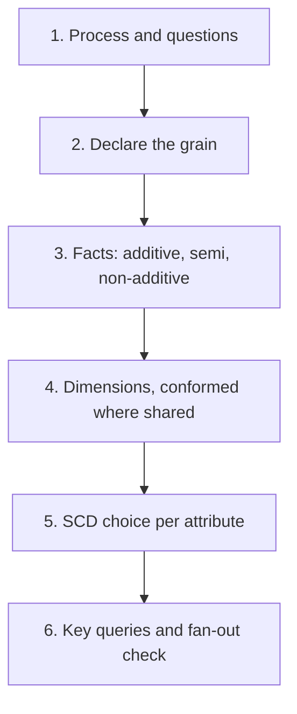

## 🎯 خلاصه

> مصاحبهٔ مدل‌سازی یک **گفتگو با یک روش** است، نه مسابقهٔ نقاشی. برای هر فرایند کسب‌وکار، اول **grain** را بگو، بعد **factها** که در آن grain اندازه‌گیری می‌شوند، بعد **dimensionها** که آن‌ها را توصیف می‌کنند، بعد قاعدهٔ **SCD** برای هر ویژگی، و در آخر **کوئری‌هایی** که مدل باید جواب دهد.

- اول grain: یک جمله که بگوید یک سطر یعنی چه. بقیهٔ چیزها از آن نتیجه می‌شوند.
- factها یا **additive** هستند (قابل جمع روی همه‌ی بعدها)، یا **semi-additive** (مثل موجودی حساب، فقط روی زمان قابل جمع نیستند)، یا **non-additive** (نسبت‌ها). معیار پایه را ذخیره کن و نسبت‌ها را در کوئری حساب کن.
- برای هر جدول fact یک grain نگه دار. جدولی که چند grain را مخلوط کند، ریشهٔ بیشتر خطاهای دوبارشماری است.
- برای هر ویژگی یک نوع SCD انتخاب کن، بر اساس سؤال‌هایی که مردم دربارهٔ گذشته می‌پرسند.

## 🌱 از ساده شروع کنیم (مبتدی)

> **💡 تشبیه:** یک رسید کافه. هر خط می‌گوید «۱ × لاته، ۴۵٬۰۰۰ تومان». grain جدول فروش **یک خط رسید** است. اگر به‌جایش جمع کل رسید را ذخیره کنی، دیگر نمی‌توانی به سؤال «امروز چند لاته فروخته‌ایم؟» جواب بدهی.

```sql
CREATE TABLE fact_sale_line (
  receipt_id   text NOT NULL,
  line_no      int  NOT NULL,
  item_key     int  NOT NULL,   -- dim_item
  date_key     int  NOT NULL,   -- dim_date, e.g. 20260315
  quantity     int  NOT NULL,
  line_amount  numeric(10,2) NOT NULL,
  PRIMARY KEY (receipt_id, line_no)
);

-- Lattes sold per day: possible only because the grain is one line
SELECT date_key, SUM(quantity) AS lattes
FROM fact_sale_line
WHERE item_key = 7
GROUP BY date_key;
```

همین مراحل برای هر دامنه‌ی واقعی کار می‌کند. مسئله‌های پایین جایی هستند که این مراحل را تمرین می‌کنی.

## 🔧 واقعاً چطور کار می‌کند (متوسط)

برای هر مسئله همین شش مرحله را استفاده کن. در مصاحبه بلند بگو، چون مصاحبه‌گر دارد روش را می‌سنجد.



- **فرایند و سؤال‌ها.** چه رویدادی رخ می‌دهد و کسب‌وکار هر هفته چه می‌پرسد؟ سه سؤال بنویس. factها از روی همین‌ها ساخته می‌شوند.
- **grain.** یک سفر، یک خط سفارش، یک CDR، یک impression، یک خط حقوق برای هر جزء. آن را به‌صورت یک جمله بنویس.
- **factها.** معیارهای عددی در همان grain. `fare_amount` additive است. `on_hand_qty` semi-additive است: می‌توانی روی انبارها جمع بزنی ولی روی روزها نه. `ctr` non-additive است: کلیک و impression را ذخیره کن و در کوئری تقسیم کن.
- **dimensionها.** چه کسی، چه چیزی، کجا و کی. از surrogate key استفاده کن، و برای مقادیر گمشده، مثل پیکی که هنوز تخصیص داده نشده، یک عضو «ناشناخته» (کلید `-1`) اضافه کن.
- **SCD.** برای هر ویژگی بپرس: «آیا مقدار را همان‌طور که در لحظهٔ رویداد بوده لازم داریم؟» اگر بله، Type 2 (یک سطر جدید با `valid_from` و `valid_to`). اگر نه، بازنویسی (Type 1). قیمت‌ها در fact هستند، نه در dimension.
- **کوئری‌های کلیدی و fan-out.** دو کوئری مهم را در ذهن اجرا کن. اگر یک کوئری دو fact را در grainهای مختلف join می‌کند، اول هر fact را به یک grain مشترک جمع بزن، وگرنه جمع‌ها بزرگ می‌شوند.

مثال: یک راننده در ۱۵ اسفند نوع خودرویش را عوض می‌کند. سفری در ۱۰ اسفند باید خودروی قبلی را نشان دهد. با Type 2 روی `dim_driver`، `driver_key` سفر به نسخهٔ قدیمی اشاره می‌کند و جواب بدون منطق اضافی درست است.

## 🧠 عمق و trade-offها (سنیور)

- **fan-out قاتل بی‌صداست.** join کردن `fact_order_line` به `fact_return_line` مبلغ هر سفارش را برای هر برگشت ضرب می‌کند. راه حل: برای هر fact یک CTE بنویس که به محصول و تاریخ گروه شده باشد، و بعد join کن.
- **dimensionهای conformed بین دامنه‌ها.** `dim_date`، `dim_zone` و `dim_customer` باید در هر جدول fact یک معنا داشته باشند، تا درآمد و برگشتی، یا سفر و پرداختی، قابل مقایسه باشند. قبل از نوشتن DDL، تعریف‌ها را توافق کن.
- **ذخیرهٔ کلیدی که در زمان رویداد معتبر بوده.** rating مخابراتی و حقوق هر دو به این نیاز دارند. rating روی هر سطر مصرف، `tariff_key` را می‌نویسد تا تغییر بعدی قیمت تاریخچه را بازنویسی نکند. حقوق نسخهٔ کارمندی را استفاده می‌کند که در پایان دورهٔ پرداخت معتبر بوده، و این قاعده را صریح می‌گوید.
- **بازمحاسبه و داده‌ی دیررسیده.** یک CDR اصلاح‌شده، یک برگشت پول دیررسیده یا تغییر حقوق با اثر گذشته باید **یک سطر جدید** باشد (با فلگ اصلاح و `run_id`)، نه به‌روزرسانی یک دورهٔ بسته. به‌روزرسانی ردپای حسابرسی را از بین می‌برد و گزارش‌های قدیمی را غیرقابل بازتولید می‌کند. نگاه کن به [[late-arriving-data]].
- **روابط چند-به-چند.** یک آگهی در دو دسته، یا یک کارمند در دو دپارتمان، به یک جدول bridge با وزن نیاز دارد، یا به قاعدهٔ «یک دسته‌ی اصلی». یکی را انتخاب کن و مستند کن.
- **اعداد مقیاس.** یک اپراتور مخابراتی با ۱۰۰ میلیون مشترک و ۲۰ رویداد مصرف برای هر مشترک در روز، روزانه ۱۰۰ میلیون × ۲۰ = ۲ × ۱۰⁹ سطر می‌نویسد. بر اساس تاریخ رویداد پارتیشن کن، grain خام را ۳۰ روز نگه دار، و برای داشبوردها به ساعتی و برای هر مشترک جمع بزن.
- **داده‌ی حساس.** شمارهٔ تلفن، کد ملی، شمارهٔ حساب و حقوق باید در مدل masked یا tokenised شوند و دسترسی‌شان محدود باشد. این را در مصاحبه بگو؛ نشانهٔ سنیور بودن است.
- **موتورها.** موتورهای ستونی (ClickHouse، StarRocks، Snowflake، BigQuery) fact‌های پهن و denormalised را ترجیح می‌دهند؛ منطق star همچنان درست است. طراحی فیزیکی را برای موتور خودت بررسی کن، نگاه کن به [[star-schema]].

## 🧪 امتحان کن

هر مسئلهٔ زیر یک شرح کوتاه است. قبل از باز کردن جواب، سعی کن grain، factها، dimensionها، انتخاب SCD، DDL و دو کوئری را بنویسی. DDL یک طرح با سبک PostgreSQL است؛ نوع‌ها را برای موتور خودت تطبیق بده.

**۱. Ride-hailing (سفرها، رانندگان، قیمت‌گذاری، surge).** سفرهای تکمیل‌شده، درآمد رانندگان و ضریب surge را که بر اساس منطقه و زمان اعمال می‌شود مدل کن.

<details><summary>مدل را ببین</summary>

- **Grain:** یک سطر برای هر سفر تکمیل‌شده. surge یک snapshot جداست: یک سطر برای هر منطقه در هر دقیقه.
- **Factها:** `distance_km`، `duration_s`، `fare_amount`، `surge_multiplier`، `driver_payout` (additive)؛ تقاضا و عرضه در snapshot.
- **Dimensionها:** `dim_rider`، `dim_driver`، `dim_zone` (با نقش مبدأ و مقصد)، `dim_vehicle_type`، `dim_date`.
- **SCD:** `dim_driver` روی خودرو و شهر مبدأ Type 2 است، تا پرداخت‌های تاریخی درست بمانند. `dim_rider` Type 1 است. مناطق فقط اگر مرزها دوباره کشیده شوند Type 2 هستند.

```sql
CREATE TABLE fact_trip (
  trip_key          bigint PRIMARY KEY,
  trip_id           text NOT NULL,      -- degenerate dimension
  rider_key         bigint NOT NULL,
  driver_key        bigint NOT NULL,    -- version valid at trip time
  pickup_zone_key   int NOT NULL,
  dropoff_zone_key  int NOT NULL,
  date_key          int NOT NULL,
  completed_at      timestamptz NOT NULL,
  distance_km       numeric(8,2),
  duration_s        int,
  fare_amount       numeric(12,2),
  surge_multiplier  numeric(4,2),
  driver_payout     numeric(12,2)
);

-- Average surge and fare per pickup zone per day
SELECT z.zone_name, d.full_date, AVG(f.surge_multiplier) AS avg_surge, AVG(f.fare_amount) AS avg_fare
FROM fact_trip f
JOIN dim_zone z ON z.zone_key = f.pickup_zone_key
JOIN dim_date d ON d.date_key = f.date_key
GROUP BY z.zone_name, d.full_date;

-- Driver payout by vehicle type, as it was at trip time
SELECT dr.vehicle_type, SUM(f.driver_payout) AS payout
FROM fact_trip f
JOIN dim_driver dr ON dr.driver_key = f.driver_key
WHERE f.date_key BETWEEN 20260101 AND 20260131
GROUP BY dr.vehicle_type;
```

</details>

**۲. E-commerce (سفارش‌ها، اقلام، موجودی، برگشت).** درآمد سفارش، برگشت پول و سطح موجودی در هر انبار را مدل کن.

<details><summary>مدل را ببین</summary>

- **Grain:** خط سفارش (فروش)؛ خط برگشتی (برگشت)؛ انبار × محصول × روز (snapshot موجودی).
- **Factها:** `quantity`، `net_amount`، `refund_amount` (additive)؛ `on_hand_qty` (semi-additive).
- **Dimensionها:** `dim_customer`، `dim_product`، `dim_warehouse`، `dim_promotion` (با عضو ناشناخته)، `dim_date`. شناسهٔ سفارش یک degenerate dimension است.
- **SCD:** `dim_product` روی دسته‌بندی Type 2 است، اگر گزارش‌ها باید دسته‌بندی زمان فروش را نشان دهند. `dim_customer` روی segment Type 2 است. قیمت واحد در fact است.

```sql
CREATE TABLE fact_order_line (
  order_line_key bigint PRIMARY KEY,
  order_id       text NOT NULL,
  line_no        smallint NOT NULL,
  customer_key   bigint NOT NULL,
  product_key    bigint NOT NULL,
  promotion_key  int NOT NULL DEFAULT -1,
  date_key       int NOT NULL,
  quantity       int NOT NULL,
  unit_price     numeric(12,2) NOT NULL,
  net_amount     numeric(12,2) NOT NULL,
  UNIQUE (order_id, line_no)
);
CREATE TABLE fact_return_line (
  return_line_key bigint PRIMARY KEY,
  order_line_key  bigint NOT NULL REFERENCES fact_order_line,
  return_date_key int NOT NULL,
  returned_qty    int NOT NULL,
  refund_amount   numeric(12,2) NOT NULL
);
CREATE TABLE fact_inventory_daily (
  date_key int, warehouse_key int, product_key bigint,
  on_hand_qty int NOT NULL,
  PRIMARY KEY (date_key, warehouse_key, product_key)
);

-- Net revenue per category for September 2026 (aggregate each fact first to avoid fan-out)
WITH sales AS (
  SELECT product_key, SUM(net_amount) AS sold
  FROM fact_order_line WHERE date_key BETWEEN 20260901 AND 20260930
  GROUP BY product_key
), refunds AS (
  SELECT ol.product_key, SUM(r.refund_amount) AS refunded
  FROM fact_return_line r
  JOIN fact_order_line ol ON ol.order_line_key = r.order_line_key
  WHERE r.return_date_key BETWEEN 20260901 AND 20260930
  GROUP BY ol.product_key
)
SELECT p.category, SUM(s.sold) - SUM(COALESCE(r.refunded, 0)) AS net_revenue
FROM sales s
LEFT JOIN refunds r ON r.product_key = s.product_key
JOIN dim_product p ON p.product_key = s.product_key
GROUP BY p.category;

-- Products out of stock in one warehouse on a given day
SELECT warehouse_key, product_key
FROM fact_inventory_daily
WHERE date_key = 20260930 AND on_hand_qty = 0;
```

</details>

**۳. مخابرات: CDR و صورتحساب (تماس، پیامک، جلسات داده، مشترکان، تعرفه‌ها).** رکوردهای مصرف، نرخی که به هر کدام اعمال می‌شود، و صورتحساب ماهانه را مدل کن.

<details><summary>مدل را ببین</summary>

- **Grain:** یک سطر برای هر رکورد مصرف rated شده (تماس، پیامک یا جلسهٔ داده). صورتحساب: یک سطر برای هر مشترک، دورهٔ صورتحساب و نوع هزینه.
- **Factها:** `duration_s`، `bytes_total`، `rated_amount` (additive).
- **Dimensionها:** `dim_subscriber`، `dim_tariff`، `dim_cell_site`، `dim_event_type`، `dim_date`، `dim_time`.
- **SCD:** `dim_subscriber` روی پلن و وضعیت Type 2 است. `dim_tariff` نسخه‌های نرخ با تاریخ اعتبار دارد. مرحلهٔ rating، `tariff_key` معتبر در زمان رویداد را ذخیره می‌کند، پس تغییر قیمت هرگز تاریخچه را بازنویسی نمی‌کند.

```sql
CREATE TABLE fact_usage (
  usage_key      bigint PRIMARY KEY,
  source_cdr_id  text NOT NULL UNIQUE,     -- makes replays idempotent
  subscriber_key bigint NOT NULL,
  tariff_key     int NOT NULL,
  cell_key       int NOT NULL,
  event_type_key smallint NOT NULL,
  started_at     timestamptz NOT NULL,
  duration_s     int,
  bytes_total    bigint,
  rated_amount   numeric(12,4) NOT NULL
);
CREATE TABLE fact_invoice_line (
  subscriber_key bigint NOT NULL,
  cycle_start    date NOT NULL,
  charge_type    text NOT NULL,
  amount         numeric(12,2) NOT NULL,
  PRIMARY KEY (subscriber_key, cycle_start, charge_type)
);

-- Data volume (GB) per plan per day
SELECT s.plan_name, date_trunc('day', f.started_at) AS day,
       SUM(f.bytes_total) / 1000000000.0 AS gb
FROM fact_usage f
JOIN dim_subscriber s ON s.subscriber_key = f.subscriber_key
JOIN dim_event_type e ON e.event_type_key = f.event_type_key
WHERE e.event_type_name = 'data_session'
GROUP BY 1, 2;

-- Rated revenue per tariff per month
SELECT t.tariff_name, date_trunc('month', f.started_at) AS month, SUM(f.rated_amount) AS revenue
FROM fact_usage f
JOIN dim_tariff t ON t.tariff_key = f.tariff_key
GROUP BY 1, 2;
```

</details>

**۴. تراکنش‌های بانکی و موجودی حساب.** postingهای دفتر کل، موجودی در هر تاریخ و صورت‌حساب ماهانه را مدل کن.

<details><summary>مدل را ببین</summary>

- **Grain:** یک سطر برای هر پای دفتر کل (یک انتقال دو پا ایجاد می‌کند). موجودی: یک سطر برای هر حساب در هر روز.
- **Factها:** `amount` با علامت از دید حساب (مثبت = پول ورودی)، `amount_base` به ارز پایه (additive)؛ `closing_balance` (semi-additive: هرگز روی روزها جمع نزن).
- **Dimensionها:** `dim_account`، `dim_customer`، `dim_txn_type`، `dim_branch`، `dim_currency`، `dim_date`. ویژگی‌های تقویم شمسی (ماه جلالی، دورهٔ مالی) را به `dim_date` اضافه کن، ولی کلیدهای میلادی را نگه دار.
- **SCD:** `dim_account` روی وضعیت، نوع محصول و سقف برداشت Type 2 است. `dim_customer` روی سطح KYC و بخش ریسک Type 2 است.

```sql
CREATE TABLE fact_ledger_entry (
  entry_key       bigint PRIMARY KEY,
  txn_id          text NOT NULL,           -- groups the legs of one transaction
  account_key     bigint NOT NULL,
  txn_type_key    smallint NOT NULL,
  currency_key    smallint NOT NULL,
  posted_date_key int NOT NULL,
  posted_at       timestamptz NOT NULL,
  amount          numeric(18,2) NOT NULL,
  amount_base     numeric(18,2) NOT NULL
);
CREATE TABLE fact_balance_daily (
  date_key        int NOT NULL,
  account_key     bigint NOT NULL,
  closing_balance numeric(18,2) NOT NULL,
  PRIMARY KEY (date_key, account_key)
);

-- Month-end balance per account, September 2026 (PostgreSQL DISTINCT ON)
SELECT DISTINCT ON (account_key) account_key, date_key, closing_balance
FROM fact_balance_daily
WHERE date_key BETWEEN 20260901 AND 20260930
ORDER BY account_key, date_key DESC;

-- Net flow per transaction type per day
SELECT posted_date_key, txn_type_key, SUM(amount) AS net_flow
FROM fact_ledger_entry
GROUP BY posted_date_key, txn_type_key;
```

</details>

**۵. بازار غذای آنلاین (سه‌طرفه).** سفارش‌هایی را مدل کن که مشتری، رستوران و پیک در آن‌ها هستند، با زمان‌بندی و پول برای هر طرف.

<details><summary>مدل را ببین</summary>

- **Grain:** یک سطر برای هر سفارش. سطر یک **accumulating snapshot** است: زمان‌ها با حرکت سفارش در وضعیت‌ها پر می‌شوند.
- **Factها:** `subtotal`، `delivery_fee`، `tip`، `commission_amount`، `courier_payout` (additive)؛ مدت‌ها از تفاضل زمان‌ها به دست می‌آیند.
- **Dimensionها:** `dim_customer`، `dim_restaurant`، `dim_courier`، `dim_zone`، `dim_date`، `dim_time`. پیکی که تخصیص داده نشده از عضو ناشناخته استفاده می‌کند.
- **SCD:** `dim_restaurant` روی طرح کمیسیون و نوع آشپزی Type 2 است (قراردادها عوض می‌شوند). `dim_courier` روی نوع خودرو Type 2 است.
- **نکته:** GMV یک بار و روی grain سفارش تعریف می‌شود. پول هر طرف یک ستون است، پس چیزی دوبار شمرده نمی‌شود.

```sql
CREATE TABLE fact_order_lifecycle (
  order_key         bigint PRIMARY KEY,
  order_id          text NOT NULL UNIQUE,
  customer_key      bigint NOT NULL,
  restaurant_key    bigint NOT NULL,      -- version valid at order time
  courier_key       bigint NOT NULL DEFAULT -1,
  zone_key          int NOT NULL,
  placed_at         timestamptz NOT NULL,
  accepted_at       timestamptz,
  picked_up_at      timestamptz,
  delivered_at      timestamptz,
  subtotal          numeric(12,2) NOT NULL,
  delivery_fee      numeric(10,2) NOT NULL DEFAULT 0,
  commission_amount numeric(12,2) NOT NULL DEFAULT 0,
  courier_payout    numeric(12,2) NOT NULL DEFAULT 0,
  tip               numeric(10,2) NOT NULL DEFAULT 0
);

-- Median delivery minutes per city per day (PostgreSQL ordered-set aggregate)
SELECT z.city, date_trunc('day', f.placed_at) AS day,
       percentile_cont(0.5) WITHIN GROUP (ORDER BY EXTRACT(EPOCH FROM (f.delivered_at - f.placed_at)) / 60) AS median_minutes
FROM fact_order_lifecycle f
JOIN dim_zone z ON z.zone_key = f.zone_key
WHERE f.delivered_at IS NOT NULL
GROUP BY 1, 2;

-- Commission revenue by restaurant commission plan
SELECT r.commission_plan, SUM(f.commission_amount) AS commission
FROM fact_order_lifecycle f
JOIN dim_restaurant r ON r.restaurant_key = f.restaurant_key
GROUP BY r.commission_plan;
```

</details>

**۶. تبلیغات (impression، کلیک، تبدیل، attribution).** impressionها، کلیک‌ها و تبدیل‌ها را مدل کن و تبدیل‌ها را طبق بیش از یک مدل attribution به کانال‌ها نسبت بده.

<details><summary>مدل را ببین</summary>

- **Grain:** impression (نمایش آگهی)، کلیک، تبدیل، و سطر attribution (یک تبدیل × یک impression × یک مدل).
- **Factها:** تعداد impression، `cost_micros`، `conversion_value`، `weight` (non-additive، ولی وزن‌ها برای هر تبدیل جمعشان ۱ است).
- **Dimensionها:** `dim_campaign`، `dim_ad_group`، `dim_creative`، `dim_placement`، `dim_device`، `dim_date`. آگهی‌دهنده (advertiser) روی مدیر حساب Type 2 است.
- **نکته:** شناسهٔ خام کاربر را در dimensionها ذخیره نکن؛ از hash با salt و سیاست نگهداری استفاده کن.

```sql
CREATE TABLE fact_impression (
  impression_id text PRIMARY KEY,
  campaign_key  int NOT NULL,
  creative_key  int NOT NULL,
  placement_key int NOT NULL,
  date_key      int NOT NULL,
  served_at     timestamptz NOT NULL,
  cost_micros   bigint NOT NULL
);
CREATE TABLE fact_click (
  click_id      text PRIMARY KEY,
  impression_id text NOT NULL REFERENCES fact_impression,
  clicked_at    timestamptz NOT NULL
);
CREATE TABLE fact_conversion (
  conversion_id    text PRIMARY KEY,
  converted_at     timestamptz NOT NULL,
  conversion_value numeric(12,2) NOT NULL
);
CREATE TABLE fact_attribution (
  conversion_id text NOT NULL REFERENCES fact_conversion,
  impression_id text NOT NULL REFERENCES fact_impression,
  model         text NOT NULL,           -- e.g. 'linear', 'last_click'
  weight        numeric(5,4) NOT NULL,
  PRIMARY KEY (conversion_id, impression_id, model)
);

-- CTR per campaign per day (aggregate each side before joining)
WITH imp AS (
  SELECT campaign_key, date_key, COUNT(*) AS impressions
  FROM fact_impression GROUP BY campaign_key, date_key
), clk AS (
  SELECT i.campaign_key, i.date_key, COUNT(*) AS clicks
  FROM fact_click c JOIN fact_impression i ON i.impression_id = c.impression_id
  GROUP BY i.campaign_key, i.date_key
)
SELECT imp.campaign_key, imp.date_key,
       COALESCE(clk.clicks, 0)::numeric / imp.impressions AS ctr
FROM imp LEFT JOIN clk USING (campaign_key, date_key);

-- Conversion value credited per channel under the linear model
SELECT c.channel, SUM(a.weight * cv.conversion_value) AS credited_value
FROM fact_attribution a
JOIN fact_conversion cv ON cv.conversion_id = a.conversion_id
JOIN fact_impression i ON i.impression_id = a.impression_id
JOIN dim_campaign c ON c.campaign_key = i.campaign_key
WHERE a.model = 'linear'
GROUP BY c.channel;
```

</details>

**۷. اشتراک / SaaS (MRR، churn).** MRR ماهانه برای هر حساب، حرکت‌ها بین ماه‌ها، و logo churn را مدل کن.

<details><summary>مدل را ببین</summary>

- **Grain:** snapshot ماهانهٔ MRR (حساب × ماه) و رویداد حرکت MRR (حساب × ماه × نوع حرکت).
- **Factها:** `mrr` (semi-additive: روی حساب‌ها جمع می‌شود، ولی فقط برای یک ماه)، `mrr_delta` (additive).
- **Dimensionها:** `dim_account` (Type 2 روی segment، منطقه و مالک حساب)، `dim_plan`، `dim_date` (grain ماهانه).
- **تعریف‌هایی که باید بگویی:** churn یعنی MRR از مثبت به صفر برسد. کاهش پلن contraction است، نه churn. MRR را به ارز قرارداد و یک ستون با ارز ثابت ذخیره کن.

```sql
CREATE TABLE fact_mrr_monthly (
  month_start date NOT NULL,
  account_key bigint NOT NULL,
  mrr         numeric(12,2) NOT NULL,
  PRIMARY KEY (month_start, account_key)
);
CREATE TABLE fact_mrr_movement (
  movement_id    bigint PRIMARY KEY,
  account_key    bigint NOT NULL,
  movement_month date NOT NULL,
  movement_type  text NOT NULL CHECK (movement_type IN ('new','expansion','contraction','churn','reactivation')),
  mrr_delta      numeric(12,2) NOT NULL
);

-- MRR bridge for October 2026
SELECT movement_type, SUM(mrr_delta) AS mrr_change
FROM fact_mrr_movement
WHERE movement_month = DATE '2026-10-01'
GROUP BY movement_type;

-- Logo churn rate: accounts paying in September and not paying in October
WITH prev AS (
  SELECT account_key FROM fact_mrr_monthly
  WHERE month_start = DATE '2026-09-01' AND mrr > 0
)
SELECT COUNT(*) FILTER (WHERE c.mrr IS NULL OR c.mrr = 0)::numeric / COUNT(*) AS logo_churn_rate
FROM prev p
LEFT JOIN fact_mrr_monthly c
  ON c.account_key = p.account_key AND c.month_start = DATE '2026-10-01';
```

</details>

**۸. استریم موسیقی و ویدیو (پخش‌ها، جلسات).** پخش‌ها، زمان گوش دادن و جلسات را برای یک سرویس استریمینگ مدل کن.

<details><summary>مدل را ببین</summary>

- **Grain:** یک سطر برای هر پخش (playbackی که شروع شده). جلسات مشتق می‌شوند و به‌عنوان dimension ذخیره نمی‌شوند.
- **Factها:** `listened_seconds`، `completed` (۰/۱) و تعداد پخش ۱ (همه additive).
- **Dimensionها:** `dim_user`، `dim_content` (آهنگ، قسمت پادکست یا ویدیو)، `dim_artist`، `dim_device`، `dim_date`.
- **SCD:** `dim_user` روی سطح پلن و کشور Type 2 است (مجوزها و گزارش‌ها به آن‌ها وابسته‌اند). `dim_content` روی قلمروهای مجاز Type 2 است، اگر بازه‌های حق نشر مهم باشند.
- **Dedup:** کلاینت یک `play_id` می‌فرستد؛ pipeline هارت‌بیت‌ها را در یک سطر برای هر پخش ادغام می‌کند، و اجرای مجدد نباید سطر تکراری بسازد.

```sql
CREATE TABLE fact_play (
  play_id          uuid PRIMARY KEY,
  user_key         bigint NOT NULL,     -- version valid at play time
  content_key      bigint NOT NULL,
  device_key       int NOT NULL,
  date_key         int NOT NULL,
  started_at       timestamptz NOT NULL,
  listened_seconds int NOT NULL,
  completed        boolean NOT NULL
);

-- Listening minutes per country and plan tier per day
SELECT u.country, u.plan_tier, d.full_date, SUM(p.listened_seconds) / 60.0 AS listen_minutes
FROM fact_play p
JOIN dim_user u ON u.user_key = p.user_key
JOIN dim_date d ON d.date_key = p.date_key
GROUP BY 1, 2, 3;

-- Completion rate per content item, ignoring items with very few plays
SELECT content_key, COUNT(*) AS plays, AVG(completed::int) AS completion_rate
FROM fact_play
GROUP BY content_key
HAVING COUNT(*) >= 1000;
```

</details>

**۹. بازار آگهی‌های طبقه‌بندی‌شده (آگهی‌ها، تماس‌ها).** آگهی‌ها را از انتشار تا فروش یا انقضا مدل کن، و تماس‌هایی را که خریداران با فروشندگان می‌گیرند.

<details><summary>مدل را ببین</summary>

- **Grain:** آگهی (یک سطر برای هر آگهی، یک accumulating snapshot از چرخهٔ عمرش)؛ تماس (یک سطر برای هر تماس خریدار با فروشنده).
- **Factها:** `asking_price` (additive روی آگهی‌ها، و روی خود آگهی ذخیره می‌شود نه در dimension)، `days_on_market` (مشتق‌شده)، تعداد تماس (از grain تماس).
- **Dimensionها:** `dim_category` (سطح‌ها تخت شده‌اند؛ هر آگهی یک دستهٔ اصلی دارد)، `dim_location`، `dim_seller`، `dim_channel`، `dim_date`.
- **SCD:** `dim_seller` روی سطح فروشنده و شخصی یا تجاری بودن Type 2 است. تاریخچهٔ قیمت، اگر لازم باشد، در یک fact جدا از تغییر قیمت است.
- **حریم خصوصی:** شمارهٔ تلفن و محتوای چت جزو این مدل نیستند.

```sql
CREATE TABLE fact_listing (
  listing_key      bigint PRIMARY KEY,
  listing_id       text NOT NULL UNIQUE,
  seller_key       bigint NOT NULL,
  category_key     int NOT NULL,
  location_key     int NOT NULL,
  published_at     timestamptz NOT NULL,
  first_contact_at timestamptz,
  closed_at        timestamptz,           -- sold or expired
  status           text NOT NULL,
  asking_price     numeric(14,0) NOT NULL -- rial (IRR), no decimals
);
CREATE TABLE fact_contact (
  contact_id   text PRIMARY KEY,
  listing_key  bigint NOT NULL REFERENCES fact_listing,
  buyer_key    bigint NOT NULL,
  seller_key   bigint NOT NULL,
  contacted_at timestamptz NOT NULL,
  channel      text NOT NULL
);

-- Listings published and listings with at least one contact, per category per month
SELECT c.category_name, date_trunc('month', l.published_at) AS month,
       COUNT(*) AS listings,
       COUNT(*) FILTER (WHERE l.first_contact_at IS NOT NULL) AS contacted_listings
FROM fact_listing l
JOIN dim_category c ON c.category_key = l.category_key
GROUP BY 1, 2;

-- Median days on market for sold listings per category
SELECT c.category_name,
       percentile_cont(0.5) WITHIN GROUP (ORDER BY EXTRACT(EPOCH FROM (l.closed_at - l.published_at)) / 86400) AS median_days
FROM fact_listing l
JOIN dim_category c ON c.category_key = l.category_key
WHERE l.status = 'sold'
GROUP BY c.category_name;
```

</details>

**۱۰. HR / حقوق با تغییرات تاریخی.** کارمندانی را مدل کن که دپارتمان، درجه و وضعیت‌شان در طول زمان عوض می‌شود، و حقوقی که در هر دوره پرداخت شده، شامل اصلاحات با اثر گذشته.

<details><summary>مدل را ببین</summary>

- **Grain:** خط حقوق (کارمند × دورهٔ پرداخت × جزء حقوق). تاریخچهٔ استخدام: یک سطر برای هر نسخهٔ کارمند.
- **Factها:** `amount` برای هر جزء (پایه، اضافه‌کاری، پاداش، مالیات، بیمه) (additive)؛ headcount تعداد نسخه‌هایی است که در یک تاریخ فعال بوده‌اند.
- **Dimensionها:** `dim_employee` (Type 2: دپارتمان، درجه، مدیر، وضعیت)، `dim_pay_component`، `dim_date` (پایان دورهٔ پرداخت). اگر نمودار سازمانی زیاد عوض می‌شود، دپارتمان‌ها می‌توانند `dim_department` جدا باشند.
- **SCD:** Type 2 روی هر چیزی که روی حقوق یا گزارش اثر دارد. حقوق یک fact است، نه ویژگی dimension.
- **حقوق با اثر گذشته:** اصلاح یک دورهٔ بسته یک خط جدید با `is_adjustment = true` و `run_id` همان اصلاح است. خطوط بسته هرگز به‌روزرسانی نمی‌شوند؛ این باعث می‌شود حسابرسی حقوق قابل بازتولید بماند.
- **حساس:** نام و حقوق محدودند؛ گزارش‌ها فقط تجمیع یا شناسهٔ masked نشان می‌دهند.

```sql
CREATE TABLE dim_employee (
  employee_key      bigint PRIMARY KEY,   -- one per version
  employee_id       text NOT NULL,        -- natural key from the HR system
  full_name         text NOT NULL,        -- restricted PII
  department_id     text NOT NULL,
  job_grade         text NOT NULL,
  employment_status text NOT NULL,
  valid_from        date NOT NULL,
  valid_to          date NOT NULL DEFAULT DATE '9999-12-31',  -- exclusive
  is_current        boolean NOT NULL,
  UNIQUE (employee_id, valid_from)
);
CREATE TABLE fact_payroll_line (
  payroll_line_key bigint PRIMARY KEY,
  employee_key     bigint NOT NULL,       -- version valid at period end
  period_end       date NOT NULL,
  component        text NOT NULL,
  amount           numeric(14,2) NOT NULL,
  is_adjustment    boolean NOT NULL DEFAULT false,
  run_id           text NOT NULL
);

-- Active headcount per department on 30 June 2026
SELECT department_id, COUNT(*) AS headcount
FROM dim_employee
WHERE DATE '2026-06-30' >= valid_from AND DATE '2026-06-30' < valid_to
  AND employment_status = 'active'
GROUP BY department_id;

-- Gross payroll cost per department per period
SELECT e.department_id, p.period_end, SUM(p.amount) AS gross_cost
FROM fact_payroll_line p
JOIN dim_employee e ON e.employee_key = p.employee_key
WHERE p.component IN ('base', 'overtime', 'bonus')
GROUP BY e.department_id, p.period_end;
```

</details>

## 💬 گوشه‌ی مصاحبه

**سؤال: «مدل داده برای یک پلتفرم غذای آنلاین را طراحی کن.»** جواب متوسط: «یک fact سفارش با dimensionهای مشتری، رستوران، پیک و تاریخ می‌سازم، و زمان‌ها را برای محاسبهٔ مدت تحویل نگه می‌دارم.»

جواب سنیور: «از grain شروع می‌کنم: یک سطر برای هر سفارش، به‌صورت accumulating snapshot، چون زمان‌ها با حرکت سفارش عوض می‌شوند. رستوران و پیک جایی که قرارداد یا خودرو عوض می‌شود Type 2 هستند، و fact کلید معتبر در زمان سفارش را ذخیره می‌کند. GMV را یک بار و روی grain سفارش تعریف می‌کنم، و پول هر طرف را در ستون جدا نگه می‌دارم تا سه طرف نتوانند دوبار بشمارند. fan-out اتصال به پیک و رستوران را بررسی می‌کنم، و می‌گویم اگر به تاریخچهٔ هر وضعیت نیاز باشد، یک fact رویداد جدا لازم است.»

**سؤال: «تیم مالی و تیم محصول اعداد درآمد متفاوتی گزارش می‌کنند. چه کار می‌کنی؟»** از grain و join شروع کن: احتمالاً یکی از تیم‌ها fact را به یک dimension یا fact دوم join کرده که ردیف‌ها را ضرب می‌کند. بعد تعریف «درآمد» را چک کن (ناخالص، خالص از برگشتی، تاریخ شناسایی یا تاریخ سفارش)، یک تعریف را به‌عنوان metric توافق کن، و آن را در لایهٔ semantic مستند کن.

> **🎤 این را در مصاحبه بگو:** «از grain شروع می‌کنم، بعد factها، dimensionها و انتخاب SCD را فهرست می‌کنم، و دو کوئری کلیدی را از نظر fan-out چک می‌کنم. وقتی دو عدد با هم فرق دارند، اول grain و join را دنبال می‌کنم، چون بیشتر اختلاف‌ها دوبارشماری یا یک تاریخ متفاوت هستند.»

## ⚠️ اشتباهات رایج

> **⚠️ توجه:** مخلوط کردن grainها در یک جدول fact. جدولی که بعضی سطرهایش per order و بعضی per line باشند، به محض جمع زدن دوبار می‌شمارد.

- انتخاب dimensionها قبل از grain. نتیجه ویژگی‌هایی است که با رویداد جور نیستند.
- ذخیرهٔ قیمت در dimension محصول. آن‌وقت سفارش‌های قدیمی قیمت امروز را نشان می‌دهند.
- استفاده از Type 1 برای ویژگی‌ای که گزارش‌ها به تاریخچه‌اش نیاز دارند (segment، پلن، دپارتمان)، و بعد تعجب از اینکه وضعیت سال قبل عوض شده.
- جمع زدن معیارهای semi-additive (موجودی) روی زمان.
- به‌روزرسانی دوره‌های بسته (حقوق، صورتحساب) به‌جای افزودن سطرهای اصلاح.
- join مستقیم دو fact و جمع زدن یکی از آن‌ها. هر fact را اول به یک grain مشترک جمع بزن.
- نداشتن عضو ناشناخته، که باعث می‌شود inner joinها سطرهایی با پیک یا پرومو گمشده را بی‌صدا حذف کنند.
- گذاشتن داده‌های شخصی (شماره تلفن، کد ملی) در dimensionهایی که همه می‌توانند ببینند.

## ✅ خودت را بسنج

1. یک جدول fact یک سطر برای هر سفارش و یک سطر برای هر خط سفارش دارد. مشکل چیست؟
   - A) هیچ؛ هر دو معتبرند
   - B) grain مخلوط است، پس هر جمعی روی جدول مبلغ سفارش‌ها را بیش از یک بار می‌شمارد
   - C) dimensionها نمی‌توانند به خطوط سفارش join شوند
   - D) کلیدهای surrogate در جدول fact مجاز نیستند

<details><summary>پاسخ</summary>

**B** — grain مخلوط یعنی بعضی سطرها مبلغ سطح سفارش دارند و بعضی مبلغ سطح خط. جمع زدن جدول دوبار می‌شمارد. برای هر جدول fact یک grain نگه دار.

</details>

2. کدام معیار **semi-additive** است؟
   - A) `fare_amount`
   - B) `quantity`
   - C) `closing_balance` یک حساب
   - D) `refund_amount`

<details><summary>پاسخ</summary>

**C** — موجودی‌ها را می‌شود در یک روز روی حساب‌ها جمع زد، ولی یک حساب را روی روزها جمع زدن بی‌معناست. بقیه روی همهٔ dimensionها additive هستند.

</details>

3. در مدل e-commerce، بعد از join کردن سفارش‌ها به برگشتی‌ها، درآمد هر دسته بزرگ‌تر از واقعیت می‌شود. درست‌ترین راه حل چیست؟

   - A) استفاده از `DISTINCT` روی ستون درآمد
   - B) اول هر fact را به محصول (و تاریخ) جمع بزن، و بعد دو نتیجه را join کن
   - C) کل fact برگشتی را حذف کن
   - D) درآمد را بر تعداد برگشتی‌ها تقسیم کن

<details><summary>پاسخ</summary>

**B** — join در سطح خط، مبلغ هر سفارش را در تعداد برگشتی‌های آن خط ضرب می‌کند. جمع کردن هر fact روی یک grain مشترک قبل از join، fan-out را برطرف می‌کند.

</details>

4. **(سنیور)** پلن یک مشتری در اسفند از Basic به Premium می‌رود. تو churn سال قبل به تفکیک پلن را لازم داری. چرا Type 2 روی `dim_account` مشکل را حل می‌کند و Type 1 غلط است؟

   - A) Type 1 نمی‌تواند رشته ذخیره کند
   - B) Type 1 مقدار Basic را با Premium بازنویسی می‌کند، پس حساب‌های سال قبل Premium دیده می‌شوند؛ Type 2 نسخهٔ معتبر در هر ماه را نگه می‌دارد
   - C) Type 2 حساب قدیمی را حذف می‌کند
   - D) Type 1 فقط برای factها است

<details><summary>پاسخ</summary>

**B** — با Type 1، تاریخچهٔ پلن از بین می‌رود، و churn به تفکیک پلن برای دوره‌های گذشته با ارتقای حساب جابه‌جا می‌شود. Type 2 برای هر دوره یک نسخه نگه می‌دارد، پس join پلنی را برمی‌گرداند که آن زمان اعمال بوده.

</details>

5. **(سنیور)** یک اجرای حقوق می‌بیند که حقوق فصل قبل کمتر پرداخت شده. چرا به‌جای به‌روزرسانی دورهٔ بسته، سطرهای اصلاح اضافه می‌کنی؟

   - A) به‌روزرسانی روی جدول‌های fact در هیچ موتوری مجاز نیست
   - B) سطرهای اصلاح ردپای حسابرسی نگه می‌دارند، پس دورهٔ گزارش‌شده قابل بازتولید است و اصلاح با run ID خودش دیده می‌شود
   - C) سطرهای اصلاح جدول را کوچک‌تر می‌کنند
   - D) دورهٔ بسته بعد از به‌روزرسانی قابل خواندن نیست

<details><summary>پاسخ</summary>

**B** — ارقام اصلی گزارش شده‌اند و حسابرس و مالی باید هم اصل و هم اصلاح را ببینند. به‌روزرسانی خط بسته بی‌صدا گزارش‌هایی را تغییر می‌دهد که قبلاً منتشر شده بودند.

</details>

## 🗂️ فلش‌کارت

| Front | Back |
|---|---|
| grain چیست؟ | معنای یک سطر، به‌صورت یک جمله؛ قبل از هر چیز اعلامش کن |
| معیار semi-additive | روی بعضی dimensionها قابل جمع است ولی روی زمان نه (مثل موجودی) |
| چرا کلیک و impression را ذخیره کنیم، نه CTR؟ | نسبت‌ها non-additive هستند؛ بعد از جمع معیارهای پایه حسابشان کن |
| fan-out | join‌ای که ردیف‌ها را ضرب و جمع‌ها را بزرگ می‌کند؛ راه حل: اول هر fact را جمع بزن |
| چه وقت یک dimension از نوع Type 2 است؟ | وقتی گزارش‌ها ویژگی را همان‌طور که در زمان رویداد بوده لازم دارند |
| عضو ناشناخته | یک سطر dimension (کلید -1) برای مقادیر گمشده تا inner joinها factها را حذف نکنند |
| accumulating snapshot | یک سطر برای هر نمونهٔ فرایند، که با رسیدن به هر مرحله به‌روز می‌شود |
| چرا کلید معتبر در زمان رویداد را ذخیره کنیم؟ | تا تغییرات بعدی (قیمت، پلن، دپارتمان) تاریخچه را بازنویسی نکنند |

## 🔗 ادامه

- **dimensional-modeling** روش star-schema را که این مسئله‌ها استفاده می‌کنند پوشش می‌دهد.
- **fact-table-types** انواع snapshot تراکنشی، دوره‌ای و accumulating را عمیق‌تر توضیح می‌دهد.
- **advanced-dimensions** bridge، dimensionهای نقش‌دار و روابط چند-به-چند را پوشش می‌دهد.
- **pattern-history** و **pattern-reconciliation** جدول‌های تاریخچه و تطبیق داده بین دو سیستم (CDR با صورتحساب، بانک با سوئیچ) را پوشش می‌دهند.
- **star-snowflake-obt** و **physical-modeling-olap** توضیح می‌دهند این مدل‌ها روی موتور ستونی چه شکلی دارند.
- برای تمرین، یک دامنه را انتخاب کن، جملهٔ grain را بنویس، و دو کوئری‌ات را روی یک نمونه داده‌ی کوچک چک کن.
