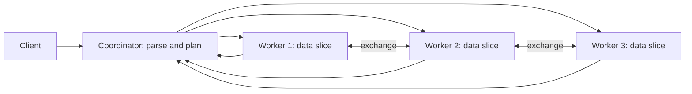

## 🎯 خلاصه

> یک موتور کوئری **MPP** (پردازش موازی انبوه، massively parallel processing) یک کوئری را بین ماشین‌های زیادی تقسیم می‌کند. هر ماشین CPU، حافظه و دیسک خودش را دارد (**shared-nothing**)، و یک **coordinator** کوئری را برنامه‌ریزی می‌کند، تکه‌ها را به **worker**ها می‌فرستد و نتیجه را جمع می‌کند.

- سرعت از اسکن موازی می‌آید، ولی هزینه‌ی واقعی **جابه‌جا کردن داده بین نودها** هنگام join و aggregation است.
- **کلید توزیع (distribution key)** مشخص می‌کند هر ردیف کجا زندگی کند. کلید خوب joinها را محلی می‌کند؛ کلید بد باعث می‌شود یک نود همه‌ی کار را بکشد.
- نسخه‌های جدید storage و compute را از هم جدا می‌کنند و **runtime filter** و **resource group** اضافه می‌کنند تا کوئری‌های بزرگ، کوئری‌های کوچک را گرسنه نگه ندارند.

## 🌱 از ساده شروع کنیم (مبتدی)

> **💡 Analogy:** شمردن آرای یک انتخابات بزرگ. یک کارمند ۱۰ میلیون برگه را تنها بشمارد: کند است. به‌جایش ۲۰ کارمند هر کدام یک جعبه را می‌شمارند و یک سرپرست جمع ۲۰ عدد را حساب می‌کند. هر کارمند میز، خودکار و جعبه‌ی خودش را دارد و کسی میز مشترک ندارد. این همان shared-nothing است.

فرض کن می‌خواهی فروش کل هر محصول را از ۱ میلیارد ردیف حساب کنی. یک ماشین همه‌ی ردیف‌ها را می‌خواند. یک موتور MPP با ۴ worker این کار را این‌طور انجام می‌دهد:

```text
1. Coordinator receives: SELECT product, SUM(amount) FROM sales GROUP BY product
2. Each worker reads only its own slice of sales and computes partial sums
3. Workers send partial results (one row per product, not per sale) to the coordinator
4. Coordinator adds the partial sums and returns the final result
```

دو ایده را به یاد بسپار: **کار بر اساس داده تقسیم می‌شود**، و **فقط نتیجه‌های کوچک سفر می‌کنند**. وقتی کوئری لازم دارد ردیف‌های workerهای مختلف به هم برسند (مثلاً join روی کلیدی که داده‌اش آنجا نیست)، خود ردیف‌ها باید سفر کنند، و سیستم‌های MPP بیشترین زمانشان را همان‌جا صرف می‌کنند.

## 🔧 واقعاً چطور کار می‌کند (متوسط)

**معماری.** کلاینت SQL را به coordinator می‌فرستد (بسته به موتور، به آن frontend، leader یا master هم می‌گویند). coordinator کوئری را parse و بهینه می‌کند و plan را به **fragment** تکه می‌کند. هر fragment روی چند worker به‌موازات اجرا می‌شود. بین fragmentها داده از طریق عملگرهای **exchange** روی شبکه جریان دارد (Greenplum به آن‌ها **motion** می‌گوید؛ Trino و StarRocks هم exchange و shuffle دارند).



**Shared-nothing در برابر shared-disk.** در یک سیستم **shared-disk** (مثل معماری کلاسیک Oracle RAC)، همه‌ی نودها از یک آرایه‌ی دیسک می‌خوانند، پس دیسک گلوگاه می‌شود و به lock manager نیاز دارد. در **shared-nothing** هر نود تکه‌ای از داده را روی دیسک خودش دارد و نودها فقط از طریق شبکه حرف می‌زنند. shared-nothing برای اسکن تقریباً خطی مقیاس می‌گیرد، ولی اضافه کردن نود یعنی جابه‌جایی داده.

**توزیع داده.** هر جدول یک سیاست توزیع دارد:

| سیاست | ردیف‌ها کجا می‌روند | مناسب برای |
|---|---|---|
| Hash روی کلید | `hash(key) mod workers` | جدول‌های fact بزرگ که روی آن کلید join می‌شوند |
| Random | round-robin یا تصادفی | جدول‌های staging بدون کلید خوب |
| Replicated | یک کپی کامل روی هر worker | dimensionهای کوچک (کشور، ارز) |

نحو Greenplum، برای نمونه: `DISTRIBUTED BY (customer_id)` یا `DISTRIBUTED REPLICATED`.

**مثال کار شده: یک join با عدد.** جدول `orders` ۱۰۰ میلیون ردیف دارد، `customers` یک میلیون ردیف، و ۸ worker. کوئری روی `customer_id` join می‌کند.

- **Redistribute** هر دو جدول روی `customer_id`: هر worker ردیف‌هایی را که مالکشان نیست می‌فرستد. حدود ۷/۸ از ۱۰۰ میلیون ردیف جابه‌جا می‌شود، یعنی تقریباً **۸۷.۵ میلیون ردیف روی شبکه**، به‌علاوه‌ی customers.
- **Broadcast** جدول کوچک: هر worker یک کپی کامل از یک میلیون ردیف customers می‌گیرد. یعنی ۸ × ۱ میلیون = **۸ میلیون ردیف جابه‌جا شده**، و جدول بزرگ `orders` اصلاً جابه‌جا نمی‌شود.

optimizer وقتی broadcast را انتخاب می‌کند که طرف کوچک در حافظه‌ی هر worker جا شود، و وقتی هر دو طرف بزرگ‌اند redistribute را. **colocated join** بهترین حالت است: اگر هر دو جدول کلید توزیع یکسان داشته باشند، ردیف‌های متناظر از قبل روی یک worker‌اند و هیچ‌چیز جابه‌جا نمی‌شود.

**Pipeline execution.** موتورهای MPP جدید داده را به‌صورت batch (vectorized) پردازش می‌کنند و بین عملگرها جریان می‌دهند، به‌جای اینکه یک مرحله کامل تمام شود تا مرحله‌ی بعد شروع شود. فقط عملگرهای **blocking** (ساختن جدول hash، sort کامل) pipeline را وادار می‌کنند کل ورودی را منتظر بماند.

**Runtime filter.** وقتی یک hash join جدول hash خودش را از یک dimension کوچک می‌سازد، موتور می‌تواند یک خلاصه‌ی فشرده از کلیدهای join (یک Bloom filter یا بازه‌ی min–max) را به اسکن جدول بزرگ بفرستد. اگر یک فیلتر dimension فقط ۲ از ۱۰۰۰ منطقه را نگه دارد، اسکن fact بیشتر blockها را قبل از خواندن رد می‌کند. runtime filterها معمولاً بعد از اجرای طرف build ساخته می‌شوند، پس وقتی join انتخابی باشد بیشترین کمک را می‌کنند.

**صف‌ها و resource group.** چند کاربر یک کلاستر را شریک‌اند. بدون محدودیت، یک کوئری سنگین کل حافظه را می‌گیرد و بقیه شکست می‌خورند یا منتظر می‌مانند. resource groupها یا صف‌ها همزمانی، حافظه‌ی هر کوئری و اولویت را محدود می‌کنند. Greenplum از resource group و queue استفاده می‌کند؛ StarRocks و Trino تنظیمات resource group خودشان را دارند.

## 🧠 عمق و trade-offها (سنیور)

- **skew اولین حالت خرابی است.** یک کلید توزیع با ۳ مقدار متمایز (مثلاً `country`) ۱۶ segment را به ۳ segment شلوغ و ۱۳ segment بیکار تبدیل می‌کند. تعداد ردیف هر نود را چک کن (در Greenplum، `SELECT gp_segment_id, count(*) FROM t GROUP BY 1`) و زمان کندترین نود را ببین، نه فقط میانگین را.
- **جابه‌جایی داده مدل هزینه است.** بایت‌هایی که در هر Motion یا exchange از شبکه رد می‌شوند را بشمار و قبل از هر تنظیم دیگری `EXPLAIN` را بخوان. plan با یک Redistribute Motion روی جدول ۲ ترابایتی یک مشکل طراحی است، نه مشکل پیکربندی.
- **scale out رایگان نیست.** اضافه کردن worker یعنی بازتوزیع داده‌ی موجود (expansion در Greenplum ردیف‌ها را به segmentهای جدید می‌برد). جدا کردن storage و compute این را دور می‌زند: داده روی object storage است و نودهای compute بی‌حالت‌اند و می‌شود اضافه یا حذف‌شان کرد. هزینه‌اش خواندن از شبکه و cache miss در کوئری اول است.
- **مدیریت خطا.** بسیاری از موتورهای MPP وقتی یک worker خطا بدهد کل کوئری را abort و از نو اجرا می‌کنند، چون fragmentها به هم وابسته‌اند. Greenplum برای هر segment اصلی یک mirror نگه می‌دارد و به آن failover می‌کند، ولی کوئری‌ای که همان لحظه در حال اجراست ممکن است شکست بخورد. قبل از قول «بدون وقفه»، قابلیت‌های fault tolerance موتورت را چک کن (مثلاً fault-tolerant execution در Trino).
- **همزمانی در برابر تأخیر.** یک کوئری MPP کل کلاستر را می‌گیرد. ده کوئری هم‌زمان هر کدام تقریباً یک‌دهم سرعت را دارند، به‌علاوه‌ی overhead. صف‌ها داشبوردی را که باید در دو ثانیه جواب دهد از گزارش شبانه محافظت می‌کنند.
- **تفاوت موتورها که باید بدانی.** Greenplum یک coordinator و segmentها دارد که هر segment یک نمونه‌ی PostgreSQL است. StarRocks نودهای frontend (FE) و backend (BE) دارد و یک حالت shared-data با نودهای compute جدا. ClickHouse planner مرکزی ندارد: نودی که کوئری را می‌گیرد آن را به shardها پخش می‌کند، و یک distributed table روی shardها و replicaها نگاشت می‌شود. Trino یک coordinator و worker دارد و storage خودش را ندارد؛ از طریق connectorها می‌خواند.
- **کی از MPP استفاده نکنی.** وقتی تعداد زیادی lookup تکی در ثانیه داری، به‌روزرسانی‌های تک‌ردیفی با تأخیر سخت‌گیرانه، یا داده‌ای که روی یک نود جا می‌شود. overhead ثابت کلاستر MPP و جابه‌جایی داده آن‌جا ابزار اشتباه است؛ یک دیتابیس OLTP یا موتور تحلیلی تک‌نودی ساده‌تر است.

## 🧪 امتحان کن

از Greenplum استفاده کن. کلمه‌ی `DISTRIBUTED BY` مخصوص Greenplum است، پس PostgreSQL ساده آن را رد می‌کند. دو جدول بساز و plan را بخوان.

```sql
CREATE TABLE orders (order_id bigint, customer_id bigint, amount numeric)
  DISTRIBUTED BY (customer_id);

CREATE TABLE customers (customer_id bigint, name text)
  DISTRIBUTED BY (customer_id);

EXPLAIN SELECT o.order_id, c.name
FROM orders o JOIN customers c USING (customer_id);
```

1. **Colocated join.** به plan بالا نگاه کن. join نباید به Redistribute یا Broadcast Motion نیاز داشته باشد؛ تنها motion باید Gather Motion نهایی باشد که ردیف‌ها را به coordinator برمی‌گرداند. توضیح بده چرا.
2. **کلید را عوض کن.** جدول `orders` را با `DISTRIBUTED BY (order_id)` دوباره بساز و همان `EXPLAIN` را بزن. کدام motion ظاهر می‌شود و روی کدام طرف؟
3. **بررسی skew.** یک میلیون ردیف در جدولی بار کن که با ستونی توزیع شده که ۳ مقدار متمایز دارد. توضیح بده در تعداد ردیف‌های هر segment چه می‌بینی و چرا زمان کوئری از بزرگ‌ترین segment پیروی می‌کند.

<details><summary>جواب‌ها را نشان بده</summary>

**1.** هر دو جدول با همان نوع روی `customer_id` hash شده‌اند، پس ردیف `orders` و ردیف متناظرش در `customers` روی یک segment‌اند. join روی هر segment محلی اجرا می‌شود. فقط نتیجه‌ی نهایی به coordinator می‌رود.

**2.** `orders` دیگر با کلید join توزیع نشده، پس ردیف‌هایش باید با `customer_id` بازتوزیع شوند. plan یک Redistribute Motion روی طرف `orders` نشان می‌دهد (طرف `customers` بسته به انتخاب optimizer ممکن است ثابت بماند یا آن هم جابه‌جا شود). حالا shuffle ترافیک شبکه‌ای متناسب با اندازه‌ی `orders` دارد.

**3.** ۳ مقدار متمایز حداکثر به ۳ segment hash می‌شوند، پس بیشتر segmentها خالی‌اند و حداکثر ۳ تا همه‌چیز را نگه می‌دارند. کوئری منتظر کندترین segment می‌ماند، پس زمان اجرا از بزرگ‌ترین segment پیروی می‌کند، نه از میانگین. کلید توزیع را طوری اصلاح کن که مقدار متمایز زیاد داشته باشد و هیچ مقداری غالب نباشد.

</details>

## 💬 گوشه‌ی مصاحبه

**سؤال: «یک دیتابیس MPP چطور join را اجرا می‌کند؟»** جواب متوسط: «coordinator کوئری را برنامه‌ریزی می‌کند، workerها داده‌ی محلی را موازی اسکن می‌کنند، و برای join یا جدول کوچک را broadcast می‌کنند یا هر دو طرف را با کلید join بازتوزیع می‌کنند.»

جواب سنیور: «به توزیع بستگی دارد. اگر هر دو جدول با کلید join توزیع شده باشند، join colocated است و چیزی جابه‌جا نمی‌شود. اگر یک طرف کوچک باشد broadcast می‌کنم، و هزینه‌اش اندازه‌ی آن ضربدر تعداد workerهاست. وگرنه هر دو طرف را بازتوزیع می‌کنم و هزینه بایت‌هایی است که از شبکه رد می‌شوند. با `EXPLAIN` می‌بینم optimizer کدام motion یا exchange را انتخاب کرده و قبل از دست بردن در تنظیمات، skew را رفع می‌کنم.»

**سؤال: «چرا MPP برای تحلیل سریع است ولی برای OLTP بد؟»** MPP اسکن روی داده‌ی بزرگ را موازی می‌کند، که تحلیل به آن نیاز دارد. OLTP تراکنش‌های کوچک زیاد با تأخیر کم می‌خواهد، و هر کدام هزینه‌ی هماهنگی و جابه‌جایی داده را می‌دهند.

> **🎤 Say this in the interview:** «MPP از نوع shared-nothing است: هر نود تکه‌ای از داده را دارد و موازی کار می‌کند، و یک coordinator نتیجه‌ها را کنار هم می‌گذارد. عملکرد با جابه‌جایی داده تعیین می‌شود، پس کلید توزیع مهم‌ترین تصمیم طراحی است. جدول‌های بزرگ را روی کلید join هم‌مکان می‌کنم، dimensionهای کوچک را broadcast می‌کنم، و skew هر نود را می‌پایم.»

## ⚠️ اشتباهات رایج

> **⚠️ Watch out:** توزیع یک جدول fact روی ستونی با مقدار کم (وضعیت، کشور، boolean). کلاستر بیکار به‌نظر می‌رسد و یک نود مشغول است.

> **⚠️ Watch out:** فرض «worker بیشتر یعنی سریع‌تر». اضافه کردن نود به کوئری‌ای که یک Redistribute Motion بر آن غالب است عمدتاً overhead هماهنگی اضافه می‌کند.

- انتخاب کلید توزیع بر اساس کلید اصلی، بدون پرسیدن اینکه جدول‌ها چطور join می‌شوند.
- کپی کردن یک جدول بزرگ روی هر worker برای اجتناب از یک shuffle، و بعد کم آوردن حافظه.
- بی‌توجهی به plan و تنظیم حافظه، وقتی مشکل واقعی یک Motion است که ۲ ترابایت جابه‌جا می‌کند.
- دیدن یک کلاستر shared-nothing به‌عنوان یک دیسک بزرگ. هر نود ظرفیت و خرابی مستقل خودش را دارد.
- اجرای گزارش شبانه و داشبورد در یک صف بدون محدودیت.
- انتظار اینکه یک موتور MPP مثل دیتابیس OLTP برای به‌روزرسانی تک‌ردیفی رفتار کند.

## ✅ خودت را بسنج

1. «shared-nothing» در یک موتور MPP یعنی چه؟
   - A) همه‌ی نودها از یک آرایه‌ی دیسک مشترک می‌خوانند
   - B) هر نود CPU، حافظه و دیسک خودش را برای تکه‌ی داده‌اش دارد و نودها از طریق شبکه حرف می‌زنند
   - C) نودها کوئری اجرا نمی‌کنند، فقط coordinator اجرا می‌کند
   - D) هیچ داده‌ای روی دیسک ذخیره نمی‌شود

<details><summary>جواب</summary>

**B** — هر نود تکه‌ای از داده و منابع خودش را دارد. نودها داده را روی شبکه رد و بدل می‌کنند، و به همین دلیل جابه‌جایی داده بیشترین هزینه‌ی join است.

</details>

2. یک کوئری یک جدول fact ۵۰۰ گیگابایتی را با یک جدول dimension دو مگابایتی روی ۱۶ worker join می‌کند. کدام استراتژی محتمل‌تر است؟
   - A) بازتوزیع هر دو جدول روی کلید join
   - B) broadcast کردن جدول dimension به هر worker
   - C) فرستادن جدول fact به coordinator و join در آن‌جا
   - D) کپی کردن جدول fact روی هر worker

<details><summary>جواب</summary>

**B** — ۲ مگابایت ضربدر ۱۶ worker می‌شود ۳۲ مگابایت جابه‌جایی، که خیلی کم است. جابه‌جا کردن ۵۰۰ گیگابایت یا کپی کردن آن روی هر worker خیلی بدتر است. broadcast وقتی طرف کوچک واقعاً کوچک باشد ارزان‌ترین انتخاب است.

</details>

3. runtime filter برای چیست؟
   - A) حذف ردیف‌های تکراری قبل از join
   - B) فرستادن خلاصه‌ای از کلیدهای join از طرف build به اسکن طرف probe، تا ردیف‌های بی‌تطابق زودتر رد شوند
   - C) محدود کردن تعداد کوئری‌های هم‌زمان
   - D) فشرده کردن ترافیک شبکه

<details><summary>جواب</summary>

**B** — وقتی یک dimension کوچک join را فیلتر می‌کند، موتور کلیدهایش را (به‌صورت Bloom filter یا بازه‌ی min–max) به اسکن جدول بزرگ می‌فرستد، که بیشتر داده را قبل از خواندن رد می‌کند.

</details>

4. **(سنیور)** کلید توزیع یک جدول fact پنج ترابایتی فقط ۴ مقدار متمایز دارد و کلاستر ۳۲ worker دارد. چه می‌شود و چه را باید عوض کنی؟

   - A) هیچ؛ worker بیشتر همیشه بار را متعادل می‌کند
   - B) حداکثر ۴ worker همه‌ی داده را دارند و بقیه بیکارند، پس کوئری با سرعت شلوغ‌ترین worker اجرا می‌شود؛ کلیدی با تعداد مقدار زیاد انتخاب کن که با join اصلی هم‌خوان باشد
   - C) این جدول اصلاً قابل توزیع نیست
   - D) راه‌حل این است که جدول را روی همه کپی کنی

<details><summary>جواب</summary>

**B** — ردیف‌ها حداکثر به ۴ worker hash می‌شوند و بقیه چیزی ندارند. زمان اجرا از شلوغ‌ترین worker پیروی می‌کند. کلیدی با تعداد مقدار زیاد که با join اصلی هم‌خوان باشد، هم پخش یکنواخت می‌دهد و هم joinهای colocated.

</details>

5. **(سنیور)** چرا جدا کردن storage و compute یک trade-off است و یک ارتقای رایگان نیست؟

   - A) object storage نمی‌تواند جدول SQL ذخیره کند
   - B) compute مستقل مقیاس و restart می‌شود، ولی خواندن‌ها از شبکه می‌آیند و کوئری اول روی cache سرد این تأخیر را می‌پردازد
   - C) هر جدول به یک نود جدا نیاز دارد
   - D) دیگر نیازی به آمار (statistics) نیست

<details><summary>جواب</summary>

**B** — جدا کردن storage اجازه می‌دهد نودهای compute را آزادانه مقیاس بدهی و عوض کنی، ولی هر خواندن سرد از شبکه به object storage می‌رود. cache برای کوئری‌های تکراری بیشتر این را حل می‌کند، ولی اجرای اول کندتر است.

</details>

## 🗂️ فلش‌کارت

| Front | Back |
|---|---|
| Shared-nothing | هر نود CPU، حافظه و دیسک خودش را برای تکه‌ی داده‌اش دارد؛ نودها فقط از طریق شبکه حرف می‌زنند |
| Shared-disk | نودها از یک آرایه‌ی دیسک مشترک می‌خوانند؛ دیسک و قفل‌هایش گلوگاه می‌شوند |
| Coordinator در برابر worker | coordinator برنامه‌ریزی و جمع می‌کند؛ worker تکه‌ی محلی خود را اسکن و محاسبه می‌کند |
| Broadcast join | جدول کوچک را به هر worker کپی کن؛ هزینه: اندازه‌اش ضربدر تعداد worker |
| Redistribute (shuffle) join | هر دو طرف را با کلید join دوباره hash کن؛ هزینه: بایت‌هایی که از شبکه رد می‌شوند |
| Colocated join | هر دو جدول با یک کلید توزیع شده‌اند؛ join محلی اجرا می‌شود و چیزی جابه‌جا نمی‌شود |
| Runtime filter | خلاصه‌ی کلیدهای join از طرف build به اسکن طرف probe می‌رود تا ردیف‌ها زودتر رد شوند |
| Distribution skew | کلیدی با مقدار کم، بیشتر ردیف‌ها را روی چند نود می‌گذارد؛ کوئری با سرعت کندترین نود اجرا می‌شود |

## 🔗 ادامه

- **[[columnar-storage]]** توضیح می‌دهد چرا اسکنی که هر worker انجام می‌دهد ارزان است، و چرا ترتیب ستون‌ها مهم است.
- **[[sql-joins]]** انواع join را پوشش می‌دهد که موتورهای MPP موازی‌شان می‌کنند.
- **[[partitioning-sharding]]** نظریه‌ی کلی پشت کلیدهای توزیع است؛ همراه با این درس بخوانش.
- **[[spark-shuffle]]** همین ایده‌ی جابه‌جایی داده را در Spark نشان می‌دهد، جایی که shuffle مرحله‌ی گران است.
- **[[starrocks-doris]]**، **[[clickhouse]]** و **[[trino]]** این ایده‌ها را روی موتورهای مشخص اعمال می‌کنند.
- **[[physical-modeling-olap]]** نشان می‌دهد چطور کلید مرتب‌سازی، کلید توزیع و پارتیشن را برای یک جدول MPP انتخاب کنی.
