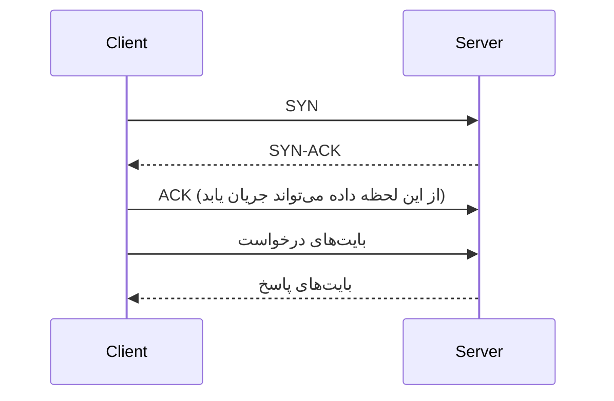

## 🎯 خلاصه

> هر سیستم داده مجموعه‌ای از ماشین‌هایی است که روی شبکه با هم حرف می‌زنند. بیشتر تصمیم‌های طراحی در واقع تصمیم درباره‌ی **تعداد round trip** هر درخواست، **میزان اطمینان** کانال، و **محل** ماشین‌هاست.

- **TCP** قابل اعتماد و مرتب است؛ **UDP** سریع و بی‌نظم. بر اساس اینکه برنامه‌ات از دست رفتن داده را تحمل می‌کند انتخاب کن.
- **HTTP/HTTPS** درخواست و پاسخ روی TCP (یا QUIC) است. **TLS** رمزنگاری اضافه می‌کند و در راه‌اندازی اتصال round trip اضافه می‌گیرد.
- **DNS** نام را به IP تبدیل می‌کند. کش کردن آن (و TTL) تعیین می‌کند failover چقدر سریع است.
- **تأخیر (latency)** و **پهنای باند (bandwidth)** دو محدودیت متفاوت‌اند. TCP روی مسیر طولانی اغلب محدود به تأخیر است، نه سرعت لینک.
- **استفاده‌ی مجدد از اتصال** (keep-alive و pooling) هزینه‌ی راه‌اندازی را از هر درخواست حذف می‌کند.

## 🌱 از ساده شروع کنیم (مبتدی)

> **💡 Analogy:** نامه در برابر تماس تلفنی. نامه (UDP) سریع فرستاده می‌شود، ولی ممکن است گم شود یا بی‌ترتیب برسد. تماس تلفنی (TCP) ابتدا یک «الو، صدامو می‌شنوی؟» لازم دارد، و هر دو طرف هر جمله را تأیید می‌کنند. شروعش کندتر است، ولی می‌دانی چه شنیده شده.

هر برنامه‌ای که روی شبکه حرف می‌زند از یک **IP** (کدام ماشین) و یک **port** (کدام برنامه روی آن ماشین) استفاده می‌کند. پورت 443 معمولاً HTTPS است، 5432 پورت PostgreSQL، و 9092 پورت پیش‌فرض broker کافکاست.

این‌ها را از شل می‌توانی ببینی:

```bash
dig +short example.com          # DNS: نام -> آدرس IP
nc -vz example.com 443          # آیا پورت TCP شماره‌ی 443 باز است؟
curl -sI https://example.com    # هدرهای HTTP روی TLS
```

ساده‌ترین برنامه‌ی شبکه در Python: یک اتصال TCP باز کن و یک درخواست بفرست.

```python
import socket

with socket.create_connection(("example.com", 80), timeout=5) as s:
    s.sendall(b"GET / HTTP/1.1\r\nHost: example.com\r\nConnection: close\r\n\r\n")
    reply = s.recv(200)
    print(reply.split(b"\r\n")[0])   # مثلاً b'HTTP/1.1 200 OK'
```

`create_connection` هندشیک TCP را برایت انجام می‌دهد. بعد از آن فقط بایت می‌فرستی و بایت می‌گیری.

## 🔧 واقعاً چطور کار می‌کند (متوسط)

### لایه‌هایی که لازم داری

| لایه (OSI) | کار | نمونه |
|---|---|---|
| ۷ Application | پروتکلی که برنامه حرف می‌زند | HTTP، gRPC، پروتکل Kafka، SQL |
| ۶ Presentation / ۵ Session | کدگذاری و رمزنگاری، مدیریت نشست | TLS (اغلب بین ۴ و ۷) |
| ۴ Transport | پورت، اطمینان، ترتیب | TCP، UDP |
| ۳ Network | آدرس و مسیریابی | IP |
| ۱–۲ Link | فریم روی یک شبکه‌ی فیزیکی | Ethernet، Wi-Fi |

لازم نیست همه‌ی لایه‌ها را از برکنی. در مصاحبه‌ی طراحی سه چیز را در نظر بگیر: **IP** ماشین را پیدا می‌کند، **port + TCP/UDP** برنامه و قواعد تحویل را، و **پروتکل لایه‌ی application** پیام‌ها را تعریف می‌کند.

### TCP: قابل اعتماد، مرتب، مبتنی بر اتصال

اتصال TCP با **سه‌مرحله‌ای (three-way handshake)** شروع می‌شود:



یعنی قبل از هر داده یک round trip (RTT) هزینه دارد. TCP هر بایت را شماره می‌زند، بسته‌ی گم‌شده را دوباره می‌فرستد و در شبکه‌ی شلوغ سرعتش را کم می‌کند. هزینه: راه‌اندازی یک RTT می‌برد، و head-of-line blocking می‌تواند داده‌های بعدی را پشت یک بسته‌ی گم‌شده نگه دارد.

### UDP: سریع، بدون تضمین

UDP datagram می‌فرستد، بدون handshake، بدون retransmit و بدون ترتیب. برای DNS، ویدیو، متریک‌های fire-and-forget (مثل StatsD) و پایه‌ی QUIC (HTTP/3) استفاده می‌شود. اگر برنامه تضمین می‌خواهد، باید خودت روی آن بسازی؛ کاری که QUIC انجام می‌دهد.

### HTTP، TLS و هزینه‌شان

HTTP پروتکل درخواست/پاسخ است. در **HTTP/1.1** یک اتصال در هر لحظه یک درخواست حمل می‌کند. **HTTP/2** چند stream را روی یک اتصال TCP مالتی‌پلکس می‌کند. **HTTP/3** روی QUIC و UDP اجرا می‌شود و head-of-line blocking در سطح TCP را ندارد.

HTTPS یعنی TLS. هندشیک TLS 1.3 بعد از آماده شدن TCP یک round trip دیگر می‌گیرد، پس یک درخواست HTTPS تازه حدود **۲ RTT** قبل از ارسال اولین بایت درخواست هزینه دارد (یک RTT برای TCP و یک RTT برای TLS). Session resumption برای اتصال‌های تکراری این را کم می‌کند.

مثال عددی با RTT برابر ۵۰ میلی‌ثانیه:

```text
درخواست HTTPS تازه:   TCP 50 ms + TLS 50 ms + درخواست/پاسخ 50 ms = 150 ms
همان درخواست روی اتصال استفاده‌شده‌ی قبلی:   درخواست/پاسخ 50 ms = 50 ms
```

این تفاوت را در یک میلیون درخواست در ساعت ضرب کن تا دلیل keep-alive روشن شود.

### Keep-alive و connection pooling

HTTP keep-alive باعث می‌شود اتصال TCP و TLS بعد از پاسخ باز بماند. **connection pool** مجموعه‌ای از اتصال‌های باز به یک سرور نگه می‌دارد و آن‌ها را به درخواست‌ها می‌دهد. درایورهای دیتابیس، کلاینت‌های HTTP و کلاینت‌های Kafka همه همین کار را می‌کنند.

```python
import http.client, time

HOST = "example.com"

def one_fresh_request() -> float:
    t = time.perf_counter()
    c = http.client.HTTPSConnection(HOST, timeout=5)   # هر بار TCP + TLS جدید
    c.request("GET", "/")
    c.getresponse().read()
    c.close()
    return time.perf_counter() - t

def reused_requests(n: int = 5) -> list[float]:
    c = http.client.HTTPSConnection(HOST, timeout=5)   # یک اتصال، درخواست‌های زیاد
    times = []
    for _ in range(n):
        t = time.perf_counter()
        c.request("GET", "/")
        c.getresponse().read()
        times.append(time.perf_counter() - t)
    c.close()
    return times

if __name__ == "__main__":
    print("fresh:", round(one_fresh_request(), 3), "s")
    print("reused:", [round(x, 3) for x in reused_requests()])
```

اجرایش کن و مقایسه کن: اولین درخواست روی اتصال استفاده‌شده کندتر از بقیه است، و درخواست‌های تازه شامل هزینه‌ی راه‌اندازی‌اند. عددها به شبکه‌ی تو بستگی دارد.

### DNS

DNS نام‌ها را از طریق یک سلسله‌مراتب به IP نگاشت می‌کند: resolver ابتدا از root، بعد از سرور TLD و در آخر از سرور authoritative می‌پرسد. پاسخ‌ها برای مدت **TTL** (زمان زندگی) که مالک دامنه تعیین کرده کش می‌شوند. TTL کم یعنی failover سریع بعد از تغییر IP، ولی query بیشتر. کلاینت‌ها گاهی بیشتر از TTL کش می‌کنند، و برای همین failover می‌تواند چند دقیقه طول بکشد.

```bash
dig kafka.internal A +noall +answer     # رکوردهای IP و TTL (عددی که ستون دوم است)
```

### لود بالانسر L4 در برابر L7

- **L4** (لایه‌ی transport) اتصال‌های TCP یا UDP را بر اساس IP و پورت بین سرورها پخش می‌کند. سریع و ساده است و محتوای درخواست را نگاه نمی‌کند.
- **L7** (لایه‌ی application) HTTP را می‌خواند: host، path، هدرها، کوکی‌ها. می‌تواند `/api` را به یک سرویس و `/static` را به سرویس دیگر بفرستد، TLS را خاتمه دهد و درخواست‌های idempotent را دوباره بفرستد.

برای یک کلاستر دیتابیس پشت یک IP مجازی L4 کافی است. برای API مبتنی بر HTTP با چند سرویس، L7 مناسب است.

### gRPC و WebSocket

**gRPC** روی HTTP/2 اجرا می‌شود، از Protocol Buffers برای پیام‌های فشرده و تایپ‌شده استفاده می‌کند و stream دوطرفه دارد. برای تماس بین سرویس‌ها رایج است.

**WebSocket** با یک درخواست HTTP و هدر `Upgrade` شروع می‌شود و بعد به یک کانال دوطرفه‌ی طولانی‌مدت تبدیل می‌شود. برای ارسال push به مرورگر مناسب است، ولی برای انتقال حجم زیاد داده بین backendها مناسب نیست.

### پهنای باند در برابر تأخیر

پهنای باند تعداد بیت در ثانیه‌ای است که لینک حمل می‌کند. تأخیر مدت زمان رسیدن یک بیت است. این دو محدودیت‌های متفاوتی ایجاد می‌کنند. برای یک stream واحد TCP، توان عملیاتی تقریباً `window / RTT` است، چون فرستنده فقط می‌تواند یک پنجره داده‌ی تأییدنشده در حال انتقال داشته باشد.

مثال: یک پنجره‌ی کلاسیک ۶۴ کیلوبایتی و RTT برابر ۱۰۰ میلی‌ثانیه، برای یک stream حدود `65536 B / 0.1 s ≈ 655 KB/s` (حدود ۵ Mbit/s) می‌دهد، حتی روی لینک ۱ Gbit/s. راه‌حل‌ها: window scaling، چند stream موازی یا batch بزرگ‌تر.

## 🧠 عمق و trade-offها (سنیور)

- **ریپلیکیشن بین دیتاسنترها یک بودجه‌ی تأخیر است.** ریپلیکیشن همزمان بین منطقه‌ها با RTT برابر ۱۰۰ میلی‌ثانیه و دو round trip متوالی برای هر commit، حدود ۲۰۰ میلی‌ثانیه به هر write اضافه می‌کند. ریپلیکیشن غیرهمزمان این هزینه را حذف می‌کند ولی یک replication lag ایجاد می‌کند که باید مانیتور شود. این بخش عملی [[cap-theorem]] و PACELC است.
- **هزینه‌ی TLS و churn اتصال.** ساختن اتصال TLS هم CPU مصرف می‌کند و هم RTT. سرویسی که زیر بار برای هر درخواست اتصال تازه باز می‌کند می‌تواند پورت‌های ephemeral را تمام کند (سوکت‌های `TIME_WAIT`) و CPU را صرف هندشیک کند. اتصال‌ها را pool کن و تعداد سوکت‌های باز و `TIME_WAIT` را با `ss -s` بپا.
- **Poolها به محدودیت نیاز دارند.** pool بدون حداکثر اندازه یک downstream کند را پنهان می‌کند، و pool خیلی کوچک درخواست‌ها را صف می‌کند. حداکثر، timeout برای گرفتن اتصال، و طول عمر اتصال کوتاه‌تر از idle timeout هر load balancer تنظیم کن، وگرنه خطاهای «connection reset» را می‌بینی که فقط شب‌ها اتفاق می‌افتند.
- **Timeout یک تصمیم طراحی است.** هر hop به connect timeout، read timeout و deadline کلی نیاز دارد. بدون آن‌ها یک dependency گیر کرده کل زنجیره را متوقف می‌کند. retry بار را ضرب می‌کند: سه retry در هر یک از سه لایه یعنی تا ۲۷ تلاش برای یک درخواست کاربر.
- **Head-of-line blocking.** HTTP/2 آن را در سطح HTTP حل می‌کند ولی همچنان یک اتصال TCP دارد، پس یک بسته‌ی گم‌شده همه‌ی streamها را می‌بندد. HTTP/3 این را ندارد. وقتی سؤال درباره‌ی شبکه‌ی موبایل با packet loss است تفاوت را بدان.
- **مشاهده‌پذیری.** زمان راه‌اندازی اتصال، RTT (با `ping` یا هیستوگرام‌های application)، retransmission (`ss -ti`، `netstat -s`) و زمان resolve شدن DNS را پایش کن. بسیاری از incidentهای «دیتابیس کنده» در واقع مشکل DNS یا راه‌اندازی اتصال‌اند.
- **کجا نباید استفاده کنی.** UDP را برای داده‌ای که نباید از دست برود، بدون برنامه‌ی بازیابی در سطح application استفاده نکن. WebSocket را جلوی یک batch job نگذار. L7 را برای ترافیک خام دیتابیس که به مدیریت اتصال در سطح TCP نیاز دارد به کار نبر.

## 🧪 امتحان کن

۱. با `dig` آدرس IP و TTL یک hostname عمومی را پیدا کن. دو بار در مدت TTL اجرایش کن و توضیح بده چه چیزی تغییر می‌کند (یا نمی‌کند).
۲. مثال `socket` پایتون را طوری تغییر بده که زمان `create_connection` را چاپ کند. ۵ بار اجرا کن. چرا فراخوانی اول معمولاً کندترین است؟
۳. **بررسی طراحی:** یک سرویس در تهران به یک دیتابیس در فرانکفورت با RTT برابر ۷۰ میلی‌ثانیه وصل است. هر درخواست ۳ round trip به دیتابیس نیاز دارد. حداقل تأخیر اضافه‌ی هر درخواست چقدر است و چه چیزی را تغییر می‌دهی؟

<details><summary>راه‌حل‌ها را نشان بده</summary>

**۱.** `dig +noall +answer example.com A` در ستون دوم TTL را بر حسب ثانیه نشان می‌دهد. پرس‌وجوی دوم در مدت TTL جواب کش‌شده را می‌گیرد و TTL رو به کاهش است. جواب را کش resolver تو می‌دهد، نه سرور authoritative.

**۲.** فراخوانی اول شامل lookup دامنه‌ی داخل `create_connection` و هندشیک TCP است. فراخوانی‌های بعدی به همان host ممکن است از کش resolver استفاده کنند، ولی اتصال TCP تازه همچنان یک RTT هزینه دارد. نگه داشتن سوکت باز این هزینه را حذف می‌کند؛ هر `create_connection` تازه دوباره هزینه می‌دهد.

**۳.** حداقل تأخیر اضافه `3 × 70 ms = 210 ms` برای هر درخواست است، قبل از هر کار سرور. راه‌ها: queryها را در یک round trip batch کن، مسیر خواندن را به منطقه نزدیک کن (replica یا cache)، یا در جاهایی که مستقل‌اند موازی‌شان کن. هدف کم کردن round tripهاست، نه تنظیم سرور در مرحله‌ی اول.

</details>

## 💬 گوشه‌ی مصاحبه

**سؤال: «چرا گاهی یک درخواست خیلی بیشتر از زمان پردازش سرور طول می‌کشد؟»** جواب متوسط: «round tripهای شبکه: DNS، هندشیک TCP، هندشیک TLS، و بعد خود درخواست. استفاده‌ی مجدد از اتصال بیشتر هزینه‌ی راه‌اندازی را حذف می‌کند.» جواب سنیور: «تأخیر را به DNS، connect، TLS، time to first byte و انتقال تقسیم می‌کنم و می‌بینم کدام غالب است. اگر راه‌اندازی است، pooling یا keep-alive اضافه می‌کنم و TTL و idle timeout لود بالانسر را بررسی می‌کنم. اگر first byte است، سرور یا یک dependency کند است.»

**سؤال: «L4 یا L7؟»** جواب متوسط: «L7 اگر به مسیریابی بر اساس path یا هدر نیاز دارم؛ L4 برای TCP خام و سرعت.» جواب سنیور: «L4 برای کمترین overhead در یک سرویس TCP مثل پروکسی دیتابیس و TLS passthrough. L7 برای APIهای HTTP که مسیریابی path، retry و متریک per-route لازم دارند. باید بگویم L7 اتصال را خاتمه می‌دهد، پس یک hop و گلوگاه اضافه دارد که باید scale شود.»

**سؤال: «لینک بین منطقه‌ای با ۱۰ Gbit کند است؛ چرا؟»** جواب سنیور: «توان یک stream TCP تقریباً برابر window تقسیم بر RTT است. با RTT برابر ۱۰۰ میلی‌ثانیه، پنجره خیلی زودتر از لینک stream را محدود می‌کند. من چند اتصال موازی، window scaling یا batch کردن انتقال را پیشنهاد می‌کنم.»

> **🎤 Say this in the interview:** «اول round tripها را می‌شمارم. TCP و TLS روی هم حدود دو RTT قبل از یک درخواست هزینه دارند، پس اتصال‌ها را pool و reuse می‌کنم. برای ترافیک بین منطقه‌ها بودجه‌ی تأخیر را برای هر hop حساب می‌کنم، روی هر فراخوانی timeout می‌گذارم، و وقتی بودجه‌ی تأخیر اجازه‌ی commit همزمان نمی‌دهد ریپلیکیشن غیرهمزمان را انتخاب می‌کنم.»

## ⚠️ اشتباهات رایج

> **⚠️ Watch out:** پهنای باند را با تأخیر اشتباه گرفتن. لینک سریع‌تر یک round trip را کوتاه‌تر نمی‌کند. یک لینک ۱ Gbit/s با RTT برابر ۳۰۰ میلی‌ثانیه باز هم هر درخواست را حداقل در ۳۰۰ میلی‌ثانیه پاسخ می‌دهد.

- باز کردن اتصال تازه برای هر query یا درخواست، و بعد مقصر دانستن دیتابیس.
- گذاشتن TTL خیلی بزرگ روی DNS و انتظار failover سریع.
- فراموش کردن timeout، که باعث می‌شود یک dependency گیرکرده همه‌ی threadها را بگیرد.
- retry در همه‌ی لایه‌ها، که در زمان خرابی بار را چندبرابر می‌کند.
- فکر کردن UDP «TCP سریع‌تر» است و استفاده از آن برای داده‌ای که نباید گم شود.
- استفاده از `ping` به‌تنهایی برای سنجش تأخیر application؛ TLS و زمان پردازش سرور در آن نیست.

## ✅ خودت را بسنج

۱. هندشیک سه‌مرحله‌ای TCP قبل از اینکه اولین بایت درخواست فرستاده شود چه هزینه‌ای دارد؟
   - A) هزینه‌ای ندارد؛ درخواست همراه SYN فرستاده می‌شود
   - B) یک round trip (RTT)
   - C) دو round trip
   - D) فقط به پهنای باند بستگی دارد

<details><summary>جواب</summary>

**B** — کلاینت SYN می‌فرستد، سرور SYN-ACK می‌دهد، و ACK کلاینت می‌تواند اولین داده را هم حمل کند. یعنی یک RTT قبل از اینکه درخواست مفید باشد. درخواست بعدی روی همان اتصال هندشیک جدید نمی‌خواهد.

</details>

۲. یک اتصال HTTPS تازه با TLS 1.3 راه‌اندازی می‌شود. روی مسیری با RTT برابر ۶۰ میلی‌ثانیه، تقریباً چقدر تأخیر اضافه می‌کند؟
   - A) ۰ میلی‌ثانیه، TLS غیرهمزمان است
   - B) حدود ۶۰ میلی‌ثانیه (یک RTT)
   - C) حدود ۲۴۰ میلی‌ثانیه
   - D) حدود ۶ میلی‌ثانیه

<details><summary>جواب</summary>

**B** — هندشیک کامل TLS 1.3 یک round trip می‌گیرد، پس حدود ۶۰ میلی‌ثانیه روی هزینه‌ی ۶۰ میلی‌ثانیه‌ای TCP. Resumption این را بیشتر کم می‌کند. گزینه‌ی C به هندشیک قدیمی‌تر و چند round tripی مربوط است.

</details>

۳. کدام انتخاب بهتر با این نیاز می‌خواند: «کوئری به همه‌ی ردیف‌های یک stream به ترتیب نیاز دارد و بازارسال اشکالی ندارد»؟
   - A) UDP بدون retry
   - B) TCP
   - C) ICMP
   - D) بسته‌های IP خام

<details><summary>جواب</summary>

**B** — TCP تحویل مرتب و قابل اعتماد می‌دهد. UDP را باید خودت با retransmit و ترتیب بسازی. ICMP برای پیام‌های کنترلی مثل ping است و IP خام هیچ اطمینانی نمی‌دهد.

</details>

۴. **(سنیور)** یک سرویس در تهران به دیتابیسی در فرانکفورت با RTT برابر ۷۰ میلی‌ثانیه وصل است و کد برای هر یک از ۳ query متوالی یک اتصال تازه باز می‌کند. مهم‌ترین رفع تأخیر چیست و ریسکش کدام است؟
   - A) استفاده از UDP برای queryها
   - B) pool و استفاده‌ی مجدد از اتصال، و کم کردن round tripهای متوالی (batch یا موازی‌سازی)؛ ریسک این است که pool تمام شود یا اتصال‌های قدیمی و بسته‌شده استفاده شوند، اگر حداکثر و طول عمر تنظیم نشده باشد
   - C) بالا بردن TTL DNS به ۸۶۴۰۰
   - D) حذف TLS برای صرفه‌جویی در هندشیک

<details><summary>جواب</summary>

**B** — pool هزینه‌ی connect و TLS را برای هر query حذف می‌کند و batch تعداد RTTها را کم می‌کند. ریسک این است که pool پر شود یا از اتصالی استفاده شود که فایروال یا load balancer آن را بسته؛ حداکثر اندازه، timeout گرفتن اتصال و طول عمر تنظیم کن. حذف TLS (گزینه‌ی D) یک اشتباه امنیتی است و TTL (گزینه‌ی C) تأخیر را تغییر نمی‌دهد.

</details>

۵. **(سنیور)** چرا یک stream واحد TCP روی یک لینک بلند و پرظرفیت می‌تواند خیلی پایین‌تر از سرعت لینک بماند؟
   - A) چون TCP به ۱۰ Mbit/s محدود است
   - B) چون یک stream در هر RTT تقریباً فقط یک پنجره‌ی دریافت را در حال انتقال دارد، پس توان تقریباً window / RTT است
   - C) چون UDP روی همه‌ی لینک‌ها سریع‌تر است
   - D) چون DNS IP اشتباه را کش کرده

<details><summary>جواب</summary>

**B** — فرستنده حداکثر یک پنجره داده‌ی تأییدنشده در حال انتقال دارد، پس نرخ محدود به window / RTT است. window scaling، چند stream موازی یا batch کردن این را بالا می‌برد.

</details>

## 🗂️ فلش‌کارت

| Front | Back |
|---|---|
| TCP در برابر UDP | TCP: قابل اعتماد، مرتب، مبتنی بر اتصال؛ UDP: بدون هندشیک، بدون retransmit، بدون ترتیب |
| هزینه‌ی یک درخواست HTTPS تازه | حدود ۲ RTT قبل از ارسال درخواست (TCP + TLS 1.3) |
| keep-alive برای چیست؟ | استفاده‌ی مجدد از اتصال باز TCP/TLS برای درخواست‌های زیاد و حذف هزینه‌ی راه‌اندازی |
| TTL در DNS چه چیزی را کنترل می‌کند؟ | مدت کش resolver برای یک جواب؛ سرعت انتشار تغییر را تعیین می‌کند |
| لود بالانسر L4 در برابر L7 | L4 با IP و پورت TCP/UDP پخش می‌کند؛ L7 بر اساس محتوای HTTP مسیریابی می‌کند |
| HTTP/2 در برابر HTTP/3 | HTTP/2 روی یک اتصال TCP مالتی‌پلکس می‌کند؛ HTTP/3 روی QUIC و UDP است |
| پهنای باند در برابر تأخیر | پهنای باند: بیت در ثانیه؛ تأخیر: زمان یک مسیر. RTT بلند توان یک stream را محدود می‌کند |
| WebSocket برای چیست؟ | کانال دوطرفه‌ی طولانی‌مدت که با upgrade از HTTP شروع می‌شود و برای push مناسب است |

## 🔗 ادامه

- **distributed-fundamentals** تأخیر و خرابی را ادامه می‌دهد: اینکه یک network partition چه بلایی بر تضمین‌های سیستم توزیع‌شده می‌آورد.
- **kafka-architecture** نشان می‌دهد producerها و consumerها چطور از اتصال و pooling با brokerها استفاده می‌کنند.
- **linux-shell** دستورهای `ss`، `dig`، `nc` و `curl` را برای بررسی شبکه از روی سرور توضیح می‌دهد.
- [[cap-theorem]] trade-off سازگاری پشت ریپلیکیشن بین منطقه‌ها را توضیح می‌دهد.
- وقتی جزئیات دقیق لازم داری، خلاصه‌ی RFC مربوط به TCP (RFC 9293) و TLS 1.3 (RFC 8446) را بخوان؛ نمودارهای بالا ساده‌شده‌اند.
