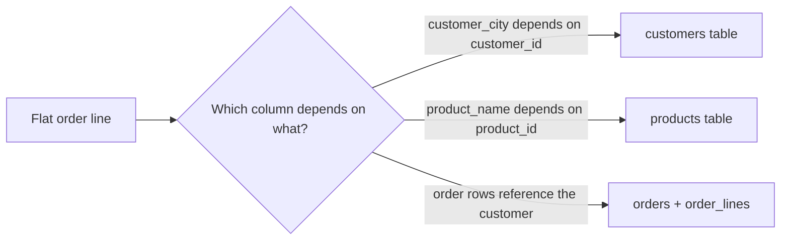

## 🎯 خلاصه

> **Normalization** (نرمال‌سازی) هر fact را **فقط یک بار** و در جدولی که مال آن است ذخیره می‌کند. این کار جلوی ناهنجاری‌های به‌روزرسانی، درج و حذف (anomaly) را می‌گیرد. **Denormalization** (ضدنرمال‌سازی) عمداً داده را تکرار می‌کند تا خواندن داده به join کمتری نیاز داشته باشد.

- سیستم‌های OLTP (سفارش، پرداخت) معمولاً تا 3NF یا BCNF نرمال می‌شوند، چون دائماً تغییر می‌کنند و باید سازگار بمانند.
- سیستم‌های تحلیلی (warehouse و lakehouse) به star schema ضدنرمال می‌شوند، چون حجم زیادی را scan می‌کنند و به ندرت یک ردیف را به‌روز می‌کنند.
- فرم‌های نرمال یک چک‌لیست از **وابستگی‌ها** هستند: 1NF (مقدار اتمی)، 2NF (بدون وابستگی جزئی)، 3NF (بدون وابستگی انتقالی)، BCNF (هر determinant یک کلید است).

## 🌱 از ساده شروع کنیم (مبتدی)

> **💡 تشبیه:** فرض کن یک اپ پیام‌رسان نام کامل، شماره و شهر دوستت را در **هر** پیام کپی کند. وقتی دوستت به شهر دیگری می‌رود، باید هزاران پیام را ویرایش کنی. یک اپ معمولی دوست را یک بار در لیست مخاطبین ذخیره می‌کند و هر پیام به آن مخاطب اشاره می‌کند. با تغییر یک بار مخاطب، همه‌ی پیام‌ها شهر جدید را نشان می‌دهند.

این همان normalization است: **یک fact، یک جا**.

این یک جدول flat است که این قانون را می‌شکند. هر ردیف یک ردیف سفارش است:

```sql
CREATE TABLE order_lines_flat (
  order_id      int,
  line_no       int,
  customer_id   int,
  customer_name text,
  customer_city text,
  product_id    int,
  product_name  text,
  qty           int,
  PRIMARY KEY (order_id, line_no)
);

INSERT INTO order_lines_flat VALUES
 (1, 1, 10, 'Ali',  'Tehran', 100, 'Keyboard', 1),
 (1, 2, 10, 'Ali',  'Tehran', 101, 'Mouse',    2),
 (2, 1, 10, 'Ali',  'Tehran', 100, 'Keyboard', 1),
 (3, 1, 11, 'Sara', 'Shiraz', 101, 'Mouse',    1);
```

«Ali از تهران» سه بار نوشته شده است. این کار سه نوع مشکل ایجاد می‌کند که به آن‌ها **anomaly** (ناهنجاری) می‌گوییم:

| ناهنجاری | چه چیزی اینجا خراب می‌شود |
|---|---|
| به‌روزرسانی (Update) | Ali به اصفهان می‌رود. باید همه‌ی ردیف‌های Ali را عوض کنی، و اگر یکی را جا بیندازی، یک مشتری دو شهر دارد. |
| درج (Insert) | می‌خواهی یک محصول جدید (مانیتور) را قبل از سفارش ثبت کنی. نمی‌توانی، چون محصول‌ها فقط داخل ردیف‌های سفارش وجود دارند. |
| حذف (Delete) | آخرین سفارشی که `Mouse` در آن است لغو می‌شود. نام و شناسه‌ی محصول هم همراهش از بین می‌رود. |

## 🔧 واقعاً چطور کار می‌کند (متوسط)

Normalization بر پایه‌ی **وابستگی تابعی** (functional dependency) است. وقتی یک مقدار A همیشه یک مقدار B را مشخص کند، می‌نویسیم `A → B` («A تعیین می‌کند B را»). در جدول flat، `customer_id → customer_name` و `product_id → product_name` است.

هر فرم نرمال یک نوع مشکل وابستگی را ممنوع می‌کند:

- **1NF:** هر ستون یک مقدار اتمی دارد. لیست مثل `'Keyboard, Mouse'` داخل یک سلول مجاز نیست، و ستون‌های تکراری `item1, item2, item3` هم نه.
- **2NF:** 1NF به‌علاوه‌ی نبود **وابستگی جزئی** (partial dependency). یک ستون غیرکلیدی فقط به بخشی از کلید ترکیبی وابسته است. اگر کلید `(order_id, product_id)` بود، `product_name` فقط به `product_id` وابسته است و باید بیرون برود.
- **3NF:** 2NF به‌علاوه‌ی نبود **وابستگی انتقالی** (transitive dependency). مثل `order_id → customer_id → customer_city`: یک ستون غیرکلیدی به یک ستون غیرکلیدی دیگر وابسته است. اطلاعات مشتری را به جدول `customers` ببر.
- **BCNF:** نسخه‌ی سخت‌گیرانه‌تر 3NF. هر determinant (سمت چپ هر وابستگی) باید یک candidate key باشد. وقتی جدول چند candidate key هم‌پوشان دارد اهمیت پیدا می‌کند. برای بیشتر کارهای OLTP، 3NF کافی است.

تجزیه‌ی مثال:

```sql
CREATE TABLE customers (
  customer_id   int PRIMARY KEY,
  customer_name text NOT NULL,
  customer_city text NOT NULL
);

CREATE TABLE products (
  product_id   int PRIMARY KEY,
  product_name text NOT NULL
);

CREATE TABLE orders (
  order_id    int PRIMARY KEY,
  customer_id int NOT NULL REFERENCES customers (customer_id)
);

CREATE TABLE order_lines (
  order_id   int REFERENCES orders (order_id),
  line_no    int,
  product_id int REFERENCES products (product_id),
  qty        int NOT NULL,
  unit_price numeric(10,2) NOT NULL,  -- price at the time of sale
  PRIMARY KEY (order_id, line_no)
);
```

به `unit_price` در `order_lines` دقت کن. در خیلی از طراحی‌ها قیمت فعلی در `products` هم هست، ولی قیمتی که ماه پیش گرفته شده یک **fact تاریخی** است. از روی قیمت امروز قابل محاسبه نیست، پس کنار خود فروش ذخیره می‌شود. Normalization کپی‌های اضافی از *همان* fact را حذف می‌کند؛ هرگز تاریخچه را حذف نمی‌کند.



تعداد join را در نظر بگیر. یک کوئری نرمال برای «درآمد به تفکیک شهر» سه join لازم دارد: `order_lines`، `orders` و `customers`. این در OLTP با index ارزان است، و یکی از دلایلی است که تحلیلگرها جدول‌های تخت‌تر می‌خواهند.

## 🧠 عمق و trade-offها (سنیور)

- **چرا تحلیل ضدنرمال می‌کند.** یک warehouse سؤال‌هایی مثل «درآمد به تفکیک شهر و ماه» را روی میلیاردها ردیف جواب می‌دهد. join بین جدول‌های بزرگ در موتورهای توزیع‌شده مثل Spark یا Trino نیاز به shuffle دارد (ببین [[shuffle]]). یک star schema (یک جدول fact و چند dimension پهن) بیشتر کوئری‌ها را به یک scan بزرگ با join‌های کوچک تبدیل می‌کند. فرمت‌های columnar هم خواندن جدول پهن را ارزان می‌کنند، چون فقط ستون‌های لازم خوانده می‌شوند.
- **هزینه‌ای که می‌پردازی.** داده‌ی تکراری باید همگام بماند. pipeline (ETL یا ELT) باید کپی‌ها را وقتی منبع تغییر می‌کند به‌روز کند، و الگوهای تاریخچه مثل [[scd]] تعریف می‌کنند که «فعلی» یعنی چه. یک جدول ضدنرمال که کسی نگهداری‌اش نمی‌کند، بی‌صدا غلط می‌شود.
- **فضای ذخیره‌سازی به ندرت هزینه‌ی واقعی است.** object storage ارزان است. هزینه‌ی واقعی، write amplification (بازنویسی ردیف‌های زیاد وقتی یک ویژگی dimension عوض می‌شود) و درستی داده است.
- **جدول‌های lakehouse.** فرمت‌های جدولی مثل Iceberg و Delta از `MERGE` پشتیبانی می‌کنند، ولی بازنویسی تعداد زیادی فایل برای عوض کردن شهر یک مشتری گران است. تناوب به‌روزرسانی یک dimension را همراه با grain آن تصمیم بگیر.
- **کِی ضدنرمال نکنیم.** سیستم منبع حقیقت (system of record) را نرمال نگه دار، به‌ویژه برای رابطه‌های many-to-many (یک محصول در چند دسته) و داده‌ی پهنی که زیاد تغییر می‌کند. ضدنرمال‌سازی را در لایه‌ی مصرف انجام بده، نه در سیستمی که نوشتن‌ها را دریافت می‌کند.
- **اندازه بگیر، حدس نزن.** execution plan را نگاه کن. اگر join‌ها بیشترین هزینه را دارند و داده در حافظه جا می‌شود، یک جدول تخت‌تر یا mart از پیش join‌شده اغلب درست است. اگر جدول نوشتن دریافت می‌کند، اول نرمال کن.

## 🧪 امتحان کن

این جدول را با کلید `(order_id, product_id)` در نظر بگیر:

| order_id | product_id | product_name | product_category | qty |
|---|---|---|---|---|
| 1 | 100 | Keyboard | Peripherals | 1 |
| 1 | 101 | Mouse | Peripherals | 2 |
| 2 | 100 | Keyboard | Peripherals | 1 |

1. وابستگی‌های تابعی‌ای که می‌بینی را نام ببر.
2. کدام فرم نرمال نقض شده و توسط کدام ستون‌ها؟
3. یک تجزیه بنویس که این مشکل را برطرف کند.

<details><summary>راه‌حل را ببین</summary>

1. `product_id → product_name`، `product_id → product_category` و `(order_id, product_id) → qty`.
2. 2NF نقض شده: `product_name` و `product_category` فقط به `product_id` وابسته‌اند که بخشی از کلید ترکیبی است. بعد از حذف این وابستگی جزئی، ستون‌های باقی‌مانده وابستگی انتقالی ندارند، پس 3NF هم برقرار است.
3. یک جدول `products(product_id, product_name, product_category)` و یک جدول `order_items(order_id, product_id, qty)`.

</details>

## 💬 گوشه‌ی مصاحبه

**سؤال: «1NF، 2NF و 3NF را توضیح بده.»** جواب متوسط: «1NF یعنی مقادیر اتمی، 2NF وابستگی جزئی روی کلید ترکیبی را حذف می‌کند و 3NF وابستگی بین ستون‌های غیرکلیدی را.» جواب سنیور دلیل را هم اضافه می‌کند: «هر مرحله یک دسته از ناهنجاری به‌روزرسانی را حذف می‌کند. منبع‌های OLTP را تا 3NF نرمال می‌کنم، و در warehouse تکرار را می‌پذیرم، چون بار کاری آن بیشتر خواندن و append است.»

**سؤال: «چرا یک data warehouse را ضدنرمال می‌کنی؟»** جواب متوسط: «برای کم کردن join در تحلیل.» جواب سنیور: «برای کاهش هزینه‌ی join و ساده کردن کوئری‌ها برای ابزارهای BI، با هزینه‌ی داده‌ی تکراری که pipeline باید سازگار نگهش دارد. grain، تناوب به‌روزرسانی هر dimension و نحوه‌ی نگهداری تاریخچه را هم می‌گویم.»

> **🎤 این را در مصاحبه بگو:** «جایی که داده نوشته می‌شود نرمال می‌کنم تا سازگاری حفظ شود، و جایی که داده خوانده می‌شود ضدنرمال می‌کنم تا تحلیل ارزان باشد. تصمیم به این بستگی دارد که چه کسی می‌نویسد و چه کسی می‌خواند.»

## ⚠️ اشتباهات رایج

> **⚠️ توجه:** Normalization یعنی «هرچه جدول بیشتر، بهتر» نیست. تقسیم بیش از حد join اضافه می‌کند و هیچ ناهنجاری‌ای را حذف نمی‌کند. وقتی هر fact یک بار ذخیره شده و هر ستون به کلید وابسته است، بایست.

> **⚠️ توجه:** ضدنرمال کردن یک پایگاه داده‌ی OLTP به این دلیل که «join کند است»، معمولاً ناهنجاری به‌روزرسانی می‌سازد که بعداً به شکل عددهای غلط خودش را نشان می‌دهد.

- اشتباه گرفتن 3NF با BCNF. فرقشان فقط وقتی است که جدول چند candidate key هم‌پوشان دارد.
- حذف مقادیر تاریخی (مثل قیمت لحظه‌ی فروش) به این خیال که تکراری از قیمت فعلی هستند.
- کپی کردن ویژگی‌های dimension داخل جدول fact و فراموش کردن اینکه این ویژگی‌ها در طول زمان عوض می‌شوند.
- فرض کردن اینکه جدول ضدنرمال همیشه سریع‌تر است. جدول‌های پهن با به‌روزرسانی زیاد می‌توانند کندتر باشند.

## ✅ خودت را بسنج

1. مشتری آدرسش را عوض می‌کند. باید 40 000 ردیف را به‌روز کنی و یکی را جا بیندازی. این کدام ناهنجاری است؟
   - A) ناهنجاری درج
   - B) ناهنجاری به‌روزرسانی
   - C) ناهنجاری حذف
   - D) ناهنجاری ارجاعی

<details><summary>جواب</summary>

**B** — همان fact در ردیف‌های زیادی ذخیره شده، پس یک تغییر باید همه‌جا اعمال شود. ردیفی که جا می‌ماند، مقادیر متناقض باقی می‌گذارد.

</details>

2. در جدولی با کلید `(order_id, product_id)`، ستون `product_name` فقط به `product_id` وابسته است. کدام فرم نرمال نقض شده؟
   - A) 1NF
   - B) 2NF
   - C) 3NF
   - D) فقط BCNF

<details><summary>جواب</summary>

**B** — این یک وابستگی جزئی است: یک ستون غیرکلیدی به بخشی از کلید ترکیبی وابسته است. انتقال `product_name` به جدول `products` مشکل را حل می‌کند.

</details>

3. کدام‌یک یک وابستگی **انتقالی** است؟
   - A) `order_id → customer_id`
   - B) `order_id → customer_id → customer_city`
   - C) `(order_id, line_no) → qty`
   - D) `product_id → product_name`

<details><summary>جواب</summary>

**B** — `customer_city` به `customer_id` وابسته است، و `customer_id` به `order_id`. یک ستون غیرکلیدی به ستون غیرکلیدی دیگری وابسته است. گزینه‌های A، C و D وابستگی مستقیم به کلید هستند.

</details>

4. **(سنیور)** جدول OLTP `order_lines` ستون `unit_price` دارد، و `products` هم یک ستون `price` دارد. یکی از هم‌تیمی‌ها می‌گوید کپی داخل `order_lines` نقض normalization است و باید حذف شود. چه جوابی می‌دهی؟
   - A) حق با اوست؛ قیمت را فقط در یک جدول نگه دار
   - B) نگهش دار: `order_lines.unit_price` یک fact تاریخی است، یعنی قیمت لحظه‌ی فروش. `products.price` با زمان عوض می‌شود و درآمد گذشته را نمی‌تواند بازسازی کند
   - C) به‌جای آن `products.price` را حذف کن، چون آن کپی است
   - D) قیمت را در جدول `customers` ذخیره کن

<details><summary>جواب</summary>

**B** — normalization کپی‌های زائد از *همان* fact فعلی را حذف می‌کند. قیمتی که در یک زمان مشخص گرفته شده fact دیگری است. حذف آن باعث می‌شود بعد از تغییر بعدی قیمت، درآمد تاریخی غلط شود.

</details>

5. **(سنیور)** چرا یک star schema معمولاً برای داشبورد BI از یک schema با 3NF روی همان موتور سریع‌تر است، و هزینه‌اش چیست؟
   - A) روی هر موتوری فضای کمتری مصرف می‌کند
   - B) در جدول‌های بزرگ join کمتری در هر کوئری لازم دارد؛ هزینه، داده‌ی تکراری است که pipeline باید سازگار نگهش دارد
   - C) نیاز به index و آمار را برمی‌دارد
   - D) نوشتن را سریع‌تر می‌کند

<details><summary>جواب</summary>

**B** — جدول fact مستقیم به چند dimension join می‌شود، به‌جای زنجیره‌ای از جدول‌های نرمال. هزینه‌اش تکرار داده و منطق ETL است که کپی‌ها را درست نگه دارد.

</details>

## 🗂️ فلش‌کارت

| Front | Back |
|---|---|
| Normalization | ذخیره‌ی هر fact یک بار، با تقسیم جدول‌ها بر اساس وابستگی، برای جلوگیری از anomaly |
| Update anomaly | یک fact در ردیف‌های زیادی است؛ تغییر به بعضی ردیف‌ها می‌رسد و به بعضی نه |
| 2NF | 1NF به‌علاوه‌ی نبود وابستگی جزئی به بخشی از کلید ترکیبی |
| 3NF | 2NF به‌علاوه‌ی نبود وابستگی انتقالی (غیرکلیدی به غیرکلیدی) |
| BCNF | هر determinant یک candidate key است |
| Denormalization | تکرار عمدی داده برای کم کردن join در خواندن |
| Functional dependency | `A → B`: هر مقدار A یک مقدار B را مشخص می‌کند |
| چرا OLTP نرمال می‌کند | نوشتن باید سازگار بماند، پس هر fact فقط در یک جا تغییر می‌کند |

## 🔗 ادامه

- `dimensional-modeling`: چطور star schemaهای ضدنرمال را عمداً طراحی کنیم.
- `oltp-vs-olap`: چرا این دو بار کاری به شکل‌های متفاوت نیاز دارند.
- `physical-modeling-olap`: partitioning، sorting و clustering در موتورهای تحلیلی.
- `star-snowflake-obt`: trade-off بین star، snowflake و طراحی one-big-table.
