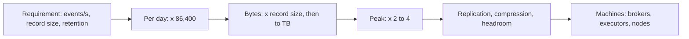

## 🎯 خلاصه

> **تخمین پشت‌پاکتی (back-of-envelope)** یعنی یک نیاز محصول را در چند دقیقه به **مرتبه‌ی بزرگی (order of magnitude)** تبدیل کنی؛ یعنی توان‌های ده. عدد دقیق لازم نیست. دقتی لازم است که طراحی درست و تعداد ماشین درست را انتخاب کنی.

- یک روز **۸۶٬۴۰۰ ثانیه، یعنی حدود ۱۰⁵** است. با آن «رویداد در ثانیه» را به «رویداد در روز» و برعکس تبدیل کن.
- حافظه حدود **۱٬۰۰۰ برابر** سریع‌تر از یک خواندن تصادفی از SSD است، و خواندن تصادفی SSD حدود **۱۰۰ برابر** سریع‌تر از جست‌وجوی HDD. فاصله‌ی تأخیرها طراحی را تعیین می‌کند.
- توان عملیاتی هر جزء (بروکر Kafka، هستهٔ Spark، نود ClickHouse) و نسبت فشرده‌سازی، بایت‌ها را به تعداد ماشین تبدیل می‌کنند.
- فرض‌ها را بگو، با **اوج (peak)** و **تکرار (replication)** ضرب کن، و نتیجه را سنجش عقل کن.

## 🌱 از ساده شروع کنیم (مبتدی)

> **💡 تشبیه:** قبل از خرید خواربار یک ماه، یک حساب ذهنی سریع می‌کنی: «۵ نفر، ۳ وعده در روز، ۳۰ روز، پس حدود ۴۵۰ وعده.» تک‌تک دانه‌های برنج را نمی‌شماری. تخمین هم همین است: ورودی‌ها را به نزدیک‌ترین توان ده گرد کن و محاسبه را ساده نگه دار.

**مرتبه‌ی بزرگی** یعنی «چند صفر دارد». ۹٬۰۰۰ و ۱۲٬۰۰۰ هر دو «حدود ۱۰⁴» هستند. این دقت برای تصمیم بین «یک سرور» و «خوشه‌ای با ۵۰ ماشین» کافی است.

سه دسته عدد بیشتر تخمین‌های مصاحبه را پوشش می‌دهند:

1. **زمان.** یک روز ۸۶٬۴۰۰ ثانیه ≈ ۱۰⁵ ثانیه است. یک سال ۳۶۵ × ۸۶٬۴۰۰ = ۳۱٬۵۳۶٬۰۰۰ ثانیه ≈ ۳ × ۱۰⁷ ثانیه است.
2. **اندازه.** KB = ۱۰³ بایت، MB = ۱۰⁶، GB = ۱۰⁹، TB = ۱۰¹²، PB = ۱۰¹⁵. برای تخمین از واحدهای اعشاری استفاده کن.
3. **سرعت.** چقدر طول می‌کشد و چقدر سریع جابه‌جا می‌شود. جدول زیر مرجع است.

جدول تأخیر (قاعدهٔ سرانگشتی؛ فقط مرتبه‌ی بزرگی، و مقادیر واقعی بسته به سخت‌افزار فرق دارد):

| عملیات | قاعدهٔ سرانگشتی |
|---|---|
| ارجاع به حافظه‌ی اصلی | ~100 ns |
| خواندن تصادفی SSD (4 KB) | ~100 µs |
| جست‌وجوی HDD (seek) | ~10 ms |
| خواندن ۱ MB پیوسته از SSD | ~1 ms (≈ 1 GB/s) |
| رفت‌وبرگشت شبکه در یک دیتاسنتر | ~0.5 ms |
| ارسال ۱ MB روی لینک ۱ Gbps | ~8 ms (1 Gbps ≈ 125 MB/s) |

برای حس کردن فاصله‌ها فرض کن یک نانوثانیه، یک ثانیه باشد. آن‌وقت ارجاع به حافظه حدود **۲ دقیقه**، خواندن تصادفی SSD حدود **یک روز** و جست‌وجوی HDD حدود **۴ ماه** طول می‌کشد. به همین دلیل دسترسی تصادفی به دیسک چیزی است که باید از آن پرهیز کنی.

## 🔧 واقعاً چطور کار می‌کند (متوسط)

تخمین خوب همیشه همین مسیر را طی می‌کند:

**تبدیل واحد (رایج‌ترین اشتباه).** سرعت شبکه بر حسب **بیت** است: ۱ Gbps ≈ ۱۲۵ MB/s، پس ۱۰ Gbps ≈ ۱.۲۵ GB/s. دیسک و ذخیره‌سازی بر حسب **بایت** هستند. قبل از مقایسه همیشه تبدیل کن.

**حجم روزانه از نرخ.** ۱ TB در روز یعنی ۱۰¹² بایت / ۸۶٬۴۰۰ ثانیه ≈ ۱.۱۶ × ۱۰⁷ B/s، پس **میانگین حدود ۱۲ MB/s**. برعکس هم حساب کن: ۱٬۰۰۰ رویداد در ثانیه × ۸۶٬۴۰۰ ≈ ۸.۶ × ۱۰⁷ رویداد در روز، یعنی **حدود ۱۰⁸ رویداد در روز**.

توان عملیاتی برای برنامه‌ریزی (قاعده‌های سرانگشتی؛ با benchmark خودت جایگزین کن):

| جزء | عدد برنامه‌ریزی | به چه چیزی وابسته است |
|---|---|---|
| بروکر Kafka | ~100 MB/s نوشتن پایدار | acks، فاکتور تکرار، دیسک، اندازه‌ی پیام |
| partition در Kafka | ~10 MB/s | هر partition مرتب است و در یک consumer group را یک consumer می‌خواند |
| هستهٔ Spark | ~30 MB/s برای خواندن + parse + نوشتن | فرمت فایل، codec، تبدیل‌ها، shuffle |
| نود ClickHouse | صدها MB/s تا چند GB/s اسکن | تعداد هسته، فشرده‌سازی، شکل query |
| اندازه‌ی رکورد | رویداد JSON ~0.5 تا 1 KB؛ CDR مخابراتی ~300 B | تعداد فیلد، متنی یا باینری بودن |
| ذخیره‌سازی ستونی فشرده | ~5 برابر کوچک‌تر از CSV خام | cardinality؛ ستون‌های تکراری خیلی بهتر فشرده می‌شوند |

عدد **برنامه‌ریزی** نقطه‌ی شروع است. مهارت این است که فرضت را نشان بدهی و بگویی «این را با load test اندازه می‌گیرم.»

## 🧠 عمق و trade-offها (سنیور)

- **اوج، نه میانگین.** ترافیک یکنواخت نیست. برای چرخه‌ی روزانه و burst از ضریب اوج ۲ تا ۴ استفاده کن. ظرفیتی که روی میانگین برنامه‌ریزی شده در ساعت شلوغی می‌شکند.
- **تکرار، نوشتن‌ها را ضرب می‌کند.** یک topic در Kafka با replication factor برابر ۳ سه بار در خوشه نوشته می‌شود (leader و دو follower). object storage این را از چشم تو پنهان می‌کند، اما ذخیره‌سازی سبک HDFS هزینه‌ی دیسک را ۳ برابر می‌کند.
- **حاشیه‌ی امن (headroom).** برای ۵۰ تا ۷۰ درصد استفاده از عدد برنامه‌ریزی برنامه‌ریزی کن تا با خراب شدن یک بروکر یا نود، بقیه اشباع نشوند. تعداد partition هم سقف موازی‌سازی consumer است: یک consumer group نمی‌تواند بیش از تعداد partition، consumer فعال داشته باشد.
- **موازی‌سازی Spark.** input splitها و تعداد shuffle partitionها تعداد taskها را تعیین می‌کنند. حتی یک خوشه‌ی بزرگ هم بیکار می‌ماند اگر داده به‌صورت یک فایل بزرگ و غیرقابل تقسیم برسد (درس [[data-formats]] را ببین).
- **فایل‌های ریز هزینه را ضرب می‌کنند.** ده میلیون فایل ۱۰۰ KB، با حجم کل حدود ۱ TB، ده میلیون عملیات metadata و راه‌اندازی task می‌خواهد. در این حالت compaction از پهنای باند مهم‌تر است؛ به [[small-files]] نگاه کن.
- **محدودیت‌های ابری.** object storage علاوه بر پهنای باند، محدودیت نرخ درخواست به ازای هر prefix هم دارد. مستندات فعلی ارائه‌دهنده را بررسی کن و عددی را از حافظه نگو.
- **کی دقت این‌قدر لازم نیست.** اگر پاسخ طراحی را عوض می‌کند (یک بروکر یا ده تا؛ Parquet یا row store؛ batch یا streaming)، خطای ۲ برابری مهم نیست. وقت را صرف سه رقم معنادار نکن.

**سنجش عقل.** تخمینت باید در حدود ضریب ۳ با یک سیستم شناخته‌شده هم‌خوان باشد. اگر محاسبه‌ات می‌گوید یک بار ۱ MB/s به ۲۰۰ بروکر Kafka نیاز دارد، محاسبه غلط است.

## 🧪 امتحان کن

**تمرین ۱.** یک سرویس در ثانیه ۲٬۰۰۰ رویداد تولید می‌کند و هر کدام ۵۰۰ بایت است. داده‌ی روزانه و در ۳۰ روز چقدر است؟

راه‌حل را ببین

رویداد در روز: 2,000 × 86,400 = 1.728 × 10⁸. بایت در روز: 1.728 × 10⁸ × 500 = 8.64 × 10¹⁰ B = **۸۶.۴ GB در روز**. سی روز: 86.4 GB × 30 ≈ 2,600 GB ≈ **۲.۶ TB**.

**تمرین ۲.** یک خوشه ۵۰۰ MB/s ورودی می‌گیرد و هر نوشتن سه بار تکرار می‌شود. نرخ نوشتن کل خوشه چقدر است و با ~۱۰۰ MB/s برای هر بروکر چند بروکر لازم است؟

راه‌حل را ببین

500 × 3 = **۱٬۵۰۰ MB/s** نوشتن روی دیسک در کل خوشه. با ~۱۰۰ MB/s برای هر بروکر: 1,500 / 100 = ۱۵ بروکر. اگر هدف ۶۰ درصد استفاده باشد: 1,500 / 0.6 = 2,500 MB/s ظرفیت، یعنی 2,500 / 100 = **۲۵ بروکر**. فاصله‌ی ۱۵ تا ۲۵ همان تصمیم حاشیه‌ی امن است که باید بلند بگویی.

**تمرین ۳ (تمرین کامل).** تو **۳ TB در روز call detail record (CDR)** دریافت می‌کنی. تخمین بزن: تعداد partition در Kafka، تعداد بروکر، ذخیره‌ی یک‌ساله در Parquet، و تعداد executor برای پردازش یک روز در یک ساعت. فرض کن میانگین رکورد ۳۰۰ بایت، ضریب اوج ۳ برابر میانگین، فشرده‌سازی Parquet پنج برابر، تکرار ۳ روی ذخیره‌سازی سبک HDFS، ۱۰ MB/s برای هر partition، ۱۰۰ MB/s برای هر بروکر، و ۵ هسته با ۳۰ MB/s برای هر هسته در هر executor باشد.

راه‌حل را ببین

**نرخ‌ها.** میانگین: 3 × 10¹² / 86,400 ≈ 3.5 × 10⁷ B/s ≈ **۳۵ MB/s**. (میان‌بر: 3 × 10¹² / 10⁵ = ۳۰ MB/s، حدود ۱۵ درصد کمتر، برای برنامه‌ریزی کافی است.) اوج: 35 × 3 ≈ **۱۰۴ MB/s**. رکوردها: 3 × 10¹² / 300 = 10¹⁰ در روز، یعنی 10¹⁰ / 86,400 ≈ **۱۱۶٬۰۰۰ رکورد در ثانیه** به‌طور میانگین و حدود ۳۵۰٬۰۰۰ در اوج.

**Partition.** 104 / 10 = 10.4، گرد به بالا می‌شود ۱۱، پس **۱۲** را انتخاب کن (به‌طور مساوی روی ۶ بروکر تقسیم می‌شود و جا برای consumerها می‌گذارد).

**بروکر.** هر بایت سه بار نوشته می‌شود: 104 × 3 ≈ ۳۱۲ MB/s نوشتن تکرارشده در اوج. با ۱۰۰ MB/s برای هر بروکر این 3.1 می‌شود، یعنی حداقل **۴ بروکر**. با هدف ۶۰ درصد استفاده: 312 / 0.6 = 520 MB/s ظرفیت، یعنی 5.2 → **۶ بروکر**.

**ذخیره‌ی یک‌ساله.** خام: 3 TB × 365 = 1,095 TB ≈ ۱.۱ PB. با Parquet پنج‌برابر: 1,095 / 5 ≈ **۲۱۹ TB**. با تکرار ۳ روی HDFS: 219 × 3 ≈ **۶۵۷ TB**. روی object storage، دوام را ارائه‌دهنده تضمین می‌کند؛ پس حدود ۲۱۹ TB به‌علاوه‌ی مدل قیمت‌گذاری ارائه‌دهنده را برنامه‌ریزی کن.

**executorها.** برای پردازش یک روز در یک ساعت: 3 × 10¹² / 3,600 ≈ 8.3 × 10⁸ B/s ≈ **۸۳۳ MB/s**. هر executor برابر 5 × 30 = 150 MB/s کار می‌کند، پس 833 / 150 ≈ 5.6 → **۶ executor**. با حاشیه‌ی ۲ برابری برای skew و retry: **۱۲ executor**.

## 💬 گوشه‌ی مصاحبه

**سؤال: «برای این stream چند partition در Kafka انتخاب می‌کنی؟»**

- **پاسخ متوسط:** «توان اوج را بر توانی که یک partition می‌تواند تحمل کند تقسیم می‌کنم، به بالا گرد می‌کنم، و عددی را انتخاب می‌کنم که روی بروکرها به‌طور مساوی تقسیم شود.»
- **پاسخ سنیور:** «از اوج MB/s و رکورد در ثانیه شروع می‌کنم، نه میانگین. اندازه‌ی partition را از توان اندازه‌گیری‌شده‌ی هر partition می‌گیرم، بعد موازی‌سازی consumerها و تعداد بروکرهایی که replicaها لازم دارند را چک می‌کنم. کاهش تعداد partition سخت است، پس کمی بالاتر انتخاب می‌کنم و دلیلش را هم می‌گویم.»

> **🎤 این را در مصاحبه بگو:** «اول فرض‌ها را می‌گویم، بعد محاسبه را با توان ده انجام می‌دهم. یک روز حدود ۱۰⁵ ثانیه است، پس نرخ میانگین را حساب می‌کنم، ضریب اوج حدود ۳ را اعمال می‌کنم و نوشتن‌ها را در فاکتور تکرار ضرب می‌کنم. جواب را با توان پیشنهادی هر بروکر و هر partition می‌سنجم و می‌گویم قبل از خرید سخت‌افزار کدام عددها را اندازه می‌گیرم.»

## ⚠️ اشتباهات رایج

> **⚠️ Watch out:** Gbps و GB/s هشت برابر با هم فرق دارند. یک «لینک ۱۰ Gbps» حدود ۱.۲۵ GB/s را حمل می‌کند، نه ۱۰ GB/s.

- استفاده از میانگین و فراموش کردن اوج. ظرفیتی که روی میانگین برنامه‌ریزی شده در شلوغ‌ترین ساعت کم می‌آورد.
- فراموش کردن تکرار: ورودی ۵۰۰ MB/s با RF = 3 می‌شود ۱٬۵۰۰ MB/s نوشتن.
- قاطی کردن بیت و بایت، یا MB و MiB. اختلاف ۲.۴ درصدی ۱۰۰۰ و ۱۰۲۴ کوچک است؛ ضریب ۸ کوچک نیست.
- نوشتن ۸۶٬۴۰۰ به‌جای ۱۰۰٬۰۰۰ بدون گفتن این‌که این کار را کرده‌ای. خطا حدود ۱۵ درصد است که برای تخمین قابل قبول است، اما باید گفته شود.
- ارائه‌ی یک عدد برنامه‌ریزی به‌عنوان benchmark. بگو «قاعدهٔ سرانگشتی؛ اندازه می‌گیرم».
- نادیده گرفتن نگهداشت داده (retention): یک روز داده، ذخیره‌ی یک سال نیست.

## ✅ خودت را بسنج

1. تقریباً چند ثانیه در یک روز است؟
   - A) 10³
   - B) 10⁴
   - C) 10⁵
   - D) 10⁶

پاسخ

**C** — ۸۶٬۴۰۰ ثانیه حدود ۱۰⁵ است. با ۱۰⁴ حدود ۹ برابر خطا داری و با ۱۰⁶ حدود ۱۲ برابر.

2. ارجاع به حافظه‌ی اصلی تقریباً چند برابر از خواندن تصادفی SSD سریع‌تر است؟
   - A) ۱۰ برابر
   - B) ۱۰۰ برابر
   - C) ۱٬۰۰۰ برابر
   - D) ۱٬۰۰۰٬۰۰۰ برابر

پاسخ

**C** — حدود ۱۰۰ ns در برابر حدود ۱۰۰ µs، یعنی ۱٬۰۰۰ برابر. مرتبه‌ی بزرگی را به خاطر بسپار، نه مقدار دقیق را.

3. یک سرویس به‌طور میانگین روزی ۱ TB می‌نویسد. کدام نرخ میانگین نزدیک‌تر است؟
   - A) 1 MB/s
   - B) 12 MB/s
   - C) 120 MB/s
   - D) 1.2 GB/s

پاسخ

**B** — 10¹² / 86,400 ≈ 1.16 × 10⁷ B/s، حدود ۱۲ MB/s. گزینه‌ی C یک خطای ۱۰ برابری است، و برای همین تقسیم باید نوشته شود.

4. **(سنیور)** تخمینت می‌گوید برای ۱۰۴ MB/s اوج ورودی با RF = 3، ۴ بروکر Kafka کافی است. قبل از خرید سخت‌افزار، مهم‌ترین اصلاح چیست؟
   - A) تغییر از واحد اعشاری به دودویی (۱۰۰۰ → ۱۰۲۴)
   - B) اضافه کردن تکرار (× ۳) و هدف استفاده، تا بروکرها موقع خرابی یا اوج اشباع نشوند
   - C) محاسبه تا چهار رقم معنادار
   - D) حذف فشرده‌سازی از تخمین، چون به آن نمی‌شود اعتماد کرد

پاسخ

**B** — ۱۰۴ MB/s ورودی یعنی حدود ۳۱۲ MB/s نوشتن تکرارشده. با ۶۰ درصد استفاده، حدود ۵۲۰ MB/s ظرفیت لازم است، پس ۴ بروکر کافی نیست. گزینه‌ی A خطایی حدود ۲ تا ۵ درصد می‌دهد، که ریسک اصلی نیست.

5. کدام مورد یک خطای برنامه‌ریزی است، نه خطای واحد؟
   - A) نوشتن «GB/s» وقتی منظورت «Gbps» بود
   - B) فرض این‌که یک روز داده برابر یک سال ذخیره‌سازی است
   - C) استفاده از ۱۰۰۰ به‌جای ۱۰۲۴
   - D) نوشتن ۸۶٬۴۰۰ به‌صورت ۱۰⁵

پاسخ

**B** — نادیده گرفتن نگه‌داشت داده (تعداد روزهایی که داده را نگه می‌داری) تخمین ذخیره‌سازی را تا ضریب ۳۶۵ اشتباه می‌کند. بقیه گزینه‌ها مشکل واحد یا گرد کردن هستند.

## 🗂️ فلش‌کارت

| Front | Back |
|---|---|
| ثانیه‌های یک روز (برای تخمین) | 86,400 ≈ 10⁵ |
| ثانیه‌های یک سال | 31,536,000 ≈ 3 × 10⁷ |
| ۱ Gbps بر حسب بایت | ≈ 125 MB/s (۱۰ Gbps ≈ 1.25 GB/s) |
| نرخ میانگین ۱ TB در روز | ≈ 12 MB/s |
| حافظه در برابر خواندن تصادفی SSD | حدود ۱٬۰۰۰ برابر سریع‌تر |
| خواندن تصادفی SSD در برابر جست‌وجوی HDD | حدود ۱۰۰ برابر سریع‌تر |
| چرا اوج، نه میانگین | بار یکنواخت نیست؛ برای شلوغ‌ترین دوره برنامه‌ریزی کن (×۲ تا ×۴) |
| تکرار ۳ روی ورودی ۵۰۰ MB/s | ۱٬۵۰۰ MB/s نوشتن در کل خوشه |

## 🔗 ادامه

- **data-estimation** و **capacity-planning** این اعداد را در پاسخ طراحی کامل یک سیستم به کار می‌برند.
- **kafka-architecture** توضیح می‌دهد چرا partitionها و replicaها تعداد بروکرها را تعیین می‌کنند.
- **spark-architecture** executor، هسته و task را توضیح می‌دهد؛ تخمین executor به آن‌ها وابسته است.
- **compression** و **columnar-storage** توضیح می‌دهند نسبت فشرده‌سازی از کجا می‌آید.
- **clickhouse** نرخ اسکنی را نشان می‌دهد که پشت عدد برنامه‌ریزی ClickHouse است.
- یک بار stack خودت را benchmark کن (مثلاً `kafka-producer-perf-test` یا یک job در Spark روی نمونه‌ای از داده). عددهای برنامه‌ریزی یادداشت‌هایت را با عددهای اندازه‌گیری‌شده جایگزین کن.
