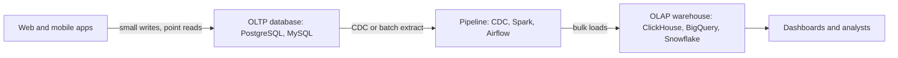

## 🎯 خلاصه

> **OLTP** (پردازش تراکنشی برخط) حجم زیادی خواندن و نوشتن کوچک و هم‌زمان را انجام می‌دهد که معمولاً چند ردیف را با کلید لمس می‌کنند. **OLAP** (پردازش تحلیلی برخط) پرسش‌هایی را جواب می‌دهد که میلیون‌ها یا میلیاردها ردیف را اسکن و تجمیع می‌کنند. الگوهای دسترسی متفاوت، موتور، چیدمان ذخیره‌سازی و طراحی اسکیمای متفاوتی می‌خواهند؛ به همین دلیل تحلیل معمولاً در یک انبار جدا زندگی می‌کند.

- OLTP: «سفارش ۸۸۱۲ را ثبت کن»، «ایمیل این کاربر را عوض کن». ردیف کم، تأخیر کم، کاربر زیاد و هم‌زمان.
- OLAP: «درآمد هر منطقه در هر ماه برای سه سال». ردیف زیاد، ستون کم، توان عملیاتی مهم‌تر از تأخیر است.
- **HTAP** (پردازش ترکیبی تراکنشی/تحلیلی) تلاش می‌کند هر دو را از یک سیستم ارائه دهد. این کار سادگی را با سازش‌ها معامله می‌کند.

## 🌱 از ساده شروع کنیم (مبتدی)

> **💡 تشبیه:** یک صندوقدار بانک در برابر یک اقتصاددان. صندوقدار هر بار با یک مشتری کار می‌کند: یک حساب را پیدا می‌کند، یک موجودی را تغییر می‌دهد و یک رسید چاپ می‌کند. اقتصاددان همه‌ی تراکنش‌های سال قبل را می‌خواند و می‌پرسد «میانگین برداشت در هر شهر چقدر بود؟» صندوقدار به کشوی سریع نیاز دارد؛ اقتصاددان به راهی سریع برای خواندن کل دفتر.

یک فروشگاه آنلاین دو نوع پرسش دارد. اولی OLTP و دومی OLAP است (نحو PostgreSQL):

```sql
-- OLTP: یک مشتری سفارش ثبت می‌کند (چند ردیف، با کلید)
BEGIN;
INSERT INTO orders (order_id, customer_id, total_cents, created_at)
VALUES (8812, 42, 1990, now());
UPDATE inventory SET stock = stock - 1 WHERE product_id = 77;
COMMIT;

-- OLAP: مالی گزارش سالانه می‌خواهد (میلیون‌ها ردیف، چند ستون)
SELECT date_trunc('month', o.created_at) AS month,
       c.region,
       SUM(o.total_cents) / 100.0 AS revenue
FROM orders o
JOIN customers c USING (customer_id)
WHERE o.created_at >= DATE '2024-01-01'
GROUP BY 1, 2
ORDER BY 1, 2;
```

| جنبه | OLTP | OLAP |
|---|---|---|
| پرسش نمونه | `WHERE id = ?` | `GROUP BY` روی بازه‌ی تاریخ |
| ردیف در هر پرسش | یک تا صدها | میلیون تا میلیارد |
| ستون در هر پرسش | بیشتر ردیف | چند ستون از تعداد زیاد |
| نوشتن | زیاد، کوچک، هم‌زمان | بارگذاری حجیم، عمدتاً افزایشی، به‌ندرت به‌روزرسانی |
| هدف تأخیر | میلی‌ثانیه | ثانیه تا دقیقه |
| کاربران | هزاران کاربر اپلیکیشن | ده‌ها تحلیلگر و داشبورد |
| داده | وضعیت فعلی | تاریخچه، اغلب چند ساله |

**چرا جدا کنیم؟** یک تجمیع ده‌دقیقه‌ای روی دیتابیس سفارش‌ها می‌تواند تسویه‌ی حساب را کند کند. تحلیلگرها هم به تاریخچه و داده‌ی چند سیستم نیاز دارند که دیتابیس اپلیکیشن ندارد.

## 🔧 واقعاً چطور کار می‌کند (متوسط)

الگوی دسترسی، طراحی فیزیکی را تعیین می‌کند.

**ذخیره‌سازی OLTP** سطری است. یک ردیف کنار هم ذخیره می‌شود، پس گرفتن یک سفارش یک خواندن صفحه است. ایندکس B-tree جست‌وجوی نقطه‌ای را سریع می‌کند. نوشتن‌ها از [[wal|write-ahead log]] می‌گذرند و موتور از [[mvcc]] استفاده می‌کند تا خواننده‌ها نویسنده‌ها را نبندند.

**ذخیره‌سازی OLAP** ستونی و فشرده است. فقط ستون‌های لازم خوانده می‌شوند و فشرده‌سازی خوبی دارند، چون مقادیر یک ستون شبیه هم‌اند. جزئیات در [[columnar-storage]] است. ایندکس اهمیت کمتری دارد؛ آماره‌های کمینه/بیشینه برای هر بلوک و هرس کردن پارتیشن‌ها بیشتر داده را کنار می‌گذارند.

**اسکیما.** OLTP اسکیمای نرمال ([[normalization]]) را ترجیح می‌دهد تا هر واقعیت یک‌بار ذخیره شود. OLAP یک [[star-schema]] را ترجیح می‌دهد: یک [[fact-table]] مرکزی از رویدادها، و دور آن [[dimension-table]]ها، تا بیشتر پرسش‌ها فقط چند جدول را join کنند. نگاه کنید به [[dimensional-modeling]].



**عددی که تفاوت را نشان می‌دهد.** فرض کنید جدولی با ۱۰۰ میلیون ردیف، ۴۰ ستون و اندازه‌ی متوسط ۲۰۰ بایت برای هر ردیف داریم. اسکن کامل برای `SUM(amount)` در یک store سطری، ۱۰۰٬۰۰۰٬۰۰۰ × ۲۰۰ بایت یعنی ۲۰ گیگابایت را می‌خواند. در store ستونی، `amount` و `created_at` روی هم ۱۶ بایت برای هر ردیف‌اند، پس اسکن ۱۰۰٬۰۰۰٬۰۰۰ × ۱۶ بایت، یعنی ۱٫۶ گیگابایت، پیش از فشرده‌سازی را می‌خواند. با فرض نسبت فشرده‌سازی ۴ به ۱، حدود ۴۰۰ مگابایت می‌شود. نسبت دقیق به داده بستگی دارد، اما مرتبه‌ی بزرگی مهم است.

**HTAP.** بعضی سیستم‌ها یک نسخه را در store سطری برای تراکنش و یک replica ستونی را برای تحلیل، در همان خوشه نگه می‌دارند. مثلاً TiDB store سطری خود را با یک replica ستونی (TiFlash) جفت می‌کند. خط لوله‌ی جدا حذف می‌شود، اما دو بار کاری حالا سخت‌افزار مشترک دارند و replica ستونی از store سطری عقب می‌ماند.

## 🧠 عمق و trade-offهای سنیور

- **تراکنش‌های طولانی روی primary.** در PostgreSQL، یک snapshot باز مانع پاک‌سازی نسخه‌های قدیمی ردیف‌ها توسط vacuum می‌شود. یک گزارش بیست‌دقیقه‌ای روی primary می‌تواند جدول‌ها را پف کند و نوشتن‌ها را کند کند، حتی اگر چیزی را که تغییر می‌کند نخواند. تحلیل را از primary جدا کنید.
- **انتقال داده.** استخراج دسته‌ای (`WHERE updated_at > last_watermark`) ساده است، اما حذف‌های سخت و ردیف‌های دیرکامیت‌شده را از دست می‌دهد. [[cdc]] مبتنی بر log، WAL یا binlog را می‌خواند، حذف‌ها را می‌گیرد، اما به replication slot نیاز دارد. یک slot بی‌استفاده باعث می‌شود منبع WAL نگه دارد و دیسک پر شود. آن را پایش کنید.
- **خانواده‌های موتور.** انبارهایی مثل Snowflake و BigQuery ذخیره‌سازی و محاسبه را جدا می‌کنند. ClickHouse برای اسکن بسیار سریع است ولی برای به‌روزرسانی تک‌ردیفی ضعیف است. Spark یا Trino روی Parquet در object storage گزینه‌ی [[lakehouse]] است. بر اساس نوع بار انتخاب کنید، نه بر اساس برند.
- **تازگی هزینه دارد.** store های OLAP افزودن و merge دوره‌ای را ترجیح می‌دهند. تحلیل نزدیک به لحظه به micro-batch، deduplication و قاعده‌ی روشن برای داده‌ی دیر‌رسیده نیاز دارد. هر قدم به سمت «ثانیه» کار عملیاتی بیشتری می‌آورد.
- **کی جدا نکنیم.** برای چند ده گیگابایت و گزارش ساده، یک read replica در PostgreSQL یا یک materialized view ممکن است کافی باشد. store تحلیلی جدا یک خط لوله، یک منبع حقیقت دوم و تأخیر تازگی اضافه می‌کند. قبل از ساختن اندازه‌گیری کنید.
- **چه چیزی را پایش کنیم:** تأخیر خط لوله، تأخیر replica، p95 پرسش‌های OLTP، سن قدیمی‌ترین تراکنش باز، و نگهداری WAL یا slot روی منبع.

## 🧪 امتحان کن

از PostgreSQL نسخه‌ی ۱۳ به بالا استفاده کنید. برای بخش OLAP می‌توانید DuckDB را هم به کار ببرید.

```sql
CREATE TABLE orders (
  order_id    bigint PRIMARY KEY,
  region      text NOT NULL,
  total_cents int NOT NULL,
  created_at  timestamp NOT NULL
);

INSERT INTO orders
SELECT g,
       (ARRAY['north','south','east','west'])[1 + (g % 4)],
       (g % 5000),
       timestamp '2024-01-01' + (g % 365) * interval '1 day'
FROM generate_series(1, 1000000) AS g;

ANALYZE orders;
```

1. پیش‌بینی کنید کدام سریع‌تر است: `SELECT * FROM orders WHERE order_id = 500000;` یا `SELECT region, SUM(total_cents) FROM orders GROUP BY region;`. بعد هر دو را با `EXPLAIN (ANALYZE, BUFFERS)` اجرا کنید و گره‌های برنامه را مقایسه کنید.
2. در یک کپی از جدول، ایندکس کلید اصلی را حذف کنید و جست‌وجوی نقطه‌ای را دوباره اجرا کنید. تغییر را توضیح دهید.
3. در یک جمله توضیح دهید چرا درج تسویه‌ی حساب نباید منتظر گزارش ماهانه بماند.

<details><summary>به دنبال چه چیزی باشید</summary>

جست‌وجوی نقطه‌ای از index scan استفاده می‌کند و چند صفحه را می‌خواند. تجمیع، اسکن ترتیبی کل جدول و یک hash aggregate است. بدون ایندکس، جست‌وجوی نقطه‌ای هم به اسکن کامل تبدیل می‌شود؛ دقیقاً به همین دلیل OLTP به ایندکس و OLAP به اسکن نیاز دارد. برای سؤال ۳: یک پرسش تحلیلی طولانی، CPU، I/O و snapshot را از تراکنش تسویه‌ی حساب می‌گیرد.

</details>

## 💬 گوشه‌ی مصاحبه

**س: تفاوت OLTP و OLAP چیست؟**

> **🎤 در مصاحبه این را بگو:** OLTP تراکنش‌های کوچک زیادی را با کلید، با تأخیر کم و روی داده‌ی نرمال و فعلی انجام می‌دهد. OLAP اسکن و تجمیع روی داده‌ی تاریخی حجیم را انجام می‌دهد، معمولاً با اسکیمای denormalized و ذخیره‌سازی ستونی. آن‌ها را جدا می‌کنیم تا تحلیل تسویه‌ی حساب را کند نکند و داده را برای تحلیل شکل دهیم.

- **جواب مبتدی:** هر دو را نام می‌برد و برای هر کدام یک مثال می‌زند.
- **جواب متوسط:** الگوی دسترسی، ذخیره‌سازی سطری در برابر ستونی، اسکیمای 3NF در برابر star، و یک خط لوله‌ی CDC یا ETL بین آن‌ها را هم اضافه می‌کند.
- **جواب سنیور:** تازگی در برابر هزینه، حالت‌های خرابی (snapshot طولانی روی primary، تأخیر replica، نگهداری slot)، زمان کافی بودن read replica یا HTAP، و اینکه چطور نتیجه را اندازه می‌گیرد را هم پوشش می‌دهد.

**پرسش ادامه: «آیا HTAP جای انبار داده را می‌گیرد؟»** معمولاً نه. برای تحلیل عملیاتی روی داده‌ی تازه یک خط لوله را حذف می‌کند، اما تاریخچه‌ی حجیم چندمنبعی همچنان به انبار یا lakehouse نیاز دارد.

## ⚠️ اشتباهات رایج

- اجرای گزارش‌های سنگین روی primary تولید به این دلیل که «فقط یک SELECT است». این کار با CPU، I/O، قفل‌ها و snapshot های قدیمی رقابت می‌کند.
- انتظار سرعت از یک انبار ستونی برای به‌روزرسانی تک‌ردیفی یا `SELECT *` روی جدول پهن. موتورهای ستونی برای اسکن چند ستون ساخته شده‌اند.
- کپی کردن بدون تغییر اسکیمای OLTP در انبار. join های زیاد روی جدول‌های 3NF هزینه‌بر و برای تحلیلگر گیج‌کننده است.
- polling با `updated_at` و فراموش کردن حذف‌های سخت و commit های دیررسیده. از [[cdc]] یا حذف نرم صریح استفاده کنید.
- فرض رایگان بودن HTAP. رقابت منابع فقط به داخل یک خوشه منتقل می‌شود.

## ✅ خودت را بسنج (کوییز)

۱. کدام پرسش نمونه‌ی بارز OLTP است؟
   - A) `SELECT region, SUM(amount) FROM sales GROUP BY region`
   - B) `SELECT * FROM orders WHERE order_id = 8812`
   - C) اسکن پنج سال رویداد برای محاسبه‌ی میانگین روزانه
   - D) خروجی گرفتن از کل جدول به CSV

<details><summary>جواب</summary>

**B** — جست‌وجوی نقطه‌ای با کلید که چند ردیف برمی‌گرداند و تأخیر کم دارد. بقیه‌ی گزینه‌ها ردیف‌های زیادی را اسکن می‌کنند و کار OLAP هستند.

</details>

۲. جدولی ۴۰ ستون دارد. یک داشبورد فقط `amount` را جمع می‌زند. کدام چیدمان کمترین داده را می‌خواند و چرا؟
   - A) store سطری، چون ردیف‌ها کنار هم ذخیره می‌شوند
   - B) store ستونی، چون فقط فایل ستون `amount` را می‌خواند
   - C) هر دو یکسان می‌خوانند، چون پرسش کل جدول را لمس می‌کند
   - D) store سطری با B-tree روی `amount`، چون ایندکس برای تجمیع همیشه برنده است

<details><summary>جواب</summary>

**B** — store ستونی فقط فایل‌های ستون‌های لازم را می‌خواند. یک ایندکس B-tree روی `amount` برای جمع کل جدول هنوز باید همه‌ی ورودی‌های ایندکس را اسکن کند، پس برنده‌ی روشنی نیست.

</details>

۳. چرا اسکیمای OLAP اغلب star است و نه 3NF؟
   - A) اسکیمای star دیسک کمتری مصرف می‌کند
   - B) پرسش‌ها join کمتری لازم دارند و نام‌ها برای کاربر کسب‌وکار ساده‌ترند
   - C) اسکیمای star محدودیت کلید خارجی را سخت‌گیرانه‌تر اعمال می‌کند
   - D) 3NF را نمی‌توان در موتورهای ستونی ذخیره کرد

<details><summary>جواب</summary>

**B** — join کمتر پرسش‌ها را ساده‌تر و سریع‌تر می‌کند و نام بُعدها به اصطلاحات کسب‌وکار نزدیک است. حجم دیسک دلیل اصلی نیست.

</details>

۴. **(سنیور)** یک تحلیلگر روی PostgreSQL اصلی تولید یک پرسش بیست‌دقیقه‌ای اجرا می‌کند و تأخیر تسویه‌ی حساب بالا می‌رود. محتمل‌ترین مکانیزم چیست و بهترین راه‌حل کدام است؟
   - A) پرسش طولانی یک snapshot قدیمی نگه می‌دارد و با منابع رقابت می‌کند؛ تحلیل را از primary جدا کنید، مثلاً به انباری که با CDC تغذیه می‌شود
   - B) PostgreSQL روی جدول‌های بزرگ `GROUP BY` را پشتیبانی نمی‌کند
   - C) راه‌حل اضافه کردن محدودیت‌های `UNIQUE` بیشتر است
   - D) تسویه‌ی حساب از انبار می‌خواند، پس پرسش آن را مسدود می‌کند

<details><summary>جواب</summary>

**A** — snapshot باز پاک‌سازی نسخه‌های قدیمی را مسدود می‌کند و پرسش منابعی را مصرف می‌کند که تسویه‌ی حساب لازم دارد. راه‌حل درست جدا کردن بارهاست، نه تنظیم پرسش تسویه‌ی حساب.

</details>

۵. **(سنیور)** مرکزی‌ترین trade-off در انتخاب HTAP به‌جای انبار جدا چیست؟
   - A) HTAP فضای ذخیره‌سازی نامحدود می‌دهد
   - B) HTAP خط لوله و بیشتر تأخیر تازگی را حذف می‌کند، اما بارها سخت‌افزار مشترک دارند و جداسازی باید مهندسی شود
   - C) HTAP نوشتن را از یک دیتابیس OLTP اختصاصی سریع‌تر می‌کند
   - D) HTAP نیاز به اسکیما را از بین می‌برد

<details><summary>جواب</summary>

**B** — یک سیستم یعنی اجزای کمتر و داده‌ی تازه‌تر، اما رقابت منابع و جداسازی مشکل شما می‌شود. فضای ذخیره‌سازی و سرعت نوشتن موضوع اصلی نیستند.

</details>

## 🗂️ فلش‌کارت

| جلو | پشت |
|---|---|
| پرسش نمونه‌ی OLTP | جست‌وجوی نقطه‌ای یا نوشتن کوچک با کلید، ردیف کم، تأخیر کم |
| پرسش نمونه‌ی OLAP | اسکن و تجمیع روی ردیف‌های زیاد و ستون‌های کم |
| چرا OLTP به 3NF گرایش دارد | هر واقعیت یک‌بار ذخیره می‌شود، پس به‌روزرسانی ناهنجاری ایجاد نمی‌کند |
| چرا OLAP به star گرایش دارد | join کمتر و جدول‌های fact و dimension با نام‌های قابل فهم |
| چرا تحلیل از primary جدا می‌شود | پرسش‌های طولانی snapshot نگه می‌دارند و با CPU و I/O رقابت می‌کنند |
| استخراج دسته‌ای در برابر CDC | دسته‌ای حذف‌های سخت و commit دیررسیده را از دست می‌دهد؛ CDC از log می‌خواند و آن‌ها را می‌گیرد |
| trade-off در HTAP | داده‌ی تازه و یک سیستم، اما منابع مشترک و جداسازی سخت‌تر |

## 🔗 ادامه

- [[columnar-storage]] توضیح می‌دهد چرا چیدمان ستونی اسکن OLAP را سریع می‌کند.
- [[replication]] نشان می‌دهد replica ها و CDC چطور داده را بین سیستم‌ها جابه‌جا می‌کنند.
- [[dwh-fundamentals]] و [[dimensional-modeling]] سمت انبار داده را پوشش می‌دهند.
- [[realtime-olap]] تحلیل زیر ثانیه روی داده‌ی تازه را توضیح می‌دهد.
- [[cap-pacelc]] trade-off تأخیر و سازگاری پشت طراحی‌های HTAP را توضیح می‌دهد.
