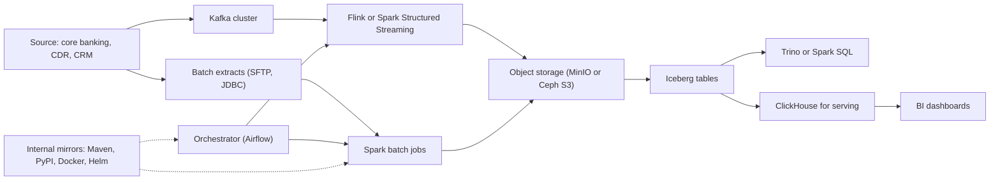

## 🎯 خلاصه

> طراحی یک پلتفرم داده **روی سخت‌افزار خودت، بدون public cloud** تمرین متفاوتی است با معماری‌های مرجع ابری که بیشتر منابع مصاحبه نشان می‌دهند. اندازه‌گیری از روی سخت‌افزار و برق انجام می‌شود، برای **وابستگی‌های آفلاین و محدود** (mirror پکیج، registry کانتینر، وزن مدل‌ها، گواهی‌ها، زمان) برنامه می‌ریزی، و می‌پذیری که **بازیابی یک فرایند فیزیکی** است (دیسک یدکی، زمان روی رک، سایت دوم).

- «فقط یک node اضافه کن» جواب نیست: ظرفیت با زمان تحویل خریده می‌شود، پس پیش‌بینی و headroom اهمیت بیشتری دارند.
- هر دانلود خارجی (Maven، PyPI، npm، image های Docker، chartهای Helm، پکیج‌های سیستم‌عامل، منابع داده) به یک **mirror یا proxy داخلی** نیاز دارد که خودت کنترل کنی.
- هزینه‌ی storage بیشترین سهم را دارد. replication، erasure coding، فشرده‌سازی و نگه‌داشت را با قیمت هر ترابایت در ذهن انتخاب کن.
- محدودیت‌ها را صریح در طراحی system design نام ببر: واقع‌گرایی‌ات را نشان می‌دهند و معماری را عوض می‌کنند (مثلاً Kafka روی object storage در برابر دیسک محلی، یا یک انبار داده به جای چند میکروسرویس).
- درباره‌ی سازمان‌های مشخص واقعیت‌سازی نکن. الگوها را توضیح بده و فرض‌هایت را بگو.

## 🌱 از ساده شروع کنیم (مبتدی)

> **💡 تشبیه:** آشپزی برای خانواده در خانه در برابر اداره‌ی یک رستوران که مواد اولیه‌اش را از یک بازار می‌گیرد. در ابر در چند دقیقه می‌توانی مواد بیشتری سفارش بدهی. روی سخت‌افزار خودت، منوی هفته را از قبل برنامه‌ریزی می‌کنی، انبار ذخیره‌ی مواد داری، و می‌دانی کدام اقلام را سریع نمی‌توانی بخری. آشپزخانه حتی وقتی ماشین تحویل دیر می‌رسد کار می‌کند.

سه چیز نسبت به طراحی ابری عوض می‌شود:

| سؤال | پیش‌فرض ابری | پیش‌فرض on-premises |
|---|---|---|
| ظرفیت بیشتر را از کجا بیاورم؟ | در چند دقیقه مقیاس بده | سخت‌افزار سفارش بده، هفته‌ها صبر کن، نصب و burn-in کن |
| پکیج‌ها و image ها از کجا می‌آیند؟ | registryهای عمومی | یک mirror داخلی که خودت اداره می‌کنی |
| چه چیزی خراب می‌شود و چطور بازیابی می‌کنم؟ | سرویس‌های مدیریت‌شده، چند zone | دیسک، برق، شبکه، و نیروی انسانی در محل |

برای مهندس مبتدی، مفیدترین عادت این پرسش است: **این سیستم برای کار کردن چه چیزی را باید دانلود کند، و اگر آن دانلود مسدود شود چه می‌شود؟** یک job اسپارک که هنگام start-up وابستگی‌هایش را از Maven Central می‌گیرد، در شبکه‌ای که آن آدرس در دسترس نیست شکست می‌خورد. راه‌حل mirror است، نه یک حلقه‌ی retry.

## 🔧 واقعاً چطور کار می‌کند (متوسط)

### یک پشته‌ی واقع‌گرایانه‌ی on-premises

شکل رایج یک پلتفرم تحلیلی در یک بانک یا اپراتور مخابراتی:

اجزا برای چیزی انتخاب می‌شوند که روی bare metal یا یک کلاستر Kubernetes خصوصی اجرا شود، با لایسنس متن‌باز و بدون وابستگی به یک سرویس مدیریت‌شده‌ی عمومی. هر محصولی که انتخاب می‌کنی باید به‌صورت آفلاین نصب شود.

### اندازه‌گیری از اصول اولیه

اندازه‌گیری از حجم روزانه شروع می‌شود و بعد ضرب می‌شود. مثال برای یک فید رکوردهای جزئیات تماس (CDR) مخابراتی:

- حجم خام: ۲۰۰ GB در روز.
- فشرده‌سازی در فرمت ستونی: فرض ۴:۱، یعنی حدود ۵۰ GB در روز برای هر کپی.
- replication یا erasure coding: فرض ۳ replica، یعنی ۱۵۰ GB در روز روی دیسک.
- نگه‌داشت: ۳۶۵ روز، پس ۱۵۰ × ۳۶۵ = ۵۴٫۷۵ TB فیزیکی برای یک سال.
- headroom: ۳۰٪ فضای آزاد برای compaction، rebuild و رشد، پس هدف قابل‌استفاده ۵۴٫۷۵ / ۰٫۷ ≈ ۷۸ TB است.

حالا تعداد node. فرض کن هر سرور ۱۲ دیسک ۸ ترابایتی دارد، یعنی ۹۶ TB خام. overhead فایل‌سیستم و فرمت حدود ۱۰٪ است، پس حدود ۸۶ TB قابل استفاده روی هر سرور. از نظر ظرفیت ۷۸ TB روی یک سرور جا می‌شود، ولی نمی‌توانی سه replica را روی یک ماشین بگذاری، و یک خرابی همه‌ی نسخه‌ها را می‌برد. سه replica حداقل به **سه domain خرابی** نیاز دارد (سه سرور، ترجیحاً در سه رک یا سه فیدر برق).

پس طراحی سه تا چهار سرور است که هر کدام دیسک کافی برای یک سوم مجموعه‌ی replica به‌علاوه‌ی headroom برای rebuild دارند. پاسخ ظرفیت پاسخ نهایی نیست: پاسخ خرابی تعداد را تعیین می‌کند.

> **⚠️ مراقب باش:** اندازه‌گیری فقط با حجم داده، replication، headroom و domainهای خرابی را نادیده می‌گیرد. نتیجه کلاستری است که روی کاغذ جا می‌شود و یک خرابی سرور را تحمل نمی‌کند.

### اندازه‌گیری compute

compute از throughput و concurrency پیروی می‌کند، نه فقط از حجم. برای یک job batch اسپارک تخمین بزن:

- ورودی در هر اجرا: ۲۰۰ GB فشرده، حدود ۸۰۰ GB فشرده‌نشده (با نسبت ۴:۱).
- زمان هدف اجرا ۳۰ دقیقه، پس ۸۰۰ GB / ۱٬۸۰۰ ثانیه ≈ ۰٫۴۴ GB بر ثانیه پردازش.
- اگر یک core اجرایی حدود ۲۰ MB بر ثانیه کار واقعی انجام دهد (خودت اندازه بگیر)، برای سرعت کامل حدود ۰٫۴۴ × ۱۰۲۴ / ۲۰ ≈ ۲۳ core لازم است. shuffle، skew و overhead را اضافه کن و حدود ۴۰ core در نظر بگیر.

این اعداد را قبل از خرید سخت‌افزار در یک pilot اندازه بگیر. عدد ۲۰ MB بر ثانیه یک فرض است که باید با benchmark جایگزین شود.

### mirrorها، registryها و وابستگی‌های آفلاین

هر چیزی که build یا job در زمان اجرا دانلود می‌کند یک وابستگی است. فهرستش کن:

| وابستگی | منبع معمول | پاسخ on-premises |
|---|---|---|
| کتابخانه‌های Java | Maven Central | proxy مخزن artifact (Nexus، Artifactory) |
| پکیج‌های Python | PyPI | proxy یا ایندکس محلی با wheelهای mirror شده |
| image های کانتینر | Docker Hub، registryهای فروشنده | Harbor یا registry خصوصی دیگر با pull-through cache |
| chartهای Helm | مخزن عمومی chart | مخزن chart داخل پلتفرم |
| پکیج‌های سیستم‌عامل | mirror توزیع | mirror محلی از مخزن‌های لازم |
| زمان | NTP عمومی | سرورهای NTP داخلی که با یک منبع قابل اتکا همگام‌اند |
| گواهی‌ها | CA عمومی | CA داخلی؛ root آن را به هر host و image توزیع کن |
| مدل‌ها و دیتاست‌ها | hubهای عمومی | کپی وزن‌ها و داده‌ها در object storage با checksum |

دو قاعده‌ی عملی:

1. **پین و mirror کن، `latest` نگذار.** یک mirror که بی‌نظم تغییر کند هم یک وابستگی کنترل‌نشده است. نسخه‌هایی که استفاده می‌کنی را snapshot کن و checksum ثبت کن.
2. **build آفلاین را تست کن.** ماهی یک بار کل build را در یک شبکه‌ی بدون اینترنت اجرا کن. اولین باری که یک وابستگی گم‌شده را پیدا می‌کنی نباید وسط یک حادثه باشد.

دسترسی به برخی سرویس‌های عمومی خارجی ممکن است در ایران محدود یا ناپایدار باشد. آن را به عنوان محدودیت عملیاتی برنامه‌ریزی کن و سیاست سازمان خودت را بررسی کن؛ فرض نکن که نتیجه‌ی خاصی وجود دارد.

### ارائه‌دهندگان داخلی و پرسش hybrid

بعضی سازمان‌ها برای بخشی از پلتفرم از یک ارائه‌دهنده‌ی ابری یا میزبانی داخلی استفاده می‌کنند، مثلاً object storage، backup یا یک دیتابیس مدیریت‌شده در یک data center ایرانی. سؤال‌های مهندسی تغییر نمی‌کنند: کدام APIها با ابزارهایی که استفاده می‌کنی سازگارند (سازگاری با S3 برای Iceberg و Spark مهم است)، SLA چیست، backupها کجا هستند، و مسیر خروج کجاست. ماتریس سازگاری مستند را بخواه، نه ادعاهای بازاریابی را.

### کارهای فیزیکی

- **برق و خنک‌کاری** حداکثر چگالی هر رک را تعیین می‌کنند. قبل از انتخاب سرورهای 2U با ۲۴ دیسک، عدد آن را از واحد تأسیسات بپرس.
- **قطعات یدکی**: دیسک یدکی و حداقل یک سرور یا ظرفیت یدکی node نگه دار. زمان تحویل قطعه‌ی یدکی زمان واقعی بازیابی است.
- **مانیتورینگ** باید وقتی پلتفرم خراب است هم کار کند: آن را روی یک پشته‌ی کوچک جدا یا سخت‌افزاری که به کلاستر داده وابسته نیست اجرا کن.
- **backup** به یک رسانه‌ی دوم یا سایت دوم نیاز دارد. نوار، data center دوم یا یک کپی آفلاین از خرابی سایت و ransomware محافظت می‌کند.

## 🧠 عمق و trade-offها (سنیور)

- **دیسک محلی در برابر storage مشترک برای Kafka و ClickHouse.** on-premises می‌توانی NVMe محلی با replication بین سرورها داشته باشی، که throughput بالا به ازای هزینه و بدون لایه‌ی storage شبکه‌ای می‌دهد. هزینه این است که جایگزینی node یعنی rebuild، و ترافیک rebuild با production رقابت می‌کند. زمان rebuild را مدل کن: ۴۰ TB با پهنای باند مؤثر ۱ GB بر ثانیه حدود ۱۱ ساعت است، و این پنجره‌ای است که خرابی دوم خطرناک‌ترین است.
- **erasure coding در برابر replication.** erasure coding (مثلاً ۴+۲ در Ceph یا MinIO) کمتر از سه برابر overhead دارد، ولی به node بیشتری نیاز دارد و نوشتن و rebuild کندتری دارد. replication در مقیاس کوچک ساده‌تر و سریع‌تر است. بر اساس تعداد node انتخاب کن: با کمتر از حدود شش node، replication معمولاً پیش‌فرض معقول است.
- **سادگی یک کلاستر در برابر سرویس‌های زیاد.** یک تیم کوچک نمی‌تواند ده سیستم توزیع‌شده را خوب اداره کند. طراحی با یک object store، یک موتور از نوع انبار داده، یک پلتفرم streaming و یک orchestrator ساده‌تر از طراحی‌ای است که معماری‌های مرجع ابری را جزء به جزء کپی کند.
- **ارتقا کندتر است.** سرویس مدیریت‌شده‌ای نیست که ارتقای rolling را انجام دهد. پنجره‌ی نگه‌داشت برنامه‌ریزی کن، ارتقا را روی یک کپی staging تست کن، و installerهای نسخه‌ی قبلی را به‌صورت آفلاین نگه دار.
- **امنیت و محل نگه‌داری داده.** داده‌ی مشتری ممکن است باید داخل کشور و در شبکه‌های مشخص بماند. زود تصمیم بگیر کدام داده را کدام ابزار می‌تواند پردازش کند، و مرزهای اعتماد را مستند کن. به [[data-security]] نگاه کن.
- **مدل هزینه.** هزینه‌ی کل مالکیت را در ۳ تا ۵ سال مقایسه کن: سخت‌افزار، برق، خنک‌کاری، فضای رک، قراردادهای پشتیبانی، زمان نیروی انسانی، و هزینه‌ی یک پیش‌بینی ظرفیت اشتباه. ابر خودکار ارزان‌تر یا گران‌تر نیست؛ مقایسه به میزان استفاده و هزینه‌ی افرادی که سیستم را اداره می‌کنند بستگی دارد.
- **استخدام و مهارت.** اجرای Kubernetes، Kafka و یک lakehouse روی bare metal به افرادی نیاز دارد که storage و شبکه را دیباگ کنند. این را در طراحی و در تصمیم برای استفاده از اجزای کمتر و ساده‌تر لحاظ کن.

> **🎤 این را در مصاحبه بگو:** «از محدودیت‌هایی که واقعاً دارم شروع می‌کنم: بدون public cloud، بودجه‌ی سخت‌افزاری ثابت، و زمان تحویل برای هر سرور. از حجم داده، replication و headroom اندازه می‌گیرم، بعد domainهای خرابی را حساب می‌کنم. هر دانلود از یک mirror داخلی می‌گذرد، و build آفلاین و restore را تمرین می‌کنم، چون بازیابی on-premises یک فرایند فیزیکی است.»

## 🧪 امتحان کن

1. برای ۵۰۰ GB رویداد خام در روز، فشرده‌سازی ۵:۱، ۳ replica، نگه‌داشت ۲ ساله و ۳۰٪ headroom اندازه بگیر. هر مرحله را نشان بده، بعد یک پیکربندی سرور انتخاب کن (مثلاً ۱۲ دیسک ۱۶ TB در هر سرور، با ۹۰٪ قابل استفاده) و حداقل تعداد سرور را با محدودیت domain خرابی بگو.
2. تمام دانلودهای خارجی یک پروژه‌ی Spark + Airflow که می‌شناسی (یا یک پروژه‌ی نمونه) را فهرست کن. برای هر کدام mirrorای که اجرا می‌کنی و روش بررسی آن در یک تست آفلاین ماهانه را بگو.
3. یک یادداشت طراحی دو پاراگرافی برای یک پلتفرم تشخیص تقلب on-premises بنویس. فرض‌هایت را صریح بگو (حجم، هدف latency، تعداد سایت) و بگو کدام الزام انتخاب storage را هدایت می‌کند.

جواب‌ها را نشان بده

**۱.** خام هر کپی در سال: ۵۰۰ GB × ۳۶۵ × ۲ سال = ۳۶۵٬۰۰۰ GB = ۳۶۵ TB خام برای هر کپی. با فشرده‌سازی ۵:۱: ۷۳ TB برای هر کپی. با ۳ replica: ۲۱۹ TB. با headroom ۳۰٪ (تقسیم بر ۰٫۷): حدود ۳۱۳ TB. قابل استفاده روی هر سرور: ۱۲ × ۱۶ TB = ۱۹۲ TB خام × ۰٫۹ = ۱۷۲٫۸ TB. از نظر ظرفیت دو سرور کافی است، ولی سه replica به سه domain خرابی نیاز دارد، پس حداقل **سه سرور** است و هر کدام حدود ۱۰۴ TB از ۳۱۳ TB (یک سوم) را نگه می‌دارد. چهار سرور جا برای rebuild بعد از یک خرابی می‌دهد.

**۲.** نمونه‌ها: پکیج‌های Maven (proxy در Nexus یا Artifactory)، پکیج‌های PyPI (ایندکس محلی)، image های پایه‌ی Docker (registry خصوصی با pull-through cache)، chartهای Helm (مخزن داخلی)، پکیج‌های Ubuntu یا Debian (mirror محلی)، دانلود دیتاست‌ها (کپی در object storage با checksum). تست آفلاین ماهانه: کل build و job را در یک بخش شبکه‌ی بدون اینترنت اجرا کن و مطمئن شو چیزی شکست نمی‌خورد.

**۳.** یک یادداشت خوب می‌گوید: ۲۰ میلیون تراکنش در روز، هدف p99 امتیازدهی کمتر از ۲۰۰ ms، دو data center در یک کشور، یک replica بدون اشتراک در سایت دوم، و تاریخچه‌ی feature برای ۹۰ روز. انتخاب storage با هدف latency ۲۰۰ ms هدایت می‌شود: سرویس‌دهی کم‌تأخیر روی NVMe محلی با یک store تحلیلی جدا. اعداد مشخص فرض‌اند؛ استدلال چیزی است که آزموده می‌شود.

## 💬 گوشه‌ی مصاحبه

**سؤال: «یک پلتفرم داده برای بانکی طراحی کن که نمی‌تواند از public cloud استفاده کند.»**

- **جواب متوسط:** «از اجزای متن‌باز روی Kubernetes استفاده می‌کنم: Kafka برای ingestion، Spark و Iceberg روی object storage، و ClickHouse برای سرویس‌دهی. یک mirror داخلی برای Maven، PyPI و Docker اجرا می‌کنم.»
- **جواب سنیور:** «اول محدودیت‌ها را تأیید می‌کنم: حجم، نگه‌داشت، latency، محل نگه‌داری داده و بودجه‌ی سخت‌افزار با زمان تحویل. از حجم داده با replication و headroom اندازه می‌گیرم و مطمئن می‌شوم حداقل سه domain خرابی وجود دارد. هر وابستگی از یک mirror می‌گذرد و build آفلاین را زمان‌بندی می‌کنم. تعداد اجزا را کم نگه می‌دارم، چون تیم باید بدون سرویس مدیریت‌شده آن‌ها را اداره کند، و backup را به سایت دوم می‌برم همراه با تمرین restore.»

> **🎤 این را در مصاحبه بگو:** «برای محدودیت‌هایی طراحی می‌کنم که واقعاً دارم. on-premises ظرفیت را با زمان تحویل می‌خرم، وابستگی‌ها از mirrorهایی می‌آیند که خودم اداره می‌کنم، و بازیابی به قطعات یدکی و زمان rebuild بستگی دارد. domainهای خرابی را قبل از ترابایت‌ها می‌شمارم.»

## ⚠️ اشتباهات رایج

> **⚠️ مراقب باش:** کپی کردن یک معماری مرجع ابری و فرض اینکه «سرویس مدیریت‌شده‌ی بیشتر» جواب است. on-premises باید همه‌ی آن‌ها را خودت اداره کنی.

- اندازه‌گیری فقط با حجم خام داده و نادیده گرفتن replication، headroom و domainهای خرابی.
- اجرای سه replica روی دو سرور.
- وابسته بودن build به تگ `latest` یا یک registry عمومی.
- کشف این‌که build در زمان قطعی به اینترنت نیاز دارد.
- فراموش کردن زمان rebuild بعد از خرابی دیسک، که دقیقاً زمانی است که خرابی دوم محتمل‌ترین است.
- نگه‌داشتن backup در همان رک یا همان فیدر برق داده.
- بیان واقعیت‌های مشخص درباره‌ی یک سازمان، فروشنده یا مقررات بدون بررسی.

## ✅ خودت را بسنج

1. چرا «node بیشتر اضافه کن» در on-premises پاسخ ضعیف‌تری نسبت به ابر است؟
   - A) node را نمی‌توان به کلاستر اضافه کرد
   - B) سخت‌افزار زمان تحویل، نصب و burn-in لازم دارد، پس برنامه‌ریزی ظرفیت باید از قبل انجام شود
   - C) node های ابری از نظر تعریف ارزان‌ترند
   - D) کلاسترهای on-premises اصلاً مقیاس‌پذیر نیستند

جواب

**B** — هزینه‌ی افزایش ظرفیت یک تأخیر تحویل و نصب است، نه یک فراخوانی API. پیش‌بینی و headroom به الزامات طراحی تبدیل می‌شوند.

2. یک کلاستر Kafka با سه replica روی دو سرور فیزیکی قرار گرفته. مشکل چیست؟
   - A) Kafka به چهار replica نیاز دارد
   - B) سه replica به سه domain خرابی نیاز دارد؛ با دو سرور، یک خرابی دو کپی را همزمان می‌برد
   - C) replication نیاز به object storage دارد
   - D) هیچ؛ replicaها می‌توانند روی یک سرور باشند

جواب

**B** — یک replica فقط وقتی مفید است که خرابی‌هایی را تحمل کند که بقیه تحمل نمی‌کنند. دو سرور یعنی خرابی یک سرور می‌تواند دو replica را ببرد و فقط یک کپی بماند.

3. یک job اسپارک در آزمایشگاه کار می‌کند ولی در production هنگام start-up با خطای «cannot resolve dependency» شکست می‌خورد. محتمل‌ترین علت ریشه‌ای چیست؟
   - A) Spark از وابستگی پشتیبانی نمی‌کند
   - B) job از یک مخزن عمومی دانلود می‌کند که در دسترس نیست؛ راه‌حل mirror داخلی و نسخه‌های پین‌شده است
   - C) نسخه‌ی Spark خیلی جدید است
   - D) کلاستر حافظه‌ی زیادی دارد

جواب

**B** — دانلود در زمان اجرا یک وابستگی خارجی است. آن را mirror کن، پین کن، و build آفلاین را تست کن.

4. **(سنیور)** برای یک object store با پنج node باید بین replication سه‌برابر و erasure coding (مثلاً ۴+۲) انتخاب کنی. چه چیزی تصمیم را هدایت می‌کند؟
   - A) رنگ رک‌ها
   - B) تعداد node و رفتار rebuild: erasure coding ظرفیت را ذخیره می‌کند ولی node کافی و نوشتن و rebuild کندتر می‌خواهد؛ با node کم، replication معمولاً ساده‌تر و سریع‌تر است
   - C) erasure coding همیشه ارزان‌تر است، پس همیشه از آن استفاده کن
   - D) replication را نمی‌توان با object storage استفاده کرد

جواب

**B** — trade-off بین overhead ظرفیت از یک طرف و سرعت نوشتن، پیچیدگی rebuild و حداقل تعداد node از طرف دیگر است. پنج node با ۴+۲ تنگ است، پس پاسخ به تحمل خرابی لازم و زمان rebuild قابل قبول بستگی دارد.

5. **(سنیور)** دیسکی در یک node با ۴۰ TB خراب می‌شود و rebuild حدود ۱۱ ساعت طول می‌کشد. چرا این پنجره مهم است و چه چیزی را تغییر می‌دهی؟
   - A) مهم نیست؛ دیسک‌ها به ندرت خراب می‌شوند
   - B) در طول rebuild افزونگی کاهش یافته، پس خرابی دوم خطرناک‌ترین است؛ این ریسک را با تحمل خرابی بیشتر، پهنای باند rebuild رزرو‌شده، قطعات یدکی در دسترس و مانیتورینگ پیشرفت rebuild کم می‌کنی
   - C) فقط برای backup مهم است
   - D) روی bare metal rebuild آنی است

جواب

**B** — افزونگی تا پایان rebuild کاهش یافته است. برای آن پنجره طراحی کن: قطعه‌ی یدکی، پهنای باند رزرو برای rebuild، و تحمل خرابی بالاتر از حداقل.

## 🗂️ فلش‌کارت

| Front | Back |
|---|---|
| بزرگ‌ترین تفاوت با طراحی ابری | ظرفیت با زمان تحویل خریده می‌شود، و هر وابستگی باید به‌صورت آفلاین در دسترس باشد |
| چرا با domainهای خرابی اندازه بگیریم | replicaها فقط وقتی کمک می‌کنند که در یک خرابی مشترک نباشند؛ سرور و رک بشمار، نه فقط ترابایت |
| اصول فرمول اندازه‌گیری | بایت روزانه × فشرده‌سازی × تعداد کپی × نگه‌داشت، سپس تقسیم بر میزان استفاده‌ی هدف (مثلاً ۰٫۷) |
| mirror برای چیست | کپی داخلی و کنترل‌شده‌ی پکیج و image تا build و job بدون دسترسی عمومی کار کنند |
| پین و mirror | نسخه‌ی دقیق با checksum، نه `latest`، تا کپی آفلاین قابل تکرار باشد |
| پنجره‌ی rebuild | زمانی با افزونگی کاهش‌یافته بعد از خرابی؛ خطرناک‌ترین دوره برای خرابی دوم |
| replication در برابر erasure coding | replication: در مقیاس کوچک ساده و سریع؛ erasure coding: overhead کمتر، نیاز به node بیشتر |
| چرا backup به سایت یا رسانه‌ی دوم نیاز دارد | از خرابی سایت، آتش‌سوزی، رخدادهای برق و ransomware که به سیستم اصلی می‌رسد محافظت می‌کند |

## 🔗 ادامه

- **[[capacity-planning]]** روش کلی پشت اندازه‌گیری این درس را پوشش می‌دهد.
- **[[kubernetes-for-data]]** اجرای سیستم‌های stateful روی کلاستر خصوصی و trade-offهای storage را توضیح می‌دهد.
- **[[dataops-cicd]]** pipelineهایی را نشان می‌دهد که به mirrorهای داخلی و build آفلاین وابسته‌اند.
- **[[data-security]]** کنترل دسترسی و رمزنگاری را برای داده‌ای که باید داخل شبکه‌ی تو بماند پوشش می‌دهد.
- **[[iran-de-market]]** و **[[negotiation-iran]]** بازار و زمینه‌ی مصاحبه برای نقش‌های داده در ایران را بررسی می‌کنند.
- **[[hadoop-ecosystem]]** پشته‌ی Hadoop on-premises را توضیح می‌دهد که بسیاری از سازمان‌ها هنوز در کنار ابزارهای جدیدتر اجرا می‌کنند.
- برای هر محصولی که در نظر داری، راهنمای نصب آفلاین و راهنمای اندازه‌گیری storage نسخه‌ی خودت را بخوان، قبل از خرید سخت‌افزار.

