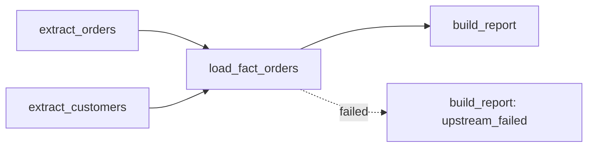

## 🎯 خلاصه

> یک **orchestrator** مراحل یک pipeline داده را به ترتیب درست و در زمان درست اجرا می‌کند و وقتی چیزی خراب می‌شود به تو خبر می‌دهد. خودش کار سنگین داده را انجام نمی‌دهد؛ آن کار در جای دیگری انجام می‌شود (Spark، یک warehouse با SQL، یا یک اسکریپت).

- یک pipeline به صورت یک [[dag]] (گراف جهت‌دار بدون دور) مدل می‌شود: تسک‌ها گره‌اند، وابستگی‌ها فلش‌اند و هیچ حلقه‌ای وجود ندارد.
- یک **scheduler** تصمیم می‌گیرد *کی* یک run شروع شود. یک **executor** (یا مجموعه‌ای از worker) تصمیم می‌گیرد هر تسک *کجا* اجرا شود.
- orchestration در محیط production علاوه بر این‌ها، **retry**، **sensor** (صبر برای یک اتفاق بیرونی)، **SLA** (مهلت)، **هشدار** و **backfill** (اجرای مجدد دوره‌های گذشته) را هم دارد.
- تسک‌ها باید امن باشند که بیشتر از یک بار اجرا شوند، چون retry و backfill آن‌ها را دوباره اجرا می‌کنند.

## 🌱 از ساده شروع کنیم (مبتدی)

> **💡 تشبیه:** آشپزخانه یک رستوران در ساعت شلوغی شام. سرآشپز خودش همه غذاها را نمی‌پزد. می‌گوید «سس باید قبل از چیدن آماده باشد»، «ماهی را ساعت ۱۹ شروع کنید»، و اگر فر خراب شد سفارش‌ها را دوباره تقسیم می‌کند و به مدیر خبر می‌دهد. سرآشپز همان orchestrator است و آشپزها کار را انجام می‌دهند.

یک pipeline روزانه را تصور کن:

1. سفارش‌های دیروز را از یک API استخراج کن.
2. جدول مشتری‌ها را از یک دیتابیس استخراج کن.
3. این دو را join کن و `fact_orders` را در warehouse بار کن.
4. یک گزارش فروش بساز.

مرحله‌های ۱ و ۲ به هم وابسته نیستند، پس می‌توانند هم‌زمان اجرا شوند. مرحله ۳ باید منتظر هر دو بماند. مرحله ۴ باید منتظر مرحله ۳ بماند. این رابطه‌ی «باید منتظر بماند» یک **وابستگی** است و مجموعه‌ای از تسک‌ها با وابستگی، یک **DAG** است.

ساده‌ترین راه اجرای این کار یک خط cron است:

```bash
# Runs every day at 02:00. It does not know whether the extract failed,
# it does not retry, it does not alert, and it cannot wait for late data.
0 2 * * * /opt/jobs/extract_orders.sh && /opt/jobs/load_fact.sh
```

cron یک **scheduler** خوب است، ولی یک **orchestrator** ضعیف: فقط ساعت را می‌شناسد، نه وضعیت کار را. بقیه‌ی این درس درباره‌ی چیزی است که باید روی ساعت اضافه کنی.

## 🔧 واقعاً چطور کار می‌کند (متوسط)

**DAG.** «جهت‌دار» یعنی هر یال یک طرفه است (A → B یعنی «B بعد از A اجرا می‌شود»). «بدون دور» یعنی حلقه نداریم، چون حلقه یعنی یک تسک منتظر خودش بماند و هیچ‌چیز شروع نشود. بیشتر orchestratorها موقع خواندن تعریف pipeline دنبال دور می‌گردند.

**Run و task instance.** یک *DAG run* یک اجرای کامل pipeline برای یک دوره است. یک *task instance* یک تسک داخل یک DAG run است. اگر یک DAG روزانه برای ۲۰۲۶-۱۰-۰۱ اجرا شده باشد، آن run چهار task instance دارد که هر کدام وضعیت جدای خودشان را دارند.

**دوره‌ی داده، نه زمان دیوار.** یک run روزانه که داده‌ی ۱ اکتبر (۲۰۲۶-۱۰-۰۱) را پردازش می‌کند معمولاً *بعد از* بسته شدن دوره اجرا می‌شود (روز ۲ اکتبر ساعت ۰۲:۰۰). orchestrator به این می‌گوید logical date یا data interval. کد پردازش باید از همین دوره استفاده کند، نه از زمان فعلی. اجرای مجدد و backfill فقط به همین شکل درست می‌شوند.

**وضعیت‌ها.** بیشتر ابزارها وضعیت‌هایی مثل queued، running، success، failed، up-for-retry، skipped و upstream-failed را نگه می‌دارند. «upstream-failed» یعنی تسک اصلاً اجرا نشد چون یکی از والدینش شکست خورد.



**قوانین trigger.** معمولاً یک تسک فقط وقتی اجرا می‌شود که همه‌ی والدینش موفق شده باشند. قوانین دیگری هم وجود دارد (اجرا وقتی یکی از والدین شکست خورده، یا وقتی همه‌ی والدین تمام شده‌اند حتی اگر بعضی شکست خورده باشند). این‌ها را برای تسک‌های پاک‌سازی یا هشدار استفاده کن، نه به عنوان میان‌بر برای عبور از داده‌ی خراب.

**Retry.** یک سیاست retry تعداد تلاش، فاصله‌ی بین تلاش‌ها و اغلب backoff نمایی دارد (یک دقیقه صبر، بعد دو دقیقه، بعد چهار دقیقه). retry مشکلات گذرا مثل timeout شبکه را حل می‌کند. کوئری بد را درست نمی‌کند، و فقط وقتی امن است که تسک idempotent باشد (ببین [[idempotency]]).

**Sensor.** sensor یک تسک است که صبر می‌کند تا یک شرط برقرار شود؛ مثلاً یک فایل وجود داشته باشد یا یک partition در جدولی آماده باشد. sensor کلاسیک وقتی منتظر است یک slot از worker را اشغال می‌کند، پس ۵۰ sensor منتظر می‌توانند کاری را که باید آن‌ها را موفق کند متوقف کنند. بسیاری از ابزارها حالت deferrable یا async دارند که در زمان انتظار slot را آزاد می‌کند.

**SLA و هشدار.** SLA (توافق سطح سرویس، این‌جا: مهلت) می‌گوید «این گزارش باید تا ۰۶:۰۰ آماده باشد». این با خطا فرق دارد. یک تسک می‌تواند ساعت ۰۷:۰۰ موفق شود و باز هم SLA را از دست داده باشد، پس هم دیر رسیدن و هم شکست را باید هشدار بدهی. ببین [[sla-slo]].

یک نمونه‌ی زمانی: یک pipeline روزانه ساعت ۰۲:۰۰ شروع می‌شود، SLA آن ۰۶:۰۰ است و تسک بارگذاری ۳ بار retry با فاصله‌ی ۵ دقیقه دارد. اگر تلاش اول ساعت ۰۲:۲۰ شکست بخورد و retryها ۵، ۱۰ و ۲۰ دقیقه صبر کنند (به علاوه‌ی زمان اجرای هر تلاش)، آخرین retry هنوز می‌تواند قبل از ۰۶:۰۰ تمام شود. اگر منبع داده دو ساعت خاموش باشد، تلاش آخر شکست می‌خورد، هشدار SLA ساعت ۰۶:۰۰ فعال می‌شود و یک آدم تصمیم می‌گیرد صبر کند یا backfill بزند.

یک مثال مستقل از ابزار که نشان می‌دهد وابستگی‌ها چطور به ترتیب اجرا تبدیل می‌شوند. ماژول استاندارد `graphlib` پایتون مرتب‌سازی را انجام می‌دهد:

```python
from graphlib import TopologicalSorter

# node -> set of tasks it depends on (its parents)
pipeline = {
    "extract_orders": set(),
    "extract_customers": set(),
    "load_fact_orders": {"extract_orders", "extract_customers"},
    "build_report": {"load_fact_orders"},
}

order = list(TopologicalSorter(pipeline).static_order())
print(order)
# One valid output: ['extract_orders', 'extract_customers', 'load_fact_orders', 'build_report']
# The two extracts may swap, because they are independent.
```

اگر وابستگی‌ها یک حلقه بسازند، `static_order()` خطای `CycleError` می‌دهد. این همان بررسی‌ای است که یک orchestrator قبل از پذیرفتن DAG تو انجام می‌دهد.

## 🧠 عمق و trade-offها (سنیور)

- **نقش‌ها را جدا کن.** scheduler (یا تایمر) runها را شروع می‌کند. DAG parser تعریف‌ها را می‌خواند. executor و workerها تسک‌ها را اجرا می‌کنند. دیتابیس متادیتا وضعیت‌ها را نگه می‌دارد. وقتی سیستم کند است، باید بفهمی کدام نقش گلوگاه است: تأخیر زمان‌بندی، زمان parse فایل‌های DAG که زیاد یا سنگین‌اند، یا رقابت روی دیتابیس وضعیت تسک‌ها.
- **داده را از داخل orchestrator عبور نده.** orchestrator متادیتای تسک را ذخیره می‌کند، نه جدول‌ها را. بین تسک‌ها reference رد و بدل کن (یک مسیر، اسم یک جدول، مقدار یک partition). اگر payload بزرگ از دیتابیس متادیتا رد شود، آن دیتابیس پر می‌شود و همه‌ی کوئری‌ها روی آن کند می‌شوند.
- **retry یعنی at-least-once.** تسکی که می‌نویسد و قبل از اعلام موفقیت کرش می‌کند دوباره اجرا می‌شود. نوشتن‌ها را طوری طراحی کن که upsert، بازنویسی یک partition، یا نام فایل قطعی باشند. ببین [[dedup-idempotent-loads]] و [[exactly-once]].
- **backfill جزو طراحی است.** اگر تسک از ساعت دیوار استفاده کند، نمی‌توانی ماه گذشته را دوباره بسازی. اگر از data interval استفاده کند، می‌توانی هر دوره‌ای را با همان کد اجرا کنی. ببین [[backfill]].
- **وابستگی بین pipelineها شکننده است.** «job ب ساعت ۰۳:۰۰ اجرا می‌شود و job الف معمولاً ۰۲:۵۰ تمام می‌شود» یک مسابقه است که منتظر شکست است. وابستگی‌های مبتنی بر داده (وقتی یک dataset یا asset به‌روز می‌شود) یا sensor با timeout را ترجیح بده و وابستگی را صریح بنویس.
- **همزمانی را عمدی کنترل کن.** تعداد runهای فعال هر pipeline را محدود کن، از pool یا صف برای منابع مشترک استفاده کن (سقف اتصال دیتابیس، API با محدودیت نرخ)، و اولویت تعیین کن تا یک گزارش فوری پشت یک backfill گیر نکند.
- **orchestrator را هم مانیتور کن، نه فقط داده را.** زمان انتظار در صف، روند مدت اجرای تسک‌ها، تأخیر scheduler، و فاصله‌ی بین شروع مورد انتظار و شروع واقعی را ببین. بررسی تازگی و کیفیت داده هم باید داخل pipeline باشد؛ ببین [[data-observability]] و [[data-quality]].
- **کی orchestrator لازم نیست؟** یک job روی یک ماشین، بدون وابستگی و بدون نیاز به هشدار، به یک پلتفرم نیاز ندارد. پردازش پیوسته‌ی رویداد (مصرف‌کننده‌های Kafka، jobهای Flink) زمان‌بندی DAG نیست؛ یک DAG تا آخر اجرا می‌شود، ولی یک stream هرگز تمام نمی‌شود. ببین [[orchestrator-alternatives]].

## 🧪 امتحان کن

1. **موازی‌سازی را پیدا کن.** برای این pipeline، تسک‌هایی که می‌توانند هم‌زمان اجرا شوند و مسیر بحرانی (طولانی‌ترین زنجیره) را فهرست کن.
   - `ingest_clicks`، `ingest_orders`
   - `dedup_clicks` به `ingest_clicks` وابسته است
   - `join_sessions` به `dedup_clicks` و `ingest_orders` وابسته است
   - `publish_dashboard` به `join_sessions` وابسته است

   بعد snippet مربوط به `graphlib` بالا را با این تسک‌ها اجرا کن و جوابت را بررسی کن.

2. **حساب retry.** یک تسک `retries=3` دارد و backoff نمایی که از ۶۰ ثانیه شروع و هر بار دو برابر می‌شود. فرض کن هر تلاش فوراً شکست بخورد. در مجموع چند تلاش اجرا می‌شود و بین اولین شکست و شکست نهایی چقدر زمان می‌گذرد؟

3. **باگ را پیدا کن.** یک sensor منتظر `s3://bucket/orders/{now}.parquet` است، که در آن `{now}` زمان فعلی لحظه‌ی شروع sensor است. چرا این کار شکست می‌خورد و باید به جایش از چه چیزی استفاده کند؟

<details><summary>پاسخ‌ها را ببین</summary>

**۱.** `ingest_clicks` و `ingest_orders` هم‌زمان اجرا می‌شوند. `dedup_clicks` بعد از `ingest_clicks` شروع می‌شود. `join_sessions` منتظر `dedup_clicks` و `ingest_orders` هر دو می‌ماند. مسیر بحرانی `ingest_clicks → dedup_clicks → join_sessions → publish_dashboard` است که چهار تسک دارد.

**۲.** در مجموع ۴ تلاش اجرا می‌شود: ۱ تلاش اولیه به علاوه‌ی ۳ retry. فاصله‌ها ۶۰ ثانیه، ۱۲۰ ثانیه و ۲۴۰ ثانیه‌اند، پس ۴۲۰ ثانیه (۷ دقیقه) بین اولین شکست و شکست نهایی می‌گذرد.

**۳.** نام فایل به زمان اجرای sensor بستگی دارد، نه به روز کاری‌ای که قرار است پردازش شود. اجرای مجدد یا backfill برای همان روز هفته‌ی پیش دنبال فایل امروز می‌گردد. مسیر را با data interval (logical date) بساز تا همان کد برای هر دوره‌ای فایل درست را پیدا کند.

</details>

## 💬 گوشه‌ی مصاحبه

**«تفاوت scheduler و orchestrator چیست؟»**
- **جواب متوسط:** «scheduler جاب‌ها را سر زمان شروع می‌کند. orchestrator علاوه بر آن، اجرای آن‌ها را بر اساس وابستگی مرتب می‌کند، retry می‌زند و وضعیت‌شان را نشان می‌دهد.»
- **جواب سنیور:** «زمان‌بندی فقط یک وظیفه است. orchestrator وضعیت هر task instance را نگه می‌دارد، وابستگی‌ها، backfill، محدودیت همزمانی، retry و هشدار را مدیریت می‌کند و مشخص می‌کند که چه چیزی برای کدام دوره اجرا شده. cron یک scheduler است. Airflow، Dagster و Prefect orchestrator هستند، و این مرز با بزرگ‌تر شدن ابزارها کم‌رنگ می‌شود.»

**«یک pipeline ساعت ۰۳:۰۰ شکست خورد و داشبورد ساعت ۰۸:۰۰ اشتباه است. چه کار می‌کنی؟»**
اولین تسک شکست‌خورده را پیدا کن، ببین آیا بالادست داشبورد است، علت را رفع کن، و فقط تسک شکست‌خورده و تسک‌های پایین‌دستش را برای دوره‌ی تحت تأثیر دوباره اجرا کن. مطمئن شو اجرای مجدد idempotent است، و بعد زمان آماده‌شدن جدید را به ذی‌نفعان بگو. یک کاندیدای سنیور هم درباره‌ی بررسی بعد از حادثه حرف می‌زند: چرا هشدار دیر رسید، یا چرا SLA تعریف نشده بود.

**«retry را چطور طراحی می‌کنی؟»** خطاهای گذرا (timeout، throttling) را با backoff و سقف retry کن. خطاهای اعتبارسنجی (schema اشتباه، شکست یک بررسی کیفیت) را retry نکن؛ سریع شکست بخور و هشدار بده. قبل از اضافه کردن retry مطمئن شو تسک idempotent است.

> **🎤 این را در مصاحبه بگو:** «orchestrator وضعیت هر اجرای تسک را مدیریت می‌کند: وابستگی‌ها، retry، دوره‌ای که هر run برای آن است، و هشدار وقتی مهلتی از دست می‌رود. چون retry و backfill تسک‌ها را دوباره اجرا می‌کنند، هر تسک را طوری طراحی می‌کنم که تکرارش امن باشد.»

## ⚠️ اشتباهات رایج

> **⚠️ مراقب باش:** استفاده از زمان فعلی به عنوان تاریخ کسب‌وکار. اجرای مجدد هفته‌ی بعد داده‌ی اشتباه را پردازش می‌کند، بی‌صدا. همیشه از data interval استفاده کن.

> **⚠️ مراقب باش:** عبور دادن یک DataFrame یا لیست بزرگ بین تسک‌ها از طریق متادیتای orchestrator. به جایش reference (مسیر یا اسم جدول) بفرست.

- اضافه کردن retry به تسکی که بدون deduplication ردیف اضافه می‌کند و در نتیجه تکرار می‌سازد.
- رفتار با DAG مثل stream: یک DAG باید تمام شود؛ کار پیوسته باید در سیستم streaming باشد.
- sensorهایی که ساعت‌ها یک slot از worker را نگه می‌دارند؛ timeout و حالت deferrable بگذار.
- retry بی‌نهایت. هر سیاست retry سقف و هشدار لازم دارد.
- هشدار برای هر خطا بدون زمینه‌ی SLA، تا جایی که تیم یاد می‌گیرد هشدارها را نادیده بگیرد.
- تکیه بر زمان‌بندی («جاب الف معمولاً زودتر تمام می‌شود») به جای یک وابستگی صریح.

## ✅ خودت را بسنج

۱. چرا یک DAG باید بدون دور باشد؟
   - الف) تا تسک‌ها بتوانند موازی اجرا شوند
   - ب) چون دور یعنی یک تسک منتظر خودش بماند، پس هیچ ترتیب معتبری وجود ندارد
   - ج) چون scheduler فقط یک والد برای هر تسک را پشتیبانی می‌کند
   - د) تا backfill سریع‌تر شود

<details><summary>پاسخ</summary>

**ب** — ترتیب topological فقط برای گراف‌های بدون دور وجود دارد. دور یعنی بن‌بست: هر تسک داخل حلقه منتظر تسک دیگری در همان حلقه است، پس هیچ‌کدام شروع نمی‌شود.

</details>

۲. یک cron ساعت ۰۲:۰۰ اجرا می‌شود و یک جدول را بار می‌کند. در مقایسه با یک orchestrator، کدام قابلیت **وجود ندارد**؟
   - الف) تریگر زمانی
   - ب) اجرای یک دستور shell
   - ج) دانستن وضعیت تسک‌های قبلی، retry و وابستگی‌ها
   - د) نوشتن در دیتابیس

<details><summary>پاسخ</summary>

**ج** — cron فقط ساعت را می‌شناسد. وضعیت تسک را ردیابی نمی‌کند، نمی‌تواند منتظر وابستگی بماند و retry یا هشدار نمی‌زند.

</details>

۳. یک تسک بارگذاری بعد از timeout دوباره اجرا شد و حالا جدول ردیف تکراری دارد. محتمل‌ترین علت ریشه‌ای چیست؟
   - الف) scheduler تسک را دو بار هم‌زمان شروع کرده
   - ب) تسک idempotent نیست: تلاش اول قبل از اعلام شکست داده را نوشته بود
   - ج) مهلت SLA خیلی کوتاه بود
   - د) DAG تسک‌های زیادی داشت

<details><summary>پاسخ</summary>

**ب** — retry یعنی اجرای دوم، پس هر نوشتنی که قابل تکرار نیست تکرار می‌سازد. راه‌حل آن upsert، بازنویسی partition، یا نام فایل قطعی است.

</details>

۴. **(سنیور)** یک backfill شش ماه داده از ساعت دیوار برای فیلتر تاریخ استفاده می‌کند. چه اتفاقی می‌افتد و راه‌حل چیست؟
   - الف) هیچ؛ backfill همیشه از تاریخ امروز استفاده می‌کند
   - ب) هر دوره داده‌ی امروز را پردازش می‌کند، پس تاریخچه هرگز درست ساخته نمی‌شود؛ کد را با data interval پارامتری کن
   - ج) orchestrator اجرای backfill با فیلتر تاریخ را رد می‌کند
   - د) راه‌حل افزایش تعداد retry است

<details><summary>پاسخ</summary>

**ب** — کد باید برای یک دوره‌ی مشخص همیشه همان خروجی را بدهد. عبور دادن data interval (ابتدا و انتهای دوره) به کوئری باعث می‌شود هر اجرای backfill تکه‌ی خودش را پردازش کند.

</details>

۵. **(سنیور)** باید بین یک sensor که هر دقیقه یک فایل را چک می‌کند و یک تریگر روی به‌روزرسانی dataset یکی را انتخاب کنی. کدام trade-off در مقیاس بزرگ مهم‌تر است؟
   - الف) polling همیشه دقیق‌تر است
   - ب) polling ظرفیت worker را نگه می‌دارد و بار را روی سیستم ذخیره‌سازی ضرب می‌کند؛ تریگر رویدادی فقط وقتی داده تغییر می‌کند کار را بیدار می‌کند، ولی به اعتماد به رویدادها وابسته است
   - ج) تریگرها را نمی‌توان با SLA استفاده کرد
   - د) sensorها نمی‌توانند شکست بخورند

<details><summary>پاسخ</summary>

**ب** — sensorهای طولانی‌مدت تعداد زیادی slot و فراخوانی متادیتا مصرف می‌کنند. تریگرهای رویدادی ارزان‌ترند، اما باید به تولیدکننده‌ی رویداد اعتماد کنی، پس برای رویدادهای گم‌شده یک بررسی پشتیبان هم لازم است.

</details>

## 🗂️ فلش‌کارت

| جلو | پشت |
|---|---|
| DAG | گراف جهت‌دار بدون دور: تسک‌ها گره‌اند، وابستگی‌ها یال یک‌طرفه‌اند، و حلقه نداریم |
| scheduler در برابر orchestrator | scheduler runها را سر زمان شروع می‌کند؛ orchestrator علاوه بر آن وابستگی، وضعیت، retry، backfill و هشدار را مدیریت می‌کند |
| logical date / data interval | بازه‌ی داده‌ای که یک run پردازش می‌کند، نه زمان ساعت دیوار شروع run |
| retry با backoff | اجرای مجدد تسک شکست‌خورده با فاصله‌های رو به افزایش؛ فقط وقتی امن است که تسک idempotent باشد |
| Sensor | تسکی که منتظر یک شرط می‌ماند (فایل، partition، رویداد)؛ مصرف slot آن را زیر نظر بگیر |
| SLA در برابر شکست | SLA یک مهلت است؛ یک تسک می‌تواند موفق شود و باز هم SLA را از دست بدهد |
| Upstream failed | تسک اجرا نشد چون یکی از والدینش شکست خورد |
| Backfill | اجرای مجدد دوره‌های گذشته با همان کد و data interval هر دوره |

## 🔗 ادامه

- [[airflow]] همین ایده‌ها را در یک orchestrator پرکاربرد نشان می‌دهد، از جمله معماری Airflow 3.
- [[dbt]] لایه‌ی transform را پوشش می‌دهد که اغلب یک مرحله‌ی داخل pipeline ارکستریشن‌شده است.
- [[backfills]] و [[dedup-idempotent-loads]] دو قاعده‌ی طراحی را پوشش می‌دهند که retry و اجرای مجدد را امن می‌کنند.
- [[pipeline-monitoring]] می‌گوید چه چیزی را باید هشدار بدهی، و [[orchestrator-alternatives]] ابزارهایی با مدل زمان‌بندی متفاوت را مقایسه می‌کند.
- صفحه‌ی مفاهیم orchestrator مورد نظرت را یک بار بخوان. اسم‌ها بین ابزارها فرق می‌کند (task instance، asset، dataset، op)، ولی ایده‌های بالا منتقل می‌شوند.
