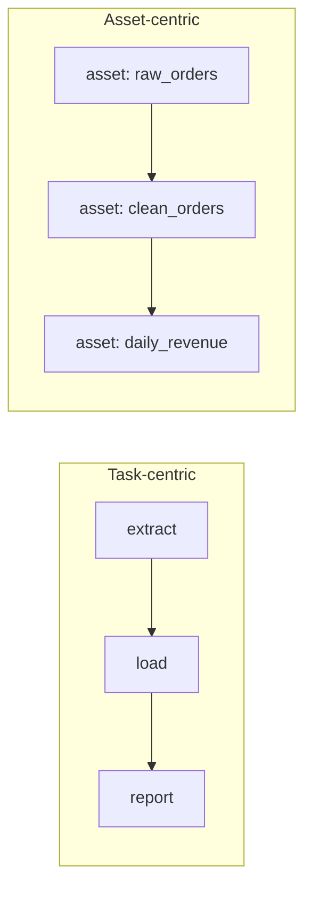

## 🎯 خلاصه

> یک **orchestrator** تصمیم می‌گیرد که هر مرحله‌ی pipeline **کی** اجرا شود، به **چه ترتیبی**، و وقتی یک مرحله شکست می‌خورد **چه اتفاقی** بیفتد. Airflow پیش‌فرضی است که بیشتر مصاحبه‌گرها می‌شناسند. جایگزین‌ها بیشتر در **واحد کار** فرق دارند: یک **task** (Airflow، Prefect، Argo) یا یک **data asset** (Dagster).

- **Dagster** asset-محور است: تو جدول‌ها یا فایل‌هایی را که باید وجود داشته باشند اعلام می‌کنی و Dagster کدی را که آن‌ها را می‌سازد اجرا می‌کند.
- **Prefect** Python-محور است: تابع‌های ساده به flow و task تبدیل می‌شوند، با retry و ردیابی وضعیت.
- **Argo Workflows** بومی Kubernetes است: هر مرحله یک container است و هر workflow یک منبع Kubernetes.
- **DolphinScheduler** یک پروژه‌ی Apache با طراح workflow بصری و انواع task آماده است.

## 🌱 از ساده شروع کنیم (مبتدی)

> **💡 تشبیه:** یک آشپزخانه‌ی رستوران. Airflow مثل سرآشپزی است با چک‌لیست («خرد کن، سرخ کن، سرو کن»). Dagster مثل سرآشپزی است که از منو شروع می‌کند («سوپ فردا باید آماده باشد، برای آن استاک لازم است، و استاک به استخوان نیاز دارد»). هر دو شام را سر میز می‌آورند؛ فقط کار را جور دیگری فکر می‌کنند.

یک orchestrator چهار کار اصلی دارد: **زمان‌بندی** اجرا، رعایت **وابستگی** بین مراحل، **retry** وقتی خطا می‌شود، و نشان دادن **این‌که چه اتفاقی افتاد** در یک UI. یک pipeline کوچک را در نظر بگیر: سفارش‌ها را بگیر، ردیف‌های بد را حذف کن، و درآمد روزانه را حساب کن. این کار به دو روش نوشته شده است.

```python
# Dagster: داده‌ها را اعلام می‌کنی؛ نام پارامترها وابستگی‌ها را تعریف می‌کند
from dagster import asset

@asset
def raw_orders():
    return fetch_orders()          # کد استخراج خودت

@asset
def clean_orders(raw_orders):      # به raw_orders وابسته است
    return [o for o in raw_orders if o["amount"] > 0]
```

```python
# Prefect: تابع‌های ساده‌ی Python؛ صدا زدن flow آن را اجرا می‌کند
from prefect import flow, task

@task(retries=2, retry_delay_seconds=30)
def fetch_orders() -> list[dict]:
    return [{"id": 1, "amount": 10}, {"id": 2, "amount": -1}]

@task
def clean_orders(rows: list[dict]) -> list[dict]:
    return [r for r in rows if r["amount"] > 0]

@flow
def orders_pipeline():
    clean_orders(fetch_orders())

if __name__ == "__main__":
    orders_pipeline()
```

هر دو برنامه یک کار را توصیف می‌کنند. تفاوت در چیزی است که ابزار **می‌داند**: در Dagster، `raw_orders` و `clean_orders` را به‌عنوان داده می‌شناسد؛ در Prefect، فراخوانی تابع‌ها و نتیجه‌شان را می‌شناسد.

## 🔧 واقعاً چطور کار می‌کند (متوسط)

دو مدل اصلی:



- **Task-centric (Airflow، Prefect، Argo).** گراف از *اقدام‌ها* ساخته شده. scheduler می‌داند که task بی بعد از موفقیت task الف اجرا می‌شود. انتقال داده با توست. XCom در Airflow برای metadata کوچک است، نه جدول: مسیر فایل را در object storage بفرست.
- **Asset-centric (Dagster).** گراف از *شیء‌های داده* ساخته شده. هر asset تاریخچه‌ی materialization دارد، پس Dagster می‌تواند بگوید کدام assetها کهنه شده‌اند چون یکی از بالادستی‌هایشان تغییر کرده. یک **I/O manager** تعیین می‌کند asset چطور ذخیره و بارگذاری شود (مثلاً Parquet روی S3)، تا کد asset روی transform متمرکز بماند.

**Prefect** (با API نسخه‌ی ۳) flow و task را مثل Python عادی اجرا می‌کند. retry روی decorator تنظیم می‌شود. `retries` روی `@flow` کل flow را دوباره اجرا می‌کند، اما `retries` روی `@task` فقط task شکست‌خورده را. زمان‌بندی با deployment انجام می‌شود.

**Argo Workflows** هر مرحله را به‌صورت یک pod اجرا می‌کند، پس هر مرحله می‌تواند CPU، حافظه یا GPU خودش را درخواست کند. یک workflow یک custom resource در Kubernetes است (YAML). برای تیم‌هایی که همه‌چیز را روی Kubernetes اجرا می‌کنند، از جمله مرحله‌های آموزش مدل، مناسب است.

**DolphinScheduler** یک UI وب دارد که با آن workflow را رسم می‌کنی، یک سرویس master که زمان‌بندی می‌کند، و workerهایی که task‌ها را اجرا می‌کنند. انواع task زیادی از اول دارد، که به تیم‌های چندتکنولوژی کمک می‌کند operatorهای سفارشی کمتری بنویسند.

| ابزار | واحد کار | سبک تعریف | دانه‌بندی retry | مناسب برای |
|---|---|---|---|---|
| Airflow | Task | فایل DAG با Python | Task | اکوسیستم گسترده، کارهای غیرداده‌ای |
| Dagster | Asset | decorator های Python | Asset / run | pipelineهای دیتالیک محور |
| Prefect | Task و flow | تابع‌های Python | Task یا flow | تیم‌های Python-محور، اجرای پویا |
| Argo Workflows | مرحله‌ی container | YAML روی Kubernetes | مرحله | کارهای K8s-بومی و GPU/batch |
| DolphinScheduler | Task | طراح بصری | Task | نوشتن بصری، شرکت‌های چندتکنولوژی |

## 🧠 عمق و trade-offها (سنیور)

- **مدل asset.** lineage، freshness و اجرای جزئی تقریباً رایگان می‌آیند. هزینه‌اش نظم است: یک asset برای هر dataset معنادار. اگر هر تابع را asset کنی، UI پر از نویز می‌شود.
- **مدل task.** برای کارهایی که dataset تولید نمی‌کنند بهتر است: ارسال هشدار، صدا زدن API فروشنده، راه‌اندازی deploy مدل. ابزارهای asset-محور آنجا ناجور هستند.
- **Backfill.** ابزارهای asset-محور «این partitionها را materialize کن» را یک عمل درجه‌یک می‌کنند. DAGهای task-محور به پارامتر برای بازه‌ی تاریخ و طراحی دقیق نیاز دارند. [[backfill|backfill]] و درس [[backfills]] را ببین.
- **retry به idempotency نیاز دارد.** retry روی task غیر [[idempotency|idempotent]] داده را تکراری می‌کند. هیچ orchestratorی این را خودکار حل نمی‌کند.
- **هزینه‌ی عملیاتی.** Argo و DolphinScheduler یعنی خودت زیرساخت را اجرا می‌کنی. سرویس‌های مدیریت‌شده کار را کم می‌کنند اما وابستگی به فروشنده می‌آورند. گزینه‌های میزبانی فعلی هر فروشنده را جداگانه بررسی کن.
- **مهاجرت هزینه‌ی واقعی است.** Airflow بزرگ‌ترین اکوسیستم operator و بیشترین سیگنال استخدامی را دارد. انتقال ۴۰۰ DAG یک پروژه است، نه یک تغییر تنظیمات. مسیر امن معمولاً این است: هر دو سیستم را موازی اجرا کن، یک pipeline را در هر مرحله منتقل کن، و خروجی‌ها را تطبیق بده.
- **مانیتورینگ مستقل از ابزار است.** تأخیر scheduler، taskهای در صف، runهای ناموفق و نقض‌های [[sla-slo|SLA]] را، با هر موتوری، رصد کن.
- **کی سوئیچ نکنیم.** اگر مشکل اصلی داده‌ی بد، نبود تست یا مالکیت نامشخص است، orchestrator جدید آن را حل نمی‌کند. اول آن‌ها را درست کن.

## 🧪 امتحان کن

۱. در pipeline بالای Prefect، `fetch_orders` را طوری کن که دو فراخوانی اول شکست بخورد (با یک شمارنده) و `retries=2` را نگه دار. **پیش‌بینی کن:** چند تلاش انجام می‌شود و آیا flow موفق می‌شود؟
۲. یک asset سوم در Dagster به نام `daily_revenue(clean_orders)` اضافه کن که مجموع مبالغ را برگرداند. **پیش‌بینی کن:** ترتیب materialization سه asset چیست؟
۳. یک pipeline پیامی در Slack می‌فرستد و بعد یک جدول را بارگذاری می‌کند. **پیش‌بینی کن:** کدام مدل بدتر جواب می‌دهد و چرا؟

<details><summary>جواب‌ها را ببین</summary>

**۱.** در کل سه تلاش: فراخوانی اول شکست می‌خورد، اولین retry شکست می‌خورد، دومین retry موفق می‌شود. flow موفق می‌شود، چون task در نهایت مقدار برمی‌گرداند. retry برای task است، نه کل flow.

**۲.** `raw_orders`، بعد `clean_orders`، بعد `daily_revenue`. Dagster گراف وابستگی را از نام پارامترها استنتاج می‌کند.

**۳.** مدل asset-محور بدتر جواب می‌دهد. پیام Slack هیچ dataset‌ای تولید نمی‌کند، پس asset ای برای materialize کردن وجود ندارد. گراف task آن را طبیعی توصیف می‌کند.

</details>

## 💬 گوشه‌ی مصاحبه

**سؤال: «چرا Dagster را به‌جای Airflow انتخاب می‌کنی؟»** جواب متوسط: «Dagster داده‌ها را به‌صورت asset مدل می‌کند، پس lineage، freshness و تست از قبل آماده‌اند. Airflow task را مدل می‌کند و من باید این‌ها را خودم اضافه کنم.» جواب سنیور: «این را یک سؤال واحد کار حساب می‌کنم. اگر بیشتر pipelineها جدول‌هایی تولید می‌کنند که تیم‌های زیادی مصرف می‌کنند، مدل asset مناسب است. اگر کارهای غیرداده‌ای زیاد داریم، Airflow ممکن است همچنان درست باشد. به‌خاطر تازگی ابزار سوئیچ نمی‌کنم؛ اول یک pipeline را منتقل می‌کنم و اندازه می‌گیرم.»

**سؤال: «Argo Workflows یا Airflow روی Kubernetes؟»** جواب سنیور: «Argo برای هر مرحله container با منابع خودش می‌دهد که برای مرحله‌های GPU و batch مناسب است. Airflow مدل زمان‌بندی داده‌ی غنی‌تر و اکوسیستم operator بزرگ‌تری دارد. اگر تیم Kubernetes را اداره می‌کند و مراحل container‌های سنگین‌اند، Argo جذاب است. وگرنه Airflow با KubernetesPodOperator به آن نزدیک می‌شود.»

> **🎤 این را در مصاحبه بگو:** «انتخاب orchestrator در واقع انتخاب واحد کار است: task یا asset داده. من بر اساس این‌که pipelineها چه تولید می‌کنند، تیم چه زیرساختی دارد و مهاجرت چقدر هزینه دارد انتخاب می‌کنم. retry فقط وقتی امن است که مراحل idempotent باشند.»

## ⚠️ اشتباهات رایج

> **⚠️ مراقب باش:** انتخاب ابزار بر اساس محبوبیت، نه بر اساس واحد کار، مهارت تیم و هزینه‌ی مهاجرت.

- هر تابع را asset کردن؛ این کار datasetهای واقعی را زیر انبوهی از گره پنهان می‌کند.
- عبور دادن جدول‌ها یا DataFrameهای بزرگ بین taskها از طریق metadata مربوط به orchestrator (XCom، نتیجه‌ی task). داده را در object storage بگذار و مسیرش را بفرست.
- فرض کردن این‌که `retries` یک مرحله‌ی غیر idempotent را امن می‌کند.
- فراموش کردن این‌که `retries` در Prefect روی flow همه‌ی taskها را دوباره اجرا می‌کند، نه فقط task شکست‌خورده را.
- مهاجرت همه‌چیز یک‌جا، بدون اجرای موازی و تطبیق خروجی‌ها.

## ✅ خودت را بسنج (quiz)

۱. کدام ابزار یک شیء داده، نه فراخوانی تابع، را واحد اصلی خودش می‌داند؟
   - A) Argo Workflows
   - B) Dagster
   - C) DolphinScheduler
   - D) Cron

<details><summary>جواب</summary>

**B** — Dagster asset-محور است: assetها با `@asset` اعلام می‌شوند و وابستگی‌ها از پارامترهایشان می‌آیند.

</details>

۲. یک flow در Prefect با `@flow(retries=2)` دارد و یک task یک‌بار شکست می‌خورد. چه چیزی دوباره اجرا می‌شود؟
   - A) فقط task شکست‌خورده
   - B) کل flow، از جمله taskهایی که قبلاً موفق شده‌اند
   - C) هیچ‌چیز؛ retry روی flow فقط برای deploymentها است
   - D) فقط اجرای بعدی زمان‌بندی‌شده

<details><summary>جواب</summary>

**B** — retry روی flow کل flow را دوباره اجرا می‌کند. برای retry یک مرحله، `retries` را روی `@task` بگذار.

</details>

۳. **(سنیور)** یک تیم ۴۰۰ DAG در Airflow، پنج مهندس، و دو مشکل دارد: داده‌ی دیررسیده و نبود تست. آیا باید مهاجرت کنند؟
   - A) بله، orchestrator جدید مشکل داده‌ی دیررس را حل می‌کند
   - B) نه، فقط به این دلیل؛ اول data contract، تست و SLA اضافه کنند، و یک ابزار asset-محور را فقط برای pipelineهای جدید و دیتالیک‌محور در نظر بگیرند
   - C) بله، چون Airflow نمی‌تواند تست اجرا کند
   - D) نه، چون Dagster از Python پشتیبانی نمی‌کند

<details><summary>جواب</summary>

**B** — داده‌ی دیررس و نبود تست مشکل کیفیت داده و فرایند هستند. orchestrator جدید هزینه‌ی مهاجرت بزرگی دارد و این مشکل‌ها را حل نمی‌کند. استفاده از ابزار جدید برای pipelineهای جدید ریسک کمتری دارد.

</details>

۴. **(سنیور)** چرا مرحله‌های آموزش GPU اغلب به Argo Workflows می‌خورند؟
   - A) Argo بدون container اجرا می‌شود
   - B) هر مرحله یک container با درخواست منابع خودش است که Kubernetes زمان‌بندی می‌کند
   - C) Argo فقط Python اجرا می‌کند
   - D) Argo مدل‌ها را برای تو ذخیره می‌کند

<details><summary>جواب</summary>

**B** — مرحله به‌صورت یک pod اجرا می‌شود، پس می‌تواند GPU و حافظه را مستقل از پروسه‌ی orchestrator درخواست کند.

</details>

۵. چه چیزی به یک ابزار asset-محور اجازه می‌دهد به سؤال «کدام datasetها کهنه‌اند؟» جواب بدهد؟

<details><summary>جواب</summary>

این‌که materialization هر asset را ثبت می‌کند و گراف وابستگی را می‌داند. وقتی asset بالادستی جدیدتر از asset پایین‌دستی باشد، asset پایین‌دستی کهنه است.

</details>

## 🗂️ فلش‌کارت

| Front | Back |
|---|---|
| Task-centric در برابر asset-centric | گراف task-محور از اقدام‌ها ساخته می‌شود؛ گراف asset-محور از شیء‌های داده با تاریخچه‌ی materialization |
| Dagster وابستگی‌ها را از کجا می‌فهمد؟ | از نام پارامترهای تابع asset |
| retry در `@flow` در برابر `@task` در Prefect | retry روی flow کل flow را؛ retry روی task فقط task شکست‌خورده را دوباره اجرا می‌کند |
| I/O manager در Dagster چیست؟ | جزئی که داده‌ی asset را ذخیره و بارگذاری می‌کند تا کد asset روی transform بماند |
| واحد اجرای Argo Workflows | یک مرحله‌ی container (یک pod) داخل منبع workflow در Kubernetes |
| چرا جدول‌ها را از طریق XCom رد نکنیم؟ | XCom برای metadata کوچک است؛ مسیر فایل را در storage بفرست |
| واقعی‌ترین هزینه‌ی سوئیچ orchestrator | انتقال تعریف‌ها، آموزش تیم و تطبیق خروجی‌ها، نه هزینه‌ی لایسنس ابزار |

## 🔗 ادامه

- [[airflow]] پایه است: اول آن را بخوان تا ببینی جایگزین‌ها چه چیزی را عوض می‌کنند.
- [[orchestration-concepts]] واژگان DAG، زمان‌بندی و sensor را توضیح می‌دهد.
- [[backfills]] و [[pattern-backfill]] نشان می‌دهند چرا materialize مجدد مبتنی بر asset جذاب است.
- [[kubernetes-for-data]] زمینه‌ی اجرایی Argo و سیستم‌های مبتنی بر Kubernetes را توضیح می‌دهد.
- [[dataops-cicd]] تست و deploy کد orchestrator را پوشش می‌دهد.
- [[data-lineage]] توضیح می‌دهد که گراف asset چه چیزی را رایگان می‌دهد.
