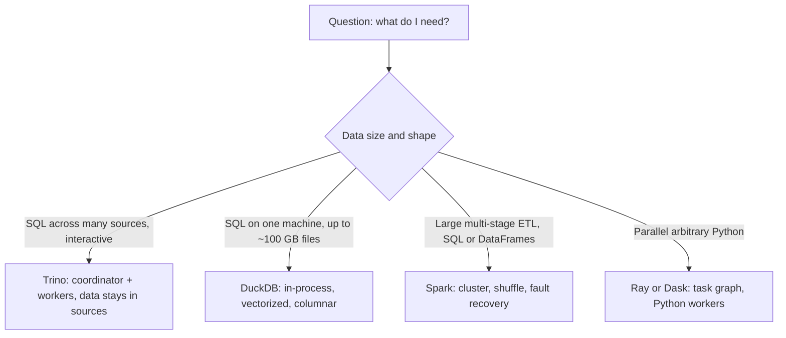

## 🎯 خلاصه

> Spark یک موتور عمومی برای پردازش بزرگ و چندمرحله‌ای داده است. برای هر کاری بهترین ابزار نیست. سه خانواده‌ی دیگر بیشتر این فاصله را پر می‌کنند: **موتورهای کوئری** (Trino/Presto) که SQL را روی چند سیستم جواب می‌دهند، **موتورهای تک‌ماشینه** (DuckDB) که روی داده‌ی متوسط سریع‌اند، و **runtimeهای توزیع‌شده‌ی پایتون** (Ray، Dask) برای کدی که در مدل Spark جا نمی‌شود.

- **Trino / Presto**: SQL تعاملی روی منابع متعدد (فایل‌های lake، دیتابیس‌ها، و topicهای Kafka از طریق کانکتور). داده همان‌جایی می‌ماند که هست.
- **DuckDB**: یک دیتابیس تحلیلی درون‌پردازه‌ای. بدون کلاستر، بدون سرور. برای فایل‌های تا ده‌ها یا چند صد گیگابایت روی یک ماشین خوب عالی است.
- **Ray / Dask**: پایتون توزیع‌شده. برای اجرای موازی توابع پایتون، پیش‌پردازش آموزش مدل، و کارهایی که نوشتنشان با SQL یا تبدیل‌های DataFrame سخت است.
- انتخاب به **حجم داده، تأخیر، شکل کار (SQL یا پایتون دلخواه) و اینکه چه کسی اجرایش می‌کند** بستگی دارد. کوچک‌ترین ابزاری را انتخاب کن که نیاز را برآورده کند.

## 🌱 از ساده شروع کنیم (مبتدی)

> **💡 Analogy:** یک بیمارستان را در نظر بگیر. Spark بخش جراحی است: قدرتمند و سنگین، برای عمل‌های بزرگ و طولانی. Trino میز پذیرشی است که می‌تواند سریع پرونده‌ی یک بیمار را در چند کلینیک جدا پیدا کند. DuckDB یک اتاق درمان مجهز است که بیشتر موارد را خودش انجام می‌دهد و نیازی به زنگ‌زدن به بیمارستان ندارد. Ray و Dask تیم‌هایی از متخصص‌اند که یک کار پایتونی را بین چند اتاق پخش می‌کنند.

برای هر مسئله‌ی داده لازم نیست کلاستر داشته باشی. اول این سؤال‌ها را بپرس:

1. **داده چقدر بزرگ است؟** چند گیگابایت در حافظه‌ی یک لپ‌تاپ جا می‌شود. چند ترابایت در صدها فایل به موتور توزیع‌شده نیاز دارد.
2. **جواب باید چقدر سریع باشد؟** جواب تعاملی (ثانیه) یعنی موتور کوئری. یک جاب شبانه می‌تواند یک ساعت طول بکشد.
3. **شکل کار چیست؟** SQL روی جدول‌ها یعنی موتور SQL. کد پایتون دلخواه برای هر سطر یا هر partition یعنی Ray یا Dask.
4. **داده کجاست؟** در یک دیتابیس، در چند دیتابیس به‌علاوه‌ی data lake، یا روی فایل‌های یک دیسک مشترک؟

یک مثال کوچک. فایل Parquet‌ای با ۳ گیگابایت رکورد فروش داری و می‌خواهی جمع فروش هر فروشگاه را ببینی. با DuckDB:

```sql
-- run in the DuckDB CLI or from Python
SELECT store_id, SUM(amount) AS total
FROM read_parquet('sales/2026-*.parquet')
GROUP BY store_id
ORDER BY total DESC
LIMIT 10;
```

بدون کلاستر، بدون `spark-submit` و بدون تنظیمات جاب. همین سؤال در Spark به یک session، یک کلاستر و یک submission نیاز دارد. برای ۱۰ ترابایت این اشتباه نیست، اما برای ۳ گیگابایت سربار بی‌لزوم است.

## 🔧 واقعاً چطور کار می‌کند (متوسط)

موتورها در **جایی که کار اجرا می‌شود** و **فرضی که درباره‌ی داده دارند** با هم فرق می‌کنند.



**Trino (و Presto).** Trino یک موتور کوئری SQL توزیع‌شده است (ریشه‌اش Presto است). یک coordinator کوئری را parse و plan می‌کند. workerها داده را از طریق **کانکتور** می‌خوانند؛ کانکتور سیستم‌های بیرونی را به جدول SQL نگاشت می‌کند: جدول‌های Hive/Iceberg/Delta روی object storage، PostgreSQL، MySQL، Kafka و خیلی‌های دیگر. موتور در حافظه کار می‌کند و داده را بین مرحله‌ها جریانی منتقل می‌کند؛ storage دائمی خودش را ندارد.

```sql
-- one query across a lake table and an operational database
SELECT o.order_date, c.segment, SUM(o.amount) AS revenue
FROM lake.sales.orders AS o            -- Iceberg table on object storage
JOIN postgres.crm.customers AS c       -- live PostgreSQL table
  ON c.customer_id = o.customer_id
WHERE o.order_date >= DATE '2026-01-01'
GROUP BY o.order_date, c.segment;
```

pushdown کانکتور مهم است. فیلترها و انتخاب ستون‌ها روی جدول lake به خواننده‌ی فایل فرستاده می‌شوند (برای Parquet یعنی خواندن فقط بعضی ستون‌ها و رد کردن row groupها با کمک آمارها). اینکه یک شرط به منبع فرستاده شود یا نه به کانکتور بستگی دارد، پس قبل از فرض کردن، `EXPLAIN` را نگاه کن.

تاریخی، Trino تحمل خطا (fault tolerance) نداشت: خرابی یک worker کل کوئری را می‌کشت، و این آن را برای ETL طولانی نامناسب می‌کرد. نسخه‌های جدیدتر حالت fault-tolerant execution دارند که کار را دوباره امتحان می‌کند، با هزینه‌ای در سرعت و تنظیمات. وضعیت این قابلیت را در مستندات نسخه‌ی خودت بررسی کن، قبل از اینکه قولش را بدهی.

**DuckDB.** DuckDB یک دیتابیس تحلیلی تعبیه‌شده است. کتابخانه‌ای است که داخل پروسه‌ی خودت لینک می‌شود (Python، R، یا CLI)، نه یک سرور. طراحی‌اش:

- **storage ستونی و اجرای vectorized**، یعنی scan و aggregation روی دسته‌هایی از مقادیر انجام می‌شود،
- یک موتور کوئری **موازی** که از همه‌ی هسته‌های یک ماشین استفاده می‌کند،
- توانایی خواندن مستقیم **Parquet، CSV و JSON** از فایل‌ها (محلی یا روی object storage) بدون مرحله‌ی import،
- **spill** به دیسک وقتی مجموعه‌ی کاری از حافظه بزرگ‌تر است (کارایی کم می‌شود، اما کوئری تمام می‌شود).

DuckDB پاسخ عالی برای «داده برای pandas زیاد است، اما کلاستر زیادی است» و برای توسعه‌ی محلی با SQL مشابه production است. محدودیتش این است که یک ماشین حافظه، دیسک و پهنای باند I/O محدود دارد. وقتی داده از چیزی که یک نود می‌تواند در بودجه‌ی زمانی‌ات اسکن کند بزرگ‌تر شود، پاسخ عوض می‌شود.

**Ray و Dask.** هر دو کد پایتون را به‌صورت موازی روی workerها اجرا می‌کنند.

- **Dask** APIهای pandas، NumPy و scikit-learn را گسترش می‌دهد. کد DataFrame آشنا می‌نویسی و Dask یک task graph می‌سازد که روی workerها اجرا می‌شود. برای تیم‌هایی مناسب است که کد pandas سنگین دارند و باید scale کنند.
- **Ray** یک runtime توزیع‌شده‌ی عمومی است که روی task و actor ساخته شده. Ray Data لایه‌ی batch آن است، و Ray برای آموزش توزیع‌شده، جست‌وجوی hyperparameter و اجرای مدل‌های پایتون روی داده‌ی بزرگ (batch inference) رایج است. موازی‌سازی را با دکوراتور صریحاً کنترل می‌کنی، که انعطاف می‌دهد و مسئولیت بیشتری هم می‌آورد.

هر دو هزینه‌ی توزیع را به کد تو منتقل می‌کنند: serialization اشیای پایتون، حافظه‌ی هر worker، و رفتار خرابی taskهای پایتون. بهینه‌ساز SQL در Spark روی توابع دلخواه پایتون اعمال نمی‌شود.

**Spark کجا جا می‌گیرد.** نقاط قوت Spark shuffleهای بزرگ، بهینه‌ساز SQL بالغ (Catalyst، در درس‌های Spark)، بازیابی خطا از طریق lineage و محاسبه‌ی مجدد، و سابقه‌ی طولانی در ETL روی داده‌ی بزرگ است. نقاط ضعفش هزینه‌ی راه‌اندازی سنگین برای جاب‌های کوچک، تنظیم حافظه‌ی JVM، و یک مدل برنامه‌نویسی است که برای پایتون دلخواه برای هر سطر ناجور است.

## 🧠 عمق و trade-offها (سنیور)

**محدودیتی را که کار را تعیین می‌کند انتخاب کن.** برای هر بار کاری معمولاً یک یا دو محدودیت تصمیم را می‌گیرند:

| محدودیت | معمولاً به سمت |
|---|---|
| SQL تعاملی و ad hoc روی منابع متعدد | Trino (یا یک warehouse، ببین [[cloud-warehouses]]) |
| تحلیل روی یک نود، فایل‌های تا ~۱۰۰ گیگابایت، توسعه‌ی محلی سریع | DuckDB |
| ETL چندساعته با shuffleهای بزرگ و retry | Spark |
| پایتون موازی (feature engineering، inference مدل، شبیه‌سازی) | Ray یا Dask |
| داشبوردهای زیر یک ثانیه روی داده‌ی تازه‌ی رویدادها | یک OLAP store مثل [[clickhouse]] (موتور batch نیست) |

**مدل خرابی، نوع جاب را تعیین می‌کند.** موتور کوئری که با خرابی کل کوئری را از اول اجرا می‌کند، برای یک داشبورد ۳۰ ثانیه‌ای خوب است و برای جاب ۶ ساعته فاجعه است. قبل از اینکه Trino را برای یک تبدیل شبانه انتخاب کنی، بررسی کن که حالت fault-tolerant در نسخه‌ی تو فعال و آزموده شده، و داده‌ی میانی جاب در محدودیت حافظه‌اش جا می‌شود. بازمحاسبه‌ی در سطح stage در Spark دلیلی است که هنوز برای جاب‌های طولانی پیش‌فرض است.

**محلی‌بودن داده و I/O.** Trino و DuckDB از طریق شبکه از object storage می‌خوانند. کارایی‌شان با پهنای باند خواندن و با میزانی که چیدمان فایل اجازه‌ی رد کردن می‌دهد محدود می‌شود. فرمت جدول از خود موتور مهم‌تر است: partitioning، فایل‌های مرتب و آمارها ([[parquet]]، [[iceberg]]) تعیین می‌کنند چقدر داده خوانده شود. چیدمان بد با فایل‌های ریز در هر موتوری کند است (ببین [[small-files-problem]]).

**هم‌روندی و جداسازی.** Trino برای کاربران هم‌زمان زیاد طراحی شده و با resource groupها ظرفیت را تقسیم می‌کند. DuckDB تک‌پروسه است: برای یک کاربر یا یک جاب در یک زمان مناسب است، و نوشتن هم‌زمان نیاز به دقت دارد. Ray و Dask روی کلاسترهای مشترک زمان‌بندی می‌کنند، پس همسایه‌ی پرسروصدا مشکل واقعی است؛ برای هر جاب درخواست منابع جدا بگذار.

**هزینه‌ی عملیاتی.** یک پروسه‌ی DuckDB تقریباً هزینه‌ی عملیاتی ندارد. Trino و Spark به کلاستر، ارتقا و مانیتورینگ نیاز دارند. Ray به کلاستر و observability خوب برای خطاهای پایتون توزیع‌شده نیاز دارد. کار پلتفرم را بشمار، نه فقط قیمت محاسبه را. در محیط on-premises ایران، که یک warehouse مدیریت‌شده اغلب گزینه نیست، همین هزینه‌ی عملیاتی معمولاً تصمیم نهایی را می‌گیرد.

**حاکمیت داده.** مدل کانکتور Trino دسترسی به منابع متعدد را متمرکز می‌کند، که برای سیاست دسترسی فدرال مفید است. اما یک کوئری می‌تواند جدول lake را به یک دیتابیس production join کند، پس قبل از باز کردن کانکتور برای تحلیلگرها، محدودیت‌ها را روی آن بگذار (read replica و سقف کوئری).

**چه چیزهایی را پایش کنی.** برای Trino: زمان صف کوئری، کوئری‌های ناموفق به تفکیک دلیل، و سهم زمان خواندن در برابر تبادل داده بین workerها. برای جاب‌های DuckDB: حافظه‌ی اوج و اینکه spill رخ می‌دهد یا نه. برای Ray و Dask: فشار روی object store، retry کارها (taskها) و رویدادهای out-of-memory در worker.

**کی از این موتورها استفاده نکنی.** Trino را برای سیستم ingestion یا تبدیل pipelineهای حساس استفاده نکن، مگر اینکه تحمل خطایش را برای کار خودت آزموده باشی. DuckDB را به‌عنوان دیتابیس مشترک با چند نویسنده برای یک تیم نگذار. برای aggregationهای ساده‌ی SQL که یک موتور SQL بهتر و سریع‌تر انجامش می‌دهد، Ray انتخاب نکن.

## 🧪 امتحان کن

به Python با پکیج‌های `duckdb` و `pyarrow` نیاز داری (`pip install duckdb pyarrow`). اول داده‌ی تست بساز:

```python
# make_data.py
import duckdb
con = duckdb.connect()
con.sql("""
COPY (
  SELECT
    (i % 500)                              AS store_id,
    (random() * 100)::DECIMAL(10,2)        AS amount,
    DATE '2026-01-01' + (i % 90)::INTEGER  AS sale_date
  FROM range(5000000) AS t(i)
) TO 'sales.parquet' (FORMAT PARQUET);
""")
print(con.sql("SELECT COUNT(*) FROM 'sales.parquet'").fetchone())
```

1. یک کوئری DuckDB بنویس که ۵ فروشگاه برتر بر اساس درآمد در ژانویه‌ی ۲۰۲۶ را برگرداند. بعد همین منطق را با pandas (`pd.read_parquet`) اجرا کن و زمان‌ها را مقایسه کن.
2. در یک پاراگراف توضیح بده کی این جاب را از DuckDB به Spark منتقل می‌کنی. آستانه‌ای که استفاده می‌کنی چیست و چرا؟
3. نسخه‌ی Dask یا Ray از «میانگین مبلغ به تفکیک فروشگاه» بنویس و تعداد خطوطش را با نسخه‌ی SQL مقایسه کن. چه کمکی از بهینه‌ساز را از دست می‌دهی؟

<details><summary>راه‌حل‌ها را نشان بده</summary>

**1.**
```sql
SELECT store_id, ROUND(SUM(amount), 2) AS revenue
FROM 'sales.parquet'
WHERE sale_date BETWEEN DATE '2026-01-01' AND DATE '2026-01-31'
GROUP BY store_id
ORDER BY revenue DESC
LIMIT 5;
```
DuckDB فقط ستون‌های لازم را می‌خواند و با آمار روی `sale_date` می‌تواند row groupها را رد کند. pandas اگر `columns=` ندهی فایل را کامل‌تر بار می‌کند، پس DuckDB معمولاً سریع‌تر است و حافظه‌ی کمتری مصرف می‌کند. روی ماشین خودت اندازه بگیر، به یک ادعای کلی اعتماد نکن.

**2.** وقتی داده دیگر راحت در حافظه و دیسک یک ماشین جا نمی‌شود و جاب هنوز باید در بودجه‌ی زمانی‌ات اجرا شود، یا وقتی جاب باید ساعت‌ها از خرابی نود جان سالم به در ببرد، یا وقتی داده در یک lake مدیریت‌شده با کلاستر است و باید توسط چند نود موازی پردازش شود. یک قاعده‌ی منطقی: اگر یک نود خوب بتواند ورودی را در SLA با حاشیه اسکن کند، روی همان یک نود بمان. آستانه‌ی دقیق به سخت‌افزارت بستگی دارد، پس بنچمارکش کن.

**3.** نسخه‌ی Dask شبیه `ddf.groupby("store_id")["amount"].mean().compute()` است و نسخه‌ی Ray به منطق گروه‌بندی صریح یا عملیات Ray Data نیاز دارد. نسخه‌ی SQL کوتاه‌تر است و بهینه‌ساز می‌تواند فیلترها را pushdown کند و استراتژی aggregation را انتخاب کند. با Dask یا Ray کنترل بیشتری روی اجرا داری، اما بخش بیشتری از برنامه‌ریزی را هم خودت بر عهده می‌گیری.

</details>

## 💬 گوشه‌ی مصاحبه

**سؤال: «کی از Spark استفاده نمی‌کنی؟»** جواب متوسط: «برای داده‌ی کوچک که هزینه‌ی راه‌اندازی کلاستر از کار بیشتر است. آن‌وقت از DuckDB یا pandas روی یک ماشین استفاده می‌کنم، و برای SQL تعاملی روی منابع متعدد از Trino.» جواب سنیور: «از محدودیت شروع می‌کنم: حجم داده، تأخیر، تحمل خطا و شکل کار. اگر داده در یک نود و در SLA جا شود، DuckDB ارزان‌تر اجرا و آسان‌تر دیباگ می‌شود. اگر کاربر SQL تعاملی روی یک lake و یک دیتابیس عملیاتی می‌خواهد، Trino مناسب است، به شرط اینکه ETL طولانی و تحمل‌خطادار از آن نخواهم. اگر کار پایتون دلخواه در مقیاس است، Ray یا Dask را بررسی می‌کنم. Spark برای ETL بزرگ و چندمرحله‌ای با shuffleهای سنگین و نیاز به بازیابی انتخاب اصلی می‌ماند.»

**سؤال: «برای data lake، Trino یا Spark؟»** جواب متوسط: «Trino برای کوئری، Spark برای تبدیل.» جواب سنیور: «این تقسیم یک پیش‌فرض خوب است، اما سؤال واقعی تحمل خطا و طول جاب است. Trino برای کوئری‌های تعاملی و فدرال و سرویس‌دهی به تحلیلگرها قوی است. Spark برای جاب‌های تبدیل طولانی که باید از خرابی نود جان سالم به در ببرند انتخاب امن‌تری است. هر دو از یک فرمت جدول می‌خوانند، پس انتخاب، داده را به یک موتور قفل نمی‌کند.»

> **🎤 Say this in the interview:** «Spark ابزار سنگین پیش‌فرض است، اما من کوچک‌ترین ابزاری را انتخاب می‌کنم که نیاز را برآورده کند. DuckDB برای تحلیل تک‌نودی، Trino برای SQL فدرال تعاملی، Spark برای ETL بزرگ و مقاوم، و Ray یا Dask وقتی کار پایتونی است که SQL خوب بیانش نمی‌کند. قبل از تصمیم، مدل خرابی و هزینه‌ی عملیاتی را می‌سنجم.»

## ⚠️ اشتباهات رایج

> **⚠️ Watch out:** اجرای یک تبدیل شبانه‌ی چندساعته روی یک موتور کوئری تعاملی، بدون بررسی حالت fault tolerance آن. خرابی یک worker ممکن است همه‌چیز را از اول شروع کند.

> **⚠️ Watch out:** استفاده از موتور تک‌نودی برای داده‌ای که از یک ماشین رد می‌شود، و کشف مشکل در production. رشد مورد انتظار را در طراحی بیاور، نه فقط حجم امروز.

- فرض کردن اینکه موتور کوئری داده‌ها را ذخیره می‌کند. Trino و DuckDB از منابع می‌خوانند؛ نسخه‌ی دائمی جای دیگری است، پس بک‌آپ و فرمت جدول را بر این اساس برنامه‌ریزی کن.
- مقایسه‌ی موتورها با یک بنچمارک کوچک. نتایج با چیدمان فایل، حافظه و cache تغییر می‌کنند. با داده‌ی خودت اندازه بگیر.
- باز کردن دیتابیس production برای تحلیلگرها از طریق Trino بدون read replica یا سقف کوئری.
- نوشتن کد پایتون برای هر سطر در Spark، Dask یا Ray در حالی که یک تابع SQL داخلی کار را سریع‌تر انجام می‌دهد.
- فراموش کردن اینکه DuckDB هم مثل هر موتور دیگری از چیدمان خوب سود می‌برد: داده‌ی مرتب، ستون‌های لازم برای کوئری، و فایل‌های Parquet با اندازه‌ی معقول.

## ✅ خودت را بسنج

1. کدام موتور داخل پروسه‌ی خودت اجرا می‌شود، بدون سرور و کلاستر، و برای فایل‌های تحلیلی متوسط روی یک ماشین مناسب است؟
   - A) Trino
   - B) Spark
   - C) DuckDB
   - D) Kafka Streams

<details><summary>جواب</summary>

**C** — DuckDB یک دیتابیس تحلیلی تعبیه‌شده، ستونی و vectorized است. Trino و Spark موتورهای توزیع‌شده‌اند که به کلاستر نیاز دارند، و Kafka Streams یک کتابخانه‌ی پردازش جریان روی Kafka است، نه یک موتور کوئری batch.

</details>

2. چرا یک join در Trino بین یک جدول lake و یک جدول PostgreSQL مفید است؟
   - A) خودکار هر دو جدول را به یک فرمت کپی می‌کند
   - B) یک کوئری SQL را بین دو سیستم جواب می‌دهد بی‌آنکه داده ابتدا به یک store مشترک منتقل شود
   - C) نوشتن exactly-once را روی هر دو سیستم تضمین می‌کند
   - D) نیاز به هر فرمت جدولی را برمی‌دارد

<details><summary>جواب</summary>

**B** — کانکتورها اجازه می‌دهند یک کوئری چند منبع را همان‌جا بخواند. گزینه‌ی A اتفاقی نیست که بیفتد (داده به فرمت مشترک کپی نمی‌شود)، گزینه‌ی C تضمین نوشتنی است که Trino برای این نوع کوئری نمی‌دهد، و گزینه‌ی D غلط است چون جدول lake همچنان به فرمت نیاز دارد.

</details>

3. یک جاب شبانه ۵ ساعت طول می‌کشد و باید از خرابی نود جان سالم به در ببرد. هنگام انتخاب بین یک موتور کوئری و Spark، کدام ویژگی بیشترین اهمیت را دارد؟

   - A) تعداد توابع SQL موجود
   - B) مدل خرابی: اینکه یک worker خراب‌شده فقط کار از دست‌رفته را دوباره اجرا می‌کند یا کل کوئری را
   - C) رنگ داشبورد
   - D) اینکه داده CSV است یا JSON

<details><summary>جواب</summary>

**B** — جاب‌های طولانی به بازیابی کار از دست‌رفته نیاز دارند، نه یک ریستارت کامل. بازمحاسبه‌ی در سطح stage در Spark برای این مناسب است. یک موتور کوئری قبل از اعتماد به آن برای چنین جابی باید برای fault-tolerant execution بررسی شود.

</details>

4. **(سنیور)** تیمی می‌خواهد تحلیلگرها PostgreSQL production را از طریق Trino کنار data lake کوئری کنند. کدام محدودیت‌ها را اول می‌گذاری و چرا؟

   - A) هیچ؛ Trino خودش بار را مدیریت می‌کند
   - B) برای کانکتور، read replica یا یک کپی غیرproduction، سقف کوئری یا resource groupها، و سیاست روشن درباره‌ی اینکه کدام جدول‌ها در دسترس باشند، چون یک کوئری فدرال می‌تواند بار سنگینی روی منبع بیاندازد
   - C) تبدیل PostgreSQL به CSV قبل از کوئری
   - D) خاموش‌کردن pushdown فیلتر تا Trino همه‌چیز را بخواند

<details><summary>جواب</summary>

**B** — کوئری فدرال روی منابع سیستم مبدا اجرا می‌شود، پس یک کوئری تحلیلی بی‌حد می‌تواند production را کند کند. replica، سقف و کنترل جدول‌ها این ریسک را مهار می‌کنند. گزینه‌ی D وضع را بدتر می‌کند، چون باعث می‌شود داده‌ی بیشتری خوانده شود.

</details>

5. **(سنیور)** یک مرحله‌ی feature engineering پایتونی داری که برای هر رکورد یک مدل سفارشی را صدا می‌زند، روی ۵۰۰ میلیون رکورد. UDFهای Spark برای این کند هستند و تیم به Ray یا Dask فکر می‌کند. قبل از انتخاب کدام را بررسی می‌کنی؟

   - A) اینکه تیم لوگوی ابزار را دوست دارد یا نه
   - B) هزینه‌ی batching و serialization، حافظه‌ی مدل برای هر worker، رفتار خرابی و retry برای taskهای پایتون، و اینکه آیا کار را می‌شود به دسته‌های برداری (مثلاً Pandas UDF یا batch inference) تبدیل کرد به جای صدا زدن برای هر رکورد
   - C) اینکه خروجی در نمودار دایره‌ای نشان داده شود
   - D) اینکه موتور از SQL پشتیبانی کند

<details><summary>جواب</summary>

**B** — کارایی پایتون توزیع‌شده به این بستگی دارد که چند فراخوانی از مرز پروسه‌ها رد می‌شود، مدل در هر worker چقدر حافظه می‌گیرد، و در retry چه اتفاقی می‌افتد. batching اغلب مهم‌تر از انتخاب فریم‌ورک است. گزینه‌ی D عامل تعیین‌کننده نیست، چون کار پایتون دلخواه است.

</details>

## 🗂️ فلش‌کارت

| Front | Back |
|---|---|
| Trino بر چه پایه‌ای است؟ | Presto؛ یک موتور کوئری SQL توزیع‌شده با coordinator و worker |
| Trino چطور به داده می‌رسد؟ | از طریق کانکتورهایی که سیستم‌های بیرونی را به جدول SQL نگاشت می‌کنند؛ داده همان‌جا می‌ماند |
| DuckDB چیست؟ | یک دیتابیس تحلیلی ستونی، تعبیه‌شده و درون‌پردازه‌ای برای یک ماشین |
| کی کلاستر لازم نیست؟ | وقتی داده در حافظه و دیسک یک ماشین جا می‌شود و جاب در SLA اجرا می‌شود |
| Ray در برابر Dask | Ray: taskها و actorهای توزیع‌شده‌ی عمومی؛ Dask: APIهای scale‌شده‌ی شبیه pandas و NumPy |
| ریسک اصلی کوئری فدرال | بار سنگین روی سیستم مبدا؛ از replica و سقف استفاده کن |
| اولین سؤال برای انتخاب موتور | مدل خرابی و شکل کار (SQL یا پایتون) چیست و داده چقدر بزرگ است؟ |
| چرا برای ETL بزرگ Spark را نگه داریم | shuffleهای بزرگ، بازیابی مبتنی بر lineage، بهینه‌ساز SQL بالغ |

## 🔗 ادامه

- **trino** معماری Trino، کانکتورها و جزئیات عملیاتی را عمیق‌تر توضیح می‌دهد.
- **spark-architecture** نشان می‌دهد Spark چه کاری می‌کند که این موتورها نمی‌کنند، از درایور و executor شروع می‌کند.
- **pyspark-api** و **python-dataframes** نشان می‌دهند کد DataFrame پایتون کجا جا می‌گیرد و کجا به مشکل مقیاس‌پذیری تبدیل می‌شود.
- **python-large-files** درباره‌ی کار با فایل‌های بزرگ‌تر از حافظه روی یک ماشین است.
- **lakehouse-table-formats** توضیح می‌دهد چرا فرمت جدول، نه موتور، اغلب کارایی را تعیین می‌کند.
- **tech-selection** چک‌لیستی برای انتخاب بین ابزارها می‌دهد.
- مستندات رسمی هر موتور را برای نسخه‌ی خودت بخوان، به‌خصوص درباره‌ی fault tolerance، تنظیمات حافظه و pushdown کانکتور. این قابلیت‌ها سریع تغییر می‌کنند.
