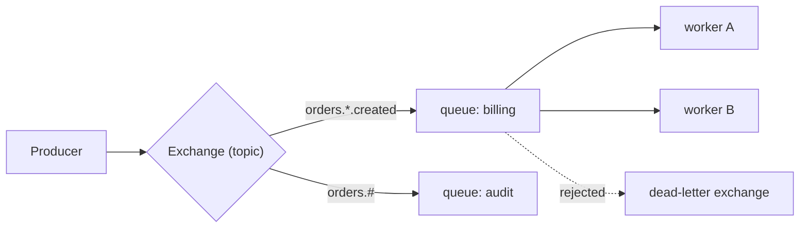

## 🎯 خلاصه

> Kafka یک **log توزیع‌شده** است: پیام‌ها تا مدت retention نگه داشته می‌شوند، consumerهای زیادی با سرعت خودشان می‌خوانند و می‌توانند replay کنند. سیستم‌های دیگر برای کارهای متفاوتی بهینه شده‌اند: **RabbitMQ** برای routing و صف کار به‌ازای هر پیام، **Pulsar** برای ذخیره‌سازی و پیام‌رسانی چندمستأجری و چندمنطقه‌ای، **Redpanda** برای API سازگار با Kafka با عملیات ساده‌تر، و **NATS** برای پیام‌رسانی سبک و کم‌تأخیر مبتنی بر subject.

- بر اساس **کاری که لازم است** انتخاب کنید، نه بر اساس برند: توزیع کار، log رویدادها، request/reply، یا پیام‌رسانی لبه‌ی شبکه.
- چهار سؤال بپرسید: آیا **replay** لازم است، **تأیید (acknowledgement) به‌ازای هر پیام**، **قوانین routing**، و **تیم چند جزء عملیاتی را می‌تواند اداره کند؟**
- سرویس مدیریت‌شده‌ی ابری (SQS، Pub/Sub، Kinesis، Event Hubs) اغلب پاسخ درست است، وقتی نمی‌خواهید خودتان broker اجرا کنید.

## 🌱 از ساده شروع کنیم (مبتدی)

> **💡 Analogy:** Kafka مثل **آرشیو روزنامه** است: نسخه‌ها روزها روی قفسه می‌مانند و هر خواننده هر زمان می‌تواند هر شماره را باز کند. یک **صف RabbitMQ** مثل **لیست کارهای انجام‌نشده** است: هر کار به یک کارگر داده می‌شود و وقتی علامت «انجام شد» بخورد، دیگر نیست. هر دو مفیدند؛ به سؤال‌های متفاوتی جواب می‌دهند.

یک کارگر کوچک RabbitMQ در Python. هر بار یک job ایمیل را برمی‌دارد و فقط بعد از موفقیت کار آن را تأیید (ack) می‌کند:

```python
import pika

def send_email(body):
    print("sending:", body.decode())   # placeholder for real work

conn = pika.BlockingConnection(pika.ConnectionParameters("localhost"))
ch = conn.channel()
ch.queue_declare(queue="emails", durable=True)
ch.basic_qos(prefetch_count=10)        # at most 10 unacknowledged messages per worker

def handle(ch, method, props, body):
    try:
        send_email(body)
        ch.basic_ack(method.delivery_tag)
    except Exception:
        ch.basic_nack(method.delivery_tag, requeue=False)

ch.basic_consume(queue="emails", on_message_callback=handle)
ch.start_consuming()
```

اگر کارگر قبل از `basic_ack` کرش کند، RabbitMQ پیام را دوباره به کارگر دیگری می‌دهد. این تضمین at-least-once است و دلیل اصلی وجود صف‌ها همین است.

## 🔧 واقعاً چطور کار می‌کند (متوسط)

**RabbitMQ.** تولیدکننده‌ها پیام را به یک **exchange** می‌فرستند. exchange با استفاده از bindingها پیام را به یک یا چند **queue** مسیریابی می‌کند: `direct` (routing key دقیق)، `topic` (الگوهای wildcard مثل `orders.*.created`)، `fanout` (کپی به همه‌ی صف‌های متصل)، یا `headers`. مصرف‌کننده‌ها از queue می‌خوانند. پیام بعد از ack حذف می‌شود. امکانات مفید:

- **Acknowledgement و prefetch** (`basic_ack`، `basic_qos`) کار در جریان هر consumer را کنترل می‌کنند.
- **Dead-letter exchange** پیام‌هایی را می‌گیرد که رد شده، منقضی شده یا از سقف تلاش گذشته‌اند.
- **TTL به‌ازای هر پیام و صف‌های اولویت‌دار** برای کارهای تأخیری یا فوری.
- **Quorum queue** یک صف را با Raft تکثیر می‌کند. صف‌های mirrored کلاسیک در نسخه‌های جدید deprecated شده‌اند؛ برای نسخه‌ی خودتان داک را ببینید.
- **Streams** (یک log فقط‌الحاق با offset، از نسخه‌ی 3.9) برای بعضی کارها replay می‌دهد، اما مدل و ابزارهایش با صف‌های کلاسیک فرق دارد.



**Pulsar.** brokerها بدون state هستند و topicها را سرو می‌کنند. داده در ledgerهای **BookKeeper** روی bookieها ذخیره می‌شود، پس compute و storage جدا مقیاس می‌شوند. topicها partition دارند و هر **subscription** یک حالت دارد: `exclusive`، `failover`، `shared` (شبیه صف، پیام بین چند consumer تقسیم می‌شود)، یا `key_shared` (پیام‌های با کلید یکسان به یک consumer می‌روند). Pulsar برای چندمستأجری namespace، تکثیر چندمنطقه‌ای، و tiered storage روی object storage برای داده‌ی قدیمی دارد.

**Redpanda.** یک باینری تک‌فایل C++ که پروتکل سیمی Kafka را حرف می‌زند و به‌جای ZooKeeper از Raft استفاده می‌کند. کلاینت‌های Kafka معمولاً بدون تغییر کار می‌کنند. وقتی معنای Kafka را می‌خواهید با اجزای عملیاتی کمتر جذاب است. سازگاری ۱۰۰٪ نیست: برای APIها و ابزارهایی که استفاده می‌کنید جدول ویژگی‌ها را ببینید و برای ویژگی‌های enterprise لایسنس را چک کنید.

**NATS.** پیام‌ها به **subject** (مثل `orders.created`) می‌روند و subscriberها می‌توانند wildcard استفاده کنند (`orders.*` برای یک بخش، `orders.>` برای همه‌ی زیرمجموعه‌ها). NATS core «بفرست و فراموش کن» است (at-most-once) و خیلی سریع است و request/reply را داخلی دارد. **JetStream** persistence، consumerهای دارای acknowledgement (at-least-once) و پنجره‌ی deduplication بر اساس هدر شناسه‌ی پیام را اضافه می‌کند.

```bash
# Terminal 1: subscribe to all order events
nats sub 'orders.>'

# Terminal 2: publish one event
nats pub orders.created '{"id": 1, "amount": 500}'
```

**سرویس‌های مدیریت‌شده.** Amazon SQS یک صف (standard یا FIFO) است، Amazon SNS اعلان‌ها را پخش می‌کند، Kinesis Data Streams یک log شاردشده است، Google Pub/Sub topic و subscription دارد، و Azure Event Hubs یک log سازگار با Kafka است. هرکدام کنترل را در برابر سادگی عملیاتی معامله می‌کنند.

## 🧠 عمق و trade-offها (سنیور)

- **معنای تحویل پیام از طراحی می‌آید.** صف‌ها با acknowledgement تحویل at-least-once می‌دهند، پس consumerها باید idempotent باشند (ببینید [[delivery-semantics]]). ویژگی‌های exactly-once کافکا داخل Kafka کار می‌کنند ([[kafka-exactly-once]])؛ به اثرهای جانبی بیرونی یک صف گسترش نمی‌یابند.
- **ترتیب.** RabbitMQ ترتیب را برای هر صف با یک consumer حفظ می‌کند، اما تحویل مجدد بعد از nack یا کرش، پیام‌ها را جابه‌جا می‌کند. اشتراک `failover` در Pulsar ترتیب را در هر partition با یک consumer فعال حفظ می‌کند؛ `key_shared` ترتیب را برای هر کلید نگه می‌دارد. Kafka داخل هر partition ترتیب می‌دهد. قبل از انتخاب، ترتیب مورد نیاز کسب‌وکار را مشخص کنید.
- **توان عملیاتی و retention.** Kafka و Pulsar برای logهای پرحجم با retention طولانی ساخته شده‌اند. صف‌های کلاسیک RabbitMQ برای پیام‌های کوچک زیاد با routing و ack بهینه‌اند؛ آرشیو بلندمدت نیستند. NATS core چیزی نگه نمی‌دارد؛ retention در JetStream برای هر stream جدا تنظیم می‌شود.
- **Replay و چند consumer.** اگر چند سرویس به رویدادهای یکسان با سرعت خودشان نیاز دارند، مدل طبیعی یک log است (Kafka، Pulsar، Redpanda، یا streamهای JetStream). اگر هر job باید یک بار توسط یک کارگر پردازش شود، صف مناسب‌تر است. استفاده از صف برای fan-out به چند consumer مستقل، کپی پیام‌ها و ضرب شدن storage را به همراه دارد.
- **عملیات.** اجزا را بشمارید: Kafka با KRaft شامل brokerها و controllerها است؛ Pulsar شامل brokerها، bookieها و یک metadata store است؛ RabbitMQ شامل nodeها و تکثیر quorum queue است؛ NATS کوچک است. ارزان‌ترین سیستم برای اجرا، سیستمی است که تیم از قبل خوب می‌شناسد.
- **چارچوب مصاحبه.** بگویید چه چیزی را انتخاب نمی‌کنید و چرا. «برای ایمیل‌های پس‌زمینه RabbitMQ می‌گذارم، چون هر job یک بار انجام می‌شود، به ack به‌ازای هر پیام و dead-letter queue نیاز دارم، و حجم متوسط است. آن را منبع حقیقت برای analytics نمی‌کنم، چون با ack پیام را پاک می‌کند.»

**راهنمای انتخاب**

| نیاز | انتخاب مناسب |
|---|---|
| replay، گروه‌های consumer زیاد، توان بالا، پلتفرم داده | Kafka (یا Redpanda با همان API) |
| صف کار، قوانین routing، jobهای تأخیری یا اولویت‌دار | RabbitMQ، SQS |
| چندمستأجری، تکثیر چندمنطقه‌ای، tiered storage در مقیاس بزرگ | Pulsar |
| API سازگار با Kafka با عملیات کمتر، باینری تک‌فایل | Redpanda (سازگاری را بررسی کنید) |
| پیام‌رسانی سبک، request/reply، لبه یا IoT | NATS (برای persistence از JetStream) |
| بدون اجرای هیچ broker | SQS، Pub/Sub، Kinesis، Event Hubs |

## 🧪 امتحان کن

۱. تیم پرداخت لازم دارد هر رویداد تراکنش ۳۰ روز برای replay در دسترس باشد و سه consumer مستقل (fraud، billing و analytics) آن را بخوانند. کدام خانواده‌ی سیستم مناسب است و چرا؟
۲. یک صف job پس‌زمینه باید resize تصویرهای ناموفق را حداکثر ۳ بار دوباره امتحان کند و بعد آن‌ها را برای بررسی کنار بگذارد. کدام ویژگی‌های RabbitMQ این را ممکن می‌کند؟
۳. تیمی می‌خواهد کلاینت‌های Kafka کار کنند، ولی از اجرای ZooKeeper و JVM خوشش نمی‌آید. چه چیزی را ارزیابی می‌کنید و قبل از مهاجرت چه چیزی را تأیید می‌کنید؟

<details><summary>جواب‌ها را ببین</summary>

**۱.** یک log: Kafka (یا Pulsar، Redpanda، یا streamهای JetStream). هر consumer group با سرعت خودش می‌خواند، داده ۳۰ روز نگه داشته می‌شود و replay داخلی است. یک صف کلاسیک RabbitMQ با ack پیام را پاک می‌کند، پس هر سه تیم به صف‌ها و کپی‌های جدا نیاز پیدا می‌کنند.

**۲.** ترکیبی از acknowledgement دستی، منطق requeue-یا-reject (مثلاً `basic_nack` با `requeue=False` بعد از بررسی تعداد تحویل)، و یک dead-letter exchange که پیام‌های رد شده را به صف نگهداری می‌فرستد. quorum queueها در نسخه‌های جدید امکانات محدودیت تعداد تحویل و dead-lettering را دارند؛ برای نسخه‌ی خودتان داک را ببینید.

**۳.** Redpanda و احتمالاً یک سرویس Kafka مدیریت‌شده را ارزیابی کنید. نسخه‌های API کلاینتی که استفاده می‌کنید، ابزارهای اکوسیستم Kafka (Connect، Schema Registry، کانکتورهای Streams یا Flink)، transaction و رفتار exactly-once اگر از آن استفاده می‌کنید، لایسنس ویژگی‌های enterprise، و نحوه‌ی انتقال offsetها و topicها بدون downtime را تأیید کنید.

</details>

## 💬 گوشه‌ی مصاحبه

**سؤال: «وقتی Kafka داریم، چرا RabbitMQ؟»** جواب متوسط: «RabbitMQ یک broker سنتی با routing، ack به‌ازای هر پیام و dead-letter queue است؛ برای صف‌های کار خوب است.» جواب سنیور: «اگر کار مجموعه‌ای از jobهای مستقل است که هر کدام یک بار، با routing پیچیده و retry انجام می‌شود، مدل RabbitMQ مناسب است و نیازی نیست منطق retry و نگهداری را روی یک log بسازیم. Kafka را برای رویدادی نگه می‌دارم که سیستم‌های زیادی باید replay کنند. مطمئن می‌شوم تیم رفتار ترتیب و تحویل مجدد هر کدام را می‌فهمد، چون باگ‌ها همان‌جا پیدا می‌شوند.»

**سؤال: «Pulsar یا Kafka؟»** متوسط: «هر دو log با partition هستند؛ Pulsar محاسبه را از storage جدا می‌کند و چندمستأجری داخلی دارد.» سنیور: «برای مستأجرهای زیاد روی یک پلتفرم، تکثیر چندمنطقه‌ای و tiered storage در مقیاس، Pulsar را انتخاب می‌کنم و قبول دارم که باید bookie و metadata store اجرا کنم. برای بزرگ‌ترین اکوسیستم connector و پردازشگر جریان، Kafka.»

> **🎤 Say this in the interview:** «بر اساس کار انتخاب می‌کنم: log برای replay و fan-out، صف برای توزیع کار، و یک bus سبک مبتنی بر subject برای request/reply و لبه. بعد هزینه‌ی عملیاتی و معنای تحویل و ترتیب را چک می‌کنم که تیم باید با آن زندگی کند.»

## ⚠️ اشتباهات رایج

> **⚠️ Watch out:** استفاده از RabbitMQ به‌عنوان انبار بلندمدت رویداد. پیام‌ها بعد از acknowledgement حذف می‌شوند، پس replay مدل پیش‌فرض نیست.

> **⚠️ Watch out:** فرض اینکه «سازگار با Kafka» یعنی هر ویژگی و ابزار سازگار است. APIها، transactionها و connectorها را چک کنید.

- انتخاب سیستم بر اساس محبوبیت، بدون نوشتن نیازهای تحویل و ترتیب.
- استفاده از صف برای fan-out به چند consumer مستقل که کپی‌ها را زیاد می‌کند.
- فراموش کردن اینکه تحویل مجدد بعد از کرش، ترتیب را در صف به هم می‌زند.
- فرض اینکه NATS core پیام‌ها را persist می‌کند. این‌طور نیست؛ اگر persistence لازم است از JetStream استفاده کنید.
- نداشتن مسیر dead-letter، که باعث می‌شود پیام‌های خراب بلاک کنند یا بی‌پایان تکرار شوند.
- اجرای یک broker خودمدیریت‌شده وقتی یک سرویس مدیریت‌شده همان نیاز را برآورده می‌کند.

## ✅ خودت را بسنج

1. کدام سیستم طوری طراحی شده که پیام بعد از ack یک کارگر حذف شود؟
   - A) topic کافکا با retention طولانی
   - B) صف کلاسیک RabbitMQ
   - C) topic در Pulsar با اشتراک `exclusive`
   - D) آرشیو در object storage

<details><summary>جواب</summary>

**B** — صف RabbitMQ بعد از acknowledgement پیام را حذف می‌کند و این برای توزیع کار به‌ازای هر job مناسب است. Kafka و Pulsar پیام‌ها را برای مدت retention نگه می‌دارند، صرف‌نظر از consumerها.

</details>

2. کدام نوع exchange در RabbitMQ با الگوهای wildcard مثل `orders.*.created` مسیریابی می‌کند؟
   - A) `direct`
   - B) `fanout`
   - C) `topic`
   - D) `headers`

<details><summary>جواب</summary>

**C** — exchange از نوع `topic` routing key ها را با الگوها و `*` (یک کلمه) و `#` (صفر یا چند کلمه) تطبیق می‌دهد.

</details>

3. وقتی یک subscriber در زمان publish آفلاین است، NATS core چه می‌کند؟
   - A) پیام را تا برگشت subscriber نگه می‌دارد
   - B) پیام را به یک dead-letter queue می‌فرستد
   - C) پیام را دور می‌ریزد، چون NATS core بفرست-و-فراموش کن است
   - D) ۲۴ ساعت تلاش مجدد می‌کند

<details><summary>جواب</summary>

**C** — NATS core پیام‌ها را persist نمی‌کند؛ تحویل at-most-once است. اگر persistence و acknowledgement لازم دارید، از JetStream استفاده کنید.

</details>

4. **(سنیور)** تیمی RabbitMQ را با چند consumer روی یک صف استفاده می‌کند و بعد از کرش‌ها سفارش‌ها خارج از ترتیب پردازش می‌شوند. دلیلش چیست و راه درست چیست؟

   - A) RabbitMQ هیچ‌وقت ترتیب را حفظ نمی‌کند؛ همه‌چیز را به Kafka ببرید
   - B) تحویل مجدد بعد از کرش، پیام را پشت پیام‌های بعدی می‌گذارد، پس ترتیب تضمین نیست؛ یا پردازش را نسبت به ترتیب بی‌حساس کنید، یا از یک log با partition یا کلید ترتیب و یک consumer برای هر کلید استفاده کنید
   - C) prefetch زیاد است؛ آن را ۱ بگذارید و ترتیب را نادیده بگیرید
   - D) مشکل در producer است؛ یک retry اضافه کنید

<details><summary>جواب</summary>

**B** — پیام تحویل‌مجددشده ممکن است بعد از پیام‌های بعدی که قبلاً پردازش شده‌اند برسد. راه‌حل به کسب‌وکار بستگی دارد: پردازش را نسبت به ترتیب بی‌حساس کنید (مثلاً به‌روزرسانی‌های نسخه‌دار)، یا با کلید به یک log یا یک consumer برای هر کلید route کنید تا ترتیب جایی که اهمیت دارد حفظ شود.

</details>

5. **(سنیور)** کدام گزینه بهترین توصیف برای زمانی است که یک سرویس پیام‌رسانی مدیریت‌شده ابری انتخاب درست است؟

   - A) فقط وقتی ترافیک ندارید
   - B) وقتی تیم نمی‌خواهد broker عملیاتی کند و ویژگی‌های لازم (ترتیب، retention، routing) در محدودیت‌های سرویس قرار می‌گیرند
   - C) هر وقت سیستم خودمدیریت‌شده خیلی ارزان نیست
   - D) فقط برای workloadهای batch

<details><summary>جواب</summary>

**B** — سرویس‌های مدیریت‌شده کنترل و برخی ویژگی‌ها را در برابر نزدیک‌به‌صفر بودن عملیات broker معامله می‌کنند. وقتی محدودیت‌هایشان (retention، دامنه‌ی ترتیب، سقف توان، وابستگی به فروشنده) با نیازها جور است، پیش‌فرض قوی‌ای هستند.

</details>

## 🗂️ فلش‌کارت

| Front | Back |
|---|---|
| چرخه‌ی پیام در RabbitMQ | به exchange منتشر می‌شود، به queue مسیریابی می‌شود، بعد از ack حذف می‌شود |
| exchange از نوع `topic` در RabbitMQ | با کلیدهای الگویی و `*` (یک کلمه) و `#` (چند کلمه) مسیریابی می‌کند |
| dead-letter exchange | پیام‌های ردشده، منقضی یا بیش از حد تلاش‌شده را برای بررسی می‌گیرد |
| لایه‌ی storage در Pulsar | ledgerهای BookKeeper روی bookieها؛ brokerها بدون state هستند |
| اشتراک `key_shared` در Pulsar | پیام‌های با کلید یکسان به یک consumer می‌روند |
| تحویل در NATS core | at-most-once، بفرست-و-فراموش کن، بدون persistence |
| JetStream | persistence در NATS با acknowledgement و تحویل at-least-once |
| ادعای اصلی Redpanda | پروتکل Kafka در یک باینری C++، Raft به‌جای ZooKeeper (سازگاری را تأیید کنید) |

## 🔗 ادامه

- [[queues-vs-logs]] تفاوت مدلی صف و log را عمیق توضیح می‌دهد.
- [[kafka-architecture]] brokerها، partitionها و تکثیری که پشت log کافکاست را پوشش می‌دهد.
- [[delivery-semantics]] و [[kafka-exactly-once]] at-least-once، idempotency و transaction را توضیح می‌دهند.
- [[dlq-bad-records]] طراحی dead-letter برای پیام‌های خراب را در هر سیستمی نشان می‌دهد.
- [[kafka-streams]] وقتی پردازش داخل یک سرویس مبتنی بر Kafka است، گزینه‌ی کتابخانه‌ای است.
- قبل از تعهد، داک سازگاری و ویژگی‌های هر فروشنده را برای نسخه‌ی خودتان ببینید؛ trade-offهای بالا پایدارند، فهرست ویژگی‌ها نه.
