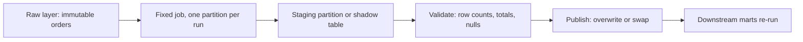

## 🎯 خلاصه

> **Backfill** یعنی اجرای دوباره‌ی یک pipeline روی داده‌ی **گذشته**: برای پرکردن یک شکاف، اصلاح یک باگ قدیمی، یا اعمال یک قانون جدید کسب‌وکار روی ردیف‌های قدیمی. اگر درست انجام شود، **idempotent** است، از جریان زنده **ایزوله** است و قبل از اینکه کسی نتیجه را بخواند **اعتبارسنجی** می‌شود.

- بازمحاسبه را **partition به partition** انجام بده (معمولاً یک روز یا یک ساعت)، نه با یک job بزرگ.
- نوشتن هر partition باید **overwrite** باشد، نه **append**، تا اجرای مجدد داده را دو برابر نکند.
- برای streaming یک **نقطه‌ی cutover** انتخاب کن: backfill مسئول همه‌چیز قبل از آن است و job زنده مسئول همه‌چیز بعد از آن.
- منابع و اثر روی downstream را کنترل کن، و قبل از انتشار، تعداد ردیف‌ها و جمع‌ها را چک کن.

## 🌱 از ساده شروع کنیم (مبتدی)

> **💡 تشبیه:** معلم می‌بیند کلید پاسخ آزمون ماه قبل اشتباه بوده. نمرات را دستی به یک‌یک دانش‌آموزان نمی‌دهد؛ همه‌ی برگه‌ها را با کلید درست، کلاس به کلاس، دوباره تصحیح می‌کند و نمرات قدیمی را جایگزین می‌کند. آن تصحیح مجدد همان backfill است.

فرض کن جدول `daily_revenue` هر شب از جدول `orders` ساخته می‌شود. روز ۳ مارس می‌بینی که بازپرداخت‌ها (refund) به‌عنوان فروش حساب شده‌اند. کوئری را درست می‌کنی. حالا ردیف‌های ۹۰ روز گذشته غلط‌اند، و اجرای فردا فقط داده‌ی فردا را درست می‌کند.

backfill یعنی کوئری درست‌شده را برای هر ۹۰ روز دوباره اجرا کنی:

```text
for each day in [2026-01-01 .. 2026-03-31]:
    rebuild daily_revenue for that day, replacing the old rows
```

دو قانون این کار را امن می‌کند:

1. **جایگزین کن، اضافه نکن.** اجرای job برای ۳ مارس دوبار باید همان جدولی بسازد که یک‌بار می‌ساخت.
2. **روزبه‌روز پیش برو.** اگر روز ۴۲ شکست خورد، از روز ۴۲ دوباره شروع کن، نه از روز ۱.

به این ویژگی می‌گویند job باید **idempotent** باشد (به [[idempotency]] نگاه کن).

## 🔧 واقعاً چطور کار می‌کند (متوسط)

یک pipeline باچ معمولاً با یک **data interval** پارامترایز می‌شود: job مربوط به `dt = 2026-03-03` فقط ورودی همان بازه را می‌خواند و فقط همان partition را می‌نویسد. پس backfill چیزی جز یک حلقه روی این بازه‌ها نیست که شاید موازی هم اجرا شود.

یک نسخه‌ی ساده با Spark:

```python
from datetime import date, timedelta
from pyspark.sql import SparkSession

spark = SparkSession.builder.getOrCreate()
# Replace only the partitions this run writes, not the whole table.
spark.conf.set("spark.sql.sources.partitionOverwriteMode", "dynamic")

def run_day(day: str) -> None:
    spark.sql(f"""
        INSERT OVERWRITE TABLE analytics.daily_revenue PARTITION (dt)
        SELECT product_id,
               SUM(CASE WHEN status = 'refund' THEN -amount ELSE amount END) AS revenue,
               dt
        FROM raw.orders
        WHERE dt = '{day}'
        GROUP BY product_id, dt
    """)

d, end = date(2026, 1, 1), date(2026, 3, 31)
while d <= end:
    run_day(d.isoformat())
    d += timedelta(days=1)
```

اجرای `run_day("2026-03-03")` دو بار، دقیقاً یک نسخه از هر ردیف باقی می‌گذارد. همین ویژگی چیزی است که می‌خری.

منبع داده هم به‌اندازه‌ی خود job مهم است. backfill فقط به اندازه‌ی تاریخچه‌ای که هنوز داری خوب است:



به مرحله‌ی **staging** دقت کن. اگر مستقیم در production بنویسی، کاربران در حین اجرا داده‌ی نیمه‌اصلاح‌شده می‌بینند. نوشتن در یک جدول shadow و جایگزینی یک‌جای آن در پایان، تغییر را «همه یا هیچ» می‌کند. فرمت‌های جدول مثل Iceberg یا Delta کامیت اتمیک دارند و این جایگزینی را ارزان می‌کنند؛ مکانیزم دقیق را در مستندات موتور خودت چک کن.

**ردیف‌های ورودی از کجا می‌آیند؟**

- **باچ:** لایه‌ی raw یا bronze که رکوردهای اصلی و تغییرناپذیر را نگه می‌دارد. این منبع معمول است.
- **Streaming:** لاگ رویداد (مثلاً یک topic در Kafka) تا مدت retention آن، یا کپی رویدادها در lake. وقتی retention تمام شود، آن رویدادها دیگر نیستند.

## 🧠 عمق و trade-offها (سنیور)

- **شعاع تأثیر (blast radius).** backfill سه‌ماهه می‌تواند همان کلاستری را که SLA روزانه را سرویس می‌دهد اشباع کند. آن را در queue یا resource pool جدا اجرا کن، همزمانی را محدود کن (مثلاً ۴ partition هم‌زمان) و هر فراخوانی به دیتابیس زنده یا API بیرونی را rate-limit کن.
- **ترتیب برای منطق stateful مهم است.** مجموع تجمعی، موجودی‌های در حال اجرا و تاریخچه‌ی SCD2 به partition قبلی وابسته‌اند. این‌ها را به ترتیب تاریخ backfill کن. تجمیع‌های روزانه‌ی مستقل می‌توانند موازی باشند.
- **نسخه‌ی کد.** اگر backfill با کد جدیدتر اجرا شود، تاریخچه‌ی جدید با بقیه‌ی جدول نمی‌خواند. وقتی معنای کسب‌وکار عوض شده، هر ردیف را با نسخه‌ی pipeline برچسب بزن، یا یک تاریخ cutover مشخص و مستند تعیین کن.
- **Handoff در streaming.** برای یک جدول streaming یک **timestamp cutover** مثل `T` انتخاب کن. job بازپرداخت داده‌ی قبل از `T` را می‌خواند (در حالت batch محدود یا replay محدود) و job زنده از `T` شروع می‌کند. بدون مرز تمیز، یا **شکاف** داری (هیچ‌کدام آن درز را پوشش نمی‌دهد) یا **شمارش دوباره** (هر دو پوشش می‌دهند). مرز را بر اساس event time بگذار، نه processing time، و از یک sink idempotent استفاده کن تا هم‌پوشانی کوچک ردیف‌ها را دو برابر نکند (به [[exactly-once]] نگاه کن).
- **داده‌ی دیررس.** رویدادهای قبل از `T` ممکن است بعد از پایان backfill هم برسند. تعیین کن چقدر تأخیر مجاز است و آیا اجرای مجدد روزهای تحت‌تأثیر لازم است (به [[late-arriving-data]] نگاه کن).
- **اعتبارسنجی.** قبل از انتشار، partitionهای جدید را با یک مقدار مورد انتظار مقایسه کن: تعداد ردیف از منبع، جمع معیار، تعداد کلیدهای یکتا، و تفاوت با نسخه‌ی قدیمی. backfill بدون مرحله‌ی reconciliation فقط یک حدس است که شبیه رفع مشکل به نظر می‌رسد.
- **ریسک orchestration.** زمان‌بندها مثل Airflow وقتی catchup فعال باشد، برای هر بازه‌ی جاافتاده یک run می‌سازند (به [[airflow]] نگاه کن). یک بازه‌ی تاریخی بی‌دقت می‌تواند صدها run را هم‌زمان راه بیندازد. بازه و همزمانی را عمداً تعیین کن و مستندات زمان‌بند نسخه‌ی خودت را چک کن.
- **کی نباید backfill کرد.** اگر منبع تاریخچه را پاک کرده و هیچ کپی خامی وجود ندارد، backfill نمی‌تواند درست باشد. این شکاف را بگو، مستند کن، و فقط به جلو اصلاح کن. همچنین متریکی که هنگام خواندن محاسبه می‌شود (view) اصلاً نیاز به backfill ندارد.

## 🧪 امتحان کن

جدول `clicks` با `dt` پارتیشن شده و یک باگ روی `2026-02-14` و `2026-02-15` ردیف‌های تکراری ساخته است. لایه‌ی raw هنوز رویدادهای اصلی را دارد.

1. Spark SQL بنویس که یک partition روزانه‌ی `clicks_clean` را از `raw.clicks` با `DISTINCT` روی `click_id` و با معناشناسی overwrite بازسازی کند. چرا نباید از `INSERT INTO` استفاده کنی؟
2. توضیح بده روزهای تعمیرشده را چطور چک می‌کنی: دو بررسی نام ببر که یک اجرای نیمه‌تمام را شناسایی کند.
3. کشف می‌کنی که باگ فقط کلیک‌های یک نسخه‌ی خاص اپ موبایل را تحت تأثیر قرار داده. بازه‌ی backfill را چطور تغییر می‌دهی و چرا؟

<details><summary>راه‌حل‌ها را نشان بده</summary>

**1.**
```sql
INSERT OVERWRITE TABLE analytics.clicks_clean PARTITION (dt)
SELECT DISTINCT click_id, user_id, url, event_time, dt
FROM raw.clicks
WHERE dt = '2026-02-14';
```
`INSERT INTO` در هر اجرای مجدد یک کپی دوم از هر ردیف اضافه می‌کند، و دقیقاً همان تکراری‌شدنی است که می‌خواهی رفع کنی.

**2.** تعداد ردیف‌های `clicks_clean` را برای هر روز با `COUNT(DISTINCT click_id)` از `raw.clicks` همان روز مقایسه کن. همچنین تعداد روزهای نوشته‌شده را با تعداد مورد انتظار (دو) بسنج. اجرای نیمه‌تمام یا تعداد کمتر نشان می‌دهد یا یک partition کم دارد.

**3.** اگر خواننده بتواند بر اساس نسخه‌ی اپ فیلتر کند، بازه را همان بگذار. اگر جدول ستون نسخه‌ی اپ ندارد، ممکن است همچنان کل روز را لازم داشته باشی، چون اصلاح نباید ردیف‌های نسخه‌های دیگر را تغییر دهد. محدودکردن بازه فقط وقتی امن است که فیلتر دقیق باشد و ردیف‌های دست‌نخورده هم به همان شکل بازسازی شوند.

</details>

## 💬 گوشه‌ی مصاحبه

> **🎤 این را در مصاحبه بگو:** سؤال «شش ماه داده را امن backfill می‌کنی؟» معمولاً یک سؤال سنیور درباره‌ی **فرایند** است، نه نحو.

- **پاسخ متوسط:** «job را روزبه‌روز با معناشناسی overwrite اجرا می‌کنم تا اجرای مجدد idempotent باشد. به ترتیب تاریخ پیش می‌روم، تعداد هر روز را چک می‌کنم، و بعد اجازه می‌دهم جداول downstream تازه شوند.»
- **پاسخ سنیور:** «job را در سطح هر partition idempotent می‌کنم و در یک جدول staging می‌نویسم، بعد جایگزین می‌کنم. backfill را در resource pool جدا با همزمانی محدود اجرا می‌کنم تا SLA روزانه آسیب نبیند. برای streaming یک timestamp cutover می‌گذارم تا backfill و job زنده همدیگر را هم‌پوشانی نکنند و شکاف نگذارند، و قبل از انتشار مجموع‌ها را با منبع تطبیق می‌دهم.»
- **نکته‌ی Staff:** درباره‌ی اینکه در طول backfill چه کسی داده را مصرف می‌کند، بازه‌ی تحت‌تأثیر را چطور اعلام می‌کنی، و اینکه آیا اعداد قدیمی برای حسابرسی باید نگه داشته شوند صحبت کن.

**پاسخ نمونه (۳ تا ۵ جمله):** یک backfill، pipeline اصلاح‌شده را روی هر partition یک‌بار اجرا می‌کند، با معناشناسی overwrite تا هر اجرای مجدد نتیجه‌ی یکسان بدهد. هر partition را در یک ناحیه‌ی staging می‌نویسم، تعداد و جمع‌ها را با منبع raw اعتبارسنجی می‌کنم، و بعد به‌صورت اتمیک جایگزین می‌کنم. کار را در resource pool جدا با همزمانی محدود اجرا می‌کنم تا job روزانه SLA خود را حفظ کند. برای جداول streaming یک cutover بر اساس event time انتخاب می‌کنم تا backfill و job زنده نه هم‌پوشانی داشته باشند و نه شکاف بگذارند.

## ⚠️ اشتباهات رایج

- **append به‌جای overwrite.** هر اجرای مجدد ردیف‌ها را دو برابر می‌کند. راه‌حل، overwrite پارتیشن یا merge روی یک کلید طبیعی است.
- **اجرای backfill کنار job زنده روی همان partitionها.** دو نویسنده رقابت می‌کنند و آخرین نفر برنده است. کارها را سریالی کن یا بر اساس زمان جدا کن.
- **استفاده از زمان جاری داخل منطق.** `now()` در هر اجرا جواب متفاوتی می‌دهد و backfill قابل تکرار نیست. به‌جایش data interval را استفاده کن.
- **فراموش کردن جداول downstream.** اصلاح `daily_revenue` گزارش هفتگی ساخته‌شده روی آن را درست نمی‌کند. گراف وابستگی را دوباره اجرا کن، نه فقط یک گره را.
- **فرض وجود تاریخچه.** retention کافکا یا پاک‌سازی منبع می‌تواند ورودی را از بین ببرد. قبل از قول دادن به backfill چک کن.
- **یک تراکنش بزرگ.** یک job نودروزه که روز آخر شکست می‌خورد ساعت‌ها را هدر می‌دهد. واحدهای کوچک و قابل‌ازسرگیری بساز.

## ✅ خودت را بسنج (quiz)

1. یک job روزانه از `INSERT INTO` روی جدول پارتیشن‌شده استفاده می‌کند. آن را برای یک روز دوباره اجرا می‌کنی. چه می‌شود و باید چه چیزی به‌کار ببرد؟
   - A) هیچ؛ Spark خودکار deduplicate می‌کند
   - B) ردیف‌های آن روز دو برابر می‌شوند؛ از overwrite آن پارتیشن استفاده کن
   - C) کل جدول جایگزین می‌شود؛ اول `TRUNCATE` بزن
   - D) job با خطای constraint شکست می‌خورد

   <details><summary>پاسخ</summary>

   **B** — معناشناسی append در هر اجرا یک کپی دوم اضافه می‌کند. overwrite پارتیشن، اجرای مجدد را idempotent می‌کند.

   </details>

2. چرا جدول staging به‌همراه جایگزینی اتمیک، در حین backfill امن‌تر از نوشتن مستقیم در production است؟
   - A) در هر اجرا سریع‌تر است
   - B) خوانندگان هرگز ترکیب نیمه‌نوشته‌ای از partitionهای قدیمی و جدید نمی‌بینند
   - C) نیاز به اعتبارسنجی را از بین می‌برد
   - D) از استفاده از partition جلوگیری می‌کند

   <details><summary>پاسخ</summary>

   **B** — تغییر یک‌جا و بعد از اعتبارسنجی دیده می‌شود. سرعت و اعتبارسنجی دو موضوع جدا هستند.

   </details>

3. یک جدول streaming دارد که job زنده‌اش امروز ساعت ۱۰ شروع شده. رویدادهای دیروز را از lake دوباره پر می‌کنی. ریسک چیست و چطور از آن دوری می‌کنی؟
   - A) ریسکی نیست، چون sink idempotent است
   - B) شکاف یا شمارش دوباره در مرز؛ یک cutover بر اساس event time انتخاب کن و فقط قبل از آن بخوان
   - C) job زنده کرش می‌کند؛ نیمه‌شب دوباره راه‌اندازی‌اش کن
   - D) فقط متادیتا غلط است؛ checkpoint را پاک کن

   <details><summary>پاسخ</summary>

   **B** — بدون مرز تمیز، یک پنجره ممکن است دوبار شمرده شود یا جا بیفتد. یک cutover صریح بر اساس event time، که هر job یک طرف آن را مسئول است، هر دو را حذف می‌کند.

   </details>

4. **تریدآف سنیور:** backfill نود روزه SLA روزانه را به خطر می‌اندازد. کدام دو کنترل ریسک را کم می‌کنند بی‌آنکه backfill را نادرست کنند؟

   <details><summary>پاسخ</summary>

   اجرای backfill در resource pool یا queue جدا، و محدودکردن تعداد partitionهایی که هم‌زمان پردازش می‌شوند (به‌علاوه rate-limit هر فراخوانی به سیستم زنده). هیچ‌کدام نتیجه را تغییر نمی‌دهند، پس درستی حفظ می‌شود و ظرفیت مشترک محافظت می‌شود.

   </details>

5. وقتی retention کافکا ۷ روز است و باگ ۳۰ روز قدیمی است، کدام منبع ورودی درست است؟

   <details><summary>پاسخ</summary>

   لایه‌ی raw یا bronze در lake، اگر رویدادها را ذخیره کرده باشد. کافکا بعد از پایان retention دیگر داده ندارد، پس replay از topic نمی‌تواند ۳۰ روز را پوشش دهد.

   </details>

## 🗂️ فلش‌کارت

| Front | Back |
|---|---|
| Backfill | اجرای مجدد یک pipeline روی داده‌ی گذشته برای پرکردن شکاف یا اصلاح باگ قدیمی |
| چرا overwrite، نه append؟ | اجرای مجدد idempotent می‌ماند: ورودی یکسان، یک کپی از هر ردیف |
| Data interval | بازه‌ی زمانی (روز یا ساعت) که job می‌خواند و می‌نویسد؛ واحد backfill |
| Staging سپس swap | نوشتن در جدول shadow، اعتبارسنجی، و بعد انتشار اتمیک |
| Cutover timestamp | مرز event time که کار را بین backfill و job زنده تقسیم می‌کند |
| Blast radius | میزان ظرفیت مشترک یا داده‌ی downstream که backfill می‌تواند تحت تأثیر قرار دهد |
| منبع معتبر برای replay | لایه‌ی raw تغییرناپذیر؛ کافکا فقط در بازه‌ی retention |

## 🔗 ادامه

- موضوع: [[backfills]] (نگاه گسترده‌تر به backfill باچ)، [[pattern-dedup]]، [[pattern-exactly-once]]، [[pattern-late-data]].
- واژه‌نامه: [[backfill]]، [[idempotency]]، [[incremental-processing]]، [[exactly-once]].
- مرجع: مستندات orchestrator درباره‌ی backfill و catchup، و مستندات فرمت جدول درباره‌ی overwrite اتمیک و snapshot.
