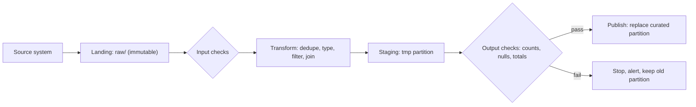

## 🎯 خلاصه

> یک **پایپ‌لاین batch ETL** در هر اجرا فقط یک **partition** از داده را پردازش می‌کند (معمولاً یک روز)، نتیجه را با **جایگزین‌کردن همان partition** می‌نویسد، و **ورودی‌ی خام** را دست نمی‌زند. اگر اجرا برای یک روز دو بار انجام شود، جواب یکسان است؛ پس rerun و backfill امن است.

- **خام تغییرناپذیر است.** داده‌ی منبع را همان‌طور که رسیده ذخیره کن و هرگز ویرایشش نکن. هر مرحله‌ی بعدی را می‌شود از آن بازساخت.
- **کار به‌ازای هر partition.** هر اجرا = یک `dt` (تاریخ). واحدهای کوچک و محدود راحت retry و مانیتور می‌شوند.
- **overwrite کن، append نکن.** جایگزین‌کردن partition اجرا را idempotent می‌کند. append در هر retry داده را تکراری می‌کند.
- **بعد از چک منتشر کن.** خروجی را اعتبارسنجی کن، بعد در یک مرحله قابل‌دیدن کن.

## 🌱 از ساده شروع کنیم (مبتدی)

> **💡 تشبیه:** یک نانوایی که هر صبح از یک محموله‌ی آرد یک دسته نان تازه می‌پزد. اگر فر ساعت ۶:۱۰ خراب شود، نانوا سینی نیم‌پخته را دور می‌ریزد و کل دسته را دوباره می‌پزد. محموله‌ی آرد (داده‌ی خام) هرگز باز نمی‌شود و با آرد دیروز مخلوط نمی‌شود. نان فقط بعد از کنترل کیفیت به مشتری نشان داده می‌شود.

فرض کن هر روز یک خروجی از سفارش‌ها از یک سیستم می‌گیری. می‌خواهی جدول `curated.orders` را داشته باشی، با یک ردیف تمیز برای هر سفارش و یک جمع روزانه.

```text
raw (files as received)        curated (clean, queryable)
---------------------------    --------------------------
raw/orders/dt=2026-10-11/  ->  curated/orders/dt=2026-10-11/
raw/orders/dt=2026-10-12/  ->  curated/orders/dt=2026-10-12/
```

قواعدی که این را ساده نگه می‌دارد:

1. **اول فایل را همان‌طور که رسیده در `raw/` کپی کن.** هرگز آن را در جای خودش درست نکن.
2. **هر اجرا یک پوشه از `raw/` را می‌خواند** (مثلاً `dt=2026-10-12`).
3. **هر اجرا یک پوشه از `curated/` را می‌نویسد** و هر چه قبلاً بوده را جایگزین می‌کند.
4. **اجرای دوباره‌ی جاب برای `2026-10-12`** همان پوشه را دوباره می‌سازد. چیزی دوبرابر نمی‌شود.

یک نسخه‌ی SQL مینیمال برای مرحله‌ی ۳، داخل یک تراکنش:

```sql
BEGIN;
DELETE FROM curated.orders WHERE dt = DATE '2026-10-12';
INSERT INTO curated.orders (order_id, customer_id, amount, dt)
SELECT DISTINCT order_id, customer_id, amount, dt
FROM raw.orders
WHERE dt = DATE '2026-10-12' AND amount >= 0;
COMMIT;
```

اگر جاب بعد از `DELETE` و قبل از `COMMIT` کرش کند، تراکنش rollback می‌شود و partition دیروز سر جایش می‌ماند. خواننده‌ها هرگز نیمه‌ی یک روز را نمی‌بینند.

## 🔧 واقعاً چطور کار می‌کند (متوسط)

یک پایپ‌لاین batch ETL یک **DAG** از مراحل است که scheduler (مثلاً [[dag]] در Airflow) آن را اجرا می‌کند. هر اجرا یک **logical date** دارد (روز کاری‌ای که نماینده‌اش است)، که با ساعت دیوار اجرای جاب فرق دارد.



مراحل کلیدی:

1. **Land.** فایل استخراج منبع را به `raw/dt=<date>/` کپی کن. نام فایل، checksum و زمان بارگذاری را در یک manifest نگه دار. این لایه ردپای حسابرسی و منبع replay است.
2. **ورودی را چک کن.** تعداد ردیف صفر نیست (مگر صفر مجاز باشد)، schema درست است، کلیدهای الزامی وجود دارند. ورودی بد باید قبل از نوشتن هر چیزی اجرا را متوقف کند.
3. **Transform.** بر اساس کلید کسب‌وکار dedupe کن، نوع‌ها را cast کن، قواعد را اعمال کن، با dimensionها join کن. نتیجه را در یک محل **staging** بنویس، نه مستقیم در جدول نهایی.
4. **خروجی را چک کن.** با ورودی و با روزهای قبل مقایسه کن (تعداد ردیف در بازه‌ی انتظار، بدون کلید null، جمع‌ها منفی نباشند).
5. **Publish.** partition را در جدول نهایی جایگزین کن. روش‌های معمول:
   - **Dynamic partition overwrite** در Spark: فقط partitionهایی که در DataFrame هستند جایگزین می‌شوند.
   - **حذف و سپس درج** در یک تراکنش (warehouseها، PostgreSQL).
   - **swap اتمی** یک جدول یا view که به پوشه‌ی partition جدید اشاره می‌کند.

یک job در PySpark برای یک روز:

```python
from pyspark.sql import SparkSession, functions as F

spark = (SparkSession.builder
         .appName("orders_daily")
         # Replace only the partitions that this DataFrame contains
         .config("spark.sql.sources.partitionOverwriteMode", "dynamic")
         .getOrCreate())

run_date = "2026-10-12"   # passed by the orchestrator, e.g. Airflow's {{ ds }}

raw = spark.read.parquet(f"s3://lake/raw/orders/dt={run_date}/")  # never written to
clean = (raw
         .dropDuplicates(["order_id"])                # dedupe by business key
         .filter(F.col("amount") >= 0)
         .withColumn("dt", F.lit(run_date)))          # partition column

(clean.write
      .mode("overwrite")                              # dynamic: only dt=2026-10-12 is replaced
      .partitionBy("dt")
      .parquet("s3://lake/curated/orders/"))
```

scheduler تاریخ و سیاست retry را تعیین می‌کند. شکل مینیمال یک DAG در Airflow:

```python
from datetime import datetime
from airflow import DAG
from airflow.operators.bash import BashOperator

with DAG(
    dag_id="orders_daily",
    start_date=datetime(2026, 1, 1),
    schedule="@daily",          # older Airflow versions call this schedule_interval
    catchup=False,
    max_active_runs=1,          # one day at a time, in order
    default_args={"retries": 3},
) as dag:
    land = BashOperator(task_id="land", bash_command="python land.py --dt {{ ds }}")
    load = BashOperator(task_id="load", bash_command="python load_orders.py --dt {{ ds }}")
    check = BashOperator(task_id="check", bash_command="python check_orders.py --dt {{ ds }}")
    land >> load >> check
```

**داده‌ی دیررس در batch** با همان مکانیزم حل می‌شود. اگر منبع ساعت ۹ صبح امروز اصلاحیه‌ی دیروز را بفرستد، partition دیروز را دوباره اجرا می‌کنی. طراحی رایج این است که هر شب یک **پنجره‌ی lookback** (مثلاً ۳ روز اخیر) بازسازی شود تا ردیف‌های دیررس بدون کار دستی گرفته شوند. هزینه‌اش محاسبه‌ی بیشتر در هر اجراست. این پنجره را پارامتر کن.

**چرا partition و نه ردیف؟** جایگزین‌کردن یک partition ارزان و دقیق است. پیدا کردن ردیف‌ها یکی‌یکی برای update یا delete کند است و راحت اشتباه می‌شود. به همین دلیل پایپ‌لاین‌های batch در lakeها و warehouseها بازنویسی partition را ترجیح می‌دهند و [[upsert]] (`MERGE`) را برای جدولی نگه می‌دارند که بازنویسی یک partition آن خیلی بزرگ است.

## 🧠 عمق و trade-offها (سنیور)

- **Idempotency ویژگی‌ای است که باید تضمین کنی.** پایپ‌لاین idempotent است اگر `run(dt)` و سپس `run(dt)` همان وضعیتی را بسازد که یک اجرا می‌ساخت. overwrite کردن partition این را رایگان می‌دهد. append به‌علاوه‌ی «بعداً تکراری‌ها را پاک کن» این را نمی‌دهد. به [[idempotency]] نگاه کن.
- **اتمی بودن publish.** خواننده هرگز نباید یک روز نیمه‌نوشته را ببیند. گزینه‌ها: تراکنش در warehouse؛ در lake، نوشتن در پوشه‌ی جدید و جابه‌جایی اشاره‌گر [[partition]] یا snapshot در فرمت جدول (Iceberg، Delta). تضمین موتور خودت را چک کن؛ overwrite ساده‌ی یک پوشه‌ی Parquet برای خوانندگان هم‌زمان اتمی نیست.
- **فایل‌های ریز.** یک اجرای روزانه با taskهای زیاد می‌تواند هزاران فایل Parquet ریز بسازد. یک مرحله‌ی compaction اضافه کن یا تعداد فایل خروجی را کنترل کن (`coalesce` یا repartition بر اساس کلید partition قبل از نوشتن). به [[small-files-problem]] نگاه کن.
- **Skew.** جاب روزانه‌ای که بر اساس یک مشتری داغ یا یک کلید null گروه‌بندی می‌کند، کل کار را روی یک task می‌گذارد. در Spark UI دنبال یک straggler طولانی باش و کلید داغ را قبل از aggregation هندل کن ([[data-skew]]).
- **اعداد مقیاس.** یک روز ۵۰ میلیون ردیف سفارش با حدود ۲۰۰ بایت هر کدام تقریباً ۱۰ گیگابایت خام می‌شود، قبل از فشرده‌سازی. یک جاب Spark که روزی یک بار این را می‌خواند و می‌نویسد، روی یک کلاستر کوچک راحت است. همان جاب با ۱۰ برابر حجم به برنامه‌ریزی ظرفیت واقعی نیاز دارد، نه فقط یک کلاستر بزرگ‌تر.
- **چیزهایی که باید مانیتور کنی:** مدت اجرا نسبت به تاریخچه‌اش، تعداد ردیف ورودی نسبت به روزهای قبل، تعداد ردیف خروجی، تعداد چک‌های شکست‌خورده، و **تازگی (freshness)**: زمان فرود آخرین partition سالم نسبت به [[sla-slo]].
- **کی استفاده نکنیم.** اگر کسب‌وکار به جواب ظرف چند دقیقه نیاز دارد، batch روزانه ابزار اشتباه است. از [[pattern-realtime-aggregation]] استفاده کن. اگر transform ساده‌ی SQL روی داده‌ای است که از قبل در warehouse است، [[etl-vs-elt]] (transform داخل warehouse) ساده‌تر از یک job جدا در Spark است.
- **Lambda و Kappa.** یک batch شبانه اغلب کنار یک مسیر بلادرنگ قرار می‌گیرد تا آن را اصلاح کند. این ترکیب در [[pattern-lambda-kappa]] و [[pattern-reconciliation]] توضیح داده شده است.

## 🧪 امتحان کن

از مثال سفارش‌ها در این درس استفاده کن. فرض کن `raw.orders` سه روز داده دارد و هر روز چند ردیف با `order_id` تکراری.

1. **تست idempotency.** تراکنش SQL بالا را برای `2026-10-12` بنویس. دو بار اجرایش کن. تعداد ردیف‌ها را قبل و بعد از اجرای دوم بشمار. توضیح بده چرا عدد تغییر نمی‌کند.
2. **Lookback.** جاب را طوری تغییر بده که هر اجرا ۳ روز اخیر را بازسازی کند (`dt` بین `run_date - 2` و `run_date`). شرط `WHERE` و بازه‌ی `DELETE` را بنویس. چرا بازه‌ی `DELETE` و بازه‌ی `INSERT` باید یکی باشند؟
3. **دروازه‌ی کیفیت.** یک چک SQL بنویس که اگر تعداد ردیف‌های روز کمتر از ۵۰ درصد میانگین ۷ روز قبل باشد، اجرا را fail کند.

<details><summary>راه‌حل‌ها را نشان بده</summary>

**۱.** اجرای اول چیزی برای حذف ندارد و ردیف‌های متمایز روز را درج می‌کند. اجرای دوم دقیقاً همان ردیف‌ها را حذف و دوباره درج می‌کند. تعداد هر دو بار یکی است، چون `DELETE` و `INSERT` روی یک کلید یکسان (`dt = 2026-10-12`) کار می‌کنند. بدون `DELETE`، اجرای دوم تعداد ردیف‌ها را دو برابر می‌کند.

**۲.**
```sql
DELETE FROM curated.orders
WHERE dt BETWEEN DATE '2026-10-10' AND DATE '2026-10-12';

INSERT INTO curated.orders (order_id, customer_id, amount, dt)
SELECT DISTINCT order_id, customer_id, amount, dt
FROM raw.orders
WHERE dt BETWEEN DATE '2026-10-10' AND DATE '2026-10-12' AND amount >= 0;
```
اگر بازه‌ی `DELETE` کوچک‌تر از بازه‌ی `INSERT` باشد، ردیف‌های روزهای اضافه تکراری می‌شوند. اگر بزرگ‌تر باشد، داده‌ای را حذف می‌کنی که بازسازی نمی‌شود. دو بازه باید یکی باشند.

**۳.**
```sql
WITH today AS (
  SELECT COUNT(*) AS n FROM curated.orders WHERE dt = DATE '2026-10-12'
),
baseline AS (
  SELECT AVG(day_count) AS avg_n
  FROM (
    SELECT dt, COUNT(*) AS day_count
    FROM curated.orders
    WHERE dt BETWEEN DATE '2026-10-05' AND DATE '2026-10-11'
    GROUP BY dt
  ) d
)
SELECT CASE WHEN today.n < 0.5 * baseline.avg_n THEN 'FAIL' ELSE 'PASS' END AS gate
FROM today, baseline;
```
orchestrator بعد از load این کوئری را اجرا می‌کند و وقتی نتیجه `FAIL` است DAG را متوقف می‌کند و partition قبلی را سر جایش نگه می‌دارد.

</details>

## 💬 گوشه‌ی مصاحبه

**سؤال: «یک ETL روزانه طراحی کن که سفارش‌ها را در warehouse بار کند. وقتی وسط کار شکست می‌خورد چه می‌شود؟»**

جواب متوسط: «در Airflow زمان‌بندی‌اش می‌کنم با retry. با شکست، retry جاب را دوباره اجرا می‌کند. مطمئن می‌شوم بار قبل از درج، ردیف‌های آن روز را پاک می‌کند تا retry تکرار نسازد.»

جواب سنیور: «لایه‌ی خام تغییرناپذیر نگه می‌دارم، هر اجرا را روی یک partition انجام می‌دهم و با حذف و درج در یک تراکنش، یا swap اشاره‌گر اتمی، آن partition را منتشر می‌کنم. retry یا backfill همان تاریخ را دوباره اجرا می‌کند و نتیجه‌ی یکسان می‌دهد، پس پایپ‌لاین idempotent است. چک ورودی و خروجی قبل از publish می‌گذارم، یک پنجره‌ی lookback برای اصلاحیه‌ها دارم، و مانیتور تازگی و تعداد ردیف در برابر SLA.»

**سؤال: «شش ماه تاریخچه را چطور backfill می‌کنی؟»** همان جاب را به‌ازای هر partition به ترتیب تاریخ، با موازی‌سازی محدود اجرا کن. طراحی idempotent است که این کار را امن می‌کند. به [[pattern-backfill]] نگاه کن.

> **🎤 این را در مصاحبه بگو:** «من هر اجرا را تابعی از یک partition می‌سازم. داده‌ی خام هرگز ویرایش نمی‌شود. partition خروجی جایگزین می‌شود، نه append، پس rerun و backfill امن است. چک‌ها قبل از publish اجرا می‌شوند، پس ورودی بد هرگز به مصرف‌کننده نمی‌رسد.»

## ⚠️ اشتباهات رایج

> **⚠️ توجه:** خروجی روز را در هر اجرا به جدول append کردن. یک retry داده را دو برابر می‌کند و هیچ چیزی در schema جلویش را نمی‌گیرد.

> **⚠️ توجه:** استفاده از تاریخ ساعت دیوار (`now()`) به‌جای logical date که scheduler می‌دهد. یک rerun برای سه‌شنبه‌ی گذشته آنگاه داده را در partition امروز می‌نویسد.

- ویرایش فایل‌های `raw/`. آنگاه نمی‌توانی replay کنی و اعداد گذشته را توضیح بدهی.
- overwrite کل جدول به‌جای partition. هزینه با تاریخچه رشد می‌کند و خطا وسط کار می‌تواند جدول را خالی بگذارد.
- حذف با یک بازه و درج با بازه‌ی دیگر (باگ lookback در تمرین).
- نبود چک خروجی، پس فایل خالی منبع یک روز با صفر سفارش را منتشر می‌کند و کسی متوجه نمی‌شود.
- dedupe با `DISTINCT` روی همه‌ی ستون‌ها. دو نسخه از یک سفارش با `updated_at` متفاوت باقی می‌مانند. dedupe را بر اساس کلید کسب‌وکار و قانون صریح «آخرین نسخه برنده است» انجام بده. به [[pattern-dedup]] نگاه کن.
- نادیده گرفتن منطقه‌ی زمانی. `dt` ساخته‌شده از زمان‌های UTC ممکن است با روز کاری در تهران یا منطقه‌ی گزارش‌دهی نخواند.

## ✅ خودت را بسنج (quiz)

1. یک جاب روزانه خروجی‌اش را به `curated.orders` append می‌کند. جاب وسط نوشتن نصف ردیف‌ها کرش کرده و دوباره اجرا شده است. محتمل‌ترین نتیجه چیست و راه حل کدام است؟
   - A) هیچ؛ پایگاه‌داده تکراری‌ها را خودکار حذف می‌کند
   - B) بعضی سفارش‌ها دو بار ظاهر می‌شوند؛ به‌جای append، partition را جایگزین کن
   - C) retry با خطای primary key شکست می‌خورد و جدول خالی است
   - D) سفارش‌ها به ترتیب دیگری مرتب می‌شوند؛ یک `ORDER BY` اضافه کن

<details><summary>جواب</summary>

**B** — append idempotent نیست. ردیف‌های نیمه‌نوشته می‌مانند و retry مجموعه‌ی کامل را دوباره اضافه می‌کند. حذف partition و درج دوباره‌ی آن (یا overwrite آن) اجرا را قابل تکرار می‌کند.

</details>

2. کدام ویژگی باید برقرار باشد تا backfill شش ماهه امن باشد؟
   - A) جاب باید یکشنبه اجرا شود
   - B) هر اجرا برای partition خودش، صرف‌نظر از تعداد دفعات اجرا، باید نتیجه‌ی یکسان بدهد
   - C) جاب باید در هر اجرا کل تاریخچه را بخواند
   - D) فایل‌های خام بعد از هر اجرا باید پاک شوند

<details><summary>جواب</summary>

**B** — idempotency به‌ازای هر partition، rerun و backfill را امن می‌کند. خواندن کل تاریخچه (C) برعکس چیزی است که می‌خواهی، و حذف داده‌ی خام (D) منبع replay را از بین می‌برد.

</details>

3. چرا جاب باید **logical date** را از scheduler بگیرد و به‌جای `current_date()` داخل کد؟

   - A) `current_date()` کندتر است
   - B) rerun یا backfill برای تاریخ قدیمی داده را در partition امروز می‌نویسد؛ logical date باعث می‌شود هر اجرا partition درست را هدف بگیرد
   - C) scheduler آرگومان تاریخ نمی‌دهد
   - D) logical date برای فایل‌های Parquet الزامی است

<details><summary>جواب</summary>

**B** — اجرا باید تابعی از کلید partition خودش باشد. اگر کد از زمان فعلی استفاده کند، rerun هفته‌ی قبل partition اشتباه را عوض می‌کند.

</details>

4. **(سنیور)** جاب شبانه‌ی تو ۹ ساعت طول می‌کشد. Spark UI نشان می‌دهد یک task ۸ ساعت اجرا می‌شود در حالی که بقیه در چند دقیقه تمام می‌شوند. علت محتمل چیست و چه چیزی را تغییر می‌دهی؟

   - A) تعداد کم فایل Parquet؛ partitionهای بیشتری بساز
   - B) data skew روی یک کلید (مثلاً null یا یک مشتری داغ)؛ کلید را salt کن یا کلید داغ را قبل از aggregation جدا هندل کن
   - C) فرمت خروجی اشتباه است؛ از CSV استفاده کن
   - D) تعداد retry در Airflow زیاد است

<details><summary>جواب</summary>

**B** — یک task استثنایی که بیشتر داده را دارد، نشانه‌ی skew است. شکستن کلید داغ (salting، یا جدا کردنش در مرحله‌ی جداگانه) کار را پخش می‌کند. اول توزیع کلید را چک کن و حدس نزن.

</details>

5. **(سنیور)** تیم می‌خواهد هر شب ۳ روز اخیر را بازسازی کند تا اصلاحیه‌های دیررس را بگیرد. معاوضه‌ی این کار چیست و کد باید چه چیزی را تضمین کند؟

   - A) رایگان است، چون داده از قبل در حافظه است
   - B) محاسبه‌ی هر اجرا حدود سه برابر می‌شود، و بازه‌ی حذف و بازه‌ی درج باید دقیقاً یکی باشند تا هیچ روزی تکراری یا گم نشود
   - C) فقط با موتورهای streaming کار می‌کند
   - D) نیاز به داده‌ی خام را از بین می‌برد

<details><summary>جواب</summary>

**B** — پنجره‌ی lookback محاسبه را در برابر درستی داده‌ی دیررس معامله می‌کند. مرحله‌ی publish باید همان مجموعه‌ی partition را حذف و درج کند، وگرنه پنجره تکرار یا فاصله می‌سازد.

</details>

## 🗂️ فلش‌کارت

| Front | Back |
|---|---|
| یک اجرای batch معمولاً چیست؟ | یک partition (مثلاً یک روز) که با logical date مشخص می‌شود |
| چرا لایه‌ی خام نگه داریم؟ | replay، حسابرسی و بازسازی؛ هرگز ویرایش نمی‌شود |
| چرا partition را جایگزین کنیم و append نکنیم؟ | rerun و retry idempotent می‌مانند؛ append داده را تکراری می‌کند |
| logical date چیست؟ | روز کاری که اجرا نماینده‌اش است، از طرف scheduler، نه ساعت دیوار |
| پنجره‌ی lookback چه چیزی را هندل می‌کند؟ | اصلاحیه‌های دیررس partitionهای گذشته، با هزینه‌ی محاسبه‌ی بیشتر |
| چک‌ها کجا اجرا می‌شوند؟ | بعد از transform و قبل از publish؛ شکست یعنی partition قبلی سر جایش می‌ماند |
| dynamic partition overwrite در Spark | فقط partitionهایی که در DataFrame نوشته‌شده هستند جایگزین می‌شوند |
| خطر اصلی بازه‌ی ثابت `DELETE` با بازه‌ی متفاوت `INSERT` | روزهای تکراری یا گم‌شده |

## 🔗 ادامه

- [[pattern-backfill]] نشان می‌دهد چطور همین طراحی per-partition برای بازسازی تاریخچه استفاده می‌شود.
- [[pattern-dedup]] و [[dedup-idempotent-loads]] قواعد dedupe را پوشش می‌دهند که این پایپ‌لاین به آن‌ها وابسته است.
- [[pattern-late-data]] معادل streaming است: وقتی نتایج از قبل منتشر شده‌اند چه باید کرد.
- [[pattern-reconciliation]] توضیح می‌دهد چطور نتیجه‌ی batch را با نتیجه‌ی بلادرنگ مقایسه کنی.
- [[medallion-architecture]] لایه‌های خام، پاک‌شده و curated را که اینجا استفاده شد نام می‌برد.
- مستندات Airflow برای نسخه‌ی خودت پارامترهای زمان‌بندی (`schedule`، `catchup`، `max_active_runs`) را با جزئیات توضیح می‌دهد.
