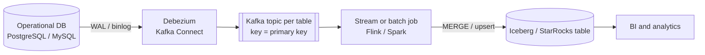
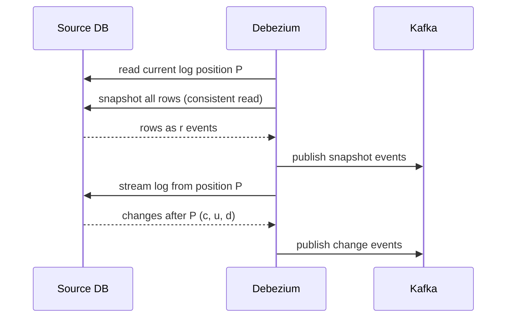

## 🎯 خلاصه

> **از CDC تا تحلیل** یعنی هر insert، update و delete را از یک دیتابیس عملیاتی به یک جدول تحلیلی منتقل کنی، تقریباً در زمان واقعی، بدون اینکه جدول‌های production را مدام کوئری بزنی.

- change log منبع (binlog در MySQL، WAL در PostgreSQL) منبع حقیقت تغییرات است. یک connector مثل **Debezium** آن را می‌خواند و برای هر تغییر ردیف یک رویداد در Kafka می‌نویسد.
- بارگذاری اول یک **snapshot** است. بعد از آن pipeline باید از دقیقاً همان موقعیت log که snapshot از آن گرفته شده ادامه دهد. وگرنه ردیف‌ها گم یا تکراری می‌شوند.
- جدول تحلیلی باید مثل یک **آینه** رفتار کند: رویدادها را با **upsert و delete بر اساس کلید اصلی** اعمال کند، به ترتیب درست، و replay را تحمل کند.

## 🌱 از ساده شروع کنیم (مبتدی)

> **💡 تشبیه:** یک مغازه دفتری دارد که هر فروش، برگشت و تغییر قیمت را به ترتیب وقوع در آن ثبت می‌کند. حسابدار که گزارش موجودی به‌روز می‌خواهد، هر ساعت به مغازه نمی‌رود و همه‌چیز را نمی‌شمارد. او خطوط جدید دفتر را در صفحه‌گسترده‌ی خودش کپی می‌کند: «این فروش را اضافه کن»، «آن قیمت را عوض کن»، «این سفارش را حذف کن». صفحه‌گسترده‌ی او در نهایت با وضعیت مغازه برابر می‌شود.

در زبان دیتابیس:

- **دیتابیس عملیاتی** (مثلاً PostgreSQL سرویس سفارش‌ها) همان مغازه است.
- **change log** (WAL در PostgreSQL، binlog در MySQL) همان دفتر است.
- **جدول انبار** همان صفحه‌گسترده‌ی حسابدار است.

هر تغییر به یک رویداد با کد عملیات تبدیل می‌شود: `c` (ایجاد)، `u` (به‌روزرسانی)، `d` (حذف) و `r` (خواندن، که برای snapshot اولیه استفاده می‌شود). یک رویداد ساده‌شده برای یک مشتری این شکلی است:

```json
{
  "op": "u",
  "before": {"id": 1, "name": "Ali"},
  "after":  {"id": 1, "name": "Ali R."},
  "source": {"table": "customers", "lsn": 103}
}
```

کار تو در pipeline این است که این رویدادها را به ترتیب بخوانی و جدول تحلیلی را با منبع یکی کنی. سه چیز این کار را سخت می‌کند: کپی اول همه‌ی داده‌ها، ردیف‌های حذف‌شده، و رویدادهایی که دوبار یا خارج از ترتیب می‌رسند.

## 🔧 واقعاً چطور کار می‌کند (متوسط)



### گام ۱: snapshot اولیه و نقطه‌ی انتقال

یک جدول می‌تواند میلیاردها ردیف داشته باشد، و ممکن است change log تاریخچه را از ابتدا نگه نداشته باشد. پس connector به ترتیب این کارها را می‌کند:

1. موقعیت فعلی log را ثبت می‌کند (مثلاً یک LSN در PostgreSQL، یا فایل و offset binlog در MySQL).
2. کل جدول را به صورت رویدادهای `r` می‌خواند (یک خواندن سازگار در آن لحظه).
3. از آن موقعیت ثبت‌شده به بعد، log را می‌خواند.



نقطه‌ی انتقال بخش پرریسک است. اگر خواندن snapshot و جریان log مرز مشترکی نداشته باشند، تغییراتی که در مدت snapshot رخ داده گم می‌شوند یا دوبار اعمال می‌شوند. connectorها با ثبت موقعیت قبل از شروع snapshot این را حل می‌کنند. چون برخی تغییرات آن بازه دو بار اعمال می‌شوند (snapshot از قبل دارد‌شان و log دوباره پخشان می‌کند)، sink باید **idempotent** باشد: اعمال رویدادی که قبلاً در نتیجه منعکس شده نباید نتیجه را عوض کند.

در عمل، هر جدول را یک بار snapshot می‌گیری و بعد جریان را روشن نگه می‌داری. تکرار snapshot یک backfill است و برنامه‌ی جدا لازم دارد (به [[backfills]] نگاه کن).

### گام ۲: ترتیب به‌ازای هر کلید

Kafka ترتیب را فقط داخل یک partition تضمین می‌کند. اگر connector بر اساس کلید اصلی partition کند، همه‌ی تغییرات یک مشتری به ترتیب به یک partition می‌روند. به همین دلیل کلید topic مهم است. اگر بر اساس یک مقدار تصادفی یا نام جدول partition کنی، دو به‌روزرسانی از یک ردیف ممکن است خارج از ترتیب پردازش شوند و وضعیت نهایی غلط است.

هر رویداد یک موقعیت در log منبع (LSN یا موقعیت binlog) دارد. برای تشخیص اینکه کدام تغییر جدیدتر است، از همین موقعیت استفاده کن، نه از زمان رسیدن. موقعیت‌ها فقط داخل یک دیتابیس منبع قابل مقایسه‌اند. تغییرات دو دیتابیس مختلف ترتیب مشترک ندارند، پس هرگز بدون شناسه‌ی منبع آن‌ها را در یک کلید جدول ترکیب نکن.

### گام ۳: اعمال رویدادها به صورت upsert و delete

هسته‌ی الگو یک قانون است: **آخرین تغییر را برای هر کلید اصلی نگه دار، بعد merge کن**. در یک micro-batch ممکن است یک ردیف چند بار ظاهر شود. ابتدا با یک window function آخرین تغییر را انتخاب کن و بعد آن را به جدول مقصد merge کن.

```sql
-- 1. keep only the latest change per key in this micro-batch
CREATE OR REPLACE TEMPORARY VIEW latest AS
SELECT * FROM (
  SELECT c.*,
         ROW_NUMBER() OVER (PARTITION BY c.id ORDER BY c.source_lsn DESC) AS rn
  FROM cdc_batch AS c
) AS ranked
WHERE rn = 1;

-- 2. apply to the lake table (Spark SQL with an Iceberg or Delta MERGE)
MERGE INTO lake.customers AS t
USING latest AS s
  ON t.id = s.id
WHEN MATCHED AND s.op = 'd' THEN DELETE
WHEN MATCHED AND s.op IN ('c', 'u', 'r') AND s.source_lsn > t.source_lsn THEN
  UPDATE SET name = s.name, email = s.email, source_lsn = s.source_lsn
WHEN NOT MATCHED AND s.op <> 'd' THEN
  INSERT (id, name, email, source_lsn) VALUES (s.id, s.name, s.email, s.source_lsn);
```

دو جزئیات این‌جا مهم است:

- شرط `s.source_lsn > t.source_lsn` **guard نسخه** است. یک رویداد replay شده یا دیرهنگام نمی‌تواند یک ردیف جدیدتر را بازنویسی کند.
- حذف با ردیف هدف‌نداشته فقط رد می‌شود. این باعث می‌شود replay حذف‌ها امن باشد.

### حذف‌ها

رویداد `d` یعنی آن ردیف در منبع حذف شده. در لایه‌ی تحلیلی سه انتخاب داری:

| روش | چه اتفاقی می‌افتد | کی استفاده کنی |
|---|---|---|
| hard delete | ردیف در آینه `DELETE` می‌شود | جدول‌های آینه‌ای که باید عیناً با منبع برابر باشند و تاریخچه لازم نیست |
| soft delete | ردیف با `is_deleted = true` و موقعیت منبع نگه داشته می‌شود | ممیزی، join های دیرهنگام، تحلیل «آن موقع چه می‌دانستیم» |
| تاریخچه (SCD2) | نسخه‌ی قدیمی بسته و نسخه‌ی جدید درج می‌شود | تاریخچه‌ی کامل تغییر ویژگی‌ها (به [[scd]] نگاه کن) |

حذف‌ها با Kafka هم سروکار دارند. topic های log-compacted از یک **tombstone** استفاده می‌کنند (رکوردی با کلید و مقدار null) تا یک کلید را از تاریخچه‌ی فشرده حذف کنند. Debezium یک رویداد حذف می‌فرستد و می‌تواند بعد از آن یک tombstone هم بفرستد. مصرف‌کننده‌ی تو باید هر دو را هندل کند: رویداد `d` حذف را اعمال می‌کند، و tombstone داده‌ی ردیف ندارد.

### تغییر schema

جدول منبع تغییر می‌کند: ستون جدید، تغییر نام، تغییر نوع. سه لایه باید با هم هماهنگ باشند:

- **connector** از DDL خبر دارد و تاریخچه‌ی schema را نگه می‌دارد، پس می‌داند هر نسخه‌ی ردیف را چطور decode کند.
- **topic و schema registry** باید schema جدید را بر اساس قانون سازگاری‌ات بپذیرند (معمولاً backward compatible: فقط ستون‌های اختیاری جدید).
- **جدول مقصد** باید ستون را قبل از رسیدن اولین ردیفی که از آن استفاده می‌کند داشته باشد. ابتدا ستون‌ها را به جدول lake اضافه کن، بعد اجازه بده رویدادهای جدید جاری شوند.

تغییر نام و کوچک‌کردن نوع سازگار نیستند. مسیر امن معمولاً این است: ستون جدید اضافه کن، آن را پر کن، خواننده‌ها را سوییچ کن، و ستون قدیمی را در نسخه‌ی بعدی حذف کن. به [[schema-evolution]] و [[pattern-schema-evolution]] نگاه کن.

## 🧠 عمق و trade-offها (سنیور)

**sink را بر اساس الگوی دسترسی انتخاب کن.** هم Iceberg و هم StarRocks می‌توانند upsert دریافت کنند، ولی برای بارهای متفاوت مناسب‌اند:

- **Iceberg** روی object storage ارزان، باز و مشترک با Spark، Trino و Flink است. هر commit از `MERGE` فایل‌های جدید می‌سازد. commit های کوچک و پرتکرار فایل‌های ریز زیادی می‌سازند و خواندن را کند می‌کنند، پس به compaction و فاصله‌ی commit متعادل بین تازگی و تعداد فایل نیاز داری. merge-on-read هزینه‌ی نوشتن را کم می‌کند ولی هزینه‌ی خواندن را بالا می‌برد. انتخاب copy-on-write در برابر merge-on-read اولین تصمیم طراحی برای جدول پرتغییر CDC است (به [[lakehouse-table-formats]] نگاه کن).
- **جدول های primary-key در StarRocks** برای upsert و حذف بر اساس کلید ساخته شده‌اند و کوئری با تأخیر کم را مستقیم سرو می‌کنند. وقتی تحلیل باید تازه (چند ثانیه) باشد و زیاد کوئری شود، از آن استفاده کن. هزینه، اداره‌ی یک سیستم عملیاتی و ردپای مشترک کوچک‌تر نسبت به lake است.

**تأخیر را کندترین مرحله تعیین می‌کند.** تأخیر انتها-به-انتها مجموع lag connector، lag Kafka، فاصله‌ی stream یا micro-batch، و زمان merge است. هرکدام را جداگانه اندازه بگیر. یک غافلگیری رایج این است که connector خوب است ولی یک `MERGE` بزرگ هر پنج دقیقه چهار دقیقه طول می‌کشد، پس تازگی همیشه «حدود ده دقیقه» است، هر چقدر بالادست را تنظیم کنی.

**ریسک‌های WAL و binlog.** یک replication slot منطقی در PostgreSQL، WAL روی سرور اصلی را نگه می‌دارد تا وقتی connector تأیید کند آن را خوانده. اگر connector متوقف شود (مثلاً خوشه‌ی Kafka ساعت‌ها در دسترس نباشد)، WAL رشد می‌کند و می‌تواند دیسک دیتابیس production را پر کند. این یکی از جدی‌ترین ریسک‌های عملیاتی CDC است. lag slot را مانیتور کن، برایش هشدار بگذار، و برنامه داشته باش که اگر connector قابل بازیابی نبود، slot را حذف کنی. در MySQL، مدت نگه‌داری binlog باید از طولانی‌ترین قطعی connector بیشتر باشد.

**ترتیب بین جدول‌ها.** هر جدول فقط داخل خودش سازگار است. اگر تغییر `customers` و تغییر `orders` در lake join شوند، ممکن است خواننده سفارش را ببیند قبل از مشتری‌اش. این را با یک نقطه‌ی خواندن سازگار در زمان کوئری حل کن، یا سازگاری نهایی را بپذیر و در طراحی صریح بگو.

**مانیتورینگ:**

- lag connector: زمان بین timestamp کامیت منبع و منتشر شدن رویداد.
- lag مصرف‌کننده در Kafka و سن آخرین رویداد اعمال‌شده به‌ازای هر جدول.
- reconciliation تعداد ردیف و checksum بین منبع و آینه، به‌ازای هر جدول و بازه‌ی کلیدی. نمونه‌ای از کلیدهای اصلی در برابر منبع، انحراف بی‌صدا را پیدا می‌کند که متریک‌های lag نشان نمی‌دهند.
- خطاهای schema registry و رویدادهای DDL در topic تاریخچه‌ی schema.

**کی این الگو را استفاده نکنی.** اگر منبع کوچک است، داده‌ها روزانه لازم‌اند و جدول حذف ندارد، یک استخراج کامل شبانه یا کوئری incremental روی ستون `updated_at` ساده‌تر است. حذف‌های سخت را از دست می‌دهد، و به همین دلیل CDC وجود دارد، ولی برای خیلی از جدول‌ها قابل قبول است. استخراج incremental بر پایه‌ی کوئری هم بار روی دیتابیس production می‌گذارد، در حالی که CDC مبتنی بر log، log را می‌خواند و این بار را ندارد.

**حالت‌های خرابی که در مصاحبه باید نام ببری:**

- replay یک snapshot قدیمی روی داده‌ی جدید، که تغییرات جدیدتر را برمی‌گرداند. guard نسخه جلوی این را می‌گیرد.
- از دست رفتن حذف‌ها چون pipeline فقط `c` و `u` را هندل می‌کرد.
- جدولی که کلید اصلی‌اش تغییر می‌کند. update می‌شود یک حذف و یک درج با کلید جدید؛ اگر حذف را هندل نکنی، آینه یک ردیف یتیم نگه می‌دارد.
- تراکنش‌های بزرگ در منبع که یک انفجار رویداد و یک merge طولانی تولید می‌کنند.

## 🧪 امتحان کن

برنامه‌ی زیر یک جریان CDC را روی یک جدول آینه‌ای با guard نسخه اعمال می‌کند. رویدادها خارج از ترتیب و با یک تکراری می‌رسند، همان‌طور که یک pipeline واقعی گاهی می‌بیند.

```python
import sqlite3

EVENTS = [  # (lsn, op, id, name) as a CDC stream delivers them, out of order
    (101, "c", 1, "Ali"),
    (103, "u", 1, "Ali R."),
    (102, "c", 2, "Sara"),
    (104, "d", 2, None),
    (100, "c", 1, "Ali"),  # late duplicate from a retry: older position
]

def init(db):
    db.execute("""CREATE TABLE IF NOT EXISTS customers (
        id INTEGER PRIMARY KEY, name TEXT, lsn INTEGER NOT NULL, deleted INTEGER NOT NULL DEFAULT 0)""")

def apply(db, lsn, op, cid, name):
    row = db.execute("SELECT lsn FROM customers WHERE id = ?", (cid,)).fetchone()
    if row and row[0] >= lsn:
        return  # the mirror already has this change or a newer one
    if op == "d":
        db.execute(
            "INSERT INTO customers VALUES (?, NULL, ?, 1) "
            "ON CONFLICT(id) DO UPDATE SET name = NULL, deleted = 1, lsn = excluded.lsn",
            (cid, lsn),
        )
    else:
        db.execute(
            "INSERT INTO customers VALUES (?, ?, ?, 0) "
            "ON CONFLICT(id) DO UPDATE SET name = excluded.name, deleted = 0, lsn = excluded.lsn",
            (cid, name, lsn),
        )

db = sqlite3.connect(":memory:")
init(db)
for ev in EVENTS:
    apply(db, *ev)
db.commit()
print(db.execute("SELECT id, name, deleted, lsn FROM customers ORDER BY id").fetchall())
# [(1, 'Ali R.', 0, 103), (2, None, 1, 104)]
```

پیش‌بینی کن و بررسی کن:

1. چرا آخرین رویداد (`lsn 100`) مشتری ۱ را تغییر نمی‌دهد؟
2. اگر حذف (`104`) قبل از درج (`102`) برسد، برای مشتری ۲ چه می‌شود؟
3. guard نسخه را حذف کن و همیشه اعمال کن. حالا کدام ردیف‌ها غلط‌اند؟

<details>
<summary>حدس تو؟</summary>

۱. آینه از قبل `lsn 103` را برای مشتری ۱ دارد. guard هر رویدادی را که موقعیتش جدیدتر نیست رد می‌کند، پس replay شده‌ی `100` نمی‌تواند به‌روزرسانی را برگرداند.

۲. حذف ردیفی پیدا نمی‌کند. با این کد، یک ردیف حذف‌شده با `lsn 104` درج می‌کند. وقتی `102` بعداً برسد، موقعیتش قدیمی‌تر از `104` است و رد می‌شود. مشتری درست حذف‌شده می‌ماند. بدون guard، درج قدیمی مشتری حذف‌شده را برمی‌گرداند.

۳. مشتری ۱ دوباره `Ali` می‌شود (replay شده‌ی `100` مقدار `Ali R.` را بازنویسی می‌کند)، که مقدار قدیمی است. مشتری ۲ هم اگر درج `102` بعد از حذف دوباره replay شود، اشتباه برمی‌گردد، چون چیزی جلوی برگشت ردیف را نمی‌گیرد. guard است که replay بعد از حذف را امن می‌کند.

</details>

## 💬 گوشه‌ی مصاحبه

> **🎤 این را در مصاحبه بگو:** «change log دیتابیس را با یک connector می‌خوانم، برای هر تغییر ردیف یک رویداد با کلید اصلی منتشر می‌کنم تا تغییرات یک ردیف مرتب بمانند، و با snapshot شروع می‌کنم که موقعیتش قبل از خواندن ثبت شده. در lake یا StarRocks هر micro-batch را به آخرین تغییر هر کلید کاهش می‌دهم، بعد با guard موقعیت منبع merge می‌کنم تا replay نتواند ردیف جدیدتر را بازنویسی کند، و روی رویدادهای `d` حذف می‌کنم. lag اسلات replication و شمارش‌های reconciliation را در بازه‌ی کلیدی مانیتور می‌کنم.»

**این چطور پرسیده می‌شود:** «CDC از چند دیتابیس میکروسرویس به انبار را طراحی کن» یا «حذف‌ها و تغییر schema را چطور هندل می‌کنی؟»

- **پاسخ مبتدی:** «جدول‌ها را هر ساعت export کن و بار کن.» برای جدول‌های کوچک کار می‌کند، ولی حذف‌ها را از دست می‌دهد و منبع را بار می‌کند.
- **پاسخ متوسط:** «Debezium، binlog را در Kafka می‌خواند و یک Spark job با MERGE بر اساس کلید اصلی اجرا می‌کند.» درست است، ولی درباره‌ی snapshot، ترتیب و replay ساکت است.
- **پاسخ سنیور:** نقطه‌ی انتقال snapshot، partition کردن بر اساس کلید، guard نسخه، استراتژی حذف، سازگاری schema registry، ریسک replication slot، و یک بررسی reconciliation که ثابت کند آینه با منبع برابر است را پوشش می‌دهد.

**پاسخ نمونه (۳ تا ۵ جمله):** یک connector مبتنی بر log مثل Debezium، WAL یا binlog را می‌خواند و برای هر تغییر ردیف یک رویداد منتشر می‌کند، با کلید اصلی به عنوان کلید تا تغییرات یک ردیف مرتب بمانند. بارگذاری اول یک snapshot است که در موقعیت ثبت‌شده‌ی log گرفته می‌شود و جریان از همان موقعیت ادامه پیدا می‌کند. هر micro-batch با یک window function به آخرین تغییر هر کلید کاهش می‌یابد و بعد در یک جدول Iceberg یا StarRocks merge می‌شود، با حذف روی رویدادهای `d` و guard نسخه بر اساس موقعیت منبع تا replay نتواند ردیف جدیدتر را بازنویسی کند. lag اسلات replication روی منبع را مانیتور می‌کنم و تعداد ردیف‌ها و کلیدهای نمونه را هر روز با منبع مقایسه می‌کنم.

## ⚠️ اشتباهات رایج

- **فکر کردن CDC «همان کوئری» است.** کوئری حذف‌ها را از دست می‌دهد و منبع را بار می‌کند. log تغییرات از جمله حذف‌ها را ثبت می‌کند و خود log را می‌خواند، نه جدول‌ها را.
- **partition کردن Kafka بر اساس چیزی غیر از کلید اصلی.** دو به‌روزرسانی از یک ردیف ممکن است خارج از ترتیب اعمال شوند.
- **مرتب‌سازی بر اساس زمان رسیدن.** از موقعیت log منبع (LSN یا offset binlog) استفاده کن، که ترتیب commit دیتابیس است.
- **نداشتن guard نسخه در MERGE.** یک snapshot replay شده یا retry، تغییرات جدیدتر را برمی‌گرداند.
- **نادیده گرفتن replication slot.** یک connector متوقف‌شده می‌تواند با نگه‌داری WAL دیسک production را پر کند.
- **اضافه کردن ستون در منبع قبل از جدول lake.** اولین رویداد با ستون جدید شکست می‌خورد و pipeline می‌ایستد.
- **حذف سخت بدون برنامه.** بعداً تحلیلگرها اعداد دیروز را می‌خواهند و ردیف‌ها رفته‌اند؛ عمدی بین hard، soft و SCD2 تصمیم بگیر.
- **فرض اینکه کلید اصلی هرگز تغییر نمی‌کند.** تغییر کلید شبیه یک حذف و یک درج است؛ هر دو را هندل کن یا یک کلید surrogate پایدار نگه دار.

## ✅ خودت را بسنج

۱. چرا یک pipeline در CDC قبل از شروع snapshot اولیه موقعیت log را ثبت می‌کند؟
   - A) تا connector اندازه‌ی جدول را بداند
   - B) تا تغییراتی که در حین snapshot رخ می‌دهند توسط جریان بعدی گرفته شوند و گم نشوند
   - C) تا Kafka بتواند snapshot را فشرده کند
   - D) تا انبار بتواند ایندکس‌هایش را حذف کند

<details>
<summary>پاسخ</summary>

**B** — snapshot روی یک جدول در حال تغییر خوانده می‌شود. ثبت موقعیت اول یعنی جریان دقیقاً از یک نقطه‌ی قبل از همه‌ی تغییرات حین خواندن شروع می‌شود. در نتیجه برخی تغییرات دوبار اعمال می‌شوند، و به همین دلیل sink باید idempotent باشد.

</details>

۲. یک micro-batch در Spark سه رویداد برای یک مشتری دارد، با موقعیت‌های 210، 212 و 211. کدام ردیف باید merge شود؟
   - A) ردیف با موقعیت 210، چون زودتر رسیده
   - B) ردیف با موقعیت 212، چون بالاترین موقعیت منبع است
   - C) هر سه، یکی پس از دیگری، به ترتیب رسیدن
   - D) هیچ‌کدام، چون Kafka تکراری‌ها را حذف می‌کند

<details>
<summary>پاسخ</summary>

**B** — آخرین تغییر هر کلید را بر اساس موقعیت منبع انتخاب کن (`ROW_NUMBER() ... ORDER BY source_lsn DESC` و نگه داشتن `rn = 1`). ترتیب رسیدن، ترتیب commit نیست، وقتی retry یا partition در کار است.

</details>

۳. تحلیلگرها می‌پرسند چرا آینه مشتری‌ای را نشان می‌دهد که هفته‌ی پیش حذف شده. pipeline فقط رویدادهای `c` و `u` را هندل می‌کند. راه‌حل چیست؟
   - A) افزایش نگه‌داری Kafka
   - B) هندل کردن رویدادهای `d` در merge، و تصمیم بین hard delete، soft delete یا SCD2 برای تاریخچه
   - C) جایگزین کردن Debezium با یک export شبانه‌ی CSV
   - D) افزودن ایندکس روی ستون ایمیل

<details>
<summary>پاسخ</summary>

**B** — بدون شاخه‌ی `d`، حذف‌ها هرگز به آینه نمی‌رسند. merge به یک شاخه‌ی حذف نیاز دارد، و تیم باید تصمیم بگیرد چقدر تاریخچه نگه دارد.

</details>

۴. **(سنیور)** یک replication slot در PostgreSQL در حال رشد است و دیسک production به ۸۵٪ رسیده. connector به خاطر قطعی Kafka شش ساعت است خاموش است. اول چه کاری می‌کنی و چه چیزی را تغییر می‌دهی؟
   - A) دیتابیس production را ری‌استارت می‌کنی تا WAL پاک شود
   - B) سریع‌ترین راه برای برگرداندن connector را پیدا می‌کنی تا slot پیش برود؛ اگر به‌موقع ممکن نبود، حذف slot را در برابر ریسک دیسک و نیاز به snapshot مجدد می‌سنجی؛ و بعد برای lag slot هشدار می‌گذاری
   - C) topic های Kafka را حذف می‌کنی تا فضای سرور دیتابیس آزاد شود
   - D) مرحله‌ی snapshot را برای همیشه غیرفعال می‌کنی

<details>
<summary>پاسخ</summary>

**B** — slot تا وقتی مصرف‌کننده پیشرفتش را تأیید کند WAL را نگه می‌دارد، پس اولویت اول این است که مصرف‌کننده به حرکت دربیاید یا یک تصمیم آگاهانه درباره‌ی slot گرفته شود، که یعنی snapshot مجدد بعداً. اصلاح پایدار هشدار روی lag slot و برنامه‌ریزی ظرفیت برای قطعی‌هاست. ری‌استارت دیتابیس یا حذف topic های Kafka علت را حل نمی‌کند.

</details>

۵. **(سنیور)** Iceberg و StarRocks را برای یک جدول CDC با ۲۰ هزار تغییر در ثانیه و داشبوردهایی که نتیجه در ۳۰ ثانیه می‌خواهند مقایسه کن. چه چیزی انتخاب را تعیین می‌کند؟
   - A) پسوند فایل داده‌ها
   - B) تازگی و تأخیر کوئری لازم، الگوی نوشتن (فاصله‌ی commit، فایل‌های کوچک، compaction) و هزینه‌ی عملیاتی؛ Iceberg برای ذخیره‌سازی باز و مشترک با خواندن‌های سنگین batch مناسب است، StarRocks برای سرویس‌دهی با تأخیر کم روی کلیدهای upsert شده
   - C) اینکه تیم SQL را دوست دارد یا نه
   - D) تعداد ستون‌های جدول

<details>
<summary>پاسخ</summary>

**B** — تصمیم از بار کاری تبعیت می‌کند. commit ها و compaction در Iceberg یک حد پایین برای تازگی تعیین می‌کنند که به تعداد فایل بستگی دارد؛ جدول های primary-key در StarRocks کوئری‌های کم‌تأخیر را روی upsert ها سرو می‌کنند ولی یک سیستم عملیاتی‌اند که باید اداره‌اش کنی. قبل از تصمیم، نرخ commit و رشد فایل را تخمین بزن و هر دو را با حجم واقعی آزمایش کن.

</details>

## 🗂️ فلش‌کارت

| Front | Back |
|---|---|
| CDC چه چیزی را می‌خواند | change log منبع (WAL در PostgreSQL، binlog در MySQL)، نه خود جدول‌ها |
| چرا موقعیت log قبل از snapshot ثبت شود | stream از همان نقطه ادامه می‌دهد، پس هیچ تغییری حین snapshot گم نمی‌شود |
| چرا topic بر اساس کلید اصلی partition شود | تغییرات یک ردیف در یک partition و به ترتیب می‌مانند |
| guard نسخه در MERGE | یک update فقط وقتی اعمال می‌شود که موقعیت منبعش از موقعیت ذخیره‌شده جدیدتر باشد |
| مرحله‌ی dedupe در micro-batch | `ROW_NUMBER() OVER (PARTITION BY id ORDER BY source_lsn DESC)` و نگه داشتن `rn = 1` |
| ریسک connector متوقف‌شده در PostgreSQL | replication slot، WAL را نگه می‌دارد و می‌تواند دیسک منبع را پر کند |
| hard در برابر soft delete | hard ردیف را برمی‌دارد؛ soft آن را با یک پرچم و موقعیت برای ممیزی نگه می‌دارد |
| ترتیب امن تغییر schema | ستون را اول در مقصد اضافه کن، بعد اجازه بده رویدادهای جدید جاری شوند |

## 🔗 ادامه

- [[cdc]] تفاوت capture مبتنی بر log و مبتنی بر کوئری، offset ها و حالت‌های snapshot را عمیق‌تر توضیح می‌دهد.
- [[pattern-exactly-once]] سه تضمین (منبع replayable، checkpoint، sink idempotent) را توضیح می‌دهد که این pipeline به آن‌ها تکیه دارد.
- [[pattern-dedup]] deduplication را وقتی یک تغییر در بازه‌ی طولانی چند بار می‌رسد پوشش می‌دهد.
- [[pattern-schema-evolution]] و [[schema-registry]] توضیح می‌دهند چطور شکل رویدادها را بدون شکستن مصرف‌کننده‌ها عوض کنی.
- [[design-cdc-lake]] نسخه‌ی کامل این الگو را به صورت مسئله‌ی طراحی سیستم، با تخمین حجم و deep dive، می‌دهد.
- [[lakehouse-table-formats]] copy-on-write و merge-on-read را برای جدول‌های پرupsert مقایسه می‌کند.
