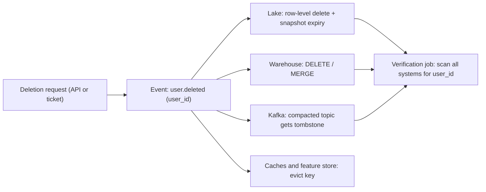

## 🎯 خلاصه

> **حذف داده در یک store غیرقابل تغییر** یعنی برداشتن داده‌ی یک نفر از سیستم‌هایی که طوری طراحی شده‌اند که مستقیماً عوض نشوند: log در Kafka، فایل‌های Parquet روی object storage، snapshotها، backupها و جدول‌های مشتق‌شده. حذف باید به هر کپی برسد، و تو باید بتوانی ثابت کنی که رسیده.

- غیرقابل‌تغییر یعنی غیرقابل‌حذف نیست. هر لایه مکانیزم خودش را دارد: **tombstone و compaction** در Kafka، **حذف ردیفی به‌علاوه‌ی expire کردن snapshot** در Iceberg یا Delta، **DELETE/MERGE** در warehouse، و **crypto-shredding** وقتی اصلاً نمی‌شود بایت‌ها را بازنویسی کرد.
- حذف وقتی تمام نیست که جدول فعال تمیز شده. snapshotهای قدیمی، پنجره‌ی time travel، backupها و replicaها تا وقتی retention خودشان تمام شود داده را نگه می‌دارند.
- آن را به‌صورت یک pipeline بساز: درخواست حذف تبدیل به یک event می‌شود، هر سیستم آن را مصرف می‌کند، هر مرحله idempotent است، و یک job تأیید بررسی می‌کند که چیزی باقی نمانده.

## 🌱 از ساده شروع کنیم (مبتدی)

> **💡 تشبیه:** یک کتابخانه که هر بار که کسی یک صفحه را ویرایش می‌کند، یک نسخه‌ی تازه از کتاب چاپ می‌کند و همه‌ی نسخه‌های قدیمی را در انباری نگه می‌دارد. اگر خواننده‌ای بخواهد یادداشت‌هایش پاک شود، نمی‌توانی فقط نسخه‌ی روی قفسه را ویرایش کنی. باید یادداشت‌ها را از همه‌ی نسخه‌های انباری هم پاک کنی، یا جعبه‌ی انباری را با کلیدی قفل کنی که بعداً دورش می‌اندازی.

نکات اصلی:

- داده در جاهای زیادی زندگی می‌کند: stream رویدادها، lake خام، جدول‌های تمیزشده، aggregateها، feature store، cache و backup.
- بیشترشان از نظر طراحی **فقط‌الحاقی (append-only)** هستند. تغییر یک ردیف یعنی بازنویسی یک فایل، یا نوشتن یک نسخه‌ی جدید که نسخه‌ی قدیمی را پنهان می‌کند.
- قوانین (مثل حق پاک‌سازی در GDPR اروپا یا CCPA در کالیفرنیا) از تو می‌خواهند داده‌ی شخصی یک نفر را در مهلت مشخصی حذف کنی و بتوانی نشان دهی که این کار انجام شده.

یک مثال کوچک. کاربر `u-42` درخواست حذف داده کرده. داده‌اش کجاست؟

```text
Kafka topic  clicks.raw         : 3 روز پیام با user_id = u-42
Lake         s3://lake/events/  : فایل‌های Parquet با user_id = u-42
Warehouse    dim_user, fact_*   : ردیف‌هایی با user_id = u-42
Aggregates   daily_country_cnt  : بدون user_id، ولی از ردیف‌های u-42 ساخته شده
```

بقیه‌ی درس این است که هر ردیف این فهرست را چطور پاک کنی، و چرا aggregate سؤالی برای حقوقی و طراحی است، نه فقط کد.

## 🔧 واقعاً چطور کار می‌کند (متوسط)

اول از خود درخواست شروع کن. نگذار هر تیم دستی حذف کند. یک event منتشر کن و بگذار هر سیستم به آن واکنش نشان دهد:



**Kafka: tombstone و compaction.** topic با `cleanup.policy=compact` فقط آخرین مقدار هر کلید را نگه می‌دارد. برای حذف یک کلید، یک **tombstone** تولید کن: همان کلید با مقدار `null`. بعد از compaction، کلید ناپدید می‌شود.

```bash
kafka-topics.sh --bootstrap-server broker:9092 --create --topic users.profile \
  --partitions 12 --config cleanup.policy=compact \
  --config delete.retention.ms=86400000
```

تولید tombstone به یک مقدار واقعی `null` نیاز دارد که بیشتر کلاینت‌ها مستقیماً پشتیبانی می‌کنند (اینجا `confluent-kafka` در Python):

```python
from confluent_kafka import Producer

p = Producer({"bootstrap.servers": "broker:9092"})
# value=None یک tombstone تولید می‌کند: کلید می‌ماند، مقدار null است
p.produce("users.profile", key=b"u-42", value=None)
p.flush()
```

سه تله:

- compaction فقط روی segmentهای بسته اجرا می‌شود. segment آخر هنوز compact نشده، پس مقدار قدیمی برای مدتی قابل خواندن است.
- خود tombstone تا `delete.retention.ms` نگه داشته می‌شود (در Apache Kafka پیش‌فرض ۲۴ ساعت است؛ برای خوشه‌ی خودت چک کن)، تا مصرف‌کننده‌ها حذف را ببینند. بعد از آن آن هم پاک می‌شود.
- یک raw topic که **compact نیست** پیام‌های اصلی را تا پایان retention نگه می‌دارد. compact کردن یک topic پروفایل، رویدادهای خام را پاک نمی‌کند. پس retention آن topic همان مهلت حذف توست.

**Lake: حذف ردیفی در فرمت‌های جدول باز.** فایل‌های Parquet غیرقابل‌تغییرند، پس حذف در [[iceberg]] سه مرحله دارد (Delta هم همین شکل را دارد):

1. **حذف:** موتور یا یک delete file می‌نویسد (merge-on-read) یا فایل‌های داده‌ی مرتبط را بازنویسی می‌کند (copy-on-write). خواننده‌ها حالا آن ردیف‌ها را رد می‌کنند.
2. **بازنویسی:** compaction فایل‌هایی را که هنوز ردیف‌ها را دارند بازنویسی می‌کند، تا بایت‌ها از snapshot فعلی واقعاً پاک شوند.
3. **انقضا:** snapshotهای قدیمی هنوز به فایل‌های قدیمی اشاره می‌کنند. آن‌ها را expire کن، بعد فایل‌های یتیم (orphan) را پاک کن.

```sql
-- Iceberg (Spark SQL). نام procedureها مثل procedureهای Spark در Iceberg است؛
-- نام آرگومان‌ها را برای نسخه‌ی Iceberg خودت چک کن.
DELETE FROM lake.events WHERE user_id = 'u-42';

CALL lake.system.rewrite_data_files(
  table => 'lake.events',
  where => 'user_id = ''u-42'''
);

CALL lake.system.expire_snapshots(
  table => 'lake.events',
  older_than => TIMESTAMP '2026-10-10 00:00:00'
);

CALL lake.system.remove_orphan_files(table => 'lake.events');
```

تا وقتی مرحله‌ی ۳ اجرا نشود، time travel می‌تواند ردیف‌های حذف‌شده را از یک snapshot قدیمی بخواند. این رفتار برای time travel درست است، و دقیقاً همان چیزی است که یک audit حذف علامت می‌زند.

**Warehouse.** `DELETE` یا `MERGE` روی جدول ردیف‌های فعال را برمی‌دارد. اگر داده‌ی کاربر در یک partition قابل شناسایی باشد، drop کردن partition ارزان‌تر است. پنجره‌ی time travel یا fail-safe خود warehouse را هم یادت باشد، چون نسخه‌های قدیمی را برای مدت ثابتی نگه می‌دارد.

**Crypto-shredding.** فیلدهای شخصی هر کاربر را با کلید مخصوص همان کاربر رمز کن، و کلید را در یک سرویس مدیریت کلید نگه دار. با حذف آن کلید، همه‌ی کپی‌ها غیرقابل‌خواندن می‌شوند: log کافکا، فایل‌های قدیمی Parquet و backupها. متن رمزشده می‌تواند برای همیشه بماند. این تنها گزینه‌ی عملی است وقتی نمی‌توانی یک آرشیو بزرگ غیرقابل‌تغییر را بازنویسی کنی.

```text
ذخیره‌شده در event:  { user_id: "u-42", email_enc: "AE9f...", key_ref: "k/u-42" }
درخواست حذف:         نابود کردن کلید k/u-42 در KMS
نتیجه:               email_enc هنوز ذخیره است ولی قابل رمزگشایی نیست
```

## 🧠 عمق و trade-offها (سنیور)

**برای هر لایه مکانیزم جدا انتخاب کن، نه یک روش برای همه.**

| لایه | گزینه‌ی سریع | گزینه‌ی سخت‌گیرانه | هزینه‌ی اصلی |
|---|---|---|---|
| raw topic در Kafka | اجازه بده retention تمام شود | crypto-shred کردن payload | طول retention مهلت توست |
| topic فشرده‌شده در Kafka | tombstone | tombstone + صبر تا `delete.retention.ms` | مصرف‌کننده‌ها باید null را هندل کنند |
| lake (Iceberg/Delta) | حذف ردیفی | حذف + بازنویسی + expire + حذف orphan | هزینه‌ی بازنویسی، سیاست snapshot |
| warehouse | `DELETE` / `MERGE` | به‌علاوه‌ی صبر برای پنجره‌ی time travel | تنظیماتی که کنترلشان نمی‌کنی |
| backup | پذیرفتن retention | crypto-shred یا عمر کوتاه backup | restore ممکن است داده را برگرداند |

**الگوی جداسازی داده‌ی شخصی.** بهترین حذف، حذفی است که هرگز مجبور نشوی بازنویسی‌اش کنی. شناسه‌ها را در یک **identity vault** کوچک و قابل‌تغییر نگه دار، و همه‌ی جدول‌های تحلیلی یک توکن تصادفی (surrogate) را ذخیره کنند، نه `user_id` یا ایمیل را. حذف کاربر یعنی حذف ردیف vault. ردیف‌های تحلیلی دیگر به یک فرد وصل نیستند، ولی هنوز وجود دارند. اینکه این ناشناس‌سازی حساب شود یا نه، تصمیم حقوقی است، نه تصمیم کد. [[data-masking]] را ببین.

**داده‌ی مشتق‌شده و aggregate.** شمارش روزانه بر اساس کشور از ردیف‌های یک کاربر ساخته می‌شود، ولی او را شناسایی نمی‌کند. سیاست را صریح تعیین کن: بعد از حذف aggregate را دوباره محاسبه کنی، یا آن را ناشناس بپذیری، یا حداقل اندازه‌ی گروه اعمال کنی (مثلاً گروه‌های کمتر از یک آستانه پنهان شوند). این تصمیم را مکتوب کن، چون در audit زیر سؤال می‌رود.

**ترتیب و همزمانی.** حذف می‌تواند با یک رویداد دیررسیده رقابت کند. یک replay از backlog کافکا می‌تواند کلیک‌های یک کاربر حذف‌شده را دوباره وارد کند. راه‌حل **deletion ledger** است: جدولی از user IDهای حذف‌شده با زمان حذف، که ingestion قبل از نوشتن آن را چک می‌کند تا رویدادهای دیررسیده‌ی کاربر حذف‌شده کنار گذاشته شوند. خود ledger باید حداقل لازم را نگه دارد، معمولاً شناسه‌ی هش‌شده و تاریخ.

**idempotency و retry.** هر مرحله باید بتواند دو بار اجرا شود: tombstone برای کلیدی که نیست بی‌ضرر است، `DELETE` بدون ردیف مطابق هیچ کاری نمی‌کند، و `expire_snapshots` را می‌شود دوباره اجرا کرد. پیشرفت را برای هر سیستم جدا ثبت کن تا مرحله‌ی شکست‌خورده بدون دخالت دستی دوباره اجرا شود. [[idempotency]] را ببین.

**تأیید.** حذف وقتی واقعی است که بتوانی نشانش دهی. با [[data-lineage]] فهرست همه‌ی جدول‌هایی را بگیر که `user_id` دارند، و بعد از هر حذف یک job اسکن اجرا کن که تعداد ردیف‌های باقی‌مانده را در همه‌ی آن‌ها بشمارد. نتیجه را برای هر درخواست گزارش کن، همراه با یک متریک مهلت: مثلاً درخواست‌هایی که بعد از ۲۵ روز هنوز باز هستند، قبل از مهلت ۳۰ روزه.

**چه چیزهایی را پایش کنی:** درخواست‌های حذف باز و سن‌شان، مرحله‌های شکست‌خورده در هر سیستم، تعداد snapshotهایی که هنوز به داده‌ی حذف‌شده اشاره می‌کنند، و نتیجه‌ی اسکن تأیید.

> **🎤 این را در مصاحبه بگو:** «من حذف را یک pipeline رویدادی با شناسه‌ی درخواست می‌سازم. هر store مکانیزم خودش را دارد: tombstone برای Kafka فشرده‌شده، حذف ردیفی به‌علاوه‌ی بازنویسی و expire کردن snapshot برای Iceberg، و crypto-shredding جایی که نمی‌توانم بایت‌ها را بازنویسی کنم. شناسه‌ها را در یک vault جدا نگه می‌دارم تا بیشتر داده هرگز بازنویسی نشود. بعد یک job تأیید ثابت می‌کند که چیزی باقی نمانده، از جمله snapshotهای قدیمی و backupها.»

## 🧪 امتحان کن

1. یک topic خام کافکا هفت روز نگه می‌دارد، و یک topic فشرده‌شده آخرین پروفایل هر کاربر را دارد. کاربری امروز درخواست حذف می‌دهد. کدام کپی‌ها فوراً می‌روند، کدام‌ها ظرف چند روز، و کدام‌ها به مکانیزم دیگری نیاز دارند؟
2. چرا `DELETE FROM lake.events` به تنهایی بایت‌های کاربر را از storage پاک نمی‌کند؟ سه مرحله‌ی بعدی را فهرست کن.
3. یک deletion ledger حداقلی برای رویدادهای دیررسیده طراحی کن. چه چیزی ذخیره می‌کنی و کجا چک می‌کنی؟

<details><summary>راه‌حل‌ها را نشان بده</summary>

**1.** کلید پروفایل بعد از compact شدن tombstone ناپدید می‌شود (زود، ولی نه فوراً) و tombstone بعد از `delete.retention.ms` پاک می‌شود. topic خام تا پایان ۷ روز پیام‌ها را نگه می‌دارد، پس ظرف یک هفته می‌رود. اگر این کند است، payload را crypto-shred کن، چون retention را نمی‌شود برای هر کاربر کوتاه کرد.

**2.** حذف فایل delete می‌نویسد یا فایل‌ها را بازنویسی می‌کند، ولی snapshotهای قدیمی هنوز به فایل‌های قدیمی داده اشاره می‌کنند و بعد از نوشتن‌های ناموفق ممکن است orphan باقی بماند. فایل‌های مرتبط را بازنویسی کن (compaction)، snapshotهای قدیمی را expire کن و بعد orphanها را حذف کن.

**3.** شناسه‌ی هش‌شده‌ی `user_id`، تاریخ حذف و شناسه‌ی درخواست را ذخیره کن. ingestion (یا merge در lake) ledger را چک می‌کند و رویدادهای کاربری که در فهرست است و بعد از زمان حذف می‌رسند را کنار می‌گذارد. ledger را کوچک نگه دار و وقتی همه‌ی منابع بالادستی از پنجره‌ی retention خودشان گذشتند، ورودی‌ها را پاک کن.

</details>

## 💬 گوشه‌ی مصاحبه

**سؤال: «چطور داده‌ی یک کاربر را در کل پلتفرم حذف می‌کنی؟»**

- **جواب متوسط:** «همه‌ی جدول‌هایی را که `user_id` دارند پیدا می‌کنم و روی هر کدام `DELETE` می‌زنم. برای topic کافکا هم tombstone می‌فرستم.»
- **جواب سنیور:** «اول با lineage همه‌ی کپی‌ها را پیدا می‌کنم، بعد درخواست را به یک event با شناسه و مهلت تبدیل می‌کنم. هر store مکانیزم خودش را دارد. topicهای فشرده‌شده‌ی Kafka tombstone می‌گیرند و بقیه به retention تکیه می‌کنند، lake حذف ردیفی به‌علاوه‌ی بازنویسی و expire کردن snapshot می‌گیرد، و آرشیوی که نمی‌توانم بازنویسی‌اش کنم را crypto-shred می‌کنم. یک job تأیید همه‌ی جدول‌ها را چک می‌کند و یک ledger رویدادهای دیررسیده‌ی کاربران حذف‌شده را کنار می‌گذارد.»

**سؤال تکمیلی:** «چرا یک ردیف بعد از حذف هنوز دیده می‌شود؟» جواب: time travel و snapshotهای قدیمی تا زمان expire شدن هنوز به فایل‌ها اشاره می‌کنند.

## ⚠️ اشتباهات رایج

> **⚠️ توجه:** `DELETE` در lake حذف بایت‌ها نیست. تا وقتی snapshotها expire و فایل‌های orphan پاک نشده‌اند، داده هنوز در storage است و از طریق time travel قابل خواندن است.

> **⚠️ توجه:** tombstone فقط روی topic فشرده‌شده کار می‌کند. فرستادنش به یک topic معمولی (با سیاست delete) برای پیام‌های خام کاری نمی‌کند.

- حذف از warehouse و فراموش کردن backupها و پنجره‌ی time travel.
- پیش‌فرض گرفتن اینکه aggregateها شخصی‌اند یا ناشناس، بدون تصمیم مکتوب.
- حذف دستی و جداگانه‌ی هر تیم، بدون شناسه‌ی درخواست و بدون تأیید.
- اجازه دادن به replay کافکا تا کاربران حذف‌شده را دوباره وارد کند، چون کسی ledger را چک نکرده.
- استفاده از salt تصادفی یا هش غیرقطعی برای vault، که باعث می‌شود نتوانی ردیف‌های کاربر را برای حذف پیدا کنی.
- باور اینکه crypto-shredding رایگان است: سرویس کلید یک وابستگی حیاتی می‌شود، و هر کپی plaintext که فراموش کرده‌ای رمز کنی هنوز آنجاست.

## ✅ خودت را بسنج

1. کدام اقدام یک کلید را از یک topic فشرده‌شده‌ی Kafka حذف می‌کند؟
   - A) تولید یک پیام با آن کلید و مقدار رشته‌ی خالی
   - B) تولید یک tombstone: کلید با مقدار `null`
   - C) تنظیم `retention.ms` روی صفر برای topic
   - D) حذف خود topic

<details><summary>جواب</summary>

**B** — مقدار `null` همان tombstone است. بعد compaction کلید را بعد از `delete.retention.ms` پاک می‌کند. رشته‌ی خالی یک مقدار معتبر است، پس کلید را حذف نمی‌کند.

</details>

2. بعد از `DELETE FROM` روی یک جدول Iceberg، یک query با time travel هنوز ردیف‌های کاربر را برمی‌گرداند. چرا؟

   - A) Iceberg نمی‌تواند ردیف حذف کند
   - B) snapshotهای قدیمی هنوز به فایل‌های داده اشاره می‌کنند؛ snapshotها را expire کن و فایل‌های orphan را حذف کن
   - C) حذف روی یک branch دیگر اجرا شده
   - D) time travel همیشه حذف‌ها را نادیده می‌گیرد

<details><summary>جواب</summary>

**B** — snapshot قدیمی یک نسخه‌ی معتبر از جدول است. فقط expire کردنش (و پاک کردن فایل‌های بدون ارجاع) باعث می‌شود بایت‌ها واقعاً ناپدید شوند.

</details>

3. **(سنیور)** یک topic خام clickstream نباید بعد از ۴۸ ساعت داده‌ی کاربر حذف‌شده را داشته باشد، ولی retention آن ۷ روز است و بین تیم‌های زیادی مشترک است. بهترین گزینه چیست؟

   - A) کوتاه کردن retention کل topic به ۴۸ ساعت
   - B) crypto-shred کردن فیلدهای شخصی کاربر، طوری که پیام‌ها بدون کلید مخصوص کاربر قابل‌خواندن نباشند
   - C) از هر مصرف‌کننده بخواهیم کپی خودش را حذف کند
   - D) topic را بر اساس کلید compact کنیم

<details><summary>جواب</summary>

**B** — retention برای کل topic تعیین می‌شود، نه برای هر کاربر؛ کوتاه کردنش بقیه‌ی تیم‌ها را خراب می‌کند. crypto-shredding پیام‌ها را بدون تغییر topic غیرقابل‌خواندن می‌کند. compaction (گزینه‌ی D) فقط مقدارهای قدیمی‌تر همان کلید را پاک می‌کند، و یک topic خام clickstream معمولاً برای این کار کلیددهی نشده.

</details>

4. **(سنیور)** چرا یک اسکن تأیید برای هر درخواست مهم است، حتی وقتی همه‌ی مراحل موفقیت گزارش داده‌اند؟

   - A) مراحل ممکن است روی جدول فعال موفق باشند، در حالی که snapshotها، backupها یا رویدادهای دیررسیده هنوز داده را دارند
   - B) اسکن حذف را سریع‌تر می‌کند
   - C) تأیید جای deletion ledger را می‌گیرد
   - D) مقررات می‌خواهند اسکن قبل از حذف اجرا شود

<details><summary>جواب</summary>

**A** — هر مرحله فقط موفقیت سیستم خودش را گزارش می‌کند. فقط یک اسکن سرتاسری روی lineage نشان می‌دهد چه چیزی باقی مانده، از جمله snapshotها، replicaها و replayها.

</details>

5. **(سنیور)** چرا بسیاری از تیم‌ها جدول‌های تحلیلی را با یک توکن surrogate ذخیره می‌کنند، نه با شناسه‌ی کاربر؟

   - A) توکن‌ها join سریع‌تری دارند
   - B) حذف نگاشت در vault، بدون بازنویسی همه‌ی جدول‌های تحلیلی، ارتباط با فرد را قطع می‌کند
   - C) Kafka توکن را الزامی کرده است
   - D) کلیدهای surrogate همیشه کوچک‌ترند

<details><summary>جواب</summary>

**B** — ردیف‌های تحلیلی سر جایشان می‌مانند، ولی دیگر نمی‌شود آن‌ها را به یک فرد وصل کرد. اینکه این کار حذف حساب شود یا نه، باید با تیم حقوقی تأیید شود.

</details>

## 🗂️ فلش‌کارت

| جلو | پشت |
|---|---|
| tombstone در Kafka | پیامی با کلید و مقدار `null`؛ compaction کلید را حذف می‌کند |
| `delete.retention.ms` | مدت نگه‌داشتن tombstone تا مصرف‌کننده‌ها حذف را ببینند |
| چرا compaction فوری نیست | فقط روی segmentهای بسته اجرا می‌شود، پس آخرین مقدارها برای مدتی قابل‌خواندن می‌مانند |
| سه مرحله‌ی lake بعد از حذف ردیف | بازنویسی فایل‌های مرتبط، expire کردن snapshotهای قدیمی، حذف فایل‌های orphan |
| crypto-shredding | رمزگذاری به‌ازای هر کاربر و نابودی کلید برای غیرقابل‌خواندن کردن همه‌ی کپی‌ها |
| identity vault | جدول کوچک و قابل‌تغییر که شناسه‌ها را به توکن surrogate نگاشت می‌کند؛ حذفش ارتباط را قطع می‌کند |
| deletion ledger | شناسه‌ها و تاریخ حذف را نگه می‌دارد تا رویدادهای دیررسیده یا replay شده‌ی آن‌ها کنار گذاشته شوند |
| چرا بعد از حذف تأیید کنیم | هر سیستم فقط موفقیت خودش را گزارش می‌کند؛ فقط یک اسکن سرتاسری نشان می‌دهد چه مانده |

## 🔗 ادامه

- [[design-user-deletion]] طراحی کامل پلتفرم برای یک درخواست حذف را بررسی می‌کند.
- [[data-retention]] و [[data-security]] قواعد retention و دسترسی را توضیح می‌دهند که مهلت‌ها را تعیین می‌کنند.
- [[data-lineage]] راهی است برای پیدا کردن همه‌ی کپی‌ها قبل از حذف.
- [[lakehouse-table-formats]] و [[pattern-dedup]] مکانیک snapshot و dedup را پوشش می‌دهند که اینجا استفاده شده.
- [[kafka-retention-compaction]] جزئیات بیشتری درباره‌ی تنظیمات compaction و retention دارد.
