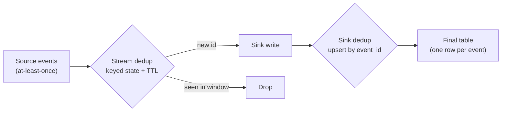

## 🎯 خلاصه

> **حذف تکرار در مقیاس بزرگ** یعنی رویدادهایی را که بیش از یک بار رسیده‌اند حذف کنی؛ وقتی همان رویداد می‌تواند با retry، replay یا تحویل at-least-once دوباره فرستاده شود، و جریان آن‌قدر بزرگ است که نمی‌شود همه‌ی رویدادها را برای همیشه به خاطر سپرد.

- تکرار طبیعی است. producerها retry می‌کنند، brokerها دوباره تحویل می‌دهند، و jobها بعد از خطا replay می‌شوند. dedup یک نیازمندی طراحی است، نه رفع یک باگ.
- سه جا می‌تواند این کار را انجام دهد: **داخل stream** (با state و پنجره‌ی TTL)، **به‌صورت احتمالاتی** (یک Bloom filter به‌عنوان پیش‌بررسی ارزان)، و **در sink** (upsert یا کلیدهایی مثل `ReplacingMergeTree`).
- هر گزینه بین **دقت** (بدون تکرار و بدون حذف اشتباه) و **حافظه و هزینه** معامله می‌کند. پنجره‌ی TTL فقط برای تکرارهایی دقیق است که داخل پنجره برسند.

## 🌱 از ساده شروع کنیم (مبتدی)

> **💡 تشبیه:** یک دفتر ثبت‌نام مدرسه به هر درخواست یک شماره‌ی فرم می‌دهد. اگر همان فرم دو بار پست شود، مسئول دفتر فهرست شماره‌فرم‌های قبلاً پردازش‌شده را نگاه می‌کند و نسخه‌ی دوم را دور می‌اندازد. اما این فهرست نمی‌تواند بی‌نهایت بزرگ شود، پس فقط فرم‌های یک ماه اخیر را نگه می‌دارد. فرمی که دو ماه دیرتر برسد دوباره پردازش می‌شود، چون فهرست دیگر آن را به یاد ندارد.

تصویر کل مسئله:

- هر رویداد یک **شناسه‌ی یکتا** دارد (همان شماره‌ی فرم).
- مجموعه‌ای از شناسه‌هایی که دیده‌ای نگه می‌داری.
- وقتی شناسه از قبل در مجموعه است، رویداد را دور بینداز.
- مجموعه حافظه می‌خواهد، پس شناسه‌های قدیمی را **منقضی** می‌کنی. انقضا منبع خطاست.

یک مثال کوچک: همان رویداد پرداخت دو بار می‌رسد چون producer بعد از timeout دوباره فرستاده است.

```text
event_id  amount  arrival
p-1001    500     10:00:01
p-1001    500     10:00:03   <- retry, same event_id: must be dropped
p-1002    200     10:00:04
```

اگر بدون dedup مبلغ‌ها را جمع بزنی، مجموع ۱۲۰۰ می‌شود نه ۷۰۰. بقیه‌ی این درس درباره‌ی این است که `p-1001` دوم را حذف کنی، ولی حافظه را محدود نگه داری.

## 🔧 واقعاً چطور کار می‌کند (متوسط)

سه لایه وجود دارد، و یک سیستم واقعی معمولاً بیش از یکی را استفاده می‌کند.



### لایه‌ی ۱: dedup با state داخل stream

پردازشگر یک **keyed state** از شناسه‌های رویدادهای دیده‌شده در یک پنجره‌ی زمانی نگه می‌دارد. اولین رویداد با شناسه‌ی جدید عبور می‌کند. رویدادهای بعدی با همان شناسه حذف می‌شوند. یک **TTL** (زمان زندگی) یا یک **watermark** شناسه‌های قدیمی‌تر از پنجره را پاک می‌کند، پس state محدود می‌ماند.

موتور state را مدیریت می‌کند، ولی قواعد با توست:

- **کلید** چیست؟ شناسه‌ای را بگیر که producer یک بار تعیین می‌کند و در retry دوباره نمی‌سازد.
- **پنجره** چقدر باشد؟ باید از طولانی‌ترین فاصله‌ی بین یک تکرار و اصلش بلندتر باشد.
- بعد از اینکه پنجره‌ی یک رویداد تمام شد چه می‌شود؟ عبور می‌کند، و ممکن است تکراری باشد که نمی‌توانی تشخیصش دهی.

منطق را به زبان ساده‌ی Python ببین تا مصالحه‌ی حافظه‌ی محدود را مستقیم بفهمی:

```python
import heapq

class TtlDeduper:
    """Exact dedup for duplicates that arrive within `ttl` of event time."""

    def __init__(self, ttl):
        self.ttl = ttl
        self.seen = {}   # event_id -> event_time
        self.heap = []   # (event_time, event_id), used to expire old ids
        self.max_time = float("-inf")

    def offer(self, event_id, event_time):
        """Return True if the event should be emitted."""
        self.max_time = max(self.max_time, event_time)
        horizon = self.max_time - self.ttl
        while self.heap and self.heap[0][0] < horizon:  # expire state
            t, old_id = heapq.heappop(self.heap)
            if self.seen.get(old_id) == t:
                del self.seen[old_id]
        if event_id in self.seen:
            return False        # duplicate inside the window: drop
        if event_time < horizon:
            return True         # too late: no state left, cannot prove duplicate
        self.seen[event_id] = event_time
        heapq.heappush(self.heap, (event_time, event_id))
        return True

d = TtlDeduper(ttl=10)
events = [("A", 1), ("B", 2), ("A", 3), ("C", 20), ("A", 4), ("C", 21), ("A", 5)]
emitted = [(e, t) for (e, t) in events if d.offer(e, t)]
print(emitted)
# [('A', 1), ('B', 2), ('C', 20), ('A', 4), ('A', 5)]
```

`A` دوم در زمان ۳ حذف می‌شود، چون `A` هنوز در پنجره است. `A` در زمان‌های ۴ و ۵ عبور می‌کنند، چون تا آن موقع state مربوط به `A` منقضی شده و کد نمی‌تواند ثابت کند که تکراری‌اند. این مصالحه‌ی اصلی است: پنجره حافظه را محدود می‌کند، و همان‌جا صحت را هم محدود می‌کند.

در Flink، این یک `ValueState` کلیددار یا یک operator داخلی dedup با TTL روی state است. در Spark Structured Streaming معادلش `dropDuplicatesWithinWatermark` است (نام گزینه‌ها را برای نسخه‌ی خودت بررسی کن). اصل یکی است: state با watermark محدود می‌شود، نه با سن کل جریان.

### لایه‌ی ۲: فیلتر Bloom به‌عنوان بررسی اولیه‌ی ارزان

**فیلتر Bloom** یک آرایه‌ی بیتی با چند تابع hash است. اضافه‌کردن یک شناسه، چند بیت را روشن می‌کند. بررسی یک شناسه می‌پرسد آیا همه‌ی بیت‌هایش روشن‌اند.

- اگر جواب **نه** باشد، شناسه قطعاً دیده نشده. رویداد را عبور بده.
- اگر جواب **بله** باشد، شناسه احتمالاً دیده شده. ممکن است مثبت کاذب باشد.

حافظه کم است. برای نرخ مثبت کاذب `p`، تعداد بیت به ازای هر عنصر `-ln(p) / (ln 2)^2` است، یعنی حدود ۹٫۶ بیت برای `p = 1%`. مثال: ۱۸۰ میلیون شناسه (یک ساعت با ۵۰ هزار رویداد در ثانیه) به ۱۸۰٬۰۰۰٬۰۰۰ × ۹٫۶ ≈ ۱٫۷ × ۱۰⁹ بیت ≈ ۲۱۶ مگابایت نیاز دارد، در حالی که یک مجموعه‌ی دقیق از شناسه‌های ۱۶ بایتی با سربار می‌تواند چند گیگابایت شود.

تله‌اش این است: یک مثبت کاذب **یک رویداد جدید واقعی را حذف می‌کند**. پس Bloom filter به‌تنهایی فقط وقتی امن است که از دست دادن کسر کوچکی از رویدادهای جدید قابل قبول باشد (مثلاً تحلیل تقریبی)، یا وقتی «بله» با یک جست‌وجوی دقیق در sink تأیید شود. آن را به‌عنوان پیش‌فیلتر جلوی یک store دقیق استفاده کن، نه تنها بررسی برای پول.

### لایه‌ی ۳: dedup در sink

قوی‌ترین گزینه این است که **sink را idempotent** کنی: جدول برای هر شناسه‌ی رویداد یک ردیف دارد، و نوشتن دوم همان ردیف را به‌روز می‌کند.

```sql
-- Iceberg / Delta / Spark: merge a micro-batch by event_id
MERGE INTO warehouse.payments AS t
USING (
  SELECT * FROM (
    SELECT p.*, ROW_NUMBER() OVER (PARTITION BY p.event_id ORDER BY p.received_at DESC) AS rn
    FROM payments_batch AS p
  ) AS ranked
  WHERE rn = 1
) AS s
ON t.event_id = s.event_id
WHEN NOT MATCHED THEN INSERT *;
```

دو چیز این را درست می‌کند. کوئری داخلی تکرارها را **داخل خود batch** حذف می‌کند (همان شناسه می‌تواند دو بار داخل یک micro-batch باشد). بند `WHEN NOT MATCHED` باعث می‌شود جدول برای هر شناسه، اولین ردیف را بین batchها نگه دارد. برای داده‌ای که ممکن است تغییر کند، به‌جای آن از `WHEN MATCHED` با guard نسخه استفاده کن.

`ReplacingMergeTree` در ClickHouse و جدول های primary-key در StarRocks در سطح ذخیره‌سازی همین کار را می‌کنند: ردیف‌های با کلید یکسان جایگزین می‌شوند، ولی این جایگزینی در merge های پس‌زمینه یا هنگام خواندن رخ می‌دهد، پس کوئری ممکن است برای دیدن نمای بدون تکرار به `FINAL` یا یک aggregation نیاز داشته باشد.

## 🧠 عمق و trade-offها (سنیور)

**لایه را بر اساس هزینه‌ی جواب اشتباه انتخاب کن.** لایه‌ها در تضمینی که می‌دهند فرق دارند:

| گزینه | حافظه | دقت | حالت خرابی | مناسب برای |
|---|---|---|---|---|
| TTL state داخل stream | متناسب با رویدادها در هر پنجره | دقیق داخل پنجره | تکرار بعد از پنجره؛ رشد حافظه اگر کلیدها بی‌کران باشند | هشدار و شمارش بلادرنگ با تأخیر بیشینه‌ی معلوم |
| فیلتر Bloom | کوچک و ثابت | هیچ تکراری را از دست نمی‌دهد؛ رویدادهای جدید را با نرخ `p` حذف می‌کند | از دست رفتن رویدادهای جدید | پیش‌فیلتر، متریک‌های تقریبی |
| upsert در sink با کلید | خود ذخیره‌سازی جدول | دقیق، با سازگاری نهایی بعد از merge | هزینه‌ی نوشتن اضافه؛ تکرار هنگام کوئری قبل از merge | جدول های مالی و موجودی |
| `ROW_NUMBER` در batch | حافظه‌ی shuffle در batch | دقیق روی batch | تکرار بین batchها اگر merge نشود | بارهای روزانه و backfill |

**پنجره را با عدد اندازه بگیر، نه حدس.** مثال: ۵۰ هزار رویداد در ثانیه، و retryهایی که تا ۱ ساعت دیر می‌رسند. پنجره باید ۳٬۶۰۰ × ۵۰٬۰۰۰ = ۱۸۰ میلیون شناسه را پوشش دهد. با یک شناسه‌ی ۱۶ بایتی و یک hash map با حدود ۵۰ بایت به ازای هر ورودی (اشیای JVM، اشاره‌گرها و bucketها)، این یعنی ۱۸۰ × ۱۰⁶ × ۵۰ ≈ ۹ گیگابایت state برای هر job، پخش‌شده روی taskهای موازی. یک نمایش فشرده یا پیش‌فیلتر Bloom این را کم می‌کند، ولی تضمین را هم عوض می‌کند. اندازه‌ی state را با تعداد کلید نزدیک به production در یک تست بسنج، قبل از اینکه پنجره را قطعی کنی.

**طراحی واقعی روی کلید است.** dedup فقط وقتی کار می‌کند که تکرارها کلید مشترک داشته باشند. تله‌های رایج:

- producer برای هر retry یک UUID تازه می‌سازد. هر نسخه «یکتا» است و چیزی حذف نمی‌شود. راه‌حل: شناسه را یک بار برای هر رویداد کسب‌وکار، قبل از اولین ارسال بساز.
- دو منبع مختلف همان رویداد کسب‌وکار را با شناسه‌های متفاوت می‌فرستند (مثلاً یک کلیک وب و یک retry موبایل). dedup فنی آن را نمی‌بیند. به یک قانون کسب‌وکاری مثل `(user_id, order_id, event_type)` با پنجره‌ی مستند نیاز داری.
- یک backfill که replay می‌شود شناسه‌ها را دوباره می‌سازد. شناسه‌ی اصلی منبع را در رکورد نگه دار.

**ترتیب و داده‌ی دیررس.** تکراری که بعد از پنجره می‌رسد اصلی‌ترین منبع نشت است. پنجره را با توزیع تأخیر اندازه‌گیری‌شده‌ات مقایسه کن (صدک ۹۹ فاصله‌ی زمان رویداد تا زمان رسیدن)، نه با میانگین. اگر p99 برابر ۴۰ دقیقه باشد و پنجره‌ات ۱۰ دقیقه، حدود ۱٪ تکراری‌ها ممکن است نشت کنند. dedup داخل stream را با dedup در sink ترکیب کن، تا نشت‌ها در انتهای مسیر حذف شوند.

**مانیتورینگ:**

- نرخ تکرار به تفکیک منبع و ساعت (تعداد رویدادهای حذف‌شده تقسیم بر کل). افزایش ناگهانی یعنی طوفان retry در producer.
- اندازه‌ی state و رشد آن در هر job، و زمان بازیابی آن بعد از خطا.
- تعداد رویدادهایی که به‌عنوان «دیرهنگام» عبور کرده‌اند (پنجره نتوانسته تکراری بودنشان را ثابت کند).
- reconciliation: شناسه‌های یکتا در sink در برابر شناسه‌های یکتا در منبع برای هر ساعت. شکاف یعنی از دست رفتن، و شمارش بالاتر از تعداد شناسه‌های یکتا یعنی تکرار به sink رسیده.

**کی اصلاً dedup داخل stream لازم نیست.** اگر مصرف‌کننده تکرار را تحمل می‌کند و یک batch بعدی آن را حذف می‌کند، state گران را لازم نداری. یک `ROW_NUMBER` روزانه روی جدول lake ارزان‌تر اجرا می‌شود و راحت‌تر فهمیده می‌شود، و حتی برای تأخیرهای طولانی درست است. dedup بلادرنگ فقط وقتی هزینه‌اش را می‌ارزد که تکرارها قبل از اجرای batch به کاربر، پرداخت یا هشدار برسند.

**لایه‌ها را ترکیب کن.** یک طراحی سنیور رایج: producer شناسه‌ی پایدار تعیین می‌کند، stream پنجره‌ای TTL دارد که صدک ۹۹ retryها را پوشش می‌دهد، یک Bloom filter یا cache کلید بار را جذب می‌کند، و sink یک کلید primary دارد تا هر چیزی که نشت کرده حذف شود. هر لایه ارزان است و ترکیبشان نرخ تکرار را کوچک و قابل اندازه‌گیری می‌کند.

## 🧪 امتحان کن

۱. کد `TtlDeduper` را اجرا کن. قبل از اجرا، لیست خروجی را پیش‌بینی کن.
۲. `ttl` را از `10` به `50` تغییر بده. پیش‌بینی کن کدام رویدادهای دیرهنگام `A` حالا حذف می‌شوند.
۳. یک dedup ساده‌ی batch به شیوه‌ی `ROW_NUMBER` در Python بنویس: با لیستی از تاپل‌های `(event_id, received_at)`، برای هر `event_id` یک تاپل برگردان که `received_at` آخر را نگه می‌دارد.

<details>
<summary>حدس تو؟</summary>

۱. خروجی `[('A', 1), ('B', 2), ('C', 20), ('A', 4), ('A', 5)]` است. `A` دوم در زمان ۳ حذف می‌شود؛ رویدادهای `A` در زمان‌های ۴ و ۵ نشت می‌کنند چون state‌شان منقضی شده.

۲. با `ttl=50` در این توالی کوتاه چیزی منقضی نمی‌شود (مرز هیچ‌وقت از ۱ بالاتر نمی‌رود). `A` در زمان ۳ حذف می‌شود، و `A`های بعدی در زمان‌های ۴ و ۵ هم حذف می‌شوند چون `A` هنوز در state است. پنجره باید تأخیر واقعی retryها را پوشش دهد.

۳. یک پاسخ ساده:

```python
def latest_per_id(rows):
    best = {}
    for event_id, received_at in rows:
        if event_id not in best or received_at > best[event_id][1]:
            best[event_id] = (event_id, received_at)
    return list(best.values())
```

</details>

## 💬 گوشه‌ی مصاحبه

> **🎤 این را در مصاحبه بگو:** «با تحویل at-least-once تکرار اجتناب‌ناپذیر است، پس در سه نقطه برایش طراحی می‌کنم. داخل stream، state کلیددار را برای پنجره‌ی retry مورد انتظار نگه می‌دارم و با watermark منقضی‌اش می‌کنم. در sink، نوشتن را با primary key یا `MERGE` روی شناسه‌ی رویداد idempotent می‌کنم. پنجره را از صدک تأخیر اندازه‌گیری‌شده محاسبه می‌کنم و نرخ تکرار و اندازه‌ی state را مانیتور می‌کنم، چون پنجره همان جایی است که دقت و هزینه به هم می‌رسند.»

**این چطور پرسیده می‌شود:** «میلیاردها رویداد در روز را dedup کن» یا «چطور تکرارها را از یک stream با حافظه‌ی محدود حذف می‌کنی؟»

- **پاسخ مبتدی:** «از `DISTINCT` استفاده کن.» روی stream کار نمی‌کند، چون مجموعه‌ی شناسه‌های دیده‌شده بی‌کران رشد می‌کند.
- **پاسخ متوسط:** «یک مجموعه از شناسه‌ها را در state با TTL نگه می‌دارم و اگر شناسه در مجموعه بود رویداد را حذف می‌کنم.» درست است و مصالحه را نام می‌برد، ولی نمی‌گوید پنجره را چطور اندازه بگیری یا با تکرارهای دیرهنگام چه کنی.
- **پاسخ سنیور:** سه لایه را توضیح می‌دهد، پنجره را با تأخیر اندازه‌گیری‌شده و تخمین state محاسبه می‌کند، طراحی کلید (شناسه‌ی پایدار که producer تعیین می‌کند) را نام می‌برد، نرخ نشت قابل قبول را مستند می‌کند، و یک بررسی reconciliation در sink دارد.

**پاسخ نمونه (۳ تا ۵ جمله):** با تحویل at-least-once تکرار انتظار می‌رود، پس آن را در چند لایه حذف می‌کنم. producer یک بار شناسه‌ی پایدار برای رویداد می‌سازد، stream برای پنجره‌ای که صدک ۹۹ تأخیر retry را پوشش می‌دهد state کلیددار نگه می‌دارد، و state با watermark منقضی می‌شود تا حافظه محدود بماند. sink یک ردیف برای هر شناسه‌ی رویداد دارد، با primary key یا `MERGE`، پس هر چیزی که از پنجره گذشته حذف می‌شود. نرخ تکرار، اندازه‌ی state و reconciliation ساعتی بین شناسه‌های یکتا در منبع و sink را مانیتور می‌کنم.

## ⚠️ اشتباهات رایج

- **استفاده از `DISTINCT` یا مجموعه‌ی بی‌کران روی stream.** حافظه تا خرابی job رشد می‌کند. state را همیشه با TTL یا watermark محدود کن.
- **ساختن شناسه‌ی جدید در هر retry.** کلید dedup باید برای هر رویداد کسب‌وکار یک بار ساخته شود.
- **اندازه‌گیری پنجره از روی میانگین تأخیر.** دُم توزیع (p99) تعیین می‌کند چند تکراری نشت می‌کند.
- **اعتماد صرف به Bloom filter برای پول.** یک مثبت کاذب، یک رویداد واقعی را بی‌صدا حذف می‌کند.
- **dedup فقط در stream.** تکرارهای دیرهنگام و replayها به کلید در sink نیاز دارند.
- **فراموش کردن تکرار داخل یک batch.** یک `MERGE` با دو ردیف منبع برای یک کلید یا شکست می‌خورد یا یکی را تصادفی انتخاب می‌کند، مگر اینکه صریح انتخاب کنی (مثلاً با `ROW_NUMBER`).
- **فرض اینکه `ReplacingMergeTree` لحظه‌ای است.** dedup هنگام merge رخ می‌دهد؛ کوئری‌ها برای دیدن ردیف‌های نهایی به `FINAL` یا aggregation نیاز دارند.
- **نادیده گرفتن تکرار کسب‌وکاری.** دو شناسه‌ی متفاوت برای یک سفارش تکرار فنی نیستند. قانون کلید کسب‌وکار لازم است.

## ✅ خودت را بسنج

۱. چرا dedup کننده‌ی stream به TTL یا watermark نیاز دارد؟
   - A) تا رویدادها به ترتیب برسند
   - B) تا حافظه‌ی مجموعه‌ی شناسه‌های دیده‌شده محدود بماند
   - C) تا شناسه‌های رویداد رمزنگاری شوند
   - D) تا شبکه سریع‌تر شود

<details>
<summary>پاسخ</summary>

**B** — مجموعه‌ی شناسه‌های دیده‌شده بدون انقضا برای همیشه رشد می‌کند. TTL یا watermark شناسه‌های قدیمی را پاک می‌کند تا state محدود بماند، به قیمت از دست دادن تکرارهایی که بعد از انقضا می‌رسند.

</details>

۲. یک رویداد پرداخت بعد از timeout توسط producer دوباره فرستاده می‌شود، و retry یک UUID تازه دارد. کدام تغییر تکرارها را در منبع رفع می‌کند؟
   - A) افزایش پنجره به ۲۴ ساعت
   - B) ساخت شناسه‌ی رویداد یک بار برای هر رویداد کسب‌وکار و استفاده‌ی مجدد در retry
   - C) استفاده از فیلتر Bloom
   - D) تغییر به یک message broker دیگر

<details>
<summary>پاسخ</summary>

**B** — UUID تازه برای هر تلاش باعث می‌شود هر نسخه یکتا به نظر برسد، پس هیچ لایه‌ی dedup نمی‌تواند آن‌ها را تطبیق دهد. شناسه باید بین retryها پایدار باشد.

</details>

۳. برای یک جدول مالی به dedup دقیق نیاز داری، و پنجره نمی‌تواند همه‌ی retryها را پوشش دهد. از چه چیزی استفاده می‌کنی؟
   - A) یک Bloom filter با ۰٫۱٪ مثبت کاذب
   - B) یک جدول sink با کلید شناسه‌ی پایدار رویداد، با upsert یا `MERGE`، به‌علاوه‌ی dedup در stream برای حالت رایج
   - C) یک `LIMIT 1` در کوئری
   - D) هیچ‌چیز؛ تکرار در امور مالی را بپذیر

<details>
<summary>پاسخ</summary>

**B** — primary key یا `MERGE` روی شناسه‌ی پایدار، تکرارها را بدون توجه به زمان رسیدنشان حذف می‌کند، پس نشت‌های پنجره را هم پوشش می‌دهد. Bloom filter می‌تواند پرداخت‌های واقعی را حذف کند، که برای پول قابل قبول نیست.

</details>

۴. **(سنیور)** صدک ۹۹ فاصله‌ی بین زمان رویداد و زمان رسیدن ۴۰ دقیقه است. تیم یک پنجره‌ی ۱۰ دقیقه‌ای را «برای صرفه‌جویی در حافظه» تعیین می‌کند. چه اتفاقی می‌افتد و چطور تصمیم می‌گیری؟
   - A) هیچ؛ ۱۰ دقیقه تقریباً همه‌ی رویدادها را پوشش می‌دهد
   - B) حدود ۱٪ از تکرارهای retry از پنجره نشت می‌کنند و به sink می‌رسند؛ با مقایسه‌ی هزینه‌ی state پنجره‌ی ۴۰ دقیقه‌ای (تخمین حافظه) با هزینه‌ی تکرارهای نشت‌کرده تصمیم بگیر، و برای باقی‌مانده یک کلید در sink اضافه کن
   - C) پنجره باید دقیقاً ۴۰ دقیقه باشد وگرنه job شکست می‌خورد
   - D) sink خودکار همه‌ی تکرارها را حذف می‌کند

<details>
<summary>پاسخ</summary>

**B** — پنجره باید دُم توزیع تأخیر را پوشش دهد، و p99 یک مقدار دُم است. تکرارهای نشت‌کرده هزینه‌ی یک پنجره‌ی کوتاه‌اند، پس تصمیم یک مصالحه‌ی اندازه‌گیری‌شده است: حافظه برای پنجره‌ی بلندتر در برابر نرخ نشت، با یک کلید در sink به‌عنوان تور ایمنی.

</details>

۵. **(سنیور)** یک dedup روزانه‌ی batch با `ROW_NUMBER` را با dedup بلادرنگ داخل stream برای یک جدول lake مقایسه کن. کدام را انتخاب می‌کنی و چرا؟
   - A) dedup داخل stream، چون همیشه دقیق‌تر است
   - B) dedup batch برای جدول های تحلیلی که تأخیر در آن‌ها قابل قبول است، چون روی کل ورودی batch دقیق است، ارزان است و با پنجره محدود نمی‌شود؛ dedup داخل stream فقط جایی که تکرار پیش از اجرای batch به کاربر یا پول می‌رسد
   - C) dedup batch، چون اصلاً به حافظه نیاز ندارد
   - D) هیچ‌کدام؛ تکرار برای تحلیل اهمیتی ندارد

<details>
<summary>پاسخ</summary>

**B** — dedup batch روی ورودی خودش بدون پنجره‌ی زمانی دقیق است و نیازی به state همیشه‌روشن ندارد. dedup stream هزینه و محدودیت دقت وابسته به پنجره اضافه می‌کند، پس فقط وقتی استفاده کن که تأخیر تکرارها برای کاربر یا پرداخت مهم باشد.

</details>

## 🗂️ فلش‌کارت

| Front | Back |
|---|---|
| چرا تکرار رخ می‌دهد | تحویل at-least-once، retry توسط producer، و replay یک job |
| قانون کلید dedup | شناسه را برای هر رویداد کسب‌وکار یک بار بساز؛ در retry دوباره نساز |
| چرا state به TTL یا watermark نیاز دارد | بدون انقضا، مجموعه‌ی شناسه‌ها بی‌کران رشد می‌کند |
| چه چیزی پنجره‌ی TTL نمی‌تواند بگیرد | تکرارهایی که بعد از انقضای پنجره می‌رسند |
| پاسخ «نه» در Bloom filter | قطعاً دیده نشده؛ رویداد را عبور بده |
| پاسخ «بله» در Bloom filter | احتمالاً دیده شده؛ مثبت کاذب یک رویداد واقعی را حذف می‌کند |
| بیت به ازای هر عنصر برای ۱٪ مثبت کاذب | حدود ۹٫۶ بیت |
| dedup در sink برای نشت‌ها | primary key یا `MERGE` روی شناسه‌ی پایدار رویداد |
| الگوی dedup در batch | `ROW_NUMBER() OVER (PARTITION BY event_id ORDER BY received_at DESC)` و نگه داشتن `rn = 1` |

## 🔗 ادامه

- [[dedup-idempotent-loads]] جزئیات سمت sink را پوشش می‌دهد: جدول‌های primary-key، `ReplacingMergeTree` و load های idempotent.
- [[pattern-exactly-once]] توضیح می‌دهد چرا dedup کننده بخشی از یک تضمین انتها-به-انتها است، نه جایگزین آن.
- [[pattern-late-data]] نشان می‌دهد watermark و allowed lateness تعیین می‌کنند یک پنجره هنوز چه چیزی را می‌بیند.
- [[pattern-cdc-analytics]] ایده‌های کلید و guard نسخه را برای جریان‌های تغییر به کار می‌برد.
- [[bloom-filter]] و [[deduplication]] (واژه‌نامه) اصطلاح‌های استفاده‌شده در این درس را تعریف می‌کنند.
- [[streaming-state]] توضیح می‌دهد state کلیددار چطور ذخیره، checkpoint و محدود می‌شود.
