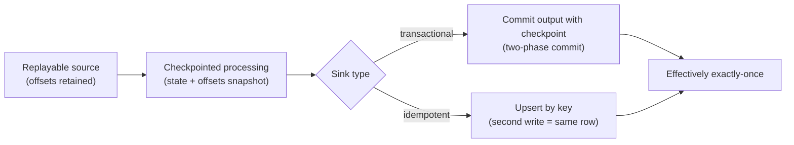
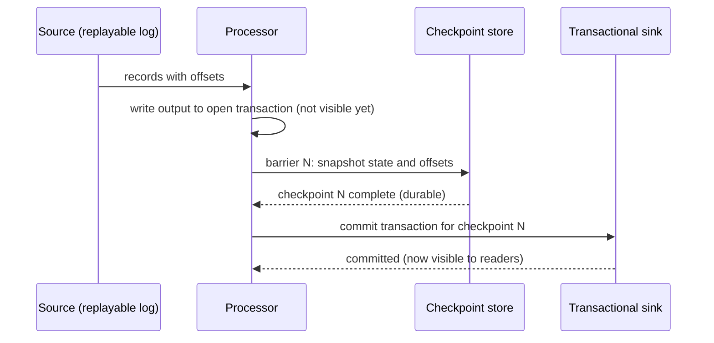

## 🎯 خلاصه

> **exactly-once انتها-به-انتها** یعنی نتیجه‌ی نهایی در sink همان چیزی باشد که وقتی هر رویداد ورودی دقیقاً یک بار پردازش شده، می‌شد؛ حتی اگر ماشین‌ها کرش کنند و کار دوباره اجرا شود.

- هیچ سیستمی این تضمین را «رایگان» نمی‌دهد. آن را از سه بخش می‌سازی: یک **منبع replayable**، **پردازش با checkpoint**، و یک **sink تراکنشی یا idempotent**.
- هر بخش به‌تنهایی کافی نیست. یک پردازشگر تراکنشی که در یک دیتابیس غیرتراکنشی می‌نویسد، بعد از کرش باز هم تکرار تولید می‌کند.
- قاعده‌ی عملی: منبع می‌تواند دوباره بفرستد، پردازشگر می‌تواند دوباره اجرا شود، و sink می‌تواند یک نوشتن دوباره را بدون تغییر نتیجه جذب کند.

## 🌱 از ساده شروع کنیم (مبتدی)

> **💡 تشبیه:** یک کارمند بانک را تصور کن که لیست انتقال‌ها را می‌خواند و دفتر کل را به‌روز می‌کند. ممکن است وسط کار قطع شود. برای جلوگیری از انتقال دوباره، او همراه هر انتقال یک نشانه‌گذار می‌نویسد («ردیف ۴۱ را تمام کردم») و آن را در **همان تراکنش دفتر کل** ثبت می‌کند. بعد از قطع شدن، از همان نشانه‌گذار ادامه می‌دهد. انتقال و نشانه‌گذار یا با هم انجام می‌شوند یا با هم انجام نمی‌شوند.

این کل الگو در یک تصویر است. حالا اصطلاح‌ها:

- **at-least-once:** هر رویداد یک بار یا بیشتر پردازش می‌شود. چیزی گم نمی‌شود، ولی بعد از retry تکرار پیش می‌آید.
- **exactly-once (در عمل):** *نتیجه‌ای که دیده می‌شود* طوری است که انگار هر رویداد یک بار پردازش شده. در داخل ممکن است رویداد دوبار پردازش شده باشد؛ ولی sink کاری می‌کند که بار دوم ضرری نداشته باشد.

یک مثال کوچک. رویدادها در یک log می‌رسند و هرکدام یک موقعیت (**offset**) دارند:

```text
offset  event
0       ali  +10
1       sara +5
2       ali  +7
3       reza +3
```

اگر مبلغ‌ها را جمع بزنیم و پروسه بعد از اضافه‌کردن offset 2 ولی قبل از ثبت «من به offset 3 رسیده‌ام» کرش کند، بعد از راه‌اندازی مجدد، offset 2 دوباره خوانده می‌شود و 7 دو بار جمع می‌شود. این مشکل تکرار است. راه‌حل این است که «جمع‌زدن مبلغ» و «ثبت offset» یک مرحله‌ی اتمیک باشند. کدی که در بخش **امتحان کن** می‌بینی همین کار را می‌کند.

## 🔧 واقعاً چطور کار می‌کند (متوسط)

سه تضمین مستقل را در نظر بگیر. نتیجه‌ی انتها-به-انتها فقط به اندازه‌ی ضعیف‌ترین آن‌ها قوی است.

| بخش | چه چیزی باید تضمین کند | پیاده‌سازی معمول |
|---|---|---|
| منبع | بعد از خطا بتوانی همان ورودی را **دوباره** بخوانی | offset های Kafka، یک CDC log با موقعیت، فایل‌ها در object storage با manifest |
| پردازش | بتوانی state و موقعیت ورودی را از **همان** snapshot بازیابی کنی | checkpoint های Flink، پوشه‌ی checkpoint در Spark Structured Streaming، جدول offset خودت |
| sink | نوشتن دوباره‌ی همان نتیجه، خروجی را عوض نکند | تراکنش با commit روی checkpoint (2PC)، upsert با کلید اصلی، `MERGE`، overwrite یک partition |



### checkpoint و sink باید هماهنگ باشند

یک checkpoint در لحظه‌ی واحد دو چیز را ثبت می‌کند: **state** عملگرها (مثلاً جمع‌های در حال اجرا) و **موقعیت ورودی** (offset ها). اگر این دو با هم ذخیره شوند، بعد از راه‌اندازی مجدد هر دو به یک نقطه برمی‌گردند و پردازشگر فقط ورودی‌هایی را دوباره اجرا می‌کند که هنوز در state منعکس نشده‌اند.

با یک sink تراکنشی، خروجی‌ای که از آخرین checkpoint تولید شده در یک تراکنش نوشته می‌شود که **فقط بعد از موفقیت checkpoint commit می‌شود**. کرش قبل از این commit خروجی uncommitted را دور می‌ریزد و replay دوباره تولیدش می‌کند. لحظه‌ی commit مرز بین «انجام شده» و «انجام نشده» است.



اگر job قبل از commit کرش کند، خوانندگان هرگز خروجی را ندیده‌اند. اگر بعد از commit ولی قبل از checkpoint بعدی کرش کند، راه‌اندازی مجدد checkpoint N را برمی‌گرداند و ورودی بعد از آن را replay می‌کند. این replay خروجی جدید می‌نویسد و لاگ تراکنش sink تشخیص می‌دهد که تلاش قبلی قبلاً commit شده و نباید تکرار شود. همین مرحله است که نشان می‌دهد sink باید برای آن طراحی شده باشد، نه فقط اسمش «تراکنشی» باشد.

### جایگزین: sink های idempotent

اگر sink نمی‌تواند با پردازشگر در یک تراکنش شرکت کند (بسیاری از دیتابیس‌های OLTP، APIهای HTTP، یا یک جدول تحلیلی که با `MERGE` به‌روز می‌شود)، نوشتن را **idempotent** می‌کنی: همان رویداد همان ردیف را تولید می‌کند، با کلیدی پایدار.

```sql
-- staging holds one micro-batch; event_id is the business key
MERGE INTO warehouse.orders AS t
USING staging.orders_batch AS s
  ON t.event_id = s.event_id
WHEN MATCHED AND s.event_ts > t.event_ts THEN
  UPDATE SET status = s.status, amount = s.amount, event_ts = s.event_ts
WHEN NOT MATCHED THEN
  INSERT (event_id, status, amount, event_ts)
  VALUES (s.event_id, s.status, s.amount, s.event_ts);
```

اجرای دوباره‌ی این دستور روی همان batch، همان جدول را می‌دهد. شرط `WHEN MATCHED AND ... >` هم در برابر replay خارج از ترتیب امن است: نسخه‌ی قدیمی یک رکورد نمی‌تواند نسخه‌ی جدیدتر را بازنویسی کند.

### مثال کار شده: جمع کل هر کاربر با یک کرش

این خطایی است که می‌خواهیم جلویش را بگیریم، در قالب کد قابل اجرا. «log» یک لیست است که جای منبع replayable را می‌گیرد، و SQLite جای sinkی را که تراکنش دارد.

```python
import sqlite3

LOG = [  # a replayable source: (offset, user_id, amount)
    (0, "ali", 10), (1, "sara", 5), (2, "ali", 7), (3, "reza", 3),
]

def init(db):
    db.execute("CREATE TABLE IF NOT EXISTS totals (user_id TEXT PRIMARY KEY, amount INTEGER NOT NULL)")
    db.execute("CREATE TABLE IF NOT EXISTS offsets (consumer TEXT PRIMARY KEY, next_offset INTEGER NOT NULL)")
    db.execute("INSERT OR IGNORE INTO offsets VALUES ('totals-job', 0)")
    db.commit()

def run(db, crash_at=None):
    (next_off,) = db.execute("SELECT next_offset FROM offsets WHERE consumer = 'totals-job'").fetchone()
    for offset, user, amount in LOG[next_off:]:
        with db:  # one transaction: the result and the offset move together, or not at all
            db.execute(
                "INSERT INTO totals VALUES (?, ?) "
                "ON CONFLICT(user_id) DO UPDATE SET amount = amount + excluded.amount",
                (user, amount),
            )
            if offset == crash_at:
                raise RuntimeError("simulated crash after the write, before the offset update")
            db.execute("UPDATE offsets SET next_offset = ? WHERE consumer = 'totals-job'", (offset + 1,))

db = sqlite3.connect(":memory:")
init(db)
try:
    run(db, crash_at=2)
except RuntimeError as e:
    print("crashed:", e)
run(db)  # restart: reads the committed offset and continues
print(db.execute("SELECT user_id, amount FROM totals ORDER BY user_id").fetchall())
# [('ali', 17), ('reza', 3), ('sara', 5)]
```

هنگام کرش، بلوک `with db:` تغییر `ali +7` را rollback می‌کند، پس offset هنوز 2 است. راه‌اندازی مجدد offset 2 را یک بار می‌خواند و یک بار جمع می‌زند. نتیجه `ali = 17` است که درست است. اگر تراکنش و به‌روزرسانی offset را دو دستور جدا کنی، همان کرش می‌تواند مجموع و offset را از هم جدا کند.

### Kafka به Kafka ساده‌ترین حالت است

وقتی ورودی و خروجی هر دو topic های Kafka باشند، broker می‌تواند رکوردهای خروجی و offset مصرف‌کننده را در یک تراکنش commit کند (producer، offset ها را جزئی از تراکنشش می‌فرستد و مصرف‌کننده‌های پایین‌دستی با `read_committed` می‌خوانند). موضوع exactly-once در Kafka این را با جزئیات توضیح می‌دهد. به محض اینکه sink یک دیتابیس، موتور جست‌وجو، object store یا API از نوع HTTP باشد، آن تراکنش broker دیگر نوشتن را پوشش نمی‌دهد و باید به sink های تراکنشی یا idempotent برگردی.

## 🧠 عمق و trade-offها (سنیور)

**ضعیف‌ترین حلقه تصمیم می‌گیرد.** مسیر از منبع تا sink را طی کن و برای هر مرحله بپرس: اگر این مرحله کرش کند و از آخرین checkpoint دوباره شروع شود چه می‌شود؟ حلقه‌های ضعیف رایج:

- **منبع غیرقابل replay.** منبعی که فقط «آخرین مقدار» را نشان می‌دهد (یک API ساده، یا log با retention کوتاه) قابل خواندن دوباره نیست. اگر پنجره‌ی replay کوتاه‌تر از بدترین زمان بازیابی‌ات باشد، از دست رفتن بی‌صدای داده داری. retention منبع را بیشتر از زمان لازم برای تشخیص و رفع یک job خراب نگه دار.
- **sink غیرتراکنشی.** پردازشگری که checkpoint دارد ولی در یک جدول JDBC ساده، بدون upsert، می‌نویسد، در هر خطا تکرار تولید می‌کند. یا از sinkی استفاده کن که commit-on-checkpoint را پشتیبانی کند، یا نوشتن را با کلید و idempotent کن.
- **اثرهای جانبی بیرونی.** ارسال ایمیل، کسر پول از کارت، یا صدا زدن API پرداخت داخل پردازشگر با rollback برنمی‌گردد. آن را پشت یک کلید idempotency که سیستم بیرونی بررسی می‌کند بگذار، یا به الگوی outbox منتقل کن.
- **منطق غیرقطعی.** اگر پردازش به ساعت دیواری یا مقدارهای تصادفی وابسته باشد، replay ممکن است برای همان ورودی خروجی دیگری بدهد. آن‌وقت sink ردیف‌های «متفاوت» می‌بیند، نه تکراری. از event time و توابع قطعی استفاده کن.

**تأخیر هزینه‌ی آن است.** یک sink تراکنشی معمولاً نتایج را فقط در مرزهای checkpoint قابل دیدن می‌کند. checkpoint هر ۱ دقیقه یعنی خوانندگان در بهترین حالت حدود ۱ دقیقه دیرتر داده می‌بینند، و بیشتر وقتی checkpoint کند باشد. فاصله‌ی کوتاه‌تر replay بعد از خطا را کم می‌کند ولی سربار checkpoint و تعداد commit ها را بالا می‌برد. trade-off این است:

| انتخاب | مزیت | هزینه |
|---|---|---|
| فاصله‌ی کوتاه checkpoint | replay کمتر، خروجی تازه‌تر | سربار بیشتر، commit بیشتر، فایل کوچک بیشتر در sink |
| فاصله‌ی بلند checkpoint | commit کارآمدتر و فایل کمتر | replay طولانی‌تر بعد از خطا، تأخیر در دیده‌شدن |
| sink upsert idempotent | تقریباً با هر دیتابیسی کار می‌کند | کلید پایدار و هزینه‌ی نوشتن برای هر ردیف لازم است |
| sink تراکنشی | بدون تکرار از سمت پردازشگر | وابسته به پشتیبانی sink از پروتکل؛ commit کندتر |

**اندازه‌ی state و زمان بازیابی.** checkpoint شامل state است. state بزرگ (میلیاردها کلید، پنجره‌های طولانی) یعنی snapshot های بزرگ، بازیابی کند و زمان restore طولانی وقتی یک نود تازه از دست رفته. اهرم‌های معمول checkpoint های افزایشی، TTL روی state و پنجره‌های کوچک‌تر هستند. هدف زمان بازیابی (مدت مجاز قطعی) باید در تست اندازه‌گیری شود، نه تخمین زده شود.

**چه چیزی را مانیتور می‌کنی:**

- مدت checkpoint و تعداد checkpoint های ناموفق. افزایش مدت، اولین نشانه‌ی دردسر است.
- زمان از رویداد منبع تا commit در sink (تأخیر انتها-به-انتها).
- حجم replay بعد از هر راه‌اندازی مجدد (چند رویداد دوباره پردازش شده).
- شمارش‌های reconciliation: تعداد ردیف‌های sink برای یک بازه‌ی کلیدی در برابر منبع، برای نمونه‌ای از ساعت‌ها. این خطاهایی را پیدا می‌کند که متریک‌ها نشان نمی‌دهند.

**کی این الگو را استفاده نکنی.** اگر داده‌ات تکرار گاه‌به‌گاه را تحمل می‌کند و یک مرحله‌ی بعدی آن را حذف می‌کند (مثلاً dedup روزانه روی یک شناسه‌ی رویداد یکتا)، یک pipeline ساده‌ی at-least-once به‌علاوه‌ی deduplication ارزان‌تر ساخته و اداره می‌شود. exactly-once انتها-به-انتها را وقتی بکار ببر که رفع تکرار بعداً گران است: پول، موجودی، صورتحساب، یا شمارش‌های قانونی.

**نکته‌های موتورها.** Flink این را با checkpoint barrier و رابط sink دو مرحله‌ای (two-phase commit) پیاده می‌کند. Spark Structured Streaming با پوشه‌ی checkpoint و sink هایی که نوشتن idempotent را پشتیبانی می‌کنند (مثلاً file sink با commit log خودش) به exactly-once می‌رسد. Kafka Streams برای topic های خودش از تراکنش‌های Kafka استفاده می‌کند. هرکدام تنظیمات و فهرست پشتیبانی sink وابسته به نسخه دارند، پس قبل از قول دادن این تضمین در طراحی، مستندات نسخه‌ی خودت را بررسی کن.

## 🧪 امتحان کن

1. کد Python مثال کار شده را اجرا کن. خروجی را یادداشت کن.
2. `crash_at=2` را به `crash_at=3` تغییر بده. قبل از اجرا، مجموع نهایی را حدس بزن.
3. خط `with db:` را حذف کن تا رفتار rollback از بین برود. دستور به‌روزرسانی offset را جدا کن و بعد از نوشتن مجموع با `db.commit()` جداگانه بگذار. با کرش وسط کار اجرا کن. چه چیزی خراب می‌شود؟

<details>
<summary>حدس تو؟</summary>

۲. با `crash_at=3` کرش روی `reza +3` رخ می‌دهد که rollback می‌شود. راه‌اندازی مجدد offset 3 را یک بار replay می‌کند. نتیجه‌ی نهایی همچنان `ali 17, reza 3, sara 5` است. خروجی تغییر نمی‌کند چون تراکنش هم نوشتن و هم offset را پوشش داده.

۳. اگر offset قبل از مجموع commit شود، کرش بعد از commit offset باعث می‌شود بعد از راه‌اندازی آن رویداد رد شود: مجموع مبلغ را از دست می‌دهد (از دست رفتن داده). اگر اول مجموع و بعد offset commit شود، کرش بین آن‌ها باعث replay و شمارش دوباره‌ی رویداد می‌شود. هر دو ترتیب می‌شکنند، مگر اینکه دو تغییر در یک تراکنش باشند.

</details>

## 💬 گوشه‌ی مصاحبه

> **🎤 این را در مصاحبه بگو:** «exactly-once یک ویژگی انتها-به-انتها است، نه امکان یک ابزار. به یک منبع replayable، یک پردازشگر که state و offset های ورودی‌اش با هم checkpoint می‌شوند، و یک sink که یا با checkpoint commit می‌کند یا هر نوشتن را با کلید کسب‌وکار idempotent می‌کند نیاز دارم. بعد ضعیف‌ترین حلقه را بررسی می‌کنم، معمولاً sink یا یک اثر جانبی بیرون از pipeline.»

**این چطور پرسیده می‌شود:** «چطور از Kafka به یک انبار داده تکرار صفر تضمین می‌کنی؟» یا «آیا Flink exactly-once می‌دهد؟»

- **پاسخ مبتدی:** «حالت exactly-once را در ابزار روشن کن.» این اشتباه نیست، ولی در پردازشگر متوقف می‌شود و sink را نادیده می‌گیرد.
- **پاسخ متوسط:** از offset، checkpoint و «upsert با کلید» می‌گوید. توضیح می‌دهد که sink باید idempotent یا تراکنشی باشد.
- **پاسخ سنیور:** سه لایه را رسم می‌کند، پروتکل sink را نام می‌برد، تأخیر دیده‌شدن در مرزهای checkpoint را توضیح می‌دهد، و یک بررسی reconciliation را پیشنهاد می‌کند که ادعا را در production ثابت کند.

**پاسخ نمونه (۳ تا ۵ جمله):** exactly-once انتها-به-انتها با ترکیب یک منبع replayable (offset های Kafka با retention کافی)، پردازش checkpoint شده که state عملگرها و موقعیت ورودی را با هم ذخیره می‌کند، و یک sink که یا تراکنشی و با commit-on-checkpoint است یا از طریق یک کلید کسب‌وکار پایدار و `MERGE` idempotent است به دست می‌آید. خروجی فقط بعد از کامل‌شدن checkpoint دیده می‌شود، پس تأخیری برابر فاصله‌ی checkpoint را می‌پذیرم. اثرهای جانبی بیرون از pipeline، مثل پرداخت یا ایمیل، با کلید idempotency مدیریت می‌شوند، نه با rollback. این تضمین را با reconciliation روزانه‌ی تعداد ردیف‌ها و جمع‌ها برای هر بازه‌ی کلیدی در برابر منبع بررسی می‌کنم.

## ⚠️ اشتباهات رایج

- **«ابزار exactly-once دارد، پس تمام است.»** این تضمین فقط بخشی را پوشش می‌دهد که ابزار کنترل می‌کند. sink و هر اثر جانبی را هم بررسی کن.
- **commit کردن offset منبع قبل از اینکه خروجی پایدار شود.** این کرش را به از دست رفتن داده تبدیل می‌کند، نه تکرار.
- **upsert بدون کلید پایدار.** اگر برای هر تلاش یک UUID تازه بسازی، هر retry یک ردیف جدید می‌شود. کلید باید از خود رویداد بیاید (یا از آن مشتق شود).
- **نوشتن idempotent بدون قانون ترتیب.** یک replay دیرهنگام می‌تواند نسخه‌ی جدیدتر را بازنویسی کند. event time یا شماره‌ی نسخه را در شرط `MERGE` مقایسه کن.
- **نادیده گرفتن retention منبع.** replayی که نمی‌توانی انجامش دهی، برنامه‌ی بازیابی نیست.
- **خواندن زودهنگام از sink تراکنشی.** داشبوردهایی که داده‌ی uncommitted می‌خوانند، مقادیری را می‌بینند که بعداً ناپدید می‌شوند.
- **یکی‌گرفتن «بدون تکرار» با «درست».** پردازش قطعی هم لازم است. replay که زمان فعلی یا عدد تصادفی صدا می‌زند، خروجی متفاوت تولید می‌کند.

## ✅ خودت را بسنج

۱. در یک پردازشگر stream با checkpoint، چه چیزهایی باید در یک snapshot با هم ذخیره شوند؟
   - A) schema sink و تعریف داشبوردها
   - B) state عملگرها و offset های ورودی (موقعیت‌ها در منبع)
   - C) لیست همه‌ی شناسه‌های رویداد که تا حالا دیده شده
   - D) پیکربندی broker های Kafka

<details>
<summary>پاسخ</summary>

**B** — state و موقعیت ورودی باید از یک نقطه باشند. بازیابی state از یک لحظه و offset از لحظه‌ی دیگر یا خیلی کم replay می‌کند (از دست رفتن) یا خیلی زیاد (تکرار).

</details>

۲. یک job بعد از هر checkpoint با `INSERT` ساده در جدول PostgreSQL می‌نویسد، و کلید یکتایی ندارد. بعد از کرش، جدول ردیف‌های تکراری دارد. کدام تغییر مستقیم‌ترین راه‌حل است؟
   - A) افزایش فاصله‌ی checkpoint
   - B) افزودن کلید یکتا روی شناسه‌ی رویداد و نوشتن با upsert
   - C) تغییر پردازشگر از Flink به Spark
   - D) افزودن `LIMIT` به کوئری

<details>
<summary>پاسخ</summary>

**B** — یک کلید یکتای پایدار به‌علاوه‌ی upsert باعث می‌شود نوشتن دوباره‌ی همان رویداد هیچ کاری نکند. فاصله‌ی بلندتر فقط میزان replay را تغییر می‌دهد.

</details>

۳. یک سرویس پرداخت از داخل پردازشگر stream صدا زده می‌شود. job بعد از موفقیت فراخوانی ولی قبل از checkpoint کرش می‌کند. طراحی امن کدام است؟
   - A) تکیه بر rollback checkpoint برای برگرداندن پرداخت
   - B) فرستادن کلید idempotency به API پرداخت تا فراخوانی تکراری شناخته شود
   - C) غیرفعال کردن checkpoint برای این job
   - D) عمداً دو بار صدا زدن API پرداخت

<details>
<summary>پاسخ</summary>

**B** — rollback نمی‌تواند یک اثر جانبی بیرونی را برگرداند. کلید idempotency (که برای هر رویداد پایدار است) به سیستم بیرونی اجازه می‌دهد نتیجه‌ی قبلی را برگرداند به جای کسر دوباره.

</details>

۴. **(سنیور)** تیم می‌خواهد تأخیر انتها-به-انتها را برای یک sink تراکنشی از ۵ دقیقه به ۱۰ ثانیه برساند. اول کدام trade-off را باید توضیح دهی؟
   - A) upsert در برابر append برای تأخیر اهمیتی ندارد
   - B) تعداد commit با فاصله‌ی checkpoint بالا می‌رود، پس سربار، فایل کوچک و بار commit افزایش می‌یابد؛ تأخیر دیده‌شدن به دفعات commit وابسته است
   - C) تأخیر تحت تأثیر checkpoint ها نیست
   - D) sink باید به فرمت متنی برود

<details>
<summary>پاسخ</summary>

**B** — با sink تراکنشی، خروجی در لحظه‌ی commit دیده می‌شود، و commit به checkpoint وابسته است. فاصله‌های کوتاه‌تر تأخیر را کم می‌کنند ولی سربار checkpoint، تعداد commit و فایل‌های کوچک را بالا می‌برند. قبل از قول دادن ۱۰ ثانیه باید هزینه را اندازه بگیری.

</details>

۵. **(سنیور)** reconciliation شبانه نشان می‌دهد انبار برای یک روز با یک راه‌اندازی مجدد شناخته‌شده، ۰٫۰۱٪ سفارش بیشتر از منبع دارد. pipeline «exactly-once» است. اول چه چیزی را بررسی می‌کنی؟
   - A) اینکه نرخ تازه‌سازی داشبورد درست است
   - B) اینکه نوشتن در sink برای بازه‌ی راه‌اندازی مجدد idempotent است، و اینکه بازه‌ی replay منبع بزرگ‌تر از چیزی بوده که state های commit شده پوشش می‌دهند
   - C) اینکه فرمت فایل Parquet است
   - D) اینکه تیم از SQL یا Python استفاده می‌کند

<details>
<summary>پاسخ</summary>

**B** — یک مازاد کوچک بعد از راه‌اندازی مجدد به یک sink غیرidempotent در بازه‌ی replay شده، یا یک commit خارج از مرز checkpoint اشاره می‌کند. اول کلیدهای نوشته‌شده در آن بازه را بررسی کن؛ این یک فرضیه‌ی مشخص است که می‌شود آزمودش.

</details>

## 🗂️ فلش‌کارت

| Front | Back |
|---|---|
| exactly-once انتها-به-انتها یعنی | نتیجه‌ی sink با پردازش یک بار هر ورودی برابر است، با وجود کرش و retry |
| سه بخش این تضمین | منبع replayable، پردازش با checkpoint، و sink تراکنشی یا idempotent |
| چرا state و offset ها با هم checkpoint می‌شوند | تا راه‌اندازی مجدد هر دو را از یک نقطه ادامه دهد: نه از دست رفتن، نه تکرار |
| commit-on-checkpoint یعنی | خروجی در یک تراکنش باز نوشته می‌شود و فقط بعد از کامل‌شدن checkpoint دیده می‌شود |
| نوشتن idempotent | نوشتن دوباره‌ی همان رویداد همان ردیف نهایی را می‌دهد، معمولاً با یک شناسه‌ی پایدار |
| چرا rollback پرداخت را برنمی‌گرداند | اثرهای جانبی بیرون از تراکنش‌اند؛ با کلید idempotency مدیریت کن |
| هزینه‌ی اصلی sink های exactly-once | تأخیر دیده‌شدن که به فاصله‌ی checkpoint یا commit وابسته است |
| چرا retention منبع مهم است | replay به ورودی‌ای نیاز دارد که هنوز وجود دارد؛ retention کوتاه‌تر از زمان بازیابی یعنی از دست رفتن |

## 🔗 ادامه

- اگر اصطلاح‌های at-least-once و at-most-once هنوز روشن نیستند، ابتدا [[delivery-semantics]] را بخوان.
- [[kafka-exactly-once]] به تفصیل idempotent producer، تراکنش‌های Kafka و `read_committed` را پوشش می‌دهد.
- [[dedup-idempotent-loads]] الگوهای سمت sink (کلیدها، upsert، `ReplacingMergeTree`، جدول های primary-key) را نشان می‌دهد که گزینه‌ی idempotent را عملی می‌کنند.
- [[flink]] checkpoint barrier ها و sink های two-phase-commit را در موتوری که این طراحی را رایج کرد توضیح می‌دهد.
- [[pattern-cdc-analytics]] همین سه لایه را برای pipeline از دیتابیس به انبار اعمال می‌کند، جایی که منبع یک change log است.
- [[pattern-reconciliation]] نشان می‌دهد چطور با شمارش و جمع‌ها در production ثابت کنی که تضمین برقرار است.
