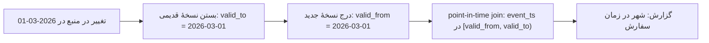

## 🎯 خلاصه

> **الگوی تاریخچه (history):** هر نسخهٔ یک رکورد را همراه با بازه‌ی زمانی‌ای نگه دار که آن نسخه معتبر بوده. این‌طوری می‌توانی درست جواب بدهی که «در لحظهٔ X وضعیت چه بود»، حتی بعد از اینکه داده تغییر کرده.

- بازنویسی یک سطر، تاریخچه را از بین می‌برد. به‌جایش نسخه‌ها را نگه دار.
- سه روش رایج داریم: **SCD2** (یک سطر برای هر نسخه با `valid_from` و `valid_to`)، **snapshot روزانه** (یک کپی کامل در هر روز)، و **time travel** جدول (موتور ذخیره‌سازی چند snapshot قدیمی را نگه می‌دارد).
- سختی اصلی ذخیرهٔ تاریخچه نیست. سختی **join** کردن فکت‌ها به نسخه‌ای است که در **زمان رویداد** معتبر بوده، نه نسخهٔ فعلی.

## 🌱 از ساده شروع کنیم (مبتدی)

> **💡 تشبیه:** کارنامهٔ مدرسه‌ات. فرض کن خانواده‌ات در سال ۱۴۰۳ به شهر دیگری رفته. اگر کسی بپرسد «وقتی سال ۱۴۰۲ ثبت‌نام کردی، در کدام منطقه بودی؟»، جواب آدرس قدیمی است، نه آدرس امروز. رکوردی که فقط آدرس امروز را دارد، به این سؤال جواب نمی‌دهد.

فرض کن یک فروشگاه آنلاین داریم. مشتری شمارهٔ ۴۲ در تبریز زندگی می‌کند. در تاریخ ۲۰۲۶-۰۳-۰۱ به شیراز می‌رود. جدول `customers` بازنویسی می‌شود:

```sql
-- UPDATE کلاسیک: تاریخچه از بین رفت
UPDATE customers SET city = 'Shiraz' WHERE customer_id = 42;
```

حالا سفارشی که در ۲۰۲۶-۰۲-۱۰ ثبت شده، شهر «شیراز» را نشان می‌دهد، در حالی که مشتری آن موقع در تبریز بوده. اگر گزارش «فروش به تفکیک شهر» داشته باشی، فروش بهمن تبریز اشتباه حساب می‌شود. به این خطا می‌گوییم **point-in-time correctness** و این خطا بی‌صدا است: اعداد معقول به نظر می‌رسند.

راه حل این است که مقدار قدیمی را هرگز از دست ندهی. ساده‌ترین شکل، یک جدول دوم با یک سطر برای هر نسخه است:

| customer_id | city | valid_from | valid_to |
|---|---|---|---|
| 42 | Tabriz | 2024-05-01 | 2026-03-01 |
| 42 | Shiraz | 2026-03-01 | 9999-12-31 |

حالا سؤال «مشتری ۴۲ در ۲۰۲۶-۰۲-۱۰ کجا بود؟» جواب واحدی دارد: سطری که بازه‌اش آن تاریخ را شامل می‌شود.

## 🔧 واقعاً چطور کار می‌کند (متوسط)

### گزینهٔ ۱: SCD Type 2 (بُعد با تغییر آهسته)

SCD2 برای هر نسخهٔ یک موجودیت یک سطر ذخیره می‌کند. هر سطر یک بازهٔ اعتبار و معمولاً یک فلگ `is_current` دارد. ستون‌های معمول عبارت‌اند از کلید surrogate (`customer_sk`)، کلید طبیعی (`customer_id`)، ویژگی‌های ردگیری‌شده، `valid_from`، `valid_to` (برای نسخهٔ فعلی یک مقدار باز-انتها) و `is_current`.

یک batch تغییر برای هر کلیدِ تغییرکرده دو کار می‌کند: نسخهٔ فعلی را **می‌بندد** و یک سطر جدید **درج** می‌کند.

```sql
-- staging_customer: آخرین وضعیت deduplicate‌شدهٔ منبع برای این batch
-- :change_ts زمانی است که تغییر در منبع رخ داده (نه زمان بارگذاری ما)

-- 1. بستن نسخهٔ فعلیِ هر مشتریِ تغییرکرده
UPDATE dim_customer
SET valid_to = :change_ts, is_current = FALSE
WHERE is_current
  AND customer_id IN (SELECT s.customer_id
                      FROM staging_customer s
                      JOIN dim_customer d
                        ON d.customer_id = s.customer_id AND d.is_current
                      WHERE s.city <> d.city);      -- فقط تغییرهای واقعی

-- 2. درج نسخه‌های جدید
INSERT INTO dim_customer (customer_id, city, valid_from, valid_to, is_current)
SELECT s.customer_id, s.city, :change_ts, DATE '9999-12-31', TRUE
FROM staging_customer s
JOIN dim_customer d ON d.customer_id = s.customer_id AND d.is_current
WHERE s.city <> d.city;
```

این مثال مشتری‌های کاملاً جدید را نادیده می‌گیرد (آن‌ها فقط به یک `INSERT` ساده نیاز دارند) و فرض می‌کند تغییر واقعی است. کد واقعی در production به‌جای مقایسهٔ ستون‌ها، **hash ستون‌های ردگیری‌شده** را مقایسه می‌کند تا برای به‌روزرسانی‌های بی‌اثر نسخهٔ جدید نسازد. اگر موتورت `MERGE` دارد، از آن استفاده کن؛ منطق همان می‌ماند.

### Point-in-time join

برای اینکه هر فکت به نسخهٔ درست وصل شود، join را روی **زمان رویداد** انجام بده که داخل بازهٔ اعتبار بیفتد:

```sql
SELECT o.order_id, o.order_ts, o.amount, c.city
FROM orders AS o
JOIN dim_customer AS c
  ON c.customer_id = o.customer_id
 AND o.order_ts >= c.valid_from
 AND o.order_ts <  c.valid_to;
```

دو جزئیات مهم است. کران پایین شامل است و کران بالا شامل نیست، پس تغییری که دقیقاً در `valid_to` رخ می‌دهد دو تطابق نمی‌سازد. و `valid_to` هرگز نباید `NULL` باشد، چون مقایسه با `NULL` بی‌صدا سطر را حذف می‌کند.

### گزینهٔ ۲: snapshot روزانه

هر روز کل بُعد (یا یک خلاصه از آن) را در جدولی با کلید `snapshot_date` کپی کن. کوئری‌ها ساده می‌شوند: `WHERE snapshot_date = '2026-02-10'`. هزینه‌اش فضای ذخیره است: ۱۰ میلیون مشتری × ۳۶۵ روز = ۳٫۶۵ میلیارد سطر در سال، حتی اگر تقریباً هیچ‌چیز تغییر نکرده باشد. snapshot برای جدول‌های کوچک، برای گزارش‌هایی که باید با یک «پایان روز» ثابت مطابقت داشته باشند، و وقتی منبع زمان تغییرات را نمی‌دهد، انتخاب درستی است.

### گزینهٔ ۳: time travel جدول

فرمت‌های جدول مثل Delta Lake و Apache Iceberg لاگی از snapshotها نگه می‌دارند. می‌توانی نسخهٔ قدیمی را با شناسه یا زمان بخوانی، مثلاً `SELECT * FROM sales TIMESTAMP AS OF '2026-02-10'` در Spark SQL؛ نحوهٔ دقیق بستگی به موتور و نسخه دارد. این برای **دیباگ**، بازتولید اجرای یک مدل، و برگرداندن یک بارگذاری بد عالی است. اما مدل تاریخچهٔ کسب‌وکار نیست: snapshotهای قدیمی با اجرای نگه‌داری retention یا expire-snapshot منقضی می‌شوند، و time travel نمی‌گوید در واقعیت کسب‌وکار چه بود اگر منبع مقدار اشتباهی فرستاده باشد که بعداً اصلاح شده.



## 🧠 عمق و trade-offها (سنیور)

- **زمان تغییر در برابر زمان بارگذاری.** `valid_from` باید زمانی باشد که تغییر در کسب‌وکار رخ داده، که معمولاً منبع آن را می‌دهد. اگر زمان بارگذاری را استفاده کنی، یک batch دیرهنگام تاریخچه را بازنویسی می‌کند: اصلاحی که دوشنبه می‌رسد برای تغییری از جمعه، باعث می‌شود سفارش‌های جمعه انگار آدرس قدیمی داشته‌اند. انتخابت را مشخص و مستند کن.
- **اصلاح‌های دیرهنگام.** وقتی تغییر قدیمی دیر می‌رسد، باید یک بازهٔ موجود را بشکنی و همهٔ فکت‌هایی را که در آن بازه افتاده‌اند دوباره وصل کنی. معمولاً یعنی اجرای مجدد پنجرهٔ تحت‌تأثیر، با همان نظم [[pattern-backfill]].
- **هزینهٔ range join.** شرط تساوی روی کلید به‌علاوهٔ شرط‌های بازه‌ای برای موتور سخت‌تر از یک equi-join ساده است. موتورها معمولاً هر دو طرف را بر اساس کلید مرتب می‌کنند و بازه‌ها را اسکن می‌کنند. بُعد را بر اساس کلید partition یا cluster کن و تعداد نسخه‌ها برای هر کلید را واقع‌بینانه نگه دار. مشتری‌ای با ۱۰٫۰۰۰ تغییر آدرس یک مسئلهٔ skew است.
- **دو کلید.** فکت‌ها باید به کلید surrogate نسخه (`customer_sk`) یا کلید طبیعی به‌علاوهٔ بازهٔ زمانی ارجاع بدهند. ارجاع فقط با کلید طبیعی، نسخهٔ فعلی را برمی‌گرداند، و این اشتباهی است که بیشترین باگ‌های point-in-time را می‌سازد.
- **کدام ویژگی‌ها تاریخچه می‌خواهند.** فقط چیزهایی را ردگیری کن که گزارش‌ها به تاریخچه‌شان نیاز دارند (segment، منطقه، دستهٔ مالیاتی)، نه همهٔ ستون‌ها. هر ستون ردگیری‌شده تعداد تغییرات جدول نسخه‌ها را بالا می‌برد.
- **نگه‌داری و قوانین حذف.** نگه‌داشتن کامل تاریخچه ممکن است با قوانین حذف داده تعارض داشته باشد. جدول‌های تاریخچه یکی از جاهایی‌اند که داده‌های شخصی بعد از درخواست حذف باقی می‌مانند. طراحی آن را در [[pattern-data-deletion]] ببین.
- **کی استفاده نکنی.** اگر همهٔ گزارش‌ها فقط مقدار فعلی را لازم دارند، SCD2 کار اضافه و باگ اضافه است. اگر جدول خیلی کوچک است، snapshot روزانه ساده‌تر و امن‌تر است. از time travel به‌تنهایی به‌عنوان تاریخچهٔ یک متریک کسب‌وکار استفاده نکن: پنجرهٔ retention در نهایت آن را پاک می‌کند.

## 🧪 امتحان کن

قیمت محصول ۷ این نسخه‌ها را دارد (`valid_from` شامل و `valid_to` غیرشامل):

| price | valid_from | valid_to |
|---|---|---|
| 100 | 2026-01-01 | 2026-02-01 |
| 120 | 2026-02-01 | 9999-12-31 |

و این فروش‌ها:

| sale_id | product_id | sale_ts |
|---|---|---|
| 1 | 7 | 2026-01-31 23:59 |
| 2 | 7 | 2026-02-01 00:00 |

۱. فروش ۱ کدام قیمت را می‌گیرد؟ فروش ۲ چطور؟
۲. join نقطهٔ زمانی‌ای بنویس که هر دو فروش را با قیمت درست برگرداند.
۳. اگر به‌اشتباه برای کران بالا `<=` بنویسی، چه تغییری می‌کند؟

<details>
<summary>حدس تو؟</summary>

۱. فروش ۱ قیمت ۱۰۰ را می‌گیرد. فروش ۲ قیمت ۱۲۰ را می‌گیرد، چون `2026-02-01 00:00` دقیقاً `valid_from` نسخهٔ جدید است و کران پایین شامل است.
۲. `JOIN prices p ON p.product_id = s.product_id AND s.sale_ts >= p.valid_from AND s.sale_ts < p.valid_to`.
۳. فروشی که دقیقاً در `2026-02-01 00:00` رخ داده هر دو سطر را تطبیق می‌دهد و در درآمد دو بار شمرده می‌شود. همه‌جا از بازهٔ نیمه‌باز `[valid_from, valid_to)` استفاده کن.

</details>

## 💬 گوشه‌ی مصاحبه

**سؤال معمول:** «ما درآمد را بر اساس segment مشتری گزارش می‌دهیم. تیم بازاریابی می‌گوید هر بار که ماه قبل را دوباره اجرا می‌کنیم اعداد عوض می‌شوند. دلیلش چیست و چطور درستش می‌کنی؟»

- **جواب مبتدی:** «جدول بازنویسی می‌شود. تاریخچه اضافه می‌کنم.»
- **جواب متوسط:** «join را به بُعد فعلی می‌زنیم، پس segmentها بازنویسی می‌شوند. یک بُعد SCD2 با بازهٔ اعتبار می‌سازم و فکت‌ها را روی زمان سفارش join می‌کنم.»
- **جواب سنیور:** «بازنویسی شدن از دو چیز می‌آید: join به نسخهٔ فعلی و استفاده از زمان بارگذاری به‌جای زمان تغییر. زمان تغییر را از منبع می‌گیرم، بُعد را SCD2 با تشخیص تغییر مبتنی بر hash می‌کنم و فکت‌ها را با بازه‌های نیمه‌باز روی زمان رویداد join می‌کنم. برای اصلاح‌های دیرهنگام، پنجرهٔ تحت‌تأثیر را با همان روش backfill دوباره اجرا می‌کنم و سیاست (زمان کسب‌وکار یا زمان بارگذاری) را در تعریف متریک می‌نویسم.»

> **🎤 این را در مصاحبه بگو:** «جدول تاریخچه جواب می‌دهد که "آن موقع چه درست بود". نسخه‌ها را با بازهٔ اعتبار ذخیره می‌کنم، فکت‌ها را روی زمان رویداد join می‌کنم و از بازهٔ نیمه‌باز استفاده می‌کنم تا ردیف‌های مرزی دو بار شمرده نشوند. برای دیباگ از snapshot جدول استفاده می‌کنم، ولی آن را تاریخچهٔ کسب‌وکار نمی‌دانم چون منقضی می‌شود.»

## ⚠️ اشتباهات رایج

- **join کردن فکت‌ها به `is_current`** برای گزارش‌های تاریخی. این وضعیت امروز را برای رویدادهای دیروز نشان می‌دهد.
- **استفاده از زمان بارگذاری به‌عنوان `valid_from`**. بارگذاری‌های دیرهنگام بی‌صدا تاریخچه را جابه‌جا می‌کنند.
- **بازهٔ بسته در هر دو سمت** (`BETWEEN`). رویدادهای مرزی با دو نسخه تطبیق می‌یابند و دو بار شمرده می‌شوند.
- **`valid_to` به‌صورت `NULL`** برای نسخهٔ باز. مقایسه با `NULL` بدون خطا سطر را حذف می‌کند.
- **ساختن نسخهٔ جدید در هر بارگذاری**، حتی وقتی چیزی تغییر نکرده. از hash ستون‌های ردگیری‌شده استفاده کن.
- **به‌عنوان audit log از time travel استفاده کردن.** snapshotها منقضی می‌شوند و داده‌ی اصلاح‌شدهٔ منبع وضعیت قبلی را جایگزین می‌کند.

## ✅ خودت را بسنج

۱. مشتری در ۲۰۲۶-۰۳-۰۱ شهر را عوض می‌کند. سفارشی در ۲۰۲۶-۰۳-۰۱ ساعت ۰۹:۰۰ ثبت می‌شود. اگر `valid_from` زمان تغییر باشد، سفارش به کدام نسخهٔ SCD2 باید وصل شود؟
   - A) نسخهٔ قدیمی، چون تغییر «همان روز» بوده و نه قبل‌تر
   - B) نسخهٔ جدید، چون `valid_from` شامل است و ساعت ۰۹:۰۰ بعد از `2026-03-01 00:00` است
   - C) هر دو نسخه، پس سفارش تقسیم می‌شود
   - D) به زمان بارگذاری بستگی دارد

   <details>
   <summary>پاسخ</summary>

   **B** — بازهٔ اعتبار `[valid_from, valid_to)` است. زمانی که بعد از شروع بازهٔ جدید باشد، متعلق به نسخهٔ جدید است. وصل کردن به هر دو نسخه باعث شمارش دوبارهٔ سفارش می‌شود.

   </details>

۲. کدام گزینهٔ ذخیره‌سازی برای نگه‌داشتن یک snapshot روزانه از یک جدول ۵ میلیون سطری به مدت ۹۰ روز ارزان‌تر است؟
   - A) SCD2 با ردگیری تغییرات
   - B) snapshotهای کامل روزانه
   - C) فقط time travel
   - D) یک materialized view از وضعیت فعلی

   <details>
   <summary>پاسخ</summary>

   **A** — SCD2 فقط سطرهای تغییرکرده را ذخیره می‌کند. snapshotهای کامل روزانه ۵ میلیون × ۹۰ = ۴۵۰ میلیون سطر می‌سازند، حتی اگر تقریباً چیزی تغییر نکرده باشد. time travel به retention بستگی دارد و materialized view از وضعیت فعلی تاریخچه‌ای ندارد.

   </details>

۳. *(trade-off)* اصلاحی برای تغییری که شش ماه پیش رخ داده امروز می‌رسد. چه باید کرد و چرا یک `UPDATE` ساده کافی نیست؟
   - A) هیچ؛ نسخهٔ فعلی همیشه درست است
   - B) بازه‌های نسخهٔ موجود را بشکن، سپس فکت‌های داخل بازهٔ اصلاح‌شده را دوباره وصل کن و مدل‌های پایین‌دستی آن پنجره را دوباره اجرا کن
   - C) اصلاح را با `valid_from = امروز` درج کن
   - D) جدول را پاک و دوباره بارگذاری کن

   <details>
   <summary>پاسخ</summary>

   **B** — یک `UPDATE` ساده فقط نسخه را عوض می‌کند، ولی هر فکت و هر aggregate که روی بازهٔ قدیمی ساخته شده حالا قدیمی است. درج با تاریخ امروز باعث می‌شود تاریخچه طوری به نظر برسد که اصلاح امروز رخ داده، و این همان اشتباه زمان بارگذاری است.

   </details>

۴. چرا فکت‌ها باید به کلید surrogate ارجاع بدهند و نه فقط کلید طبیعی؟
   - A) چون کوچک‌تر است
   - B) چون کلید طبیعی همهٔ نسخه‌ها را برمی‌گرداند و هیچ‌وقت مفید نیست
   - C) چون یک نسخهٔ مشخص را شناسایی می‌کند، پس فکت، نسخه‌ای را نگه می‌دارد که در زمان رویداد درست بود
   - D) چون کلیدهای طبیعی را نمی‌شود index کرد

   <details>
   <summary>پاسخ</summary>

   **C** — کلید surrogate به یک نسخهٔ مشخص اشاره می‌کند. کلید طبیعی به‌تنهایی به هر نسخه‌ای که فیلتر کنی join می‌شود و آسان است که نسخهٔ فعلی را به اشتباه انتخاب کنی.

   </details>

## 🗂️ فلش‌کارت

| Front | Back |
|---|---|
| Point-in-time correctness | هر فکت به نسخه‌ای وصل می‌شود که در زمان رویداد آن فکت معتبر بوده |
| SCD Type 2 | یک سطر برای هر نسخه با `valid_from`، `valid_to` و معمولاً `is_current` |
| بازهٔ نیمه‌باز | `[valid_from, valid_to)`: شروع شامل، پایان غیرشامل، تا مرزها دو بار تطبیق نیابند |
| Daily snapshot | کپی کامل جدول در هر روز؛ کوئری ساده، هزینهٔ ذخیره‌سازی بالا |
| Time travel | خواندن جدول به‌صورت snapshot قدیمی؛ برای دیباگ خوب، محدود به retention |
| زمان تغییر در برابر زمان بارگذاری | `valid_from` باید زمان تغییر کسب‌وکار باشد، نه زمان بارگذاری batch |
| Hash diff | hash ستون‌های ردگیری‌شده؛ نسخهٔ جدید فقط وقتی ساخته شود که hash عوض شده |
| Restatement | تغییر گزارش‌های قدیمی، چون تاریخچه بازنویسی یا به مقدار فعلی join شده |

## 🔗 ادامه

- [[dimensional-modeling]] برای جایگاه بُعدهای SCD2 در star schema.
- [[advanced-dimensions]] برای SCD نوع ۱ تا ۶ و trade-offهایشان.
- [[lakehouse-table-formats]] برای snapshot و time travel در Iceberg و Delta.
- [[pattern-backfill]] برای اجرای مجدد پنجره‌ها بعد از یک اصلاح دیرهنگام.
- [[pattern-reconciliation]] برای بررسی اینکه جدول تاریخچه با منبع مطابقت دارد.
